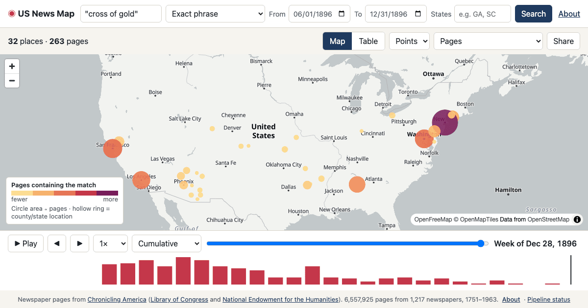
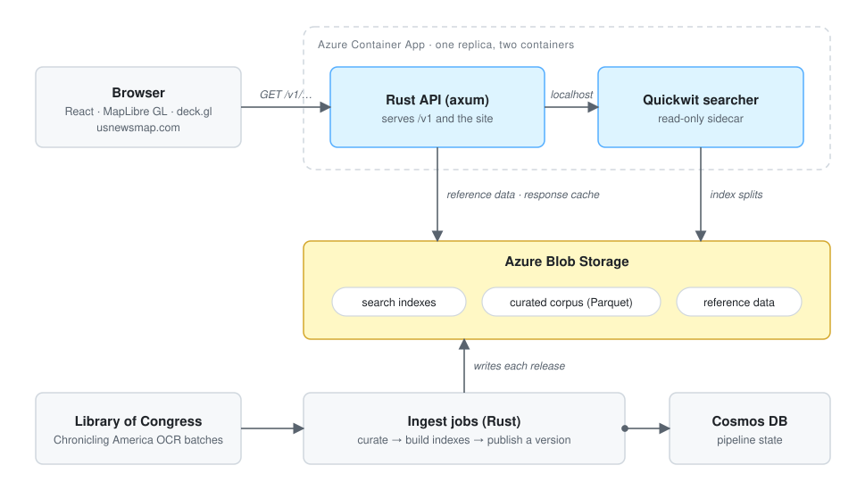

# US News Map

[](https://github.com/tgoodyear/usnewsmap.com/actions/workflows/ci.yml)
[](LICENSE)

**[usnewsmap.com](https://usnewsmap.com)** searches 23 million pages of historical American newspapers and maps every match by where and when it was printed. Play the timeline to watch a word, a name or a story spread across the country.

[](https://usnewsmap.com)

The pages come from [Chronicling America](https://www.loc.gov/collections/chronicling-america/), the Library of Congress and National Endowment for the Humanities collection of digitized newspapers, 1736–1963. This is a rebuild of the original US News Map (2015–2016, Georgia Tech Research Institute and eHistory.org at the University of Georgia), whose code is preserved at [`tgoodyear/usnewsmap`](https://github.com/tgoodyear/usnewsmap).

## Repository map

Each directory below, except `.github/`, has a README with the details.

| Path                  | What it is                                                                                                                                                              | Read next                                              |
| --------------------- | ----------------------------------------------------------------------------------------------------------------------------------------------------------------------- | ------------------------------------------------------ |
| `catalog/`            | The US place gazetteer and the hand-written place and title corrections that the ingest pipeline compiles in.                                                           | [catalog/README.md](catalog/README.md)                 |
| `contrib-compute/`    | The stock BOINC server the volunteer OCR pilot submits to: its server and bridge images, project files and docs, and the Azure Bicep it ran on before the move on-prem. | [contrib-compute/README.md](contrib-compute/README.md) |
| `crates/`             | The Rust workspace of 21 crates: the API, the ingest pipeline, the OCR pipeline and the BOINC bridge and apps.                                                          | [crates/README.md](crates/README.md)                   |
| `docker/`             | The Dockerfiles for the API, ingest, Japanese OCR and patched Quickwit images.                                                                                          | [docker/README.md](docker/README.md)                   |
| `docs/`               | The guides, design documents, architecture decision records, dated technical notes and reports.                                                                         | [docs/README.md](docs/README.md)                       |
| `fixtures/`           | The synthetic corpus for development and tests, and the recorded responses and ground-truth samples some tests read.                                                    | [fixtures/README.md](fixtures/README.md)               |
| `fuzz/`               | A standalone cargo-fuzz crate that fuzzes the parsers of untrusted OCR node output; it is outside the Cargo workspace.                                                  | [fuzz/README.md](fuzz/README.md)                       |
| `infra/`              | The Azure infrastructure in Bicep, the per-environment settings, the Quickwit configs and the monitoring workbooks.                                                     | [infra/README.md](infra/README.md)                     |
| `ja-ocr/`             | The Python job that reads Japanese pages the Library of Congress ships without text, the OCR quality audit that shares its image, and their tools (`tools/`).           | [ja-ocr/README.md](ja-ocr/README.md)                   |
| `ocr/`                | The OCR engine catalog and routes, the engine contract's schemas, the BOINC app definitions and the OCR benchmark data.                                                 | [ocr/README.md](ocr/README.md)                         |
| `ops/`                | The saved log queries, the build records of published index versions and the captures that compare versions.                                                            | [ops/README.md](ops/README.md)                         |
| `scripts/`            | The scripts, grouped by purpose: Azure environments, BOINC, generated data, index and version checks, local development, corpus data flow, OCR nodes and CI checks.     | [scripts/README.md](scripts/README.md)                 |
| `web/`                | The web app: React, MapLibre GL and deck.gl.                                                                                                                            | [web/README.md](web/README.md)                         |
| `.github/`            | The GitHub Actions workflows (CI is `ci.yml`), the actions they share and the Dependabot configuration.                                                                 | [.github/workflows/ci.yml](.github/workflows/ci.yml)   |
| `Cargo.toml`          | The Cargo workspace: its member crates, the shared dependency versions and the lint settings.                                                                           | [crates/README.md](crates/README.md)                   |
| `rust-toolchain.toml` | The Rust toolchain every build uses: stable, with rustfmt and Clippy.                                                                                                   | [rust-toolchain.toml](rust-toolchain.toml)             |
| `CONTRIBUTING.md`     | The checks to run before a pull request and the repository's rules.                                                                                                     | [CONTRIBUTING.md](CONTRIBUTING.md)                     |
| `SECURITY.md`         | How to report a vulnerability privately, and what is in scope.                                                                                                          | [SECURITY.md](SECURITY.md)                             |

## What it does

- Phrase, all-words, any-word and proximity search over the OCR text, with filters by date, state and language.
- Complete counts for every matching page, by place and time, in one cacheable response; playback and cumulative views run in the browser.
- A relative-rate view: how much more or less a place printed a term than its digitized pages predict.
- Snippets with a link to each page at the Library of Congress, a table view, keyboard playback, and a shareable URL for every search.
- A public JSON API under `/v1`, the same one the site uses ([design doc 06](docs/design/06-api-design.md)).

## How it's built

<picture>
  <source media="(prefers-color-scheme: dark)" srcset="docs/images/architecture-dark.svg">
  
</picture>

A Rust API ([axum](https://github.com/tokio-rs/axum)) and a [Quickwit](https://quickwit.io/) searcher run side by side in one Azure Container App, and the API also serves the site. A Rust ingest pipeline, run as Container Apps jobs, turns the Library of Congress's bulk OCR into curated Parquet on Blob Storage, builds the search indexes from it and publishes versioned snapshots. Everything is defined in Bicep, every service signs in with an Entra ID managed identity rather than a key, and there are no servers to maintain. The [architecture overview](docs/design/03-architecture-overview.md) has the details.

## Quick start

Needs a stable Rust toolchain (`rust-toolchain.toml`) and Node.js 24. No Azure account or newspaper data: the API serves a small synthetic corpus from `fixtures/`.

```sh
cargo run -p usnm-api                 # terminal 1: the API on http://localhost:8080
cd web && npm ci && npm run dev       # terminal 2: the site on http://localhost:5173
```

`cargo test --workspace` runs the unit and API tests against the same fixtures. The [development guide](docs/development.md) covers running against Quickwit, the ingest pipeline and the local Azure stand-ins.

## Repository layout

| Path        | What                                                                                                                                                                                                                   |
| ----------- | ---------------------------------------------------------------------------------------------------------------------------------------------------------------------------------------------------------------------- |
| `crates/`   | The Rust workspace: `usnm-core` (domain types and the query language), `usnm-search` (search backends), `usnm-store` (Blob Storage), `usnm-api` (the API, which also serves the site) and `usnm-ingest` (the pipeline) |
| `web/`      | The web app: React, MapLibre GL and deck.gl ([README](web/README.md))                                                                                                                                                  |
| `infra/`    | The Azure infrastructure in Bicep, one deployment stack per environment, and the Quickwit configs ([README](infra/README.md))                                                                                          |
| `ja-ocr/`   | The Japanese OCR job (Python, NDLOCR-Lite) and its tools                                                                                                                                                               |
| `docker/`   | The Dockerfiles for the API, ingest, Japanese OCR and patched Quickwit images; the build context is the repository root ([README](docker/README.md))                                                                   |
| `edge/`     | The Cloudflare fallback Worker that sends a request to Azure when the on-prem tunnel fails ([README](edge/fallback-worker/README.md))                                                                                  |
| `scripts/`  | Scripts grouped by purpose: stand an environment up, deploy and tear it down (`azure/`); BOINC; generated data; version checks and load tests (`ops/`); local Azure stand-ins; CI checks ([README](scripts/README.md)) |
| `fixtures/` | A small synthetic corpus for development and tests ([README](fixtures/README.md))                                                                                                                                      |
| `ops/`      | Saved log queries and the history of published index versions                                                                                                                                                          |
| `docs/`     | Guides, the design documents and the technical notes ([index](docs/README.md))                                                                                                                                         |

## Documentation

- [Development](docs/development.md): running and testing locally.
- [Configuration](docs/configuration.md): the API's settings.
- [Operations](docs/operations/README.md): running the ingest pipeline in Azure.
- [Infrastructure](infra/README.md): what the Bicep deploys and how to stand an environment up.
- [Design documents](docs/design/README.md) and [architecture decision records](docs/design/adr/README.md): what was built and why.
- [Technical notes](docs/notes/README.md): dated write-ups of work on the index, the OCR and the corpus's coverage, with the measurements behind each change.

## Contributing and security

See [CONTRIBUTING.md](CONTRIBUTING.md). To help make historical newspapers searchable by donating computer time, read [why volunteer and how to get started](docs/boinc-volunteer.md#why-volunteer). BOINC tasks transcribe pages and evaluate OCR quality; platform availability is limited during the pilot. To report a vulnerability, follow [SECURITY.md](SECURITY.md) and don't open a public issue.

## Credits

- Newspaper pages, OCR text and title records, the source of most place coordinates: [Chronicling America](https://www.loc.gov/collections/chronicling-america/), from the [National Digital Newspaper Program](https://www.loc.gov/ndnp/) of the National Endowment for the Humanities and the Library of Congress.
- The original US News Map (2016): [eHistory.org](https://ehistory.org/) at the University of Georgia (Claudio Saunt and Steve Berry) and the [Georgia Tech Research Institute](https://gtri.gatech.edu/) (Trevor Goodyear, David Ediger and Zach Suffern).
- Basemap: [OpenFreeMap](https://openfreemap.org/), with map data from [OpenStreetMap](https://www.openstreetmap.org/copyright) contributors.
- Built on [Quickwit](https://quickwit.io/), [MapLibre GL JS](https://maplibre.org/) and [deck.gl](https://deck.gl/).

## License

The code is released under the [MIT License](LICENSE). The newspaper content belongs to its sources: see the Library of Congress's [rights and access statement](https://www.loc.gov/collections/chronicling-america/about-this-collection/rights-and-access/) for Chronicling America.
