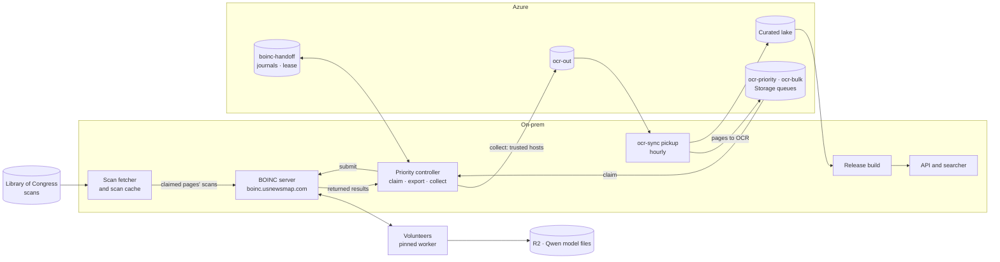

# Boundaries and monitoring

Part of the [BOINC batch pilot guide](README.md).

## Live feed health (#1441)

`boinc/scripts/feed_collect.py` gathers observations from each source host and `boinc/scripts/feed_status.py --config … --state-dir …` evaluates them. Both only observe: neither admits, prepares, submits, renews `ENABLED_UNTIL`, changes budgets or schedules work. Temporal still owns prepare and ship. The old explicit-value CLI is kept as an offline diagnostic.

### Sources

| Source       | Reads                                                                                                                                                                                                                                                                                                                                                                                                                                                                                                                                                                                             |
| ------------ | ------------------------------------------------------------------------------------------------------------------------------------------------------------------------------------------------------------------------------------------------------------------------------------------------------------------------------------------------------------------------------------------------------------------------------------------------------------------------------------------------------------------------------------------------------------------------------------------------- |
| `server`     | The BOINC database in one read-only transaction (2 s statement limit, 8,000 rows, 8 MiB), the live `plan_class_spec.xml` and the cohort's `ENABLED_UNTIL` env file. `--container` runs the PHP config check and the queries inside the running server container. It exports inventory only, never config XML or credentials                                                                                                                                                                                                                                                                       |
| `client`     | Loopback GUI RPC on a project-owned client: CPU preferences, suspend and no-work flags, GPUs, queued tasks, installed app versions and disk allowance. Never install it on volunteers                                                                                                                                                                                                                                                                                                                                                                                                             |
| `controller` | The OCR priority controller's journal and `systemctl show`, for completed and running ticks. Durations use `CLOCK_MONOTONIC`. A failed tick's error is kept only as a fixed class (`reason`) with `same_error_in_a_row`; its text never leaves the host. It also reports the controller's own signals (#1698): the largest share of each lifetime cap from `boinc_batch_cap_warning`, the live plans' `ownership_conflicts`, when a live plan last published, and the p90 of the last hour's tick durations. Don't point it at a long-running Temporal worker: service uptime isn't tick duration |
| `backlog`    | The dashboard's queue metrics for `ocr-priority` and `ocr-bulk`, the Qwen source requests and their `.progress` receipts, the campaign's `c*/READY` markers and, optionally, the selector's `selected.jsonl`. Only a fresh selection proves an empty backlog; fresh request receipts with pending pages, or `READY` chunks in the outbox, prove an open one. The monitor never runs preparation, so keep the source inspector's observations fresh                                                                                                                                                |

Sources are polled every minute with a 180-second evidence budget. Health output carries no credentials, error transcripts, network names or page text. A source error replaces its last success, and a truncated or malformed HTTP reply makes only that source unknown (`http_protocol_error`). The dashboard takes pushes only from each source's allowlisted address on its private listener, and never serves them back.

### What the supply checks model

CPU supply is the `usnm_ocr` CPU lane and GPU supply the `usnm_qwen` GPU lane. Both are modeled candidates; the scheduler may still not dispatch them. `eligible_results` keeps its name but means supply within this model, and `idle_slots` means resource-eligible own slots.

The model checks platform and installed versions, the account's app selection and resource flags, workunit and batch limits, memory, disk and devices, and prior host participation. One unsent replica fills one slot, and two replicas of a unit can't share a host. Assigned and homogeneous-redundancy work is excluded. CPU, RAM and disk budgets per host are shared between the two lanes, and queued tasks reserve theirs first, from the workunit's resource record or else the app version's, as [BOINC does](https://github.com/BOINC/boinc/blob/22bbebe08e2eaac5d5e88a6d93b88e800cb6341c/client/result.h).

The policy is validated before any stock is counted, so an empty stock can't hide an unsupported gate. Anything the model can't settle is unknown with a reason, never healthy and never a shortage:

- unsupported plan or account gates, non-preferred-app fallback, unknown or mixed profiles, a live `ngpus` or CPU demand that differs from the installed profile, or oversized inventories;
- a live plan with no `gpu_type`, which the scheduler treats as [CPU-only](https://github.com/BOINC/boinc/blob/22bbebe08e2eaac5d5e88a6d93b88e800cb6341c/sched/plan_class_spec.cpp) (`live_resource_type_mismatch`);
- an OpenCL plan without `have_opencl` or OpenCL memory evidence (`opencl_*_unavailable`), matching the [scheduler](https://github.com/BOINC/boinc/blob/22bbebe08e2eaac5d5e88a6d93b88e800cb6341c/sched/plan_class_spec.cpp);
- GPU memory per task (`gpu_ram_used_mb`, else `min_gpu_ram_mb`) that needs placing across several physical GPUs or on an already occupied one (`gpu_memory_packing`);
- invalid queued-task reservations (`task_resource_usage_unavailable`);
- missing host CPU capacity, performance-derived GPU CPU demand or an unmodeled memory-scaling policy (CPU demand is the live `avg_ncpus`, or `max_threads` capped by the host's CPUs);
- a CPU and GPU match that can't both fit, or shared headroom that isn't proven (`shared_capacity_unproven`);
- more than 100,000 edges or slots per resource, or 1,000,000 comparisons. Other caps: 32 clients, 256 versions or plans, 8 GPU types, 1,024 slots per host or device.

**Started tasks** keep the resource usage they started with, and GUI RPC shows only a rounded string for them. The client source keeps a per-session record, `<name>.session.json`, and follows the client's message log. A session is trusted if the log still starts at its first message and every `app_config.xml` is older than the start. A "Re-reading" line, a gap in the log or a change to those files ends trust for the session. Untrusted started tasks, and any other project's, make the source `active_task_resource_usage_unavailable`, and both stock checks unknown, until they end or the client restarts. The log holds about 2,000 messages, so a client that ran before its source was installed needs one restart.

**Paused clients** (suspended, no new work, or project suspended) report `paused: true` with no idle capacity, so they can't cause a shortage. A GPU suspend reason zeroes only the GPUs.

The model doesn't see custom scheduler hooks, per-user restrictions, daily quotas, in-progress limits, work-fetch backoff, resource share, deadline feasibility or reliability rules. It also doesn't prove a driver or container can run a task.

### Timing and alert conditions

The evaluator writes `feed-health.json` and `feed-health.prom` atomically, logs one Syslog JSON line, then commits `duration.json` under one lock, so a failed publication can repeat an alert but never lose one. Process restarts keep durations. A reboot, a config change, a clock step or a gap over 180 seconds resets them.

| Condition                                                      | Fires                                                                                                                                                                                                                                                                                                                                                                                                                                                                                                                                                                                                                                              |
| -------------------------------------------------------------- | -------------------------------------------------------------------------------------------------------------------------------------------------------------------------------------------------------------------------------------------------------------------------------------------------------------------------------------------------------------------------------------------------------------------------------------------------------------------------------------------------------------------------------------------------------------------------------------------------------------------------------------------------- |
| `collection` (an unknown check, an unreadable source, a reset) | After 180 s of it (`COLLECTION_HOLD_S`), timed across resets on the monotonic clock, so one failed source run sends nothing                                                                                                                                                                                                                                                                                                                                                                                                                                                                                                                        |
| Shortage                                                       | After 30 minutes of a modeled shortage                                                                                                                                                                                                                                                                                                                                                                                                                                                                                                                                                                                                             |
| No work                                                        | After an hour with open backlog and no new workunit                                                                                                                                                                                                                                                                                                                                                                                                                                                                                                                                                                                                |
| Refill window ending (≤ 6 h left) or expired                   | At once                                                                                                                                                                                                                                                                                                                                                                                                                                                                                                                                                                                                                                            |
| Controller tick failed or ran over 15 minutes                  | On the second such run in a row (#1659): the collector counts failed or slow runs since the last good one, with systemd unit and start-job failures, within the two-hour, 2,000-record journal window, and a good tick resets the count. A tick that finishes over 15 minutes counts as one of the two. A new maintenance-unit failure (kept in the durable `maintenance_failure_at` watermark) or a tick still running past 30 minutes (`TICK_HANG_S`) fires at once; one still running between 15 and 30 minutes waits (#1698). The check carries the newest failure's class as `reason` (below), `same_error_in_a_row`, and `sticky` from three |
| Controller cap at 85% (`controller_cap`, opt-in)               | At once, for the cap nearest its limit (`cap`, `percent`), from the largest `boinc_batch_cap_warning` in the two-hour window, so it clears up to two hours after the history is archived                                                                                                                                                                                                                                                                                                                                                                                                                                                           |
| Ownership conflict (`ownership_conflict`, opt-in)              | At once, while the latest tick of a live (not draining) plan reports `ownership_conflicts` above 0                                                                                                                                                                                                                                                                                                                                                                                                                                                                                                                                                 |
| No publication (`controller_progress`, opt-in)                 | At once, when no live plan published a page for two hours while the latest live tick has pending or uncollected work. Waits for a rotation window to end. A journal window that starts later than 1 h 45 min ago (a new controller, a full journal) proves nothing and stays healthy                                                                                                                                                                                                                                                                                                                                                               |
| Slow tick trend (`tick_trend`, opt-in)                         | After an hour of the p90 of the last hour's tick durations over 630 s (70% of the 15-minute limit), an early warning before ticks fail                                                                                                                                                                                                                                                                                                                                                                                                                                                                                                             |

The alert rule keeps every firing check, and every unknown one from an evaluation whose `collection` was firing, for ten minutes, so a five-minute evaluation doesn't miss a short failure and an unknown check doesn't flap.

**Failure reason (#1698).** The collector maps the newest failure's `boinc_batch_failure.error` to one class with a fixed table (`FAILURE_CLASSES` in `feed_collect.py`): `ownership_conflict`, `cap_reached` (dispatch inventory limit, too many claimed pages, spool entries), `handoff_failed` (hand-off storage), `step_failed` (a bridge or hand-off step), `status_fetch`, `lock_busy`, `held_result`, `uncertain_submission`, `terminal_failure`, or `other`. `same_error_in_a_row` counts the failed runs, newest first, with the same error (numbers and ids masked) until another error; a slow run without an error is skipped. Three in a row is `sticky`: a stuck record or a full cap that the next tick won't clear. The evaluator accepts only a listed class, so error text can't reach the health output.

**One alert per cause (#1698).** An unknown check carries `cause`, the source it waits on that is down: `source:server` (the refill window, both no-work and both shortage checks, `feeder_allocation`), `source:controller` (`controller_tick` and the controller signal checks), `source:backlog` (both no-work checks, except `usnm_qwen_no_work` under `qwen_admission`) or `source:clients` (both shortage checks, also with no own clients configured). The alert raises one row per cause instead of one per check. `collection` carries `uncovered`, what it counts that no cause names (a model error such as `gpu_memory_packing`, a reset), and alerts only while that is above 0. After a healthy evaluation its 180-second hold runs down at half the rate it builds instead of clearing, so a source down two minutes in three still fires and a single failed read never does.

**Rotation window (#1687).** A planned plan rotation onto a new app version stops the controller and leaves the queue empty for a while. `feed_status.py --rotation-start --state-dir DIR --minutes N --reason TEXT` (N at most 240) writes `rotation.json` in the evaluator's state directory. Until it ends, `cpu_shortage` and `usnm_ocr_no_work` stay pending (the check carries `rotation_until`) and fire at its end if still true, and a missing controller tick doesn't count towards `collection`. Every other check, and a controller tick that fails, fires as usual. `--rotation-end --state-dir DIR` closes it early; an expired or malformed file is ignored. The order a rotation follows is in [boinc-ocr-bundles.md](../../docs/boinc-ocr-bundles.md#rotating-a-plan-onto-a-new-worker-version).

The supply model loads app versions as the feeder does: the version installed on a host stands for its platform and plan class, so a host whose only installed version is older than the one published still counts, for the version the scheduler would send it.

The source units have a 75-second start timeout, the evaluator 90 seconds, both with 256 MiB of memory. The command reader kills its whole process group on timeout, overflow, failure and success, but killing a local Podman CLI doesn't cancel an exec or query already running in the container.

### Optional checks

**Feeder allocation (#1462).** With `--feeder-guard`, the server source runs the image's read-only [`feeder-slot-guard.py`](../../boinc/images/server/feeder-slot-guard.py) as `boincadm` and reports `feeder_allocation`. Its exit codes 1 (`drift`) and 2 (`unknown`) are reports; a missing guard, another exit code, a timeout or bad output is `guard_unavailable` and leaves the rest of the server source intact. With `"feeder_allocation": true` in the evaluator config, it becomes an eighth check: `match` is healthy, and `drift` fires once the same reason and app IDs hold for 600 s (`FEEDER_DRIFT_HOLD_S`), the first condition for a [refresh](feeder-refresh.md#when-a-refresh-is-warranted). `maintenance`, `unknown` and an unavailable guard (`guard_unavailable`) make it unknown. Without `--feeder-guard` it is `not_reported`, and with the server source down `server_unavailable`. It only prompts the runbook; nothing here restarts the feeder. Deploy a dashboard that accepts eight checks first (an older one rejects the contract and shows the panel as unavailable), then add the flag, check `server.json` has a `feeder_allocation` object, and then set the key. The guard adds at most 15 s to the server source.

**Qwen admissions (#1441).** `usnm-qwen-cohort-auto.service` admits existing audited units rather than creating workunits, so a new workunit is the wrong signal. With `--cohort-unit usnm-qwen-cohort-auto.service` the server source reports a `cohort` record (or `cohort_unavailable`) from that unit's journal: runs, failure streak, the last report and `admissible_backlog` over 30 minutes. A report without the admitted count and budget is skipped, and a run that finds the step lock busy exits 75 and reports nothing. With `"qwen_admission": true`, `usnm_qwen_no_work` uses it:

- **fires at once** when the timer is inactive (`cohort_timer_inactive`), three runs in a row failed (`cohort_run_failed`), no run succeeded for 15 minutes (`cohort_stalled`), or none reported for 30 (`cohort_no_report`);
- **fires after an hour without an admission** when the window is open (`ENABLED_UNTIL` ahead, budget left, not closed) with backlog, every host is below its in-flight buffer and nothing is unsent;
- is **unknown** without a cohort record, with the server source down, or with an incomplete report (`cohort_report_incomplete`), and healthy otherwise.

To turn it on, add `--cohort-unit`, confirm `server.json` has a `cohort` object, then set the key.

**Controller signals (#1698).** With `"controller_signals": true` in the evaluator config, the evaluator adds `controller_cap`, `ownership_conflict`, `controller_progress` and `tick_trend` from the controller source's signals (conditions above). A collector from before #1698 doesn't send them, and the checks are unknown with `not_reported`; with the controller source down they wait on `source:controller`. The failure reason on `controller_tick` and the cause tags need no key: an older dashboard ignores the fields. Roll out in this order, as for `feeder_allocation`:

1. Deploy a dashboard that accepts the four checks (`OPTIONAL_CHECKS` in `crates/usnm-ocr-dash/src/feed.rs`). An older one rejects the contract and shows the panel as unavailable.
2. Update the evaluator host through the feed-monitor updater. The new evaluator reads an older collector's documents (no reason, signals `not_reported`) and starts tagging causes.
3. Update the controller source host the same way. An older evaluator would ignore the new fields, but the new one validates them.
4. Check `controller.json` has `reason`, `caps` and `progress` in its `tick`, then set the key in the evaluator config. That resets the durations once.
5. Provision the condition rule (`infra/modules/boinc-feed-alerts.bicep`) with `provision.sh`. It reads `cause`, `reason` and `uncovered`; a line without `uncovered` alerts on `collection` as before.

### Outputs

`feed-health.prom` has one-hot `boinc_feed_check{check,state}` gauges (`healthy`, `pending`, `firing`, `unknown`), their durations and `boinc_feed_observed_at_seconds`. The dashboard reads `feed-health.json` through `USNM_OCRDASH_FEED_HEALTH`, shows the checks under **BOINC feed / stale data**, includes them in `/api/view.json`, and treats evidence older than 180 s as unknown.

### Installing

Take addresses and paths from the private deployment inventory. Client sources go only on the project's own hosts (1, 2, 9, 10 and 12 today), never on volunteer hosts such as 5 and 13. Keep configs and `feed-sources/` private (0750/0640) with a shared monitoring group or read ACL: the evaluator reads `feed-sources/`, and the dashboard reads the evaluator's output.

On each source host, from a reviewed checkout, install the scripts with the updater, which keeps `/opt/usnm-feed-monitor/` on the bundle CI attests from `main` ([feed-monitor/README.md](../scripts/onprem/feed-monitor/README.md): install, rollback, pinning). Don't copy the scripts by hand; a host on hand-copied files drifts from `main`. Then install the units:

```sh
sudo boinc/scripts/onprem/feed-monitor/install.sh
sudo install -m 0644 boinc/scripts/onprem/usnm-boinc-feed-source@.{service,timer} /etc/systemd/system/
sudo install -d -m 0750 /etc/usnm-boinc
```

Create a private `/etc/usnm-boinc/feed-source-<name>.env` per source:

```sh
# Source-host examples; replace bracketed values from the private inventory.
SOURCE_ARGS="server --project [host-project-path] --window-env /etc/usnm-boinc/qwen-cohort-auto.env --container usnm-boinc-server --container-project /project/usnmocr"
# Optional feeder allocation check (#1462), after a server image that ships the guard:
# append --feeder-guard /usr/local/lib/usnm-boinc/feeder-slot-guard.py to the server SOURCE_ARGS.
PUSH_URL="http://[existing-dashboard]/api/feed-source/server"
# controller: SOURCE_ARGS="controller --unit usnm-boinc-priority-controller.service --maintenance-unit usnm-boinc-held-archive.service"
# (--maintenance-unit, #835: the daily held-page archive pauses the controller; its failures fire `controller_tick` at once.)
# backlog: SOURCE_ARGS="backlog --dashboard https://[dashboard-name]/api/view.json --requests [qwen-state]/requests --outbox [outbox]/[qwen-campaign] --selection [read-only-selected.jsonl]"
# each own client: SOURCE_ARGS="client --data-dir [existing-boinc-data-dir]"
# Its PUSH_URL ends in /controller, /backlog, or /client-<inventory-name>.
```

The backlog source reads `view.json` over HTTPS, because the plain listener only redirects and the collector refuses redirects; pushes still use the plain listener. With no Qwen source requests, `--requests` can be an empty directory.

**The server source only** needs the Podman drop-in, because Podman writes metadata and locks even for a read-only `exec`. Check the host's paths, install it, and confirm `DropInPaths` lists it, `ProtectSystem=strict` holds and `ReadWritePaths` has `/var/lib/containers/storage`, `/run/containers/storage` and `/run/libpod`. Storage paths alone fail on `alive.lck`. On a host with other paths, change only this instance's allowlist, never the template or a parent directory, and don't install it for other sources.

```sh
sudo podman info --format 'graphroot={{.Store.GraphRoot}} runroot={{.Store.RunRoot}}'
sudo install -d -m 0755 /etc/systemd/system/usnm-boinc-feed-source@server.service.d
sudo install -m 0644 boinc/scripts/onprem/usnm-boinc-feed-source@server.service.d/podman.conf \
  /etc/systemd/system/usnm-boinc-feed-source@server.service.d/podman.conf
sudo systemctl daemon-reload
sudo systemctl show usnm-boinc-feed-source@server.service \
  -p DropInPaths -p ProtectSystem -p ReadWritePaths
```

On the dashboard, set `USNM_OCRDASH_FEED_PUSH` to `server=[address],controller=[address],backlog=[address],client-[name]=[address]`; one source per own client, and the addresses must also pass its `--allow`. On macOS clients, run the same client command every minute through the host's observation runner.

On the evaluator host, run `install.sh` as above, create the `usnm-feed-monitor` system account, and write `/etc/usnm-boinc/feed-monitor.json`:

```json
{
  "server": "/var/lib/usnm-ocrdash/feed-sources/server.json",
  "controller": "/var/lib/usnm-ocrdash/feed-sources/controller.json",
  "backlog": null,
  "clients": []
}
```

Without a backlog source both no-work checks are unknown (`not_configured`); without own clients both shortage checks are (`no_own_clients_configured`). Set `backlog` to `/var/lib/usnm-ocrdash/feed-sources/backlog.json` once it publishes. Add a client only after `jq .host_id` on its published file shows the project-owned host the inventory names, then list it as `{"location": "/var/lib/usnm-ocrdash/feed-sources/client-<name>.json", "host_id": <id>}`. A client that later reports another host is `host_binding_mismatch`. Locations and host IDs must be distinct; a plain path without `host_id` is still accepted. Each change to this file resets the durations.

Set `USNM_OCRDASH_FEED_HEALTH=/var/lib/usnm-boinc-feed-health/feed-health.json`, then:

```sh
sudo install -m 0644 boinc/scripts/onprem/usnm-boinc-feed-health.{service,timer} /etc/systemd/system/
sudo systemctl daemon-reload
# On each source host, substitute the configured source name:
# The Podman source must use NAME=server to select the server-only drop-in.
sudo systemctl start usnm-boinc-feed-source@NAME.service
sudo systemctl enable --now usnm-boinc-feed-source@NAME.timer
# On the evaluator only:
sudo systemctl start usnm-boinc-feed-health.service
sudo systemctl enable --now usnm-boinc-feed-health.timer
sudo journalctl -u usnm-boinc-feed-health.service -n 2 --no-pager
```

Check that every source is `fresh`, the idle capacities match the clients, the second tick has no reset warning and the dashboard agrees.

### Existing alert route and deployment gate

Alerts use the main environment's one action group (`infra/modules/monitoring.bicep`, emailing `USNM_ALERT_EMAILS`). Don't add another route or change the OCR workspace's daily cap.

1. `usnm-boinc-feed-health.service` logs one JSON line a minute to `local0.info` as `usnm-boinc-feed-health` (about 1.8 KB).
2. `usnm-boinc-feed-dcr-<env>`, associated only with the evaluator's Arc machine, sends `local0` to `usnm-ocr-log-<env>` and drops every other line: about 2.6 MB a day. Don't use the nodes' rule, which would add 20 to 45 MB a day of counters against the workspace's 0.1 GB cap.
3. Two scheduled-query rules in `infra/modules/boinc-feed-alerts.bicep` run every five minutes on that machine's rows and email through the action group, one alert per `Check`:
   - `usnm-boinc-feed-condition-alert-<env>`: a check firing in any line of the last ten minutes. An unknown check counts only from a line whose `collection` was firing, as `Check=<cause>` (`source:server` and so on) when it has one, so one dead source is one alert. `collection` itself alerts only while it counts something no cause names (`uncovered`). A firing `controller_tick` with a failure class is `Check=controller_tick:<reason>`, so the email names the cause; every other check keeps its plain code. A separate `Reason` dimension would split every check's alert identity, since Azure keys an alert on all its dimensions, so the reason goes into `Check` for that one check only. A `boinc_feed_delivery_test` line fires it with `Check=delivery_test`.
   - `usnm-boinc-feed-missing-alert-<env>`: no health line in five minutes (`Check=collector_heartbeat`): the evaluator, its timer, the host, the agent or the association stopped, or the workspace hit its cap.

Azure sends one email when a check starts firing and a resolved email about 30 minutes after it clears.

`main.bicep` deploys these with `USNM_BOINC_FEED_ALERTS=true`, `USNM_OCR_NODES`, alert emails and the private `USNM_BOINC_FEED_MACHINE`; change them through `provision.sh`. Turn them on only once the panel shows every source, since anything firing or unknown emails at once; with the backlog or own-client sources missing, `collection` fires.

**The evaluator host** is an Arc machine named `usnm-<role>-arcs-<env>` (ADR-0017), connected without `scripts/ocr-node/onboard.sh` and with no role assignment. Its extension allow list holds only `Microsoft.Azure.Monitor/AzureMonitorLinuxAgent`, installed with automatic upgrades (`az rest --method put` on the machine's `extensions/AzureMonitorLinuxAgent`, as `onboard.sh` does for a node). It needs rsyslog, receiving the journal's syslog, and `sudo`; a minimal Debian container may have neither. In an unprivileged LXC container the agent's installer fails with exit code 52 because `dmidecode` can't read DMI; put a wrapper at `/usr/local/sbin/dmidecode` that runs `/usr/sbin/dmidecode` with its errors dropped, then reinstall. The agent wants 700 MB free under `/var/opt` and 500 MB each under `/etc/opt` and `/opt`. Only the evaluator may log to `local0`:

```sh
journalctl SYSLOG_FACILITY=16 --since -1h -o json | jq -r .SYSLOG_IDENTIFIER | sort | uniq -c
```

**Deploy:**

```sh
scripts/azure/settings.sh --env prod --key USNM_BOINC_FEED_MACHINE --value '<Arc machine name>'
# Set "USNM_BOINC_FEED_ALERTS": true in infra/env/prod.json through a PR, then:
scripts/azure/provision.sh --env prod --what-if   # one DCR and two scheduled-query rules
scripts/azure/provision.sh --env prod
DCR_ID=$(scripts/azure/settings.sh --env prod --key BOINC_FEED_DCR_ID)
MACHINE=/subscriptions/<subscription>/resourceGroups/<resource group>/providers/Microsoft.HybridCompute/machines/<Arc machine name>
az rest --method put \
  --url "https://management.azure.com$MACHINE/providers/Microsoft.Insights/dataCollectionRuleAssociations/${DCR_ID##*/}?api-version=2022-06-01" \
  --body "{\"properties\": {\"dataCollectionRuleId\": \"$DCR_ID\", \"description\": \"usnewsmap BOINC feed evaluator (#1441)\"}}" \
  -o none
```

Expect one `collector_heartbeat` email and its resolution before the first lines arrive. After about ten minutes, `scripts/azure/logs.sh --env prod --query-name ocr-node-boinc-feed --span 1h` should show `boinc_feed_health` lines about once a minute. No rows means the association, the agent or rsyslog is missing; the agent logs under `/var/opt/microsoft/azuremonitoragent/log/`.

**End-to-end check.** On the evaluator, log a synthetic line; it touches no state:

```sh
logger --priority local0.info --tag usnm-boinc-feed-health \
  "$(python3 /opt/usnm-feed-monitor/feed_status.py --delivery-test)"
```

A `boinc_feed_delivery_test` row should appear in `ocr-node-boinc-feed`, then within 5 to 15 minutes an email from `usnm-boinc-feed-condition-alert-prod` with `Check=delivery_test`, and a resolved email about 30 minutes later. A row with no email points at the rule's history and the action group.

**Rollback.** Disable the two rules to silence them; the next provision re-enables them. To remove them, delete the association first (Azure won't delete a rule that is still associated), then set `USNM_BOINC_FEED_ALERTS` to `false` through a PR and provision:

```sh
az rest --method delete \
  --url "https://management.azure.com$MACHINE/providers/Microsoft.Insights/dataCollectionRuleAssociations/${DCR_ID##*/}?api-version=2022-06-01"
```

Never restart a retired feed timer as a rollback.

**Tests:** `python3 -m unittest boinc/scripts/test_feed_status.py boinc/scripts/test_feed_collect.py` and `CARGO_BUILD_JOBS=2 cargo test -p usnm-ocr-dash --lib`. For the Bicep, `scripts/ci/lint-bicep.sh`, `scripts/ci/build-bicep.sh` and `python3 scripts/ci/check-names.py`. To run the Python tests against a real dashboard process, build it with `CARGO_BUILD_JOBS=2 cargo build -p usnm-ocr-dash --bin usnm-ocrdash` and set `USNM_FEED_DASH_BINARY="$PWD/target/debug/usnm-ocrdash"`.

## Public dataset-page counts

The public `/datasets` page reads `https://boinc.usnewsmap.com/work_summary.php`, a credential-free, CORS-enabled endpoint that caches an aggregate query for two minutes. It gives each app's tasks ready to send, in progress, and completed with BOINC validation; errors return 503, never zeros, and the page marks counts older than ten minutes as out of date.

These are retained task records, not lifetime totals or unique pages. Completed records are purged after 30 days, replicas and retries count separately, and BOINC validation doesn't mean the OCR was accepted or published. The server entrypoint installs the endpoint, so roll out the server image before the frontend, after comparing the live image's source revision with `main`.

## Workbook query validation

The BOINC workbook and its workspace belong to the Azure-hosted server and are deleted with `"server": "onprem"`, so this applies only to `"server": "azure"`.

`python3 boinc/scripts/validate-boinc-workbook.py --workspace <customer-GUID>` runs a positive control and the workbook's nine queries (seven days, one-hour grain) and reports each panel's status, row count and query hash, with no raw log text. It uses your Azure CLI sign-in, or `--identity arc` on an Arc host whose identity has workspace Reader. `--subscription <id>` picks the account. For the BOINC workspace pass `--location westus2`; Arc-only hosts must pass the location or host.

The shared client, `scripts/azure/log_analytics.py`, queries `https://<region>.api.loganalytics.io/v1/workspaces/<customer-GUID>/query`. In October 2026 some Azure frontends refused the BOINC workspace while serving others (#528), so it tries hosts in order: the workspace region, westus, eastus, northcentralus, westcentralus, then `api.loganalytics.io`. `--hosts` or `LOG_ANALYTICS_QUERY_HOSTS` replaces the order; `--host` or `LOG_ANALYTICS_QUERY_HOST` sets only the first, and `--location` or `LOG_ANALYTICS_WORKSPACE_LOCATION` the region. Only `.io` API hosts are accepted. A 403 `InsufficientAccessError`, 429, 5xx or connection failure moves to the next host; it makes at most one more pass after 3 to 6 s, within 90 s. Other errors and partial results fail. The receipt goes to a private `.boinc-work-*` directory in the checkout; delete it after reading. The BOINC post-deploy health step runs this as a warning-level check.

## Pipeline

The OCR and search pipeline with BOINC, as it has run since 6 November 2026:



The controller pushes each claimed page's scan straight to the BOINC host, so no scan goes through Azure (#1116; [batch scheduler](../../docs/boinc-batch-scheduler.md)). `collect` publishes a trusted host's result to `ocr-out` and deletes its queue message, and holds an untrusted host's result in quarantine. The hand-off state in `boinc-handoff` is moving to the BOINC host ([#1367](https://github.com/tgoodyear/usnewsmap.com/issues/1367); [local hand-off journals](../../docs/boinc-onprem.md#local-handoff-journals)).

## Boundaries

- **Platforms:** `x86_64-pc-linux-gnu`, `aarch64-unknown-linux-gnu`, `arm64-apple-darwin`, `x86_64-apple-darwin` and `windows_x86_64` (`boinc/project/project.xml`, #533).
- **Container apps** (`usnm_ocr`, `usnm_gold` and container versions of `usnm_quality` and `usnm_qwen`; `usnm_assess` and `usnm_surya` retired on 2 November 2026) run under BOINC's `docker_wrapper` with plan classes `docker`, `docker_mt` and `docker_nvidia_cuda`: Docker or Podman on Linux, Podman through `Run_Podman` on macOS (with the quoting fix in `boinc/scripts/patch-mac-wrapper.py`), and the WSL2 `boinc-buda-runner` on Windows. The task's container runs Tesseract directly, with no nested container daemon. The [volunteer guide](../../docs/boinc-volunteer.md) has the rootless Podman profile and the startup preflight, `boinc/scripts/volunteer_preflight.py --job-toml`, which checks slot access, cgroup limits, and pausing and resuming.
- **Native apps** run without a container ([boinc-quality.md](../../docs/boinc-quality.md)). `usnm_quality` is a CPU binary (`crates/usnm-quality-app`) on all five platforms. `usnm_qwen` is a driver with the pinned `llama.cpp` builds in `boinc/apps/qwen/llama.lock` and `<sticky/><no_delete/>` model files, under `apple_gpu_8b` (≥ 7,000 MB unified RAM), `nvidia_cuda_8b` (≥ 7,000 MB VRAM), `nvidia_cuda_2b` (≥ 3,000 MB VRAM) and `mt` (4–8 threads). Native binaries copy their slot files, report `fraction_done`, and write `boinc_finish_called` containing `0\n` before exiting 0; otherwise the client restarts them up to 100 times and aborts with `ERR_TOO_MANY_EXITS` (`client/app_control.cpp`).
- **Work** is an explicit cohort of 1 to 100 cached pages from one batch, or pages the [batch controller](../../docs/boinc-batch-scheduler.md#queue-fed-work) claims off `ocr-bulk`, the queue's only consumer since #966. Neither fetches from LoC.
- **Credentials** stay with the bridge and controller, which alone reach Azure. Volunteers get images and processing metadata only.
- **Provenance:** the job and result transport (version 1) is separate from the planned ADR-0016 engine protocol; results record `contract=0` and `route=boinc@r1`, with the same models and routing as the retired worker.
