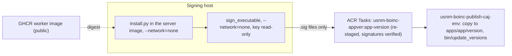

# Releasing a BOINC app version

`scripts/boinc-app-release.sh` builds, stages, signs and publishes one app version on the
live server in one command:

```sh
scripts/boinc-app-release.sh --env prod --app usnm_ocr --version 1.0 --signing-host HOST --what-if
scripts/boinc-app-release.sh --env prod --app usnm_ocr --version 1.0 --signing-host HOST
```

`--signing-key-dir` (default `/usbbak/signing/boinc`) and `--signing-dataset` (default
`usbbak/signing`) name where the private key is on the signing host. `--what-if` runs the
read-only checks and prints the plan.

`usnm_ocr`, `usnm_assess`, `usnm_gold` and `usnm_quality` use `--plan-class docker` (the
default) and `images.worker` from `infra/boinc/env/<env>.json`. `usnm_surya` (#516) and
`usnm_qwen` (#522) have their own worker images (`.github/workflows/boinc-surya.yml` and
`.github/workflows/boinc-qwen.yml`) and two plan classes (`docker_mt` for version `1.0`,
`docker_nvidia_cuda` for version `1.1`), passed with `--plan-class` and `--worker-image`:

```sh
scripts/boinc-app-release.sh --env prod --app usnm_quality --version 1.0 --signing-host HOST
scripts/boinc-app-release.sh --env prod --app usnm_qwen --version 1.0 --plan-class docker_mt \
  --worker-image ghcr.io/tgoodyear/usnm-boinc-worker@sha256:... --signing-host HOST
scripts/boinc-app-release.sh --env prod --app usnm_qwen --version 1.1 --plan-class docker_nvidia_cuda \
  --worker-image ghcr.io/tgoodyear/usnm-boinc-worker@sha256:... --signing-host HOST
```

## What it needs

- The server and bridge images in `infra/boinc/env/<env>.json` (`scripts/build-boinc-images.sh`)
  and the project initialised (`usnm-boinc-init-caj-<env>`).
- `codeSignPublicKey` in the settings: the public half of the key on the signing host.
- `images.worker`: the public GHCR worker image, by digest (below).
- SSH as root to the signing host, with the key's dataset unlocked by hand:
  `zfs load-key usbbak/signing && zfs mount usbbak/signing`. The script never unlocks it.
- podman on the signing host.

## Steps



1. **Worker image.** Volunteers' Docker pulls it, so it must be public, and the project's ACR
   has no anonymous pull (ADR-0019, addendum). `.github/workflows/boinc-worker.yml` builds the
   Tesseract engine and `ocr/boinc/Containerfile` on it and pushes
   `ghcr.io/tgoodyear/usnm-boinc-worker`; it runs by hand from main and writes the digest to the
   run's summary. Make the package public once in its settings, put the digest in
   `images.worker`, and commit. The script checks that an anonymous client can read that
   digest. With `images.worker` empty it builds the engine and worker in ACR Tasks instead
   (cached by input key), as a build check, and stops.
2. **Stage.** The server image goes to the signing host with a short-lived ACR pull token
   (deleted after the pull). `scripts/boinc/install.py` and `ocr/boinc/`, from the committed
   HEAD, run in it with `--network=none` and write
   `apps/<app>/<version>/x86_64-pc-linux-gnu__docker/` (wrapper, `job.toml`, a `Dockerfile`
   pinned to the worker digest, `version.xml`).
3. **Sign.** BOINC's `sign_executable` runs in the server image with `--network=none` and the
   key directory mounted read-only, and signs every file but `version.xml`. Only the `.sig`
   files come back. The work directory on the signing host is removed on exit.
4. **Publish.** ACR Tasks builds `usnm-boinc-appver:<app>-<version>` from
   `contrib-compute/images/appver/`: the server image with the version directory staged again
   from the same inputs, the `.sig` files added, and the result checked by
   `check_appver.py`. The build fails on a `.sig` with no staged file, a staged file without a
   `.sig`, anything in the signatures that isn't a `.sig`, a `version.xml` that names a file
   that wasn't staged, or a signature that `crypt_prog -verify` rejects against
   `codeSignPublicKey`. `provision-boinc.sh --publish-image <digest>` deploys the manual job
   `usnm-boinc-publish-caj-<env>` with that image (it has the share, the database and the vault,
   as the init job does), and the script starts it. The job copies the version to the share,
   installs the app's templates and runs `bin/update_versions --noconfirm`. A version already on
   the share must be identical, byte for byte (`diff -r`): a rerun with changed bytes is refused,
   because versions are immutable and a change is a new version. The
   script then writes the image's digest to `images.appver` in the settings; commit it. Every
   `provision-boinc.sh` deploys the publish job on `images.appver`, so the job stays and always
   holds the last published version (rerunning it is safe: it changes nothing when the version
   is already there). `--publish-image` overrides it for one deployment.

## Test client

An end-to-end test needs a BOINC client with Docker (and an NVIDIA GPU for `docker_nvidia_cuda`
versions), attached to the master URL with a test account, that downloads a staged workunit
and returns a result that validates and is assimilated (#484). Container Apps and ACI cannot
run Docker in a container, so `scripts/boinc-test-client.sh` and
`contrib-compute/infra/boinc/test-client.bicep` deploy a short-lived VM in its own resource
group (`usnm-boinc-test-rg-<env>`) and delete the group when the test is done:

```sh
scripts/boinc-test-client.sh --env prod --create [--sku Standard_NC4as_T4_v3] [--spot|--paygo] \
  [--authenticator-secret boinc-test-authenticator] [--what-if]
scripts/boinc-test-client.sh --env prod --delete [--what-if]
```

Flags:

- `--env <prod|dev>`: reads subscription, location and `masterHost` from
  `contrib-compute/infra/boinc/env/<env>.json`, and finds the BOINC Key Vault from the
  `usnm-boinc-<env>` stack's `keyVaultName` output.
- `--create`: checks that the `boinc-test-authenticator` secret (or `--authenticator-secret
  <NAME>`) exists in the BOINC Key Vault, creates `usnm-boinc-test-rg-<env>`, and deploys
  `contrib-compute/infra/boinc/test-client.bicep` with an ARM Key Vault parameter reference
  for `projectAuthenticator` so the secret value never touches disk, stdout or process
  arguments on the caller's machine. Create the test volunteer account once on the server and
  store its authenticator in Key Vault as `boinc-test-authenticator` before running `--create`.
- `--delete`: deletes the resource group `usnm-boinc-test-rg-<env>` and everything in it, so
  nothing stands between tests.
- `--sku <SKU>`: Azure VM size (default `Standard_NC4as_T4_v3`, 4 vCPUs, 28 GiB RAM, 1x NVIDIA
  T4 16 GiB, which exercises `docker`, `docker_mt` and `docker_nvidia_cuda`).
- `--spot` / `--paygo`: deploys as an Azure Spot VM with `Delete` eviction policy (`--spot`,
  the default) or a regular pay-as-you-go VM (`--paygo`).
- `--what-if`: checks settings and the Key Vault secret and prints the plan without creating or
  deleting resources.

`contrib-compute/infra/boinc/test-client.bicep` provisions an Ubuntu 24.04 LTS x86-64 VM in
its own VNet (`100.64.0.0/24`, RFC 6598 shared address space) with an NSG that denies all
inbound traffic; outbound HTTPS reaches `https://<masterHost>/usnmocr/`, `ghcr.io`, and the
Ubuntu and NVIDIA package repositories. Cloud-init installs Docker, `boinc-client`, and (when
an NVIDIA GPU is present) the NVIDIA driver and `nvidia-container-toolkit`, adds `boinc` to
the `docker` group, starts the client, and runs
`boinccmd --project_attach https://<masterHost>/usnmocr/ <authenticator>`.

UNVERIFIED against a live deployment: cloud-init package installation, GPU detection by
`boinc-client`, workunit execution on the VM, and end-to-end result assimilation.
