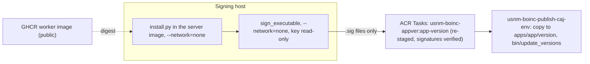

# Releasing a BOINC app version

`scripts/boinc-app-release.sh` builds, stages, signs and publishes one app version on the
live server in one command:

```sh
scripts/boinc-app-release.sh --env prod --app usnm_ocr --version 1.0 --signing-host HOST --what-if
scripts/boinc-app-release.sh --env prod --app usnm_ocr --version 1.0 --signing-host HOST
```

`--signing-key-dir` (default `/usbbak/signing/boinc`) and `--signing-dataset` (default
`usbbak/signing`) name where the private key is on the signing host. `--what-if` runs the
read-only checks and prints the plan.

The release script and `scripts/boinc/install.py` support two distribution kinds (`--kind`):

Operator staging uses a unique mode-0700 directory beneath the checkout and a
private directory beneath the signing host's root home, removed on exit. Build
inputs stay on those filesystems rather than relying on system temporary storage.

### Native NVIDIA experimental canary

Native `nvidia_cuda_2b` and `nvidia_cuda_8b` are experimental and default-deny:
the scheduler requires the account's **effective venue** project preference
`qwen_native_cuda_canary` to equal exactly `1`. Absent, false, or malformed
preferences do not enroll anyone. The authenticated project preferences page
(`prefs.php?subset=project`) exposes an unchecked opt-in checkbox; volunteers
must explicitly save it for the venue used by their host. Unchecking it stops
future canary assignments, not already assigned tasks. Existing stock application
selection, CPU/job limits, other preferences and venue editing remain available.
No operator should silently enroll accounts or edit authenticators.

These native-only classes admit stable BOINC 8.2.11+; unlike containers they do
not need the 8.2.13 container extension. They require a CUDA 12.4-capable NVIDIA driver (the pinned
runtime includes CUDA libraries; no toolkit/WSL/Podman), 3 GB/7 GB detected GPU
memory respectively, and cold disk bounds of 12 GiB/18 GiB. This is admission
policy, **not measured Windows acceptance**. Signed publication is not evidence
of successful inference.

Before publication, coordinate deployments in #529 and preserve all existing
OCR/training pins and queues. Publish only the intended Windows platform version;
inventory opted-in eligible hosts without publishing identities. Initially stage
at most **one** audited workunit with two independent results, digest-qualified
sticky models, the correct native target and existing idempotency journal.
Record exact workunit/result IDs, then stop submitting until the results have been
examined. Do not reduce independent quorum to make a single volunteer pass.
Collect BOINC exit status, bounded stderr, backend/model/runtime identities and
available resource diagnostics; report missing measurements rather than inferring
successful CUDA execution from registration. Do not run arbitrary commands on
volunteers or broaden enrollment to bypass missing hardware/consent.

### Holding legacy Qwen dispatch

Before enabling split-payload inference, inventory app versions, workunits and
results read-only. For each **legacy Qwen inference container** version only, run
the reviewed operator tool in the existing server:

```sh
php scripts/boinc/hold-legacy-qwen.php --project /project/usnmocr --app-version ID
php scripts/boinc/hold-legacy-qwen.php --project /project/usnmocr --app-version ID --apply
```

Preview is the default. Apply journals the original state before deprecating that
exact app version and notifying the feeder. Replaying it is safe. It never
cancels results, rewrites workunits, changes quorum, or touches OCR, training,
native, or split-payload versions. In-flight results remain reportable. Preserve
the journal and before/after queue inventory. Do not re-enable the legacy version
until its cold bounds and payload are safe.

Partially completed workunits cannot simply be reissued against a new engine
digest: that would mix campaign identities and lose independent-quorum semantics.
Leave those originals held with their inputs/results intact pending an explicit
scientific disposition. Only fully unsent, audited work can be considered for a
separate idempotently staged campaign with the new engine identity and bounds;
never edit campaign submission markers or database rows to fake migration.

1. **`--kind container` (default)**: stages a signed `docker_wrapper`, `Dockerfile`, `job.toml`
   and `version.xml` under `apps/<app>/<version>/<platform>__<plan_class>` across the five
   registered platforms (`x86_64-pc-linux-gnu`, `aarch64-unknown-linux-gnu`,
   `arm64-apple-darwin`, `x86_64-apple-darwin`, `windows_x86_64`) and the container plan
   classes (`docker`, `docker_mt`, `docker_nvidia_cuda`, `docker_mt_2b`, `docker_nvidia_cuda_8b`).
   - `usnm_ocr`, `usnm_assess`, `usnm_gold` and container `usnm_quality` use `--plan-class docker`
     (the default) and `images.worker` from `infra/boinc/env/<env>.json`.
   - `usnm_surya` (#516) and container `usnm_qwen` (#522) have their own worker images
     (`.github/workflows/boinc-surya.yml` and `.github/workflows/boinc-qwen.yml`).
     Surya retains `docker_mt` / `docker_nvidia_cuda`; Qwen uses **separate immutable
     2B/8B images** with `docker_mt_2b` / `docker_nvidia_cuda_8b`, passed with `--plan-class`
     and the corresponding digest-pinned `--worker-image`. Qwen release checks reject
     legacy dual-model or wrong-model images using anonymous config metadata; signing
     is unchanged. See [disk policy and rollout](../../docs/boinc-quality.md#qwen-disk-admission-and-cold-cache-acceptance-559).

   ```sh
   scripts/boinc-app-release.sh --env prod --app usnm_quality --version 1.0 --signing-host HOST
   scripts/boinc-app-release.sh --env prod --app usnm_qwen --version 1.0 --plan-class docker_mt_2b \
     --worker-image ghcr.io/tgoodyear/usnm-boinc-worker@sha256:... --signing-host HOST
   scripts/boinc-app-release.sh --env prod --app usnm_qwen --version 1.1 --plan-class docker_nvidia_cuda_8b \
     --worker-image ghcr.io/tgoodyear/usnm-boinc-worker@sha256:... --signing-host HOST
   ```

2. **`--kind native --binary`**: stages a native executable built by CI without `docker_wrapper`
   or a container image (#533):
   - **`usnm_quality`**: `.github/workflows/boinc-quality-native.yml` builds static musl, Mach-O
     and MSVC executables (`usnm_quality_<ver>_<platform>[.exe]`) plus `SHA256SUMS` across all
     five platforms (`x86_64-pc-linux-gnu`, `aarch64-unknown-linux-gnu`, `arm64-apple-darwin`,
     `x86_64-apple-darwin`, `windows_x86_64`). Stage and sign each platform binary with
     `--kind native --binary <FILE> --binary-sha256 <HEX>` (writes
     `apps/usnm_quality/<version>/<platform>/` with no plan-class suffix):

   ```sh
   scripts/boinc-app-release.sh --env prod --app usnm_quality --version 1.1 --kind native \
     --platform x86_64-pc-linux-gnu \
     --binary /path/to/usnm_quality_1.1_x86_64-pc-linux-gnu \
     --binary-sha256 CHECKED_SHA256 --signing-host HOST
   scripts/boinc-app-release.sh --env prod --app usnm_quality --version 1.1 --kind native \
     --platform arm64-apple-darwin \
     --binary /path/to/usnm_quality_1.1_arm64-apple-darwin \
     --binary-sha256 CHECKED_SHA256 --signing-host HOST
   scripts/boinc-app-release.sh --env prod --app usnm_quality --version 1.1 --kind native \
     --platform windows_x86_64 \
     --binary /path/to/usnm_quality_1.1_windows_x86_64.exe \
     --binary-sha256 CHECKED_SHA256 --signing-host HOST
   ```

   - **`usnm_qwen`**: stages the native `usnm_qwen` driver binary together with the platform's
     pinned `llama-server` executable (`llama-server.exe` on `windows_x86_64`),
     `ocr/boinc/qwen/llama.lock`, and `ocr/boinc/qwen/weights.lock` (plus any runtime shared
     libraries) passed via repeatable `--extra-file LOGICAL=PATH` flags under
     `apps/usnm_qwen/<version>/<platform>__<plan_class>` for plan classes `apple_gpu_8b`
     (`arm64-apple-darwin`), `nvidia_cuda_8b` and `nvidia_cuda_2b` (`x86_64-pc-linux-gnu`,
     `aarch64-unknown-linux-gnu`, `windows_x86_64`), and `mt` (all five platforms). Model files
     are staged separately as `<sticky/><no_delete/>` inputs in `download/` using the
     plan-class-specific model input templates (`usnm_qwen_8b_in` for 8B classes and
     `usnm_qwen_2b_in` for 2B/`mt` classes).

## What it needs

- The server and bridge images in `infra/boinc/env/<env>.json` (`scripts/build-boinc-images.sh`).
  Provisioning ensures the project is initialised automatically.
- `codeSignPublicKey` in the settings: the public half of the key on the signing host.
- `images.worker`: the public GHCR worker image, by digest (below).
- SSH as root to the signing host, with the key's dataset unlocked by hand:
  `zfs load-key usbbak/signing && zfs mount usbbak/signing`. The script never unlocks it.
- podman on the signing host.

## Steps



1. **Worker image.** Volunteers' Docker pulls it, so it must be public, and the project's ACR
   has no anonymous pull (ADR-0019, addendum). `.github/workflows/boinc-worker.yml` builds the
   Tesseract engine and `ocr/boinc/Containerfile` on it and pushes
   `ghcr.io/tgoodyear/usnm-boinc-worker`; it runs by hand from main and writes the digest to the
   run's summary. Make the package public once in its settings, put the digest in
   `images.worker`, and commit. The script checks that an anonymous client can read that
   digest. With `images.worker` empty it builds the engine and worker in ACR Tasks instead
   (cached by input key), as a build check, and stops.
2. **Stage.** The server image goes to the signing host with a short-lived ACR pull token
   (deleted after the pull). `scripts/boinc/install.py` and `ocr/boinc/`, from the committed
   HEAD, run in it with `--network=none` and write either
   `apps/<app>/<version>/<platform>__<plan_class>/` for `--kind container` (`x86_64-pc-linux-gnu`
   and `docker` by default: wrapper, `job.toml`, a `Dockerfile` pinned to the worker digest,
   `version.xml` with `<is_wrapper/>`) or `apps/<app>/<version>/<platform>[__<plan_class>]/` for
   `--kind native --binary` (the native `<main_program/>` binary, plus the `llama.lock` archive
   for `usnm_qwen`, and `version.xml` without `<is_wrapper/>`).
3. **Sign.** BOINC's `sign_executable` runs in the server image with `--network=none` and the
   key directory mounted read-only, and signs every file but `version.xml`. Only the `.sig`
   files come back. The work directory on the signing host is removed on exit.
4. **Publish.** ACR Tasks builds `usnm-boinc-appver:<app>-<version>` from
   `contrib-compute/images/appver/`: the server image with the version directory staged again
   from the same inputs, the `.sig` files added, and the result checked by
   `check_appver.py`. The build fails on a `.sig` with no staged file, a staged file without a
   `.sig`, anything in the signatures that isn't a `.sig`, a `version.xml` that names a file
   that wasn't staged, or a signature that `crypt_prog -verify` rejects against
   `codeSignPublicKey`. `provision-boinc.sh --publish-image <digest>` deploys and runs the job
   `usnm-boinc-publish-caj-<env>` with that image (it has the share, the database and the vault,
   as the init job does). The job copies the version to the share,
   installs the app's templates, copies the committed project metadata, runs `bin/xadd`
   to register platforms, and runs the unmodified `bin/update_versions --noconfirm` in a
   temporary layout containing only the requested app/version/platform. The configuration
   still names the real download and key directories. It explicitly verifies the exact
   database app-version row before notifying the feeder: PHP `die(string)` can otherwise
   exit zero even though registration failed. A platform already on
   the share must be identical, byte for byte (`diff -r`): a rerun with changed bytes is refused,
   because versions are immutable and a change is a new version. The
   script then writes the image's digest to `images.appver` in the settings; commit it. Every
   `provision-boinc.sh` deploys and runs the publish job on `images.appver`, so the job stays and always
   holds the last published version (rerunning it is safe: it changes nothing when the version
   is already there). `--publish-image` overrides it for one deployment. Provisioning also
   ensures secrets, skips a completed project initialization, registers apps and checks the
   public project configuration. It refuses to overwrite partial project data or an existing
   database, and never prints a manual bootstrap checklist.

Deployment previews use GA `az stack-whatif group create`, with the same unmanage and deny
settings as deployment, three-hour retention and Azure's baseline-based noise reduction.
Existing managed-identity principal IDs are resolved before template evaluation so role
assignment IDs remain unchanged and deterministic. Preview results still require review;
noise reduction is not evidence that all differences are real or safe.

## Test client

An end-to-end test needs a BOINC client with Docker (and an NVIDIA GPU for `docker_nvidia_cuda`
versions), attached to the master URL with a test account, that downloads a staged workunit
and returns a result that validates and is assimilated (#484). Container Apps and ACI cannot
run Docker in a container, so `scripts/boinc-test-client.sh` and
`contrib-compute/infra/boinc/test-client.bicep` deploy a short-lived VM in its own resource
group (`usnm-boinc-test-rg-<env>`) and delete the group when the test is done:

```sh
scripts/boinc-test-client.sh --env prod --create [--sku Standard_NC4as_T4_v3] [--spot|--paygo] \
  [--authenticator-file <path>] [--what-if]
scripts/boinc-test-client.sh --env prod --delete [--what-if]
```

Flags:

- `--env <prod|dev>`: reads subscription, location and `projectUrl` from
  `contrib-compute/infra/boinc/env/<env>.json`, and checks that the `usnm-boinc-<env>` stack is
  deployed.
- `--create`: creates `usnm-boinc-test-rg-<env>` and deploys
  `contrib-compute/infra/boinc/test-client.bicep`. By default, cloud-init creates a fresh
  disposable test volunteer account on the server with `boinccmd --create_account`; if
  `--authenticator-file <PATH>` is given, the script reads that file into a mode-`0600`
  `@params` file and passes it to the `@secure()` `projectAuthenticator` parameter without
  putting the value in process arguments or stdout.
- `--delete`: deletes the resource group `usnm-boinc-test-rg-<env>` and everything in it, so
  nothing stands between tests.
- `--sku <SKU>`: Azure VM size (default `Standard_NC4as_T4_v3`, 4 vCPUs, 28 GiB RAM, 1x NVIDIA
  T4 16 GiB, which exercises `docker`, `docker_mt` and `docker_nvidia_cuda`).
- `--spot` / `--paygo`: deploys as an Azure Spot VM with `Delete` eviction policy (`--spot`,
  the default) or a regular pay-as-you-go VM (`--paygo`).
- `--what-if`: checks settings and prints the plan without creating or deleting resources.

`contrib-compute/infra/boinc/test-client.bicep` provisions an Ubuntu 24.04 LTS x86-64 VM in
its own VNet (`100.64.0.0/24`, RFC 6598 shared address space) with an NSG that denies all
inbound traffic; outbound HTTPS reaches `https://<masterHost>/usnmocr/`, `ghcr.io`, and the
Ubuntu, BOINC (`https://boinc.berkeley.edu/dl/linux/stable/noble`), and NVIDIA package
repositories. Cloud-init installs Docker, `boinc-client` (>= 8.2.13 from the upstream BOINC
noble repository, using `/var/lib/boinc`), and (when an NVIDIA GPU is present) the NVIDIA
driver and `nvidia-container-toolkit`, adds `boinc` to the `docker` group, starts the client,
creates a disposable account when `projectAuthenticator` is empty, and runs
`boinccmd --project_attach https://<masterHost>/usnmocr/ <authenticator>`.

UNVERIFIED against a live deployment: cloud-init package installation, GPU detection by
`boinc-client`, workunit execution on the VM, and end-to-end result assimilation.
Automated release-to-client acceptance orchestration is tracked in
[#548](https://github.com/tgoodyear/usnewsmap.com/issues/548); app registration and public
health are not a substitute for execution and canonical assimilation.

## Mac app versions

Contribute build scripts and public settings through a PR. Runtime changes made
inside the Container App disappear on rebuild. A contributor can build and test
native ARM workers and wrappers without server or signing-key access; the
maintainer publishes and signs from the merged commit.

1. Merge the native build changes, then dispatch `boinc-worker.yml` from `main`.
   Verify both architecture checks and anonymous pulls, and commit its index
   digest as `images.worker` through a PR. Follow the cohort drain procedure in
   [docs/boinc.md](../../docs/boinc.md#publish-the-worker-image).
2. Dispatch `boinc-mac-wrapper.yml` from the same reviewed commit. Download the
   `boinc-mac-wrappers` artifact: `docker_wrapper_arm64`, `docker_wrapper_x86_64`,
   `BOINC_COMMIT`, and `SHA256SUMS`. Alternatively, on a Mac with Xcode:

   ```sh
   bash scripts/boinc/build-mac-wrapper.sh --out /tmp/mac-wrappers
   ```

   The script checks out exactly the BOINC commit pinned by the server
   Containerfile, applies `scripts/boinc/patch-mac-wrapper.py` to fix the
   `Run_Podman` `--format` pipe quoting bug in `samples/docker_wrapper/docker_wrapper.cpp`
   (`get_container_state`), builds both Mach-O executables and records checksums. The
   artifact is a BOINC code-signing candidate, not an Apple-notarized installer.
   A checksum and source-pin file check integrity and consistency; use artifacts
   from a trusted, reviewed build. Record the workflow run, commit and SDK in the
   release evidence.

3. On the maintainer's checkout, verify the artifact checksums and use the
   existing offline-signing release path with the selected platform:

   ```sh
   (cd /tmp/mac-wrappers && shasum -a 256 -c SHA256SUMS)
   # Run from the clean repository checkout, using the checked checksum below.
   scripts/boinc-app-release.sh --env prod --app usnm_ocr --version 1.1 \
     --signing-host HOST --platform arm64-apple-darwin \
     --wrapper /tmp/mac-wrappers/docker_wrapper_arm64 \
     --wrapper-sha256 CHECKED_SHA256 \
     --wrapper-source-pin /tmp/mac-wrappers/BOINC_COMMIT --what-if
   ```

   Remove `--what-if` to stage, sign and publish. For Intel Mac use
   `x86_64-apple-darwin` and `docker_wrapper_x86_64`. The script requires a worker
   index containing the corresponding native Linux child, validates wrapper
   architecture/checksum/source pin, and signs the frozen bytes on the signing
   host. Mac binaries are never executed on that Linux host. A new platform can
   share a version number only when its shared templates agree; existing
   platform files remain immutable. Changed image, wrapper or job configuration
   requires a new version. Commit the resulting `images.appver` setting.

4. Reserve a synthetic/cached-page `usnm_ocr` job for an ARM Mac client, then
   verify scheduler selection, signed download, native execution, upload,
   validation, assimilation and bridge collection. Repeat on an Intel Mac when
   available. Check pause/resume, client restart and reboot, then run a matched
   gold campaign before calling Mac support complete.

The standalone Mac spike found an upstream `Run_Podman` command-quoting failure
when restarting a paused container, which `scripts/boinc/patch-mac-wrapper.py`
fixes during `scripts/boinc/build-mac-wrapper.sh` ([evaluation note](../../docs/notes/boinc-buda-arm-evaluation.md)).
Native image execution succeeds; BOINC lifecycle behavior still needs full
client/server validation on a reserved Mac workunit.
See [#476](https://github.com/tgoodyear/usnewsmap.com/issues/476),
[#533](https://github.com/tgoodyear/usnewsmap.com/issues/533) and the separate
[BUDA evaluation PR #503](https://github.com/tgoodyear/usnewsmap.com/pull/503).
These release tools contribute to #476 without closing it or the BUDA spike #481.
