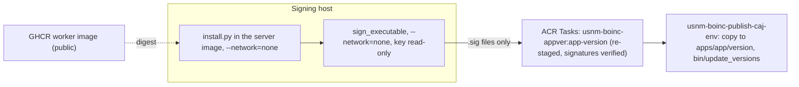

# Releasing a BOINC app version

Runtime rebuilds retain the deployed feeder's `--allapps` interleaving and 1,000
shared-memory work slots, with an explicit query budget as described below.
Re-rendering an existing project also leaves already-correct config and
key symlinks intact; a runtime upgrade must not transiently remove its signing
paths.

### Feeder visibility

`shmem_work_items` sizes the cache, **not** the database enumeration. In the
[pinned BOINC feeder](https://github.com/BOINC/boinc/blob/22bbebe08e2eaac5d5e88a6d93b88e800cb6341c/sched/feeder.cpp),
the default query budget is independently `MAX_WU_RESULTS * 2 = 200`.
With `--allapps`, each application's enumeration limit is
`floor(0.5 + feeder_query_size * app_weight / total_app_weight)`.
Nine equally weighted applications therefore got only 22 candidates each,
despite 1,000 cache slots (about 111 per app). Replicas already completed by
the requesting host still occupy that prefix: distinct-host validation correctly
blocks them, leaving eligible work beyond enumeration invisible (#860).

The template sets `feeder_query_size=20000`: 2,222 candidates per equal-weight
app. The sizing invariant is that **each positive-weight app's rounded query
budget covers at least twice the entire cache capacity**, and Qwen's covers
at least four times the 455 ready results across its current batches (2, 8, 12
and 18). The whole-cache floor is deliberately conservative; this allocation
is about 20 times each app's current cache share and 4.9 times the Qwen
baseline. Tests derive the budgets from `project.xml` weights, so app additions,
weight changes and cache growth must still satisfy the invariant.

This is a bounded fix, not infinite fairness: queries may enumerate roughly
20,000 joined result/workunit rows across apps per pass (rounding can vary the
total), increasing database, feeder memory and collision-check costs without
allocating more shared-memory slots. A larger blocked prefix or a full cache
of infeasible work can still hide eligible results. Recheck actual registered
app weights, ready counts, cache contents and feeder/database load before
backlog growth exhausts this headroom; update the sizing baseline and budget
together. Do not clear queues or weaken `one_result_per_host_per_wu` or quorum
to improve apparent dispatch.

Release verification remains separate from these configuration tests: confirm
the rendered runtime query size, feeder restart/cache visibility and actual
GPU returns, distinct-host validation and collection before claiming recovery.
Ship the reviewed `refresh-plan-policy.py` startup path and Vulkan definitions
already on main, not the old unconditional policy copy. The refresher preserves
operator-controlled cohort bounds while restoring missing classes closed;
registration alone does not admit work. Preview then open at most ten audited
units through `native-qwen-cohort.php --plan-class shared_8b`, under the existing
release coordination and locks. Preserve live configuration, quality metrics,
queues and pins; this code change neither deploys nor opens a cohort.

`scripts/boinc-app-release.sh` builds, stages, signs and publishes one app version on the
live server in one command:

```sh
scripts/boinc-app-release.sh --env prod --app usnm_ocr --version 1.0 --signing-host HOST --what-if
scripts/boinc-app-release.sh --env prod --app usnm_ocr --version 1.0 --signing-host HOST
```

`--signing-key-dir` (default `/usbbak/signing/boinc`) and `--signing-dataset` (default
`usbbak/signing`) name where the private key is on the signing host. `--what-if` runs the
read-only checks and prints the plan.

For a **PR-first release**, use `--prepare-only` to stage, sign and build the
immutable app-version image without publishing. It changes only `images.appver`;
the key stays on the signing host. After pin review, green CI and merge, run
`scripts/provision-boinc.sh --env prod` to publish and verify registration.
Preparation proves neither publication nor volunteer execution. Omit
`--prepare-only` only when immediate publication is authorized.

The release script and `scripts/boinc/install.py` support two distribution kinds
(`--kind`), listed below.

Operator staging uses a unique mode-0700 directory beneath the checkout and a
private directory beneath the signing host's root home, removed on exit. Build
inputs stay on those filesystems rather than relying on system temporary storage.

On macOS, prefix release commands with `COPYFILE_DISABLE=1` so BSD tar does not
inject AppleDouble `._*` sidecars from downloaded files' extended metadata.
These are not runtime dependencies; do not bypass the logical-name, payload-hash,
or signature checks to include them.

### Native NVIDIA experimental canary

Project participation includes production and experimental tasks, including
`nvidia_cuda_2b` and `nvidia_cuda_8b`. There is no Qwen-specific enrollment.
Ignore legacy `qwen_native_cuda_canary` values; do not rewrite account rows.
Honor effective-venue CPU and GPU choices, resource limits, pause and No new
tasks. Do not enable GPUs or change volunteers' preferences.

Rebuild the BOINC **base and server** through `build-boinc-images.sh` before
enabling this policy. Removing only the web control or XML tag is insufficient:
the older CGI contains an additional account-flag check. The base cache key
includes its removal. After rollout, verify the hashes of the CGI and image
actually served.

Native NVIDIA campaigns remain operator-bounded, independently of user profiles.
Shipped plan classes have an impossible WU interval (`min_wu_id=2`, `max_wu_id=1`),
so publishing a version does not broadly release unvalidated work. After staging
one audited native workunit through the existing CLI, preview then apply:

```sh
php scripts/boinc/native-qwen-cohort.php --project /project/usnmocr \
  --plan-class nvidia_cuda_2b --workunit ID
php scripts/boinc/native-qwen-cohort.php --project /project/usnmocr \
  --plan-class nvidia_cuda_2b --workunit ID --apply
# Operator stop: closes BOTH NVIDIA classes, without canceling in-flight results.
php scripts/boinc/native-qwen-cohort.php --project /project/usnmocr --stop --apply
```

The helper checks Qwen identity, model batch, disk bound, independent quorum and
target of 2, and two unsent results. It journals the old plan, atomically opens
one WU in one class and closes the other. Stock scheduler range and batch checks
enforce that window. It creates no work and changes no scientific rows, account
rows or resource choices. Normal server startup refreshes reviewed policy while
preserving existing bounded admission, including the shared Vulkan window and
closed container class. Newly introduced classes start closed; reinitialization
uses the closed template. Re-audit before opening or widening any cohort. Stop
after the cohort. The helper does not authorize general unvalidated dispatch.

These native-only classes admit stable BOINC 8.2.11+ and do not require a
container runtime. The ordinary OCR `docker` class also admits stable 8.2.11 when
its platform runtime is available; do not require a development Mac client for it.
Native CUDA classes require a CUDA 12.4-capable NVIDIA driver (the pinned runtime
includes CUDA libraries; no toolkit, WSL or Podman), 3 GB and 7 GB of detected GPU
memory respectively, and cold disk bounds of 12 GiB and 18 GiB. This is admission
policy, **not measured Windows acceptance**. Signed publication is not evidence of
successful inference.

Windows publication must include both pinned CUDA archives in `llama.lock`: the
llama archive does **not** include `cudart64_12.dll` or the cuBLAS DLLs. The
companion runtime archive contributes 574,138,880 bytes; the selected llama-server
and DLL payload contributes 545,153,592 bytes before the small driver, locks and
Microsoft runtime. Together they fit the reviewed 2 GiB native bundle envelope
(enforced by staging). The Windows native CI artifact supplies app-local Microsoft
CRT DLLs from the installed Visual Studio redistributable, verifies their
Microsoft Authenticode signatures and records versions and hashes in
`VC_REDIST_SOURCE.json` and `SHA256SUMS`. Stage these DLLs as signed
`--extra-file` members too; staging rejects a missing mandatory CUDA or CRT
dependency, including the portable `ggml-cpu-x64.dll` backend and its
`libomp140.x86_64.dll` dependency from the pinned llama archive (CPU backend
discovery is required even for CUDA offload; optimized CPU variants are optional).
No volunteer should install a CUDA toolkit or manually fetch DLLs. The NVIDIA
driver's `nvcuda.dll` and Windows system APIs remain platform prerequisites.

Before publication, coordinate deployments in #529 and preserve all existing OCR
and training pins and queues. Publish only the intended Windows platform version;
the scheduler must also be upgraded, not just its plan-class XML. The persistent
project CGI is a copy, not necessarily a link to the new image's executable.
Server startup atomically refreshes it from the reviewed image before serving,
preserving already-running CGI requests. Verify the project CGI SHA256 matches
`/usr/local/boinc/sched/cgi` after the single-active-revision rollout; otherwise
old batch and account-gate code can silently prevent or misroute dispatch.
Inventory ordinarily eligible participating hosts without publishing identities.
Initially stage at most **one** audited workunit with two independent results,
digest-qualified sticky models, the correct native target and existing idempotency
journal. Record exact workunit and result IDs, then stop submitting until the
results have been examined. Do not reduce independent quorum to make a single
volunteer pass. Collect BOINC exit status, bounded stderr, backend, model and
runtime identities and available resource diagnostics; report missing measurements
rather than inferring successful CUDA execution from registration. Do not run
arbitrary commands on volunteers or override CPU, GPU or resource choices to
bypass missing hardware.

Native failures write a nonzero `boinc_finish_called` and exit nonzero; BOINC may
show **Computation error**. A bounded, fixed-schema `USNM_QWEN_FAILURE` JSON
summary enters task stderr and the scheduler result report even if output upload
fails. Windows appends it to the slot's `stderr.txt`; Unix uses stderr. Fields
cover outcome, runtime and model identities, driver, memory, timings and failure
category. They exclude raw paths, input text, prompts, account data and full logs.
Successful tasks upload three checksummed outputs. Download, signature and loader
failures can precede app startup and lack an application summary; inspect normal
BOINC status, stderr and event reports. Verify server receipt with real canary
results. Volunteers should not need to upload logs manually.

#### Production delivery snapshot (2026-10-16)

The coherent runtime from `00fbdd96` was deployed after paired-pin PR #648: the
served CGI matched the image and the public About page and footer changes were
present. That earlier rollout used an experiment flag; the new
project-participation policy removes it and requires a fresh coordinated runtime
rollout. Signed Windows native version 1.3 is registered as app versions 18
(`nvidia_cuda_2b`) and 19 (`nvidia_cuda_8b`). Each complete 38-file application
payload is 1,122,771,473 bytes, excluding the separately staged model weights. All
76 server-side file hashes and anonymous download headers were verified; both
drivers' signatures and anonymous full driver and lock downloads were also
checked. Large DLLs were not downloaded again merely to repeat those checks.

This is **publication**, not Windows GPU or failure-report acceptance. The
native versions had no assigned results at that snapshot. No extra experiment
opt-in is now required; use an ordinarily eligible host with its existing GPU choice
honored and the operator's bounded window deployed. Real GPU inference, ordinary server receipt
of the bounded failure summary, and isolated live disk-only rejection remain
open acceptance items in #559. The earlier CPU quorum canary 74 is independent
evidence, not a substitute for these Windows checks.

### Holding legacy Qwen dispatch

Before enabling split-payload inference, inventory app versions, workunits and
results read-only. For each **legacy Qwen inference container** version only, run
the reviewed operator tool in the existing server:

```sh
php scripts/boinc/hold-legacy-qwen.php --project /project/usnmocr --app-version ID
php scripts/boinc/hold-legacy-qwen.php --project /project/usnmocr --app-version ID --apply
```

Preview is the default. Apply journals the original state before deprecating that
exact app version and notifying the feeder. Replaying it is safe. It never
cancels results, rewrites workunits, changes quorum, or touches OCR, training,
native, or split-payload versions. In-flight results remain reportable. Preserve
the journal and the queue inventory from before and after. Do not re-enable the
legacy version until its cold bounds and payload are safe.

Partially completed workunits cannot simply be reissued against a new engine
digest: that would mix campaign identities and lose independent-quorum semantics.
Leave those originals held with their inputs and results intact pending an
explicit scientific disposition. Only fully unsent, audited work can be
considered for a separate idempotently staged campaign with the new engine
identity and bounds; never edit campaign submission markers or database rows to
fake migration.

1. **`--kind container` (default)**: stages a signed `docker_wrapper`, `Dockerfile`, `job.toml`
   and `version.xml` under `apps/<app>/<version>/<platform>__<plan_class>` across the five
   registered platforms (`x86_64-pc-linux-gnu`, `aarch64-unknown-linux-gnu`,
   `arm64-apple-darwin`, `x86_64-apple-darwin`, `windows_x86_64`) and the container plan
   classes (`docker`, `docker_mt`, `docker_nvidia_cuda`, `docker_mt_2b`, `docker_nvidia_cuda_8b`).
   - `usnm_ocr`, `usnm_assess`, `usnm_gold` and container `usnm_quality` use `--plan-class docker`
     (the default) and `images.worker` from `infra/boinc/env/<env>.json`.
   - `usnm_surya` (#516) and container `usnm_qwen` (#522) have their own worker images
     (`.github/workflows/boinc-surya.yml` and `.github/workflows/boinc-qwen.yml`). Surya retains
     `docker_mt` and `docker_nvidia_cuda`; Qwen uses **separate immutable 2B/8B images** with
     `docker_mt_2b` and `docker_nvidia_cuda_8b`, passed with `--plan-class` and the
     corresponding digest-pinned `--worker-image`. Qwen release checks reject legacy dual-model
     or wrong-model images using anonymous config metadata; signing is unchanged. See
     [disk policy and rollout](../../docs/boinc-quality.md#qwen-disk-admission-and-cold-cache-acceptance-559).

   ```sh
   scripts/boinc-app-release.sh --env prod --app usnm_quality --version 1.0 --signing-host HOST
   scripts/boinc-app-release.sh --env prod --app usnm_qwen --version 1.0 --plan-class docker_mt_2b \
     --worker-image ghcr.io/tgoodyear/usnm-boinc-worker@sha256:... --signing-host HOST
   scripts/boinc-app-release.sh --env prod --app usnm_qwen --version 1.1 --plan-class docker_nvidia_cuda_8b \
     --worker-image ghcr.io/tgoodyear/usnm-boinc-worker@sha256:... --signing-host HOST
   ```

2. **`--kind native --binary`**: stages a native executable built by CI without `docker_wrapper`
   or a container image (#533):
   - **`usnm_quality`**: `.github/workflows/boinc-quality-native.yml` builds static musl, Mach-O
     and MSVC executables (`usnm_quality_<ver>_<platform>[.exe]`) plus `SHA256SUMS` across all
     five platforms (`x86_64-pc-linux-gnu`, `aarch64-unknown-linux-gnu`, `arm64-apple-darwin`,
     `x86_64-apple-darwin`, `windows_x86_64`). Stage and sign each platform binary with
     `--kind native --binary <FILE> --binary-sha256 <HEX>` (writes
     `apps/usnm_quality/<version>/<platform>/` with no plan-class suffix):

   ```sh
   scripts/boinc-app-release.sh --env prod --app usnm_quality --version 1.1 --kind native \
     --platform x86_64-pc-linux-gnu \
     --binary /path/to/usnm_quality_1.1_x86_64-pc-linux-gnu \
     --binary-sha256 CHECKED_SHA256 --signing-host HOST
   scripts/boinc-app-release.sh --env prod --app usnm_quality --version 1.1 --kind native \
     --platform arm64-apple-darwin \
     --binary /path/to/usnm_quality_1.1_arm64-apple-darwin \
     --binary-sha256 CHECKED_SHA256 --signing-host HOST
   scripts/boinc-app-release.sh --env prod --app usnm_quality --version 1.1 --kind native \
     --platform windows_x86_64 \
     --binary /path/to/usnm_quality_1.1_windows_x86_64.exe \
     --binary-sha256 CHECKED_SHA256 --signing-host HOST
   ```

   - **`usnm_qwen`**: stages the native `usnm_qwen` driver binary together with the platform's
     pinned `llama-server` executable (`llama-server.exe` on `windows_x86_64`),
     `ocr/boinc/qwen/llama.lock`, and `ocr/boinc/qwen/weights.lock` (plus any runtime shared
     libraries) passed via repeatable `--extra-file LOGICAL=PATH` flags under
     `apps/usnm_qwen/<version>/<platform>__<plan_class>` for plan classes `apple_gpu_8b`
     (`arm64-apple-darwin`), `nvidia_cuda_8b` and `nvidia_cuda_2b` (`x86_64-pc-linux-gnu`,
     `aarch64-unknown-linux-gnu`, `windows_x86_64`), and `mt` (all five platforms). Model files
     are staged separately as `<sticky/><no_delete/>` inputs in `download/` using the
     plan-class-specific model input templates (`usnm_qwen_8b_in` for 8B classes and
     `usnm_qwen_2b_in` for 2B/`mt` classes).

## What it needs

- The server and bridge images in `infra/boinc/env/<env>.json` (`scripts/build-boinc-images.sh`).
  Provisioning ensures the project is initialised automatically.
- `codeSignPublicKey` in the settings: the public half of the key on the signing host.
- `images.worker`: the public GHCR worker image, by digest (below).
- SSH as root to the signing host, with the key's dataset unlocked by hand:
  `zfs load-key usbbak/signing && zfs mount usbbak/signing`. The script never unlocks it.
- podman on the signing host.

## Steps



1. **Worker image.** Volunteers' Docker pulls it, so it must be public, and the project's ACR
   has no anonymous pull (ADR-0019, addendum). `.github/workflows/boinc-worker.yml` builds the
   Tesseract engine and `ocr/boinc/Containerfile` on it and pushes
   `ghcr.io/tgoodyear/usnm-boinc-worker`; it runs by hand from main and writes the digest to the
   run's summary. Make the package public once in its settings, put the digest in
   `images.worker`, and commit. The script checks that an anonymous client can read that
   digest. With `images.worker` empty it builds the engine and worker in ACR Tasks instead
   (cached by input key), as a build check, and stops.
2. **Stage.** The server image goes to the signing host with a short-lived ACR pull token
   (deleted after the pull). `scripts/boinc/install.py` and `ocr/boinc/`, from the committed
   HEAD, run in it with `--network=none` and write either
   `apps/<app>/<version>/<platform>__<plan_class>/` for `--kind container` (`x86_64-pc-linux-gnu`
   and `docker` by default: wrapper, `job.toml`, a `Dockerfile` pinned to the worker digest,
   `version.xml` with `<is_wrapper/>`) or `apps/<app>/<version>/<platform>[__<plan_class>]/` for
   `--kind native --binary` (the native `<main_program/>` binary, plus the `llama.lock` archive
   for `usnm_qwen`, and `version.xml` without `<is_wrapper/>`).
3. **Sign.** BOINC's `sign_executable` runs in the server image with `--network=none` and the
   key directory mounted read-only, and signs every file but `version.xml`. Only the `.sig`
   files come back. The work directory on the signing host is removed on exit.
4. **Publish.** ACR Tasks builds `usnm-boinc-appver:<app>-<version>` from
   `contrib-compute/images/appver/`: the server image with the version directory staged again
   from the same inputs, the `.sig` files added, and the result checked by `check_appver.py`.
   The build fails on a `.sig` with no staged file, a staged file without a `.sig`, anything in
   the signatures that isn't a `.sig`, a `version.xml` that names a file that wasn't staged, or
   a signature that `crypt_prog -verify` rejects against `codeSignPublicKey`.
   `provision-boinc.sh --publish-image <digest>` deploys and runs the job
   `usnm-boinc-publish-caj-<env>` with that image (it has the share, the database and the vault,
   as the init job does). The job copies the version to the share, installs the app's templates,
   copies the committed project metadata, runs `bin/xadd` to register platforms, and runs the
   unmodified `bin/update_versions --noconfirm` in a temporary layout containing only the
   requested app, version and platform. The configuration still names the real download and key
   directories. It explicitly verifies the exact database app-version row before notifying the
   feeder: PHP `die(string)` can otherwise exit zero even though registration failed. A platform
   already on the share must be identical, byte for byte (`diff -r`): a rerun with changed bytes
   is refused, because versions are immutable and a change is a new version. The script then
   writes the image's digest to `images.appver` in the settings; commit it. Every
   `provision-boinc.sh` deploys and runs the publish job on `images.appver`, so the job stays
   and always holds the last published version (rerunning it is safe: it changes nothing when
   the version is already there). `--publish-image` overrides it for one deployment.
   Provisioning also ensures secrets, skips a completed project initialization, registers apps
   and checks the public project configuration. It refuses to overwrite partial project data or
   an existing database, and never prints a manual bootstrap checklist.

Deployment previews use GA `az stack-whatif group create`, with the same unmanage and deny
settings as deployment, three-hour retention and Azure's baseline-based noise reduction.
Existing managed-identity principal IDs are resolved before template evaluation so role
assignment IDs remain unchanged and deterministic. Preview results still require review;
noise reduction is not evidence that all differences are real or safe.

## Test client

An end-to-end test needs a BOINC client with Docker (and an NVIDIA GPU for `docker_nvidia_cuda`
versions), attached to the master URL with a test account, that downloads a staged workunit
and returns a result that validates and is assimilated (#484). Container Apps and ACI cannot
run Docker in a container, so `scripts/boinc-test-client.sh` and
`contrib-compute/infra/boinc/test-client.bicep` deploy a short-lived VM in its own resource
group (`usnm-boinc-test-rg-<env>`) and delete the group when the test is done:

```sh
scripts/boinc-test-client.sh --env prod --create [--sku Standard_NC4as_T4_v3] [--spot|--paygo] \
  [--authenticator-file <path>] [--what-if]
scripts/boinc-test-client.sh --env prod --delete [--what-if]
```

Flags:

- `--env <prod|dev>`: reads subscription, location and `projectUrl` from
  `contrib-compute/infra/boinc/env/<env>.json`, and checks that the `usnm-boinc-<env>` stack is
  deployed.
- `--create`: creates `usnm-boinc-test-rg-<env>` and deploys
  `contrib-compute/infra/boinc/test-client.bicep`. By default, cloud-init creates a fresh
  disposable test volunteer account on the server with `boinccmd --create_account`; if
  `--authenticator-file <PATH>` is given, the script reads that file into a mode-`0600`
  `@params` file and passes it to the `@secure()` `projectAuthenticator` parameter without
  putting the value in process arguments or stdout.
- `--delete`: deletes the resource group `usnm-boinc-test-rg-<env>` and everything in it, so
  nothing stands between tests.
- `--sku <SKU>`: Azure VM size (default `Standard_NC4as_T4_v3`, 4 vCPUs, 28 GiB RAM, 1x NVIDIA
  T4 16 GiB, which exercises `docker`, `docker_mt` and `docker_nvidia_cuda`).
- `--spot` / `--paygo`: deploys as an Azure Spot VM with `Delete` eviction policy (`--spot`,
  the default) or a regular pay-as-you-go VM (`--paygo`).
- `--what-if`: checks settings and prints the plan without creating or deleting resources.

`contrib-compute/infra/boinc/test-client.bicep` provisions an Ubuntu 24.04 LTS x86-64 VM in
its own VNet (`100.64.0.0/24`, RFC 6598 shared address space) with an NSG that denies all
inbound traffic; outbound HTTPS reaches `https://<masterHost>/usnmocr/`, `ghcr.io`, and the
Ubuntu, BOINC (`https://boinc.berkeley.edu/dl/linux/stable/noble`), and NVIDIA package
repositories. Cloud-init installs Docker, `boinc-client` (>= 8.2.13 from the upstream BOINC
noble repository, using `/var/lib/boinc`), and (when an NVIDIA GPU is present) the NVIDIA
driver and `nvidia-container-toolkit`, adds `boinc` to the `docker` group, starts the client,
creates a disposable account when `projectAuthenticator` is empty, and attaches to the exact
configured BOINC master URL (for production, `https://boinc.usnewsmap.com/`). The project's
filesystem path `/project/usnmocr` is not part of that URL.

UNVERIFIED against a live deployment: cloud-init package installation, GPU detection by
`boinc-client`, workunit execution on the VM, and end-to-end result assimilation.

### Opt-in bounded client acceptance (#548)

Registration/public health is **not** execution acceptance. Add
`--acceptance-config FILE --acceptance-evidence FILE` to `boinc-app-release.sh`
to run acceptance after publication. Only a successful matching client result,
independently validated canonical result, expected nonempty outputs, and confirmed
cleanup print `release-ready`. A failure exits nonzero **without rolling back the
published version**. `--prepare-only` cannot be combined with acceptance.
`--what-if` validates and prints the acceptance plan without reserving or driving
clients. This does not change existing signing-host isolation or deployment locks.

Already-published versions can be tested without building/signing/publishing:

```sh
python3 scripts/boinc/acceptance.py --env prod \
  --app usnm_qwen --version 1.0 --platform x86_64-pc-linux-gnu \
  --plan-class docker_mt_2b --config acceptance-config.json \
  --evidence acceptance-receipt.json --timeout 1800 --dry-run
```

Remove `--dry-run` only after following the **current #529 coordination protocol**
and add `--coordination-claim https://github.com/tgoodyear/usnewsmap.com/issues/529#issuecomment-N`.
The argument records operator acknowledgement, **not** an automatic distributed
lock or authorization. The same argument is required on a production release
with acceptance enabled. No automation here approves paid resources or publishes
an app on its own.

Example **operator-local, secret-free** config for an existing dedicated client
(the paths/transport must be adapted to the actual test installation):

```json
{
  "fixture": "qwen-cpu",
  "server_command": ["ssh", "test-server", "python3 /reviewed/scripts/boinc/acceptance_server.py --project /project --fixtures /project/acceptance"],
  "client": {
    "mode": "existing",
    "dedicated_test_client": true,
    "python_command": ["ssh", "pve-big", "pct exec 100 -- runuser -u boinc -- python3 -"]
  }
}
```

`server_command` is an argv transport accepting one JSON request on stdin and
returning one JSON receipt. Use the included server adapter **on the project
host**, as project owner, never on the signing host. It uses the existing TLS
MySQL connector and project configuration; no DB credentials leave the server.
`python_command` executes Python source from stdin as the **BOINC service user**,
with its normal local RPC-password lookup. For nonstandard data directories,
put `env BOINC_DIR=/path/to/data` before `python3 -`. This also permits Mac,
Windows (with an appropriate transport), and ARM test clients. Before any attachment/update, the server must verify a **dedicated assignment-only
account**: stock pinned BOINC uses the existing `user.seti_id` only-run-own-jobs
gate to serve targeted assignments and then skip ordinary/broadcast scheduling.
The account must have no team, unrelated active assignments, or unrelated
in-progress results. Its hosts/peers must belong to that account. Establish this
account deliberately under #529 coordination; the runner does not change account
flags, trust, project preferences, or scheduler policy. Every dispatch/status
rechecks isolation; fixture targeting alone is not sufficient. Existing clients
must already be attached to that isolated account; acceptance only probes and requests scheduler updates,
never detaches, deletes, or rewrites their preferences. Do not select a volunteer
or any client running unrelated work.

There is **no automatic paid fallback**. To explicitly opt into the existing
Azure ephemeral infrastructure, use `"client": {"mode": "ephemeral", "sku":
"Standard_D8s_v5", "authenticator_file": "/private/test-account.auth"}` (CPU), or an explicitly approved NVIDIA SKU for a CUDA plan.
Only Linux x86 CPU/NVIDIA clients are provisionable by that template; unsupported
platform/GPU combinations fail before reservation. Each run uses a random,
run-specific resource group, including partial creates. Dedicated acceptance
VMs use the **existing isolated account**, never the template's default new
disposable account. The private regular authenticator file must have mode 0600
or stricter. Its fingerprint is verified against the isolated server account
before provisioning; the key is copied once to a run-private 0600 file to avoid
attachment to changed credentials, and removed during teardown. Provisioning uses
a parent-owned mode-0700 `.boinc-provision-<run_id>` directory so the runner also
removes credential-bearing ARM parameters if its child must be forcibly killed.
Failure to remove either private staging artifact fails cleanup. Keys are never
placed in JSON config, logs, evidence, or command arguments. Dedicated acceptance
VMs expose all CPUs and 90% RAM; existing volunteer defaults remain unchanged.
The runner invokes VM commands as `boinc` and waits for attachment. CPU counts
are **effective preference-limited CPUs**, not physical cores (`max_ncpus_pct=0`
means unrestricted); memory/disk, client
version, GPU vendor/VRAM/CUDA/compute/OpenCL capability, platform, and container runtime must meet the fixture
and current server plan class. Closed cohorts/batch mismatches are rejected;
acceptance never opens experimental cohorts or changes production trust policy.
On macOS, the probe discovers Podman through BOINC's Terminal-PATH/installer/Homebrew
locations and runs `info` through `/Library/Application Support/BOINC Data/Run_Podman`,
not the login user's separate Podman machine. Structured runtime output must confirm
a working server; an empty successful helper response is insufficient. Unavailable,
timed-out, or unlaunchable optional runtimes do not reject native apps or prevent
trying a fallback runtime. Mac RPC updates also discover the installed BOINC app's
`boinccmd` when the service user's PATH is restricted.
Because stock workunit routing binds a numeric version rather than an exact
app-version ID, reservation rejects another active platform/plan at the same app
and numeric version. Use distinct candidate version numbers per platform/plan;
the runner never globally deprecates other versions to force routing.

#### Pre-staging an acceptance fixture

Before running, the operator stages licensed test inputs in the project's normal
hashed download hierarchy, installs the reviewed app's existing input/output
templates and any app-specific validator job registry, and writes
`/project/acceptance/qwen-cpu.json`. The fixture includes its app-native workunit
identity (for example, `usnm_qwen_` plus its actual job hash); the adapter refuses
an identity already present in the database rather than renaming it and breaking
validator identity binding. Stage a fresh job identity for each acceptance run.
The adapter creates one fresh host-targeted workunit, **not** a claim on production queue work. Example
manifest shape (replace input names/digests and resource bounds with the reviewed
fixture's actual requirements, including cold image/model extraction space):

```json
{
  "release": {"app": "usnm_qwen", "version_num": 100, "platform": "x86_64-pc-linux-gnu", "plan_class": "docker_mt_2b"},
  "workunit_name": "REPLACE_WITH_ACTUAL_APP_WORKUNIT_NAME",
  "account_id": 42,
  "batch": 12,
  "min_quorum": 2,
  "peer_host_ids": [3],
  "profile": {"cpus": 4, "memory_bytes": 6442450944, "disk_bytes": 42949672960, "gpu": "none"},
  "input_template": "usnm_qwen_acceptance_in",
  "output_template": "usnm_qwen_out",
  "inputs": [{"name": "fixture-physical-input", "sha256": "REPLACE_WITH_ACTUAL_SHA256"}],
  "outputs": [{"name": "result.json", "kind": "json", "equals": {"unit_error": null}, "nonempty": ["transcription"]}]
}
```

Stage an acceptance-specific input template whose explicit quorum, replica,
RAM/disk, error/result limits and deadline match the manifest/runner bounds:
`min_quorum=target_nresults=Q`, `max_error_results=1`,
`max_total_results=max_success_results=Q+1`, resource bounds equal `profile`,
and `delay_bound=14400`. A stock production template may override CLI flags;
conflicts are rejected before reservation/provisioning, and effective database
workunit fields are verified after creation and before accepting output. The
manifest quorum must also be satisfied by successful validated results from all
approved distinct hosts, not merely by an early canonical ID. Input hashing is
streamed in bounded chunks, including multi-gigabyte native model payloads.

List **all** template inputs in positional order, with actual content hashes, and
all required canonical outputs. JSON checks use dotted object keys; `text` checks
require non-whitespace UTF-8, `xml` checks require well-formed XML. Use the
application's actual result schema; this example is not a ready-to-submit Qwen
job. Project host assignments must already be enabled. The manifest quorum is
never reduced by the runner: `peer_host_ids` must name exactly quorum-minus-one
existing dedicated independent peers (distinct from the driven client). The adapter
adds only exact-workunit, exact-host assignments for these peers; it never opens
work to an entire account/team. Those peers must already be compatible and
attached/running on the same isolated account; absent consensus correctly times out. A
single-client structural-validation fixture is suitable only where the app's
existing scientific/trust policy permits it, not as a consensus bypass.

Fixture reservation and dispatch intent are durable and serialized per fixture.
An interrupted/uncertain dispatch is never retried automatically. After a
transport failure, inspect the server's `*.reservation.json` and actual BOINC
workunit before manual recovery. Releasing a fixture does not delete/cancel its
workunit, outputs, or validation history; late results remain reportable. The
runner never mutates project trust, validation, or queue-allocation policy.

Every catchable exit (success, timeout, command failure, SIGINT/SIGTERM/SIGHUP)
attempts fixture release and ephemeral-client teardown. Teardown has its own
bounded budget and polls until the resource group is absent; an unconfirmed
delete makes acceptance fail and records the exact group for recovery. Recovery
can use `scripts/boinc-test-client.sh --env prod --delete --resource-suffix <run_id>`
without an authenticator file. If the runner itself is killed or its host fails,
also reconcile/remove its local `.boinc-acceptance-<run_id>` credential copy and
`.boinc-provision-<run_id>` parameter directory; these private artifacts are ignored
by Git but must not be retained or committed. As with
any process, SIGKILL, host failure, or an unavailable control plane needs operator
reconciliation using the run ID/resource group; no cleanup guarantee is possible
under those conditions. Total run defaults to 30 minutes (maximum 4 hours),
commands to 120 seconds, cleanup to 10 minutes (maximum 30 minutes).

Evidence is created exclusively with mode 0600 and contains the exact release,
host/resource preflight, canonical result ID, output hashes/sizes, and cleanup
outcome. Raw RPC state, authenticators, DB errors, output transcription, and
subprocess stdout/stderr are never logged or persisted. Canonical bytes are
retrieved only to check their hashes/lengths and the server-side output contract.
Canonical bytes can be read from the upload hierarchy or, after completed
assimilation, the exact workunit/batch collected-output path. Moves during
collection are retried safely. Missing files in both locations, registration
alone, and a successful upload without independent validation cannot pass. Evidence paths must be new for each run.

Offline tests (mock Azure/BOINC; no Docker or resources needed):

```sh
python3 -m unittest discover -s scripts/boinc -p test_acceptance.py
```

## Mac app versions

Contribute build scripts and public settings through a PR. Runtime changes made
inside the Container App disappear on rebuild. A contributor can build and test
native ARM workers and wrappers without server or signing-key access; the
maintainer publishes and signs from the merged commit.

1. Merge the native build changes, then dispatch `boinc-worker.yml` from `main`.
   Verify both architecture checks and anonymous pulls, and commit its index
   digest as `images.worker` through a PR. Follow the cohort drain procedure in
   [docs/boinc.md](../../docs/boinc.md#publish-the-worker-image).
2. Dispatch `boinc-mac-wrapper.yml` from the same reviewed commit. Download the
   `boinc-mac-wrappers` artifact: `docker_wrapper_arm64`, `docker_wrapper_x86_64`,
   `BOINC_COMMIT`, and `SHA256SUMS`. Alternatively, on a Mac with Xcode:

   ```sh
   bash scripts/boinc/build-mac-wrapper.sh --out /tmp/mac-wrappers
   ```

   The script checks out exactly the BOINC commit pinned by the server Containerfile,
   applies `scripts/boinc/patch-mac-wrapper.py` to fix the `Run_Podman` `--format` pipe
   quoting bug in `samples/docker_wrapper/docker_wrapper.cpp` (`get_container_state`),
   builds both Mach-O executables and records checksums. The artifact is a BOINC
   code-signing candidate, not an Apple-notarized installer. The checksum file and the
   source-pin file check integrity and consistency; use artifacts from a trusted, reviewed
   build. Record the workflow run, commit and SDK in the release evidence.

3. On the maintainer's checkout, verify the artifact checksums and use the
   existing offline-signing release path with the selected platform:

   ```sh
   (cd /tmp/mac-wrappers && shasum -a 256 -c SHA256SUMS)
   # Run from the clean repository checkout, using the checked checksum below.
   scripts/boinc-app-release.sh --env prod --app usnm_ocr --version 1.1 \
     --signing-host HOST --platform arm64-apple-darwin \
     --wrapper /tmp/mac-wrappers/docker_wrapper_arm64 \
     --wrapper-sha256 CHECKED_SHA256 \
     --wrapper-source-pin /tmp/mac-wrappers/BOINC_COMMIT --what-if
   ```

   Remove `--what-if` to stage, sign and publish. For Intel Mac use
   `x86_64-apple-darwin` and `docker_wrapper_x86_64`. The script requires a worker
   index containing the corresponding native Linux child, validates the wrapper's
   architecture, checksum and source pin, and signs the frozen bytes on the
   signing host. Mac binaries are never executed on that Linux host. A new
   platform can share a version number only when its shared templates agree;
   existing platform files remain immutable. Changed image, wrapper or job
   configuration requires a new version. Commit the resulting `images.appver`
   setting.

4. Reserve a synthetic or cached-page `usnm_ocr` job for an ARM Mac client,
   then verify scheduler selection, signed download, native execution, upload,
   validation, assimilation and bridge collection. Repeat on an Intel Mac when
   available. Check pause and resume, client restart and reboot, then run a
   matched gold campaign before calling Mac support complete.

The standalone Mac spike found an upstream `Run_Podman` command-quoting failure
when restarting a paused container, which `scripts/boinc/patch-mac-wrapper.py`
fixes during `scripts/boinc/build-mac-wrapper.sh` ([evaluation
note](../../docs/notes/boinc-buda-arm-evaluation.md)). Native image execution
succeeds; BOINC lifecycle behavior still needs full client and server validation
on a reserved Mac workunit. See
[#476](https://github.com/tgoodyear/usnewsmap.com/issues/476),
[#533](https://github.com/tgoodyear/usnewsmap.com/issues/533) and the separate
[BUDA evaluation PR #503](https://github.com/tgoodyear/usnewsmap.com/pull/503).
These release tools contribute to #476 without closing it or the BUDA spike
#481.
