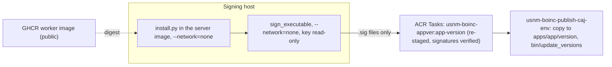

# Releasing a BOINC app version

`scripts/boinc-app-release.sh` builds, stages, signs and publishes one app version on the
live server in one command:

```sh
scripts/boinc-app-release.sh --env prod --app usnm_ocr --version 1.0 --signing-host HOST --what-if
scripts/boinc-app-release.sh --env prod --app usnm_ocr --version 1.0 --signing-host HOST
```

`--signing-key-dir` (default `/usbbak/signing/boinc`) and `--signing-dataset` (default
`usbbak/signing`) name where the private key is on the signing host. `--what-if` runs the
read-only checks and prints the plan.

## What it needs

- The server and bridge images in `infra/boinc/env/<env>.json` (`scripts/build-boinc-images.sh`)
  and the project initialised (`usnm-boinc-init-caj-<env>`).
- `codeSignPublicKey` in the settings: the public half of the key on the signing host.
- `images.worker`: the public GHCR worker image, by digest (below).
- SSH as root to the signing host, with the key's dataset unlocked by hand:
  `zfs load-key usbbak/signing && zfs mount usbbak/signing`. The script never unlocks it.
- podman on the signing host.

## Steps



1. **Worker image.** Volunteers' Docker pulls it, so it must be public, and the project's ACR
   has no anonymous pull (ADR-0019, addendum). `.github/workflows/boinc-worker.yml` builds the
   Tesseract engine and `ocr/boinc/Containerfile` on it and pushes
   `ghcr.io/tgoodyear/usnm-boinc-worker`; it runs by hand from main and writes the digest to the
   run's summary. Make the package public once in its settings, put the digest in
   `images.worker`, and commit. The script checks that an anonymous client can read that
   digest. With `images.worker` empty it builds the engine and worker in ACR Tasks instead
   (cached by input key), as a build check, and stops.
2. **Stage.** The server image goes to the signing host with a short-lived ACR pull token
   (deleted after the pull). `scripts/boinc/install.py` and `ocr/boinc/`, from the committed
   HEAD, run in it with `--network=none` and write
   `apps/<app>/<version>/x86_64-pc-linux-gnu__docker/` (wrapper, `job.toml`, a `Dockerfile`
   pinned to the worker digest, `version.xml`).
3. **Sign.** BOINC's `sign_executable` runs in the server image with `--network=none` and the
   key directory mounted read-only, and signs every file but `version.xml`. Only the `.sig`
   files come back. The work directory on the signing host is removed on exit.
4. **Publish.** ACR Tasks builds `usnm-boinc-appver:<app>-<version>` from
   `contrib-compute/images/appver/`: the server image with the version directory staged again
   from the same inputs, the `.sig` files added, and each file checked with
   `crypt_prog -verify` against `codeSignPublicKey`. A signature that does not match fails the
   build. `provision-boinc.sh --publish-image <digest>` deploys the manual job
   `usnm-boinc-publish-caj-<env>` with that image (it has the share, the database and the vault,
   as the init job does), and the script starts it. The job copies the version to the share,
   installs the app's templates and runs `bin/update_versions --noconfirm`. A version already on
   the share must be identical: versions are immutable, so a change is a new version. The
   script then writes the image's digest to `images.appver` in the settings; commit it. Every
   `provision-boinc.sh` deploys the publish job on `images.appver`, so the job stays and always
   holds the last published version (rerunning it is safe: it changes nothing when the version
   is already there). `--publish-image` overrides it for one deployment.

## Test client (not built yet)

An end-to-end test needs a BOINC client with Docker, attached to the master URL with a test
account, that gets one reserved job submitted through the bridge job (design.md, section 4)
and returns a result that validates and is assimilated. Container Apps cannot run Docker in a
container, and neither can ACI. The plan is a small spot VM, defined in Bicep in its own group,
created for the test and deleted after it, so nothing stands between tests. The design is in issue #484.
