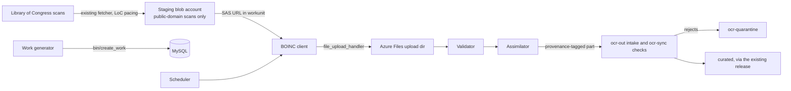

# BOINC route: design

Status: draft. Nothing here is deployed. Facts about BOINC and Azure are
in [verified-facts.md](verified-facts.md); each is cited there with a fetch date
(2026-10-13). UNVERIFIED marks a claim that was not confirmed.

BOINC is the work-distribution layer for every contribution route. The Proxmox LXC template,
the docker/podman container and the Azure Spot VM or container group (see [interface.md](interface.md)) each run a BOINC client attached to this
project server. A volunteer on a plain machine uses `scripts/boinc/attach.sh` instead.
The trust model:

- Contributors never hold an Azure credential.
- Every result is provenance-tagged.
- New hosts start on probation (every job replicated), trusted hosts are sampled.
- Results enter the same `ocr-sync` checks and the same quarantine as any other node's output.

## 1. How it works

We run one BOINC project server in Azure. Hosts install the BOINC client, attach to the
project URL with an account key, and the client fetches signed app files and workunits.
BOINC's scheduler, file transfer and account system do the work distribution. A contributor
holds a BOINC account key and no Azure credential. Trust is adaptive replication, then sampled
re-OCR.

## 2. Hosting on Azure

### 2.1 One Container Apps app

One Container Apps app, one container, `minReplicas = maxReplicas = 1`. The container runs
what `boinc-server-docker`'s `apache` image runs: `supervisord` starting cron, Apache with
PHP, and `bin/start`, which starts the feeder, transitioner, validator, assimilator,
file_deleter, db_purge and our work generator. Reasons:

- The feeder and the scheduler share a System V shared-memory segment (at least 32 MB), so
  they must share a host. Two containers in one replica share the network namespace, but
  whether they share the IPC namespace is UNVERIFIED. One container removes the question.
- Upstream splits the stack into `mysql`, `makeproject` and `apache` images; the daemons are
  already inside `apache`. We copy that split and replace `mysql` with the managed server.
- A sidecar is useful for one job: a log or metrics shipper. It is not needed in the first
  version. If added later it can share a replica-scoped volume with the main container.
- A second replica is not allowed: two schedulers with two feeders would each have a job cache
  and would both run the transitioner and validators against the same rows. BOINC supports
  multi-host projects, but only with the daemons each assigned to one host
  (`wiki:MultiHost`). We do not need it at this size.

Sizing for the first deployment, with clients arriving from all host routes: 1 vCPU and 2 GiB (the Consumption combination). Apache with
PHP-FPM or mod_php, the scheduler CGI and about eight daemons fit in 2 GiB. UNVERIFIED until
measured.

### 2.2 Scale to zero is not viable

The daemons are long-running processes that poll the database every few seconds. The feeder
holds the job cache in memory. Scale to zero would stop all of them. A volunteer's scheduler
RPC arriving at a cold replica waits for a start that includes shared-memory warm-up and the
feeder's first fill. BOINC clients back off and retry, so it would "work", but results being
uploaded and validated would stall for the cold period, and the daemons would not run when no
HTTP request has arrived.

So: `minReplicas = 1`. What we can do cheaply is a pause switch. Setting `minReplicas = 0`
(and stopping the work generator) parks the whole project. The clients back off with growing
delay. That is the real "off" and costs only the database and storage.

Container Apps bills a replica at the idle rate (lower) when it is not busy and at the active
rate when it is. The daemons use little CPU when no work flows, so the real bill sits between
the two. Section 6 gives both bounds.

### 2.3 Storage inside the app

The BOINC project tree needs persistence: `upload/`, `download/` (for the small per-workunit
manifests and the app files), `keys/` (public code-signing key, upload key pair), logs. On
Container Apps the container disk is ephemeral and the persistent option is an Azure Files
mount; Blob storage cannot be mounted. So:

- an Azure Files share holds `upload/` and `download/`; mounted at the project path;
- `keys/` is not on the share. The container start script writes the upload key pair from
  Key Vault into a tmpfs-backed path and links it into the tree;
- the code-signing private key is not anywhere in Azure (section 5.4).

Whether SMB semantics (setgid, umask 0002, file locking) hold under the mount is UNVERIFIED.
If they do not, the fallback is a one-user container (web and daemons both as `boincadm`),
which gives up the web-user/daemon-user split BOINC recommends but keeps one process owner.
That is a deployment-time test (section 9, question 3).

### 2.4 Database: Azure Database for MySQL flexible server, burstable

`Standard_B1ms` to start (1 vCore, 2 GiB, 341 connections), MySQL 8.4, 20 GiB storage, private
access in a VNet shared with the Container Apps environment, which cannot be changed later, so
choose it now. Notes:

- Authentication. BOINC reads a fixed password from `config.xml` and cannot refresh a token.
  Entra tokens last 5 to 60 minutes. So the daemons use a normal MySQL user whose password is
  generated at deploy time and stored as a Key Vault secret. Container Apps reads it through
  the app's user-assigned managed identity as a Key Vault secret reference. The password
  appears in the running container's environment and in the rendered `config.xml`, so
  `config.xml` is rendered into tmpfs at start, never into an image layer or the repo. Entra
  admin is still set for human access. This is the one place where the "no keys in config"
  rule is not fully met, and it is documented as a gap.
- MyISAM. `post`, `thread` and `profile` are MyISAM in `schema.sql`. We turn off forums and
  profiles. Whether the server rejects MyISAM is UNVERIFIED; the `schema.sql` we apply is
  tested on a throwaway server first.
- TLS. Whether the BOINC C++ and PHP clients connect with `require_secure_transport = ON` is
  UNVERIFIED. If they do not, set it `OFF`. That is acceptable only because the server has
  private access only.
- CPU credits. B1ms has 20% baseline CPU. The transitioner and feeder poll constantly. If the
  credit balance drains, MySQL throttles to 20%. We alarm on the CPU-credit metric and move to
  `Standard_B2s` (4 GiB RAM variants cost more; section 6) when it does.
- Privileges. A setup user with `CREATE`/`ALTER`/`INDEX`/`DROP` runs `make_project` once from a
  one-off job; the run-time user gets `SELECT`/`INSERT`/`UPDATE`/`DELETE`. UNVERIFIED that the
  run-time user needs nothing more.

## 3. Static frontend: what can be static

Honest scope: very little.

- The client requests `<master URL>get_project_config.php` and the account RPCs
  (`create_account.php`, `lookup_account.php`) at the master URL. All are PHP. So the master
  URL must be served by the dynamic app. A static master page can carry the scheduler URLs
  (HTML comment plus `<link rel="boinc_scheduler">`) but cannot answer
  `get_project_config.php`.
- Static Web Apps can link a Container Apps backend, but this needs the Standard plan and is
  for `/api` routes (UNVERIFIED for the root path). A redirect rule from the static host to the
  dynamic one could work because the client follows redirects (`CURLOPT_FOLLOWLOCATION`), but
  that is UNVERIFIED end to end.

Decision:

1. The master URL is `https://boinc.<project domain>/`, a custom domain on the Container App.
   Its stability matters more than anything else here: a changed master URL forces every
   volunteer to reattach. The domain is ours, so we can move the app behind it.
2. Static Web Apps, Free plan, hosts the human-facing pages: what the project is, how to
   join, the privacy notice, the terms of use. These are plain HTML built from files in the
   repo. Nothing the BOINC client needs lives there.
3. File transfer: downloads come from blob storage (section 4); uploads go to the dynamic app's
   `file_upload_handler`, because upload cannot be redirected to blob storage.
4. Scheduler RPC goes to the dynamic app at `https://boinc.<project domain>/<project>_cgi/cgi`.

This differs from the "static frontend" the maintainer asked for. Reasons are in section 8.

## 4. Data flow

### 4.1 Scans served to volunteers

The scans are staged by the existing on-prem fetcher (the scan server already writes from
LoC's batch bags with LoC pacing). A separate staging copy step (not built here, a TODO in
section 9) copies the pages queued for BOINC into a dedicated staging storage account and
writes a manifest: one line per page with page id, blob name, byte size, MD5, language,
OCR profile.

Access mechanism: each workunit's input URLs carry a read-only SAS signed with a user
delegation key (Entra identity of the work generator's managed identity, no account key).
Reasons for SAS rather than an anonymous container:

- an anonymous container is a free CDN for anyone, billed to us;
- a SAS limits access to named blobs for a fixed time.

The limit of this: BOINC stores the URL in the workunit and sends it to every host that gets a
replica or retry, and a user delegation key lives at most seven days. So the workunit deadline
(`delay_bound`) is 5 days and the SAS lasts 7 days from creation. A workunit that is not
finished before its SAS expires is cancelled and its pages go back to the manifest for a new
workunit. UNVERIFIED: how many workunits that affects in practice.

What the staging account may hold: public-domain Chronicling America page images that were
already fetched from LoC, and nothing else. It must never hold:

- search text, user data or query logs;
- OCR output (that goes to `ocr-out`);
- any image from a source with rights restrictions or a take-down;
- keys, manifests that name internal hosts, or anything from the curated store.

The account has public access disabled, shared-key access disabled, a lifecycle rule that
deletes blobs after 14 days, and diagnostic logs to Log Analytics.

Why serving these is acceptable: the images are public-domain and already obtainable from LoC;
serving a copy does not release anything private. The cost of serving, not privacy, is the
constraint (section 6). It also moves the load off LoC: volunteers never contact LoC, so LoC's
pacing limits stay with the one fetcher.

### 4.2 Results

Each workunit produces one output file, `result.json`, uploaded through BOINC's
`file_upload_handler` (certificate-signed by the project's upload key). It has, per page:
page id, plain text, SHA-256 of the text, engine name and version, traineddata SHA-256, the
MD5 of the input image it read, and optionally ALTO. Upload size cap 8 MB.

### 4.3 Assimilation and provenance

The assimilator (a Rust program run by BOINC's `script_assimilator`) takes the canonical
result and writes one provenance-tagged part per page to a sink behind a trait. The tag has:

- `source = "boinc"`;
- `boinc_host_id`, `boinc_user_id` (an integer, not an email);
- `app_version` (BOINC app version id and the pinned engine and traineddata hashes);
- `validation_state`: one of `replicated` (two or more matching results), `single_trusted`
  (one result from a trusted host), `single_untrusted_fallback` (not expected; flagged);
- the workunit name, result id and credit granted.

The sink writes into the `ocr-out` intake, using the names `ocr-sync` already reads:
`pages/<lccn>_<date>_ed-<n>.boinc.<stamp>.parquet` and `alto/<doc_id>.boinc.<stamp>.xml`, with
`boinc` as the node. `ocr-sync` then applies its usual checks (sizes, strict schema, outstanding
page, text hash, allowed engine, bounded ALTO parse). Rejects go to `ocr-quarantine`. Nothing
from BOINC reaches curated storage directly. The sink is a trait in the code and is stubbed
with a clear TODO: the real write needs an identity that can write only those names.

`ocr-sync` does not need to change for the names, but BOINC rows would not pass today: it needs
an ALTO per page, a pinned image digest in the engine tag (a native app has no image), and
the page to be outstanding in the ledger. Exactly what the tag must say, what `ocr-sync` would
change and why, is in [ocr-sync-provenance.md](ocr-sync-provenance.md), written as an issue
for the main repository. This change touches nothing there.

Host id and app version are not given to a script assimilator, so the real implementation reads
them from the BOINC database by result id. That read is also stubbed behind a trait.

### 4.4 Job types beyond staged OCR

The maintainer asked whether distributed downloading and ingest are useful too. This section
judges each candidate from the repo's own docs (`docs/design/12-onprem-ocr-pipeline.md`,
`docs/operations.md`, `crates/usnm-ingest`) and from what the volunteer-host model allows. The
recommendation comes first.

**Recommendation.** Build the staged OCR type (4.1) first, as designed. Treat fetch-and-ocr as
the next type, written but switched off. If it is ever enabled, it runs at a low per-client
rate and is not a way around the source's limits (Risks, item 1). Prefer a better place to
get the data if one exists.
Do not build fetch-only. Run ingest candidates only on the project's own trusted nodes, and
only if a measurement shows they are worth moving.

| Type                | What the workunit carries                                         | Verdict                                             | Build now                                                                                  |
| ------------------- | ----------------------------------------------------------------- | --------------------------------------------------- | ------------------------------------------------------------------------------------------ |
| Staged OCR (4.1)    | page images from our staging account                              | first                                               | yes, the crate and templates                                                               |
| fetch-and-ocr       | page ids, URLs, sizes, MD5s; the client downloads from the source | worth building; off by default; low per-client rate | manifest slice type, request budget, client logic behind traits; the HTTP client is a stub |
| fetch-only (mirror) | URLs to download and send back                                    | not worth it                                        | no                                                                                         |
| Ingest              | depends on the step                                               | own trusted nodes only, except damage scoring       | no                                                                                         |

#### A. fetch-and-ocr

The workunit holds a manifest of up to 16 pages (4 by default). Each entry has: page id, batch,
format (`jp2` or `jpeg`), URL, expected byte size, MD5, language and profile. The client downloads each scan from the source itself, follows the same
routes as the maintainer's fetcher, reads it, and uploads only `result.json` (a few
hundred kilobytes). Code: `boinc/src/fetch.rs`; template `usnm_ocr_fetch_in`; the generator runs it
with `--mode fetch-and-ocr`.

Routes, from `docs/design/12-onprem-ocr-pipeline.md` (the batch route, #368):

- The first choice is the batch's original JP2 on `tile.loc.gov/storage-services/`, checked
  against the MD5 that the batch's bag lists (`manifest-md5.txt`). The generator copies that MD5
  into the manifest, so the client can verify it without reading the bag.
- Each workunit pins ONE format for each page, and every replica requests the same URL. The
  client has no per-client fallback: it never switches format on its own. An engine crash is a
  failed result. The generator may then reissue that page deliberately in the other format (the
  IIIF full-size JPEG, `/full/full/0/default.jpg`) as a new workunit.
- The maintainer reports that some JP2s crash the engine (exit 136). UNVERIFIED: the repo's
  docs do not give a rate (they report only that the JP2 and JPEG texts differ, and that
  Leptonica reads JP2 through OpenJPEG).
- A hold from the source (429, 503, 403) ends the page and is never retried or worked around,
  which matches the fetcher's rule in docs/design/12-onprem-ocr-pipeline.md: a hold, a 403 or a
  failure on the storage service never falls back to another route, so nothing goes round a
  block.
- The IIIF JPEG has no published MD5, so for a JPEG page the client checks only the size (if
  the generator knew it) and records the SHA-256 of what it read.

What it changes:

- No staging copy step, no staging account, no SAS, and no 7-day SAS limit on the deadline.
- No scan egress from our account. What remains is the app files (static Tesseract and the
  traineddata, downloaded once per host and version) and the small results.
- The load on the source goes up, not down (see Risks).

Cost with and without, in terms of section 6's blocks: the server blocks are the same either way. Staging blobs and scan egress drop to zero, and app-file egress stays inside the free allowance.

The cost no longer grows with pages. It moves to the source: at 4.5 MB per JP2 times 1.25
replicas, each page costs the source about 5.6 MB, so 150,000 pages are about 840 GB and about
190,000 requests a month (4.3 a minute on average). The maintainer's fetcher fetches each page
once, about 4.5 MB, and we then serve our own copy. Fetch-and-ocr is cheaper for
us because it passes the bytes, about 1.25 times as many of them, to the source.

#### B. fetch-only (mirror)

Not worth it. The bytes must come back to us: a volunteer downloads a scan from the source and
uploads it to our project. That doubles the transfer for the volunteer, does nothing for our
egress (we receive; upload to us is free), and adds a trust problem: an untrusted host hands us
an image we cannot compare to anything except the bag's MD5. That check works for JP2s, so
integrity is solvable, but the only gain over the existing fetcher would be more request
sources, which adds load on the source without fetch-and-ocr's saving. The maintainer's fetcher
already reaches the budget the source allows from one IP.

#### C. Ingest workunits

Judged from the repo. A step suits an untrusted host only if it needs no secret, reads no
private data, has bounded inputs, and gives output deterministic enough to compare across
replicas.

| Step (crate `usnm-ingest`)                                                        | Needs                                                                             | Untrusted hosts        | Why                                                                                                                                                                                                                  |
| --------------------------------------------------------------------------------- | --------------------------------------------------------------------------------- | ---------------------- | -------------------------------------------------------------------------------------------------------------------------------------------------------------------------------------------------------------------- |
| `ocr-damage` scoring                                                              | the page text; writes tables to the curated store                                 | feasible               | A pure function of text. Exact comparison works. Inputs can ride in the workunit (text up to 512 KiB). Output is a score per page. Needs a parity check against the Python audit first (#296)                        |
| `geocode`                                                                         | cached title records, `overrides/places.json`; no network                         | feasible in principle  | Deterministic, but its output is the catalog, which feeds the release. A wrong result is a wrong place on the map, so it would need full replication, and the gain is small (it runs without the network in seconds) |
| language detection, ALTO checks                                                   | one page of text or ALTO                                                          | feasible, not worth it | Cheap steps; the workunit overhead is larger than the work                                                                                                                                                           |
| `enqueue`, `curate`                                                               | the LoC listing, retained batch archives, write to the curated lake and Cosmos DB | own trusted nodes only | Writes curated storage and pipeline state; needs Azure identities. Also downloads whole batch archives, which the source limits to 10 bulk requests per 10 minutes per IP (docs/operations.md)                       |
| `titles-sync`                                                                     | LoC API, 5 s Crawl-Delay; writes the record cache and catalog                     | own trusted nodes only | The catalog decides what is released; the source limits it; the fetch must be the one paced client                                                                                                                   |
| `release`, `prune`, `duplicates`, `titles-archive`, `titles-seed`, `archive-copy` | curated store, Quickwit writer lock, raw store                                    | own trusted nodes only | Credentials, a writer lock, and the whole index                                                                                                                                                                      |
| `ocr-prefetch`                                                                    | fetcher, see A and B                                                              | see A                  |                                                                                                                                                                                                                      |
| `ocr-sync`                                                                        | `ocr-out`, `ocr-quarantine`, the ledger                                           | own trusted nodes only | It is the gate; it must not run where the result comes from                                                                                                                                                          |

Only damage scoring is a good ingest candidate for volunteers, and it has no volume problem: it
runs once per page, on text we already have. Defer it until the OCR route works.

#### Risks

1. Source rate limits. The repo records LoC's published limits as 150 requests a minute for
   image services and 150 for storage services, each with a one-hour block past it, and 10 bulk
   requests per 10 minutes per IP, and www.loc.gov's `Crawl-Delay` of 5 s
   (docs/design/12-onprem-ocr-pipeline.md, docs/operations.md). Whether those limits are per IP,
   per User-Agent or per service is UNVERIFIED, and the source's terms of use were not read.
   **The design is not an attempt to get around the source's limits.** The answer to the load
   is a low request rate per client. The client requirements are the 1 s minimum gap, one request at a time, a global
   budget the generator enforces (item 2), jitter between requests, and honouring `Retry-After`.
   Robots and terms rules for loc.gov were not checked (UNVERIFIED). The source has not approved this
   type. Nothing here contacts the source. The type exists as
   code and tests, and it is off by default.

   **Prefer a better data source if one exists.** The repo's own docs (cited, not confirmed
   beyond that) list candidates, all for OCR text rather than page images:
   `docs/design/04-data-sources-and-ingestion.md` records the Chronicling America Datasets
   portal's bulk OCR downloads (one `tar.bz2` per batch, with a `sha256` in the collection
   JSON), LoC's own NDNP-Open-OCR re-OCR outputs (425k+ pages as of August 2026 per that doc),
   the American Stories article-level dataset, and mirrors of the bulk OCR such as the
   `biglam/chronicling-america-bulk-ocr` bucket on Hugging Face (check provenance first). None
   of these is confirmed to carry the page images that a re-read needs. Whether the images are
   available in bulk, from a mirror or an archive, is UNVERIFIED. If they are, use that and
   leave this type off.

2. A request budget the generator enforces. Clients fetch only for workunits that exist, so the
   generator's creation rate caps the load. `fetch::Budget` sets workunits per run, hour and
   day. `from_requests` derives the hourly figure from a ceiling in requests a minute; the
   suggested ceiling is what the single fetcher uses today, 60 a minute (1 s gap), so BOINC
   replaces that load and does not add to it. At 1.25 requests per page (the replication
   factor) and 4 pages, that is 720 workunits an hour, far above the about 1,560 a day
   that 150,000 pages a month needs at 1.25 replicas. Per host: `max_wus_in_progress` 4 and the client's 1 s gap
   (`min_gap_ms`, never lower than 1,000 ms in a manifest) keep one host far below 150 a
   minute. The manifest carries the gap, one request at a time, a project User-Agent with a
   contact URL, and a client rule to follow no redirect off the allowed host.
3. A circuit breaker. If any client reports a hold (the task exits with code 33 for a 429, 503 or 403, which
   BOINC records in the result), the operator writes a future time into `--hold-file` and the generator
   creates nothing until then. A hold is also never retried or worked around by the client.
4. Validation when each replica downloads separately. Each workunit requests one explicit
   format, pinned in the workunit, and every replica requests the same URL. The client verifies
   the file's MD5 (from the bag, in the manifest) before reading, and a mismatch is a download
   failure (exit code 34), not a validation disagreement. Each result records what it read
   (`source`: format, byte count, SHA-256). The validator requires equal formats and equal input
   MD5s across replicas. A JP2 that crashes the engine is a failed result; the generator may
   reissue that page as a `jpeg` workunit. The repo measured 84% shared words between the JP2
   and JPEG texts on one page, below the 0.98 threshold, so the two formats are never mixed in
   one comparison.
5. Volunteer IP exposure. Volunteers' IP addresses will be visible to the source, along with a
   User-Agent naming the project, and a block affects only that volunteer. The maintainer
   accepts this risk.
6. Result integrity. Fetch-and-ocr adds no new ways to fake a result beyond staged OCR. The
   volunteer can claim a download that never happened, but then the text will not match
   replicas or the sampled re-OCR. The manifest URLs are generated and checked on both
   sides: https only, the allowed host list, a path pattern, no query, no port, no userinfo,
   no dot segments. A volunteer cannot be told to fetch an arbitrary URL, so the project
   cannot be used to attack a third party.

#### Build order

1. Staged OCR (4.1), as in the rest of this document.
2. Measurements on the project's own hardware, including how many JP2s crash the engine on the
   static build.
3. Check for a better place to get the images (Risks, item 1). If there is none, and the
   maintainer decides to enable the type: the HTTP client behind `fetch::Fetcher` with the
   low-rate rules above, a trial of 2,000 pages from the project's own hosts, then volunteers.
   The source has not approved this.
4. Damage scoring as an ingest type, if wanted.

## 5. Workunits, validation, packaging, security

### 5.1 Workunit shape

- Pages per workunit: 4. One frak2021 page took 160 to 330 s on the project's nodes (survey
  of 11 October), so a workunit is about 11 to 22 minutes of one core on similar hardware, and
  longer on slower machines. Short enough that a laptop finishes it, long enough that scheduler
  contact is not the cost.
- Download per workunit: 4 JP2 pages at about 4.5 MB each (measured on one page: 4.5 MB JP2
  versus 5.2 MB IIIF JPEG, same pixel size; usnewsmap `docs/design/12-onprem-ocr-pipeline.md`)
  plus a manifest of a few KB. About 18 MB.
- `rsc_fpops_est`: 4 pages x 250 s x 3e9 FLOPS = 3e12, a first guess calibrated by BOINC's
  estimated host speed. UNVERIFIED; recalibrate from the first results. `rsc_fpops_bound` is
  10x. `rsc_memory_bound` 2.5 GiB (the maintainer's figure per page in flight; measure it), `rsc_disk_bound` 200 MB.
- `delay_bound` (deadline): 5 days.
- `min_quorum = 1`, `target_nresults = 1` per job with adaptive replication on the app
  (`app.target_nresults = 2`; section 5.2). `max_error_results = 3`, `max_total_results = 6`.
- `one_result_per_user_per_wu` on, so one account cannot supply both replicas. Consequence for
  the host routes: hosts that share one account key cannot validate each other. A fleet that
  uses one key (say, all Spot VMs of one deployment) needs at least one other account in the
  pool, or the replicas wait for it. The recommendation is one account per contributor or
  deployment, never one global key.
- Throttles: `max_wus_in_progress` per host, `daily_result_quota`, and `min_sendwork_interval`
  set conservatively; section 5.5.

### 5.2 Validation

Validator: Rust, plugged in through `script_validator`. For each result it:

1. `init`: parses `result.json`, checks the structure, that the engine version and traineddata
   hash equal the values pinned in the app version, that each page has non-empty text unless
   marked blank, and that sizes are in bounds. Exit 0 valid, 3 transient, other invalid.
2. `compare`: for each page, normalises both texts (Unicode NFC not applied to avoid a
   dependency; lowercasing not applied since case carries information; whitespace collapsed,
   line breaks and hyphenation at line ends handled) and computes a word-multiset Dice score.
   Results match only if every page scores at or above the threshold (default 0.98) and the
   length ratio is within 5%. The word-multiset measure is linear in text length, unlike edit
   distance, which is quadratic on 30 KB pages. The thresholds are flags, not constants, and
   are not tuned: the first replicated results give the distribution to choose them.

The script validator sees only file paths, result id and runtime, so everything it can decide
is from the files. It does not know the expected page ids or input MD5s. The assimilator and
`ocr-sync` check those (the manifest is the source of truth), and `ocr-sync` re-checks.

Adaptive replication maps to the trust model:

| Existing term | BOINC mechanism                                                                                                                     |
| ------------- | ----------------------------------------------------------------------------------------------------------------------------------- |
| Probation     | A host with fewer than 10 consecutive valid results is untrusted: every job is replicated to a second host and the two are compared |
| Trusted       | A host past the threshold; its jobs are sent once, except random sampling                                                           |
| Sampling      | BOINC's own `1 - 1/CV` rule re-replicates some trusted jobs. We add a second layer below                                            |
| Revoked       | An invalid result resets `consecutive_valid`; the validator can mark suspicious; admin can ban the account                          |

Disagreements: when two results do not match, the transitioner creates a further replica (up
to `max_total_results`). If three or more agree, they win and the odd one is invalid for its
host (trust reset). If no quorum forms, the workunit errors, the assimilator logs an error
event with the page ids, and the pages return to the manifest for a new attempt. Nothing is
emitted for it.

A second layer that BOINC does not give us: two volunteers can collude or be one person with
two accounts. So regardless of BOINC's trust, a random sample of canonical results (chosen by
hashing the page id with a secret salt) is re-OCRed on the maintainer's
nodes and scored with the damage metric. A host whose sampled agreement falls under the
threshold is banned. The sample rate is not chosen; it needs the first measurements.

### 5.3 App packaging: native, not Docker

The app must run inside all three host environments:

| Host                                                | Docker-wrapper app                                                                                                                                                    | Native app                         |
| --------------------------------------------------- | --------------------------------------------------------------------------------------------------------------------------------------------------------------------- | ---------------------------------- |
| Unprivileged LXC container on Proxmox               | Needs a Docker daemon inside the container: nesting and extra LXC features, and an AppArmor and cgroup setup that often fails. UNVERIFIED here; treated as unreliable | Works: needs only the BOINC client |
| docker or podman container running the BOINC client | Needs the host's Docker socket (root-equivalent on the host) or privileged Docker-in-Docker. BOINC also says the Unix client cannot use Podman                        | Works                              |
| Azure Spot VM                                       | Works (a full VM can run Docker)                                                                                                                                      | Works                              |
| Azure Container Instances group                     | Impossible: ACI does not expose the container runtime or run privileged containers (Microsoft Learn, ACI troubleshooting page, read 2026-10-13)                       | Works                              |
| Plain Linux machine (`attach.sh`)                   | Needs Docker installed and the BOINC user able to run it                                                                                                              | Works                              |

Sources: `wiki:Docker-app-implementation` (on Unix the client needs Docker with the
daemon running and the BOINC user able to run the CLI, and Podman cannot be used),
`https://learn.microsoft.com/en-us/azure/container-instances/container-instances-troubleshooting`.

Decision: a native app, delivered by BOINC itself (signed, sticky files). The app version is
`usnm_ocr` and holds:

- `ocr-run`, a small Rust driver (in `boinc/`): reads the workunit manifest, runs Tesseract per
  page, writes `result.json`. A BOINC wrapper (`job.xml`) starts it, so the driver needs no
  BOINC API and gets suspend, resume and checkpoint handling from the wrapper.
- `tesseract`, statically linked (Tesseract 5.5.0, Leptonica with OpenJPEG for JP2), built in CI
  from the same sources and versions as the pinned engine image `ocr/engines/tesseract/`.
- the traineddata files (`frak2021`, and the `deu`, `deu_latf` models of the plan), pinned by
  SHA-256 in the app version. They are sticky files, so a host downloads them once per app
  version.

Checkpoints and eviction. An Azure Spot VM gets a 30 s eviction notice (Microsoft Learn,
Scheduled Events, `Preempt`; UNVERIFIED here, from memory of the docs) and a page takes 60 to
250 s, so `ocr-run` cannot finish a page after the notice. It checkpoints once per finished
page: the page's result is written to `checkpoint/page<N>.json` in the slot directory with a
write, flush and rename, so a kill at any moment leaves a whole page or none. On start it reads
the checkpoints in order, checks each page id and text hash, skips the pages already done and
redoes the rest. A stop therefore loses at most the page in progress, not the workunit. This
works for any stop: a BOINC quit, a reboot, or an eviction with the disk kept. It does not
help if the VM's disk is ephemeral and discarded on eviction; then the workunit is lost and
retried after its deadline. UNVERIFIED: whether the generic wrapper sends the app a stop
signal that `ocr-run` should handle, or kills it; the file-based design does not depend on
the answer. The checkpoint interval is one page; a finer interval is not possible with the
Tesseract command line, which gives no partial result.

Statically linking Tesseract with Leptonica and its image libraries is a build task that is
not done: UNVERIFIED that the static build reproduces the container's text
byte for byte. The fuzzy validator exists for the remaining differences (CPU-specific SIMD
paths).

Platforms, in order: `x86_64-pc-linux-gnu` first; then `aarch64-unknown-linux-gnu` (Azure Ampere
VMs, Raspberry Pi class hosts); `windows_x86_64`, `x86_64-apple-darwin` and `arm64-apple-darwin`
later and only if volunteers need them. The Linux build is static against musl or an old glibc,
so one binary runs on Debian, Ubuntu and RHEL-family hosts. Platform names are from
`wiki:BOINC-platforms`.

The Docker wrapper stays documented as the fallback for a future app that cannot be built
static. It is not built here. VirtualBox is not recommended (needs VT-x, nested virtualisation
is unavailable in LXC and ACI).

Native executables run with the BOINC user's rights on the volunteer's machine. The signature
from the offline code-signing key (5.4) is what makes that acceptable to the client. The app
reads only its slot directory and writes only `result.json`.

### 5.4 Code signing

- The code-signing key pair is generated on an offline machine (BOINC says disconnected and
  physically secure). The private key is never in the repo, the image, Key Vault or any Azure
  resource. The public key is committed in `boinc/keys/code_sign_public` (it is public by
  design) and baked into the container at build time.
- Release flow: CI builds the app files (`ocr-run`, the static `tesseract`, `job.xml`, the traineddata files)
  as a release artifact. A human takes the files to the offline machine, runs
  `sign_executable FILE private_key > FILE.sig` for each, and brings the `.sig` files back. They
  go into the app version directory and `update_versions` runs on the server with no private
  key present, which picks up the `.sig` files (verified-facts.md (h)).
- Rotation: BOINC supports an old-key signature chain. We keep a rotation runbook as a TODO.
- The upload key pair is separate, lives in Key Vault, and is loaded into tmpfs at start.

### 5.5 Security

Attack surface: the public scheduler CGI, `file_upload_handler`, the PHP web UI, and the blob
SAS URLs. The MySQL server has private access only; nothing else in the project is public.

Controls:

- Keep the PHP surface small: disable forums, profiles, private messages, teams (or keep
  teams), and the web UI's optional features in `html/project/project.inc`. Account creation
  can use `INVITE_CODES` at first so that the project starts effectively private; remove them
  to go public.
- Account creation. Host scripts and volunteers create accounts through the project's account
  RPC (`boinccmd --create_account`) or the web form, or attach with an existing account key.
  Accounts are anonymous apart from an email address. Invite codes (`INVITE_CODES_RPC`) are
  the gate if the project needs one. A fresh account's host starts untrusted, so new accounts
  earn no trust and produce replicated work; the generator cap bounds that cost.
- Limits: the upload handler enforces `max_nbytes` per file (8 MB in the output template), and
  BOINC's per-host quotas (`max_wus_in_progress`, `daily_result_quota`, `max_ncpus`) are set
  tightly. Download links are per-workunit and expire. How the project behaves under a
  sustained flood has not been tested (UNVERIFIED); the pause switch (2.2) is the backstop.
- Secrets: Key Vault (RBAC mode) and a user-assigned managed identity for the app. The staging
  blob account has shared-key access off. Exceptions to the repository's Entra-only rule
  (ADR-0009), all needed by the platform or by BOINC: the MySQL password (2.4); the key of the
  Azure Files account, because the Container Apps Azure Files mount takes an account key
  (that account holds only the BOINC upload and download directories); the Log Analytics shared
  key the Container Apps environment is configured with; and the user-delegation SAS URLs in
  workunit rows, because the clients are outside Azure and can't use Entra. No connection
  strings in Bicep outputs. The Files key is passed to the deployment as a parameter and
  not committed.
- Images: our own build from the BOINC `server_release/1.6/1.6.2` tag; the Docker Hub images
  are stale.

Privacy:

- BOINC stores volunteer email, name, IP address (user and host rows), and the account key.
  We set `enable_privacy_by_default`, show terms of use, turn on `enable_delete_account`, and
  run the `delete_expired_*` tasks.
- What we keep: account row (email, name, authenticator), host rows, result rows (credit,
  timings), the uploaded result files until assimilated. Retention: `db_purge` and
  `file_deleter` remove result and file data after `delete_delay_hours` (7 days for the
  files); workunit and result rows are archived out and removed after 30 days; accounts with
  no activity for 12 months are scrubbed. These numbers are proposals.
- Web server and scheduler logs include IP addresses. Log Analytics retention 30 days.
- Provenance records going to `ocr-out` carry an integer host id and user id, never an email
  or IP. The mapping stays in the BOINC database.
- Volunteers see no usnewsmap search data, ever (the staging account has none).

## 6. Cost

Prices come from the Azure retail prices API (`https://prices.azure.com/api/retail/prices`),
queried 2026-10-13, East US, pay-as-you-go. Retail list price, not an invoice.

| Item                                  | Meter                                          | Unit price                              | Monthly (730 h / 2,592,000 s) |
| ------------------------------------- | ---------------------------------------------- | --------------------------------------- | ----------------------------- |
| Container Apps vCPU, idle             | Standard vCPU Idle Usage                       | $0.000003 / s                           | 1 vCPU: $7.78                 |
| Container Apps vCPU, active           | Standard vCPU Active Usage                     | $0.000024 / s                           | 1 vCPU: $62.21                |
| Container Apps memory                 | Standard Memory (idle or active)               | $0.000003 / GiB-s                       | 2 GiB: $15.55                 |
| Container Apps requests               | Standard Requests                              | $0.40 / 1M after 2M free                | about $0                      |
| MySQL B1ms compute                    | `B1MS`                                         | $0.017 / h                              | $12.41                        |
| MySQL B2s compute (alternative)       | `B2S`                                          | $0.068 / h                              | $49.64                        |
| MySQL storage, 20 GiB                 | Storage Data Stored                            | $0.115 / GB-month                       | $2.30                         |
| Azure Files, 20 GB used               | Files v2 Hot LRS data                          | $0.0287 / GB-month                      | $0.57 plus operations         |
| Staging blobs, 45 GB                  | Hot LRS data                                   | $0.0208 / GB-month                      | $0.94                         |
| Static Web Apps, Free plan            | none in the API                                | not listed (list price $0, UNVERIFIED)  | $0                            |
| Static Web Apps, Standard (if needed) | Standard App                                   | $9.00 / month                           | $9                            |
| Key Vault operations                  | Standard operations                            | $0.03 / 10K                             | under $0.50                   |
| Log Analytics ingest                  | Analytics Logs                                 | $2.30 / GB (first tier $0)              | 3 GB: up to $7                |
| Blob egress to the internet           | Routing Preference Internet, Data Transfer Out | first 100 GB $0, then $0.08/GB to 10 TB | see below                     |

Container Apps: the first 180,000 vCPU-seconds, 360,000 GiB-seconds and 2 million requests per
subscription per month are free (Microsoft Learn billing page). I do not subtract it because
the subscription may host other things. Whether a Consumption-only environment has its own
hourly fee is UNVERIFIED; the API's "Environment" meters look like Dedicated-plan and private
endpoint charges.

The replica bill is between the idle and the active bound. Planning figure, assuming the
replica is active about 25% of the time: vCPU 0.25 x 62.21 + 0.75 x 7.78 = $21.4, memory
$15.55, total about $37.

Egress per page: 4.5 MB JP2, times the average replication factor. Planning factor 1.25
(untrusted hosts get every job twice; trusted ones are rarely replicated).

| Pages a month | Egress (GB) | Egress cost |
| ------------- | ----------- | ----------- |
| 20,000        | 112         | about $1    |
| 100,000       | 562         | about $37   |
| 150,000       | 844         | about $60   |
| 200,000       | 1,125       | about $82   |

The fixed server blocks (Container Apps, MySQL, storage, Key Vault, Log Analytics) are priced above. Egress is the only block that grows with pages. No total is given here: the figures are list prices and planning assumptions, not measured.

A cap in the work generator (`--max-pages-per-day`) sets the ceiling on pages, so a
large volunteer base does not raise the bill: the clients are idle until we feed them.

Egress is the main variable cost at any real volume; the fixed cost dominates at low volume. Compute is paid by the volunteers.

Knobs, in order of effect:

1. Pages per month (the generator cap). Linear in egress.
2. Replication factor. Raising the trust threshold or lowering the BOINC re-replication of
   trusted jobs lowers it; going from 1.25 to 1.1 saves 12% of egress.
3. JP2 (4.5 MB) rather than the IIIF JPEG (5.2 MB): 13% less. Already assumed.
4. Image compression beyond that: JP2 is already compressed, so gzip gains little (UNVERIFIED
   on these files). Downscaling from 400 dpi to 300 dpi would cut bytes by about 44%, but it
   changes the OCR input and needs an accuracy test first; not assumed.
5. Workunit size. Larger workunits reduce scheduler contact but not bytes. Smaller ones lower
   waste when a host leaves.
6. Compute scale: B1ms to B2s adds about $37 a month; a larger replica adds more.
7. Pause (2.2) when idle: saves the replica while the database and files keep their cost.

Volunteers downloading from the source directly (fetch-and-ocr) would remove egress and
staging, leaving only the fixed server blocks (4.4). It is not the plan: it moves the
bytes to the source, about 1.25 times as many per page, at a low per-client rate. Also rejected for now: a CDN in front of
the blob account. Pricing and cache hit behaviour for single-use 4.5 MB objects were not
checked (UNVERIFIED).

## 7. Coexistence with the other routes

- The three routes feed the same `ocr-out` and `ocr-sync`. Provenance tells them apart:
  `source` is `node` (the project's own workers) or `boinc`.
- Page allocation: the queue is shared. BOINC takes pages through the manifest that the
  staging step builds, drawn from the same queue messages with the same dedupe, so a page is
  not given to a BOINC volunteer and one of the project's own workers at once. The allocator for that is a TODO
  (section 9).
- Approval: for BOINC, approval is automatic with replication by default (any account may
  attach; trust is earned). If the maintainer wants a gate, invite codes provide one. A
  read-only view of host counts, untrusted and trusted counts, recent invalid results and
  sampled agreement, plus a ban action, is not built.

## 8. Where this disagrees with the requested architecture

1. Scale-to-zero. Not viable, for the shared-memory and long-running-daemon reasons in 2.2. A
   pause switch gives most of the saving when the project is idle.
2. Static frontend. Only the human pages can be static. The master URL, `get_project_config.php`,
   account RPCs, scheduler and upload handler must be dynamic. SWA Standard ($9) can link the
   container app but only for `/api`. I recommend SWA Free for the docs site and the master URL
   on the container app.
3. PaaS MySQL. Workable but not clean: MyISAM tables, TLS negotiation and a stored password.
   The cheap B1ms is also a CPU-credit risk. These are testable before spending anything beyond
   one throwaway server for an hour.
4. App type. The Docker wrapper is the usual BOINC way for container apps, but it fails inside
   ACI, unprivileged LXC and plain containers. The app is native with a static Tesseract.
5. Egress. It is the biggest line, and the only one that grows with success. The design caps it
   in the generator instead of in billing alerts alone.
6. Entra auth for MySQL cannot be used by BOINC. The password-in-Key-Vault path is the plan.
7. Distributed downloading. It is the cheapest option for us (about $57 against $118 at 150,000
   pages) because it hands the cost and the load to the source. I built it as code and tests
   but it should stay off unless the source agrees (4.4). Fetch-only is not worth building.
   Ingest steps other than damage scoring belong on the maintainer's own nodes.

## 9. Open questions

1. What monthly ceiling should the generator cap be set from?
2. Is `ocr-out` with a `boinc/` prefix the right intake, or should BOINC write to a separate
   container that `ocr-sync` also reads? It needs a change in the usnewsmap repo either way.
3. Does Azure Files under Container Apps keep setgid, umask and locking semantics that BOINC
   needs? Test with a throwaway app before choosing it.
4. Do the BOINC C++ and PHP clients connect to the flexible server with TLS required? Does
   it accept the MyISAM tables?
5. Does the static Tesseract build give the same text as the pinned container image? The first
   comparison run decides the validator thresholds.
6. The project's name, domain and terms of use: who writes them, and are they for a public
   launch or an invite-only pilot first? (No contact with BOINC; listing is optional.)
7. Who builds the staging step (copy from the scan server into the staging account and write
   the manifest), and how does it avoid giving the same page to two routes?
8. What are the sample rate and agreement threshold? They need the first measured runs.
9. Code-signing key custody: which offline machine, and who holds the backup?
10. Should the project's own OCR nodes also run as BOINC clients? Not decided and not
    documented here. The priority queue would stay off BOINC, because BOINC clients pull work
    at their own pace and back off up to a day when idle.
11. Does the maintainer accept `require_secure_transport = OFF` inside the private network if
    the BOINC clients cannot use TLS?
12. Is there a better place to get the page images than the source's per-page URLs (Risks,
    item 1)? Until that is answered and the maintainer decides, fetch-and-ocr stays off.

## 10. First real deployment step

Not without the maintainer's go-ahead: create a throwaway resource group
with the MySQL server only, run BOINC's `schema.sql` against it from a developer machine, and
record whether MyISAM is accepted and whether the BOINC daemons connect with TLS required. It
costs a few cents for an hour and answers questions 3 and 4 before anything else is built on
the answer.
