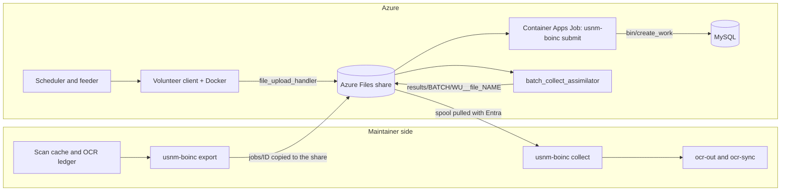

# BOINC server hosting: design

The production stack was deployed and checked as recorded in #470. This design
describes the committed Bicep and scripts; it does not claim a fresh live check.
Facts about BOINC and Azure are in [verified-facts.md](verified-facts.md), and
UNVERIFIED marks behavior that remains unconfirmed.

## 1. What this covers

PR #441 (`docs/boinc.md`, `crates/usnm-boinc`, `ocr/boinc/`) is the client side and the
bridge. This design does not change its model:

- a Docker-wrapper app, `usnm_ocr`, whose worker image runs Tesseract directly; BOINC's
  `docker_wrapper` controls the outer container, so volunteers need Docker;
- one page per task, in an explicit cohort of 1 to 100 already-cached pages;
- a central bridge, `usnm-boinc`, that reserves pages under the OCR lock and ledger,
  journals each submission before `create_work`, reads the stock `batch_collect_assimilator`
  spool and publishes native ALTO and Parquet to `ocr-out` and `ocr-sync`;
- the default validator (`sample_trivial_validator`), for trusted friends;
- a stock, self-hosted BOINC server (provisioned separately by this directory).

This directory is that last item: Azure hosting for the stock server and the notes on how the
bridge reaches it. Provisioning and image builds are driven by `scripts/provision-boinc.sh`
and `scripts/build-boinc-images.sh`. It contains no BOINC code, no work generator, no validator,
no assimilator and no app. The interface to #441 is in
[interface.md](interface.md).

## 2. Hosting on Azure

The production Container Apps environment, MySQL server, VNet, Files account and Key Vault use
the `westus2` setting in `infra/boinc/env/prod.json`; other deployments take their region from
their committed settings. Static Web Apps retains its `eastus2` default because it is available
in a limited set of regions.

### 2.1 One Container Apps app

One Container Apps app, one container, `minReplicas = maxReplicas = 1`. The container runs
what `boinc-server-docker`'s `apache` image runs: `supervisord` starting cron, Apache with
PHP, and `bin/start`, which starts the feeder, transitioner, file_deleter, db_purge and the two app daemons from #441's `ocr/boinc/daemons.xml` (`sample_trivial_validator` and `batch_collect_assimilator`). Reasons:

- The feeder and the scheduler share a System V shared-memory segment (at least 32 MB), so
  they must share a host. Two containers in one replica share the network namespace, but
  whether they share the IPC namespace is UNVERIFIED. One container removes the question.
- Upstream splits the stack into `mysql`, `makeproject` and `apache` images; the daemons are
  already inside `apache`. We copy that split and replace `mysql` with the managed server.
- A sidecar is useful for one job: a log or metrics shipper. It is not needed in the first
  version. If added later it can share a replica-scoped volume with the main container.
- A second replica is not allowed: two schedulers with two feeders would each have a job cache
  and would both run the transitioner and validators against the same rows. BOINC supports
  multi-host projects, but only with the daemons each assigned to one host
  (`wiki:MultiHost`). We do not need it at this size.

Sizing for the first deployment, a pilot with a few trusted clients: 1 vCPU and 2 GiB (the Consumption combination). Apache with
PHP-FPM or mod_php, the scheduler CGI and about eight daemons fit in 2 GiB. UNVERIFIED until
measured.

### 2.2 Scale to zero is not viable

The daemons are long-running processes that poll the database every few seconds. The feeder
holds the job cache in memory. Scale to zero would stop all of them. A volunteer's scheduler
RPC arriving at a cold replica waits for a start that includes shared-memory warm-up and the
feeder's first fill. BOINC clients back off and retry, so it would function, but results being
uploaded and validated would stall for the cold period, and the daemons would not run when no
HTTP request has arrived.

So `minReplicas = 1`. What we can do cheaply is a pause switch. Setting `minReplicas = 0`
(and not running the bridge job) parks the whole project, and the clients back off with
growing delay. A parked project costs only the database and storage.

Container Apps bills a replica at the idle rate (lower) when it is not busy and at the active
rate when it is. The daemons use little CPU when no work flows, so the bill falls between
the two. Section 6 gives the unit prices.

### 2.3 Storage inside the app

The BOINC project tree needs persistence: `upload/`, `download/` (the staged scans, one per task, and the app files), `results/` (the assimilator's spool), `keys/` (public code-signing key, upload key pair), logs. On
Container Apps the container disk is ephemeral and the persistent option is an Azure Files
mount; Blob storage cannot be mounted. So:

- an Azure Files share holds `upload/`, `download/`, `results/`, `apps/` and a `handoff/` folder (section 4), mounted at the project path over SMB with `mfsymlinks,uid=1000,gid=1000,dir_mode=0775,file_mode=0775,cache=strict`;
- `keys/` is not on the share. The container start script writes the upload key pair from
  Key Vault into a tmpfs-backed path and links it into the tree;
- the code-signing private key is not anywhere in Azure (section 5.1).

The `mfsymlinks` mount option provides the symlink behavior BOINC's project tree needs; the
mount also sets the container uid/gid and modes. Full POSIX ownership, permission and file-locking
semantics still need validation beyond successful project initialization and daemon startup.
The share is reached through a private endpoint in the VNet.

### 2.4 Database: Azure Database for MySQL flexible server, burstable

`Standard_B1ms` to start (1 vCore, 2 GiB, 341 connections), MySQL 8.4, 20 GiB storage, private
access in a VNet shared with the Container Apps environment, which cannot be changed later, so
choose it now. Notes:

- Authentication. BOINC reads a fixed password from `config.xml` and cannot refresh a token.
  Entra tokens last 5 to 60 minutes. So the daemons use a normal MySQL user whose password is
  generated at deploy time and stored as a Key Vault secret. Container Apps reads it through
  the app's user-assigned managed identity as a Key Vault secret reference. The password
  appears in the running container's environment and in the rendered `config.xml`, so
  `config.xml` is rendered into tmpfs at start, never into an image layer or the repo. BOINC uses
  this runtime account; the template does not configure a human Entra MySQL administrator.
- MyISAM. `post`, `thread` and `profile` are MyISAM in `schema.sql`. Forums and profiles are
  disabled. The production project initialization recorded in #470 succeeded against the
  configured MySQL server.
- TLS. The deployed MySQL server keeps `require_secure_transport` OFF pending #464's
  copied-project migration and Azure-chain acceptance. The pinned image's clients now
  require verified TLS; this does not prove old persistent project copies were upgraded.
  BOINC's root template and MySQL module expose `requireSecureTransport`, defaulting
  to `false` (OFF). Explicit `true` maps to ON; normal provisioning omits the parameter
  and cannot activate it implicitly. The server has private VNet access only. Enable
  enforcement only after the gates below and a separately coordinated #529 deployment.
  `scripts/boinc/patch-server-db-tls.py` patches the pinned source's Python
  `db_base`, **both** PHP connection paths, and C++ `DB_CONN`; CLI consumers pass
  verified TLS flags. Python's Bookworm mysqlclient cannot use `ssl_mode` against
  MariaDB, so an explicit immutable option file enforces TLS and verification.
  All three patched paths reject an empty session cipher. The image builds a
  dedicated bundle from Debian's DigiCert Global Root G2 **and Microsoft RSA Root
  Certificate Authority 2017**, as required by [Azure's current rotation
  guidance](https://learn.microsoft.com/en-us/azure/mysql/security/security-tls-how-to-connect).
  No leaf pin, disabled verification, or silent plaintext fallback is permitted.
  Certificate roots are verified at image build, not fetched at runtime.

  **Migration gate (not yet executed):** build the new base, server and bridge
  images together (base cache key includes patch and options). In an isolated dev
  project and database, initialize with enforcement ON and show non-empty
  `SHOW SESSION STATUS LIKE 'Ssl_cipher'` for Python, both PHP APIs and a C++
  utility. Exercise the web pages, `get_project_config.php`, scheduler RPC, feeder,
  transitioner, validator and assimilator. A wrong hostname, untrusted CA and
  TLS-disabled test server must all fail for each client type. Existing projects
  contain **copies**, not symlinks, of PHP, Python, daemon and CGI binaries:
  rebuild alone is insufficient. Back up the dev project and rehearse BOINC's
  `upgrade` or project installation from the new source with all daemons stopped,
  preserving config, keys, apps and spool. Inventory every installed binary and
  library against the patched image before resuming. Only after this is
  independently verified should a separately reviewed production maintenance plan
  migrate the project, verify live sessions while enforcement remains OFF, then
  turn it ON. Rollback restores the complete project and matching image while
  enforcement is OFF. Do not restart or deploy production as part of this PR. Local
  connector mocks and patch and syntax checks are prerequisites, **not** live Azure
  TLS acceptance or proof of uninterrupted production operation. The [local
  disposable TLS fixture](db-tls-acceptance.md) exercises the actual pinned Python,
  both PHP APIs, C++ `DB_CONN` and CLI against TLS-required MariaDB and MySQL 8.4
  servers, including certificate, hostname and plaintext negative cases. MySQL 8.4
  uses the same pinned image as the existing CI SQL checks and retests all five
  consumers after a persisted database restart. Synthetic certificates do not
  replace Azure-chain or full persisted-project migration acceptance.

- CPU credits. B1ms has 20% baseline CPU. The transitioner and feeder poll constantly. If the
  credit balance drains, MySQL throttles to 20%. We alarm on the CPU-credit metric and move to
  `Standard_B2s` (4 GiB RAM variants cost more; section 6) when it does.
- Privileges. The in-VNet init job creates the project schema and tree; the run-time user gets
  `SELECT`/`INSERT`/`UPDATE`/`DELETE`. UNVERIFIED that the run-time user needs nothing more.

## 3. Static frontend: what can be static

Very little can be static.

- The client requests `<master URL>get_project_config.php` and the account RPCs
  (`create_account.php`, `lookup_account.php`) at the master URL. All are PHP. So the master
  URL must be served by the dynamic app. A static master page can carry the scheduler URLs
  (HTML comment plus `<link rel="boinc_scheduler">`) but cannot answer
  `get_project_config.php`.
- Static Web Apps can link a Container Apps backend, but this needs the Standard plan and is
  for `/api` routes (UNVERIFIED for the root path). A redirect rule from the static host to the
  dynamic one could work because the client follows redirects (`CURLOPT_FOLLOWLOCATION`), but
  that is UNVERIFIED end to end.

Decision:

1. The master URL is `https://boinc.usnewsmap.com/` for production and `https://boinc-dev.usnewsmap.com/` for dev and experiments, both custom domains on the Container App in the usnewsmap.com zone.
   A changed master URL forces every volunteer to reattach, so it must not change. The domain is ours, so we can move the app behind it.
2. Static Web Apps, Free plan, hosts the human-facing pages: what the project is, how to
   join, the privacy notice, the terms of use. These are plain HTML built from files in the
   repo. Nothing the BOINC client needs lives there.
3. File transfer: both directions go through the dynamic app, which reads and writes the
   Files share. Downloads are the cached scans that the bridge stages with `create_work`;
   uploads go to `file_upload_handler`, which cannot be redirected to blob storage.
4. Scheduler RPC goes to the dynamic app at `https://boinc.usnewsmap.com/<project>_cgi/cgi`.

Custom-domain provisioning is declarative and staged by `scripts/provision-boinc.sh`:

1. The Bicep `custom-domain-dns` module writes the CNAME to the Container App FQDN and the
   `asuid` TXT verification record in the existing public zone.
2. Provisioning advances the app's custom-domain binding and managed-certificate stages. The
   production endpoint and DigiCert managed certificate were reported working in #470.
3. The master URL cannot change after volunteers attach; every client would have to reattach.
4. `boinc-dev` follows the repo's dev rule: it holds nothing unless a focused experiment is
   running, and is torn down fully afterwards.

This differs from a "static frontend" as first asked for.

## 4. Data flow and the bridge

### 4.1 Who runs what

| Step                                  | Where                        | Why there                                                                                |
| ------------------------------------- | ---------------------------- | ---------------------------------------------------------------------------------------- |
| `export` (reserve, journal, snapshot) | Maintainer side              | Needs the scan cache, the OCR lock and ledger, and the existing Entra credential path    |
| `submit`, `reconcile` (`create_work`) | Container Apps Job, in Azure | Needs the project tree, `config.xml` and the database; none is reachable from outside    |
| Scheduler, feeder, transitioner, etc. | Container App                | Stock daemons; one replica (section 2)                                                   |
| `batch_collect_assimilator`           | Container App                | Writes the spool under the project tree, on the share                                    |
| Runtime/upload secrets                | In-VNet secrets job          | Reaches the private Key Vault; generates missing secrets without passing them locally    |
| Project initialization                | In-VNet init job             | Creates the schema and project tree on the mounted share; skips complete initialization  |
| Signed app-version publication        | In-VNet publish job          | Copies the selected version to the share and runs `update_versions`                      |
| `collect`, `status`                   | Maintainer side              | Writes `ocr-out`; holds the ledger and journal; the Job gets no storage write credential |

### 4.2 Where `create_work` runs

`usnm-boinc submit` runs `bin/dir_hier_path` and `bin/create_work` from the project
directory (`crates/usnm-boinc/src/submit.rs`). Both read `config.xml` and write to the
database, which is on a private VNet with no route from on-prem (ADR-0015 has no VPN). The
choices were:

- **Inside the server container** (`az containerapp exec`). Works, but it gives an
  interactive path into the public-facing replica and puts a second writer in its process
  space. Rejected.
- **A separate Container Apps Job in the same environment.** Same image (server tools plus
  the `usnm-boinc` binary), same share mounted at the project path, same identity and
  Key Vault path to render `config.xml` into tmpfs, manual trigger only, no platform
  retries (`modules/bridge-job.bicep`). Chosen. It has no role on `ocr-out` or `curated`.
- **A VM or a Cloud Shell session.** Rejected: ADR-0005 keeps IaaS out, and the shell would
  need the database credential on a person's machine.

The bridge image combines the server image and bridge binary (`images/bridge/Containerfile`).
`scripts/build-boinc-images.sh` records its digest in the environment settings, and Bicep gives
the runtime and secrets identities `AcrPull` on the app's shared registry. `bridge-job`
(`images/server/bridge-job.sh`) renders `config.xml` into tmpfs and runs `usnm-boinc submit` or
`reconcile` for the job id in `JOB_ID`.

### 4.3 The hand-off and the spool

- **Jobs go in.** `export` writes `<root>/jobs/<id>/` (the page, `request.json`, the record).
  The operator copies that folder to `handoff/jobs/<id>/` on the share. The Job runs
  `usnm-boinc submit --root <share>/handoff --project <share project dir> --job <id>`. The
  submission record, with its stage, is then updated on the share, so the operator copies it
  back before `collect` runs. #441's bridge assumes one `--root` holding the journal for
  every step; with two hosts, that file has to be moved by hand until the bridge supports a
  remote submit (a gap, section 7).
- **Results come out.** `batch_collect_assimilator` writes
  `results/<batch>/<workunit>__file_<logical name>` under the project directory, which is
  the Files share. The operator pulls that folder to the maintainer's side with Entra
  authorisation and points `collect --spool` at the local copy. The share's copy stays until
  `collect` reports `published`, as #441 requires. Entra authorisation for Azure Files data
  access from outside Azure is UNVERIFIED here; the fallback is the account key, which is
  already an ADR-0009 exception for the mount.
- **A job can also run `collect`.** That would need the ledger and write access to `ocr-out`
  from an Azure identity, a new grant under ADR-0015. Not proposed.

## 5. Signing, security and privacy

### 5.1 Code signing

- The code-signing key pair is generated on an offline machine (BOINC says disconnected and
  physically secure). The private key is never in the repo, the image, Key Vault or any Azure
  resource. The public key goes into the project's `keys/` directory.
- Release flow: `scripts/boinc/install.py` (#441) writes the app version directory. A human
  takes its files to the offline machine, runs `sign_executable FILE private_key > FILE.sig`
  for each, and brings the `.sig` files back. They go beside the files and `update_versions`
  runs on the server with no private key present, which picks up the `.sig` files
  (verified-facts.md (g)). The Dockerfile and `job.toml` are app files and are signed too.
- Rotation: BOINC supports an old-key signature chain. A rotation runbook is still to do.
- The upload key pair is separate, lives in Key Vault, and is loaded into tmpfs at start.

### 5.2 Security

The attack surface is the public scheduler CGI, `file_upload_handler` and the PHP web UI. The
MySQL server has private access only. The Key Vault and Files account have public network
access off and are reached through private endpoints in the project's VNet. The public name is
`boinc.usnewsmap.com` with a managed certificate; #470 records a successful production health
check. The master URL is part of every volunteer's attachment and cannot change.

- Keep the PHP surface small: disable forums, profiles, private messages and teams in
  `html/project/project.inc`. Account creation can use `INVITE_CODES` so the project starts
  effectively private (#441's pilot is a few friends).
- BOINC's per-host quotas are set tightly in `config.xml` (`max_wus_in_progress`,
  `daily_result_quota`, `max_wus_to_send`); the cohort size (at most 100 tasks per batch) is
  the effective ceiling. How the project behaves under a flood has not been tested (UNVERIFIED);
  the pause switch (2.2) is the backstop.
- Secrets: Key Vault (RBAC mode), a runtime user-assigned managed identity shared by the app and
  the bridge, init and publish jobs, and a separate identity for the secrets job. Exceptions to
  the repository's Entra-only rule (ADR-0009), all forced by the platform or by BOINC: the MySQL
  password (2.4); the key of the Azure Files account, because the Container Apps mount takes it
  (the template reads it from the account it creates, so no key is passed in or committed); and
  the Log Analytics shared key that the Container Apps environment is configured with. No
  connection strings in Bicep outputs.
- Registry and operator access: the app and its jobs pull from the app's shared registry, with
  `AcrPull` granted by the BOINC stack to the runtime and secrets-job identities. Registry admin
  and anonymous pull are disabled. The configured operator receives Key Vault Secrets Officer;
  the in-VNet secrets job creates the runtime password and upload keys without routing their
  values through the operator's machine. The init and publish jobs also run in the VNet with
  their required share mounts and settings. The maintainer-side hand-off to and from the share
  still needs a network path into the VNet (open question 11).
- Private DNS: the VNet links the Key Vault private endpoint to `privatelink.vaultcore.azure.net`;
  the Files account also has its private DNS zone and endpoint.
- Policy: the repository's guardrails deny a storage account with shared key access and a
  Log Analytics workspace with local auth. This stack needs both (the three ADR-0009 exceptions
  in decision 6 of ADR-0019). `infra/main.bicep` waives exactly those two policies for the
  dedicated BOINC resource group when `USNM_BOINC_GROUP` is set. The group must hold only
  BOINC resources, and provisioning runs before this stack is deployed.
- Images: `scripts/build-boinc-images.sh` uses ACR Tasks in the shared registry. The build
  reuses `usnm-boinc-base` (pinned BOINC source and runtime dependencies) and
  `usnm-boinc-bridge-bin` (the Rust binary) when their input hashes are unchanged, then builds
  digest-pinned server and bridge images. The worker image remains in public GHCR for volunteer
  clients.

Privacy:

- BOINC stores volunteer email, name, IP address and the account key. `config.xml` sets
  `enable_privacy_by_default`, `enable_delete_account` is on, and the terms of use are shown.
- The files on the share are scans the cache already holds, volunteers' results and the spool.
  No search text, user data or credentials of ours.
- Web server and scheduler logs include IP addresses. Log Analytics retention is 30 days.
- #441's provenance carries its own route and version fields; nothing here adds a volunteer's
  email or IP to what is published.
- #441 notes that its result fields establish transport consistency, not proof that a
  volunteer ran the declared image. Trusted friends are a prerequisite.

## 6. Cost

Unit prices come from the Azure retail prices API (`https://prices.azure.com/api/retail/prices`),
queried 2026-10-13, East US, pay-as-you-go. They are retail list prices, not an invoice or a
westus2 estimate. No run-rate total is given: the volumes depend on how many pages the maintainer
chooses to send.

| Item                        | Meter                                          | Unit price                             |
| --------------------------- | ---------------------------------------------- | -------------------------------------- |
| Container Apps vCPU, idle   | Standard vCPU Idle Usage                       | $0.000003 / s                          |
| Container Apps vCPU, active | Standard vCPU Active Usage                     | $0.000024 / s                          |
| Container Apps memory       | Standard Memory (idle or active)               | $0.000003 / GiB-s                      |
| Container Apps requests     | Standard Requests                              | $0.40 / 1M after 2M free               |
| MySQL B1ms compute          | `B1MS`                                         | $0.017 / h                             |
| MySQL B2s compute           | `B2S`                                          | $0.068 / h                             |
| MySQL storage               | Storage Data Stored                            | $0.115 / GB-month                      |
| Azure Files                 | Files v2 Hot LRS data                          | $0.0287 / GB-month, plus operations    |
| Static Web Apps, Free plan  | none in the API                                | not listed (list price $0, UNVERIFIED) |
| Key Vault operations        | Standard operations                            | $0.03 / 10K                            |
| Log Analytics ingest        | Analytics Logs                                 | $2.30 / GB (first tier $0)             |
| Data transfer out           | Routing Preference Internet, Data Transfer Out | first 100 GB $0, then $0.08 / GB       |

Container Apps: the first 180,000 vCPU-seconds, 360,000 GiB-seconds and 2 million requests per
subscription per month are free (Microsoft Learn billing page). That is not subtracted here,
because the subscription may host other things. Whether a workload-profiles environment on the
Consumption profile has its own fee is UNVERIFIED; `infra/modules/containerapps-env.bicep`
says there is none without a Dedicated profile. That the Container Apps replica's traffic is
billed on the data-transfer-out meter is also UNVERIFIED.

### 6.1 Volumes from #441's contracts

The bridge sends one page per task, one result per task (`target_nresults` 1, quorum 1;
a task can be retried up to five times, `max_total_results` in `submit.rs`).

| Quantity per task    | Typical                                       | Contract limit (`usnm-ocr-contract/src/boinc.rs`) |
| -------------------- | --------------------------------------------- | ------------------------------------------------- |
| Download: scan       | about 4.5 MB (one JP2, measured on one page)  | 128 MiB (`MAX_SCAN`)                              |
| Download: request    | a few KB                                      | 16 KiB (`MAX_JSON`)                               |
| Upload: ALTO         | not measured (UNVERIFIED)                     | 32 MiB (`MAX_ALTO`)                               |
| Upload: text, result | not measured (UNVERIFIED)                     | 512 KiB (`MAX_TEXT`) and 16 KiB                   |
| Worker image pull    | once per host, from the registry, not from us |                                                   |

| Quantity per batch (at most 100 tasks) | Typical (4.5 MB scan) | At the contract limits |
| -------------------------------------- | --------------------- | ---------------------- |
| Staged on the share until deleted      | about 450 MB          | about 12.5 GiB         |
| Download from the server               | about 450 MB          | about 12.5 GiB         |
| Upload to the server                   | not measured          | about 3.1 GiB for ALTO |

Per-unit consequences, using the unit prices above:

- Download at 4.5 MB a task costs $0.08 / GB x 0.0045 GB per task above the free 100 GB a
  month, which is $0.00036 per task, if that traffic is billed on the meter in the table.
  Uploads to the server are inbound and have no transfer charge in the retail table (UNVERIFIED).
- Task rate: the batch sets it, not the server. A volunteer core needs the OCR time per page,
  which the project's own nodes measure at about 160 to 330 s (UNVERIFIED on volunteer
  hardware), so one core completes roughly 11 to 22 tasks an hour, and downloads about 50 to
  100 MB an hour. Scheduler contacts are about one per task.
- Files holds the staged scans for `delete_delay_hours` (168 in the template) after
  assimilation. The share quota is a parameter (`shareQuotaGb`, 200).
- The bridge job runs for seconds to minutes per cohort at 0.5 vCPU and 1 GiB, billed at the
  active rate for that time only.

The fixed blocks (Container App at the idle or active rate, MySQL, Files, Key Vault, Log
Analytics) are billed whether or not a batch is running. Pausing (2.2) saves the replica.

The knobs are the cohort size and how often batches go out, the MySQL tier (B1ms to B2s
if CPU credits drain), and the retention of staged scans.

## 7. Where #441 and this hosting may not fit

1. **Docker on the server: not needed.** The plan class `docker` only filters hosts by the
   Docker version they report (verified-facts.md (d)). The Container App and the Job run no
   containers. Volunteers need Docker; the host routes that cannot run it (ACI, an
   unprivileged LXC, a plain container without the host socket) cannot take this app.
2. **The bridge assumes one host.** `submit.rs` and `lib.rs` take a single `--root` that holds
   the jobs, the journal and the scan cache, and run `create_work` from a local project
   directory. With the server in Azure and the cache on-prem, the journal has to be copied
   across by hand (4.3). A `submit` that works from a remote hand-off, or journals on the
   server side, would remove that.
3. **`--cap-drop=ALL` and directory permissions.** `ocr/boinc/job.toml` drops all
   capabilities, and `ocr/boinc/Containerfile` sets the user. BOINC creates slot and project
   directories with mode 0771 (`boinc_mkdir`), so the container user may not be able to write
   its outputs unless the user ids match. #441's acceptance exercise covers this; we cannot
   check it from here.
4. **`workdir` and `create_args` are source-only.** The wiki does not document them; the
   wrapper source does (verified-facts.md (d)). A released wrapper binary is needed that has
   them.
5. **`install.py` needs a `docker` plan class** that the repository did not provide.
   `boinc/plan_class_spec.xml` here supplies it.
6. **The worker image's registry.** Volunteers' Docker pulls it by digest, without our
   credentials, from the public GHCR package (ADR-0019, addendum).
7. **`daemons.xml` has no standard daemons.** It lists only the validator and the assimilator;
   the template here adds the feeder, transitioner, file_deleter and db_purge.
8. **Azure Files semantics.** The Container Apps app and jobs mount SMB with `mfsymlinks`
   and explicit uid/gid and mode options (2.3). Full POSIX permissions and file-locking
   behavior across BOINC operations remain to be verified.
9. **Resource bounds.** `submit.rs` sets `rsc_memory_bound` to 1.5 GiB and `job.toml` caps the
   container at 1536 MiB. Whether Tesseract plus JP2 decoding of a 128 MiB scan fits is
   UNVERIFIED; #441 says to calibrate on real scans.

## 8. Later, for anonymous volunteers

#441 trusts its friends. If the project ever opens to anonymous volunteers, the server side
would add replication with a validator that compares the text of replicas (BOINC's
`compare_results` hook or `script_validator`) and adaptive replication, so trusted hosts are
sampled. That belongs with the bridge's own validation, not with this hosting, and is not
proposed here.

A job type where a volunteer's machine fetches the scan from the Library of Congress instead
of receiving it from us is deferred. If it were ever built, each client would run at a low
request rate, it would not be a way around the source's limits, and a better place to get
the images would be preferred if one exists. It is not planned until the maintainer decides.

## 9. Open questions

1. Does Azure Files under Container Apps preserve the POSIX permissions and locking behavior
   BOINC needs across all project operations? Project initialization and daemon startup succeeded
   (#470), but the full behavior remains to be verified.
2. Does BOINC's runtime account have all required MySQL 8.4 privileges? Project initialization
   succeeded (#470); `require_secure_transport` is OFF in the deployed stack, and #464 tracks the
   separate TLS migration gate before it can be enabled.
3. Does Entra authorisation work for pulling and pushing Azure Files data from the
   maintainer's side, or does the hand-off use the account key?
4. ~~Does a Container Apps Job accept per-run argument overrides at start (the job id to
   submit), or does each run need a new execution template?~~ Settled in code: an execution
   template drops the job's settings and has no mounts, so `scripts/start-boinc-bridge.sh`
   writes the run's settings into the job and starts it without an override (docs/boinc.md,
   "Start a bridge step"). UNVERIFIED against a live job.
5. Does the BOINC client follow a redirect for `get_project_config.php`?
6. ~~Which registry holds the worker image?~~ Public GHCR package (ADR-0019, addendum).
7. Code-signing key custody: which offline machine, and who holds the backup?
8. The terms of use and any change to project metadata. The production domain and master URL
   are set; a URL change after volunteers attach would require them to reattach.
9. ~~Who builds the server image and bridge job?~~ `scripts/build-boinc-images.sh` builds both in ACR Tasks and writes their digests to the settings (docs/images.md).
10. Should `submit` get a remote mode in #441, or is the manual hand-off enough for the pilot?
11. What network path does the maintainer use to reach the Files share for the hand-off in
    section 4? Secrets and project initialization are handled by in-VNet jobs; the share
    hand-off still requires an operator path into the VNet.
12. ~~How are the three ADR-0009 exceptions expressed in the guardrail policies?~~ Resolved
    (ADR-0019, decision 6): group-scoped Waiver exemptions in `infra/modules/boinc-exemptions.bicep`;
    the definitions are unchanged.
13. ~~Does the maintainer accept `require_secure_transport = OFF` inside the private network
    while BOINC's clients cannot use TLS?~~ The deployed setting is OFF; #464 tracks restoring
    required TLS after its migration gate.

## 10. Deployment and acceptance

The production deployment and checks are recorded in #470: provisioning completed, the in-VNet
secrets and project initialization jobs succeeded, the public project configuration and status
endpoints answered, the daemons were running, and the managed certificate was active. This
design update does not re-run those production checks. Remaining acceptance items are the
MySQL schema and runtime compatibility details, complete Azure Files permission and locking
behavior, and the #464 TLS migration; see the open questions above.
