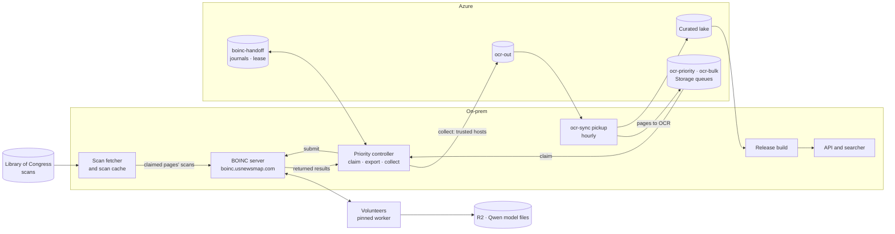

# BOINC

All of the project's OCR runs on volunteer computers through BOINC (#438); the direct queue worker on the OCR nodes was retired (#966). The BOINC server, its database, the bridge and hand-off steps and the batch controller run on on-prem hosts ([BOINC server on-prem](server/onprem.md)). The Azure-hosted server is kept only as a fallback ([the Azure server](server/azure.md)).

## How a page is OCRed

The pipeline since 6 November 2026:

`ocr-sync` queues pages on `ocr-priority` (user requests) and `ocr-bulk`. The [batch controller](server/batch-scheduler.md) on CT 211 claims them, pushes each page's cached scan straight to the BOINC host (#1116), exports and submits one workunit per page, and collects returned results. `collect` publishes a [trusted host's](server/gold-check.md#host-trust-for-usnm_ocr) result to `ocr-out` and deletes its queue message, and holds an untrusted host's result in quarantine. The journals and claims in `boinc-handoff` are still in Azure ([local hand-off state](server/local-state.md), #1367).

## Boundaries

- **Platforms:** `x86_64-pc-linux-gnu`, `aarch64-unknown-linux-gnu`, `arm64-apple-darwin`, `x86_64-apple-darwin` and `windows_x86_64` (`boinc/project/project.xml`, #533).
- **Container apps** (`usnm_ocr`, `usnm_gold` and container versions of `usnm_quality` and `usnm_qwen`; `usnm_assess` and `usnm_surya` retired on 2 November 2026) run under BOINC's `docker_wrapper` with the `docker*` plan classes: Docker or Podman on Linux, Podman through `Run_Podman` on macOS (with the quoting fix in `boinc/scripts/patch-mac-wrapper.py`), and the WSL2 `boinc-buda-runner` on Windows. The task's container runs Tesseract directly, with no nested container daemon. The [volunteer guide](volunteer/README.md) has the rootless Podman profile and the startup preflight, `boinc/scripts/volunteer_preflight.py --job-toml`, which checks slot access, cgroup limits, and pausing and resuming.
- **Native apps** run without a container ([OCR quality](apps/quality.md)). `usnm_quality` is a CPU binary (`crates/usnm-quality-app`) on all five platforms. `usnm_qwen` is a driver with the pinned `llama.cpp` builds in `boinc/apps/qwen/llama.lock` and `<sticky/><no_delete/>` model files, under the native plan classes listed in [the server and the apps](server/server-and-apps.md#connect-a-stock-boinc-project) (for example `apple_gpu_8b`, `nvidia_cuda_8b`, `amd_vulkan_8b` and the CPU class `mt`). Native binaries copy their slot files, report `fraction_done`, and write `boinc_finish_called` containing `0\n` before exiting 0; otherwise the client restarts them up to 100 times and aborts with `ERR_TOO_MANY_EXITS` (`client/app_control.cpp`).
- **Work** is an explicit cohort of 1 to 100 cached pages from one batch, or pages the [batch controller](server/batch-scheduler.md#queue-fed-work) claims off `ocr-bulk`, the queue's only consumer since #966. Neither fetches from LoC.
- **Credentials** stay with the bridge and controller, which alone reach Azure. Volunteers get images and processing metadata only.
- **Provenance:** the job and result transport (version 1) is separate from the planned ADR-0016 engine protocol; results record `contract=0` and `route=boinc@r1`, with the same models and routing as the retired worker.

## Apps

| App            | What it does                                                                                                                            | Page                                                                                                    |
| -------------- | --------------------------------------------------------------------------------------------------------------------------------------- | ------------------------------------------------------------------------------------------------------- |
| `usnm_ocr`     | Tesseract 5.5.0 OCR, one cached page per task (or several, as [bundles](apps/ocr-bundles.md)), publishing ALTO and Parquet to `ocr-out` | [Native OCR](apps/native-ocr.md), [the worker image](apps/worker-image.md)                              |
| `usnm_gold`    | Scores a host's engine on public ground truth; host trust for `usnm_ocr` comes from it                                                  | [The gold check](server/gold-check.md#gold-check)                                                       |
| `usnm_quality` | Per-page quality scoring without ground truth (#522)                                                                                    | [OCR quality](apps/quality.md)                                                                          |
| `usnm_qwen`    | Qwen3-VL word-crop transcription on GPUs; its `intel_vulkan_8b` class replaced the Iris pilot                                           | [OCR quality](apps/quality.md), [AMD GPUs](apps/amd-gpu.md), [Intel and NVIDIA GPUs](apps/intel-gpu.md) |
| `usnm_ndlocr`  | Japanese NDLOCR-Lite, collected into `ocr-ja`                                                                                           | [Japanese OCR](apps/ndlocr-lite.md)                                                                     |

Retired on 2 November 2026 and sending no work: `usnm_surya` ([Surya 2](apps/surya.md), kept for reading its results), `usnm_assess` ([JP2 versus IIIF JPEG](../notes/2026-10-16-boinc-assessment.md), #456; it never sent work), `usnm_iris` (#703) and `usnm_qwen_train` (#583). Production and experimental tasks share one account, CPU and GPU choices and resource limits; operators bound campaigns with the [native NVIDIA workunit window and stop procedure](apps/app-release.md).

## Volunteers

- [Volunteer guide](volunteer/README.md): what volunteers run, the apps, limits and troubleshooting.
- Quick starts: [Linux](volunteer/linux.md), [Windows](volunteer/windows.md), [macOS](volunteer/macos.md).

## App releases

- [Releasing an app version](apps/app-release.md): signing and publishing, feeder sizing, the native GPU windows and client acceptance.
- [Release pipeline](server/bootstrap-pipeline.md): the reviewed, resumable release from images to client acceptance (#551).
- [Images and deployment steps](apps/images.md) and [the worker image](apps/worker-image.md).
- [OCR bundles](apps/ocr-bundles.md), [native OCR](apps/native-ocr.md), [NDLOCR-Lite](apps/ndlocr-lite.md), [OCR quality](apps/quality.md), [AMD GPUs](apps/amd-gpu.md), [Intel and NVIDIA GPUs](apps/intel-gpu.md) and [Surya 2](apps/surya.md).
- [The AMD #885 release](apps/amd-885-release.md): the record of the scoped AMD Vulkan release.

## Server

- [BOINC server on-prem](server/onprem.md): what runs on the host, security updates, the hand-off steps, Cloudflare and LAN access.
- [The bridge steps](server/bridge-steps.md): running a step and registering apps.
- [Batch controller](server/batch-scheduler.md): the bounded tick that claims, exports, submits and collects, and archiving its history.
- [The scan-cache hand-off](server/scan-cache-handoff.md): one page from the scan cache to `ocr-out`, and the identities involved.
- [Allocation, recovery and acceptance](server/allocation-and-recovery.md): the job journal, recovering failed work and deliberate retries.
- [The gold check](server/gold-check.md): scoring hosts on public ground truth, host trust for `usnm_ocr` and building the gold bundle.
- [Host trust commands](server/host-trust.md): `usnm-boinc host-trust` onboarding, promotion and OCR spot checks.
- [The server and the apps](server/server-and-apps.md): installing app versions and plan classes, keeping scans, retiring an app.
- [Feeder-only refresh](server/feeder-refresh.md): restarting only the feeder so its slot allocation matches the app registry (#1462).
- [Feed health and monitoring](server/monitoring.md): the feed health checks and alerts, and the public task counts.
- [Database TLS checks](server/db-tls-acceptance.md): the CI fixtures for the BOINC database TLS patch and the project-code refresh.
- [Local hand-off state](server/local-state.md): moving journals, documents and lake stores onto the host (#1367, not switched).
- [The Azure server](server/azure.md): the fallback launcher, its start guard, the hand-off job and the share move.

## Design and history

- [Server hosting design](design.md) and [BOINC and Azure facts](verified-facts.md): why the Azure server was built as it was, with sourced facts about BOINC.
- Notes: [the pilot](../notes/2026-10-13-boinc-pilot.md), [BOINC beside the OCR worker](../notes/2026-10-16-boinc-ocr-node-pilot.md), [first current-worker pages](../notes/2026-10-17-boinc-first-current-worker-pages.md), [production drift reconciliation](../notes/2026-10-18-boinc-prod-drift-reconciliation.md), [the quality wave's JPEG cache](../notes/2026-10-19-quality-wave-jpeg-cache.md), [moving the server on-prem](../notes/2026-10-21-boinc-server-onprem-cutover.md) and the [post-training pilot](../notes/2026-10-16-boinc-transcription.md).
