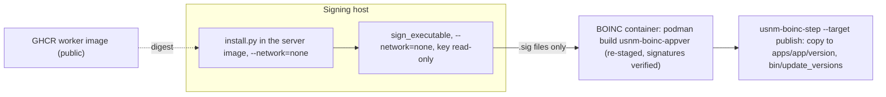

# Releasing a BOINC app version

`boinc/scripts/boinc-app-release.sh` builds, stages, signs and publishes one app version on the live server in one command. Prod's server is on-prem (`"server": "onprem"` in `boinc/infra/boinc/env/prod.json`, since 21 October 2026), so every prod release also takes `--onprem-host` (the Proxmox host) and `--onprem-ct` (the BOINC container); the script stops without them:

```sh
boinc/scripts/boinc-app-release.sh --env prod --app usnm_ocr --version 1.0 \
  --signing-host HOST --onprem-host HOST --onprem-ct ID --hold --what-if
boinc/scripts/boinc-app-release.sh --env prod --app usnm_ocr --version 1.0 \
  --signing-host HOST --onprem-host HOST --onprem-ct ID --hold
```

`--what-if` runs the read-only checks (settings, the worker image, the signing host's key status and podman) and prints the plan. `--signing-key-dir` (default `/usbbak/signing/boinc`) and `--signing-dataset` (default `usbbak/signing`) name where the private key is on the signing host. `--prepare-only` stages, signs and builds the app-version image in the container, then prints the `usnm-boinc-step --target publish` command that publishes it; leave it off only when immediate publication is authorized. Preparation proves neither publication nor volunteer execution. `usnm_ocr` and `usnm_gold` releases also need `--hold` or `--outrank-pinned` ([Held versions](#held-versions)).

On macOS, prefix release commands with `COPYFILE_DISABLE=1` so BSD tar doesn't add AppleDouble `._*` files to the staged payload.

## What it needs

- The server and bridge images ([Server images](images.md)); on-prem, the running `SERVER_IMAGE`.
- `codeSignPublicKey` in the settings: the public half of the key on the signing host.
- `images.worker`: the public GHCR worker image, by digest ([The worker image](worker-image.md)), for container versions.
- SSH as root to the signing host, with the key's dataset unlocked by hand: `zfs load-key usbbak/signing && zfs mount usbbak/signing`. The script never unlocks it.
- podman on the signing host.

## Steps



1. **Worker image.** Volunteers' Docker or Podman pulls it, so it must be public. The script checks that an anonymous client can read the `images.worker` digest. With `images.worker` empty it builds the engine and worker in ACR Tasks as a build check and stops.
2. **Stage.** The server image goes to the signing host with a short-lived ACR pull token (deleted after the pull). `boinc/scripts/install.py` and `boinc/apps/`, from the committed HEAD, run in it with `--network=none` and write `apps/<app>/<version>/<platform>__<plan_class>/` for `--kind container` (wrapper, `job.toml`, a `Dockerfile` pinned to the worker digest, `version.xml` with `<is_wrapper/>`) or `apps/<app>/<version>/<platform>[__<plan_class>]/` for `--kind native` (the native `<main_program/>` and its extra files, `version.xml` without `<is_wrapper/>`). Staging uses a mode-0700 directory under the checkout and a private directory under the signing host's root home, removed on exit.
3. **Sign.** BOINC's `sign_executable` runs in the server image with `--network=none` and the key directory mounted read-only, and signs every file but `version.xml`. Only the `.sig` files come back.
4. **Publish.** The same build context goes to the BOINC container, which builds `localhost/usnm-boinc-appver:<tag>` with podman, `--network=none`, on the `SERVER_IMAGE` the server runs (`/etc/usnm-boinc/server.env`). `check_appver.py` fails the build on a `.sig` with no staged file, a staged file without a `.sig`, anything in the signatures that isn't a `.sig`, a `version.xml` that names a file that wasn't staged, or a signature `crypt_prog -verify` rejects against `codeSignPublicKey`. `usnm-boinc-step --target publish` then runs the image's `publish-appver.sh` with the server's settings and mounts. It copies the version into the project, installs the app's templates, runs `bin/xadd` to register platforms and the unmodified `bin/update_versions --noconfirm` in a layout holding only the requested app, version and platform, and checks the exact `app_version` row before notifying the feeder (PHP `die(string)` can exit zero after a failed registration). A platform directory already in the project must be identical byte for byte: versions are immutable, and a change is a new version. Nothing goes to ACR and `images.appver` isn't written.

The Azure server published through its `usnm-boinc-publish-caj-<env>` job and recorded the last published image as `images.appver`; that job was deleted with the Azure server, and the setting is a record of the last Azure release.

## Distribution kinds

`boinc-app-release.sh` and `install.py` take `--kind container` (the default) or `--kind native`.

### Container versions

Container versions run `boinc/apps/Containerfile`'s worker image under the stock `docker_wrapper`, on the five registered platforms (`x86_64-pc-linux-gnu`, `aarch64-unknown-linux-gnu`, `arm64-apple-darwin`, `x86_64-apple-darwin`, `windows_x86_64`). `usnm_ocr`, `usnm_gold` and container `usnm_quality` use `--plan-class docker` (the default) and `images.worker`; the stable 8.2.11 client is enough. `usnm_ndlocr` also uses `docker` but has its own image, passed as a digest-pinned `--worker-image` ([NDLOCR-Lite](ndlocr-lite.md)). Mac platforms need a separately built wrapper ([Mac app versions](#mac-app-versions)).

The container classes of the retired apps (`docker_mt` and `docker_nvidia_cuda` for `usnm_surya`, `docker_intel_vulkan`, `docker_intel_opencl_4b` for `usnm_iris`, `docker_nvidia_train`) and of container `usnm_qwen` (`docker_mt_2b`, `docker_nvidia_cuda_8b`) remain in `plan_class_spec.xml`, but none has a live version since 2 November 2026. Those apps had their own images (`.github/workflows/boinc-qwen.yml`, `.github/workflows/boinc-surya.yml`), and a release for one takes `--plan-class` and a digest-pinned `--worker-image`.

#### Line-job versions (`docker_lines`)

A `usnm_ocr` or `usnm_gold` version for Cherokee line jobs goes under `--plan-class docker_lines`, on the same platforms and wrappers as `docker`, with a version number its app hasn't used. It loads beside the live `docker` version instead of outranking it, and serves only batch-1621 units. [OCR bundles](ocr-bundles.md), "Line jobs", explains why, and how line jobs and their gold are submitted.

### Native versions

A native version is a CI-built executable with no `docker_wrapper` or container image (#533):

- **`usnm_quality`**: `.github/workflows/boinc-quality-native.yml` builds `usnm_quality_<ver>_<platform>[.exe]` plus `SHA256SUMS` for all five platforms. Stage each with `--kind native --platform PLATFORM --binary FILE --binary-sha256 HEX`; it goes under `apps/usnm_quality/<version>/<platform>/`, with no plan class.
- **`usnm_qwen`**: the native driver with the platform's pinned `llama-server`, its runtime libraries, `boinc/apps/qwen/llama.lock` and `weights.lock`, each passed as `--extra-file LOGICAL=PATH`, under `apps/usnm_qwen/<version>/<platform>__<plan_class>`. The plan classes and their platforms are in [OCR quality](quality.md#app-versions-and-plan-classes). Models aren't in the version: they are staged once as `<sticky/><no_delete/>` inputs through `usnm_qwen_8b_in` or `usnm_qwen_2b_in`.
- **`usnm_ocr_native` and `usnm_gold_native`** (#1418, [Native OCR](native-ocr.md)): `--build-dir` takes the build directory `.github/workflows/boinc-ocr-native.yml` uploads, for `x86_64-pc-linux-gnu` with no plan class, after `boinc/scripts/check-native-ocr-build.py` has checked it against the container worker's Tesseract and models.

```sh
boinc/scripts/boinc-app-release.sh --env prod --app usnm_quality --version 1.1 --kind native \
  --platform arm64-apple-darwin --binary /path/to/usnm_quality_1.1_arm64-apple-darwin \
  --binary-sha256 CHECKED_SHA256 --signing-host HOST --onprem-host HOST --onprem-ct ID
boinc/scripts/boinc-app-release.sh --env prod --app usnm_gold_native --version 1.0 --kind native \
  --build-dir /path/to/boinc-ocr-native-x86_64-pc-linux-gnu/build \
  --signing-host HOST --onprem-host HOST --onprem-ct ID
```

Publishing an app needs it in `boinc/project/project.xml` first. Adding an active app changes the feeder's slot allocation ([Feeder visibility](#feeder-visibility)).

## Held versions

A new app version outranks the older ones of its platform and plan class. BOINC's feeder (stock `sched_shmem.cpp`) loads, of an app's versions not deprecated in the database, every one at or above the app's `min_version` when that is set, and otherwise only the highest. A workunit pinned with `app_version_num` is sent only with a loaded version of that number. So when `usnm_ocr` 1.7 (107) was published on 9 November 2026, the feeder dropped 106, and the controller's bundles, pinned to 106, went unsent (#1687). A `usnm_gold` version whose worker the running server's `gold-engine-platforms.json` doesn't bind gets every gold unit refused ("Gold image/base has no compatible reviewed platform binding").

So `usnm_ocr` and `usnm_gold` releases take one of two flags:

- `--hold` publishes the version deprecated. The image carries the hold (`APPVER_HOLD=1`), so a `--prepare-only` image published later with `usnm-boinc-step` is held too. `publish-appver.sh` runs a private copy of `update_versions` whose one `app_version` INSERT adds `deprecated=1`, so the row is held from the moment it exists; if the stock script doesn't have exactly one such INSERT, publication refuses before registering anything. A journal (`publish-held-<app>-<version>-<platform>-<time>.json`) goes under `<project>/ops-app-versions/` first, and verification refuses a row it finds live.
- `--outrank-pinned` publishes it live, for an app with no pinned work.

For `usnm_gold` the script also reads `gold-engine-platforms.json` from the running `usnm-boinc-server` container. Without a binding for the worker on `--platform` it refuses, unless `--hold`, and then it warns.

`boinc/scripts/app-version-hold.php` holds and releases. It runs in the server container, at `/usr/local/lib/usnm-boinc/app-version-hold.php` in images from #1687 on. Preview is the default; `--apply` changes the database:

```sh
podman exec usnm-boinc-server php /usr/local/lib/usnm-boinc/app-version-hold.php \
  --project /project/usnmocr --journal-dir /project/usnmocr/ops-app-versions \
  --app-version ID --action release
podman exec usnm-boinc-server php /usr/local/lib/usnm-boinc/app-version-hold.php \
  --project /project/usnmocr --journal-dir /project/usnmocr/ops-app-versions \
  --action min-version --min-version 106
```

- `--action hold` and `--action release` set `deprecated` on one `usnm_ocr` or `usnm_gold` container version. `--action min-version` sets `usnm_ocr`'s `min_version`, which keeps every version from that number up loaded, so units pinned to an older version are still sent after a newer one is released. `register-apps.php` writes the database's `min_version` into `project.xml` before `xadd` runs, so a later publication doesn't reset it.
- Each change writes a journal first (`<action>-app-version-<id>-<time>-<random>.json` or `min-version-usnm_ocr-...`, with the value before), then makes the change, checks it and touches `reread_db`. Revert with the opposite action. A version already in the target state journals nothing, but `--apply` still touches `reread_db`, so rerunning finishes a run that stopped before its notice.
- It refuses a change that would stop a pinned version number loading on any platform while workunits pinned to it are unfinished (no canonical result and no error yet, `need_validate` set, or not yet assimilated), and names the platforms. Wait for them, set `min_version` first, or pass `--accept-stranded`.
- A `usnm_gold` release also needs `/usr/local/lib/usnm-boinc/gold-engine-platforms.json` (or `--gold-bindings FILE`) to bind the worker the version's `Dockerfile` pins on its platform.

The controller checks the other side: before it submits bundles, it refuses a tick whose `bundle_app_version` the scheduler wouldn't send (held, unpublished, or outranked on a platform where it is published). The tick fails after collection, so `controller_tick` pages on the second one. That needs a server image whose `batch-inventory` reports `ocr_app_versions` (#1687); with an older one, each tick prints a `boinc_batch_pin_unchecked` warning and submits as before. The order for a plan rotation is in [OCR bundles](ocr-bundles.md#rotating-a-plan-onto-a-new-worker-version).

## Native Qwen releases

A new or changed plan class needs a server image with that class in its `plan_class_spec.xml`, and the scheduler itself, not only its XML, must be upgraded. The persistent project CGI is a copy: server startup refreshes it from the image (`refresh-scheduler.py`), so after a server rollout check that the project CGI's SHA-256 matches `/usr/local/boinc/sched/cgi`. Every Qwen GPU class ships closed (`min_wu_id=2`, `max_wu_id=1`), so publishing a version sends no work until an operator opens it ([Intel and NVIDIA GPUs](intel-gpu.md#admission), [AMD GPUs](amd-gpu.md)). Coordinate deployments on #529 and keep existing pins and queues.

The native classes need stable BOINC 8.2.11 or later (`nvidia_vulkan_6gb_8b` and `nvidia_vulkan_2b` 8.2.9) and no container runtime. The CUDA classes need a CUDA 12.4-capable NVIDIA driver; the pinned runtime carries the CUDA libraries, so volunteers need no toolkit, WSL or Podman.

### Windows bundles

A Windows CUDA version must include both pinned CUDA archives in `llama.lock`: the llama archive doesn't include `cudart64_12.dll` or the cuBLAS DLLs. Together they fit the 2 GiB native bundle limit that staging enforces. The Windows native CI artifact supplies app-local Microsoft CRT DLLs from the installed Visual Studio redistributable, checks their Microsoft Authenticode signatures and records versions and hashes in `VC_REDIST_SOURCE.json` and `SHA256SUMS`. Stage these as signed `--extra-file` members too. Staging rejects a missing CUDA or CRT dependency, including the portable `ggml-cpu-x64.dll` backend and its `libomp140.x86_64.dll`, which CPU backend discovery needs even for GPU offload. The NVIDIA driver's `nvcuda.dll` and the Windows system APIs are the volunteer's. Vulkan bundles take the driver's `vulkan-1.dll`; never bundle a loader.

### Failure reports

A native failure writes a nonzero `boinc_finish_called` and exits nonzero; BOINC may show **Computation error**. A bounded, fixed-schema `USNM_QWEN_FAILURE` JSON summary (outcome, runtime and model identities, driver, memory, timings and failure category; no paths, input text, prompts or account data) goes to task stderr, which reaches the scheduler even when no output uploads; on Windows it is appended to the slot's `stderr.txt`. BOINC uploads no output files for a failed task, so `diag.txt` follows the summary between `USNM_QWEN_DIAG_BEGIN` and `USNM_QWEN_DIAG_END`, cut to its first 2 KB and last 4 KB with absolute paths reduced to file names. Download, signature and loader failures can happen before the app starts and have no summary; read BOINC's own status and event log for those.

### Linux NVIDIA 2B (`nvidia_vulkan_2b`)

`nvidia_vulkan_2b` (Linux x86-64 only, #1234) runs the 2B `Q8_0` model and projector fully on NVIDIA cards too small for the 8B classes, such as a 6 GB GTX 1660 SUPER. BOINC detects and assigns the card through CUDA; the app runs the same pinned `ubuntu-vulkan-x64` llama.cpp runtime as `nvidia_vulkan_8b`, and refuses to start with less than 4,096 MiB of free Vulkan memory. The scheduler wants at least 4,500 MB of GPU RAM and BOINC 8.2.9. Both memory numbers are estimates from the model files (2,174 MiB) plus context, not measurements; measure the peak on the first unit. The class ships closed and has its own window for batch-2 work staged with `usnm-boinc qwen submit --target native-2b`.

Every `boinc-quality-native.yml` run uploads the release inputs as the `boinc-native-qwen-nvidia_vulkan_2b` artifact. `boinc/scripts/qwen_vulkan_bundle.py` builds them from that commit's musl `usnm_qwen` and the `llama.lock`-pinned archive (links copied as files, the two locks added); its `release.json` holds the on-prem manifest's `release` and `worker` entries. CI checks that the runtime is byte for byte the one already signed for `nvidia_vulkan_6gb_8b`. Download the artifact of the merged commit, verify it, and hand its files to the release script:

```sh
python3 boinc/scripts/qwen_vulkan_bundle.py verify --bundle "$PWD/target/qwen-2b" \
  --same-runtime-as boinc/infra/boinc/releases/prod-onprem-usnm_qwen-nvidia_vulkan_6gb_8b.json
mapfile -t inputs < <(python3 boinc/scripts/qwen_vulkan_bundle.py args --bundle "$PWD/target/qwen-2b")
boinc/scripts/boinc-app-release.sh --env prod --app usnm_qwen --version VERSION --kind native \
  --plan-class nvidia_vulkan_2b --platform x86_64-pc-linux-gnu "${inputs[@]}" \
  --signing-host HOST --onprem-host HOST --onprem-ct ID --what-if
```

No `nvidia_vulkan_2b` version had been released by 10 November 2026.

## Client acceptance (#548)

Registration and public health are not execution acceptance. Adding `--acceptance-config FILE --acceptance-evidence FILE` to `boinc-app-release.sh` runs acceptance after publication: only a matching client result, an independently validated canonical result, the expected nonempty outputs and confirmed cleanup print `release-ready`. A failure exits nonzero without rolling back the published version. `--prepare-only` can't be combined with acceptance; `--what-if` prints the acceptance plan without reserving or driving clients. An already-published version can be tested on its own:

```sh
python3 boinc/scripts/acceptance.py --env prod \
  --app APP --version N.M --platform PLATFORM \
  --plan-class CLASS --config acceptance-config.json \
  --evidence acceptance-receipt.json --timeout 1800 --dry-run
```

Remove `--dry-run` only under the current #529 coordination protocol, adding `--coordination-claim https://github.com/tgoodyear/usnewsmap.com/issues/529#issuecomment-N`. The argument records the operator's acknowledgement; it is not a lock or an authorization. The offline tests need no Docker or cloud resources: `python3 -m unittest discover -s boinc/scripts -p test_acceptance.py`.

### Configuration

A secret-free config for an existing dedicated client (adapt the transport to the test installation):

```json
{
  "fixture": "qwen-cpu",
  "server_command": ["ssh", "-o", "BatchMode=yes", "root@BOINC-HOST",
    "python3 /opt/reviewed/boinc/scripts/onprem_acceptance.py --expected-image sha256:REVIEWED_64_HEX_ID --project /project/usnmocr"],
  "client": {
    "mode": "existing",
    "dedicated_test_client": true,
    "python_command": ["ssh", "CLIENT-HOST", "runuser -u boinc -- python3 -"]
  }
}
```

- `server_command` is an argv transport that takes one JSON request on stdin and returns one JSON receipt. Exit status 75 (`EX_TEMPFAIL`) means it ran nothing: `acceptance.py` sends the same request again after `--poll-interval` until the run's deadline, counting `server_busy_retries`. Any other failure ends the run.
- `boinc/scripts/onprem_acceptance.py` is the on-prem transport. Install it with its adjacent `acceptance_server.py` in an operator-owned directory on the BOINC host. It shares `/run/usnm-boinc-step.lock` with the step runner and exits 75 while another step holds it. It checks the running `usnm-boinc-server` container against the reviewed local image ID (from `podman inspect` of the running container, bare or `sha256:`-prefixed; not a tag or registry digest), then runs the adapter inside it as the project user (UID/GID 1000) with a 90-second deadline. It creates and restarts nothing and needs Podman's `--preserve-fds` with `crun`. Use an existing administrator transport, not the controller's restricted key, and never skip SSH host-key checks. A transport timeout is an uncertain outcome: reconcile the reservation and dispatch journal before retrying.
- `python_command` runs Python from stdin as the BOINC service user (put `env BOINC_DIR=/path/to/data` before `python3 -` for a nonstandard data directory), so Mac, Windows and ARM clients work too. On macOS the probe finds Podman through BOINC's `Run_Podman` and `boinccmd` in the installed BOINC app.

The client must be attached to a dedicated assignment-only account: stock BOINC's `user.seti_id` only-run-own-jobs gate serves its targeted assignments and skips ordinary scheduling. The account must have no team, unrelated assignments or unrelated results in progress, and every dispatch and status check rechecks that. The runner never changes account flags, trust, preferences or scheduler policy, and never detaches or rewrites a client. Don't select a volunteer or any client running unrelated work.

Stock routing binds a numeric version, not an app-version ID, so reservation rejects another active platform or plan class with the same app and version number; give candidates distinct version numbers.

There is no automatic paid fallback. `"client": {"mode": "ephemeral", "sku": "Standard_D8s_v5", "authenticator_file": "/private/test-account.auth"}` opts into an Azure VM from `boinc/infra/boinc/test-client.bicep` in a run-specific resource group, for Linux x86 CPU or NVIDIA (an NVIDIA SKU needs explicit approval) only. It attaches with the isolated account's authenticator (a mode-0600 file whose fingerprint is checked against the server account first) and is torn down on every catchable exit; an unconfirmed delete fails the run and names the group. Recover with `boinc/scripts/boinc-test-client.sh --env prod --delete --resource-suffix <run_id>`, and remove a killed run's `.boinc-acceptance-<run_id>` and `.boinc-provision-<run_id>` directories. Runs default to 30 minutes (at most 4 hours), commands to 120 seconds and cleanup to 10 minutes (at most 30).

Evidence is written once, mode 0600, with the exact release, host and resource preflight, canonical result ID, output hashes and sizes and the cleanup outcome; never authenticators, raw RPC state, database errors, transcriptions or subprocess output. Evidence paths must be new for each run.

### Fixtures

Before a run, stage licensed test inputs in the project's hashed download hierarchy, install the app's input and output templates (and any validator job registry), and write `/project/acceptance/<fixture>.json`. The adapter creates one fresh host-targeted workunit, not a claim on production work, and refuses a workunit name already in the database, so stage a fresh job identity for each run. The shape (the values are placeholders, from a retired container class):

```json
{
  "release": {"app": "usnm_qwen", "version_num": 100, "platform": "x86_64-pc-linux-gnu", "plan_class": "docker_mt_2b"},
  "workunit_name": "REPLACE_WITH_ACTUAL_APP_WORKUNIT_NAME",
  "account_id": 42,
  "batch": 12,
  "min_quorum": 2,
  "peer_host_ids": [3],
  "profile": {"cpus": 4, "memory_bytes": 6442450944, "disk_bytes": 42949672960, "gpu": "none"},
  "input_template": "usnm_qwen_acceptance_in",
  "output_template": "usnm_qwen_out",
  "inputs": [{"name": "fixture-physical-input", "sha256": "REPLACE_WITH_ACTUAL_SHA256"}],
  "outputs": [{"name": "result.json", "kind": "json", "equals": {"unit_error": null}, "nonempty": ["transcription"]}]
}
```

The input template must match the manifest: `min_quorum=target_nresults=Q`, `max_error_results=1`, `max_total_results=max_success_results=Q+1`, resource bounds equal to `profile`, `delay_bound=14400`. Conflicts are rejected before reservation, and the workunit's database fields are checked after creation. List all template inputs in positional order with their content hashes. `peer_host_ids` names exactly quorum minus one dedicated peers on the same isolated account; the adapter assigns only that workunit to those hosts and never reduces the quorum. Reservation and dispatch intent are durable and serialized per fixture; an interrupted dispatch is never retried automatically (inspect the server's `*.reservation.json` and the workunit first). Releasing a fixture doesn't cancel its workunit; late results stay reportable.

The AMD route stages its fixture differently ([AMD GPUs](amd-gpu.md#bounded-acceptance-with-a-staged-workunit)): `audited_workunit_id` is accepted only there.

## Feeder visibility

The feeder runs `--allapps --purge_stale 5` with `shmem_work_items` 4096 and `feeder_query_size` 196608 (`boinc/project/config.xml.template`). Two limits decide what a scheduler request can see (#860):

- **Cache share.** With `--allapps`, the feeder divides the shared-memory slots between apps by `app.weight` once, at startup. `usnm_qwen` has weight 16; every other active app has 1 (`boinc/project/project.xml`). At nine equal weights (#860, October 2026) Qwen got 111 slots while 624 to 635 Qwen replicas were unsent, and eligible requests mostly got empty replies.
- **Query budget.** Each app's enumeration limit per pass is `floor(0.5 + feeder_query_size * app_weight / total_app_weight)`, independent of the cache size (the [pinned feeder](https://github.com/BOINC/boinc/blob/22bbebe08e2eaac5d5e88a6d93b88e800cb6341c/sched/feeder.cpp) defaults to 200 in total). Replicas a requesting host has already run occupy that prefix, so eligible work beyond it stays invisible.

`--purge_stale 5` is multiplied by 60 in the pinned feeder, so cached slots rotate after five minutes. On 28 October 2026, all 111 Qwen slots stayed occupied for over six hours while an eligible unit was absent from the cache. Stale purging can uncommit a homogeneous-redundancy workunit and add a replica; the project uses no HR, so check that every app's HR fields and every workunit's `hr_class` stay zero.

The sizing invariant, which tests derive from `project.xml` weights: every positive-weight app's rounded query budget covers at least twice the whole cache, Qwen's covers at least four times its 1,800-result ready baseline, and Qwen's cache share covers that baseline. The 4,096-slot cache needs about 380 MB of shared memory. Calculate live shares from the database's active apps, since retirements change the weight sum.

`xadd` doesn't update an existing app's weight. Change `app.weight` in the database and the rendered `feeder_query_size` together, and restart only the feeder, since `reread_db` doesn't recompute slot shares ([Feeder-only refresh](../server/feeder-refresh.md)). A `config.xml` change also changes the hash the Qwen refill controller pins; disable its timer first and re-pin it after. Don't clear queues or weaken `one_result_per_host_per_wu` or quorum to improve apparent dispatch.

### Allocation drift detection

The guarded feeder records the ordered app IDs and full-precision weights from the startup scan that sets its `--allapps` allocation in `${USNM_PID_ROOT:-/var/lib/usnm-boinc}/pid_<host>/usnm-feeder-slots.json`, tied to the feeder PID, process start ticks and boot ID and refreshed about once a minute. A snapshot over three minutes old is unknown. A reload that changes the app IDs or weights is latched even if the registry later reverts.

`feeder-slot-guard.py` compares that snapshot with the database's active apps over verified TLS, including changes made outside `xadd`. The server image's supervisor program emits a `boinc_feeder_slot_guard` JSON event about every five minutes: `match`, `drift`, `unknown` or `maintenance`. `drift` and `unknown` need attention; `match` only means allocation and registry agree, not that work is visible. An old binary, a failed refresh or a stalled feeder reports `unknown`. Also watch for the feeder's `usnm-feeder-guard: allocation status unavailable` warning. On-prem, the [failed-unit check](../server/onprem.md#feeder-allocation-guard-1462) reads it. The guard changes nothing. For drift, coordinate one feeder-only refresh ([Feeder-only refresh](../server/feeder-refresh.md)) and don't restart repeatedly on `unknown`. Rollout is tracked in [#1462](https://github.com/tgoodyear/usnewsmap.com/issues/1462).

## Mac app versions

A contributor can build and test native ARM workers and wrappers without server or signing-key access; the maintainer signs and publishes from the merged commit.

1. Merge the native build changes, then dispatch `boinc-worker.yml` from `main`. Verify both architecture checks and anonymous pulls, and commit its index digest as `images.worker` through a pull request ([Publish the worker image](worker-image.md#publish-the-worker-image)).
2. Dispatch `boinc-mac-wrapper.yml` from the same commit and download the `boinc-mac-wrappers` artifact: `docker_wrapper_arm64`, `docker_wrapper_x86_64`, `BOINC_COMMIT` and `SHA256SUMS`. Or, on a Mac with Xcode, `bash boinc/scripts/build-mac-wrapper.sh --out /tmp/mac-wrappers`. The script checks out the BOINC commit the base image pins, applies `boinc/scripts/patch-mac-wrapper.py` (it fixes the `Run_Podman` `--format` quoting in `docker_wrapper.cpp`'s `get_container_state`, which broke restarting a paused container) and builds both Mach-O executables with checksums. The result is a BOINC code-signing candidate, not an Apple-notarized installer.
3. Verify the checksums and release with the platform's wrapper:

   ```sh
   (cd /tmp/mac-wrappers && shasum -a 256 -c SHA256SUMS)
   boinc/scripts/boinc-app-release.sh --env prod --app usnm_ocr --version 1.1 \
     --signing-host HOST --onprem-host HOST --onprem-ct ID --hold --platform arm64-apple-darwin \
     --wrapper /tmp/mac-wrappers/docker_wrapper_arm64 \
     --wrapper-sha256 CHECKED_SHA256 \
     --wrapper-source-pin /tmp/mac-wrappers/BOINC_COMMIT --what-if
   ```

   For an Intel Mac use `x86_64-apple-darwin` and `docker_wrapper_x86_64`. The script requires a worker index with the matching native Linux child, checks the wrapper's architecture, checksum and source pin, and signs the frozen bytes; Mac binaries never run on the signing host. A new platform can share a version number if its shared templates agree; a changed image, wrapper or job configuration needs a new version.

4. Reserve a synthetic or cached-page `usnm_ocr` job for an ARM Mac client and check scheduler selection, signed download, execution, upload, validation, assimilation and collection, then pause and resume, client restart and reboot, and a matched gold campaign. Repeat on an Intel Mac when one is available. See [Mac tests without a project server](../../notes/2026-10-14-buda-mac-offline-tests.md).
