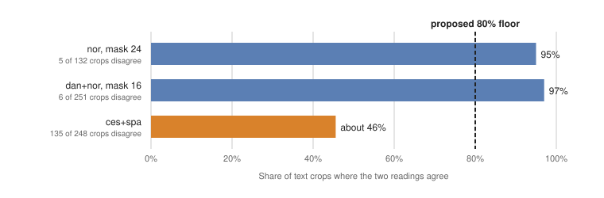

# Qwen per-crop settlement (proposal)

Issue: [#1963](https://github.com/tgoodyear/usnewsmap.com/issues/1963). Evidence: [#1919](https://github.com/tgoodyear/usnewsmap.com/issues/1919). Related changes: #1964 and #1967 (client crash handling), #1965 (empty-return guard and vouching), #1968 (`quality.excluded_qwen_readings`). Rule being changed: `crop-consensus-v2` in `crates/usnm-boinc/src/qwen/consensus.rs`.

Status: Proposed, not adopted. Issue #1963 is open and the science decision has not been made (as of 22 Nov 2026). Nothing here is built, and `crop-consensus-v2` is unchanged. The rerun described on #1919 has a pre-registered rule that says nothing changes in v2 before the Science Coordinator decides.

## Summary

- **Problem.** Under `crop-consensus-v2` one disagreeing crop fails a whole unit of 130 to 250 crops. Two Nordic units had 95% and 97% of their text crops agreeing and still produced no agreed result.
- **Proposal.** Accept a pair when at least 80% of its text crops agree, vouch only the agreeing crops, and re-issue each disagreeing crop once in pooled follow-up units. The 80% is a proposed value, not a finding.
- **Status.** Proposed, not adopted. Issue #1963 is open.
- **What deciding it needs.** A Science Coordinator decision on the six open questions below, chiefly the 80% threshold, which the planned #1919 rerun on at least 300 matured units can test. The evidence so far is three failed units.

_Figure 1. The three units that failed under v2 (14 Nov table in Problem). The Nordic units would pass at 80%. The ces+spa return was a host failure that the empty-return guard already rejects._

## Problem

A `usnm_qwen` unit holds 130 to 250 crops. Under `crop-consensus-v2` a pair fails if any one crop is in the `disagree` state, so one bad crop discards the rest.

The 14 Nov read of the three matured v2 units that ended with no agreeing pair (#1919) shows how lopsided this is:

| Unit             | Crops | Disagree | What the disagreements were                                                                |
| ---------------- | ----- | -------- | ------------------------------------------------------------------------------------------ |
| nor, mask 24     | 132   | 5        | 1 reading order, 4 real misreads (mostly one side stopping early or dropping lines)        |
| dan+nor, mask 16 | 251   | 6        | 2 reading order, 4 real misreads                                                           |
| ces+spa          | 248   | 135      | one return had 134 empty readings with outcome `ok` (a host failure, since fixed by #1964) |

The two Nordic units had 95% and 97% of their text crops agreeing and still produced no agreement. The disagreements were a side stopping early, dropped lines, a neighbouring column leaking in, and a few real misreads. None were script or diacritic differences, and none were blank or looped crops. One volunteer host's results (Windows, 54 tasks) tell the same story from the volunteer side: the crops it read well were lost together with the few that disagreed.

The cost shows in the first measure on #1919: v2 any-pair agreement was 69 of 72 units (95.8%) against 99.1% for the baseline, and the gap rests on three failed units. A failed pair also sends a third replica of the whole unit, so a unit with 5 bad crops pays for 130 more good ones.

## States per crop

Today `CropState` has `agree`, `disagree`, `looped` and `no_text`. The proposal keeps those as pair-level judgements and adds a settlement state per crop, which is what the quality tables and the collector read.

| Settlement state | Meaning                                                                                                                                                  | Vouched for use |
| ---------------- | -------------------------------------------------------------------------------------------------------------------------------------------------------- | --------------- |
| `settled`        | An agreeing pair judged the crop `agree`.                                                                                                                | Yes             |
| `unsettled`      | The crop disagreed, was re-issued once, and still disagreed.                                                                                             | No              |
| `looped`         | A side's reading ends in a repeated run, or its result marks the crop looped. A model failure, not a reading.                                            | No              |
| `blank`          | No text on either side, or empty on both, or empty where LoC's text is blank too (the same LoC-blank exclusion as the #1965 guard). Nothing to agree on. | No reading kept |
| `failed`         | The client could not read the crop: llama-server died and the retries ran out.                                                                           | No              |

Notes:

- `no_text` maps to `blank`. The existing name stays in the pair record for compatibility (see Format).
- `failed` follows #1964. That change deliberately left per-crop `failed` out of the result format: a crop that cannot be read fails the whole unit (outcome `failed`, non-zero exit), so the server reissues the unit. This design keeps that behaviour. `failed` is therefore a state a crop can only get at the server, when a returned unit reports it as `failed` and a re-issue also cannot read it. It is not something a client writes into an uploaded success.
- A crop that is `disagree` after the pair but not yet re-issued is `pending`. It is a transient state in the ledger, never in a published table.

## Validator and consensus changes

### Pair threshold

Today: no crop may disagree, `agree` crops must be more than half of the crops with text, and they must hold at least 100 characters.

Proposed: the pair validates when the `agree` crops are at least 80% (a proposed value, not adopted) of the crops that have text (`agree + disagree`, with looped, blank and no-text crops left out of both counts), the existing "more than half of the crops with any text" and 100-character floors still hold, and both results finished.

Why 80% is proposed:

- The two failed Nordic units sit at 95% and 97% of text crops agreeing. An 80% floor passes both with a wide margin, and leaves room for noisier languages.
- The ces+spa failure had 135 of 248 crops disagreeing. It would fail under any floor above about 45%, and the #1965 empty-return guard already rejects that return before pairing.
- A lower floor, such as 60%, would let a pair through where a quarter of the text crops are still wrong. Those crops cost one re-issue each, and 80% bounds the work: at most 20% of a unit's text crops go into follow-up units.

The number is a proposal, not a finding. It is a free parameter next to `floor`, `min_share` and `min_agreed_chars` in `Params`, so it can be changed without touching the rule's structure. The #1919 sample is three failed units, and the rerun planned on #1919 is what would show whether 80% is too tight or too loose.

### No vouching of disagreeing crops

This is #1965's rule extended, not changed. `consensus::vouched` already vouches `agree` crops and never `disagree` crops, whatever the pair's overall verdict. A pair that validates under the new threshold vouches its `agree` crops only. A disagreeing crop is never vouched by a pair that validates around it, and it is never used by the collector on the grounds that "the unit passed".

### Empty-return guard

Unchanged and ordered first. A finished result with more than 10% unexplained empty readings (LoC-blank crops and looped crops excluded from the counts) is invalid on its own at init, before any pairing. The new threshold never sees such a result. Blank crops where LoC is blank too are `blank`, so they do not count against the 80%.

### `page-v1` settling

Recommendation: keep it, unchanged, for bundle units, and apply per-crop settlement inside whatever `page-v1` accepts. `page-v1` settles a bundle when at least half the pages agree, and it was built for multi-page benchmark bundles, which are a separate staging path. Under per-crop settlement a page's crops are settled or unsettled by the same rule, and a page counts as agreed when it meets the 80% threshold. Deprecating `page-v1` is not needed and would be a separate change. Open question below.

## Crop-level re-issue

When a pair validates with some crops in `disagree`, those crops go into follow-up units.

- **Pooling.** Disagreeing crops from many units are pooled by language and app version, so a follow-up unit has enough crops to run at least 5 minutes. A single unit rarely has more than a handful. A follow-up unit is staged when its pool reaches a minimum crop count, with the count chosen from the app's measured seconds per crop for the plan class (an open item for the rollout, not a number to fix here). Crops that wait in a pool are `pending`, and a pool older than a set age is flushed even if small, because a short unit is better than a crop that never settles; the age is an open question.
- **Cap.** One re-issue per crop. A crop re-issued once and still disagreeing becomes `unsettled`. There is no second re-issue.
- **Pairing rules.** A follow-up unit is an ordinary `usnm_qwen` unit with a fresh pair under the same rule, app version and reader-mismatch check. A crop in a follow-up unit settles if the follow-up pair judges it `agree`.
- **Provenance.** Each follow-up unit records `retry_of` (the parent unit's job id, the same field the native-OCR retry path already uses in `crates/usnm-ocr-contract/src/boinc.rs`) and, per crop, the parent crop id and parent job id. A crop pooled from several units carries its own parent. The ledger keeps, for every crop: the original pair's two readings (by `readings_sha256`), the follow-up pair's, and the state history. Provenance is kept even for crops that settle, so an audit can reproduce any settled reading.
- **What the follow-up pair compares.** The follow-up pair compares only its own two new readings. The original pair's readings for that crop are kept as evidence and never counted as a third vote, so a crop is never settled by a two-of-three majority drawn across units.

## Credit

Both volunteers of a validating pair are credited for the work they did. A pair that validates with 85% of its text crops agreeing is credited as a valid result, as today. To avoid giving full credit to a result that mostly failed the check, the proposal is credit proportional to settled crops: the claimed credit is scaled by `settled crops / crops with text`, floored at the 80% threshold (so a validating pair is credited between 80% and 100% of the claim). Volunteers who read a disagreeing crop are not penalised separately, since at least one side of each disagreement is the model, not the volunteer.

A pair that fails (below 80%, or an invalid empty return) keeps today's behaviour. Follow-up units are credited like any other unit, by their own settlement. Proportional credit is a likely choice, not a settled one; see the open questions.

## Format

All changes are additive, because the result, readings and crop-state record types use `deny_unknown_fields` and old and new servers read the same files.

- **Result and readings (`usnm-ocr-contract::qwen`).** No change. `Reading` and `Readings` gain no field (as #1964 decided). Settlement is decided at the server from the pair, not written by the client.
- **Crop-state record (`consensus::Record`, `RECORD_VERSION`).** Bump from 2 to 3. A v3 record adds the settlement state per crop (`settled`, `unsettled`, `pending`, `looped`, `blank`, `failed`) beside the existing pair state, plus `retry_of` and `parent_crop` where present. The collector reads both versions. An old collector that meets a v3 record must skip it, not fail, so the roll order is: collector first (reads v3), then the server (writes v3).
- **Job (`usnm-ocr-contract::qwen::Job`).** A follow-up unit is a normal job. `retry_of` and the per-crop parent ids go in a sidecar file next to the job, not in `Job`, so clients built before this change still accept the unit.

What needs a release:

| Component                                                        | Release needed?                                                                                                                                                                                                 |
| ---------------------------------------------------------------- | --------------------------------------------------------------------------------------------------------------------------------------------------------------------------------------------------------------- |
| Server (validator, assimilator, stager)                          | Yes: a server roll.                                                                                                                                                                                             |
| `usnm_qwen` client app versions                                  | No, if provenance stays in the sidecar and settlement stays at the server. The #1964 and #1967 client fix still needs its own new version on every platform that runs llama-server, independent of this design. |
| Collector (`quality collect`)                                    | Yes: reads v3 records, applies `settled`/`unsettled` labels. Roll before the server.                                                                                                                            |
| Quality tables and `scripts/data/build-quality-assessment-db.py` | Yes, additive columns (see below).                                                                                                                                                                              |

## Data and analysis

- **`crops.parquet`.** `vlm_crop_state` already exists. It gains the values `settled` and `unsettled` (today `agree`, `disagree`, `looped`, `no_text`, `strict-v1`, `page-strict-v1`, `unjudged`). Only `settled` crops keep `vlm_text`; `unsettled`, `looped`, `blank` and `failed` crops keep the state and no reading, so they cannot enter a score by accident. An added `vlm_settled_round` column (`first` or `reissue`) tells the two paths apart.
- **Quality tables.** The page-level vlm row aggregates its crops, so a page with unsettled crops either aggregates the settled ones only or is withheld. Recommendation: aggregate settled crops only, and report the settled share per page so a thin page is visible.
- **`quality.excluded_qwen_readings` (#1968).** Unchanged and independent. It is a manual, reversible hold on units or crops pending a re-read. Per-crop settlement is the automatic path. The two combine by exclusion winning: a crop on a live exclusion row is dropped at collect time whatever its settlement state. A crop that the exclusion table held and that later settles through re-issue is released by hand (the table's existing `released_at`), not automatically.
- **Metrics.** The unit-level first-pair and any-pair rates get crop-level counterparts reported per language: settled on the first pair, settled after re-issue, `unsettled`, `looped`, `blank`, `failed`. Per-language conclusions follow the #1919 rule of at least 30 units.

## Rollout plan

If adopted, the order would be:

1. Land the collector change (reads v3 records, no behaviour change while only v2 records exist).
2. Land the validator and consensus change behind a project file, the way `page-v1` is gated by `<project>/qwen/bundle-verdict`. The default stays v2 until the file is set. Removing the file restores v2.
3. Run on one language, such as the Nordic set, with credit scaling off first. Compare the any-pair and settled-crop rates with the baseline using the same definitions as #1919.
4. Turn on pooled re-issue, then credit scaling.
5. Extend language by language once the settled-crop rate and the rate of crops whose re-issue agrees with the original disagreeing readings look sound.

## Tests

- `consensus.rs`: a pair at 79%, 80% and 81% of text crops agreeing; the two Nordic units' real crop counts (5 of about 100, 6 of about 220); a pair where disagreements are all looped crops; blank and LoC-blank crops outside both counts; the ces+spa shape (invalid before pairing by the empty guard).
- `vouched`: a validating pair vouches `agree` crops only, never `disagree`; the WU 54155 pattern still behaves as in #1965.
- Re-issue: a crop disagrees, is pooled, re-issued once, then settles; a crop that disagrees twice becomes `unsettled` and is not re-issued again; pooling by language and app version never mixes either; a pool below the minimum waits; a stale pool flushes; provenance (`retry_of`, parent ids) round-trips.
- Format: a v3 record read by the v2 reader path skips cleanly; v2 records read by the new collector; `deny_unknown_fields` on `Job`, `Reading`, `Readings` is untouched by the sidecar.
- Collector: `unsettled` crops carry state and no reading; interaction with a live `excluded_qwen_readings` row; cache key changes when settlement changes.
- Credit: proportional scaling at 80%, 90% and 100%; a failed pair is unchanged.

## Open questions for the Science Coordinator

1. Is 80% of text crops the right pair threshold, or should the #1919 rerun with at least 300 matured v2 units set it?
2. Should settled-crop credit scale with the settled share (proposed), or stay full for any validating pair?
3. Minimum pooled follow-up unit size, and the age at which a small pool is flushed anyway.
4. Keep `page-v1` (proposed) or deprecate it once per-crop settlement is live?
5. Should a crop with the one-sided "stopped early" pattern (3 of 4 and 4 of 4 real-misread crops in the Nordic units) get its own state, since a heuristic cannot tell it from a guard stop?
6. Is one re-issue per crop enough, or should crops that disagree twice go to a different app version or plan class?
