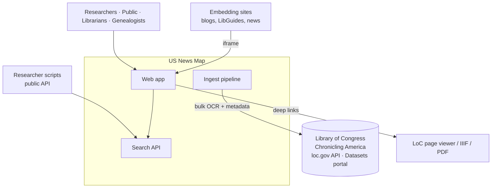
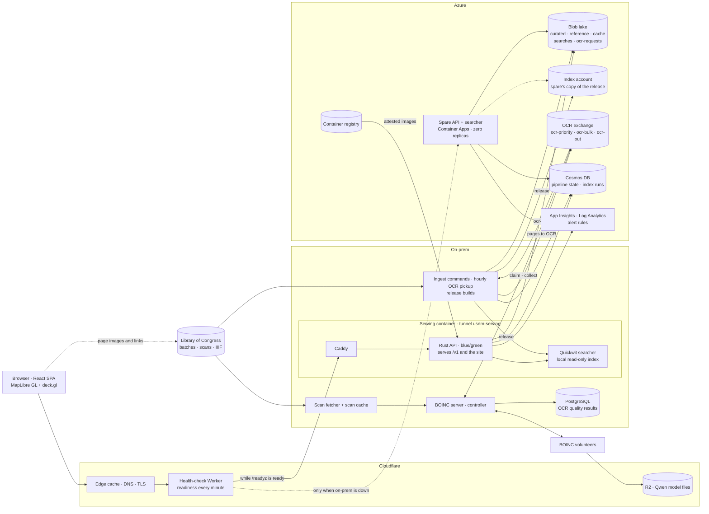
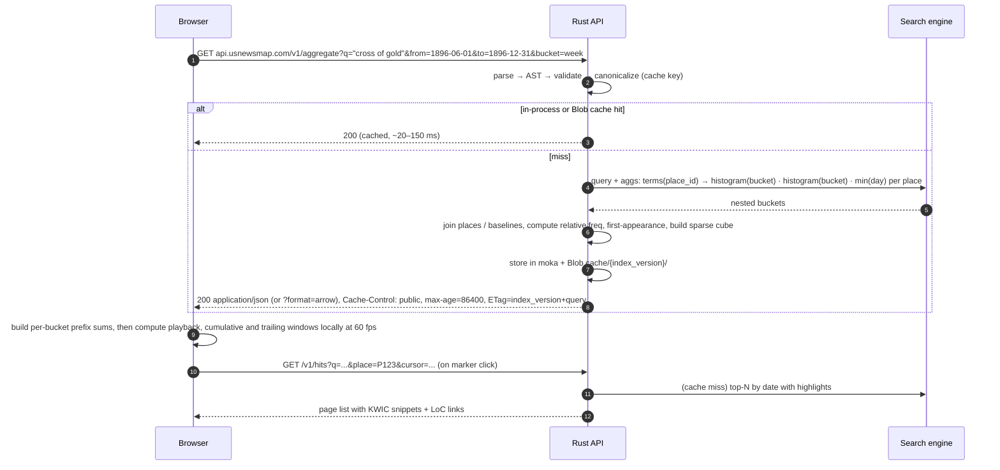
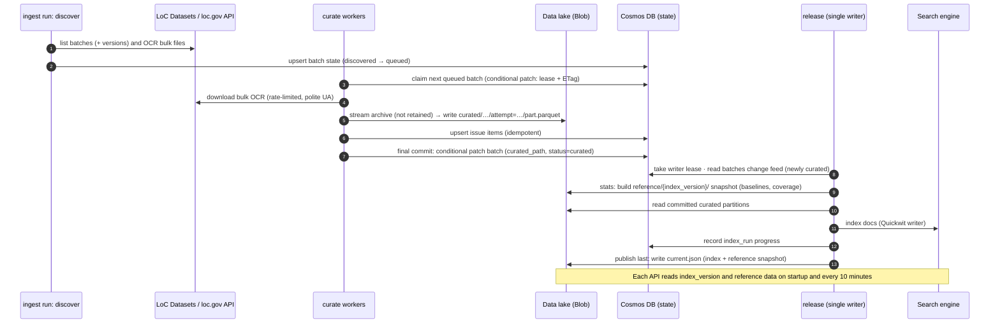

# 03: Architecture Overview

## 3.1 Architectural drivers

Ranked in order. Where drivers conflict, the higher one wins.

1. **Sustainability.** Low fixed cost, no servers to patch, reproducible from code. The system must not go offline again when the institution hosting it stops supporting it.
2. **Correctness.** Complete aggregates, rates normalized by the digitized pages per place and time, stable citations.
3. **Performance.** Searches within the SLOs (p95 ≤ 2 s uncached, ≤ 150 ms cached, [09 §9.1](09-operations-security-cost.md#91-service-level-objectives)), with smooth playback on commodity laptops and phones.
4. **Lowest running cost.** Managed services where they are cheap (storage, identity, observability); on-prem hardware where cloud compute would cost more ([ADR-0027](adr/0027-onprem-serving-behind-cloudflare.md)).
5. **Evolvability.** The search engine can be swapped, the article-level corpus added later, and semantic search layered on.

## 3.2 System context



## 3.3 Deployment today (November 2026)

Serving moved on-prem on 31 October 2026 ([ADR-0027](adr/0027-onprem-serving-behind-cloudflare.md), [ADR-0029](adr/0029-onprem-primary-azure-failover.md)). The ingest commands, the OCR pickup and the index releases run on on-prem hosts too, and OCR runs only through BOINC (#966). Azure keeps the state the system shares, a cold spare of the API and searcher, and the monitoring ([08](08-azure-infrastructure.md)).



| Piece                 | Where it runs today                                                                                                                                                                                                                                                         |
| --------------------- | --------------------------------------------------------------------------------------------------------------------------------------------------------------------------------------------------------------------------------------------------------------------------- |
| Edge                  | Cloudflare: DNS, TLS, the cache rules and the health-check Worker in [`edge/fallback-worker/`](../../edge/fallback-worker/README.md), which sends each request to on-prem while its `/readyz` answers and to the Azure spare when it doesn't                                |
| API, site and search  | One on-prem container behind the Cloudflare Tunnel `usnm-serving`: Caddy, the API image CI builds and attests, in blue/green colors, and the pinned Quickwit binary reading the index from local disk ([`scripts/onprem/serving/`](../../scripts/onprem/serving/README.md)) |
| Azure spare           | The same API image and Quickwit in a Container Apps environment without a VNet, at zero replicas until the Worker wakes them, with its own copy of the current release ([search serving](../operations/search-serving.md#the-azure-cold-spare))                             |
| Ingest and releases   | On-prem hosts with their own Azure Arc identities. Prod has no Container Apps ingest jobs (`USNM_INGEST_JOBS` is `false`; [environments and deploys](../operations/environments-and-deploys.md))                                                                            |
| OCR                   | BOINC only: the BOINC server and its controller run on-prem ([BOINC server on-prem](../boinc/server/onprem.md)); work and results pass through the Azure exchange account's Storage queues and `ocr-out`                                                                    |
| Shared state          | Azure: the Blob lake, Cosmos DB, the index account, the registry and Key Vault. Both serving origins read and write the same stores (ADR-0029 decision 7)                                                                                                                   |
| OCR quality results   | On-prem PostgreSQL ([`scripts/onprem/quality/`](../../scripts/onprem/quality/README.md))                                                                                                                                                                                    |
| Monitoring and alerts | Azure Monitor: Application Insights, Log Analytics and the alert rules in `infra/modules/`, with the on-prem hosts reporting through Arc                                                                                                                                    |

## 3.4 Components

Both origins run the same API image and the same pinned Quickwit build, and read the same shared state, so either origin returns the same result for a request. The original Azure layout put the API and Quickwit in one Container App, as two containers in each replica, inside a VNet with private endpoints, and ran ingest as Container Apps jobs. The template still builds that layout behind settings prod turns off (08). The **growth profile** (Front Door, a larger searcher, Azure AI Search in place of Quickwit) stays a set of Bicep parameters ([ADR-0006](adr/0006-lean-hosting-profile.md)).

### 3.4.1 Component responsibilities

| Component               | Tech                                                                           | Responsibility                                                                                                                                                                                                        | Runs                                                      |
| ----------------------- | ------------------------------------------------------------------------------ | --------------------------------------------------------------------------------------------------------------------------------------------------------------------------------------------------------------------- | --------------------------------------------------------- |
| **Edge**                | Cloudflare: DNS, TLS, cache rules, the health-check Worker                     | Picks the ready origin; caches static files and aggregate responses; limits each address on the search paths                                                                                                          | Cloudflare (`edge/fallback-worker/`)                      |
| **Site hosting**        | The API image                                                                  | Serves the built SPA at `usnewsmap.com` and `www`, same origin as `/v1`; SPA fallback, cache and security headers in code ([ADR-0010](adr/0010-site-served-by-the-api.md))                                            | With the API                                              |
| **Web app**             | React 19 + TypeScript + Vite; MapLibre GL JS; deck.gl                          | UI, URL state, client-side playback from aggregate cubes, accessible table views ([07](07-frontend-design.md))                                                                                                        | The browser                                               |
| **Search API**          | Rust, axum/tokio (`crates/usnm-api`)                                           | Parse and validate queries; run aggregate, hit and snippet queries; join with reference data; normalize; encode; response caches (browser, edge, in-process, stored); rate limiting; OpenAPI ([06](06-api-design.md)) | On-prem (blue/green colors); the Azure spare              |
| **Search engine**       | Quickwit 0.9.1, our build ([ADR-0013](adr/0013-quickwit-from-our-fork.md))     | Read-only searcher with the file-backed metastore; no indexer or janitor role ([08 §8.4.1](08-azure-infrastructure.md#841-quickwit-metastore-one-writer-many-readers))                                                | On-prem from local NVMe; the spare from the index account |
| **Index writer**        | `usnm-ingest release` with a Quickwit indexer and janitor as its child process | The only process that writes indexes, and it writes only new ones; published indexes are sealed, so a version's results never change                                                                                  | The on-prem release host                                  |
| **Reference data**      | Parquet and JSON snapshots in the lake's `reference/`                          | Titles, places, baselines, coverage, per version; `current.json` names the serving version                                                                                                                            | Loaded into each API's memory                             |
| **Ingest**              | `usnm-ingest` (Rust)                                                           | Discover LoC batches, curate them into Parquet, sync title records, build reference data and releases ([04](04-data-sources-and-ingestion.md))                                                                        | On-prem hosts, with Arc identities                        |
| **OCR**                 | BOINC with our apps; `usnm-ingest ocr-*` for seeding and pickup                | Re-read badly OCR'd pages and score page quality; results reach releases through `ocr-out` and `curated/ocr-local/` ([12](12-onprem-ocr-pipeline.md), [13](13-ocr-engines.md))                                        | The on-prem BOINC server and volunteers                   |
| **Data lake**           | Azure Blob Storage, flat namespace, versioning and soft delete                 | System of record for the corpus and all derived artifacts ([ADR-0002](adr/0002-blob-data-lake-system-of-record.md))                                                                                                   | Azure                                                     |
| **Pipeline state**      | Cosmos DB for NoSQL, free tier                                                 | Per-title, per-batch, per-issue and per-index-run status; leases; the writer lock. Read by the status page, never on the search path ([ADR-0007](adr/0007-cosmos-document-state.md))                                  | Azure                                                     |
| **OCR quality results** | PostgreSQL                                                                     | Every quality signal per page, for ranking pages for OCR ([`scripts/onprem/quality/`](../../scripts/onprem/quality/README.md))                                                                                        | On-prem                                                   |
| **Observability**       | Application Insights and Log Analytics, with Entra-only ingestion              | Traces, metrics, page views, alerts (08 §8.1.2)                                                                                                                                                                       | Azure                                                     |

## 3.5 Key runtime flows

### 3.5.1 Search → map → playback (the main flow)



**Why this fixes the legacy problems:** there is one request per search instead of one per animation frame; there is no server session; responses can be cached by URL; and the counts are complete.

### 3.5.2 Ingestion (weekly and on demand)

The steps below were first built as Container Apps jobs. In prod they run as `usnm-ingest` commands on on-prem hosts, and a release builds on local disk and then copies the new version to Azure ([full rebuild on-prem](../operations/rebuild-and-index-storage.md#full-rebuild-on-prem)). Prod has no schedule: an operator starts releases (08 §8.4). The OCR flow through BOINC is drawn in 3.3 and described in the [BOINC pages](../boinc/README.md).



## 3.6 Cross-cutting design decisions

| Decision              | Choice                                                                                                                                                                                  | ADR                                                                                                                                                 |
| --------------------- | --------------------------------------------------------------------------------------------------------------------------------------------------------------------------------------- | --------------------------------------------------------------------------------------------------------------------------------------------------- |
| Search engine         | Quickwit, our build of 0.9.1, behind the Rust `SearchBackend` trait; Azure AI Search stays the managed alternative, out of budget                                                       | [0001](adr/0001-search-engine.md), [0013](adr/0013-quickwit-from-our-fork.md)                                                                       |
| System of record      | Curated Parquet on Blob Storage (immutable attempt paths); indexes are disposable, in their own account                                                                                 | [0002](adr/0002-blob-data-lake-system-of-record.md), [0021](adr/0021-separate-index-storage.md)                                                     |
| Document state        | Cosmos DB free tier (titles, batches, issues, index runs, ops)                                                                                                                          | [0007](adr/0007-cosmos-document-state.md)                                                                                                           |
| API shape             | Stateless, GET, aggregate-first, cacheable at the edge; client-side temporal playback                                                                                                   | [0003](adr/0003-stateless-aggregate-first-api.md)                                                                                                   |
| API language          | Rust (axum)                                                                                                                                                                             | [0004](adr/0004-rust-api.md)                                                                                                                        |
| Operating constraints | Under $80 a month, no Azure VMs, everything reproducible from the repository, operable by one maintainer                                                                                | [0005](adr/0005-sustainability-constraints.md)                                                                                                      |
| Serving               | On-prem behind a Cloudflare Tunnel; a health-check Worker fails over to an Azure cold spare at zero replicas; the API serves the site                                                   | [0027](adr/0027-onprem-serving-behind-cloudflare.md), [0029](adr/0029-onprem-primary-azure-failover.md), [0010](adr/0010-site-served-by-the-api.md) |
| OCR                   | Only through BOINC: on-prem server, volunteer hosts, pluggable engines behind one contract                                                                                              | [0015](adr/0015-onprem-ocr-workers.md), [0016](adr/0016-pluggable-ocr-engines.md), [0019](adr/0019-boinc-server-hosting.md)                         |
| Page identity         | A page id is `<source>:<local id>`, and a bare id means `loc` (proposed)                                                                                                                | [0026](adr/0026-source-qualified-page-ids.md)                                                                                                       |
| Unit of retrieval     | **Page** (matches LoC URLs and the legacy); American Stories' article text is indexed with its page                                                                                     | [04](04-data-sources-and-ingestion.md)                                                                                                              |
| Geography             | Place = the title's place of publication (point), resolved from LoC metadata and the gazetteer, with date-ranged places for titles that moved                                           | [04](04-data-sources-and-ingestion.md)                                                                                                              |
| Cache invalidation    | `index_version` is in every ETag and cache key; a new index version means new URLs and a new cache prefix                                                                               | [06](06-api-design.md)                                                                                                                              |
| Identity              | Entra identities and RBAC only: managed identities in Azure, Arc machine identities on-prem, OIDC federation for CI; no shared keys, SAS or connection strings anywhere                 | [0009](adr/0009-entra-identity-only.md), [0025](adr/0025-onprem-database-client-certificates.md) (on-prem databases)                                |
| Networking            | No VNet or private endpoints in prod since November 2026: the data accounts accept every network with Entra ID the only way in; the exchange account and scan archive keep IP firewalls | [0008](adr/0008-private-networking.md)                                                                                                              |

## 3.7 Repository layout

```
usnewsmap.com/
├─ docs/                  ← design (this set), ADRs, operations, BOINC, OCR, notes, reports
├─ web/                   ← React + TypeScript SPA (Vite)
├─ crates/                ← the Rust workspace: API, ingest, search, state, store, telemetry, OCR and BOINC crates (crates/README.md)
├─ infra/                 ← Bicep: main.bicep, modules/, env/<env>.json, names/, quickwit/ (index and searcher configs), workbooks/
├─ edge/                  ← the Cloudflare fallback Worker and the check site
├─ scripts/               ← azure/ (bootstrap, provision, logs), onprem/ (serving, release, queue, quality), ci/, corpus/, ocr-node/, …
├─ boinc/                 ← the BOINC project: apps, images, server scripts, its own infra
├─ ocr/                   ← engine catalog, contract, routing, benchmarks, models
├─ catalog/               ← hand-curated place and title overrides
├─ ops/                   ← saved Log Analytics queries, API schema snapshots
├─ docker/                ← Dockerfiles: the API, ingest, Japanese OCR and patched Quickwit images
├─ fuzz/                  ← fuzz targets for untrusted OCR inputs (ALTO, node output, dead letters)
└─ .github/workflows/     ← CI, publish, spare-roll, edge deploy, BOINC app builds
```
