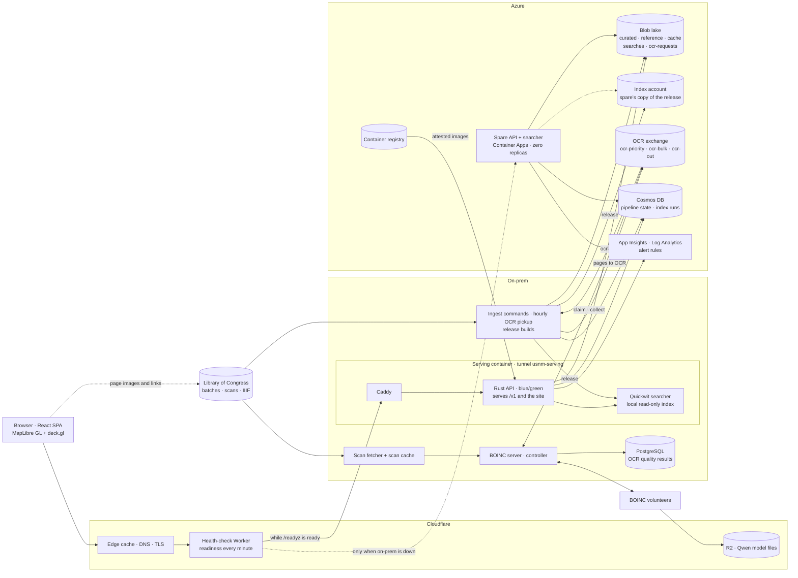
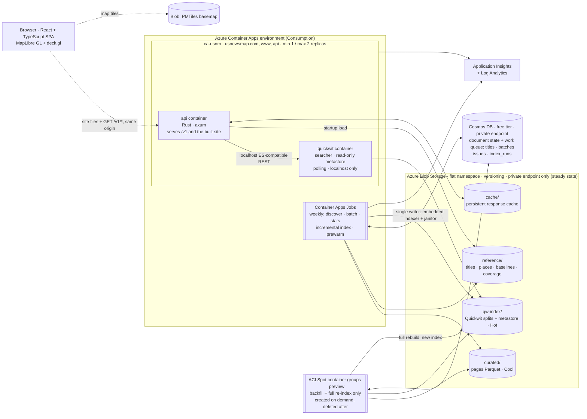
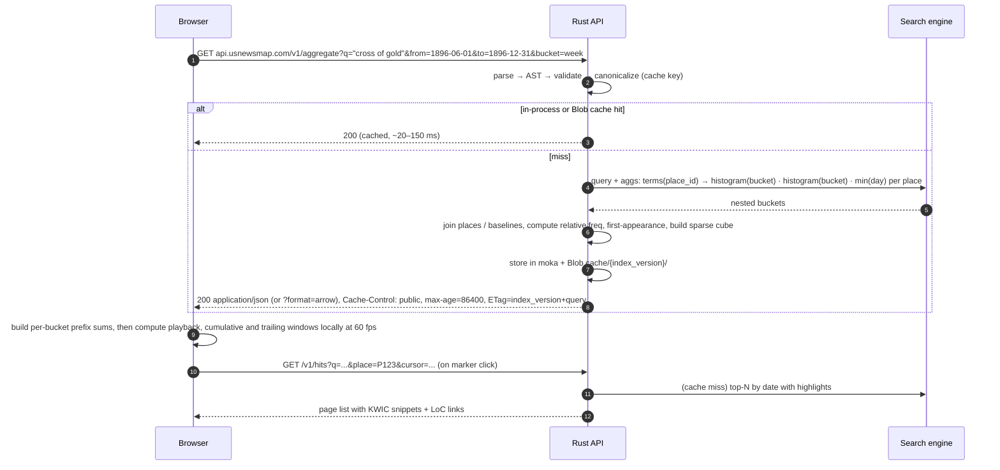
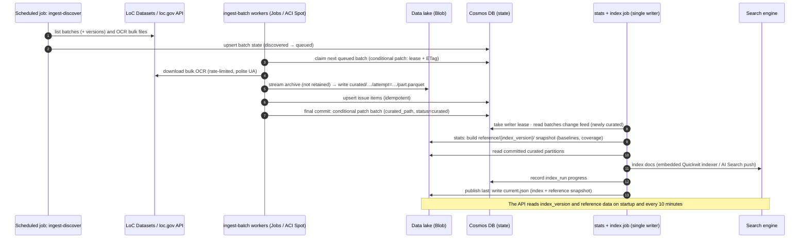

# 03: Architecture Overview

## 3.1 Architectural drivers

Ranked in order. Where drivers conflict, the higher one wins.

1. **Sustainability.** Low fixed cost, no servers to patch, reproducible from code. The system must not die again for lack of support.
2. **Correctness.** Complete aggregates, honest normalization, stable citations.
3. **Performance.** The map should feel instant, with smooth playback on commodity laptops and phones.
4. **Lean on Azure PaaS.** Use managed services for storage, compute, edge, identity and observability.
5. **Evolvability.** The search engine can be swapped, the article-level corpus added later, and semantic search layered on.

## 3.2 System context


## 3.3 Deployment today (November 2026)

Serving moved on-prem on 31 October 2026 ([ADR-0027](adr/0027-onprem-serving-behind-cloudflare.md), [ADR-0029](adr/0029-onprem-primary-azure-failover.md)). The ingest commands, the OCR pickup and the index releases run on on-prem hosts too, and OCR runs only through BOINC. Azure keeps the state the system shares, a cold spare of the API and searcher, and the monitoring. Sections 3.4 to 3.6 record the Azure design the system started from; the spare still follows it.



| Piece                 | Where it runs today                                                                                                                                                                                                                                                         |
| --------------------- | --------------------------------------------------------------------------------------------------------------------------------------------------------------------------------------------------------------------------------------------------------------------------- |
| Edge                  | Cloudflare: DNS, TLS, the cache rules and the health-check Worker in [`edge/fallback-worker/`](../../edge/fallback-worker/README.md), which sends each request to on-prem while its `/readyz` answers and to the Azure spare when it doesn't                                |
| API, site and search  | One on-prem container behind the Cloudflare Tunnel `usnm-serving`: Caddy, the API image CI builds and attests, in blue/green colors, and the pinned Quickwit binary reading the index from local disk ([`scripts/onprem/serving/`](../../scripts/onprem/serving/README.md)) |
| Azure spare           | The same API image and Quickwit in a Container Apps environment without a VNet, at zero replicas until the Worker wakes them, with its own copy of the current release ([search serving](../operations/search-serving.md#the-azure-cold-spare))                             |
| Ingest and releases   | On-prem hosts with their own Azure Arc identities. Prod has no Container Apps ingest jobs (`USNM_INGEST_JOBS` is `false`; [environments and deploys](../operations/environments-and-deploys.md))                                                                            |
| OCR                   | BOINC only: the BOINC server and its controller run on-prem ([BOINC server on-prem](../boinc/server/onprem.md)); work and results pass through the Azure exchange account's Storage queues and `ocr-out`                                                                    |
| Shared state          | Azure: the Blob lake, Cosmos DB, the index account, the registry and Key Vault. Both serving origins read and write the same stores (ADR-0029 decision 7)                                                                                                                   |
| OCR quality results   | On-prem PostgreSQL ([`scripts/onprem/quality/`](../../scripts/onprem/quality/README.md))                                                                                                                                                                                    |
| Monitoring and alerts | Azure Monitor: Application Insights, Log Analytics and the alert rules in `infra/modules/`, with the on-prem hosts reporting through Arc                                                                                                                                    |

## 3.4 Container view as first designed (Azure lean profile)

This is the Azure deployment the system was built for, and the one the spare still follows. Since #917 prod has no Container Apps jobs, and since #308 the environment has no VNet or private endpoints ([ADR-0008](adr/0008-private-networking.md)).



The **growth profile** adds Azure Front Door in front of both origins (edge cache, WAF), splits the API and search into separate apps with a 4 vCPU / 8 GiB searcher, and can swap Quickwit for Azure AI Search. All of these are Bicep parameters ([ADR-0006](adr/0006-lean-hosting-profile.md)).

### 3.4.1 Component responsibilities

| Component                              | Tech                                                                                                        | Responsibility                                                                                                                                                                                                                  | Scales by                           |
| -------------------------------------- | ----------------------------------------------------------------------------------------------------------- | ------------------------------------------------------------------------------------------------------------------------------------------------------------------------------------------------------------------------------- | ----------------------------------- |
| **Site hosting**                       | The API app                                                                                                 | Serves the built SPA at `usnewsmap.com` and `www` from the API image, same origin as `/v1`, with free managed TLS; SPA fallback, cache and security headers in code ([ADR-0010](adr/0010-site-served-by-the-api.md))            | Managed                             |
| **Web app**                            | React 19 + TypeScript + Vite; MapLibre GL JS; deck.gl; uPlot; TanStack Query                                | UI, URL state, **client-side playback** from aggregate cubes, accessibility views                                                                                                                                               | Static                              |
| **Search API** (`api` container)       | Rust, axum/tokio, reqwest, moka                                                                             | Parse and validate queries → backend DSL; run aggregate, hit and snippet queries; join with reference data; normalize; encode responses; **three cache layers** (browser, in-process, Blob); rate limiting; OpenAPI             | Replicas (max 2)                    |
| **Search engine** (`quickwit` sidecar) | **Quickwit** (Rust, Apache-2.0); Azure AI Search in the growth profile                                      | **Read-only** serving: searcher role with the file-backed metastore opened in polling mode. No indexer or janitor role runs here                                                                                                | With its replica; splits on Blob    |
| **Index writer**                       | Quickwit indexer + janitor embedded in the `index` job (Container Apps Job weekly; ACI Spot for compaction) | The **only** process that writes the metastore, guarded by a Cosmos `ops` lease. It writes only **new** indexes (weekly deltas, or a new base at compaction); published indexes are sealed, so a version's results never change | One at a time                       |
| **Reference data**                     | Parquet/JSON artifacts on Blob                                                                              | Titles (LCCN → name, place, dates, language), places (lat/lon, county, state), baselines (pages per place per day), coverage                                                                                                    | Loaded into API memory (tens of MB) |
| **Weekly ingest**                      | Rust CLI in Container Apps Jobs (inside the VNet); batches claimed from Cosmos with leases                  | Discover new LoC batches; curate; build reference data; incremental index; pre-warm                                                                                                                                             | Fixed parallelism                   |
| **Backfill / re-index**                | Same Rust image on **ACI Spot container groups** (preview)                                                  | Initial download and curation of ~3,000 batches; full index builds                                                                                                                                                              | Launcher creates N groups           |
| **Data lake**                          | Azure Blob Storage (flat namespace, versioning + soft delete)                                               | System of record for the corpus and all derived artifacts                                                                                                                                                                       | Managed                             |
| **Document state + work queue**        | Cosmos DB for NoSQL, free tier, private endpoint                                                            | Per-title, per-batch, per-issue and per-index-run status; batch claiming via leases (replaces a Storage Queue); change feed driving incremental indexing. Not on the API request path                                           | Free tier (1,000 RU/s)              |
| **Observability**                      | App Insights via the managed OpenTelemetry agent; Log Analytics (free tier with daily cap)                  | Traces, metrics, logs, availability tests, alerts                                                                                                                                                                               | Managed                             |

The #283 index-account move is opt-in: a separate private Entra-only Blob
account holds Quickwit's derived metastore and splits, without the lake's
versioning or soft delete. During migration a parallel internal searcher
reads it while the old searcher serves the lake. A staged reference pointer
and the separately gated API-reader switch preserve the serving version
until cutover ([ADR-0021](adr/0021-separate-index-storage.md),
[operations](../operations/rebuild-and-index-storage.md#index-storage-cutover)). Curated data and
reference snapshots remain in the protected lake.

## 3.5 Key runtime flows

### 3.5.1 Search → map → playback (the main flow)



**Why this fixes the legacy problems:** there is one request per search instead of one per animation frame; there is no server session; responses can be cached by URL; and the counts are complete.

### 3.5.2 Ingestion (weekly and on demand)

The flow below is the one first designed, with Container Apps jobs and Spot backfills. The steps are the same today, but they run as commands on on-prem hosts; [the full rebuild on-prem](../operations/rebuild-and-index-storage.md) covers releases. The OCR flow through BOINC is drawn in 3.3 and described in the [BOINC pages](../boinc/README.md).



## 3.6 Cross-cutting design decisions

| Decision              | Choice                                                                                                                                                                                                   | ADR                                                                                  |
| --------------------- | -------------------------------------------------------------------------------------------------------------------------------------------------------------------------------------------------------- | ------------------------------------------------------------------------------------ |
| Search engine         | Quickwit on Container Apps + Blob (recommended, the only option within budget); Azure AI Search (managed alternative, growth profile); both behind the Rust `SearchBackend` trait                        | [0001](adr/0001-search-engine.md)                                                    |
| System of record      | Curated Parquet on Blob Storage (immutable attempt paths); indexes are disposable                                                                                                                        | [0002](adr/0002-blob-data-lake-system-of-record.md)                                  |
| Document state        | Cosmos DB free tier (titles, batches, issues, index runs)                                                                                                                                                | [0007](adr/0007-cosmos-document-state.md)                                            |
| API shape             | Stateless, GET, aggregate-first, CDN-cacheable; client-side temporal playback                                                                                                                            | [0003](adr/0003-stateless-aggregate-first-api.md)                                    |
| API language          | Rust (axum)                                                                                                                                                                                              | [0004](adr/0004-rust-api.md)                                                         |
| Operating constraints | < $105/mo (was $80 until 12 Nov 2026), no VMs, IaC, single-maintainer operable                                                                                                                           | [0005](adr/0005-sustainability-constraints.md)                                       |
| Hosting profile       | No Front Door; one container app (API + Quickwit sidecar) that also serves the site; ACI Spot for backfill                                                                                               | [0006](adr/0006-lean-hosting-profile.md), [0010](adr/0010-site-served-by-the-api.md) |
| Unit of retrieval     | **Page** at launch (matches LoC URLs and the legacy); article level later (American Stories)                                                                                                             | [04](04-data-sources-and-ingestion.md)                                               |
| Geography             | Place = title's place of publication (point), resolved from LoC metadata and GNIS; state and county from the same source                                                                                 | [04](04-data-sources-and-ingestion.md)                                               |
| Cache invalidation    | `index_version` is included in every ETag and cache key (browser, in-process, Blob `cache/{index_version}/`); a new index version means new URLs and a new cache prefix                                  | [06](06-api-design.md)                                                               |
| Identity              | Entra identities and RBAC only: managed identities for workloads, OIDC federation for CI; local (key) auth off on every service and denied by policy; no shared keys, SAS or connection strings anywhere | [0009](adr/0009-entra-identity-only.md)                                              |
| Private networking    | VNet-integrated Container Apps env; private endpoints for Blob and Cosmos; public access disabled except during a guarded Spot-backfill window                                                           | [0008](adr/0008-private-networking.md)                                               |

## 3.7 Repository layout (proposed for `usnewsmap.com`)

```
usnewsmap.com/
├─ docs/design/                 ← this document set
├─ web/                         ← React + TS SPA (Vite)
├─ crates/
│  ├─ usnm-core/               ← domain types, query AST/parser, normalization, cube encoding
│  ├─ usnm-search/             ← SearchBackend trait + quickwit + azure_ai_search adapters
│  ├─ usnm-api/                ← axum service (bin)
│  ├─ usnm-ingest/             ← ingest CLI: discover, batch, refdata, index (bin)
│  └─ usnm-refdata/            ← titles/places/baselines builders, gazetteer matching
├─ search/
│  ├─ quickwit/                ← index config YAML, node config
│  └─ azure-ai-search/         ← index JSON schema, analyzers
├─ infra/                      ← Bicep modules + main.bicepparam (one deployment stack per environment)
├─ .github/workflows/          ← CI (fmt, clippy, test, build, scan), CD (image publish + rollout)
└─ ops/runbooks/               ← reindex, restore, incident, cost-spike
```
