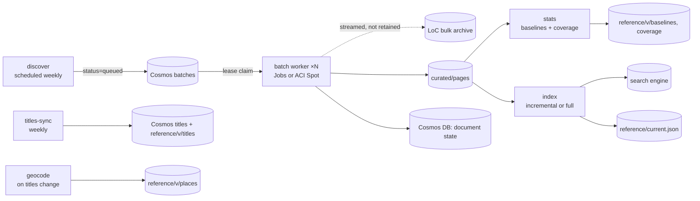

# 04: Data Sources & Ingestion

## 4.1 Source landscape (as of September 2026)

The legacy crawler targeted `chroniclingamerica.loc.gov` JSON endpoints (`/batches/…json`, `/lccn/{sn}/{date}/ed-{n}.json`, `/…/ocr.txt`, `/lccn/{sn}.json`). **Those endpoints are gone.** On **4 August 2025** the Library of Congress moved Chronicling America onto loc.gov. The legacy domain now permanently redirects there, and the collection is reachable **only through the loc.gov API**. Since then LoC has launched a **Chronicling America Datasets portal** with batch data and **bulk OCR downloads for 3,000+ batches and 23M+ pages**. It is also re-OCRing pre-2012 content with its open-source **NDNP-Open-OCR** pipeline (Tesseract with layout detection; 425k+ pages reprocessed as of August 2026).

| Source                                                                                       | What we take                                                                                                            | Access pattern                                                                       | Notes                                                                                                                     |
| -------------------------------------------------------------------------------------------- | ----------------------------------------------------------------------------------------------------------------------- | ------------------------------------------------------------------------------------ | ------------------------------------------------------------------------------------------------------------------------- |
| **Chronicling America Datasets portal** (`loc.gov/collections/chronicling-america/datasets`) | Batch list and versions; **bulk OCR text** per batch                                                                    | Bulk download, rate-limited (historically 10 bulk requests per 10 min per IP)        | **Primary corpus source.** One archive per batch is far cheaper for LoC and for us than per-page fetches.                 |
| **loc.gov JSON API** (`?fo=json`)                                                            | **Title metadata** (LCCN, title, place, county, state, language, ethnicity, dates); page `resource` URLs; small top-ups | Paginated JSON; requests limited; searches over 100k results must be split by facets | Used for reference data and for reconciling page URLs. Not used to pull text for the bulk corpus.                         |
| **NDNP-Open-OCR outputs**                                                                    | Replacement OCR for reprocessed pages                                                                                   | Show up as new batch versions or dataset updates                                     | Triggers re-ingestion of affected pages (§4.7).                                                                           |
| **USGS GNIS Domestic Names** (public domain) + **Census TIGER** county/state shapes          | Coordinates for places of publication; county centroids as fallback; state polygons                                     | One-time download, refreshed yearly                                                  | Replaces the legacy Google Places geocoding and its committed key.                                                        |
| **Legacy `town_ref.csv`**                                                                    | 1,795 LCCN → city/state/lat/lon rows                                                                                    | One-time                                                                             | **Cross-check only** for geocoding QA.                                                                                    |
| _American Stories_ (Dell et al., Harvard; Hugging Face)                                      | Article-level segmentation of ~20M scans, 438M articles, 1774–1963                                                      | Parquet download                                                                     | **Phase 3** option for article-level results and reprint detection (F-33/F-34).                                           |
| _Mirrors_ (e.g. the `biglam/chronicling-america-bulk-ocr` bucket on Hugging Face)            | Same bulk OCR                                                                                                           | S3-style bulk                                                                        | Optional **backfill accelerator** to reduce load on LoC. Check provenance and checksums against LoC manifests before use. |

### 4.1.1 Spike S-1 findings (September 2026)

- **The batch list is machine-readable.** The collection JSON (`https://www.loc.gov/collections/chronicling-america/?fo=json&c=1`) carries a `datasets` array: one entry per batch with `batch` (e.g. `vi_elgar_ver02`), `url` (`https://chroniclingamerica.loc.gov/data/ocr/{batch}.tar.bz2`), `sha256`, `size`, `page_count`, `issue_count` and `lccns`. `usnm-ingest enqueue` reads it directly (its default `--list`). The Datasets HTML page itself answers scripted clients with 403, so the JSON is the interface.
- **Size:** 2,997 batches, **23.7M pages**, **2.47 TB of `tar.bz2`** (largest 3.8 GB). Versions run `_ver01` (2,307) to `_ver08`.
- **Archive layout:** `{lccn}/{yyyy}/{mm}/{dd}/ed-{n}/seq-{n}/ocr.txt` plus ALTO `ocr.xml`, exactly the historical layout the reader expected. The XML is ~35× the text and is skipped, so most of the download is discarded.
- **Text volume:** a 1900s weekly batch (`vi_elgar_ver02`: 1,605 pages) averages **33.7 KB of text per page**; its curated Parquet is 3.2× smaller than the raw text. That fits the 450–800 GB raw / 150–300 GB curated estimate in §4.3.1.
- **Throughput:** the download ran at ~80 MB/s (but see §4.1.2: that rate may only hold when the CDN has the archive cached). Curation is bound by single-threaded bzip2 at **~3.9 MB/s of archive per worker** (54 s for 208 MB), so the full 2.47 TB is ~175 worker-hours: about 22 hours with 8 workers if CPU were the limit. It isn't: LoC's bulk limit paces the backfill to ~2.5 days (§4.4). Run one worker process per vCPU.
- **Scratch disk:** the worker downloads the whole archive before parsing (to verify the sha256 first), so its disk must hold the largest archive (3.8 GB).
- **Titles:** `https://www.loc.gov/item/{lccn}/?fo=json` returns the title record with `location_city/county/state`, **`latlong`**, `dates_of_publication`, `number_first_issue`/`number_last_issue` and `languages`. LoC's own coordinates can seed `geocode`, with GNIS as the cross-check.
- **Access:** everything above is anonymous HTTPS. A real archive (`dlc_zurich_ver04`, 58 KB) is checked into `crates/usnm-ingest/tests/data/` as a layout regression test.

### 4.1.2 Local trial findings (September 2026)

A trial ran the pipeline end to end on 6 real batches (40,452 pages: `dlc_zurich_ver04`, `vi_elgar_ver02`, `iune_mallard_ver08`, `ncu_cane_ver01`, `nn_nelson_ver01`, and `dlc_nosebleed_ver01`, the largest archive at 3.8 GB). It ran on an 8-core laptop over a residential 1 Gbps link, with Azurite standing in for Blob Storage and a stand-in for Cosmos DB.

- **Downloads depend on the CDN cache.** `chroniclingamerica.loc.gov` is served through Cloudflare. When the archive was already cached (`cf-cache-status: HIT`), downloads ran at 20–45 MB/s. On a miss they ran at **0.3–1.2 MB/s per connection**: `iune_mallard_ver08` (318 MB) took about 15 minutes. Range requests work (`accept-ranges: bytes`), but on a miss, 8 parallel ranges did not add up to much: one ran fast and most stalled. S-1's ~80 MB/s was measured on `vi_elgar_ver02`, which may already have been cached. Few people download these archives, so most of a backfill will be cache misses. **These rates were measured from a residential link, not from Azure.** Measure a cache-miss download from Azure before sizing the backfill. If misses are just as slow from Azure, downloading is what limits the backfill, not curation CPU. For example, 8 parallel batches at 0.3–1.2 MB/s each is about 2.4–10 MB/s, or 3–12 days for 2.47 TB.
- **LoC's listing counts are not exact.** In 5 of the 6 batches, the curated pages matched the listing's `page_count`. `ncu_cane_ver01` held 11,100 pages in 2,509 issues, while the listing said 10,550 pages in 2,365 issues. There were no empty or duplicate pages. So `page_count` and `issue_count` can't be used to check that a batch curated completely. The checks remain the archive's sha256 and our own counts.
- **Memory:** a curate worker peaked at 500 MB on the 3.8 GB archive. A 4-batch `run` (curate, `titles-sync`, release) peaked at 650 MB. That leaves plenty of room in 1 vCPU / 2 GiB.
- **Quickwit ingest is rate limited per shard.** The writer node has one shard per index. Quickwit 0.9 allows ~50 MiB in a burst and then 5 MB/s per shard (20 MB/s at most, with `ingest_api.shard_throughput_limit`). Past the burst it answers `503 no shards available`. The release now retries on 503 and runs its writer at 20 MB/s. **The index build is slower than §4.4 planned.** A full release of the 40,452 trial pages took 72 s end to end on the laptop, about 560 pages/s. At that rate, 23.7M pages take about 12 hours. On the job's 2 vCPU it will be slower; this has not been measured yet. `caj-usnm-ingest` has `replicaTimeout: 86400` (24 h) and no retry, so measure the build rate on the job's size before the first full backfill.

**Good-citizen policy:** identify ourselves with a descriptive User-Agent and contact address; prefer bulk over per-page requests; schedule off-peak; back off exponentially on 429/5xx; never parallelize beyond published limits; cache everything in our lake so we fetch each object **once**.

## 4.2 Canonical identifiers

- **Page key** (human-readable and stable): `{lccn}/{yyyy-mm-dd}/ed-{n}/seq-{n}`, e.g. `sn84026749/1896-07-10/ed-1/seq-1`. This is the same tuple the legacy code used (`sn, date, ed, seq`) and the one LoC uses for resource paths.
- **Doc id** (engine key): the page key itself, with `/` replaced by `_` (e.g. `sn84026749_1896-07-10_ed-1_seq-1`). It is **collision-free by construction**, reversible, and uses only characters valid in AI Search keys (letters, digits, `_`, `-`). A 64-bit hash was rejected: at 23M pages the chance of at least one collision is ~1.4×10⁻⁵, and a collision would silently merge two pages and break exact counts.
- **Place id**: `P` + a stable integer assigned once and never reused (e.g. `P00412`). Ids stay stable across reference snapshots; the registry is carried forward from one `reference/{index_version}/places` snapshot to the next. One place can serve many titles, since cities had several papers.
- **Index version**: `pages-v{YYYYMMDD}-{n}`. It is recorded in `reference/current.json` and appears in every API ETag.

## 4.3 Data lake layout (Blob Storage, flat namespace, one storage account)

```
raw/                                   (lean profile: NOT retained; LoC is the source of record)
  loc-api/titles/{date}/…json.zst       raw title metadata snapshots only (small)
curated/                               (Cool; the system of record; versioned + soft delete)
  pages/{batch}/v{NN}/{attempt}/part-{nnnn}.parquet
                                        written once, never overwritten; the Cosmos `batches` item
                                        points at the committed attempt (the atomic "commit")
  pages/{batch}/v{NN}/{attempt}/counts.json
                                        pages per (lccn, day), all text statuses: baselines are
                                        built from these without re-reading the parts
  ocr-ja/targets-v2.jsonl               the Japanese pages to OCR (§4.8), one JSON object per page
  ocr-ja/pages/{lccn}_{date}_ed-{n}[.{k}].parquet
                                        our OCR of an issue's Japanese pages, an overlay keyed by
                                        doc_id: page identity (doc_id, page_key, lccn, date,
                                        edition, seq, batch), ocr_source = usnm-ndlocr-lite,
                                        ocr_engine, loc_text (empty, short, garbled), image_url,
                                        ocred_at, text_status, text, text_chars, text_sha256. The
                                        release joins it to the curated row for everything else.
                                        Written only when every page it was asked for has text and
                                        ALTO; a page is done when its doc_id is in a part and it
                                        has ALTO (.2, .3, ... for pages read again or added to the
                                        targets after the issue's first part)
  ocr-ja/alto/{doc_id}.xml              the page's ALTO v3 from our OCR (§4.8, #151)
  ocr-ja/claims/{targets}/{issue}.json  which replica took the issue (create-only)
  american-stories/pages/{lccn}/{year}-{nnn}.parquet
                                        American Stories' text of our pages (§4.9), one row per page:
                                        doc_id, lccn, date, text, articles (JSON: headline, byline,
                                        offsets in text, boxes, legibility), legibility, width, height
  american-stories/years/{year}.json    the writer finished the year (written last): the release
                                        reads only the parts of years with one
reference/                             (Hot; small; loaded by API; IMMUTABLE per index version)
  catalog/titles.json, places.json      the working catalog (titles-sync + geocode; hand-written
                                        until those land). Titles and places carry stable ordinals
  {index_version}/                      = pages-v{YYYYMMDD}-{n}
    titles.json  places.json            the catalog as published with this version (only titles
                                        and places that have pages in it)
    baselines.json                      pages published per place: {place_id: [[day, pages], …]}
    title_pages.json                    pages published per title: {lccn: pages}, the same pages as the
                                        baselines summed by title (the status page's pages by
                                        language). Snapshots from before it was added don't have it
    title_dates.json                    each title's first and last page date:
                                        {lccn: {first: "1895-01-05", last: "1897-12-25"}}, the same pages
                                        as title_pages.json (06 §6.3.11). Snapshots from before it was
                                        added don't have it
    language_baselines.json             the same pages as baselines.json, split by the languages
                                        their title lists: {sets: [{languages: ["eng", "ger"],
                                        baselines: {place_id: [[day, pages], …]}}, …]}, one set per
                                        distinct language list, sorted. A page is in exactly one set,
                                        so any selection of languages sums the sets that share one
                                        of them without counting a page twice. Titles that list no
                                        language are left out (no language filter matches them).
                                        Snapshots from before it was added don't have it
    page_language_baselines.json        only on a version with page languages (05 §5.5.8): the same
                                        pages split by their own languages, in the same shape
    page_languages.json                 only on such a version: the pages whose own languages differ
                                        from their title's, {version, batches: {batch: {lccn: {set:
                                        {date: [[edition, seq], …]}}}}}, which a delta carries
                                        forward (the API doesn't read it)
    batches.json                        the batches the version was built from, each with its full
                                        curation record (parts, counts path, pages, lccns, sha256).
                                        The release reads the published version's list to find new
                                        batches; the Cosmos index_runs item only points at it
    ocr_ja.json                         our Japanese OCR in this version (§4.8), when the overlay has
                                        parts: {fold, index, indexed, pages, added_to_baselines,
                                        skipped, parts: [{path, sha256, bytes}]}
    american_stories.json               American Stories' text in the main index this version built
                                        (§4.9), when it was built with it: {version, years, unfinished_parts,
                                        loaded, docs, only_american_stories, parts: [{path, sha256, bytes}]}
    manifest.json                       { index_version, files: [{path, sha256, bytes}], built_from: {batches, ocr_ja?,
                                          american_stories?: {version, years, parts, bytes, docs,
                                          only_american_stories}},
                                          indexes (split layout), build }. build (#161) is what this run
                                          built: commit (USNM_GIT_SHA, from CI), ingest crate version, the
                                          engine (the writer's /api/v1/version), full or delta, feature
                                          versions (common_grams, ja_fold, and american_stories for a version with it) and the template of each index it
                                          wrote (pages, unless overlay-only; pages-ja, if it built one), in
                                          full with its sha256. The Cosmos index_runs item keeps the same
                                          without the templates' text. Indexes it kept (a delta's base, an
                                          overlay-only release's main indexes) were built by earlier
                                          versions: follow previous_version
  raw/titles.json                       the fields titles-sync keeps from each LoC title record
  current.json                          { index_version, backend, indexes: [base, delta…] (sealed), reference: "{index_version}", bounds, previous_version, published_at, synthetic, common_grams, american_stories?, ja?: {indexes: [pages-ja-…], fold, pages} }
(document state, meaning per-title, per-batch, per-issue and per-index-run status, lives in Cosmos DB, not here; see 05 §5.9.1)
cache/{index_version}/                 (Hot) persistent API response cache, zstd JSON keyed by canonical-query hash
qw-index/                              (Hot; Quickwit splits + file-backed metastore)
```

### 4.3.1 Curated page schema (Parquet, zstd)

| Column           | Type        | Notes                                                      |
| ---------------- | ----------- | ---------------------------------------------------------- |
| `doc_id`         | string      | `page_key` with `/`→`_` (unique)                           |
| `page_key`       | string      | `lccn/date/ed-n/seq-n`                                     |
| `lccn`           | string      |                                                            |
| `date`           | date32      | Publication date. Pre-1970 dates are normal; ~1756 onward. |
| `year`, `month`  | int16, int8 | Denormalized for partition pruning                         |
| `edition`, `seq` | int16       |                                                            |
| `front_page`     | bool        | `seq == 1`                                                 |

| `batch`, `batch_version` | string, int16 | Provenance |
| `ocr_source` | enum | `ndnp-original` \| `ndnp-open-ocr` |
| `text_status` | enum | `ok` \| `short` \| `empty` (§4.5) |
| `text` | large_string (nullable) | Normalized OCR text (§4.5); null unless `text_status = ok` |
| `text_chars`, `word_count` | int32 | QA and baselines |
| `text_sha256` | fixed_binary(32) | Change detection |
| `resource_url` | string | Canonical loc.gov page URL |
| `ingested_at` | timestamp | |

Curated rows hold only **immutable page facts**. Title-derived attributes (`place_id`, `state`, `language`) are **not stored here**. The `index` and `stats` jobs join them from the versioned titles snapshot, so a corrected title record never leaves stale copies in the system of record.

**Size estimate.** The legacy sample of 1879 _Daily Review_ (Towanda, PA) pages averages about **10.6 KB** of OCR text per page. Later eight-column broadsheets carry 2–5× more. We plan for **20–35 KB per page average × ~23M pages ≈ 450–800 GB of raw text**, or about **150–300 GB as zstd Parquet**. The estimate is validated in Spike S-1 ([10](10-roadmap-and-risks.md)).

## 4.4 Pipeline

All stages are subcommands of one Rust binary (`usnm-ingest`, in `crates/usnm-ingest`), packaged as one container image (`docker/Dockerfile.ingest`: the binary on the pinned Quickwit image).

**Implemented so far:** `enqueue` (from LoC's collection JSON `datasets` listing by default, or any batch list), `curate` (the `batch` stage), and `release` (the `index` stage, with the reference snapshot built from each batch's `counts.json`; `stats` is folded in). `run` chains all three for the weekly job. State lives in Cosmos over its REST API, or in a local JSON file for development. `titles-sync` and `geocode` build the catalog from LoC's title records (§4.6), and `run` calls `titles-sync` before releasing, so every curated title has a catalog entry. `prune` deletes the Quickwit indexes of older versions and of unpublished ones: every index that neither the serving version, its rollback, nor a published version newer than the serving one (left after a rollback by hand) names (#245, [operations](../operations/rebuild-and-index-storage.md#prune-old-index-versions)). **Still to come:** garbage collection of uncommitted attempts.

The ingest and backfill Container Apps Jobs are in `infra/modules/ingestjobs.bicep` (08 §8.4). `scripts/dev/fixture-batches.py` turns the synthetic fixtures into batch archives, and CI checks that the pipeline reproduces the fixture indexes and reference snapshot exactly.

**Weekly incremental** work runs as **Azure Container Apps Jobs**. The **initial backfill** runs the same image as a manual Container Apps Job with N parallel curation replicas, inside the VNet (see [08 §8.4](08-azure-infrastructure.md#84-compute-sizing-notes); ACI Spot remains a documented alternative). Work is split into **one Cosmos `batches` item per batch version** (about 3,000 batches). Workers claim items with lease patches, so work parallelizes naturally and retries are idempotent. Cosmos is the work queue; there is no Storage Queue.



| Stage                  | Trigger                                                    | Does                                                                                                                                                                                                                                                                                                                                                                                                                                                                                                                                                                                                                                                                                                                                                                                                                                                                                                                                                                                                                                                                                                                                                                                                                                                                                                                                                                                                                                                                                                                                                                                                                                                                                                                                                                                                                                                                                                                                                                                                                                                                                                                           | Idempotency                                                                                                                                                                                                                                                                                                                                                                                                                                                                                                                                                                                                                                                 |
| ---------------------- | ---------------------------------------------------------- | ------------------------------------------------------------------------------------------------------------------------------------------------------------------------------------------------------------------------------------------------------------------------------------------------------------------------------------------------------------------------------------------------------------------------------------------------------------------------------------------------------------------------------------------------------------------------------------------------------------------------------------------------------------------------------------------------------------------------------------------------------------------------------------------------------------------------------------------------------------------------------------------------------------------------------------------------------------------------------------------------------------------------------------------------------------------------------------------------------------------------------------------------------------------------------------------------------------------------------------------------------------------------------------------------------------------------------------------------------------------------------------------------------------------------------------------------------------------------------------------------------------------------------------------------------------------------------------------------------------------------------------------------------------------------------------------------------------------------------------------------------------------------------------------------------------------------------------------------------------------------------------------------------------------------------------------------------------------------------------------------------------------------------------------------------------------------------------------------------------------------------ | ----------------------------------------------------------------------------------------------------------------------------------------------------------------------------------------------------------------------------------------------------------------------------------------------------------------------------------------------------------------------------------------------------------------------------------------------------------------------------------------------------------------------------------------------------------------------------------------------------------------------------------------------------------- |
| `discover` (`enqueue`) | Cron (weekly) + manual                                     | Reads the batch list from LoC's collection JSON `datasets` array (§4.1.1), or any batch list given with `--list`; upserts `batches` items in Cosmos and marks new or changed versions `queued`. Never downgrades a version                                                                                                                                                                                                                                                                                                                                                                                                                                                                                                                                                                                                                                                                                                                                                                                                                                                                                                                                                                                                                                                                                                                                                                                                                                                                                                                                                                                                                                                                                                                                                                                                                                                                                                                                                                                                                                                                                                     | Only marks `queued` if the status ≠ curated for that version; failed batches are re-queued                                                                                                                                                                                                                                                                                                                                                                                                                                                                                                                                                                  |
| `batch`                | A `queued` batch is available to claim                     | Streams the bulk OCR for the batch (checksum verified; not retained); parses per-page text; normalizes; writes curated Parquet (~256 MB row groups); updates the manifest                                                                                                                                                                                                                                                                                                                                                                                                                                                                                                                                                                                                                                                                                                                                                                                                                                                                                                                                                                                                                                                                                                                                                                                                                                                                                                                                                                                                                                                                                                                                                                                                                                                                                                                                                                                                                                                                                                                                                      | Claims the batch with a conditional Cosmos patch (lease + ETag); writes to a **new attempt path** (never overwriting); then **upserts the issue items first** (idempotent, keyed by lccn/date/edition). The **final commit marker** is one conditional patch on the batch item, made only while the worker still holds the lease: `curated_path` → that attempt, plus sha256, pages and `status=curated`. If anything fails before that patch, the batch stays un-curated, its lease expires, and it's retried; `discover` also re-queues any batch not `curated`. Re-upserting issues is harmless. Uncommitted attempts are garbage-collected after 7 days |
| `titles-sync`          | Each `run` (weekly), before release; manual                | Fetches `loc.gov/item/{lccn}/?fo=json` for titles with pages that aren't cached or catalogued yet (for a title in `catalog/overrides/titles.json`, the record it names); caches the fields used in `reference/raw/titles.json`; then runs `geocode`                                                                                                                                                                                                                                                                                                                                                                                                                                                                                                                                                                                                                                                                                                                                                                                                                                                                                                                                                                                                                                                                                                                                                                                                                                                                                                                                                                                                                                                                                                                                                                                                                                                                                                                                                                                                                                                                            | Paced under LoC's 20 requests/minute limit; on a 429/CAPTCHA, waits out LoC's one-hour block and resumes more slowly until its deadline (`run --titles-max-runtime-secs`, 8 h into a job run; `titles-sync --max-runtime-secs` when run on its own), else stops; failures are retried next run; the cache is saved as it goes                                                                                                                                                                                                                                                                                                                               |
| `geocode`              | After `titles-sync`; manual (e.g. after editing overrides) | Resolves each title's place of publication (§4.6): merges spellings of one town, then takes an override, else LoC's `latlong` from records that list only that city (the gazetteer's point when LoC's is more than 100 km from the gazetteer's town of the name and the name isn't ambiguous there), else the Census gazetteer, else LoC's `latlong` from records that list several cities, else the state centroid; writes `catalog/places.json` then `catalog/titles.json`, only if they changed                                                                                                                                                                                                                                                                                                                                                                                                                                                                                                                                                                                                                                                                                                                                                                                                                                                                                                                                                                                                                                                                                                                                                                                                                                                                                                                                                                                                                                                                                                                                                                                                                             | Deterministic, no network; stable ordinals and ids                                                                                                                                                                                                                                                                                                                                                                                                                                                                                                                                                                                                          |
| `stats`                | After batches are curated                                  | Aggregates baselines (pages per place/day and per title/month) and coverage (state/year) from curated Parquet joined with the titles snapshot, using DataFusion or Polars. Writes a **new** `reference/{index_version}/` snapshot (never overwrites)                                                                                                                                                                                                                                                                                                                                                                                                                                                                                                                                                                                                                                                                                                                                                                                                                                                                                                                                                                                                                                                                                                                                                                                                                                                                                                                                                                                                                                                                                                                                                                                                                                                                                                                                                                                                                                                                           | Full recompute (cheap: one scan of the ids and dates columns)                                                                                                                                                                                                                                                                                                                                                                                                                                                                                                                                                                                               |
| `index` (`release`)    | After curation, or manual                                  | Takes the Cosmos `ops/quickwit-writer` lease (the single metastore writer). Runs the Quickwit writer node as a child process for the length of the release. **Incremental:** writes newly curated rows with `text_status = ok` into a **new delta index**. **Compaction/full:** writes all rows into a **new base index**. Both join the titles snapshot for `place_id`/`state`/`language` and compute `place_shard`. Never writes an index a published version lists. Before publishing, waits for the writer to merge the new index into a few large splits, then closes it (05 §5.5.1); a full disk, a failed merge or a merge that doesn't finish in time fails the release instead. Logs an `index layout` line (splits, documents, size) for each index of the version and records the same in its manifest. Writes the version's batch list into its reference snapshot (`batches.json`, listed in the manifest) and records only its path and count in the Cosmos `index_runs` item. Keeps one copy of a page that ships in more than one batch (§4.7). With `--partition-decade` (`USNM_PARTITION_DECADE`), a full base is laid out by decade: each page gets its `decade`, each split holds one decade, and the pages are sent a decade at a time through bounded files on the writer's scratch share; a delta on such a version gets the field and tags its splits with their decades, and `current.json` records `decades` (05 §5.5.5, #123). With `--single-text-field` (`USNM_SINGLE_TEXT_FIELD`), a full base searches LoC's and American Stories' text in one field, `text_all`, and `current.json` records `text_layout: 2`; a delta follows the published version (05 §5.5.7, #283). With `--page-language` (`USNM_PAGE_LANGUAGE`), a full base gives each page its own languages, found from its words, writes the page-language baselines and the pages that move to them, and `current.json` records `page_language: 1`; a delta follows the published version and carries the moves forward (05 §5.5.8, #289). Publishes by writing `current.json` last, naming the index set and its reference snapshot | Deterministic `doc_id` (the page key); each new index is built from scratch, so a retry discards the unpublished index and starts again                                                                                                                                                                                                                                                                                                                                                                                                                                                                                                                     |

**Throughput plan for the initial backfill.** The original plan assumed 2,000 pages/s per indexer, about 3.2 hours of indexing. The trial (§4.1.2) measured about 560 pages/s on 8 laptop cores with the writer's per-shard ingest limit, so plan on 12 hours or more, and measure on the job's 2 vCPU before the backfill. Downloads from LoC dominate anyway (days, not hours; cache misses ran at 0.3–1.2 MB/s in the trial), which is why the curated lake matters: **after the first backfill we never re-download to re-index.** If the mirror is validated, the backfill can pull from it instead. S-1 measured curation at ~175 worker-hours for the whole corpus (§4.1.1), ~$15–20, but **LoC's download limit sets the pace, not CPU**: 10 bulk requests per 10 minutes per IP. The first prod backfill (September 2026) ran 8 workers at ~140 downloads/hour, was tolerated for about 90 minutes, then refused almost everything for over an hour. Workers now take download slots 75 s apart from one Cosmos item (`ops/loc-bulk-pacer`) shared by every worker and execution, and a 429 pauses all of them for an hour without costing the batch an attempt. That is ~48 batches/hour, about 2.5 days for the corpus with 4 workers (more add nothing). Each worker stops claiming batches 22 h after it starts and exits 0 before the job's 24 h replica timeout, and the job is started again until the queue is empty. After the backfill, new batches come from the weekly `run` (08 §8.4). A worker that dies only delays the work, because each batch is idempotent and becomes claimable again when its lease expires. The jobs run inside the VNet, so the data services stay private throughout.

## 4.5 Text normalization (applied at curation time)

1. Unicode NFC; strip control characters; turn the long s `ſ` into `s`; normalize ligatures (`fi` → `fi`).
2. **Rejoin line-break hyphenation**: `indus-\ntry` → `industry`, but only when the joined token is alphabetic. This substantially improves phrase recall on OCR text.
3. Collapse runs of whitespace; keep paragraph breaks as `\n`.
4. **Keep every digitized page as a curated row**, even when the normalized text is empty or shorter than 20 characters. Such rows get `text_status = empty | short` and a null `text`. They are **excluded from the search index only**; baselines and coverage count them, so relative frequencies and the "no digitized newspapers" layer stay correct. (The legacy code dropped them entirely.)
5. Keep the text case-sensitive in storage; lowercasing and ASCII folding happen in the engine's analyzer.

## 4.6 Geography

- **Unit:** a title's **place of publication**, as recorded by LoC (city, county, state). All pages of a title inherit its place. A title that moved can have its places by date (`place_periods` on the title in the catalog, from `catalog/overrides/title-places.json`, below): a page's date selects its place, and the title's own `place_id` is where most of its pages were published.
- **Places.** Titles whose cities are spellings of one town share a place (merging, below). A place's coordinates are, in order:
  1. a manual override (`catalog/overrides/places.json` in git, compiled into the ingest image: `[{added, city, lat, lon, name?, precision?, reason, ref, source, state}]`; like every override, each entry records when (`added`), why (`reason`), from what source (`source`) and where it was decided (`ref`), with `updated` and `history` when it changes; see `catalog/overrides/README.md`);
  2. LoC's own `latlong` from the place's title records that list only this city in `location_city` (precision `city`); when there are several, the median latitude and longitude. When that point is more than 100 km from the gazetteer's town and the name isn't ambiguous in the gazetteer (below), the gazetteer's point instead, since LoC's point is then a state's or another town's (in October 2026 LoC put Barre, Vermont near Turin, Italy, and Atlanta at Richmond, Virginia);
  3. the US gazetteer, by city and state, when the name isn't ambiguous there (precision `city`);
  4. LoC's `latlong` from records that list several cities (the median, precision `city`), only when the gazetteer has no match;
  5. the state centroid (precision `state`).

  Each place stores `precision ∈ {city, county, state}` and the UI shows lower precision with a hollow marker. `geocode` also records the step that gave its coordinates as `coordinates_from` (`override`, `loc`, `gazetteer`, `gazetteer_over_loc`, `loc_multi_city` or `state_centroid`), and the other city names its titles use, each with the rule that put it there, as `variants` (`spelling`, `alias`, `x_city` or `title_place`, below); places it didn't place (hand-written ones) have neither.

  A LoC title record has one `latlong` however many cities it lists: the Memphis Daily Appeal (sn83045160) lists Memphis to Selma, and its `latlong` is Selma's. Before October 2026 a place took the `latlong` of its first title (by LCCN), so a paper that moved could put a whole city at another one's point (Memphis and Chattanooga at Selma, Charleston at Camden, Fort Scott at Topeka). Step 2 leaves those points out, and step 4 uses them only when the gazetteer has no match.

  When a single-city point and the gazetteer's are more than 25 km apart and step 2 keeps LoC's (the name is ambiguous in the gazetteer, the gazetteer has it only as "X City" or "X", or the two are at most 100 km apart), `geocode` lists the place in its report (`disagreements`, the 50 furthest in `disagreement_examples`) for review. LoC's point can be wrong, and so can the gazetteer's (another town of the same name, or the internal point of a large consolidated city such as Anchorage). The fix for either is an override. A place whose point is a median of LoC points (step 2, or step 4 when step 2 has none) is also listed when two of those points are more than 25 km apart (`loc_apart`, the 50 furthest in `loc_apart_examples`, each with the two points and their LCCNs): one of those records likely has another town's point. New Echota, Georgia (#223) would be one without its override: its two records list the city as "New Town" and "Echota", which don't key as New Echota, so both points count as multi-city and step 4 would take their median, though the two are 84 km apart. Its override in `places.json` (step 1) now places it, so the report doesn't list it. The report counts places by source (`from_override`, `from_loc`, `from_gazetteer`, `gazetteer_over_loc` with the list in `gazetteer_over_loc_places`, `from_loc_multi_city`, `state_centroid`).
  - **Gazetteer.** `catalog/gazetteer/us-places.csv` (`state,name,lat,lon`, about 32,000 rows, 1 MB) is compiled into the ingest image. `scripts/data/build-gazetteer.py` makes it from the Census Bureau's Gazetteer Files, national places file (2025): every incorporated place and census designated place, with its internal point, without the area description the Census appends ("Abbeville city" is "Abbeville", "Abanda CDP" is "Abanda"). It is a work of the US government, in the public domain. A name a state has more than once (Oakwood, Ohio has three) is listed once per place, the incorporated one first, then the larger. Places whose names key alike in a state are told apart by spelling (Alabama has a Lake View and a Lakeview): `geocode` takes the one whose name has the same words as the titles' spelling (case, accents and "St."/"Saint" aside; spacing counts). When there isn't exactly one, the name is ambiguous: the gazetteer gives it no point (step 3) and doesn't replace LoC's (step 2), and a LoC point more than 25 km from its first town is listed for review. The gazetteer also accepts "X City" for "X" and the other way round (LoC's "Langston City" is Langston).
  - **A title's city** is the city in its LoC title, e.g. "(North Platte, Neb.)", else the first city its record lists. LoC lists a record's cities and states by position (The Broad Ax, sn84024055: Chicago, Salt Lake City; Illinois, Utah), so when the two lists are the same length, the city's state is the one at its position. Otherwise the state is the one its place label names. Either way, a city is never put in a state where the gazetteer lacks it when the gazetteer has it in another of the record's states, so there is no "Salt Lake City, Illinois". A title whose record lists several places can be placed by hand in `catalog/overrides/title-places.json` (in git, compiled in): `[{added, city, lccn, places?, reason, ref, source, state}]`, keyed by LCCN, applied before anything else (The Broad Ax is in Chicago, where most of its pages were published). A paper whose record dates its moves can also give its places by date, `places: [{city, from?, state, to?}]`: at least two, oldest first, the first without `from` and the last without `to`, each starting the day after the one before ends, and the entry's own `city` and `state` one of them (the Morning Star, sn84024361, is in Limerick, Maine, up to Nov. 13, 1833 and in Dover, New Hampshire, from Nov. 14, where most of its pages were published, #1066). `geocode` then makes a place for each, and records them on the title as `place_periods: [{place_id, from?, to?}]` beside its own `place_id`; a title in one place has no `place_periods`. Only dates a source gives are used: Boston, where the Morning Star was also published later, has no period until one is sourced. The label is kept on the title as `place_of_publication`, so historical names ("Dakota Territory") survive.
  - **Merging.** A city is keyed ignoring case, accents, punctuation and spaces, so "New-York" and "New York" are one place. The one exception is a key the gazetteer has for several towns in the state: a title whose spelling names exactly one of them (same words, spacing counted) is placed in that town, so Alabama's Lake View and Lakeview stay two places; titles whose spelling names none of them, or several, share the plain key. These variants also key alike: "St."/"Saint", "Ste."/"Sainte", "Mt."/"Mount", "Ft."/"Fort", a leading "The" ("The Dalles"/"Dalles"), a leading "City of", "Borough of", "Town of" or "Village of", a trailing state name or abbreviation ("Chicago Ill.", "Nome Alaska", "Cheraw S.C."), a trailing "Court House" or "C.H." ("Anderson Court House") unless the gazetteer has the full name in that state (Washington Court House, Ohio), "M'" for "Mc" ("M'arthur"), and LoC's own corrections ("Nueva-Orleans i.e. New Orleans"). "X City" and "X" in one state are one place when both exist and their points are within 10 km (Yazoo City and Yazoo, Washington City and Washington); the merged place takes the name of the one with more titles, "X" on a tie. Misspellings and renamed towns are in `catalog/overrides/place-aliases.json` (in git, compiled in): `[{added, from, reason, ref, source, state, to}]`, applied to a city before it is keyed. For example "Skaguay" is Skagway, "Vermilionville" is Lafayette, "Great Salt Lake City" is Salt Lake City, and a title naming two cities ("Fort Worth-Dallas") is placed in the first. Towns that were separate keep their own places: East Providence and Olneyville are not Providence, Franklinton is not Columbus, Winston is not Winston-Salem (separate until 1913), Carlisle Barracks is not Carlisle.
  - **Names.** A place's name is, in order: the override's `name`; the alias's `to`; the gazetteer's spelling, when it only respells LoC's (case, accents, "St."/"Saint", "The") or LoC's has punctuation it fixes ("Newbury-Port" is Newburyport, "Coeur D'alene" is Coeur d'Alene); else LoC's: the spelling most of the titles of the place's main variant use (the lowest LCCN's on a tie), with its 19th-century hyphens as spaces ("Baton-Rouge" is Baton Rouge) except in real hyphenated names (Winston-Salem, Wilkes-Barre, Sedro-Woolley). LoC's "Tule Lake" (the camp) keeps its name although the gazetteer's town is Tulelake.
  - **Ids.** Ordinals and place ids are stable, and nothing is ever removed. When spellings merge, the place keeps the id that most of its titles had (on a tie, the lower ordinal). The other places stay in `catalog/places.json`, named by no title (`retired` in the report), so their ids are never given to another place; a release's snapshot lists only places with pages, so they drop out of the site.
  - **Releases.** Index documents carry a page's `place_id` and `place_shard` (from the place's ordinal) and its `state` (its title's, or its place's for a title with `place_periods`, whose pages are in the place of their date), and the baselines are summed by place id and day, so they count each page where its document is; coordinates and names are only in the snapshot's `places.json`. So a corrected point or name needs no reindex: an incremental release takes the current name, coordinates and precision (with `coordinates_from` and `variants`) for every published place, and a place folded into another shows the same name and point. A published title that the catalog now puts in another place (a merge, an alias, a corrected city) or in places by date stays where it was published, in one place, until a full release, as any other change to a published title does (§4.7); a new title takes its periods at once, so a version never counts a page in one place and indexes it in another. A full release on the Consumption profile runs out of memory (#172), so it is run by hand on the E4 profile (`USNM_INGEST_FULL`, operations/rebuild-and-index-storage.md, Full rebuild). Each incremental release logs how many published titles' place changes wait for it. Meanwhile a new title in a merged place goes to the place its published titles are in, so a town doesn't gain a second id in a version.
  - `titles-sync` caches the fields it uses from each record in `reference/raw/titles.json`, fetching only titles that are neither cached nor in the catalog (`--refresh` re-fetches). Requests go one at a time, every 3.5 s: loc.gov's JSON API allows 20 a minute and blocks for an hour beyond that, and any request during the block starts the hour again. LoC also limits below that rate when it is busy: in September and October 2026 a 429 or CAPTCHA page came after about 250 to 340 requests at about 13 a minute. With a deadline (`titles-sync --max-runtime-secs`, or `run --titles-max-runtime-secs`, which the ingest job sets to 8 h from its start), titles-sync then sends nothing for 65 minutes and resumes 1.5 times slower (at most one request every 10 s). Without a deadline, or when the pause would run past it, titles-sync stops, and the next run continues from the cache. A title takes about 4.5 s (LoC's response time is over the 3.5 s pace), so ~3,100 titles take about 4 hours, plus 65 minutes for each block. A full release goes ahead only after titles-sync has fetched every title LoC has, with no failed fetches (08 §8.4); weekly runs fetch only new titles. A title whose pages ship under an LCCN with no loc.gov record would never be catalogued, and its batches would wait forever. So `catalog/overrides/titles.json` (in git, compiled in) can name another LoC record for the same title; titles-sync fetches that record instead and caches it under the pages' LCCN, with the record's LCCN kept on the title as `loc_record`. For example, LoC has no record under `sn87093109`, the LCCN of The Vancouver Independent's pages in `wa_duwamish_ver01` and `wa_lacamas_ver01`, but its record `sn84022797` describes the title and points at those pages (#120). `geocode` rebuilds the catalog from that cache with no network. With a raw store (`USNM_RAW_URL`: the archival account in dev), each titles-sync then saves the cache and the catalog as one create-only copy, `raw/titles/{time}.json`, unless the newest copy is the same. `usnm-ingest titles-seed` loads the newest copy into a new environment that has no cache, never replacing a file (#275; operations, "Dev environment lifecycle").
  - `cargo run -p usnm-ingest --example place-report -- --places places.json` runs these rules on a published `/v1/places` GeoJSON (with stand-in titles at the live points) and lists the merges, renamed places and places that move.

- **QA:** `geocode` lists places more than 25 km from the gazetteer (above). Still to do: diff against legacy `town_ref.csv`, and have CI check that every title with pages resolves to a place.
- **Historical context:** territories (e.g. Dakota Territory, Indian Territory) keep their historical label in `titles`. Historical state and territory boundary overlays are F-32 (Phase 3).

## 4.7 Updates, reprocessing and re-indexing

| Change                                                                                                                                                            | Detection                                                                                                                                     | Action                                                                                                                                                                                                                                                                                                                                                                                                                                                                                                                                                                                                                                                                                                                                                                                                                                            |
| ----------------------------------------------------------------------------------------------------------------------------------------------------------------- | --------------------------------------------------------------------------------------------------------------------------------------------- | ------------------------------------------------------------------------------------------------------------------------------------------------------------------------------------------------------------------------------------------------------------------------------------------------------------------------------------------------------------------------------------------------------------------------------------------------------------------------------------------------------------------------------------------------------------------------------------------------------------------------------------------------------------------------------------------------------------------------------------------------------------------------------------------------------------------------------------------------- |
| **New batch**                                                                                                                                                     | `discover` finds an unseen batch                                                                                                              | Curate → `stats` builds the new `reference/{index_version}/` snapshot → `index` writes the new pages into a **new sealed delta index** → **publish last**: write `current.json` listing base + deltas only when both the index set and its reference snapshot are complete                                                                                                                                                                                                                                                                                                                                                                                                                                                                                                                                                                        |
| **New batch version** (e.g. `_ver02`, or NDNP-Open-OCR reprocessing)                                                                                              | Version increment or dataset update                                                                                                           | Curate the new version and mark the batch `pending_replacement` in Cosmos. Published indexes are sealed, so the replacement takes effect at the next **compaction** (a full rebuild into a new base index, monthly or sooner), which publishes a new `index_version`. Until then the previous OCR keeps serving.                                                                                                                                                                                                                                                                                                                                                                                                                                                                                                                                  |
| **A page in two batches** (LoC ships some issues in two batch archives: `wa_duwamish_ver01` and `wa_lacamas_ver01` both carry 20 pages of `sn87093109` from 1875) | Each batch's `counts.json` names the title-days more than one batch has; the release reads the page keys (not the text) of only those batches | The release keeps one copy of each such page: a copy with text wins over one without, and between equals the batch whose name sorts first wins, so every release keeps the same copy. A losing copy from a batch being indexed is left out. A losing copy that an earlier index of the version already holds (a delta can't change it) is listed in the snapshot's `duplicates.json` and hidden from every search (05 §5.7). The page counts once in the baselines, pages per title and the run's `pages`; the manifest and the run record `duplicate_pages`, and the status page shows them. A version released before this rule indexed every copy, so the first delta on top of it hides all the extra ones, and a full release needs to hide none. `usnm-ingest duplicates` reports them across every curated batch without changing anything |
| **Title metadata change** (e.g. corrected place)                                                                                                                  | `titles-sync` diff (recorded on the Cosmos `titles` item)                                                                                     | Record the change in Cosmos as pending. At the next **compaction**, the new titles snapshot drives both the rebuilt base index (via the join) and the matching reference snapshot, published together as one `index_version`. No re-curation is needed because curated rows carry no title-derived fields. A published title moved to another place (a merge, §4.6) waits too, and new titles of its town go to the place it is published in; a published place's corrected name or coordinates ship with the next delta.                                                                                                                                                                                                                                                                                                                         |
| **Analyzer or schema change**                                                                                                                                     | Code change                                                                                                                                   | **Full rebuild** (compaction) into a new base index from curated Parquet, then flip `current.json` atomically. Indexes listed by the previous version are kept for 7 days for rollback.                                                                                                                                                                                                                                                                                                                                                                                                                                                                                                                                                                                                                                                           |

The API re-reads `reference/current.json` every 10 minutes and loads the reference snapshot it names, verifying checksums. Snapshots are immutable and kept for at least the current and previous versions (7 days minimum), so **rolling back `current.json` restores the exact index + reference pair** that was published together. Because `index_version` is part of every cache key, caches never mix versions.

## 4.8 Japanese pages: our own OCR

LoC's OCR has no Japanese script. The Japanese pages of the Japanese-language titles (the internment-camp papers and the Japanese-American papers, catalogued "In English and Japanese") come from LoC with no text (`[NO TEXT AVAILABLE FOR THIS PAGE]` on loc.gov, empty in the bulk archives) or as garbled Latin characters, so they can't be found by any search. LoC serves every page image through its IIIF service at full scan resolution, so we OCR those pages ourselves (#128).

**Engine.** NDLOCR-Lite, the National Diet Library's open-source OCR (CC BY 4.0, CPU only). On 23 reference crops from 1942–45 papers (typeset and hand-lettered mimeograph), it found 77% of character pairs against 61% for Azure AI Document Intelligence Read and 26% for Tesseract `jpn_vert`, and scored higher than Azure on 19 of 23 crops (details in #128; tooling in `ja-ocr/tools/`).

**Job.** `ja-ocr/jaocr.py`, image `docker/Dockerfile.ja-ocr`, Container Apps Job `caj-usnm-jaocr-{env}` (manual, `USNM_JA_OCR_JOB`), running as `id-usnm-ingest`:

1. **Targets** (`jaocr.py targets`, or the first `run`): pages of titles whose catalog languages include `jpn` (the working catalog and the published one), from two sources. **Missing:** LoC's bulk archives ship a Japanese page as an empty ALTO `ocr.xml` with no `ocr.txt`, and curation reads only `ocr.txt`, so these pages never reach the curated store; the job streams the file list of every archive LoC's datasets listing gives for a Japanese title and takes each page with `ocr.xml` and no `ocr.txt` (in `dlc_ballston_ver01` alone, 2,433 of 5,791 pages). **Empty, short, garbled, mixed:** pages in the published version's Parquet parts whose `text_status` is `empty` or `short`, or `ok` but under 35% word-like tokens (`garbled`), or from 35% to under `--mixed-below` (`JAOCR_MIXED_BELOW`, a whole percentage, default 0.65: `mixed`, #204). Written to `curated/ocr-ja/targets-v3.jsonl` (the name changes when the rules do, so a run lists them again; a `--mixed-below` other than the default names its own list, `targets-v3-mixed{nn}`, and claims). `jaocr.py run` takes the same `--mixed-below`.
2. **Per issue**: claim it (a create-only blob), ask loc.gov for the issue's page images (one API request; the `files` list is in page order, which is not the frame order of the file names), download each target page's full-resolution JPEG, run NDLOCR-Lite on them together, and write each page's ALTO to `curated/ocr-ja/alto/{doc_id}.xml`, then `curated/ocr-ja/pages/{issue}.parquet`. A page is done once its `doc_id` is in a part and it has ALTO; the job is started again until every target page is done. Pages read before the job wrote ALTO are read again (claims under `{targets}-alto/`); the newer part wins.
3. **Pacing.** loc.gov's API at one request per 3.5 s and the image server at one per second, both multiplied by the replica count so the replicas together stay within LoC's limits.
4. **ALTO** (`ja-ocr/alto.py`, #151). LoC's `ocr.xml` for these pages is an empty ALTO: iArchives ran ABBYY 8 with `Lang:ja`, found no words, and recorded `xdpi:300` and the page size in `inch1200`. That size is our IIIF full-size image's pixels × 4 (1200/300), to within a few pixels, so ours uses the same units and can stand in for it. Ours is ALTO v3 (the namespace LoC's NDNP-Open-OCR writes), with `MeasurementUnit` `inch1200` at the dpi in LoC's `ocr.xml` (the issue JSON lists it; 300 without it) and LoC's page size where it gives one. It has one `TextBlock` per NDLOCR-Lite text block (`LANG="jpn"`) and one `TextLine` per line, in NDLOCR-Lite's reading order, each with one `String`: the line's text as `CONTENT` and its confidence as `WC`. NDLOCR-Lite measures lines, not characters, so there are no character boxes. Blocks without text (running heads, page numbers, figures) are left out. `Description` names NDLOCR-Lite and its commit and the source image URL. About 90 KB a page. The release doesn't read ALTO.
5. **Progress** for the status page (06 §6.3.6): `reference/status/ocr-ja.json`, `{schema, updated_at, started_at, engine, targets: {pages, issues}, done: {pages, issues}, eta}`, written when a replica starts, at most every 2 minutes after an issue, and when it finishes. `done` counts the target pages that have ALTO under `ocr-ja/alto/`, and the issues all of whose target pages do, from the listing alone, so every replica writes the same numbers. `eta` extrapolates this replica's pace since it started. A failed write is logged and the OCR goes on.

The text keeps NDLOCR-Lite's line breaks (one per column or line). Old character forms stay as printed (戰, 國); search folds them (step 3 of #128).

**Indexing** (#139). Every release reads the overlay (`ocr_ja.rs`): each part under `ocr-ja/pages/`, the newest row of each page (by `ocred_at`, then part path), and only pages of batches in the version whose titles are catalogued. It builds their own index, `pages-ja-{stamp}-{n}` (`infra/quickwit/pages-ja-index.yaml`), from scratch every time: about 11k pages, about a minute. A Japanese page's `text` is `usnm_core::ja::index_text` of the printed text (one token per Japanese character, old forms folded to modern ones, 06 §6.4), with its Latin runs folded by the analyzer of the version's main indexes (05 §5.5.3), and `printed` keeps the text as printed for snippets. `current.json` names the index under `ja` with the fold version, which the API folds Japanese queries with. Pages that curation never had (`loc_text = missing`) are in no `counts.json`, so the release adds them to `baselines.json`, `title_pages.json`, `title_dates.json` and `language_baselines.json`; pages curation had (empty, short, garbled, mixed LoC text) are counted already. A `mixed` page joins the Japanese index only when our OCR found at least 20 Japanese characters on it (`ocr_ja::MIN_MIXED_JA_CHARS`): most pages in that band are English pages LoC read badly, on which NDLOCR-Lite puts out at most a dozen Japanese-looking characters for specks and rules. `ocr_ja.json` records the parts read, with checksums, in the manifest. A version without overlay parts has the same files as before. An incremental release with no new batches still publishes when the overlay's parts differ from the published version's `ocr_ja.json`: the same main indexes, a new Japanese index and snapshot, and the run's `new_index` is the Japanese index. So OCR that the job adds goes live at the next run, without waiting for new LoC batches. With `--ja-latin` and Latin text of ours to add, that run builds a main-index delta instead (below).

**Mixed pages** (#204). LoC read some pages of the Japanese titles in English that also have Japanese on them, so their LoC text is partly words and passed the 35% test. Against the other titles in the same batches, the Japanese titles have an excess of pages from 0.35 to 0.65 word-like (2.1% of their pages against 1.3% from 0.35 to 0.5, 6.3% against 2.5% from 0.5 to 0.65) and almost none above (27.4% against 22.7% from 0.65 to 0.8, with 6.4 points fewer from 0.8 to 0.9: a shift of the whole distribution). The excess is an upper bound, since the camp papers are mimeographed. A spot check of the sampled pages (`loc-text-samples`, 41 pages read with NDLOCR-Lite on a laptop, October 2026) found Japanese on 3 of 13 pages from 0.5 to 0.65, all Rocky Shimpo front pages (1,433 to 1,832 Japanese characters), on none of 13 from 0.35 to 0.5 and on none of 15 from 0.65 to 0.8; the others are English pages LoC read badly. On 22 of the 23 from 0.35 to 0.65, NDLOCR-Lite read more of English's 5,000 most frequent words than LoC's text has (6,839 against 4,403); from 0.65 to 0.8 it read about as many (5,691 against 5,723). So the cut is at 0.65, where both the Japanese and the gain in English stop. That is about 2,000 pages (505 from 0.35 to 0.5 and 1,489 from 0.5 to 0.65); Rocky Shimpo's 179 pages in the band are the likely Japanese ones, and NDLOCR-Lite's reading of the English ones goes to the main index (below). Rocky Shimpo's 75 pages from 0.65 to 0.8 weren't sampled.

**English text of our OCR** (#203, `--ja-latin`, `USNM_JA_LATIN`, off by default). A non-Japanese query searches only the main indexes, which held only LoC's text, so the English our OCR reads on those pages couldn't be found. With the setting, the release puts it in the main index, each page counted once:

- **Pages curation never had** (`loc_text = missing`, about 10.4k): a main-index document with the Latin-script text of our OCR (`ocr_ja::latin_text`: on each line, the runs between Japanese characters and Japanese punctuation that hold two Latin letters or more, normalized as LoC's text is, §4.5), when it has at least 20 characters, the bar LoC's own text has to clear. Its `batch` is the batch whose archive had no `ocr.txt` for it. The baselines have counted these pages since #139, and a page with a copy with LoC's text in some batch of the version gets no such document; a copy without it (`empty`, `short`) gets none instead (with American Stories' text on, unless an earlier index may hold it as a document already). The release's new main index (a delta or a base) takes the pages no main index of the version holds yet. When no batch is new and there are such pages (the setting just turned on, or new OCR of these pages), the run builds a delta of just them, with the same duplicate plan, decade tagging, `ja_latin.json` and snapshot as any delta, and the Japanese index as every release does, so they don't wait for LoC's next batch. Only a run with none left is overlay-only.
- **Pages curation had** (`garbled`, `short`, `empty`, `mixed`): our Latin text takes the place of LoC's in the page's own document when it holds more word-like tokens (the target list's rule), and an `empty` or `short` page becomes a document with it. It goes on the copy the version keeps (§4.7), whichever batch's copy we read. A batch takes this change when a release indexes it, so published batches take it at the next full release (a delta of only the pages above indexes no batch). A delta can't change a published index, and hiding the old documents instead would add a clause to every search.
- **Once:** a page in an earlier index with our text is hidden like a duplicate copy (§4.7, `duplicates.json`) when a copy with LoC's text takes over: a new batch of the version has the page with text, or another batch's copy with text wins. A copy without LoC's text doesn't take over: ours stays searchable and that copy gets no document. A Japanese query still searches only the Japanese index.
- **Provenance:** `{version}/ja_latin.json` lists every page the version's main indexes hold with our text (`batch`, `loc_text`, `ocr_source`, `ocr_engine`); a delta carries the list forward. The API loads it and marks those hits as our OCR, with the viewer link unhighlighted, as for the Japanese index. `ocr_ja.json` records `latin: {added, pages, hidden}`, and with the setting `latin.rule`, the rule's version, which says the release weighed every page of the overlay; the build record has `features.ja_latin` (the same version). A run with no new batch whose overlay matches the published version's, with `latin.rule` at this version, has no page left to add and skips reading the curated parts. When the setting is turned on (or the rule changes) and every such page is left out for a copy of LoC's, the run publishes an overlay-only release once, to record it.
- **Off:** no new documents; a delta keeps the earlier ones and the list; the next full release leaves them out.
- **Decades:** in a version laid out by decade (05 §5.5.5) these documents carry the `decade` field like LoC's, and a partitioned base sends them a decade at a time with the rest, so a date-limited search that skips other decades' splits still finds them.

NDLOCR-Lite's Latin text was chosen over a second, English engine on the same spot check. On 5 Japanese pages with English ads and sections (Colorado Times, Rocky Shimpo, Topaz Times; LoC ships 4 of them without text and read the fifth as garbled), NDLOCR-Lite read 333 of English's 5,000 most frequent words (3 letters or more) and Tesseract `eng` (`--psm 1`) 412, but Tesseract's text had 2,753 tokens of 3 letters or more against 661, most of them noise from the Japanese columns, and it would need every image downloaded again (about 3 hours at loc.gov's pace). On 4 mimeographed English pages LoC read as garbled, NDLOCR-Lite read 1,245 such words, Tesseract 597 and LoC 339. So the release uses the job's own text, with no second pass. [operations](../operations/japanese-ocr.md#japanese-ocr-mixed-pages-and-english-text) says how to run the mixed pages and turn the setting on.

**Audit of pages without text** (`jaocr.py audit`, #135). LoC's per-title "Pages (Full Text)" count on loc.gov includes pages with no OCR text; our count (`title_pages.json`) has only the pages with an `ocr.txt`. The audit compares the two for every title whose languages include anything but English (`--all-languages`: every title), one paced loc.gov request per title, and writes `curated/audit/loc-pages-{version}-{non-english,all}.csv` sorted by the gap, flagging titles with batches not yet in the published version. Run it as a one-off execution of `caj-usnm-jaocr-{env}` with `audit` as the argument.

**OCR quality audit** (`jaocr.py quality`, `ja-ocr/quality.py`). The same job measures LoC's OCR for every language, to find where reading pages again would pay off, and whether a page's language can be told from its text. From a fixed sample of the published version's curated pages (2% by default, chosen by a hash of `doc_id`), the default metric (v2) first finds each page's own language: among its title's catalog languages plus English, the one whose 100 most frequent words (wordfreq's function words) make up the largest share of the page, if it clearly beats the runner-up; `mixed` when two of them each win at least 20% of the page's decided 50-word windows; `und` when the page is too short, garbled or in a language without a word list (Hawaiian, Dakota, Choctaw). Hebrew-script pages take the title's Yiddish or Hebrew. It then scores the page against that language: `function_share` (the share of its words that are function words) and `damage_rate` (of the language's 20 most frequent words, the share of occurrences misread one edit away into a non-word: "tbe", "aud", "bie", "ift"), and the share of tokens that rmgarbage-style rules flag. The first version (`--metric v1`) scored the share of words in wordfreq's top 200,000 for the title's first language; it was too lenient to rank pages, because those lists hold common OCR errors, and it scored multilingual titles' pages against the wrong language. It writes `curated/audit/ocr-quality-v2-{version}-{pct}pct.json` and a CSV per table: by detected language and decade, by language, by decade, a crosstab of title language against detected page language with summary shares, and the worst titles and batches by median `damage_rate`, plus every sampled page's language and scores (`-pages.csv.gz`); and `reference/status/ocr-quality.json` for the status page. Titles that list Japanese are left out. Modern word lists miss historical spellings, so some real words count as damage and the scores are for comparing like with like. [operations](../operations/japanese-ocr.md#ocr-quality-audit) says how to run it and read it.

## 4.9 American Stories' text

American Stories (Dell et al. 2023, arXiv:2308.12477, CC BY 4.0) re-OCRed most of Chronicling America's scans with a layout-aware model. Searching its text beside LoC's finds 10% to 26% more pages per term in 1865 and 2% to 12% in 1925 (#205), so the main index carries it in its own fields, `text_as` and `text_as_cg` (05 §5.5.4, #218).

**Writer.** `jaocr.py american-stories-write` (`ja-ocr/american_stories_write.py`), a one-off on the one-replica job `caj-usnm-jaone-{env}`, streams American Stories' year files from Hugging Face, places each scan using the shared audit/writer physical identity policy (#573; [operations](../operations/american-stories.md#physical-scan-identity-and-existing-data-573)), and writes `curated/american-stories/pages/{lccn}/{year}-{nnn}.parquet`: per resolved page the `doc_id`, `scan_key` (LCCN/date/edition/reel/image), `source_name`, `lccn`, `date`, its text (each article's headline, byline and text in American Stories' order, separated by blank lines), the article structure and the legibility counts. Verified copies of a physical page are skipped, not distinct images sharing a printed page label. A fresh year uses two archive passes; affected issues require ordered LoC JP2 metadata, and unresolved scans are retained separately without a guessed page assignment. Placement snapshots freeze the joins before writing any parts, so retries/resumes use the same decisions. `american-stories/years/{year}.json` is written last for each finished year; a rerun skips those years.

**Release** (`crates/usnm-ingest/src/american_stories.rs`), only with `--american-stories` (`USNM_AMERICAN_STORIES` in the deployment, off by default):

1. The release lists the finished years and their parts once. With the setting on and no finished year, it stops before building anything (the ingest job's `run` checks at its start, before curation and titles-sync): a version without the text mustn't say it has it. Parts of years not finished yet are left out (their count is logged and recorded).
2. For each batch it indexes, it reads the parts of the batch's titles for the years the batch has pages in, and keeps the rows on the title-days the batch's `counts.json` lists, so it holds about one batch's pages in memory (logged per batch as `American Stories' text for the batch`, with the text's size). Texts are normalized like LoC's (§4.5); a text that is then empty is left out.
3. A page with such a text gets `text_as` and `text_as_cg` (its common-word pairs, 05 §5.5.3). A page LoC has no usable text for (`empty` or `short`, §4.5) is indexed when American Stories has text for it, with an empty `text`. The baselines already count it. Pages LoC ships without `ocr.txt` never reach curation (§4.8), so their American Stories text isn't indexed. Of a page's copies in two batches the release keeps one as before (§4.7); with the text on, a published copy without LoC's text may be a document, so it is hidden like one with text when another copy wins.
4. `current.json` gets `american_stories: usnm_core::american_stories::VERSION`, and the build record gets the same feature, but only when every index in the version has the text. So the first release with the setting, or with a new `VERSION`, builds a full base, as a change of the common-word pairs does. Deltas on top of it keep writing the text. A release of new Japanese OCR alone keeps the published main indexes and the flag.
5. `american_stories.json` in the snapshot records every part read for the new main index, with checksums; the manifest has a summary under `built_from.american_stories`.

Without the setting nothing is read, the documents are byte for byte what they were, and `current.json` has no `american_stories`, so the API searches LoC's text alone. Turning it off after a version with the text therefore switches the text off in searches at the next release, without a rebuild; turning it on again rebuilds in full. The text is a snapshot: years the writer finishes after the full base reach the base's pages only at the next full release, and only the pages of later batches pick them up before then. [operations](../operations/american-stories.md#american-stories-text) says how to turn it on.

## 4.10 Congress pages (#229)

The Congressional Globe (UNT's page OCR), the Serial Set (GovInfo, no key) and the Annals of Congress and Register of Debates (the Library of Congress's scans on Congress.gov, with our own OCR) are planned as a second corpus, searched apart from the newspapers (05 §5.5.6, 06 §6.3.10). The sources, sizes, fetch plans and the design are on #229.

Phase 0 added the shapes: the page a release indexes (`usnm_congress::CongressPage`) and its engine document (`congress_doc`). Phase 1 added the first source, the Globe, and the release step. Phase 2 adds the Serial Set from GovInfo ([below](#the-serial-set-from-govinfo-phase-2)); the release takes its volumes into the same Congress set. Neither fetch has run yet. The Annals and Register wait for the Congress.gov PDFs.

**The Globe from UNT** (`usnm-ingest congress-globe`, `congress::globe`). It runs as the manual job `usnm-cong-caj-<env>` ([operations](../operations/congress-pages.md#congress-pages)):

1. **List.** OAI-PMH `ListRecords` on UNT's `CGLOB` collection in its `untl` format: 112 items, each with its official and sort titles (`Congressional Globe, Congress 25, Session 2`, `Session 1x` for an appendix volume, `Part 2`), its date range and its page extent.
2. **De-duplicate sessions.** Only one pair of items holds the same pages. `metadc30905` and `metadc30907` (the 24th Congress's first session and its appendix in the 25 cm set) are both in `metadc29282` (the 30 cm set, `xliv, 616, ix, 769 p.`), so the two are left out (`globe::SUPERSEDED`). The five other pairs that share a sort title are different parts of one session catalogued under one title: their extents differ (`942 p.` and `[942] p.`, `xxxv, 1120 p.` and `xiv, 457 p.`), so both stay. A new pair with the same session, part and extent is logged.
3. **Fetch.** Each item's IIIF manifest lists its pages; each page's OCR is a list of word annotations with boxes (`/ark:/67531/{id}/m1/{seq}/annotations/ocr/`, about 0.7 MB). One request at a time, 3 seconds apart (UNT's `Crawl-delay`), with a User-Agent that names the site and the issue; 429, 5xx and failed or cut-off requests back off (up to 10 minutes, and at least `Retry-After`, given as seconds or a date). With a raw store (`USNM_RAW_URL`, the archive) every response is kept there zstd-compressed under `raw/congress/unt/` (`oai/`, `{id}/manifest.json.zst`, `{id}/ocr/{seq}.json.zst`, a 404 as an empty body) and read back instead of UNT. An item stopped at the deadline writes nothing and the next run resumes it from those copies. The Cosmos lock `congress-globe` keeps two runs apart.
4. **Read a page** (`congress::parse`). Lines come from the word boxes in UNT's reading order. A word lower or higher by more than half its height, or left of the last, starts a line; one above the line's top starts a column. Most punctuation is gone from UNT's words, so the rules read tokens:
   - **Day heading:** a weekday (exact, or close: `TftuasDAY`), then month, day and year, and nothing else on the line. A weekday spelled in full must be that date's weekday.
   - **Chamber heading:** `SENATE`, `IN SENATE` or `HOUSE OF REPRESENTATIVES` in capitals (`OP` for `OF` included), or a chamber then a date (`In Senate, March 3, 1838`, an appendix speech's heading).
   - **Appendix:** a page whose first four lines start `APPENDIX TO THE CONG…` (the title page, or the running head), after a page number at most. From there to the item's end the pages are appendix. An item whose sort or official title says appendix is appendix throughout.
   - **Printed page:** the canvas label when it is a number (the 25 cm set's manifests), else a number alone at either end of the first line when that line is a number alone or a running head with `GLOBE`. Otherwise none.
   - **Members:** `Mr. NAME` in capitals (`McKAY`, `DeGRAFF` allowed), with `of {State}` when printed. They aren't matched to congress-legislators ids yet (`how` is `surname_state` or `unresolved`, and `bioguide` is empty). A state the text names goes into `states` with `via: speaker`.
5. **Date it** (#229 design §5, `globe::Dating`):
   - **Heading:** a page takes its first day heading (`heading`, or `appendix_heading` in the appendix).
   - **Carried:** a page without one takes the last one before it in the item (`carried`).
   - **Session:** a page before any heading takes the item's first day, or its last in the appendix (`session`).
   - **Checks:** a heading is used only within the item's dates, give or take 7 days. In the debates it may go back at most 3 days from the one before, since further back is likelier a misread digit.
   - **Chamber:** carried the same way. Entering the appendix drops the carried date and chamber.
6. **Write** (`congress::curated`). Each item's pages go in one attempt: `curated/congress/globe/{id}/{attempt}/part-0000.parquet`, then `counts.json` (pages by day, text status, `date_from`, appendix pages, the parts with sha256), written last. Attempts are create-only and numbered from `0001`. A run skips items with a finished attempt unless `--refetch`.
   - **Columns:** design §7's, the state data included (`states`, `places`, `speakers` as JSON).
   - **Ids and links:** doc ids are `unt-{id}_p{seq}`; links go to `https://digital.library.unt.edu/ark:/67531/{id}/m1/{seq}/`.
   - **Citations:** `Cong. Globe, 25th Cong., 2nd Sess. 300`, or `Cong. Globe App., …` in the appendix, the page left off when it isn't known.
   - **Text:** normalized as LoC's is (§4.5); short and empty pages are counted but not indexed.

#### The Serial Set from GovInfo (phase 2)

`usnm-ingest congress-serialset` (`congress::serialset`) runs as the manual job `usnm-sset-caj-<env>` ([operations](../operations/congress-pages.md#the-serial-set-from-govinfo)). It needs no API key.

1. **List.** The sitemap index (`/sitemap/SERIALSET_sitemap_index.xml`) names 182 yearly sitemaps, each listing package ids with a `lastmod`. All are read every run: a volume's packages can be listed in more than one year, so `--years` picks the volumes with a package in those years and each is still made of its packages in every sitemap (a volume read from some sitemaps only would be written as finished without the others). A volume package (`SERIALSET-00033_00_00`) is the bound volume and repeats its documents, so only document packages (`SERIALSET-00033_00_00-009-0042-0000`) are fetched, grouped by their volume (`00033_00_00`, GovInfo's `bagId`): the unit of a curated attempt. An id that isn't a Serial Set package is logged and left out.
2. **Decide.** A volume is fetched when it has no finished or empty attempt, or when its packages differ from those its newest attempt read. The attempt's `counts.json` or `empty.json` records them as `source_packages`, the SHA-256 of each document package's id and `lastmod` (`Volume::fingerprint`), so a document GPO changed, added or dropped is seen whatever its `lastmod` (a `lastmod` moved earlier, or a document added with an older one, leaves the newest `lastmod` unchanged). An attempt written before `source_packages` was kept has none and is fetched again (from the raw store). `--refetch` fetches finished and empty volumes again. This run is also the monthly update; no api.data.gov key is needed.
3. **Fetch.** Per document, `/metadata/pkg/{id}/mods.xml` and `/content/pkg/{id}/pdf/{id}.pdf`, one request at a time about a second apart, with a User-Agent that names the site and the issue; 429, 5xx and failed or cut-off requests back off as for UNT (`congress::fetch`, shared with the Globe). The PDF is streamed to scratch (`USNM_WORK_DIR`), read with poppler's `pdftotext` (one form feed ends each page, so the text is split there), and deleted. With a raw store the MODS and the page texts (`pages.json`, the strings `pdftotext` gave) are kept zstd-compressed under `raw/congress/govinfo/{volume}/{id}/{lastmod}/`, and the sitemaps under `raw/congress/govinfo/sitemaps/{run}/`, and read back instead of GovInfo. Only a response that parses as MODS is kept; a 404 is never kept (one an earlier run kept is passed over), so it is asked for again. A sitemap or MODS try may take 120 s and a PDF try 30 minutes; with a deadline, every request ends within an hour after the deadline (no try starts with less than 5 s left, a try's timeout is cut to what is left, and no retry waits past it), short of the job's 24-hour timeout. A volume stopped at the deadline writes nothing. The Cosmos lock is `congress-serialset`.
4. **Read a document.**
   - **Text:** a `¬` at a line end is GovInfo's line-end hyphen (`com¬` / `mercial`) and is read as `-`, so normalizing (§4.5) joins the word. Short and empty pages are counted but not indexed.
   - **Date:** MODS `dateIssued` (GovInfo's `extension` copy, else the `w3cdtf` one), with `date_precision` `day`, `month` (on its first day) or `year` (on 1 January), and `date_from` `date_issued`. Without one, the session year (`year`, `session_year`). Without either the document is left out and reported. The design proposed a year-only document on its session's first day; MODS has no session dates, so it is 1 January for now, and the first fetch counts how many there are.
   - **Document:** `chamber` (`house`, `senate`), `doc_class` (`HDOC`, `SRPT`), `doc_number`, `citation` (`H. Doc. 16-42`), `serial`, `congress`, `session` and the title, from MODS.
   - **States and places:** `places` are the MODS `geographic` subjects as given (`Spain`, `Gonzales County (Tex.)`). `states` has each state a subject names (`via: mods_geographic`: a name, `City, State`, an LCSH abbreviation in brackets, `Washington (State)`, `Washington (D.C.)`) and each state the title names in full (`via: title`; `Washington` only as `Washington Territory` or `State of Washington`, and a name inside a longer one counted once).
5. **Write.** One attempt per volume: `curated/congress/serialset/{volume}/{attempt}/`, its `counts.json` with `source_packages` (above) and `source_lastmod`, the newest `lastmod` of its packages. Doc ids are `{package_id}_p{seq}`, `seq` the page in the document's PDF, and links go to `https://www.govinfo.gov/content/pkg/{id}/pdf/{id}.pdf#page={seq}`. Same-day hits order by serial number, then the document's place in its volume, then page (`unit_ordinal`). An attempt is written only when every document is read or left out for good (undated, or no PDF where its MODS names none): a finished attempt records the volume's packages, so a later run wouldn't fetch it again. A 404 for a document the sitemap lists (its MODS, or a PDF its MODS names) or a document that couldn't be read (MODS that isn't MODS, a PDF `pdftotext` fails on) leaves the volume `incomplete`: nothing is written and the next run fetches it again. A volume all of whose documents are left out for good gets an empty attempt: `curated/congress/serialset/{volume}/{attempt}/empty.json` (`curated::Empty`: its `source_packages`, `source_lastmod` and the documents left out, with why), numbered like any attempt and with no parts or `counts.json`. A later run skips it as it skips a finished one, until its packages change or `--refetch`. The release never lists an empty attempt, and leaves out a finished attempt that an empty one came after (the volume's documents all lost their text or date since).

**Release** (`--congress`, `USNM_CONGRESS`; off by default, `congress::release`):

- **Units.** It reads each unit's newest finished `counts.json`, leaving out superseded units and units whose newest attempt is an empty one (`empty.json`, above).
- **Rebuild or keep.** When the units, the rule (`congress::VERSION`) or the analyzer differ from the published version's `congress.json`, it builds `congress-{stamp}-{n}` from scratch with `infra/quickwit/congress-index.yaml`: one document per page with text, each part checked against its counts. Otherwise the version keeps the published index and carries its files forward. A release with no new batches still publishes for a changed set: the run's new index is then the Congress index, or the Japanese one when it has pages.
- **Snapshot.** `congress.json` holds the units with their sha256, the index and pages indexed. `congress/baselines.json` is `{series: [[day, pages], …]}`, every page printed, kept apart from the newspapers' baselines. The manifest lists both, and its `indexes` layout includes the Congress index, so prune keeps it for that version.
- **`current.json`.** It gets `congress: {indexes, common_grams, series: [{series, pages, from, to}]}`, which the API reads (06 §6.3.10).
- **Build record.** It has `features.congress` and, when the run wrote the index, the template.
- **Off.** Without the setting nothing is read, and the version has no Congress set. The same holds when no curated unit has a page with text. Leaving out a set the published version has is a change to publish: with no new batches, the release keeps the main indexes (and rebuilds the Japanese one, as every release does) and drops the `congress` block and files. Its run's new index is then the Japanese index, or empty when there are no Japanese pages. Prune deletes the old Congress index once no kept version names it, so it stays while that version is the rollback.
