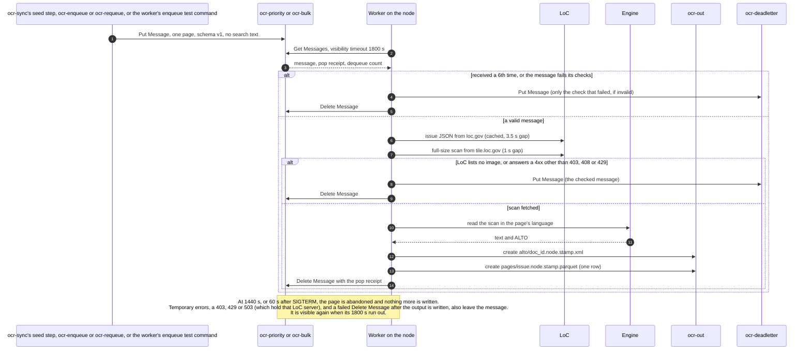
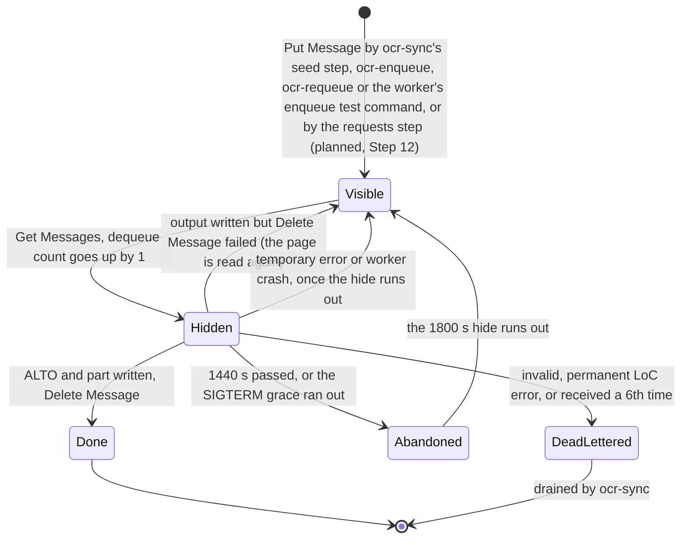
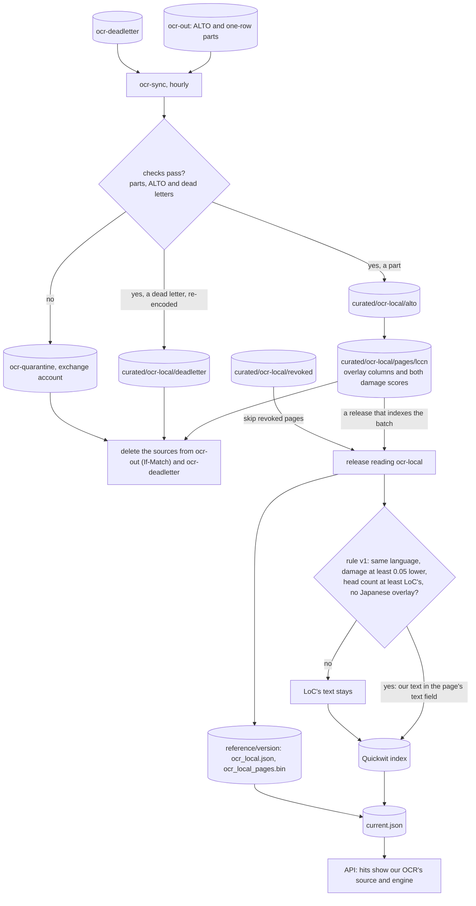
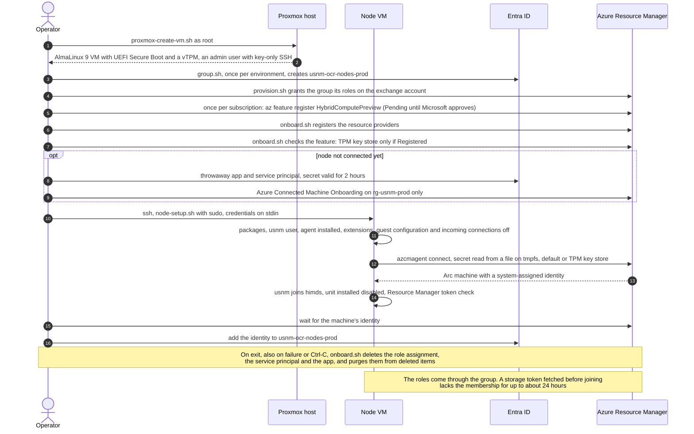

# 12: On-prem OCR Pipeline

**Status:** Design for review; the code for Steps 2 to 10 is merged. The Azure side, node onboarding, the worker and its attested EL9 release, node monitoring, the damage metric in Rust and the full damage pass, the cloud pickup (`ocr-sync`), the release support and the seeder are on `main`. Not built: capturing pages users find (Step 12, after the pilot) and the optional replacement delta (Step 14). The full damage pass ran in prod on 11 October and succeeded, and prod was provisioned from `main` that afternoon. Not done: the pilot on node 1 (Step 11), which waits for the parity gate's result, the engine choice from the survey's report (#370) and the maintainer's OK; the scan prefetch for the bulk run (#368), which waits for its damaged-page manifest; and the TPM key store (Step 0), which waits for Microsoft to approve a preview feature. ADR-0015 and ADR-0016 are still Proposed · **Date:** 10 October 2026, status updated 11 October 2026 · **Issue:** [#296](https://github.com/tgoodyear/usnewsmap.com/issues/296) · **Code:** `infra/modules/ocr-exchange.bicep`, `infra/modules/ocr-node-monitoring.bicep`, `scripts/ocr-node/`, `crates/usnm-ocr-worker/`, `crates/usnm-ocr-contract/`, `crates/usnm-overlay/`, `crates/usnm-alto/`, `crates/usnm-core/src/damage/`, `crates/usnm-ingest/src/ocr_local/`, `ocr/engines/tesseract/`

## 12.1 Purpose and scope

LoC's OCR misreads whole groups of pages, and search can't find a word that was misread. The [language report](../reports/2026-10-language-analysis/report.md) scored a 10% sample of index version `pages-v20261003-1` (2,371,337 pages from 2,989 batches) by damage: the share of occurrences of a language's 20 most common words that LoC's OCR read one edit wrong. A page above 0.25 is badly damaged. The worst groups are German before the 1920s (57,580 sampled pages from the 1850s to the 1910s, so about 580,000 in the index), five English batches with median damage from 0.46 to 0.52, and the Serbian, Russian and Czech titles ([ADR-0015](adr/0015-onprem-ocr-workers.md)). Reading these pages again on Azure compute or a cloud OCR service would cost more than the project's monthly budget, so two local machines do it (#296).

This document covers the pipeline end to end: how a page is queued, read on a node, checked in the cloud and put into search. It records what is built (§12.2), draws the flows (§12.3), names the language of each component (§12.4) and orders the remaining work as pull requests (§12.5).

**Engines are designed elsewhere.** [ADR-0016](adr/0016-pluggable-ocr-engines.md) and [13: OCR engines](13-ocr-engines.md) cover which engine reads which pages and how engines run on a node. There each engine is a container behind one contract. The candidates are NDNP Open OCR, American Stories' EffOCR, Tesseract, docTR, Surya, Kraken, NDLOCR-Lite, and GPU vision-language models later. OCR-D's processors aren't used as engines (ADR-0016, alternatives), though its curated model lists are. This document says "the engine" and doesn't pick one. The worker's one engine implementation today runs Tesseract: on a node, a pinned container per page through podman (#317, #341); elsewhere, a subprocess (#296: "Tesseract to start; the survey decides"). ADR-0015 decision 7 holds any bulk run until the engine survey has reported.

**The Japanese OCR job is separate.** `ja-ocr/jaocr.py` (04 §4.8) is an earlier pipeline: Python orchestration around NDLOCR-Lite in a cloud job, writing `curated/ocr-ja/`. This document touches it only where the release reads both overlays, and lists moving its orchestration to Rust as a follow-up (Step 15).

**Languages.** On 10 October 2026 the maintainer asked for the OCR pipeline to be Rust wherever practical, as [ADR-0004](adr/0004-rust-api.md) already has it for the API and ingest. Python stays in three places: inside the container of an engine that is itself written in Python, as a thin adapter behind the engine contract; in exploratory one-off analysis; and in two one-off exports whose output is committed data (§12.4). Python jobs outside this pipeline, such as the American Stories text import, stay as they are for now. §12.4 lists every component with its language and the reason.

**Priorities.** In steady state, search latency and running cost come first; ingest and rebuild speed come second. No required step in §12.5 adds a clause to every search or a field to the index. The one optional step that would add a clause (Step 14) waits for a benchmark.

## 12.2 As built

The state on `main` on 11 October 2026, checked against the code, and in production as #296 reports it. "Deployed in prod" means provisioned in `rg-usnm-prod` (East US 2). "Merged" or "built" means on `main`; for code merged after #296's last report of a provision, the row doesn't claim it is deployed. #296's last report of a provision is `scripts/provision.sh --env prod` on 11 October from 4:43 to 4:53 PM ET, from `main` at `8faee42`, after the full damage pass had finished. §12.5 gives each step's state and what blocks it.

| Component                                                                                                                                                                                                                                            | State                                                                                                                                                                                                                                                                                                                                                                                                                                                   | Where                                                                                                                                            |
| ---------------------------------------------------------------------------------------------------------------------------------------------------------------------------------------------------------------------------------------------------- | ------------------------------------------------------------------------------------------------------------------------------------------------------------------------------------------------------------------------------------------------------------------------------------------------------------------------------------------------------------------------------------------------------------------------------------------------------- | ------------------------------------------------------------------------------------------------------------------------------------------------ |
| Exchange account `stusnmo<suffix>`: StorageV2, LRS, Hot, shared keys off, public network access on behind a firewall (default Deny, no trusted-service bypass) that allows `USNM_OCR_NODE_IPS` and `snet-cae`                                        | Merged (#297); deployed in prod as `stusnmoffapzy`                                                                                                                                                                                                                                                                                                                                                                                                      | `infra/modules/ocr-exchange.bicep`, `infra/main.bicep`                                                                                           |
| Queues `ocr-priority`, `ocr-bulk` and `ocr-deadletter`; container `ocr-out` (7 days of soft delete, no versioning, blobs deleted 30 days after their last change)                                                                                    | Merged (#297); deployed in prod                                                                                                                                                                                                                                                                                                                                                                                                                         | `infra/modules/ocr-exchange.bicep`                                                                                                               |
| Exchange account listed by resource id in the public-network policy assignment's `publicAccountIds` (the policy denies public network access to every other account; there is no policy exemption); Microsoft.Storage service endpoint on `snet-cae` | Merged (#297); deployed in prod                                                                                                                                                                                                                                                                                                                                                                                                                         | `infra/main.bicep` (the ids), `infra/guardrails.bicep` (the rule), `infra/modules/network.bicep`                                                 |
| Exchange account diagnostics: blob writes and deletes, every queue request                                                                                                                                                                           | Merged (#297)                                                                                                                                                                                                                                                                                                                                                                                                                                           | `infra/modules/diagnostics.bicep`, `infra/modules/storage-diagnostics.bicep`                                                                     |
| Node roles through the Entra group `usnm-ocr-nodes-<env>`: Message Processor on the work queues, Message Sender on `ocr-deadletter`, a custom writer role on `ocr-out` (read and write, no delete)                                                   | Merged (#301), replacing the per-machine grants of #299; provisioned in prod on 10 October from 4:47 to 4:58 PM ET. The exchange account holds the group's four grants and no per-machine grant (checked at 5:45 PM ET). Prod's settings hold the group's id and a leftover empty `USNM_OCR_NODE_NAMES` line, which nothing has read since #301                                                                                                         | `infra/modules/ocr-exchange.bicep`, `scripts/ocr-node/group.sh`                                                                                  |
| `id-usnm-ingest` on the exchange account: Queue Data Contributor on the account, Blob Data Contributor on `ocr-out`                                                                                                                                  | Merged (#297); used by the hourly `ocr-sync` job, which `main.bicep` deploys with the OCR nodes and the ingest jobs on, as in prod                                                                                                                                                                                                                                                                                                                      | `infra/modules/ocr-exchange.bicep`                                                                                                               |
| Deployment outputs `OCR_EXCHANGE_ACCOUNT`, `OCR_QUEUE_ENDPOINT` and `OCR_BLOB_ENDPOINT`                                                                                                                                                              | Merged (#297)                                                                                                                                                                                                                                                                                                                                                                                                                                           | `infra/main.bicep`                                                                                                                               |
| `proxmox-create-vm.sh`: AlmaLinux 9 GenericCloud VM with its checksum checked, UEFI Secure Boot, vTPM 2.0, CPU type `host`                                                                                                                           | Merged (#297); used for node 1                                                                                                                                                                                                                                                                                                                                                                                                                          | `scripts/ocr-node/proxmox-create-vm.sh`                                                                                                          |
| `onboard.sh`: a throwaway service principal with a 2-hour secret and only Azure Connected Machine Onboarding on `rg-usnm-<env>` (§12.3.1 lists what that role reaches), deleted and purged at exit; adds the node's identity to the group            | Merged (#299, #301, #303); used for both nodes                                                                                                                                                                                                                                                                                                                                                                                                          | `scripts/ocr-node/onboard.sh`                                                                                                                    |
| `node-setup.sh`: packages, a persistent journal, post-quantum SSH key exchange, the `usnm` user, the Arc agent locked down before it connects, the worker's unit installed disabled, a token check                                                   | Merged (#297, #300, #301)                                                                                                                                                                                                                                                                                                                                                                                                                               | `scripts/ocr-node/node-setup.sh`                                                                                                                 |
| `group.sh` and `offboard.sh`                                                                                                                                                                                                                         | Merged (#301); `group.sh` has run for prod, and `offboard.sh` removed node 1's first machine                                                                                                                                                                                                                                                                                                                                                            | `scripts/ocr-node/`                                                                                                                              |
| htop, iftop and screen from EPEL; the agent's automatic upgrade; a TPM-backed agent identity                                                                                                                                                         | Merged (#303). The TPM key store is an Arc preview: Azure accepts it only once the subscription's `Microsoft.HybridCompute/HybridComputePreview` feature is Registered, which needs Microsoft's approval. It was requested on 10 October and was still Pending when node 2 was onboarded that evening (#296); until it is Registered, `onboard.sh` uses the agent's default key store (Step 0)                                                          | `scripts/ocr-node/node-setup.sh`, `scripts/ocr-node/onboard.sh`                                                                                  |
| RHEL 10 as a node OS beside AlmaLinux 9; a Key Vault for the operator's node-setup secrets (the RHEL activation key, org id and offline token), `usnmocrkv<env><suffix>`, behind the same firewall as the exchange account, with no node access      | Merged (#319, #316)                                                                                                                                                                                                                                                                                                                                                                                                                                     | `scripts/ocr-node/`, `infra/modules/ocr-vault.bicep`                                                                                             |
| Node 1, `usnm-ocr-node1`                                                                                                                                                                                                                             | Re-onboarded in prod on 10 October at 5:30 PM ET with a new identity in the default key store; connected, locked down and in the group (§12.2.1). It ran the engine survey. #317's dry run found its Arc machine as `usnm-ocr-node1-arcs-prod`. No worker installed                                                                                                                                                                                     | Home network                                                                                                                                     |
| Rust worker: queue loop, LoC fetch with pacing, Tesseract in a pinned container per page through podman, ALTO and overlay output, Application Insights telemetry                                                                                     | Merged (#298; Step 2's flags and `check-engine` in #317; Step 7's fixes in #335; the Podman API socket and the engine user in #341). Not installed on any node                                                                                                                                                                                                                                                                                          | `crates/usnm-ocr-worker/`                                                                                                                        |
| Shared queue client (with the approximate message count), the work message and dead letter (v2, with `cause` and `kind`), the bounded ALTO check                                                                                                     | Merged (#335, #342)                                                                                                                                                                                                                                                                                                                                                                                                                                     | `crates/usnm-store/src/queue.rs`, `crates/usnm-ocr-contract/`, `crates/usnm-alto/`                                                               |
| Arc managed identity in the shared credential code                                                                                                                                                                                                   | Merged (#298)                                                                                                                                                                                                                                                                                                                                                                                                                                           | `crates/usnm-store/src/credential.rs`                                                                                                            |
| Overlay Parquet schema, shared by `jaocr.py` and the worker                                                                                                                                                                                          | Merged (#298)                                                                                                                                                                                                                                                                                                                                                                                                                                           | `crates/usnm-overlay/`                                                                                                                           |
| A worker build for EL9 and a way to install it                                                                                                                                                                                                       | Built (Step 2, #317): CI's `ocr-worker-el9`, `ocr-worker-check` and `ocr-worker-release` publish attested `ocr-worker-<yyyymmdd>-<sha7>` releases, several a day on 11 October; `install-worker.sh` installs one. Not run against either node except as a dry run                                                                                                                                                                                       | `.github/workflows/ci.yml`, `scripts/ocr-node/install-worker.sh`, `scripts/ocr-node/install-worker-node.sh`                                      |
| A systemd unit that runs the worker                                                                                                                                                                                                                  | Merged (#304; moved to its own file in #317; hardened in #341): `ExecStart=/usr/local/bin/usnm-ocr-worker run` with `/etc/usnm/ocr-worker.env`, `KillMode=mixed`, `TimeoutStopSec=120`. Installed disabled; `install-worker.sh --enable` starts it                                                                                                                                                                                                      | `scripts/ocr-node/usnm-ocr-worker.service`                                                                                                       |
| An engine on the node outside the survey's containers                                                                                                                                                                                                | Partly built. The Tesseract image (`ocr/engines/tesseract/`, Tesseract 5.5.0 with eight Apache-2.0 tessdata_best models) is in each worker release (#317), and `node-setup.sh` sets up the engine user `usnmeng` and the Podman API socket (#341). `engine-spike.sh` hasn't run on a node. The engine contract and routing (ADR-0016, #307) aren't built; the Tesseract-only pilot doesn't need them (#296, 10 October)                                 | `ocr/engines/tesseract/`, `scripts/ocr-node/node-setup.sh`, `scripts/ocr-node/engine-spike.sh`                                                   |
| Engine survey                                                                                                                                                                                                                                        | Round 1 scored on both nodes; the report is draft PR #370, not on `main`                                                                                                                                                                                                                                                                                                                                                                                | `docs/reports/2026-10-ocr-engine-survey/` (in #370)                                                                                              |
| A telemetry grant for the nodes (Monitoring Metrics Publisher)                                                                                                                                                                                       | Merged (#304): on the nodes' own component `usnm-ocr-appi-<env>`, on their own workspace `usnm-ocr-log-<env>`; nothing on `appi-usnm-<env>`                                                                                                                                                                                                                                                                                                             | `infra/modules/ocr-node-monitoring.bicep`                                                                                                        |
| Azure Monitor Agent through an extension allowlist of only `Microsoft.Azure.Monitor/AzureMonitorLinuxAgent`, with its data collection rule in Bicep                                                                                                  | Merged (#304, Step 3): the rule `usnm-ocr-dcr-<env>`; `node-setup.sh` sets the allowlist and `onboard.sh` installs the agent and associates the machine. Since then VM insights' metrics (#348), provisioned in prod on 11 October (#296), and the OCR nodes workbook (#318). Alerts: node log volume and the nodes' cap (#304), LoC holds (#335); Step 3's heartbeat, metric and dead-letter alerts aren't built                                       | `infra/modules/ocr-node-monitoring.bicep`, `infra/modules/workbooks.bicep`, `scripts/ocr-node/`                                                  |
| Damage metric v2                                                                                                                                                                                                                                     | Built in Rust (Steps 4 and 5, #315, #332): `usnm_core::lang` and `usnm_core::damage` behind the cargo feature `damage`, with a parity fixture against `ja-ocr/damage_v2.py`, which `quality.py` imports                                                                                                                                                                                                                                                 | `crates/usnm-core/src/lang.rs`, `crates/usnm-core/src/damage/`, `ja-ocr/damage_v2.py`                                                            |
| Full damage pass and parity gate (`usnm-ingest ocr-damage`)                                                                                                                                                                                          | Built (Step 6, #337). The full pass over `pages-v20261010-2` ran in prod on 11 October from 9:15 AM ET (`caj-usnm-ingest-prod-tlq8sep`) and succeeded at 4:22 PM ET: about 24 million pages in 3,010 batches, at about 930 pages a second (#296). Its damage counts come with the prefetch manifest's summary (#368). #296 records no result for the 10% parity gate                                                                                    | `crates/usnm-ingest/`                                                                                                                            |
| Seeder that fills `ocr-bulk`                                                                                                                                                                                                                         | Built (Step 10, #345): `ocr-sync`'s seed step and `usnm-ingest ocr-seed`. Seeding stays off while `USNM_OCR_SEED_PLAN` is empty (ADR-0015 decision 7)                                                                                                                                                                                                                                                                                                   | `crates/usnm-ingest/src/ocr_local/seed.rs`                                                                                                       |
| Pickup from `ocr-out` into `curated/ocr-local/`                                                                                                                                                                                                      | Built (Step 8, #342 and #344): `usnm-ingest ocr-sync`, `ocr-enqueue`, `ocr-requeue` and the job `usnm-ocrs-caj-<env>` (`usnm-ocrsync-caj-<env>` until the October 2026 rename, #309), run as `id-usnm-ingest`. The 11 October provision, from `main` at `8faee42`, includes #344, and the Bicep deploys the job with the OCR nodes on, under the old name until the next provision; #296 doesn't report checking it in prod. Nothing has been picked up | `crates/usnm-ingest/src/ocr_local/`, `infra/modules/ingestjobs.bicep`                                                                            |
| Release support for `curated/ocr-local/`                                                                                                                                                                                                             | Built (Step 9, #346, #347): `usnm-ingest release --ocr-local`, turned on by `USNM_OCR_LOCAL` (off by default); the API loads `ocr_local_pages.bin`. #296 records no release with it                                                                                                                                                                                                                                                                     | `crates/usnm-ingest/src/ocr_local/`, `crates/usnm-ingest/src/release.rs`, `crates/usnm-state/src/ocr_local.rs`, `crates/usnm-api/src/refdata.rs` |
| Queuing pages users find (the API records page ids; `ocr-sync` queues them)                                                                                                                                                                          | Not built, by plan: Step 12 comes after the Step 11 pilot. `id-usnm-app` has no role on the exchange account and won't get one                                                                                                                                                                                                                                                                                                                          |                                                                                                                                                  |
| Node 2, `usnm-ocr-node2-arcs-prod`                                                                                                                                                                                                                   | Onboarded in prod on 10 October at 9:12 PM ET: VM 200 on pve-big (i7-7700K, 8 vCPUs, 40 GiB, a 1 TB bulk disk at `/srv/bulk`), default key store, in the group (#296). It ran part of the engine survey. No worker installed (Step 13)                                                                                                                                                                                                                  | Home network                                                                                                                                     |
| One searched text field (#285)                                                                                                                                                                                                                       | Merged (#292), behind `USNM_SINGLE_TEXT_FIELD` (off by default)                                                                                                                                                                                                                                                                                                                                                                                         | `crates/usnm-ingest/src/release.rs`, `crates/usnm-core/src/text_layout.rs`                                                                       |

### 12.2.1 Node 1

Node 1 is VM 120 on a Proxmox host, an Intel NUC with an i5-4250U (2 cores, 4 threads) and 8 GB. It runs AlmaLinux 9.8 with UEFI Secure Boot and a vTPM. The engine survey runs on it. The host's e1000e network card needed its offloads turned off ([operations](../operations.md#on-prem-ocr-nodes)).

Its Arc machine changed on 10 October (times in ET, from the activity log and #296):

- With the per-machine grants that came before #301, its first identity could peek the work queues, was refused (403) when it tried to add a message, and could not reach the private data lake. After the group provision (4:47 to 4:58 PM), a peek (200) and a put (403) through the group gave the same results (#296, 5:00 PM).
- 5:13 PM: `offboard.sh` deleted the machine, to reconnect with the identity's key in the TPM (#303).
- 5:14 to 5:17 PM: six connects with `--identity-key-store tpm` failed with HCRP400, because the subscription isn't registered for the `HybridComputePreview` feature. The onboarding role assignment was removed at 5:17 PM.
- 5:29 to 5:30 PM: `onboard.sh` from #303 connected it again as `usnm-ocr-node1` in `rg-usnm-prod`, with the default key store, extensions, guest configuration and incoming connections turned off, and a new system-assigned identity. That identity is in `usnm-ocr-nodes-prod`, and as `usnm` it can peek both queues (200) and can't add a message (403), as reported in #296 at 5:31 PM.

At 5:45 PM the machine was connected with the default key store, its identity was a member of the group, and `HybridComputePreview` was still Pending. Moving it to the TPM later means `offboard.sh` and `onboard.sh` again, which makes a third machine and identity (Step 0).

### 12.2.2 How the worker handles a page

- **Polling.** The worker takes from `ocr-priority` first, then `ocr-bulk`. With both empty it waits, doubling from 1 s to 60 s, so an idle node makes about 2,880 queue requests a day. Each one is a `StorageQueueLogs` row in the workspace.
- **A fixed hide.** A taken message is hidden for `--visibility-secs` (1800 s by default) and the hide is never renewed: Message Processor has neither `messages/write` (Update Message) nor `messages/add/action` (Put Message), so a node can't update a message or add one to the work queues. A page not finished at 80% of the hide (1440 s) is abandoned with nothing more written, and the message is visible again when the 1800 s run out. After SIGTERM, pages in flight get 60 s and are then abandoned the same way.
- **Dead letters.** A message received more than 5 times goes to `ocr-deadletter`, so the 6th receive dead-letters it without reading the page. Messages that fail their checks and pages LoC lists no image for (or answers with a 4xx other than 403, 408 or 429) go there too. For an invalid message the dead letter keeps only the kind of check that failed, never the content. Since #335 the dead letter is `v: 2`, with a `cause` field (`dequeue_count`, `invalid`, `permanent`; `unroutable` is reserved for the engine contract), a `kind` for `invalid`, and an `error` cut to 200 characters. A page dead-lettered for its dequeue count still doesn't say why its 5 attempts failed.
- **Temporary failures** (fetch, engine, no model on this node, output, scratch disk) leave the message to come back. Since #335 the worker asks the engine whether it can read the page's language before it fetches the scan, so a page with no model makes no image request.
- **LoC pacing** with `jaocr.py`'s gaps: 3.5 s between loc.gov API requests and 1 s between image requests, shared by every page in flight on the node. A 429, 503 or (since #335) 403 holds every request to that server (the loc.gov API or tile.loc.gov) for its `Retry-After`, or for 60 s times the attempt number if that is longer or no header came, at most an hour. With N nodes each must run with N times the gaps; nothing enforces that across nodes.
- **Where it differs from `jaocr.py`.** `jaocr.py` gives up at once only on a 404 and retries every other error, with no cap on `Retry-After`. The worker treats every 4xx except 403, 408 and 429 as permanent and dead-letters the page. A capped hold is counted in `ocr.loc_slowdowns` with `capped=true`, and `alert-usnm-ocr-loc-hold-<env>` fires on it. A 4xx on an issue's item JSON fails that page but is no longer cached (#335), so later pages of the issue ask again.
- **A long hold.** Since #335 the worker takes no messages while a LoC hold runs past a new page's budget, so a long hold no longer spends pages' receives. (Before, it kept taking messages, and pages that waited past their 1440 s budget were dead-lettered for their dequeue count.)
- **Output.** Create-only `alto/<doc_id>.<node>.<stamp>.xml`, then `pages/<lccn>_<date>_ed-<n>.<node>.<stamp>.parquet`, a part with one row in the overlay schema. `ocr_source` names the engine (`usnm-tesseract` today) and `loc_text` holds the queue reason (`bulk` or `user`), because the worker never sees LoC's text.
- **No search text.** Unknown fields are refused and every field has a fixed format, so a message can't carry a query in a field of its own; only trusted cloud jobs can enqueue. Since #317 and #335, `batch` must have the shape of a LoC base batch name (no `_verNN`, and several words joined by underscores are refused), and `language` must be an ISO 639-3 code `usnm_core::lang` knows. Telemetry carries page ids, queues, languages and outcomes, never message bodies, search text or tokens. It reaches Application Insights only when `APPLICATIONINSIGHTS_CONNECTION_STRING` is set, with an Entra token from the node's Arc identity.

### 12.2.4 Scans fetched ahead of the workers (#368)

The damaged pages' scans are fetched once, onto pve-big's ZFS pool, before the workers read them, so every engine reads the same local scan and LoC serves each image once ([ADR-0015](adr/0015-onprem-ocr-workers.md) decision 9).

- **Manifest.** `usnm-ingest ocr-prefetch-manifest --version <index version> [--partial] [--min-damage 0.25] [--exchange-url <ocr-out URL>]`, an ingest job execution, reads the damage tables (Step 6) and writes `audit/damage/v2/prefetch/<version>/manifest.parquet` and `summary.json` in the curated store: the pages above 0.25 in issue order, one copy of each page (the copy the version keeps, else the batch that sorts first), with doc_id, batch, lccn, date, edition, seq, detected language, decision, damage rate and the issue's loc.gov item URL. The summary counts pages by language, decade, batch, and language by decade. `--partial` reads the batches whose tables are written before the version's list exists, into `partial-<stamp>/`. `--exchange-url` copies both to `ocr-out/manifests/<version>/`, which `ocr-sync` doesn't read and the lifecycle rule deletes after 30 days. The curated rows have no image URL (curation drops the reel the IIIF id needs), so the fetcher resolves each page from its issue's item JSON, as the worker does.
- **Getting it to pve-big.** `scripts/ocr-node/pull-manifest.sh --scan-server http://<CT 211>:8380`, run as root on an OCR node, gets a storage token from the node's Arc identity, which can already read `ocr-out`, checks the manifest's sha256 against the summary, and PUTs both to the scan server, which writes them to `/tank/ocr/manifests/<version>/`. Nothing passes through a laptop and no role is added.
- **Storage.** `scripts/ocr-node/pve-ocr-storage.sh` on pve-big: `tank/ocr` (lz4, atime off, quota 3 TB), `tank/ocr/scans` (lz4, recordsize 1M) and `tank/ocr/text` (zstd, recordsize 128K) and a `manifests/` directory, owned by `ocrdata` (uid and gid 102000, mode 2775). Nothing is exported over NFS: the first version exported `tank/ocr` to the nodes, but a `hard` NFS read can block a worker thread for as long as the server is away and can't be cancelled (#381), so the nodes now read over HTTP. `nfs-kernel-server` stays installed with no usnm exports, and `node-setup.sh` removes the old `/srv/ocr-data` mount from a node.
- **The scan server.** `usnm-ocr-worker serve-scans` in CT 211 (`scanfetch-ct.sh --serve --allow <node IPs>`, unit `usnm-scanserve.service`, port 8380). `GET /scans/<set>/<batch>/<lccn>/<date>/<ed>/<seq>.jpg` and its `.json` sidecar; `DELETE` of a `buffer/` scan renames its sidecar to `<scan>.done` and removes the scan (a `keep/` path gets 403); `PUT /manifests/<version>/{manifest.parquet,summary.json}`; and `GET /index/full.jsonl`, the fetcher's index, one sidecar per fetched scan in the order they landed, which tells a seeder which pages are cached (a buffer scan listed there may since have been read and deleted). Only the node IPs are served, by the server and by an nftables rule in the container. Plain HTTP on the LAN, which is trusted for integrity as the home network the nodes already share (the maintainer's decision): the scans are LoC's public images, and the worker's checks catch a damaged or mismatched scan, but not a forgery made by something on the LAN that rewrites both a scan and its sidecar. One JSON log line per request (method, path, status, peer).
- **The fetcher.** `usnm-ocr-worker prefetch` in CT 211 `usnm-scanfetch` (`scripts/ocr-node/scanfetch-ct.sh`): an unprivileged Debian 12 container with no Azure credentials, `tank/ocr/scans` and `manifests/` bind-mounted read-write, running as uid 2000 (the host's 102000) under the unit `usnm-scanfetch.service`. It uses the worker's LoC client, so the User-Agent, the 3.5 s and 1 s gaps, `Retry-After` on 429 and 503, the hold on 403 and the one-hour cap are the worker's. It runs two pages at a time through those shared gaps, holds a lock file so only one fetching process runs, and stops after 20 pages fail in a row instead of pressing on. While it runs it is the only LoC fetcher; with the workers fetching too, the gaps would have to be shared out as for N nodes.
- **Layout.** `/tank/ocr/scans/<set>/<batch>/<lccn>/<date>/<edition>/<seq>.jpg` (`<seq>.pct<n>.jpg` for a scaled fetch), each with a sidecar `<file>.json`: doc_id, batch, the image URL on tile.loc.gov, the IIIF base, the resolution, the fetch time, bytes, sha256, the request's time and the User-Agent. Every fetch is also a line in `index-<res>.jsonl`, every failure one in `failures-<res>.jsonl`, and `status-<res>.json` is rewritten every 100 pages and every 30 s. A scan counts once its sidecar is written; a run skips scans whose size and sha256 match their sidecar, so it can be stopped, pointed at a newer manifest and started again.
- **Two sets.** The first manifest for `pages-v20261010-2` lists 1,922,826 pages, 1,733,773 of them English. At about 5 MB a full scan, that's far more than `tank` holds, so the scans are split in two (the maintainer's decision, 11 October).
  - The **keep set** is every page not detected as English, plus the worst English batches' pages. It is kept for good under `scans/keep/`.
  - The **buffer set** is the rest of English, under `scans/buffer/`. It's a rolling buffer: the fetcher waits while the buffer's scans on disk reach `--buffer-cap` (default 1 TB) and counts again every minute. A worker deletes a buffer scan once its output for that page is uploaded (ADR-0015 decision 9); the delete leaves the sidecar as `<scan>.done`, so a later fetch skips the page. Nothing deletes under `keep/`. If the buffer can't be counted, the fetcher takes it as full and waits.
  - `--resolution` sets the keep set's resolution and `--buffer-resolution` the buffer set's. `--sets keep|buffer|both` picks which sets to fetch.
- **Order and budget.** Keep pages come first, by default German before the 1920s, then the worst English batches, Czech, Serbian, Russian and the rest. Each issue goes in its best page's group, in issue order. Buffer pages follow in issue order. `--max-total-bytes` stops the fetch once this run's scans on disk reach a budget.
- **The workers read it first.** With `--scan-cache-url http://<CT 211>:8380` (`USNM_OCR_SCAN_CACHE_URL`, set by `install-worker.sh --scan-cache-url`), the worker asks the scan server for the page's full scan under the message's batch, in `keep/` and then `buffer/`, with a 2 s connect timeout and a 30 s total. It uses the scan only when the sidecar names that page and batch at full size, its URL is the image URL of its IIIF base on tile.loc.gov, and the bytes' size and sha256 match; a miss, a timeout, a 5xx or a mismatch goes to LoC at once. Either way the overlay's `image_url` is the tile.loc.gov IIIF base and the ALTO's `sourceImageInformation` holds the image URL and a `fileIdentifier` with the sha256 of the bytes read (ADR-0015 decision 9). Once the page's output is uploaded, a buffer-set scan is deleted with `DELETE`, best effort. `ocr.image_fetch_seconds` has a `source` attribute, `cache` or `loc`.
- **Size.** `prefetch --sample N` fetches about N pages stratified by language and decade, and `prefetch-estimate` projects the manifest's size and fetch time from them. The numbers are on #368.

### 12.2.3 Text that disagrees with the code

- The body of #296 describes 10-minute leases that are renewed. ADR-0015 and the code use a fixed 1800 s hide.
- ADR-0015 decision 4 and a comment in `ocr-exchange.bicep` say a message taken 5 times goes to `ocr-deadletter`. The code processes it 5 times and dead-letters it on the 6th receive.
- ADR-0015 decision 5 says the writer role means one node can't remove another's output. The role's `blobs/write` also lets a node overwrite another node's blob, as the Bicep comment says; the worker writes create-only, but a node that has been tampered with need not. The worker's README (Output: "can create blobs but not replace or delete them") makes the same claim.
- ADR-0015 is still "Proposed", though it is built and deployed. Whether to mark it Accepted is the maintainer's call.
- 08 §8.5 lists only the tiles account in `publicAccountIds`; with `USNM_OCR_NODES` on, the exchange account and the nodes' Key Vault are there too, as 08 §8.3 already says.
- 04 §4.7 and 08 §8.4.1 say compaction runs monthly. Nothing schedules a full rebuild. `USNM_INGEST_CRON` (empty in prod) schedules only incremental runs; a full base needs `USNM_INGEST_FULL` and the E4 profile, set by hand and cleared afterwards ([operations, Full rebuild](../operations.md#full-rebuild)). A version with 8 deltas makes the next run full on whatever profile the job is on, and on Consumption a full rebuild runs out of memory (#172).

Step 1 fixes these. Checked on `main` on 11 October 2026: each item above still stands. The worker's "later change" in `docs/operations.md` and `node-setup.sh` is gone. The status part of Step 1 (§12.2 and §12.5) was brought up to date on 11 October 2026; the corrections to ADR-0015, the Bicep comment, the worker's README and 04 and 08 are still to do (§12.5, Step 1).

## 12.3 Diagrams

In the flowcharts, dashed lines and boxes are planned and solid ones exist on `main`. In the sequence and state diagrams, "(planned)" marks what isn't built.

### 12.3.1 System overview

There are three trust boundaries, numbered in the diagram. The node is on the home network, and everything it writes is untrusted input to the cloud. The exchange account is the only project storage a node has a role on, and the only one it can write to: a public endpoint whose firewall allows the home IP and `snet-cae`. (The tiles account allows public reads, so a node can read it like anyone else.) The data lake allows private endpoints only, so only the jobs and the API inside the VNet reach it.

```mermaid
flowchart TB
  subgraph HOME["Boundary 1, home network: node output is untrusted"]
    subgraph VM["Proxmox VM 120 usnm-ocr-node1, AlmaLinux 9.8"]
      HIMDS["Arc agent, HIMDS on localhost:40342"]
      WORKER["usnm-ocr-worker as user usnm<br/>(merged, not installed)"]
      ENGINE["Tesseract container through podman<br/>(merged, not installed; other engines and<br/>the contract planned, ADR-0016)"]
      AMA["Azure Monitor Agent<br/>(merged, Step 3)"]
    end
  end

  LOC["Library of Congress<br/>loc.gov item JSON, tile.loc.gov scans"]

  subgraph AZ["Azure rg-usnm-prod"]
    subgraph EXCH["Boundary 2, exchange account stusnmoffapzy: public endpoint behind a firewall"]
      WQ[("ocr-priority, ocr-bulk")]
      QD[("ocr-deadletter")]
      OUT[("ocr-out")]
      QUA[("ocr-quarantine")]
    end
    subgraph VNET["VNet subnet snet-cae"]
      SYNC["ocr-sync job, id-usnm-ingest<br/>(merged, Step 8)"]
      REL["ingest release job, id-usnm-ingest;<br/>its Quickwit writer, caj-usnm-ingest-prod system identity"]
      API["API app, id-usnm-app;<br/>Quickwit sidecar, ca-usnm-prod system identity"]
    end
    subgraph LAKE["Boundary 3, data lake: private endpoints only, reached from snet-cae"]
      CUR[("curated")]
      REF[("reference")]
      QWI[("qw-index")]
      REQ[("ocr-requests (planned)")]
    end
    MON["Log Analytics and Application Insights"]
    MONN["Node workspace and component<br/>(merged, Step 3)"]
  end

  WORKER -->|"paced: API 3.5 s, images 1 s"| LOC
  WORKER -->|"token, via the himds group"| HIMDS
  WORKER --> ENGINE
  WORKER -->|"take, peek, delete"| WQ
  WORKER -->|"add only"| QD
  WORKER -->|"read, write, no delete"| OUT
  WORKER -->|"telemetry, Metrics Publisher"| MONN
  AMA -->|"Heartbeat, Perf, Syslog, InsightsMetrics"| MONN
  WQ -->|"a log row per request"| MONN
  SYNC -->|"add messages"| WQ
  SYNC -->|"read and delete"| QD
  SYNC -->|"read and delete"| OUT
  SYNC -->|"move rejects"| QUA
  SYNC -->|"read damage tables, write ocr-local"| CUR
  SYNC -.->|"read and delete day files"| REQ
  API -.->|"page ids by day"| REQ
  REL -->|"read"| CUR
  REL -->|"write snapshots"| REF
  REL -->|"Quickwit writer: write splits"| QWI
  API -->|"read"| REF
  API -->|"Quickwit sidecar: search"| QWI

  classDef planned stroke-dasharray: 5 5
  class REQ planned
```

What each identity can do:

| Identity                                                                        | Runs                                   | Can                                                                                                                                                                                                                                                                                                | Can't                                                                                                                                                           |
| ------------------------------------------------------------------------------- | -------------------------------------- | -------------------------------------------------------------------------------------------------------------------------------------------------------------------------------------------------------------------------------------------------------------------------------------------------- | --------------------------------------------------------------------------------------------------------------------------------------------------------------- |
| A node's Arc system-assigned identity, through the group `usnm-ocr-nodes-<env>` | The worker, as `usnm` in `himds`       | Take, peek and delete messages on `ocr-priority` and `ocr-bulk`; add any message to `ocr-deadletter`; read, create and overwrite blobs in `ocr-out`; after Step 3, write any telemetry to the nodes' Application Insights component                                                                | Add to the work queues (403 through the group, checked on node 1 on 10 October); delete blobs; reach the lake, Cosmos or the index; send telemetry until Step 3 |
| `id-usnm-ingest`                                                                | Ingest jobs in `snet-cae`              | Queue Data Contributor on the whole exchange account; Blob Data Contributor on `ocr-out`, and in the lake on `curated`, `reference` and `qw-index`; Cosmos Data Contributor; Monitoring Metrics Publisher; Cognitive Services User on Document Intelligence (with `USNM_OCR`, on in prod); AcrPull |                                                                                                                                                                 |
| `caj-usnm-ingest-<env>`'s system-assigned identity                              | The Quickwit writer the release starts | Blob Data Contributor on `qw-index`                                                                                                                                                                                                                                                                | Anything else                                                                                                                                                   |
| `id-usnm-app`                                                                   | The API app                            | Read `reference` and `qw-index`, write `cache`, create blobs in `searches`; Monitoring Metrics Publisher                                                                                                                                                                                           | Anything on the exchange account                                                                                                                                |
| `ca-usnm-<env>`'s system-assigned identity                                      | The Quickwit searcher sidecar          | Blob Data Reader on `qw-index`                                                                                                                                                                                                                                                                     | Anything else                                                                                                                                                   |
| The throwaway onboarding service principal                                      | `onboard.sh`, for one run              | Azure Connected Machine Onboarding on `rg-usnm-<env>`, with a secret that expires after 2 hours. That role reaches every Arc machine in the resource group (create and update any of them, add extensions) and data collection rule associations (create and delete)                               | Anything on storage, Entra or other resource types; `onboard.sh` deletes it and purges it from Entra's deleted items when it exits                              |
| The operator                                                                    | Laptop, `az` sign-in                   | Owner on the subscription (the provision needs it); owner of `usnm-ocr-nodes-<env>`; registers apps in the tenant (`onboard.sh`); Blob Data Reader on the lake's `searches` (no network path from the laptop)                                                                                      | No data role on the exchange account (checked 10 October), so `usnm-ocr-worker enqueue` from the laptop is refused; as Owner, could grant itself one            |

### 12.3.2 Page lifecycle

One page from the queue to `ocr-out`, with the dead-letter and abandon paths.

### 12.3.3 Queue message states

### 12.3.4 Result pickup and release

The chosen design (§12.5). All of it is on `main` (Steps 8 and 9: #342, #344, #346, #347); #296 records no pickup and no release with `ocr-local` in production yet.

The seeded batches are already published, and a published index can't change, so in practice our text goes live at the next full rebuild (Step 9).

### 12.3.5 Node onboarding

From a new VM to a node with roles. The steps exist on `main` (#297, #299, #301, #303; the Azure Monitor Agent step in #304 and the RHEL 10 path in #319). #303 added EPEL tools, the agent's automatic upgrade and a TPM-backed identity to `node-setup.sh` and `onboard.sh`. The TPM key store is an Arc preview: Azure refuses `--identity-key-store tpm` until the subscription's `Microsoft.HybridCompute/HybridComputePreview` feature is Registered. `az feature register --namespace Microsoft.HybridCompute --name HybridComputePreview` asks for it (a subscription-level action, Owner or Contributor), and once it is Registered, `az provider register -n Microsoft.HybridCompute` makes it take effect. The feature needs Microsoft's approval and has been Pending since 10 October (the latest report in #296). `onboard.sh` checks the feature with `az feature show` and asks for the TPM only when it is Registered, so `node-setup.sh` never retries a connect that can't succeed.

## 12.4 Languages

Rust wherever practical (ADR-0004 and the maintainer's request of 10 October 2026). In this pipeline Python appears only inside Python engines' containers, in exploratory analysis, and in two one-off exports whose output is committed data. Three Python jobs outside it stay Python for now: the quality audit, the Japanese OCR orchestration and the American Stories text import (the last three rows).

| Component                                                         | Language                                                                                    | Why                                                                                                                                                                                                                          |
| ----------------------------------------------------------------- | ------------------------------------------------------------------------------------------- | ---------------------------------------------------------------------------------------------------------------------------------------------------------------------------------------------------------------------------- |
| Worker: queue loop, LoC fetch, pacing, output                     | Rust (exists)                                                                               | ADR-0015 decision 6: it shares `PageKey`, the overlay types and the Entra credential code with ingest                                                                                                                        |
| Engine contract client and language routing, in the worker        | Rust                                                                                        | Runs inside the worker; the contract is ADR-0016's                                                                                                                                                                           |
| Engine adapters                                                   | Rust for CLI and HTTP engines; thin Python for Python-library engines, inside the container | Python only for engines that are Python libraries (docTR, Surya, EffOCR, NDLOCR-Lite, NDNP Open OCR), imported once behind the contract (13 §13.2)                                                                           |
| ALTO checks                                                       | Rust (`usnm-alto`, 13 §13.2)                                                                | They parse untrusted bytes in the cloud job. One bounded ALTO reader serves the worker and `ocr-sync`                                                                                                                        |
| Damage metric v2                                                  | Rust (`usnm-core`, cargo feature `damage`)                                                  | The release and the seeder decide keep-or-replace with it in process; scoring millions of pages is CPU work                                                                                                                  |
| Word lists for the metric                                         | Data, exported once with wordfreq 3.1.1's Python API                                        | wordfreq's own API is the reference for which words, in which order, `quality.py` uses; `scripts/build-english-words.py` already exports lists this way. Nothing in the pipeline runs it. A Rust exporter is open question 5 |
| Parity fixture for the metric                                     | Python, one-off (`ja-ocr/damage_parity.py`)                                                 | `quality.py`'s v2 code is the implementation the port is checked against                                                                                                                                                     |
| Full per-page damage pass                                         | Rust (`usnm-ingest ocr-damage`)                                                             | Replaces the Python audit's sample for ranking; the Python audit drops its per-page table above 3,000,000 rows                                                                                                               |
| Pickup, checks and dead-letter drain (`ocr-sync`)                 | Rust (`usnm-ingest`)                                                                        | Parses node output; reuses `usnm-overlay`, `usnm-alto`, `usnm-store` and the Cosmos lock                                                                                                                                     |
| Queue client                                                      | Rust (`usnm-store`)                                                                         | One Entra-only client for the worker and the cloud jobs                                                                                                                                                                      |
| Seeder                                                            | Rust (a step of `ocr-sync`)                                                                 | Shares `PageKey`, the queue client and the damage tables                                                                                                                                                                     |
| Release support                                                   | Rust (`usnm-ingest`)                                                                        | The release is Rust                                                                                                                                                                                                          |
| Capturing pages users find                                        | Rust (`usnm-api`)                                                                           | The API is Rust; it reuses the search log's writer                                                                                                                                                                           |
| Node scripts                                                      | Bash, named flags only                                                                      | Operator scripts next to `onboard.sh`, not pipeline logic                                                                                                                                                                    |
| Infrastructure, alerts                                            | Bicep, with KQL in alert rules                                                              | Bicep is the project's infrastructure language                                                                                                                                                                               |
| CI                                                                | GitHub Actions YAML                                                                         |                                                                                                                                                                                                                              |
| OCR quality audit (`ja-ocr/quality.py`)                           | Python today                                                                                | Stays as the parity reference and for exploration; the recurring audit moves to Rust once parity holds (Step 15)                                                                                                             |
| Japanese OCR orchestration (`ja-ocr/jaocr.py`)                    | Python today                                                                                | A follow-up moves it onto these queues and the Rust worker, with NDLOCR-Lite as a Python adapter (Step 15)                                                                                                                   |
| American Stories text import (`ja-ocr/american_stories_write.py`) | Python today                                                                                | Outside this pipeline, but it writes `curated/american-stories/`, which the release indexes beside LoC's text; a Rust port is a follow-up (Step 15)                                                                          |

## 12.5 Next steps

### The chosen design

- **One new Rust job.** `usnm-ingest ocr-sync`, run hourly by `usnm-ocrs-caj-<env>` on the existing ingest image as `id-usnm-ingest`, picks node output up from `ocr-out`, checks it, scores it and stores it under `curated/ocr-local/`. It also drains dead letters, fills `ocr-bulk` a window at a time and, later, queues pages users find.
- **The damage metric moves to Rust** (`usnm-core`), with parity tests against `quality.py`, and a Rust pass scores every page's LoC text once per curated batch version. Later steps read those scores instead of scoring LoC's text again.
- **The release replaces LoC's text in place** where the damage rule prefers ours, through the hook #203 added for the Japanese titles' Latin text, for the batches it indexes. No new searched field and no hidden-copy clause, so search latency doesn't change. The seeded batches are already published, so replacements go live at the next full rebuild. #296 asked for a delta without waiting; Step 14 is that, kept optional.
- **Provenance** goes in a compact per-version file the API loads, not in `ja_latin.json`.
- **Nodes** get the worker as an attested GitHub release, installed over ssh by a script, and are monitored through the Azure Monitor Agent behind a one-entry allowlist. Their telemetry and logs go to a workspace of their own with its own daily cap, so a tampered node can't stop the environment's logging.
- **Pages users find** are captured by the API at day level, the way the search log works. The API never touches the exchange account.

Each step below is one pull request unless it says ops. Sizes: S is a small change in one place, M touches a few files in one or two layers, L spans several crates or adds a subsystem.

| Step | Change                                                          | Size | Language                     | After                     | State on 11 October 2026                                                                                                                                                                                |
| ---- | --------------------------------------------------------------- | ---- | ---------------------------- | ------------------------- | ------------------------------------------------------------------------------------------------------------------------------------------------------------------------------------------------------- |
| 0    | Merge #303; node 1 to the TPM key store once Azure allows it    | S    | Bash (existing scripts)      |                           | #303 merged and node 1 re-onboarded. The move to the TPM is blocked on Microsoft approving `HybridComputePreview` (Pending); removing the leftover `USNM_OCR_NODE_NAMES` setting isn't recorded as done |
| 1    | Docs catch-up                                                   | S    | Markdown                     |                           | Partly done: the status in §12.2 and here is current. Left: the corrections in §12.2.3 and ADR-0015's status, which the maintainer decides                                                              |
| 2    | Worker build, install script and unit                           | M    | Rust, YAML, Bash             | 0                         | Built (#317, #341). Installing it is part of Step 11                                                                                                                                                    |
| 3    | Node monitoring                                                 | M    | Bicep, Bash, KQL             | 0                         | Built (#304, #318, #348). #348 was provisioned in prod on 11 October                                                                                                                                    |
| 4    | Language codes and word lists                                   | M    | Rust; one-off Python export  |                           | Built (#315)                                                                                                                                                                                            |
| 5    | Damage metric v2 in Rust                                        | L    | Rust; one-off Python fixture | 4                         | Built (#332)                                                                                                                                                                                            |
| 6    | Full damage pass and parity gate                                | M    | Rust                         | 5                         | Built (#337). The full pass succeeded in prod on 11 October; #296 records no parity gate result                                                                                                         |
| 7    | Shared queue client, contract checks, worker fixes              | M    | Rust                         | 3, 4                      | Built (#335)                                                                                                                                                                                            |
| 8    | `ocr-sync`: pickup, checks, dead letters, ledger, scheduled job | L    | Rust, Bicep                  | 6, 7                      | Built (#342, #344); in the 11 October provision's Bicep, not checked in prod                                                                                                                            |
| 9    | Release reads `ocr-local`; provenance file                      | L    | Rust, Bicep                  | 8                         | Built (#346, #347); `USNM_OCR_LOCAL` is off by default, to be turned on at the pilot's full rebuild                                                                                                     |
| 10   | Seeder                                                          | M    | Rust, Bicep                  | 6, 8                      | Built (#345); seeding is off until a plan is set                                                                                                                                                        |
| 11   | Pilot on node 1                                                 | S    | Ops and a draft report       | 2, 3, 8, 9, 10, an engine | Not started. Blocked on the parity gate's result, the engine choice from the survey (draft #370) and the maintainer's OK to install and enable the worker                                               |
| 12   | Pages users find                                                | M    | Rust, Bicep                  | 11                        | Not built, by plan: it comes after the Step 11 pilot                                                                                                                                                    |
| 13   | Node 2                                                          | S    | Ops                          | 11                        | Node 2 is onboarded (10 October). Installing the worker waits for Step 11                                                                                                                               |
| 14   | Optional: replacement delta for published batches               | L    | Rust                         | 11 and a benchmark        | Not built; only if full rebuilds prove too slow                                                                                                                                                         |
| 15   | Follow-up issues                                                |      |                              |                           | Not filed yet                                                                                                                                                                                           |

Outside these steps, #368 prefetches the scans of the badly damaged pages onto pve-big, from the full damage pass's tables, so that every engine reads the same local scan and LoC serves each image once. The full damage pass it reads finished on 11 October; building its damaged-page manifest is still to do (#296). It changes how the worker gets a scan, so ADR-0015 and this document get a provenance amendment with it. The engine contract and the other engines (ADR-0016, #307) follow for the groups where the survey shows another engine clearly wins.

### Step 0: Merge #303; node 1 to the TPM key store once Azure allows it (ops, S)

**State, 11 October 2026.** #303 is merged. Node 1 was re-onboarded with it on 10 October and node 2 was onboarded that evening, both with the default key store. Left: the move to the TPM, blocked until Microsoft approves `HybridComputePreview` (Pending), and deleting the leftover `USNM_OCR_NODE_NAMES` line, which #296 doesn't record as done. Node 2 then needs the same move.

`group.sh`, the provision after #301 and adding node 1 to the group are done (§12.2, §12.2.1).

- **Changes.** Review and merge #303. #303, Step 2 and Step 3 all change `node-setup.sh`, so #303 goes first. Delete the leftover empty `USNM_OCR_NODE_NAMES` line from prod's settings; #301 stopped reading it. When `az feature show --namespace Microsoft.HybridCompute --name HybridComputePreview` says Registered, run `az provider register -n Microsoft.HybridCompute`, then `offboard.sh` and `onboard.sh` for node 1. That makes a new machine with its key in the TPM and a new identity, which `onboard.sh` adds to the group; no provision is needed. Nothing else waits for it: once Step 3 is in, `onboard.sh` attaches the monitoring to the new machine.
- **Verify.** After the move, `properties.identityKeyStore` of node 1's Arc machine (`usnm-ocr-node1-arcs-prod`, as #317's dry run found it; `az connectedmachine list -g rg-usnm-prod -o table` shows the current name) is no longer `Default`; `az ad group member check` for the new identity; once any storage token fetched before joining has expired (up to about 24 hours), a peek from node 1 as `usnm` succeeds and a put gets 403. `dnf list installed htop iftop screen` on node 1.

### Step 1: Docs catch-up (S)

**State, 11 October 2026.** The status line, §12.2 and the table above were checked against `main` and brought up to date. The corrections listed in §12.2.3 are still to do; the Bicep comment and the worker's README are part of them. ADR-0015 stays Proposed until the maintainer decides to mark it Accepted.

- **Changes.** Fix the text in §12.2.3: ADR-0015 to Accepted, with the fixed hide, the 6th-receive dead-letter and the overwrite caveat, and its status in `docs/design/adr/README.md`; the "seen five times" comment in `ocr-exchange.bicep`; the worker's README (Output) and the `output_paths` comment in `worker.rs`, which should say that the worker writes create-only and the role can overwrite; "the worker comes in a later change" in `docs/operations.md` and `node-setup.sh`; `publicAccountIds` in 08 §8.5; the monthly compaction in 04 §4.7 and 08 §8.4.1, which nothing schedules. 04 §4.3 gets `ocr-local/`, marked planned, and its `ocr-ja/targets-v2.jsonl` becomes `targets-v3.jsonl`, as in the code and §4.8.
- **Verify.** Prettier passes; each corrected sentence matches the code it describes.

### Step 2: Worker build, install script and unit (M)

**State, 11 October 2026.** Built in #317, with the engine runtime from #341. Attested releases are published (`ocr-worker-<yyyymmdd>-<sha7>`). Nothing is installed on either node. It differs from the plan below in these ways:

- **Engine.** Until the engine contract (#307) exists, the worker runs Tesseract from a pinned image, one container per page (`--tesseract-image sha256:<id>`; tags are refused). The image is `ocr/engines/tesseract/`: Tesseract 5.5.0 from the survey's Debian base, with tessdata_best's eng, deu, deu_latf, srp, srp_latn, ces, pol and rus models from `models.lock`, all Apache-2.0. Since #341 the containers run through the Podman API socket (`/run/usnm-ocr/podman.sock`) of a separate engine user, `usnmeng`, so the unit keeps `NoNewPrivileges`. ADR-0016 rejects per-page containers for production, so this is a stopgap for the Tesseract pilot. `engine-spike.sh` checks the node side and hasn't run on a node.
- **CI.** Three jobs: `ocr-worker-el9` (the build and the glibc check), `ocr-worker-check` (on AlmaLinux 10: builds the image and reads a line through it with podman) and `ocr-worker-release` (on `main`: attests the binary, the image archive, its id and `SHA256SUMS`).
- **Install.** `install-worker.sh` runs `install-worker-node.sh` on the node, which downloads the image archive itself and checks it against the verified sums. N is the nodes' group's member count. `--enable` runs the new `check-engine` subcommand as `usnm` first, in place of an `ocr-file` run.

Rust for the worker changes, YAML for CI, Bash for the install script.

- **Worker.** These `run` flags can also come from the environment, through clap's `env` feature, which the workspace already enables: `USNM_OCR_QUEUE_URL`, `USNM_OCR_OUT_URL`, `USNM_OCR_NODE_ID`, `USNM_OCR_CONCURRENCY`, `USNM_OCR_API_GAP_MS`, `USNM_OCR_TILE_GAP_MS`, `USNM_OCR_VISIBILITY_SECS`. `--shutdown-grace-secs` and `--once` stay command-line only. (The plan kept the engine flags command-line only too; as built, #317 and #341 read them from the environment as well: `USNM_OCR_TESSERACT_IMAGE`, `USNM_OCR_PODMAN_URL`, `USNM_OCR_SCRATCH_DIR` and the `USNM_OCR_ENGINE_*` limits, which the unit's environment file and `install-worker.sh` set.) `--version` prints the git commit. A message whose batch ends in `_verNN` is refused: curated rows and the release use the base batch name, so a versioned name would be skipped at release without an error.
- **CI.** A job `ocr-worker-el9`, on `main` when the worker or a crate it uses changes, builds `cargo build --release --locked -p usnm-ocr-worker` in an AlmaLinux 9 container, fails if any `GLIBC_` symbol is newer than 2.34 (EL9's), and publishes a GitHub release `ocr-worker-<yyyymmdd>-<sha7>` with the binary, its sha256 and a build provenance attestation. That job needs `contents: write`, `id-token: write` and `attestations: write`; the workflow default stays `contents: read`.
- **Unit.** It moves from the heredoc in `node-setup.sh` to `scripts/ocr-node/usnm-ocr-worker.service`, which `node-setup.sh` installs disabled: `EnvironmentFile=/etc/usnm/ocr-worker.env`, `ExecStart=/usr/local/bin/usnm-ocr-worker run`, `TimeoutStopSec=120` and `KillMode=mixed`. The 120 s covers the 60 s grace plus the 30 s telemetry flush, with margin; systemd's default of 90 s can cut the flush. `install-worker.sh` doesn't set the grace, and changing it means changing `TimeoutStopSec` with it. `KillMode=mixed` sends SIGTERM to the worker alone, so the engine isn't killed out from under pages that still have their grace. The unit keeps the hardening and the Arc `IDENTITY_ENDPOINT` and `IMDS_ENDPOINT` lines. Changes the engine runtime needs, such as rootless podman's, come with the engine work (ADR-0016, 13 §13.3).
- **Install script.** `scripts/ocr-node/install-worker.sh --env --name --host [--ssh-key] [--release] [--nodes] [--concurrency] [--enable] [--rollback] [--dry-run]` downloads the release with `gh`, runs `gh attestation verify` and checks the sha256, copies the binary to `/usr/local/lib/usnm-ocr-worker/<release>/` and points `/usr/local/bin/usnm-ocr-worker` at it; `--rollback` points it back. It writes `/etc/usnm/ocr-worker.env` (root:usnm, 0640) from the environment's deployment outputs: `OCR_QUEUE_ENDPOINT` (the worker trims its trailing slash), `OCR_BLOB_ENDPOINT` followed by `ocr-out`, the Arc machine name as the node id, `APPLICATIONINSIGHTS_CONNECTION_STRING` from Step 3's `OCR_NODE_APPINSIGHTS` (left out until Step 3 is deployed, so the worker sends no telemetry), and gaps of 3500 × N and 1000 × N ms. It refuses an N that differs from the group's member count. It enables the unit only with `--enable`, after an `ocr-file` run on a test image succeeds.
- **Verify.** The CI job's glibc check and attestation; on node 1, `usnm-ocr-worker --version` and `systemd-analyze verify usnm-ocr-worker.service`; a dry run prints the environment file it would write. The unit stays disabled until an engine is on the node. Don't run the worker on real queues before Step 8 is deployed: `ocr-out` deletes blobs after 30 days.

### Step 3: Node monitoring (M)

Bicep, Bash and KQL.

Built in PR #304, which differs from this plan in four ways: `onboard.sh` installs the agent and creates the association itself through Resource Manager calls, with no per-machine template or `monitor.sh`; the rule also collects `cron`, `syslog` and `user` at Warning and above and the worker's `local0` lines at Info and above; `node-setup.sh` installs rsyslog; and the alerts are a per-node volume alert and a cap alert, not the heartbeat, metric and dead-letter alerts below. The onboarding role question stays open. Since 11 October 2026 the rule also sends VM insights' log-based metrics (`\VmInsights\DetailedMetrics` into `InsightsMetrics`), so the Arc machines' Insights pane and Performance tab work, without the OpenTelemetry mode or the Dependency agent.

- **A workspace for the nodes.** A new module, `infra/modules/ocr-node-monitoring.bicep`, in the stack when `USNM_OCR_NODES` is on: a Log Analytics workspace `usnm-ocr-log-<env>` with a daily cap of its own (0.1 GB to start, against an estimate of 20 to 45 MB per node per day, §12.9) and a workspace-based Application Insights component `usnm-ocr-appi-<env>` on it, with local auth off. Output its connection string as `OCR_NODE_APPINSIGHTS` for Step 2's install script. The exchange account's diagnostic setting sends its `StorageQueueLogs` there too, since every node request is a row.
- **Why not the shared component.** Monitoring Metrics Publisher grants `Metrics/Write` and `Telemetry/Write` on a whole component, so a node, or anyone holding a node's token, can write any telemetry under any cloud role. On `appi-usnm-<env>` a tampered node could write fake `usnm-api` rows, which `api-alerts.bicep` reads by `AppRoleName == "usnm-api"`, or fill prod's 1 GB daily cap and stop all logging and alerting until the cap resets, as a 0.15 GB cap did on 7 October 2026. Application Insights ingestion has no IP firewall, so a stolen token works from anywhere. On a workspace of their own, the most a node can do is fill that cap and stop node monitoring. The API alerts also gain a filter on the API component's `_ResourceId`.
- **Telemetry grant.** Monitoring Metrics Publisher on `usnm-ocr-appi-<env>` only, for the nodes' group (`principalType: 'Group'`). With local auth off, the worker's telemetry is refused without it.
- **Data collection rule.** `usnm-ocr-dcr-<env>` (Linux), sending to `usnm-ocr-log-<env>` performance counters every 60 s (CPU, memory, free disk, network bytes) and syslog `auth`, `authpriv`, `daemon` and `kern` at Warning and above. Output `OCR_NODE_DCR_ID`.
- **Per machine.** `infra/ocr-node-monitoring.bicep` declares the AzureMonitorLinuxAgent extension (automatic upgrade on) and the rule's association on one Arc machine. `scripts/ocr-node/monitor.sh --env --name [--dry-run]` deploys it, and `onboard.sh` calls it. `offboard.sh` deletes the association before it deletes the machine. The stack doesn't declare Arc machines (ADR-0015) and #301 removed the per-machine lookups, so this part is a small separate deployment; the rule itself stays in the stack.
- **Agent settings.** `node-setup.sh` runs `azcmagent config set extensions.allowlist Microsoft.Azure.Monitor/AzureMonitorLinuxAgent` first and `extensions.enabled true` second, so no other extension is ever allowed. Guest configuration and incoming connections stay off, and the script checks all three with `azcmagent config list`. ADR-0015 decision 2 gets the one-extension amendment.
- **Onboarding role.** Azure Connected Machine Onboarding can add extensions to any Arc machine in the resource group and create or delete any data collection rule association there. Once nodes have the agent and associations, a secret copied during onboarding (root on the node can, §12.8) could remove other nodes' monitoring until it expires within 2 hours. Proposed: a custom onboarding role with only `Microsoft.HybridCompute/machines/read` and `write`, tested on dev with `azcmagent connect` and both key stores; or accept the gap in writing in ADR-0015 (open question 6).
- **Alerts** (the `ingest-alerts.bicep` pattern, only with `USNM_OCR_NODES`, on `usnm-ocr-log-<env>`): a node's `Heartbeat` missing for 30 minutes; no `ocr.*` metric for an hour from a node that sent one the day before; more than 20 dead letters in an hour; the node workspace reaching its cap.
- **Check first.** The rule's syslog stream needs rsyslog or syslog-ng on the node. `node-setup.sh` installs neither, and whether the AlmaLinux cloud image has one is unverified: `rpm -q rsyslog` on node 1.
- **Verify.** `Heartbeat`, `Perf`, `Syslog` and `InsightsMetrics` rows for `usnm-ocr-node1` in `usnm-ocr-log-<env>` and none in the main workspace; each Arc machine's Insights pane shows Monitoring insights as configured and its Performance tab has charts; `azcmagent config list`; the node workspace's daily volume in `Usage` against its cap; a telemetry write from a node to `appi-usnm-<env>` is refused.

### Step 4: Language codes and word lists (M)

A Rust module; the word lists are data exported once with Python.

Built in PR #315. The table also covers every language the catalog lists, with no word list where `quality.py` has none; a test parses `quality.py`'s tables so the two can't drift; the data licences are in `crates/usnm-core/data/README.md`.

- **Codes.** `usnm_core::lang` maps between the catalog's MARC codes (`ger`, `cze`, `srp`), ISO 639-3 (`deu`, `ces`, `srp`: queue messages and engine routing) and wordfreq's codes, copying `quality.py`'s `WORDFREQ` table exactly (`hrv` and `srp` are both `sh`, `nor` is `nb`, `tgl` is `fil`) and its own lists for Hawaiian and Yiddish. No such map exists today: a message with `ger` passes validation (any three lower-case letters), finds no model and dead-letters after 5 receives.
- **Word lists.** Each wordfreq language's 5,000 most frequent words, from wordfreq 3.1.1 (the version `ja-ocr/requirements.txt` pins), written by `scripts/build-damage-words.py --out-dir <dir> [--check]` as `scripts/build-english-words.py` writes `english-words.txt`. Hawaiian and Yiddish come from `ja-ocr/wordlists/`. They go under `crates/usnm-core/data/damage-words/` with a source and license note like `ja-ocr/wordlists/README.md`'s. wordfreq's data is CC BY-SA 4.0, plus the Google Books Ngram terms. The exported lists keep that licence, with a README naming wordfreq 3.1.1 and its sources, and the crate's licence metadata notes the data files. The same holds for `crates/usnm-core/data/english-words.txt` and `english-shared-words.txt`, which are already wordfreq exports. `haw.txt` (CC0) and `yi.txt` (CC BY-SA 4.0) keep their recorded licences.
- **Feature.** A cargo feature `damage` holds the lists and the metric, so the API binary doesn't embed them. This holds while the API and ingest images build their crates separately with `-p`.
- **Verify.** `--check` reproduces the committed files; every `WORDFREQ` code has a list; round-trip tests for the code map.

### Step 5: Damage metric v2 in Rust (L)

Built in PR #332. The CI fixture holds 66 pages of loc.gov's text from 33 titles in 25 catalog languages, picked from the language report's title lists through the public API rather than from the cloud run's log (that run needs Step 6's `--parity`), and 17 synthetic pages; `damage_parity.py --rescore` scores a fixture's pages again after a change to `damage_v2.py`. `start-quality.sh` takes `--env` and `--command`.

- **Port.** `usnm_core::damage` ports `score_v2`: tokenizing (dehyphenation, word extraction, NFC with combining marks stripped, Yiddish ligatures, full case folding, the rmgarbage flags with the syllabic-consonant exception), the models (the top 100 function words, the top 20 head words, the top 5,000 as real words, near-misses one OCR edit from a head word) and language detection (the title's languages plus English, the minimum share, the lead over the runner-up, 50-word windows for mixed pages, other scripts, Serbian Cyrillic scored in Latin letters). It returns `lang`, `decision`, `mixed_with`, `script`, `function_share`, `damage_rate`, `garbage_share` and `words`, plus the `head` and `near` counts rule v1 uses (Step 9). `DAMAGED` 0.1, `BADLY_DAMAGED` 0.25, `VERSION` 2.
- **Forced language.** `usnm_core::damage` also exposes the score against one given language, with no detection: `quality.py`'s `damage()` as the engine survey's `score.py` calls it. The worker and the survey use it, because they know the page's language but not the title's catalog languages (13 §13.4.7). Its tables are keyed by ISO 639-3 through `usnm_core::lang`, while `quality.py` keys them by MARC code, so the parity fixture also holds forced-language scores, computed in Python with the MARC code and in Rust with the ISO 639-3 code for the same page.
- **Python side.** The v2 constants and functions (`text_words`, `token_info`, `garbage`, `build_model`, `Damage`, `detect`, `score_v2` and their helpers) move from `quality.py` into `ja-ocr/damage_v2.py`, which `quality.py` imports, so the parity check pins that file and not all 1,577 lines of `quality.py`. A new `ja-ocr/damage_parity.py` adds `jaocr.py damage-parity --pages 400`. Both files join the COPY line in `Dockerfile.ja-ocr`, and `scripts/ja-ocr/start-quality.sh` gains the command and moves to named flags (`--env`).
- **Parity fixture.** `jaocr.py damage-parity` runs once on `caj-usnm-jaone-<env>`, because curated text is reachable only inside the VNet. It samples 400 pages across languages, decisions and scripts from the 10% audit's per-page CSV and writes `curated/audit/damage-parity/<stamp>.jsonl.zst`: each page's doc_id, text and title languages, `score_v2`'s output, and from `detect()` the page's `lang.damage.head`, `near`, `function` and `words`, which `score_v2` doesn't return. The header holds `damage_v2.py`'s sha256. The job logs the sampled doc_ids and title languages, never text. Two checks use the pages:
  - In the cloud, `usnm-ingest ocr-damage --parity curated/audit/damage-parity/<stamp>.jsonl.zst` on `caj-usnm-ingest-<env>` scores the 400 pages in Rust and prints counts and up to 50 doc_ids that differ.
  - In CI, a small fixture committed as `crates/usnm-core/tests/data/damage-parity.jsonl.zst`, built on the laptop by `python3 ja-ocr/damage_parity.py --pages-from <file> --out <path>` for about 60 of the logged pages, from loc.gov's OCR text fetched with the usual pacing, plus synthetic pages for the known traps below. The fixture holds the text it was scored on, so a difference between loc.gov's text and the curated copy doesn't matter.

  Both require the same language and decision, equal head, near, function-word and word counts, and rates within 1e-9. The Rust test fails if `damage_v2.py`'s sha256 differs from the header.

- **Known traps.** Python's `casefold` maps ß to "ss"; `str.isalpha` and Python's Unicode `\w` differ from Rust's `char::is_alphabetic` and the regex crate's `\w` on combining marks; `str.split()` splits on `\x1c` to `\x1f`, which `split_whitespace` doesn't.
- **Verify.** `cargo test -p usnm-core --features damage` and clippy in CI.

### Step 6: Full damage pass and parity gate (M)

Built in PR #337, with no change to the stack: the command runs as one-off executions of `caj-usnm-ingest` (`scripts/start-job.sh --env <env> --job INGEST_JOB -- ocr-damage ...`), whose 48-hour replica timeout `--max-runtime-secs` keeps under. The tables also carry `mixed_with` and `script`; the summary is written after the table and marks a batch version done. The gate joins on doc_id and batch, since a page copied in two batches has one CSV row each, and passes when 99.99% of the CSV's rows agree on language, decision and all three scores. `--parity` checks a `damage-parity` file. [Operations](../operations.md#ocr-damage-tables-296) has the commands and a dev-scale test. The full pass over `pages-v20261010-2` ran in prod on 11 October 2026 (`caj-usnm-ingest-prod-tlq8sep`, 9:15 AM to 4:22 PM ET) and succeeded: about 24 million pages in 3,010 batches, at about 930 pages a second. Its damage counts come with the prefetch manifest's summary (#368), and #296 records no result for the 10% gate.

- **Command.** `usnm-ingest ocr-damage --version <index_version> [--batches <list>] [--sample-pct <n>] [--compare-csv <path>] [--parity <path>] [--max-runtime-secs <s>]` reads each batch's curated parts for the version and scores every page's LoC text against its title's languages plus English. The tables are keyed by curation, not by index version: `curated/audit/damage/v<VERSION>/<batch>_ver<NN>.parquet`, one per base batch and curated version (doc_id, lccn, date, edition, seq, base batch name, batch_version, text_status, lang, decision, damage_rate, function_share, garbage_share, words, head, near), with a summary per (batch, lccn). `curated/audit/damage/v<VERSION>/versions/<index_version>.json` lists the files that make up an index version; the seeder and `ocr-sync` read that list for the published version. A batch version already scored at this metric version is skipped, so later runs pay only for new batches. It runs as one-off executions of `caj-usnm-ingest`, which already writes curated. `scripts/start-job.sh` takes positional arguments, against the named-flags rule, so this PR moves it to flags.
- **Sampling.** `--sample-pct` uses `quality.py`'s sampler: BLAKE2b with an 8-byte digest of the doc_id, read big-endian, mod 10,000, below round(pct × 100), over every curated row of the version's `batches.json`, duplicate copies included.
- **Gate before any seeding.** On `pages-v20261003-1` with `--sample-pct 10 --compare-csv audit/ocr-quality-v2-pages-v20261003-1-10pct-pages.csv.gz`, joined on doc_id over the CSV's 2,368,911 rows (the 2,371,337 sampled pages less the 2,426 of Japanese titles, which the audit doesn't score): at least 99.99% of pages with the same language and decision, and `damage_rate`, `function_share` and `garbage_share` equal to the CSV's after formatting Rust's value the same way (`{:.4}`, trailing zeros trimmed), since the CSV rounds every score to 4 decimals. The 1e-9 tolerance applies only to the Step 5 pages, which Python writes at full precision. The CSV has no head or near counts; the Step 5 pages check those. The command prints counts and up to 50 doc_ids, never text. The result goes in a draft report PR.
- **Then** the full pass on the live version. The 10% Python run took 5,725 s; time the full run against the job's replica limit.
- **Verify.** The gate itself; a second run on the same version writes nothing.

### Step 7: Shared queue client, contract checks and worker fixes (M)

**State, 11 October 2026.** Built in #335, which differs from the plan below in these ways: the worker asks its engine `can_read(language)` directly, since the contract client doesn't exist yet; it never sends an `unroutable` dead letter, which comes with #307; the capped-hold alert is `alert-usnm-ocr-loc-hold-<env>`; and the Get Queue Metadata check on dev wasn't run, though #345 found that Storage Queue Data Contributor includes the read it needs. #342 then moved the message and dead letter into `usnm-ocr-contract`.

Rust, in `usnm-store` and the worker.

- **Queue client.** Move `AzureQueue` and `LocalQueue` from `crates/usnm-ocr-worker/src/queue.rs` to `usnm-store`, unchanged (Entra only, no SAS, no redirects), and add the approximate message count from Get Queue Metadata. Check on dev that Queue Data Contributor allows that read; if not, the seeder counts outstanding pages from its ledger.
- **Messages.** Validation accepts only ISO 639-3 codes `usnm_core::lang` knows, and a `batch` that has the shape of a base batch name; `ocr-sync`'s check 5 confirms the batch is in the published version.
- **Engine.** The worker asks the engine whether it can read the page's language before it fetches the scan, through the contract client from ADR-0016: today a page with no model downloads the full-size scan on each of up to 5 attempts before failing as `no_model`.
- **LoC.** A 403 is treated like a 429: it holds that server, and the page isn't dead-lettered. A 4xx on an issue's item JSON is no longer cached as an issue with no pages. `Retry-After` keeps its one-hour cap, but a capped hold is counted in `loc_slowdowns` (attribute `capped`), and a rule on the nodes' workspace alerts on it.
- **Holds.** The worker stops receiving while a LoC hold extends past a new page's budget (`Pacer` exposes its held-until time), so a long hold no longer spends pages' receives.
- **Dead letters.** The body becomes `v: 2` with `cause` (`dequeue_count`, `invalid`, `permanent` or `unroutable`) and, for `invalid`, `kind` (`MessageError::kind()`). `unroutable` is a page moved off a work queue after its defer budget while its engines were down, with the ids of those engines (13 §13.7.6). A `dequeue_count` dead letter still can't say why the earlier attempts failed; that is only in `ocr.pages_failed` by `error` and in the `ocr_page` requests by message id.
- **Verify.** The worker's tests pass unchanged; new tests: `ger` is refused at enqueue; a page with no model fails without an image request (the stand-in server counts them); a 1-hour `Retry-After` takes no messages; a 403 holds without a dead letter; each dead-letter cause has its field.

### Step 8: `ocr-sync`: pickup, checks, dead letters, ledger, scheduled job (L)

Rust in `usnm-ingest`, Bicep for the job.

- **Commands.** `usnm-ingest ocr-sync --queue-url --out-url [--max-parts <n>] [--report] [--from-quarantine --reason <r>]`; `usnm-ingest ocr-enqueue --pages <doc_ids> --reason bulk|user`, which queues chosen pages for the pilot before the seeder exists (the operator has no queue data role, so it runs as a job execution) and writes a ledger row for each message it puts; `usnm-ingest ocr-requeue --cause <cause> [--kind <kind>] [--since <date>]`, over the dead letters by Step 7's fields. `ocr-sync` takes a Cosmos lock (`State::lock("ocr-sync")`), so overlapping runs never import twice.
- **Checks**, on each `pages/*.parquet` in `ocr-out`, oldest first and cheapest first. A failure gets a reason code.
  1. The name matches the worker's pattern, and the size in the listing is within limits before anything is downloaded (part and runs record at most 1 MiB each, ALTO at most 32 MiB).
  2. A new strict reader in `usnm-overlay`, `read_node_part`, succeeds: it accepts exactly the 16 columns by name, type and order, with no nulls except `text`, and returns every field, `image_url`, `text_chars` and `text_sha256` included; `doc_id` matches its `PageKey`. (`read_part` accepts extra columns and nulls and doesn't return those three.) The part has one row, the row's issue matches the name, and `alto/<doc_id>.<node>.<stamp>.xml` exists. The part name is per issue and the ALTO name per page, so pairing goes through the row's `doc_id`.
  3. The page was asked for: its `doc_id` is outstanding in the ledger with the same base batch and reason.
  4. `text_sha256` and `text_chars` match the text; the text is at most 512 KiB, with no control characters other than newline and tab.
  5. `ocr_source` is on the engine list from 13; `loc_text` is `bulk` or `user`; the batch is in the published version; the title is catalogued and not Japanese; `image_url` is on `tile.loc.gov`.
  6. The ALTO is well-formed XML with no DOCTYPE, within depth and element limits, in an ALTO namespace, with a `Page` that has `WIDTH` and `HEIGHT`, read with `usnm-alto`'s bounded reader (13 §13.2).
  7. Once the worker writes them (13 §13.8.3), the page's runs record, `runs/<lccn>_<date>_ed-<n>.<run_id>.parquet`, exists and passes `usnm-ocr-contract`'s strict reader, with the same `run_id` and `doc_id`, and its selected row's `ocr_engine` equals the part's and has no `image=local`.

  `ocred_at` comes from the blob's creation time on the server, not the node's clock.

- **Scores.** Ours is scored with `usnm_core::damage` against the title's languages plus English, as LoC's was. LoC's lang, damage_rate and head come from Step 6's tables for the published version; `ocr-sync` reads curated text only for pages the tables lack. Both scores go into the row.
- **Ledger.** Create-only `curated/ocr-local/queued/<day>/<run>.parquet`: doc_id, base batch, batch_version, reason, language, plan, attempt, queued_at. `ocr-enqueue` writes it in this step; the seeder (Step 10) and the requests step (Step 12) write it the same way. Outcomes go to `curated/ocr-local/outcomes/<day>/<run>.parquet`: `imported` for each part imported, and `dead_lettered` with the cause and kind for each dead letter drained. A page is outstanding while its latest ledger row has no outcome after it, or its latest outcome is a dead letter with cause `unroutable`, which the seeder queues again (Step 10).
- **Writes, in order.** (1) The ALTO to `curated/ocr-local/alto/<doc_id>.<node>.<stamp>.xml`, and the runs record, when there is one, to `curated/ocr-local/runs/`, with an `ocred_at` column added from the same server time as the row's (13 §13.8.3). (2) One merged, create-only part per title, `curated/ocr-local/pages/<lccn>/<stamp>.parquet` (by title, so the release can match a page to whichever batch's copy it keeps, Step 9): the 16 overlay columns plus the source part, node, reason, metric version, and both texts' lang, damage_rate, function_share and head count. (3) A run record, `curated/ocr-local/import/<stamp>.json`, listing the sources consumed. (4) Delete each source from `ocr-out` with If-Match on the ETag read. Nodes can overwrite blobs in `ocr-out`, so `ocr-sync` writes only the bytes it checked and never reads a source twice. A run that stops before (4) leaves sources the next run finds in a run record and deletes without importing them again.
- **Rejects** move to a new exchange container, `ocr-quarantine` (no node role, a 30-day lifecycle rule), with a reason record that holds no content. `--from-quarantine` replays them after a fix.
- **Dead letters** are untrusted too: any member of the nodes' group can put any message of up to 64 KiB on `ocr-deadletter`. Each is parsed with the worker's dead-letter schema (v1 or v2, unknown fields refused, size-capped; `from` is `ocr-priority` or `ocr-bulk`; `message` is null or passes `OcrMessage::validate`; `cause` and `kind` from the known values; `error` cut to at most 200 characters with no control characters; `message_id`, `dequeue_count`, `node` and `at` in their formats). Valid ones are written to `curated/ocr-local/deadletter/<day>/<stamp>.jsonl` re-encoded from the checked fields; the rest go to `ocr-quarantine` with a reason code and are never copied into the lake. Then each is deleted from the queue.
- **Status and metrics.** `reference/status/ocr-local.json` (imported, rejected by reason, dead letters by cause and kind, queue depths); metrics `ocr_sync.parts` by outcome and reason, and `ocr.out.oldest_age_s`.
- **Bicep.** `usnm-ocrs-caj-<env>`: the ingest image, args `ocr-sync`, schedule `USNM_OCR_SYNC_CRON` (default `17 * * * *`), 0.5 vCPU and 1 GiB, a replica timeout of 3600 s, the exchange endpoints in its environment; only when `USNM_OCR_NODES` and the ingest jobs are on; output `OCR_SYNC_JOB`. The `ocr-quarantine` container and `id-usnm-ingest`'s grant on it. Alerts: an execution failed; `ocr.out.oldest_age_s` above 72 hours.
- **Tests.** A fixture for each reject reason; a run stopped between steps; fuzz targets for `read_node_part`, the ALTO checks and the dead-letter parser (cargo-fuzz, run locally; the repository has none yet).
- **Verify.** On dev with one worker in directory mode or `ocr-enqueue`: the `curated/ocr-local/` layout, the quarantine, `ocr-out` emptied, the status file.

Built in #342 (shared pieces) and #344 (the job), which differ from the plan above in these ways:

- **Shared crates.** The work message and dead letter moved from the worker to a new crate, `usnm-ocr-contract` (13 §13.2), which `usnm-ingest` uses; #338's rules are in it (a `permanent` or `unroutable` dead letter keeps its message, engine ids follow 13 §13.8.1). `usnm-alto` exists with the bounded check only. `usnm-store` gained `list_info`, `get_if_match` and `delete_if_match`. `read_node_part` also caps rows and the decompressed size that the footer and every page header declare, before decoding.
- **Names.** The job is `usnm-ocrs-caj-<env>` ([ADR-0017](adr/0017-resource-naming.md)), and its alerts are `usnm-ocrs-failed-alert-<env>` and `usnm-ocrs-backlog-alert-<env>`. Its container is `ocrsync`, which the alerts and saved queries match. Until the October 2026 rename (#309) it was `usnm-ocrsync-caj-<env>`, which a 16-character environment name would take past the 32-character limit for job names. The backlog alert reads the run's `ocr sync finished` line (`oldest_age_s`), which also goes to the `ocr.out.oldest_age_s` metric. `USNM_OCR_SYNC_CRON=manual` turns the schedule off.
- **Check 7** waits for the runs records (13 §13.8.3). The worker doesn't write them yet, and `runs/` blobs are left to the lifecycle rule. Check 5 refuses an `ocr_engine` with `image=local` already.
- **Engines.** Check 5's engine list is `usnm-tesseract`, `usnm-kraken` and `usnm-doctr`, a constant until `engines.toml` lands (13 §13.7.2).
- **Imports.** A run checks at most `--max-parts` parts (2,000) in imports of `--chunk` (200). Each import writes its own merged parts, outcomes and record, then deletes its sources, so a stopped run loses at most one import. Merged parts carry `batch_version`, `source_part`, `node`, `reason`, `metric_version` and, for both texts, `lang`, `decision`, `damage_rate`, `function_share` and `head`. LoC's scores come from Step 6's tables, or from the curated text of a batch the tables lack.
- **Quarantine** keeps `rejects/<run>/<source path>` with a `.reason.json` beside it. A source over its size limit gets the record only.
- **`--report`** picks nothing up; it only applies rule v1 to the stored scores.
- **Commands** also take `ocr-enqueue --plan --batch --dry-run` and `ocr-requeue --plan --max-pages --dry-run`, and run as executions of the pickup job (`scripts/start-job.sh --job OCR_SYNC_JOB`), which has the exchange account's endpoints.
- **Fuzz targets** are #343.

### Step 9: Release reads `ocr-local`; provenance file (L)

Rust in `usnm-ingest` and `usnm-api`; Bicep for the setting.

- **Setting.** `--ocr-local` / `USNM_OCR_LOCAL`, off by default, through `main.bicepparam`, `main.bicep` and `ingestjobs.bicep`.
- **Loading.** List `ocr-local/pages/` once. As the release reaches a batch, it loads the parts of that batch's titles (`ocr-local/pages/<lccn>/`), the way it reads American Stories' text, so memory holds one batch's titles; a title in several batches is read once for each. (`ocr_ja::load` holds the whole overlay, which wouldn't fit hundreds of thousands of pages in the ingest job's 8 GiB on the Consumption profile.) A row applies only to the copy of its page that the duplicate plan keeps (`dedup.keeps`), whichever batch that is, as #203's text does. For each page, take the row with the lowest stored `damage_rate` (ties: the newest) before reading any text.
- **Rule v1.** The release scores LoC's text and the chosen row's text again with `usnm_core::damage`; it doesn't trust stored scores. Ours replaces LoC's when both are decided in the same language (or LoC's is `und` and ours is decided in one of the title's languages), our damage rate is at least 0.05 lower, and our head count is at least LoC's. The head test stops a short output that looks clean from winning on its rate. The constants are provisional until the pilot.
- **Where.** `build_index`'s replacement hook from #203, only for pages of batches this release indexes. The Japanese overlay wins when a page has both. Pages listed in a create-only `curated/ocr-local/revoked/<stamp>.json` (by node, engine, time window or run, with a reason and a reference) are skipped.
- **Records.** `{version}/ocr_local.json`: the rule, the metric, a parts summary (count, bytes, the sha256 of the sorted path list), pages considered, replaced and kept by reason, by language and by engine. The manifest's `built_from.ocr_local` holds the summary, not every part. `{version}/ocr_local_pages.bin`: sorted 64-bit doc_id hashes, each with an engine index (into a table of `OcrEngineTag` short keys, `<family>/<version> <profile>`, 13 §13.8.1) and the batch of the copy that holds our text (a u16 index into the version's batch list), about 11 bytes a page, carried forward by deltas. When a later batch's copy of a page wins the duplicate plan, the release and the API drop entries whose (doc_id, batch) is in `duplicates.json`, as `refdata` does for `ja_latin`, so LoC's text in the winning copy isn't labelled as ours.
- **API.** `refdata` loads `ocr_local_pages.bin`; a hit on a page with our text gets `ocr {source, engine}` and a viewer link without highlights, as #203's pages do now.
- **Timing.** The release logs how many pages in `ocr-local` would replace text in published batches, so the operator can time a full rebuild. That count uses the scores `ocr-sync` stored, so it is an estimate; only batches this release indexes are scored again. `ocr-sync --report` applies rule v1 with the stored scores to all of `ocr-local` without releasing and writes `curated/ocr-local/report/<stamp>.json`, so the pilot can measure the gain before a rebuild.
- **Why not `ja_latin.json`.** Every incremental release that has something to publish reads the curated parts (without text) of every batch holding a title of any page in `ja_latin.json` (`wanted.extend(latin_before.pages.keys().cloned())` in `release.rs`), and every API replica holds the file as JSON. A few hundred thousand pages would make both expensive.
- **With #292.** Under one searched text field, our text goes in the LoC part of `text_all`, as #203's does on that branch. Whichever merges second rebases.
- **Verify.** Fixture batches with `ocr-local` parts: full and delta releases, a short output, `und`, a page with both overlays, a duplicate page whose kept copy changes; the CI fixture reproduction; an API test for provenance; a full release on dev with `USNM_OCR_LOCAL`.

Built in #346, which differs from the plan above in these ways:

- **Setting.** `--ocr-local` on `release` and `run`. The Bicep setting `USNM_OCR_LOCAL` (through `main.bicepparam`, `main.bicep` and `ingestjobs.bicep`) came in #347 and adds `--ocr-local` to the ingest job's `run`. `id-usnm-ingest` already had Blob Data Contributor on `curated`, so it needed no new grant.
- **Rule.** `ocr_local::rule` holds rule v1 as constants (`VERSION` 1, `MARGIN` 0.05, `HEAD_TEST`), which `ocr_local.json` records. A rate exactly 0.05 lower passes, and so does an equal head count. When LoC's text is `und` or empty and the title lists no language, ours must be in English. `ocr-sync --report` applies the same rule to stored scores, without the title-language test.
- **Revocations.** A file holds `reason` and `reference` and at least one of `node`, `engine` (full tag or short key), `run` (the `ocr-sync` import run, which is the merged part's stem), `from` and `to` (on `ocred_at`). Every field given must match. Matching rows are left out before a page's row is picked, so another node's reading of the page can still win. A file the release can't read stops the release.
- **Records.** In `ocr_local_pages.bin` (`usnm_state::ocr_local`) the engine table holds each engine's `ocr_source` together with its short key, and the batch index points into the version's `batches.json` order. A delta carries the published file forward whether or not the flag is set. `ocr_local.json` also lists the revocations applied and the count of pages carried, dropped and added. Pages the Japanese overlay has are counted as kept with the reason `japanese_ocr`, and pages whose every row was revoked are counted with the reason `revoked`.
- **Timing.** The estimate for published batches counts only rows whose queued batch the version keeps from its published indexes. It goes in the log and in `ocr_local.json`, as `estimate_published`.

### Step 10: Seeder (M)

Rust, as a `seed` step of `ocr-sync`; no new job.

- **Settings.** Seeding is off while `USNM_OCR_SEED_PLAN` is empty, which keeps ADR-0015 decision 7. `USNM_OCR_SEED_PLAN` (the ledger's name), `USNM_OCR_SEED_BATCHES`, `USNM_OCR_SEED_LANGUAGES` (ISO 639-3, the page's detected language), `USNM_OCR_SEED_YEARS`, `USNM_OCR_SEED_MIN_DAMAGE` (default 0.25), `USNM_OCR_SEED_MAX_PAGES` (the plan's budget) and `USNM_OCR_BULK_WINDOW` (default 0; then about 2 days of pages, measured from the pages a day `ocr-sync`'s import records (`curated/ocr-local/import/<stamp>.json`) show, topped up when the queue is below half). `id-usnm-ingest` has no reader role on Application Insights or Log Analytics, and doesn't get one.
- **Order.** (batch, lccn) units ranked by summed max(0, damage_rate − 0.1) from Step 6's tables for the published version (its `versions/<index_version>.json` list), only in languages the deployed engines route (13). Whole units go in issue order (lccn, date, edition, seq), so the worker's issue cache (256 issues for an hour) hits.
- **Skips.** Titles that list Japanese; pages in the `ocr-ja` overlay or in `ja_latin.json`; pages in `ocr-local` or outstanding in the ledger; duplicate copies the version hides; pages under the minimum damage.
- **Messages.** The base batch name (the audit's tables and CSV carry `_verNN`, which is stripped); the page's detected language in ISO 639-3, or the title's first language for `und`; `score` = LoC's damage rate; reason `bulk`.
- **Ledger.** The seeder writes the ledger as `ocr-enqueue` does (Step 8). A page outstanding for 14 days with no result is queued again, at most 3 times. A dead-lettered page is queued again only when its cause was `dequeue_count`, within the same limit, or `unroutable`. An `unroutable` page is queued again outside that limit, after 6 hours doubling to 48 hours per `unroutable` cycle of the same page (13 §13.7.6).
- **Verify.** `--dry-run` counts per unit; a dev run into a directory queue; the ledger matches the queue count; the worker accepts every message.

Built in #345, which differs from the plan above in these ways:

- **Command.** `usnm-ingest ocr-seed` runs the step on its own, as an execution of the pickup job. Its `--dry-run` prints the units and page ids it would queue as JSON and writes nothing. Each setting has a flag (`--seed-plan`, `--bulk-window` and so on) that overrides it.
- **Settings.** Also `USNM_OCR_BULK_REFILL_BELOW` (default half the window), `USNM_OCR_SEED_PILOT` (one language or a batch list, and a budget of at most 10,000 pages) and `USNM_OCR_SEED_SKIP_AMERICAN_STORIES` (off; question 8). `USNM_OCR_SEED_LANGUAGES` defaults to the Tesseract pilot's languages: ces, deu, eng, pol, rus and srp. The automatic window is at least 500 pages, for a start with no imports to measure.
- **Window.** Outstanding means bulk pages in the ledger with no result, not timed out and not waiting out an `unroutable` dead letter, or `ocr-bulk`'s approximate count if that is larger. The automatic window measures the rate from the ledger's `imported` outcomes, since an import record lists merged parts rather than pages. `ocr-enqueue` and `ocr-requeue` now hold the `ocr-sync` lock too, so nothing queues while the seeder counts. Get Queue Metadata needs `queueServices/queues/read`, which `id-usnm-ingest`'s Storage Queue Data Contributor already has.
- **Ledger.** When a send fails, the pages after it get a new outcome, `not_sent`, so they aren't outstanding; the seeder sends its own plan's again in the next run, within the retry limit. `unroutable` cycles are counted by dead letter message id, so a dead letter drained twice counts once.
- **Ranks** are worked out per batch version, filter set and title languages, and kept under `curated/ocr-local/seed/rank/`. A run that hits its deadline before every batch is ranked queues no new pages, and the next run continues. Units a plan has finished go under `curated/ocr-local/seed/plans/<plan>/done/`, per filter set. A `name_verNN` batch filter must name the published version.
- **Skips.** Duplicate copies follow the release's rule: a copy is skipped when a batch sorting first has the page with text, or the version's `duplicates.json` hides it. `ocr-ja` pages are skipped by title.
- **Retries** cover the plan's own pages. Pages that `ocr-enqueue` queued use its `--include-outstanding`, or `ocr-requeue`.

### Step 11: Pilot on node 1 (ops and a draft report, S)

**State, 11 October 2026.** Not started. Steps 2, 3, 8, 9 and 10 are merged, and the maintainer approved a Tesseract-only pilot on 10 October (#296), so the engine is Tesseract. What blocks it:

- **The parity gate.** The full pass over `pages-v20261010-2` succeeded on 11 October at 4:22 PM ET, and the seeder ranks pages from its tables, but #296 records no result for the 10% gate that comes before any seeding (Step 6).
- **A check of prod.** `scripts/provision.sh --env prod` ran on 11 October from 4:43 to 4:53 PM ET, from `main` at `8faee42`, which includes #344 and #348 (#296). Before the pilot, check that prod has the pickup job and its alerts: `usnm-ocrsync-caj-prod` and `usnm-ocrsync-*-alert-prod` until the next provision after the October 2026 rename (#309), then `usnm-ocrs-caj-prod` and `usnm-ocrs-*-alert-prod`. #296 doesn't report checking them.
- **The engine choice.** Round 1 of the survey is in draft PR #370. Its numbers pick the group and the Tesseract model the pilot runs.
- **The maintainer's OK.** No prod deploy, job start or worker enable happens without it (#296, 10 October).

The scan prefetch (#368) doesn't block the pilot, which can fetch from LoC at the worker's pacing.

Needs an engine picked for one group (the survey, ADR-0016) with its container on node 1, and Steps 2, 3, 8, 9 and 10 deployed.

1. `scripts/ocr-node/install-worker.sh --env prod --name usnm-ocr-node1-arcs-prod --host <host> --concurrency 2 --enable` (the Arc machine's name as #317's dry run found it; the script takes the node count from the nodes' group, which has 2 members now that node 2 is in it, and refuses a `--nodes` that differs).
2. Set `USNM_OCR_SEED_PLAN=pilot-<group>`, `USNM_OCR_SEED_MAX_PAGES=3000` and a bulk window, then provision.
3. Watch `ocr.pages_done`, `ocr.ocr_seconds`, `ocr-sync`'s status file and the alerts.
4. Run `ocr-sync --report` for the gain under rule v1, check a hand sample of verdicts, and set the margin and head test for each language family.
5. At the next full rebuild, set `USNM_OCR_LOCAL=true`, and compare probe searches between the old and new versions (both kept 7 days for rollback).
6. Write it up as a draft report PR under `docs/reports/`.

### Step 12: Pages users find (M)

**State, 11 October 2026.** Not built, by plan. It is sequenced after the Step 11 pilot and isn't started before then.

After the pilot, as #296 orders it. Rust in `usnm-api` and in `ocr-sync`; Bicep.

- **API.** In the `/v1/hits` handler (the request headers are there, not in the cached compute closure): for each 200, from a cache or not, that `searchlog::admit` would record (no DNT or GPC, not a crawler, from the site's own pages; the warm-up is excluded as for the search log), push the doc_ids of hits without our OCR into a bounded channel of 1,024. A full channel drops them and counts the drop. The search log's writer code batches them per UTC day, shuffled, into create-only staging blobs every 5 minutes, `ocr-requests/staging/{day}/{random}.jsonl`, and merges each day into `ocr-requests/days/{day}.jsonl`. Only page ids: no query, filters or time of day.
- **Infrastructure.** A lake container `ocr-requests`, with lifecycle rules that delete staging blobs after 7 days and old versions after 1 day (the lake keeps versions); `ocr-sync` deletes each day file after reading it. The API gets the existing no-delete search-log writer role (usnm search log writer) on it and writes create-only (`If-None-Match: *`); the role itself would allow an overwrite. `id-usnm-ingest` gets Blob Data Contributor.
- **`ocr-sync`'s `requests` step** reads the closed days, drops pages already in `ocr-local`, outstanding or with our OCR, looks LoC's damage up in Step 6's tables, and queues pages at or above 0.1, with a ledger row each, shuffled, to `ocr-priority` with reason `user` and `queued_at` at 00:00 UTC of that day, up to `USNM_OCR_USER_DAILY_MAX` a day. Then it deletes the day file.
- **Why the API doesn't enqueue.** A queue write per search would leave a timed record (`queued_at` and a `StorageQueueLogs` row) that could be joined with `AppPageViews`, which ADR-0012 is built to prevent, and the public-facing identity would need a role on an account with public network access.
- **Docs.** An ADR-0012 amendment and an update to `/privacy`.
- **Verify.** Tests that no query text reaches the blobs and that requests `admit` refuses add nothing; the cold-search load test shows no change.

### Step 13: Node 2 (ops, S)

**State, 11 October 2026.** Node 2 is onboarded early (`usnm-ocr-node2-arcs-prod`, 10 October): VM 200 on pve-big with 8 vCPUs and 40 GiB, the default key store, in the group, and it ran part of the engine survey. Installing the worker on both nodes with `--nodes 2` still waits for the pilot.

`proxmox-create-vm.sh` if it is a Proxmox VM, otherwise a plain AlmaLinux 9 or RHEL 10 install; then `onboard.sh`, which adds it to the group and attaches monitoring; then `install-worker.sh --nodes 2` on both nodes, so each runs with 7,000 ms and 2,000 ms gaps. Set its concurrency from its cores and raise `USNM_OCR_BULK_WINDOW` by the measured throughput.

### Step 14: Optional replacement delta for published batches (L)

Only if waiting for full rebuilds proves too slow (open question 1). A delta would re-index a finished (batch, lccn) unit and hide the old copies with one clause per batch on two small raw fields, `NOT (batch:X AND lccn:IN [...])`, never long `doc_id` lists. The new documents need a marker batch value so the clause doesn't hide them, which every consumer of (batch, doc_id) has to learn: the duplicate plan, the hiding of #203's copies, `duplicates.json` and the hidden-copy clauses. Each such delta uses a delta slot, and more than 8 (`MAX_DELTAS`) force a full base. Gate: a dev benchmark of the warm-up's queries, cold and warm, p50 and p95, with and without N clauses; dev torn down afterwards.

### Step 15: Follow-up issues

**State, 11 October 2026.** Not filed. Drafts are in the pull request that brought this document up to date (Refs #296), for the maintainer to file.

- Move `jaocr.py`'s orchestration (targets, claims, ALTO and part writing) onto these queues and the Rust worker, with NDLOCR-Lite as a Python adapter behind the ADR-0016 contract.
- Move the recurring OCR quality audit (its tables and `status/ocr-quality.json`) to Rust once Step 6's parity holds, leaving `quality.py` for exploration.
- Port the American Stories text import (`ja-ocr/american_stories_write.py`) to Rust, since the release indexes what it writes.

## 12.6 Open questions

1. **When our text goes live.** Decided 10 October 2026: the pilot's pages go live with the planned full rebuild (#283). A regular rebuild cadence (for example a scheduled monthly run on E4) waits until the pilot has measured the gain. Step 14 stays optional. `USNM_INGEST_CRON` alone won't do: it schedules incremental runs, and under a weekly cron the 9th release would turn into a full base by itself on the Consumption profile, where full rebuilds run out of memory (§12.2.3).

2. **Replace or keep both.** Decided 10 October 2026: replace LoC's text in the index only where ours scores better, as #203 does, so the index stays the same size. LoC's text stays in `curated` for provenance and rollback.

3. **Rule v1.** Is a margin of 0.05 with the head test right? Calibrate it in the pilot, per language family.
4. **Which identity parses node output.** Decided 10 October 2026: start with `id-usnm-ingest` (ADR-0015 decision 5), and revisit after the pilot. A separate identity that can read `curated` and write only the OCR prefixes would limit what a parser bug could reach, at the cost of its own container or role conditions and its own lock.

5. **Word-list export.** Keep the one-off Python export (Step 4), or write a Rust exporter that reads wordfreq's data files, to follow the language rule strictly? The parity test checks either.
6. **Attaching the monitoring agent.** Decided 10 October 2026: per machine, by a script after connect (Step 3), not an Azure Policy assignment, so no policy identity holds standing rights to install extensions. Node telemetry and logs go to a workspace and Application Insights component of their own (Step 3), also decided that day. Still open: the onboarding role can delete other nodes' data collection rule associations while its secret lasts (Step 3): a custom onboarding role (proposed), or accept the gap in ADR-0015?

7. **User requests.** Pages shown in hits (proposed, as #296 describes), or an explicit "read this page again" action in the viewer?
8. **Seeder skips.** Skip pages whose American Stories text already scores as undamaged?
9. **ALTO.** Keep all of it in curated (moved to Cool after 30 days, for word boxes later), or keep only the text?
10. **Worker releases.** GitHub releases kept indefinitely for rollback (proposed), or CI artifacts with 90-day retention?
11. **Status page.** Show on-prem OCR progress from `reference/status/ocr-local.json` in Step 8, or later?
12. **Scan resolution** (from #296). Does a scaled-down image read as well as the full-size scan, with less memory and less LoC bandwidth? The survey can answer it.

## 12.7 Operations

In [`docs/operations.md`](../operations.md) today:

- [On-prem OCR nodes](../operations.md#on-prem-ocr-nodes): the exchange account and the node IPs, the nodes' group, creating the VM, the NUC's network card, connecting a node, a home IP change, delays after group changes, removing a node.
- [OCR quality audit](../operations.md#ocr-quality-audit): the Python audit that produced the 10% sample and the per-page CSV.
- [Full rebuild](../operations.md#full-rebuild): the E4 profile and its timings, which set when replaced text goes live.
- [Japanese OCR: mixed pages and English text](../operations.md#japanese-ocr-mixed-pages-and-english-text): the #203 path that Step 9 builds on.
- [Search log](../operations.md#search-log): the pattern Step 12 reuses.

Each step adds its own section or paragraph: installing and rolling back the worker (Step 2), monitoring and its checks (Step 3), the damage pass (Step 6), `ocr-sync`, quarantine and replays (Step 8), seeding plans (Step 10). Once running, the daily checks are the worker's metrics under the cloud role `usnm-ocr-worker`, `reference/status/ocr-local.json`, the queue depths and the alerts.

## 12.8 Security notes

- **Entra only.** No keys, SAS tokens or stored secrets. The worker refuses a queue URL with a query or credentials and follows no redirects; Application Insights has local auth off.
- **What a node can reach** is in the table in §12.3.1. A stolen node can take and drop pages, add any dead letter, and write or overwrite blobs in `ocr-out`. After Step 3 it can also write any telemetry to the nodes' Application Insights component, from anywhere, and so fill the nodes' workspace cap; that is why the nodes get a workspace of their own. It can't add work or reach the lake, Cosmos or the index.
- **Node output is untrusted.** `ocr-sync` checks sizes before downloading, refuses ALTO with a DOCTYPE, accepts only pages the cloud asked for, checks dead letters the same way and re-encodes them from the checked fields, writes only the bytes it checked and deletes with If-Match (Step 8). The release scores both texts again rather than trust stored scores (Step 9). Rejects stay in the exchange account, outside the lake.
- **The parser's identity** is `id-usnm-ingest`, which can write the lake's `curated`, `reference` and `qw-index` and Cosmos, and call Document Intelligence. Open question 4 covers a narrower identity.
- **The agent's lockdown** keeps Azure from installing extensions, running commands or applying machine configuration, but root on the node can undo it (ADR-0015). Step 3 allows one extension, the Azure Monitor Agent, which runs as root.
- **Onboarding** uses a credential with one role on one resource group that expires within 2 hours and is deleted and purged when `onboard.sh` exits; root on the node during onboarding could copy it (ADR-0015). That role reaches every Arc machine in the resource group and its data collection rule associations, so a copied secret could change other nodes' machines or remove their monitoring until it expires (Step 3, open question 6). `onboard.sh` (#303) keeps the machine identity's key in the TPM once the subscription's `HybridComputePreview` feature is Registered, so the production machine identity will then depend on an Arc preview feature. The TPM protects the key against a copy of the VM's disk but not against the Proxmox host.
- **Removal delay.** After a node leaves the group it keeps access for up to about 24 hours on a token it holds. To cut it off at once, take its IP out of `USNM_OCR_NODE_IPS` and provision, which cuts off every node behind that IP. Step 9's revocation files keep a node's output out of the next full rebuild; until then, text it gave published batches stays searchable. To pull it sooner, run a full rebuild (or Step 14's delta, if built).
- **No search text** in messages (unknown fields are refused and every field has a fixed format; only trusted cloud jobs enqueue), in worker telemetry, or in the user-request path, which keeps page ids at day level (Step 12, ADR-0012).
- **LoC.** Pacing is per process: 3.5 s for API requests and 1 s for images, times the number of nodes. A 429, 503 or 403 holds that server's requests for its `Retry-After`, capped at an hour, and a capped hold raises an alert (#335). Any other 4xx except 408 counts as permanent and the page is dead-lettered. Nothing works around a block.
- **The worker binary** comes from an attested GitHub release, checked by `gh attestation verify` and its sha256 before install (Step 2).
- **The home IP** is only in the environment's settings, never in the repository.

## 12.9 Cost notes

Figures marked "estimate" are not measured; the pilot measures them.

- **Exchange account.** Storage queues are billed per operation, with no base fee, and the Arc control plane for servers has no charge (ADR-0015). An idle node makes about 2,880 queue requests a day, and each is a `StorageQueueLogs` row. Today those rows count under the main workspace's daily cap (1 GB in prod; a normal prod day was about 53 MB from 30 September to 9 October 2026); Step 3 moves them to the nodes' workspace and its own cap. Blob write logs are on the Auxiliary plan, outside the cap.
- **`ocr-sync`.** Hourly, a few minutes at 0.5 vCPU and 1 GiB: estimate a few dollars a month at most beyond the Container Apps free grant.
- **Monitoring.** Performance counters and VM insights' metrics every 60 s and syslog at Warning and above: estimate 20 to 45 MB per node per day, queue logs included. The nodes' workspace and component have no base fee; their data is billed per GB like the main workspace's. Each new log alert rule is billed monthly, so the rules run hourly where that is enough.
- **Storage.** ALTO is most of it: estimate 100 to 300 KB a page after compression, so 60 to 200 GB for 600,000 pages, a few dollars a month in Cool (open question 9). The text parts are small.
- **Release.** Scoring adds minutes to a release (estimate). Replacements go live with full rebuilds, which run on the E4 profile: about $0.39 an hour for the node while the job runs plus about $0.10 an hour for the profile while it exists (operations, October 2026), for up to about 41 hours.
- **Search.** No new field and no new clause, so no change to search latency; the API holds about 11 bytes per replaced page (estimate: about 7 MB for 600,000 pages).
- **LoC traffic** goes from LoC to the home network, so there is no Azure egress for scans.
