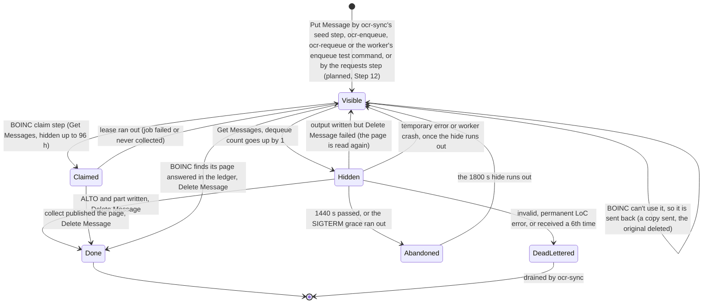
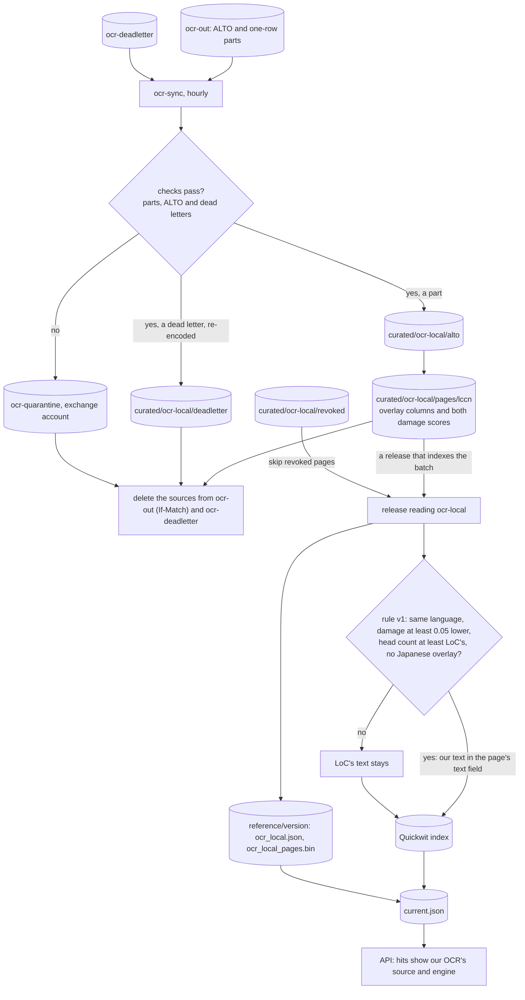

# 12: On-prem OCR Pipeline

**Current state (November 2026):**

- The direct queue worker is retired (#966), and no node runs it; local OCR runs through BOINC only (#917, #942; [BOINC pages](../boinc/README.md)). Its systemd unit, `install-worker.sh`, `install-worker-node.sh`, `update-worker.sh` and `engine-spike.sh` are removed.
- Still in use: the worker crate (`usnm-boinc` uses its engine code) and its attested release (the scan archive and scan-fetch hosts and the LAN dashboard install from it), the exchange account with its Storage queues and `ocr-out`, the seeder, the hourly `ocr-sync` pickup, and the onboarding and offboarding scripts.
- The pickup runs on an on-prem host as `usnm-ocr-sync.service` ([runbook](../operations/onprem-ocr.md)), and releases run on-prem too, not in Container Apps jobs; the main environment has no VNet (`USNM_CAE_VNET` is `false` in [`infra/env/prod.json`](../../infra/env/prod.json)). The Container Apps job, `snet-cae` and VNet details in Step 8, §12.3.1 and §12.9 are history.
- The parts on nodes, the worker and its trust boundaries describe the design as built in October 2026.

**Status (15 October 2026):** Steps 2 to 10 on `main`; Step 12 implemented, not merged or provisioned; Step 14 not built. ADR-0015 and ADR-0016 Proposed · **Issue:** [#296](https://github.com/tgoodyear/usnewsmap.com/issues/296) · **Code:** `infra/modules/ocr-exchange.bicep`, `infra/modules/ocr-node-monitoring.bicep`, `scripts/ocr-node/`, `crates/usnm-ocr-worker/`, `crates/usnm-ocr-contract/`, `crates/usnm-overlay/`, `crates/usnm-alto/`, `crates/usnm-core/src/damage/`, `crates/usnm-ocr-local/`, `ocr/engines/tesseract/`

## 12.1 Purpose and scope

LoC's OCR misreads whole groups of pages, and search can't find a misread word. The [language report](../reports/2026-10-language-analysis/report.md) scored a 10% sample of `pages-v20261003-1` (2,371,337 pages from 2,989 batches) by damage: the share of occurrences of a language's 20 most common words read one edit wrong. A page above 0.25 is badly damaged. The worst groups are German before the 1920s (57,580 sampled pages, about 580,000 in the index), five English batches with median damage 0.46 to 0.52, and the Serbian, Russian and Czech titles ([ADR-0015](adr/0015-onprem-ocr-workers.md)). Azure compute or a cloud OCR service would cost more than the monthly budget, so local machines read them again (#296). This document covers queueing a page, reading it, checking it in the cloud and putting it into search.

- **Naming (#309).** Dated rows keep historical names. Script-owned groups are `usnm-ocr-nodes-grp-<env>` (relabelled in place by saved object ID); new nodes are `usnm-ocr-node<digits>-arcs-<env>`, at most 32 characters ([operator runbook](../../infra/README.md#naming-guard-and-phase-12-rollout)). The exchange account stays pinned in prod: the rollout assumed it would be empty when migrated, which stopped being safe once the pilot was running. Before renaming it, inventory its live queues, blobs and OCR and BOINC users and agree a window to drain, copy and reconfigure.
- **Engines** are in [ADR-0016](adr/0016-pluggable-ocr-engines.md) and [13: OCR engines](13-ocr-engines.md): each a container behind one contract (candidates NDNP Open OCR, EffOCR, Tesseract, docTR, Surya, Kraken, NDLOCR-Lite, later GPU vision-language models; OCR-D's model lists but not its processors). The worker's one engine was Tesseract (#317, #341). ADR-0015 decision 7 holds any bulk run until the engine survey has reported.
- **The Japanese OCR job** (`ocr/ja-ocr/jaocr.py`, 04 §4.8, writing `curated/ocr-ja/`) is separate; it matters here only where the release reads both overlays.
- **Languages:** §12.4.
- **Priorities.** Search latency and running cost first, ingest and rebuild speed second: no required step adds a clause to every search or a field to the index (Step 14, which would, waits for a benchmark).

## 12.2 As built

State on `main` on 11 October 2026 and in prod as #296 reports it. "Deployed in prod" means provisioned in `rg-usnm-prod` (East US 2); "merged" or "built" means on `main`, not claimed deployed. #296's last provision report is `scripts/azure/provision.sh --env prod` on 11 October, 4:43 to 4:53 PM ET, from `main` at `8faee42`, after the full damage pass. Onboarding scripts are in §12.3.5, monitoring in Step 3, and the pipeline's code under its step in §12.5.

| Component                                                                                                                                                                                                                       | State                                                                                                                                                                                                                                                                                                  | Where                                                                                                                    |
| ------------------------------------------------------------------------------------------------------------------------------------------------------------------------------------------------------------------------------- | ------------------------------------------------------------------------------------------------------------------------------------------------------------------------------------------------------------------------------------------------------------------------------------------------------ | ------------------------------------------------------------------------------------------------------------------------ |
| Exchange account `stusnmo<suffix>`: StorageV2, LRS, Hot, shared keys off, public network access behind a firewall (default Deny, no trusted-service bypass) allowing `USNM_OCR_NODE_IPS` and `snet-cae`                         | Merged (#297); in prod as `stusnmoffapzy`                                                                                                                                                                                                                                                              | `infra/modules/ocr-exchange.bicep`, `infra/main.bicep`                                                                   |
| Queues `ocr-priority`, `ocr-bulk`, `ocr-deadletter`; container `ocr-out` (7 days soft delete, no versioning, blobs deleted 30 days after last change)                                                                           | Merged (#297); in prod                                                                                                                                                                                                                                                                                 | `infra/modules/ocr-exchange.bicep`                                                                                       |
| Exchange account in the public-network policy's `publicAccountIds` by resource id (every other account is denied public access; no exemption); Microsoft.Storage service endpoint on `snet-cae`                                 | Merged (#297); in prod                                                                                                                                                                                                                                                                                 | `infra/main.bicep` (ids), `infra/guardrails.bicep` (rule), `infra/modules/network.bicep`                                 |
| Exchange diagnostics: blob writes and deletes, every queue request                                                                                                                                                              | Merged (#297)                                                                                                                                                                                                                                                                                          | `infra/modules/diagnostics.bicep`, `infra/modules/storage-diagnostics.bicep`                                             |
| Node roles through the Entra group `usnm-ocr-nodes-<env>`: Message Processor on the work queues, Message Sender on `ocr-deadletter`, a custom writer role on `ocr-out` (read and write, no delete)                              | Merged (#301, replacing #299's per-machine grants); provisioned in prod 10 October. The account holds the group's four grants and no per-machine grant. Prod's settings keep a leftover empty `USNM_OCR_NODE_NAMES`, unread since #301. #397 adds Queue Data Reader on each queue; not yet provisioned | `infra/modules/ocr-exchange.bicep`, `scripts/ocr-node/group.sh`                                                          |
| `id-usnm-ingest` on the exchange account: Queue Data Contributor on the account, Blob Data Contributor on `ocr-out`                                                                                                             | Merged (#297); used by the hourly `ocr-sync` job                                                                                                                                                                                                                                                       | `infra/modules/ocr-exchange.bicep`                                                                                       |
| Deployment outputs `OCR_EXCHANGE_ACCOUNT`, `OCR_QUEUE_ENDPOINT`, `OCR_BLOB_ENDPOINT`                                                                                                                                            | Merged (#297)                                                                                                                                                                                                                                                                                          | `infra/main.bicep`                                                                                                       |
| Rust worker: queue loop, paced LoC fetch, Tesseract in a pinned container per page, ALTO and overlay output, telemetry; Arc managed identity in `crates/usnm-store/src/credential.rs`; overlay schema in `crates/usnm-overlay/` | Merged (#298, #317, #335, #341); attested EL9 releases (Step 2); unit removed and retired from nodes (#966)                                                                                                                                                                                            | `crates/usnm-ocr-worker/`                                                                                                |
| Shared queue client with the approximate message count, work message and dead letter v2, bounded ALTO check                                                                                                                     | Merged (#335, #342)                                                                                                                                                                                                                                                                                    | `crates/usnm-store/src/queue.rs`, `crates/usnm-ocr-contract/`, `crates/usnm-alto/`                                       |
| Damage metric v2 (Steps 4, 5)                                                                                                                                                                                                   | Built (#315, #332), with a parity fixture against `ocr/ja-ocr/damage_v2.py`                                                                                                                                                                                                                            | `crates/usnm-core/src/lang.rs`, `crates/usnm-core/src/damage/`, `ocr/ja-ocr/damage_v2.py`                                |
| Engine survey                                                                                                                                                                                                                   | Round 1 scored; the report is draft PR #370, not on `main`                                                                                                                                                                                                                                             | `docs/reports/2026-10-ocr-engine-survey/` (in #370)                                                                      |
| One searched text field (#285)                                                                                                                                                                                                  | Merged (#292), behind `USNM_SINGLE_TEXT_FIELD` (off by default)                                                                                                                                                                                                                                        | `crates/usnm-ingest/src/release.rs`, `crates/usnm-ingest/src/release/document.rs`, `crates/usnm-core/src/text_layout.rs` |

### 12.2.1 The nodes

Hosts are provisioned by the infrastructure operator: a VM with UEFI Secure Boot and a vTPM and an admin user with key-only SSH, running prepared AlmaLinux 9 or registered RHEL 10. Onboarding doesn't create VMs, register OS subscriptions or manage Lightspeed. Use distinct node IDs across rebuilds to preserve provenance. History: nodes 1 (AlmaLinux 9.8) and 2 (8 vCPUs, 40 GiB) ran from 10 October 2026 on two lab hosts, replaced on 12 October by RHEL 10.2 nodes 3 and 4 (`usnm-ocr-node4-arcs-prod`, 4 vCPUs, 8 GiB, default key store) running `ocr-worker-20261012-75fab3f`. No node runs the worker since #966.

### 12.2.2 How the worker handles a page

History: the Rust worker (`crates/usnm-ocr-worker/`, #298, #317, #335, #341) took from `ocr-priority`, then `ocr-bulk`, hid each message for a fixed 1800 s (`--visibility-secs`, never renewed: Message Processor has no Update or Put Message), abandoned a page at 1440 s or 60 s after SIGTERM, and paced LoC at 5 s per API request and 1 s per image per node. Its LoC client lives on in the scan fetcher (§12.2.4, LoC client rules).

Still governing the queues, `ocr-out` and the pickup:

- **Dead letters.** More than 5 receives, a failed message check (only the kind kept, never content) or a permanent LoC answer (no image, or a 4xx other than 403, 408 or 429) dead-letters a page. `v: 2` (#335) has `cause` (`dequeue_count`, `invalid`, `permanent`, `unroutable`), `kind` for `invalid`, and `error` cut to 200 characters.
- **Output names.** Create-only `alto/<doc_id>.<node>.<stamp>.xml`, the runs record `runs/<lccn>_<date>_ed-<n>.<node>.<stamp>.parquet` (#307, 13 §13.8.3), then `pages/<lccn>_<date>_ed-<n>.<node>.<stamp>.parquet`, one row in the overlay schema. `ocr_source` names the engine (`usnm-tesseract`); `loc_text` holds the queue reason (`bulk` or `user`).
- **No search text in messages.** Unknown fields are refused and every field has a fixed format; only trusted cloud jobs enqueue. `batch` is a LoC base batch name (#317, #335): 1–128 ASCII characters from `[A-Za-z0-9_]`, a 2–10 lowercase-letter awardee prefix before the first `_`, a nonempty rest, no trailing `_verNN`; capitals (`curiv_joshuaTree`, `lu_Cypher`, `me_Bissonnette`, `vi_White`, `wvu_Quote`) are identifiers, and spelling is case-sensitive everywhere, never lowercased. `language` is an ISO 639-3 code `usnm_core::lang` knows. Oversized damage-table, summary and seed-rank filenames are split into a batch segment and a versioned filename to stay within the object store's 128-byte segment limit; existing shorter keys are unchanged. The seeder, `ocr-enqueue` and `ocr-sync` share this check; prefetch manifests, fetched lists and v1 dead letters keep their older, looser shape within the same alphabet and bound. Telemetry carries page ids, queues, languages and outcomes, never message bodies, search text or tokens.

### 12.2.3 Text that disagrees with the code

Checked on `main` on 11 October 2026; Step 1 fixes these.

- #296's body describes renewed 10-minute leases; the code used a fixed 1800 s hide.
- ADR-0015 decision 4 and a comment in `ocr-exchange.bicep` say 5 receives dead-letter a message; the code dead-letters on the 6th.
- ADR-0015 decision 5 and the worker's README (Output: "can create blobs but not replace or delete them") miss that the writer role's `blobs/write` lets one node overwrite another's blob, as the Bicep comment says.
- ADR-0015 is "Proposed", though built and deployed (the maintainer's call).
- 08 §8.5 lists nothing in `publicAccountIds`; with `USNM_OCR_NODES` on, the exchange account and the nodes' Key Vault are there, as 08 §8.3 says.
- 04 §4.7 and 08 §8.4.1 say compaction runs monthly. Nothing schedules a full rebuild: `USNM_INGEST_CRON` (empty in prod) schedules only incremental runs, a full base needs `USNM_INGEST_FULL` and the E4 profile, set by hand and cleared afterwards ([operations, Full rebuild](../operations/rebuild-and-index-storage.md#full-rebuild)), and a version with 8 deltas makes the next run full on whatever profile the job is on, which on Consumption runs out of memory (#172).

### 12.2.4 Scans fetched ahead of the workers (#368)

The damaged pages' scans are fetched once onto the lab's ZFS pool, so every engine reads the same local scan and LoC serves each image once ([ADR-0015](adr/0015-onprem-ocr-workers.md) decision 9). The [worker README](../../crates/usnm-ocr-worker/README.md#prefetching-scans) has the commands and flag defaults.

- **Manifest.** `usnm-ingest ocr-prefetch-manifest --version <index version> [--partial] [--min-damage 0.25] [--exchange-url <ocr-out URL>]`, an ingest command (an ingest job execution as built), reads the damage tables (Step 6) and writes `audit/damage/v2/prefetch/<version>/manifest.parquet` and `summary.json` in the curated store: pages above 0.25 in issue order, one copy each (the copy the version keeps, else the batch that sorts first), with doc_id, batch, lccn, date, edition, seq, detected language, decision, damage rate and the issue's loc.gov item URL. The summary counts pages by language, decade, batch, and language by decade. `--partial` reads batches whose tables exist before the version's list does, into `partial-<stamp>/`. `--exchange-url` copies both to `ocr-out/manifests/<version>/`, which `ocr-sync` doesn't read and the lifecycle rule deletes after 30 days. Curated rows have no image URL (curation drops the reel the IIIF id needs), so the fetcher resolves each page through its batch.
- **Getting it to the lab.** `scripts/ocr-node/pull-manifest.sh --scan-server http://<scan server>:8380`, as root on an Arc host whose identity can already read `ocr-out`, checks the manifest's sha256 against the summary and PUTs both to the scan server (`/tank/ocr/manifests/<version>/`); no role is added. Infrastructure tooling provisions the scan and manifest directories; the application doesn't provision the lab's ZFS datasets. Scans are read over HTTP, not NFS, so a blocked hypervisor mount can't strand a reader.
- **The scan server.** `usnm-ocr-worker serve-scans` (unit `usnm-scanserve.service`, port 8380): `GET /scans/<set>/<batch>/<lccn>/<date>/<ed>/<seq>.<jp2|jpg>` (`image/jp2` or `image/jpeg`) and its `.json` sidecar; no `DELETE` (scans are never deleted since 2026-11-08; a DELETE gets 405, and `<scan>.done` markers from earlier buffer deletes still stop a re-fetch); `PUT /manifests/<version>/{manifest.parquet,summary.json}`; `GET /index/full.jsonl`, one sidecar per fetched scan in landing order, which tells a seeder what is cached (a buffer scan listed before 2026-11-08 may have been deleted). It serves only configured hosts (names re-resolved every 5 minutes; the container's nftables drops the port from outside its LAN subnet), over plain HTTP, trusted for integrity on the LAN (the maintainer's decision): the scans are LoC's public images and the checks catch a damaged or mismatched scan, though not a forgery that rewrites both scan and sidecar. One JSON log line per request (method, path, status, peer).
- **The scan archive (#442, ADR-0018).** `usnm-ocr-worker archive-scans` copies the keep set to a Cold-tier, write-once Azure container, checked against each sidecar: an off-site copy, and the source contributor-compute clients read before LoC through a small API (a later change). The buffer set isn't archived.
- **The fetcher.** `usnm-ocr-worker prefetch` in `usnm-scanfetch` (infrastructure tooling): an unprivileged Debian 12 container with no Azure credentials, `tank/ocr/scans` and `manifests/` bind-mounted read-write, uid 2000 (host 102000), unit `usnm-scanfetch.service`. It runs 16 pages in flight since 2 November (4 before: with a storage-service JP2 taking about 35 s, 4 used only about 7 of the host's 30 requests a minute), with `--loc-in-flight` keeping LoC's servers at 4. A lock file allows one fetching process. A run starts from the last run's buffer count when under a day old, leaving a tenth of the cap free; the buffer walk (about ten minutes) runs alongside and replaces that count. It stops after 20 pages from at least 3 titles fail in a row (`--max-failures-in-a-row`, `--stop-min-titles`).
- **LoC client rules** (from the worker, #335, #523). A 429, 503 or 403 holds every request to that server (loc.gov API, image server or storage service) for `Retry-After`, or 60 s times the attempt number if longer or absent, at most an hour; a longer `Retry-After` is cut to the hour and counted in `ocr.loc_slowdowns` with `capped=true` (`alert-usnm-ocr-loc-hold-<env>`). A 408 is retried; any other 4xx is permanent. Routes set `LocConfig::html_is_block`, since none expects HTML: a 2xx HTML answer (or `cf-mitigated: challenge`) or an unreadable body fails at once as transient and holds that server for the configured backoff (60 s by default) or a longer `Retry-After` (capped at an hour), without retrying or passing the answer to OCR. A failed item-health probe can't treat a challenge as a working item, and a probe's challenge also stops the original fetch and keeps its requested hold. A Cloudflare 403 names the challenge and keeps the usual HTTP hold and retry. `ocr.loc_slowdowns` labels holds `reason=html_challenge`, `unreadable_body` or `http_status`; the `status`, `server`, `retry_after` and `capped` attributes remain. No block is bypassed.
- **The batch route (#368, 12 October).** Each full-size page is the original JP2 from its batch, not the IIIF JPEG. Batches are BagIt bags on tile.loc.gov's storage service (`https://tile.loc.gov/storage-services/service/ndnp/<inst>/batch_<batch>_ver<NN>/`; `chroniclingamerica.loc.gov/data/batches/<batch>_ver<NN>/` 308-redirects there, followed only onto the storage service). Per batch the fetcher reads `manifest-md5.txt` once and keeps it, with the batch's URL, under `/tank/ocr/manifests/batches/<batch>_ver<NN>/` (`--batch-cache`). Per issue it reads the METS (`<YYYYMMDD><EE>.xml`, about 16 KB, or the signed `_1.xml` if that's all the bag has), checks the bag's md5 and keeps it under `mets/<lccn>/`. Each `np:page` div in the METS structMap has a MODS `start` (the seq) and a `service` file `./<frame>.jp2`, since JP2s are named by reel frame. A JP2 failing the bag's md5 fails as transient. The IIIF base is the JP2's storage path with `/` as `:`, as the item API gives, so it stays the page's id. `--resolution scaled:<n>` uses the same lookup, then the IIIF `pct:<n>` JPEG. Only a page the route can't place (no such batch, issue or METS not in the bag, no JP2 for the seq, or a 404 for a listed JP2) uses the item API and IIIF JPEG; a hold, 403 or failure on the storage service never does, so nothing goes round a block. Status counts `fetched_jp2` and `fetched_item_api`.
  - **Pacing.** Storage requests 1 s apart (`--storage-gap-ms`), API 5 s (`--api-gap-ms`; was 3.5 s). LoC publishes 150 a minute each for image and storage services with a 1-hour block past it, but not whether they are counted together, so by default they share one pacer at the longer gap and a hold on either holds both; `--storage-own-budget` separates them.
  - **The global budget (#962).** Since 2 November 2026 the host's whole LoC budget is 20 requests a minute for storage and image services together (the maintainer's decision, after LoC's published limits at loc.gov/apis/json-and-yaml/working-within-limits: 150 a minute for `/storage-services/`, 150 for Image Services, 20 for the JSON API, each with a one-hour block; LoC may block lower under load). It was 45 from 24 October, when the slow rate was 10 a minute until an operator reset it. It was 30 on the morning of 2 November, until LoC sent challenge pages at about 27 a minute with 16 requests in flight. OCR scans, the quality pass, the bulk OCR archives and any loc.gov API request through it all count. `--loc-global-pacer <file>` (`USNM_LOC_GLOBAL_PACER`) makes every request also wait for a slot in a state file under `flock`, so the fetcher, `bulk-ocr` and `usnm-boinc`'s stages (when the variable is set; `--gap-secs` floor 3 s instead of 5) share one rate. At most 4 requests to LoC's own servers per process are in flight (`--loc-in-flight`, `USNM_PREFETCH_LOC_IN_FLIGHT`, 1 to 16; the bucket isn't counted), since bursts can trip the challenge system. A 429, 403 or challenge page holds the whole budget past the block (`Retry-After`, or an hour) and drops it to 12 a minute for every process for 24 hours from the last push-back (logged at start and lift); `usnm-ocr-worker loc-pacer --file <file> --reset` lifts it sooner. A file slowed by a release before this rule has no end time and stays slow until reset. A 503 holds only its server. The fetcher runs OCR's manifests first and the quality pass's in one-hour slices after, so the quality pass takes what is left; since 2 November its manifests (`queue-quality-`) are out of `--no-loc-prefixes`, so a page neither the bucket nor a mirror has comes from LoC instead of waiting a day as `needs-loc`. The JSON API gap (5 s) and the title sync's 3.5 s stay under the API's 20 a minute.
  - **Mirrors (24 October 2026).** `--mirrors nbu,pst,oru,scu,wayback` (`USNM_PREFETCH_MIRRORS`; none by default) asks copies of LoC's files for a page's JP2 before LoC. LoC's bag manifest and METS still place the page, and only bytes matching the bag's md5 are taken.
    - **State partners.** Four awardees serve their batches' JP2s byte for byte with Chronicling America's software: Nebraska (`nbu`, nebnewspapers.unl.edu, about 583,000 of LoC's pages), Pennsylvania (`pst`, panewsarchive.psu.edu, about 363,000), Oregon (`oru`, oregonnews.uoregon.edu, about 327,000), South Carolina (`scu`, historicnewspapers.sc.edu, about 306,000, all English): about 6.6% of the corpus, including Nebraska Staats-Zeitung, Pokrok Západu, Stjernen, Scranton Wochenblatt and Toveritar. Each is asked only for its own batches, at `/lccn/<lccn>/<date>/ed-<n>/seq-<n>.jp2`. A partner may hold more pages than LoC lists, so where its page JSON names the file (its IIIF id; South Carolina's doesn't), it must be LoC's, or the partner isn't asked.
    - **Wayback Machine.** Archive Team's crawl has a few percent of each batch's storage-service JP2s. One CDX lookup per issue (shared by pages asked at once; a failed lookup isn't kept) lists captures, read as captured (`/web/<timestamp>id_/<url>`), largest first, since some were cut short. Save Page Now is never used: it would make the Internet Archive fetch from LoC.
    - **Pacing.** One request at a time per mirror, at least 5 s after the last ended (`--partner-gap-ms`, `--wayback-gap-ms`), outside the LoC budget. A page waits at most 30 s for its turn, then goes to LoC. A 429 or 503 holds the mirror for `Retry-After` (1 minute to 1 hour); a 403, challenge or HTML for an hour; a held mirror is skipped and never holds LoC. Redirects only within the mirror's host, at most two, each paced. Wayback CDX lookups get 60 s (25 October 2026, after timeouts and 503s left it all but off; partners keep 30 s); a Wayback timeout or connection error holds nothing (a miss, counted as `errors`), and a 503 without `Retry-After` holds 15 s (with one, 15 s to an hour). A partner's timeout or error holds it a minute.
    - **Records and limits.** The sidecar is as for LoC's JP2 (LoC's URL, IIIF base, md5), so downstream reads it unchanged; `sources-<res>.jsonl` records each mirrored page's source (doc_id, mirror, URL, md5, bytes, time), and status counts `fetched_mirror` and per-mirror requests, hits, misses, seq drift, md5 mismatches, skips and holds. A mirror's page neither ends a failure run nor clears an issue's cool-off, and a page the batch route can't place still uses the item API (its batch has no bag manifest at that path on the storage service, or one that lists no JP2s: 18 of the 461 manifests on disk on 24 October, such as `nbu_abbott_ver01`).
    - **Trial (24 October 2026).** 46 of 100 buffer pages came from a mirror, all matching md5. Not used: Georgia's site (JP2s behind a bot challenge) and Digital Commonwealth (robots rules allow only a lossy JPEG).
  - **No LoC for some manifests (25 October 2026).** `--no-loc-prefixes <prefixes>` (`USNM_PREFETCH_NO_LOC_PREFIXES`, comma-separated; none by default): manifests in directories with a listed prefix take JP2s only from the bucket or a mirror. A page neither has, one its batch can't place, and any scaled page are deferred: nothing goes to LoC's storage service, item API or IIIF, it counts in `finished` and `deferred_needs_loc` (status `no_loc`), with an info line in the log, and it isn't a failure, a cool-off or part of a run of failures; a later run without the prefix takes it. Batch manifests and METS still come from LoC when the bucket can't serve them. OCR's manifests (`queue-ocr-*`) always go to LoC.
  - **LoC's bucket (24 October 2026).** `--loc-bucket https://ndnp-batches.s3.amazonaws.com/` (`USNM_PREFETCH_LOC_BUCKET`; off by default) reads batches LoC's S3 bucket `ndnp-batches` holds from it (us-east-1, anonymous GET and HEAD, not behind Cloudflare). The maintainer allowed it "for everything" on those batches, at a slow pace.
    - **Contents.** Keys drop the awardee and `batch_`: `…/ndnp/<aw>/batch_<b>_ver<NN>/<path>` is `<b>_ver<NN>/<path>`. On 24 October 1,074 of 3,010 batches were public, 9,095,045 of 23,847,619 pages (38.1%; 3 of those answered only when asked again later that day); the other 1,936 answered 403. Objects carry `x-amz-meta-md5` (for a single-part upload the ETag is the md5 too); 40 of 40 sampled JP2s matched LoC's md5 and the stored sha256.
    - **Use.** For a batch whose manifest isn't on disk, the bucket is asked first, then for METS and full-size JP2s (before any mirror), each checked against the bag's md5. A manifest is taken only if its body matches `x-amz-meta-md5` or, without it, a single-part ETag (32 hex digits, no `-`); otherwise it is refused (`no_md5`). The first answer decides whether a batch is public or private (a 403, or a 404 for the manifest) for the life of the process; after that a 403 or 404 is a miss for that file only. A 403, 404, mismatch, hold or busy bucket sends the request to LoC.
    - **Guessed URLs.** A batch with a `url` file from LoC never uses a guess. Otherwise a bucket manifest's LoC URL is guessed from the batch name (`<aw>/batch_<b>_ver<NN>/`) into `url.guessed`, not `url`, used only while the bucket is on; with the bucket off, the batch is looked up on LoC as if nothing were on disk. When LoC answers 404 under a guess, the fetcher asks Chronicling America's redirect where the batch is (one request on the storage service's pacer, at most hourly per batch), keeps that in `url` and retries before the item API; the IIIF base and the sidecar's URL are then the redirect target's. A METS or JP2 LoC serves under the guess with a matching md5 confirms it; a right guess is then dropped and a wrong one kept as `url.wrong`. Pages LoC was never asked for keep the guess in their sidecar, and `url.guessed` beside the manifest says which batches those are. Only a JP2 under a confirmed URL seeds the storage service's known-good item. On 24 October all 521 kept `url` files matched the guess.
    - **Pacing.** At least 2 s between starts by default (`--loc-bucket-gap-ms`, at least 500 ms). The maintainer's plan of 25 October: 6 s from 24 October, then 2 s, watch for throttling, then 1 s; on 11 November, 500 ms, to double the quality feed's supply (#1475). `--loc-bucket-concurrency N` (1 to 16, `USNM_PREFETCH_LOC_BUCKET_CONCURRENCY`; 2 November) runs up to N at once, since one at a time held the fetcher to about 25 pages a minute and LoC's limits don't cover S3. None of it counts in LoC's budget. `--loc-bucket` takes only an `amazonaws.com` host, so the bucket's client can't be sent to a LoC host. A request waits at most 30 s for its turn, then goes to LoC. A 429 or 503 (SlowDown) holds the bucket for `Retry-After` (1 minute to 1 hour); a challenge, HTML or any redirect (none is followed; S3 redirects mean the root is wrong) for an hour; a 5xx, timeout, network error or unreadable body for a minute. A 403 holds nothing, since it only means the batch is private. A held bucket is skipped, not waited for, and nothing it answers holds or slows LoC.
    - **Records.** As for a mirror, with `ndnp-batches` in `sources-<res>.jsonl`; status counts `fetched_bucket` and, under `bucket`, requests; manifests, METS and JP2s taken; public and private batches seen; misses; md5 mismatches; manifests refused for want of an md5; skips and holds.
  - **Bulk OCR (#962).** `usnm-ocr-worker bulk-ocr --out <dir> --loc-global-pacer <file>` fetches Chronicling America's per-batch OCR archives (`ocr.txt` and ALTO with word confidence; 3,011 archives, 2.47 TB, with sizes and sha256 in LoC's datasets table) one at a time, at least 60 s apart (LoC: "10 bulk requests within 10 minutes" per IP), checks size and sha256, and stops starting archives after `--max-hours` (default 20; LoC may stop programs running past 24 hours).
  - **Fetching outside content (#1413).** `bulk-ocr` downloads through `usnm_ocr_worker::fetcher`; #1413 moves every outside download onto it. A job names a file, its size and SHA-256, its destination and sources in preference order. A host policy (`crates/usnm-ocr-worker/policies/<name>.toml`, or `--policies <dir>`) sets rate, concurrency, byte cap, retries and push-back; a URL or redirect hop no policy covers is refused, and a redirect can't leave its policy. LoC's policy holds the limits above, shares the state file, and is tested against the scan fetcher's pacer constants. State goes through the `Budget` and `JobStore` traits (`FileBudgets`, `FileJobs`). A policy is refused for an unknown key, two policies on one host, a zero rate, a slow rate above the normal rate, `slow_for_secs` without a slow rate, `default_hold_secs` of zero or above `max_hold_secs`, or a push-back status outside 400–599; a slow rate without `slow_for_secs` lasts until `loc-pacer --reset`. `disallow_paths` and `allow_paths` use `robots.txt` patterns (prefix, `*`, final `$`) on every URL and hop, but a matching disallow (path, or path with query) always wins, an allow list admits only allowed paths without a query, and a redirect the policy won't follow is push-back. A job with no SHA-256 treats its size as a ceiling, doesn't resume, reports the SHA-256 received and replaces any existing copy. To come: a daily byte budget (#1415), state in Postgres, the fetcher as its own CI-built service off the scan-fetch host, then the queue command, alerts and scan prefetch.
  - **A mirror for the archives (#1413).** `bulk-ocr --mirror-url <base> --mirror-manifest <file> --state <dir>` tries the mirror, then LoC, always checking LoC's SHA-256. An archive the mirror lacks or lists with another hash goes in `<state>/held-back.tsv` (`absent-from-mirror`, `sha256-differs`) and comes from LoC, or waits under `--mirror-only`. Transfers resume from `<state>/part`, keep to the policy's byte cap (`--rate-bytes-per-sec` or `<state>/rate-bytes-per-sec` can only lower it; it halves if the API slows), and stop at three verification failures in `<state>/checksum-failures.tsv`, which a restart also refuses. A slowed LoC budget stops only jobs that need LoC.
  - **Georgia Historic Newspapers (#1193).** The maintainer's decision (1 November 2026): GHN's IIIF page images and our own OCR, starting with public-domain pages to 1930 on titles we lack, once the queue and native OCR (#1418, #1415) can carry them; never GHN's search JSON, its OCR or anything its `robots.txt` disallows. The `ghn` policy covers the site and its image server (untested against GHN): 6 requests a minute, 10 s apart, one transfer at a time, at most 2 MB/s, 2 a minute for a day after a push-back, `robots.txt`'s rules, and only `newspapers.json`, `/lccn/*.json` and full-size `default.jpg`; page HTML and JP2 links redirect to a Turnstile challenge, which is push-back and never followed.
    - `usnm-ocr-worker ghn-catalog --cache <dir> --ours batches.json --out <dir> [--rights <tsv>] [--fetch-metadata --pacer <file>]` is a dry run over GHN's newspapers list and title collections (cached, or fetched under the byte cap, one run at a time on a cache, kept only once they parse). It marks titles `selected`, `ours` (a batch of ours lists the LCCN), `elsewhere` (the Wiregrass Farmer, `sn90052158`, from LoC's API text, #1419), `none-in-range` or `no-metadata`, and writes `titles.tsv`, `issues.tsv` (selected issues to `--through`, at most 1930-12-31) and `summary.json`. With DLG's rights list (refused if it gives an issue two statements) only NoC-US issues are listed; otherwise each is `unchecked`.
    - `usnm-ocr-worker ghn-fetch --issues issues.tsv --out <dir> --pacer <file>` takes each issue's manifest, then its pages' `<service>/full/full/0/default.jpg` (8 MiB and 64 MiB ceilings), through an engine holding only the `ghn` policy; a lock beside the pacer file lets one GHN run transfer at a time. A page lands at `<out>/pages/<lccn>/<year>/<doc_id>.jpg` once it decodes as a whole JPEG (anything else is removed and left to do), with a sidecar `<doc_id>.json` (removed before a missing image is asked for again): its `ghn:` page id (ADR-0026), image and manifest URLs, the manifest's SHA-256, the image's size and SHA-256, and its rights basis. It refuses `unchecked` issues without `--unchecked-rights`, issues after 1930 and the Wiregrass Farmer. Neither command enqueues OCR. Not run against GHN yet: DLG's rights list, a page-level duplicate check against Chronicling America and an OCR comparison sample come first.
  - **LoC's page text for pages a bulk archive lacks (#1419).** The Wiregrass (`sn90052158`) has 10,904 pages listed in `gu_allmanbrothers_ver01` against 7,923 curated, and the batch's archive, which matches its published SHA-256, has none of it. `usnm-ocr-worker loc-text enqueue --out <dir> --batch <batch>_ver<NN> [--lccn <lccn>] --bag-manifest <manifest-md5.txt> --counts <curated counts.json> [--datasets <datasets.json>] [--dry-run]` plans the missing title-days into `<dir>/queue.json` (asking LoC nothing, except `--fetch-manifest`, one request in the budget and never on a dry run). `loc-text run --out <dir> --loc-global-pacer <file>` fetches item JSON and `fulltext_service` text through the fetcher under LoC's policy and global budget, refusing a text URL on a host the policy doesn't cover, 60 s apart unless `--gap-secs` (at least 5 s). A push-back slows the budget for every process and ends the run; a run doesn't start while it is slowed. Answers go to `responses/` and `items/`, then the record to `pages/<doc_id>.json` (`ocr_source = "loc-api-fulltext"`, not `ndnp-original`), written last so a rerun skips pages that have one ([worker README](../../crates/usnm-ocr-worker/README.md#locs-text-for-pages-a-bulk-archive-lacks)). Reading them into curation or search, as a source-qualified overlay like `ocr-ja/` (04 §4.8), and any gap under the policy's 60 s are the maintainer's decision.
  - **Item errors on the storage service.** The #414 rule (below) applies to a METS or JP2 only on a second fast, bare 503 for the same file after the first held as usual, since 503s under load look the same there. A batch manifest's 503 always holds. Cool-offs are per route (`storage:<issue>` in `item-errors.json`), so an issue whose item JSON failed still comes through its batch.
  - **The JP2s.** Lossy (9/7 wavelet, 25 quality layers), 8-bit greyscale, about 400 dpi, the IIIF JPEG's pixel size and about 13% smaller; the JPEG re-encodes the JP2, the best LoC publishes (no TIFFs). Tesseract reads JP2 through Leptonica and OpenJPEG (about 20 s more per page; `--dpi 300` either way). The engine contract's decode step (13 §13.4) uses the Rust `image` crate, which doesn't read JP2, so it needs OpenJPEG or a PNG conversion first.
- **Item errors (#414).** Some items answer 503 at once, for hours, while loc.gov works (all of `sn83045081`, 30 July to 11 August 1904, on 12 October). An item JSON 503 is an item error, holding nothing, only when it came within 2 s with no `Retry-After`, another item answered 2xx in the last minute or does when asked now (the last item that answered, from the index after a restart), and fewer than 3 titles had item errors in the last 30 minutes. Anything else holds: a 429, 403, `Retry-After`, slow 503, any image-server 503, a known-good item failing too, or a third title's item errors. The issue's pages are skipped for `--item-cooloff-secs` (a day), each logged as `loc_item_error`, and retried after, in the same run (state `cooling`) or the next; after `--item-max-cooloffs` (3) the issue is permanent. `item-errors.json` keeps cool-offs across restarts. The worker treats an item error as transient.
- **Layout.** `/tank/ocr/scans/<set>/<batch>/<lccn>/<date>/<edition>/<seq>.jp2` (batch route), `<seq>.jpg` (IIIF JPEG: about 6,000 early keep-set scans and item-API pages), `<seq>.pct<n>.jpg` (scaled), each with a sidecar `<file>.json`: doc_id, batch, URL fetched, IIIF base, resolution, fetch and request time, bytes, sha256, User-Agent, `format` (`jpeg` or `jp2`; absent means JPEG) and, for a JP2, the bag's `md5`. Fetches go in `index-<res>.jsonl`, failures in `failures-<res>.jsonl`, and `status-<res>.json` is rewritten every 100 pages and 30 s. A scan counts once its sidecar is written. A run skips scans in either format whose size, sha256 and md5 (where recorded) match their sidecar, so a JPEG already there isn't fetched again as a JP2, and a run can stop and restart against a newer manifest.
- **Cut short at LoC (#1457).** Some of LoC's JP2s end before their codestream does (a box or tile-part past the end of the file, or no EOC marker) yet match the bag's md5. After checksums pass, the fetcher reads the headers (`usnm_ocr_contract::jp2::truncation`). A truncated scan isn't written, indexed or seeded; it is a `source_truncated` failure and a line of `source-truncated.jsonl` (doc_id, batch and version, LoC URL, md5, sha256, bytes, reason, time), the list to report to LoC. Status counts `source_truncated`, and later runs don't ask LoC for that batch version of the page again. A worker (or the BOINC worker) reading one cached before this check dead-letters the page as `permanent` without trying the JPEG. The page keeps LoC's text ([boinc-quality.md](../boinc/apps/quality.md#undecodable-source-scans)).
- **Two sets** (11 October). The first manifest for `pages-v20261010-2` lists 1,922,826 pages, 1,733,773 English, far more than `tank` holds at about 5 MB a scan.
  - The **keep set**, every page not detected as English plus the worst English batches, kept for good under `scans/keep/`.
  - The **buffer set**, the rest of English, under `scans/buffer/`, capped by `--buffer-cap` (default 1 TB, recounted every minute; an uncountable buffer counts as full). Until 2026-11-08 a worker deleted a buffer scan once its output was uploaded (ADR-0015 decision 9), leaving `<scan>.done` so a later fetch skips the page. Since then no scan is deleted: the fetcher waits at the cap until the cap is raised or scans move to kept storage.
  - `--resolution` and `--buffer-resolution` set each set's resolution; `--sets keep|buffer|both` picks sets.
- **Order and budget.** Keep pages first, by default: German before the 1920s, the worst English batches, Czech, Serbian, Russian, the rest, each issue in its best page's group, in issue order; then buffer pages in issue order. `--max-total-bytes` stops once this run's scans reach a budget.
- **Cache provenance.** The worker read scans from the scan server (`--scan-cache-url`, `USNM_OCR_SCAN_CACHE_URL`) only when the sidecar matched page, batch, full size, format, tile.loc.gov URL, size, sha256 and md5, else fetched from LoC. The overlay's `image_url` is always the IIIF base, and the ALTO's `sourceImageInformation` holds the URL of the file read and a `fileIdentifier` with its sha256, plus the bag's md5 for a JP2 (ADR-0015 decision 9); `ocr.image_fetch_seconds` has `source` = `cache` or `loc`.
- **Size.** `prefetch --sample N` and `prefetch-estimate` project a manifest's size and fetch time ([worker README](../../crates/usnm-ocr-worker/README.md#prefetching-scans); numbers on #368).

### 12.2.5 The LAN dashboard

A read-only page of the pipeline's local side, `usnm-ocrdash` (`crates/usnm-ocr-dash/`), on an access-controlled internal endpoint. It shows doc_ids, counts, sizes, times and engine tags, never page text, and has no Azure credentials. DNS, TLS, mounts and containers are infrastructure concerns; the [application runbook](../operations/onprem-ocr.md#the-ocr-dashboard-on-the-lan-296) covers the API and evidence contract.

- **Sources.** Nothing is asked of the fetcher or scan server. The container bind-mounts `tank/ocr/scans` and `tank/ocr/manifests` read-only at the same paths and reads `status-full.json`, `index-full.jsonl` (as it grows), `failures-full.jsonl` and the manifest the status names. As built, each worker answered `GET /status` and `GET /journal?from=<offset>` on port 8381, polled every 15 s, only to the dashboard's address (`install-worker.sh --status-allow`, enforced by the node's nftables); the dashboard keeps its copy of the journals in `/var/lib/usnm-ocrdash`. After a start it reads the whole fetch index and decodes every queued manifest (about six and a half minutes with 1,983 manifests, #1436) with its lock released, answering from what is read so far. Until then, and while a new plan or replaced index is reread, `warming` says how far it has got (null after), the page shows a "Reading the fetcher's files" panel, `queue_error` says queue totals omit unread manifests, and `GET /readyz` on the LAN listener answers 503 `warming` (200 `ready` after); `/healthz` answers 200 `ok` throughout. Hypervisor stats come from a root timer on each host writing a small JSON every minute: one file is bind-mounted read-only, and the second lab host PUTs its own to `/api/host/pve`, accepted only from that host's address. Schemas are in `usnm_ocr_contract::status`.
- **Network.** HTTPS on 443 with the configured hostname's certificate from a read-only bind mount, reread on `systemctl reload`; port 80 redirects to it except the stats push (`PUT /api/host/pve`), which stays plain HTTP. Without TLS settings it is plain HTTP on 80. It answers only `--allow` (`lan` by default, the container's subnet, read at start and every five minutes; host names are accepted and re-resolved on the same schedule), and the container's nftables input policy drops everything from outside that subnet.
- **Public view.** `--public-listen` / `USNM_OCRDASH_PUBLIC_LISTEN` (off unless set) serves a redacted page for a Cloudflare Tunnel to publish as ocr.usnewsmap.com without login: plain HTTP (the tunnel terminates TLS), no `--allow` check, so bind it to loopback or an address only cloudflared reaches. Only GET and HEAD of `/`, `/healthz`, `/api/view.json`, `/api/pipeline.json` and `/api/fetch.json`; other routes 404, other methods 405. The public page is an overview only (`html::overview::sections`), six sections in this order, each a number or two, a plain sentence and at most one chart: the collection (scans fetched so far, from the fetch index, pages searchable with our OCR from the data-flow snapshot's `indexed` stage, against Chronicling America's about 24 million pages, and the bulk download of LoC's own OCR); scans being fetched (the last 24 hours and the queue from the fetch index and queue, the pacer's hold, a week of daily counts); volunteer computing (the BOINC week, with the last 24 hours' completed jobs by app in plain words); results (the last 7 days of the `ocr_collect`, `ocr_import` and `quality_load` steps' hourly counts, and the snapshot's `indexed`); accuracy (fixed figures from the gold bundle baseline in `docs/ocr/gold-set.md` and the 345 Chronicling America crops of the October 2026 BOINC quality pilot report, §4.1, with what they are measured against; the quality database's agreement estimates are not accuracy and are not shown); and throughput (the import step's pages a day over the last 7 days, and the last 24 hours of fetch, collect, import and quality load). The LAN page shows the same overview with the operational panels under it. Redaction happens before rendering (`usnm_ocr_dash::public`): no workbook link; hosts as "scan server" and "lab host N"; guests as "container N" or "VM N"; workers as "OCR node N" without addresses, routes or scan cache; manifests without paths; no fetcher output path or pid, seed plan or Serial Set unit; and paths, lab host names, container numbers and IP addresses replaced in free text. Responses carry `Cache-Control: public, max-age=60` (LAN: `no-store`). A test renders a realistic fixture through it and fails if any of those appear, if a BOINC account name or id appears, or if the public page has anything but the six overview sections.
- **Step throughput (#704).** Hourly counts per step from the fetch index and from `scripts/ocr-node/throughput-collect.py`, which runs on the hosts holding the controller's and shippers' journals and the BOINC database and PUTs aggregates to `/api/throughput/<source>` (each source only from its own address, not on the public listener). The dashboard never connects to the BOINC server. It keeps two weeks; an unobserved hour stays unknown, a counted zero is zero.
- **BOINC week.** Three charts on one time axis, the last seven days in 3-hour buckets aligned to US Eastern: queued jobs (unsent results at each bucket's end), active volunteers and machines (accounts and hosts sent or reporting a result in the bucket, with and without the project's own accounts) and completed jobs (successful results received). `scripts/ocr-node/boinc-week-collect.py` runs every five minutes on the BOINC server, counts them from the `result` table with four read-only aggregate queries, and PUTs 56 buckets of counts and app names to `/api/boinc-week`, accepted only from the address of the `boinc` throughput collector (`usnm_ocr_dash::boinc_week::parse` refuses anything else). The project's account ids come from the collector's `--project-users` setting; ids, names and addresses never leave the server. The queue is rebuilt from `create_time` and `sent_time`; a result that left the queue unsent is taken to have left at its `mod_time`, so that chart is approximate. The page draws the charts server-side (`html::boinc_week::panel`) and its script adds the shared crosshair and tip.
- **Panels.** _Pool and hosts_ (`tank`'s health, capacity, fragmentation, scrub and errors; `tank/ocr` against its quota with used, logical and compression figures for `scans` and `text`; hosts' CPU, memory, load and uptime; the `usnm-` guests). _Scan downloads_ (fetcher state; pages and bytes per set and group; hourly and daily rates, holds and failures; estimated finish per group and for the keep set; pages given up for good (LoC can't serve them, or holds their JP2 cut short), pages skipped while their issue cools off (`loc_item_error`), and the latest failures; holds shorter than the status file's 30 s rewrite can be missed). _Nodes_ (each worker's version, engine, models, routes, concurrency, pages in flight and outcomes, cache against LoC reads). _What's next_ (next keep-set pages not yet OCRed and next to fetch; a JSON `--seed-plan` shown as is; the cloud seeder's settings are on the ocr-sync job). _What's been OCRed_ (latest pages and counts by language and engine; `ocr-sync` imports via the `batch` throughput collector; damage against LoC is in the curated store, which nothing on the LAN reads, so the panel links the OCR nodes workbook). _Azure queues and dead letters_ (queue lengths including hidden messages and the oldest visible dead letters with doc_id, source queue, cause, kind, receive count, node, time and error, joined across readers by message id. As built, each worker with a status port read them once a minute with Get Queue Metadata and Peek Messages, which take nothing, under Storage Queue Data Reader on the three queues (granted by the exchange Bicep). With the workers retired this panel has no reader unless another host takes that role (UNVERIFIED).

## 12.3 Diagrams

In flowcharts, dashed lines and boxes are planned and solid ones exist on `main`. In sequence and state diagrams, "(planned)" marks what isn't built.

### 12.3.1 System overview

Three trust boundaries: the node's output is untrusted; the exchange account, the only storage a node has a role on, is a public endpoint whose firewall allows the lab's public IP and `snet-cae`; the data lake allows private endpoints only.

```mermaid
flowchart TB
  subgraph HOME["Boundary 1, lab network: node output is untrusted"]
    subgraph VM["two Proxmox VMs, usnm-ocr-node3 and node4, RHEL 10.2"]
      HIMDS["Arc agent, HIMDS on localhost:40342"]
      WORKER["usnm-ocr-worker as user usnm"]
      ENGINE["Tesseract container through podman<br/>(other engines and<br/>the contract planned, ADR-0016)"]
      AMA["Azure Monitor Agent<br/>(merged, Step 3)"]
    end
  end

  LOC["Library of Congress<br/>loc.gov item JSON, tile.loc.gov scans"]

  subgraph AZ["Azure rg-usnm-prod"]
    subgraph EXCH["Boundary 2, exchange account stusnmoffapzy: public endpoint behind a firewall"]
      WQ[("ocr-priority, ocr-bulk")]
      QD[("ocr-deadletter")]
      OUT[("ocr-out")]
      QUA[("ocr-quarantine")]
    end
    subgraph VNET["VNet subnet snet-cae"]
      SYNC["ocr-sync job, id-usnm-ingest<br/>(merged, Step 8)"]
      REL["ingest release job, id-usnm-ingest;<br/>its Quickwit writer, caj-usnm-ingest-prod system identity"]
      API["API app, id-usnm-app;<br/>Quickwit sidecar, ca-usnm-prod system identity"]
    end
    subgraph LAKE["Boundary 3, data lake: private endpoints only, reached from snet-cae"]
      CUR[("curated")]
      REF[("reference")]
      QWI[("qw-index")]
      REQ[("ocr-requests, when enabled")]
    end
    MON["Log Analytics and Application Insights"]
    MONN["Node workspace and component<br/>(merged, Step 3)"]
  end

  WORKER -->|"paced: API 5 s, images 1 s"| LOC
  WORKER -->|"token, via the himds group"| HIMDS
  WORKER --> ENGINE
  WORKER -->|"take, peek, delete"| WQ
  WORKER -->|"add only"| QD
  WORKER -->|"read, write, no delete"| OUT
  WORKER -->|"telemetry, Metrics Publisher"| MONN
  AMA -->|"Heartbeat, Perf, Syslog, InsightsMetrics"| MONN
  WQ -->|"a log row per request"| MONN
  SYNC -->|"add messages"| WQ
  SYNC -->|"read and delete"| QD
  SYNC -->|"read and delete"| OUT
  SYNC -->|"move rejects"| QUA
  SYNC -->|"read damage tables, write ocr-local"| CUR
  SYNC -.->|"read and delete day files"| REQ
  API -.->|"page ids by day"| REQ
  REL -->|"read"| CUR
  REL -->|"write snapshots"| REF
  REL -->|"Quickwit writer: write splits"| QWI
  API -->|"read"| REF
  API -->|"Quickwit sidecar: search"| QWI

  classDef planned stroke-dasharray: 5 5
  class REQ planned
```

What each identity can do:

| Identity                                                                                                                   | Runs                                   | Can                                                                                                                                                                                                                                                                                                           | Can't                                                                                                                                                   |
| -------------------------------------------------------------------------------------------------------------------------- | -------------------------------------- | ------------------------------------------------------------------------------------------------------------------------------------------------------------------------------------------------------------------------------------------------------------------------------------------------------------- | ------------------------------------------------------------------------------------------------------------------------------------------------------- |
| A node's Arc system-assigned identity, through `usnm-ocr-nodes-grp-<env>` (`usnm-ocr-nodes-<env>` until the relabel, #309) | The worker, as `usnm` in `himds`       | Take, peek and delete on `ocr-priority` and `ocr-bulk`; add any message to `ocr-deadletter`; read each queue's length and peek all three (Queue Data Reader, for the LAN dashboard); read, create and overwrite blobs in `ocr-out`; write any telemetry to the nodes' Application Insights component (Step 3) | Add to the work queues (403 through the group, checked 10 October); delete blobs; reach the lake, Cosmos or the index                                   |
| `id-usnm-ingest`                                                                                                           | Ingest jobs in `snet-cae`              | Queue Data Contributor on the exchange account; Blob Data Contributor on `ocr-out` and the lake's `curated`, `reference` and `qw-index`; Cosmos Data Contributor; Monitoring Metrics Publisher; Cognitive Services User on Document Intelligence (with `USNM_OCR`, on in prod); AcrPull                       |                                                                                                                                                         |
| `caj-usnm-ingest-<env>`'s system-assigned identity                                                                         | The Quickwit writer the release starts | Blob Data Contributor on `qw-index`                                                                                                                                                                                                                                                                           | Anything else                                                                                                                                           |
| `id-usnm-app`                                                                                                              | The API app                            | Read `reference` and `qw-index`, write `cache`, create blobs in `searches`; Monitoring Metrics Publisher                                                                                                                                                                                                      | Anything on the exchange account                                                                                                                        |
| `ca-usnm-<env>`'s system-assigned identity                                                                                 | The Quickwit searcher sidecar          | Blob Data Reader on `qw-index`                                                                                                                                                                                                                                                                                | Anything else                                                                                                                                           |
| The throwaway onboarding service principal                                                                                 | `onboard.sh`, one run                  | Azure Connected Machine Onboarding on `rg-usnm-<env>`, secret expiring after 2 hours. That role reaches every Arc machine in the group (create, update, add extensions) and data collection rule associations (create, delete)                                                                                | Storage, Entra or other resource types; `onboard.sh` deletes it and purges it from Entra's deleted items on exit                                        |
| The operator                                                                                                               | A workstation, `az` sign-in            | Owner on the subscription (provision needs it); owner of `usnm-ocr-nodes-grp-<env>`; registers apps in the tenant (`onboard.sh`); Blob Data Reader on the lake's `searches` (no network path from outside the VNet)                                                                                           | No data role on the exchange account (checked 10 October), so `usnm-ocr-worker enqueue` from a workstation is refused; as Owner, could grant itself one |

### 12.3.2 Page lifecycle

History: the worker's path for one page was Get Messages (1800 s hide), item JSON and scan from LoC, engine, create the ALTO and the one-row part in `ocr-out`, then Delete Message with the pop receipt. A 6th receive, a failed check or a permanent LoC answer put a dead letter and deleted the message; a page abandoned at 1440 s (or 60 s after SIGTERM), a temporary error, a LoC hold or a failed Delete Message after output left the message to reappear when its hide ran out (§12.2.2).

### 12.3.3 Queue message states

BOINC reads the same two queues (the hand-off's `claim` step, `docs/boinc/server/batch-scheduler.md#queue-fed-work`), so a page has one place in line whichever pool takes it. A claim keeps the message hidden for its lease (`Claimed`), with the pop receipt in `boinc-handoff/claims/`; the message is deleted only once the page is in `ocr-out`. The hand-off identity has the nodes' queue roles plus Message Sender, so it can put an unusable message back, and no Update Message.

### 12.3.4 Result pickup and release

All on `main` (Steps 8 and 9: #342, #344, #346, #347); as of #296's last report, nothing had been picked up and no release had run with `ocr-local` in production.

### 12.3.5 Node onboarding

The scripts are live for Arc hosts (#297, #299, #301, #303; monitoring #304; RHEL 10 #319). `node-setup.sh` also sets up a persistent journal, post-quantum SSH key exchange, the `usnm` user, EPEL's htop, iftop and screen, the agent's automatic upgrade and a token check. Order:

1. `group.sh` creates or relabels the saved group `usnm-ocr-nodes-grp-<env>`.
2. `provision.sh` grants the group its roles on the exchange account.
3. Once per subscription, `az feature register` for the TPM key store (Step 0).
4. `onboard.sh` registers the resource providers and checks the feature with `az feature show`, asking for the TPM only when it is Registered (Azure refuses `--identity-key-store tpm` before), so `node-setup.sh` never retries a connect that can't succeed.
5. If the host isn't connected yet, `onboard.sh` creates a throwaway app and service principal with a 2-hour secret and only Azure Connected Machine Onboarding on `rg-usnm-<env>`.
6. The operator runs `node-setup.sh` over ssh with sudo, credentials on stdin: packages, the `usnm` user, the agent with extensions, guest configuration and incoming connections off, then `azcmagent connect` with the secret read from a file on tmpfs.
7. `usnm` joins `himds`; the operator waits for the machine's identity and `onboard.sh` adds it to the group. A storage token fetched before the join lacks the membership for up to about 24 hours.

On exit, also on failure or Ctrl-C, `onboard.sh` deletes the role assignment, the service principal and the app, and purges them from Entra's deleted items.

## 12.4 Languages

Rust wherever practical (ADR-0004; the maintainer's request of 10 October 2026).

| Component                                                                                                                                                                                                             | Language                                                                                                                                      | Why                                                                                                                                                                                                                                                             |
| --------------------------------------------------------------------------------------------------------------------------------------------------------------------------------------------------------------------- | --------------------------------------------------------------------------------------------------------------------------------------------- | --------------------------------------------------------------------------------------------------------------------------------------------------------------------------------------------------------------------------------------------------------------- |
| Worker, engine contract client and routing                                                                                                                                                                            | Rust                                                                                                                                          | ADR-0015 decision 6: shares `PageKey`, the overlay types and the Entra credential code with ingest; the contract is ADR-0016's                                                                                                                                  |
| Engine adapters                                                                                                                                                                                                       | Rust for CLI and HTTP engines; thin Python inside the container for Python-library engines (docTR, Surya, EffOCR, NDLOCR-Lite, NDNP Open OCR) | Imported once behind the contract (13 §13.2)                                                                                                                                                                                                                    |
| ALTO checks (`usnm-alto`), damage metric v2 (`usnm-core`, feature `damage`), full damage pass (`usnm-ingest ocr-damage`), `ocr-sync`, queue client (`usnm-store`), seeder, release support, page capture (`usnm-api`) | Rust                                                                                                                                          | Untrusted bytes parsed in one bounded reader; scoring millions of pages in process (the Python audit drops its per-page table above 3,000,000 rows); one Entra-only queue client; shared `PageKey`, `usnm-overlay`, the Cosmos lock and the search log's writer |
| Word lists                                                                                                                                                                                                            | Data, exported once with wordfreq 3.1.1's Python API                                                                                          | wordfreq's API is the reference for `quality.py`'s words and order (as `scripts/data/build-english-words.py` does); nothing in the pipeline runs it; a Rust exporter is open question 5                                                                         |
| Parity fixture (`ocr/ja-ocr/damage_parity.py`)                                                                                                                                                                        | Python, one-off                                                                                                                               | `quality.py`'s v2 code is what the port is checked against                                                                                                                                                                                                      |
| Node scripts                                                                                                                                                                                                          | Bash, named flags only                                                                                                                        | Operator tooling                                                                                                                                                                                                                                                |
| Infrastructure, alerts, CI                                                                                                                                                                                            | Bicep with KQL; GitHub Actions YAML                                                                                                           |                                                                                                                                                                                                                                                                 |
| `ocr/ja-ocr/quality.py`, `jaocr.py`, `american_stories_write.py`                                                                                                                                                      | Python today                                                                                                                                  | Parity reference and exploration; the recurring audit, the Japanese orchestration (onto these queues, NDLOCR-Lite as an adapter) and the American Stories import (which writes `curated/american-stories/`) move to Rust later (Step 15)                        |

## 12.5 Next steps

### The chosen design

One new Rust job, `ocr-sync`, picks node output up, checks and scores it into `curated/ocr-local/`, drains dead letters, seeds `ocr-bulk` and queues pages users find (Steps 8, 10, 12). The damage metric moves to Rust and scores every page's LoC text once per curated batch version (Steps 4 to 6). The release replaces LoC's text in place where the damage rule prefers ours, through #203's hook, so there is no new searched field or hidden-copy clause and no latency change (timing: Step 9, open question 1; Step 14 is the optional delta #296 asked for). Provenance goes in a compact per-version file the API loads, not `ja_latin.json` (Step 9). The API captures pages users find at day level and never touches the exchange account (Step 12).

Each step is one pull request unless it says ops; S, M and L are one place, a few files, or several crates.

| Step | Change                                                          | Size | Language                     | After                     | State on 11 October 2026                                                                                                                                                               |
| ---- | --------------------------------------------------------------- | ---- | ---------------------------- | ------------------------- | -------------------------------------------------------------------------------------------------------------------------------------------------------------------------------------- |
| 0    | Merge #303; node 1 to the TPM key store once Azure allows it    | S    | Bash (existing scripts)      |                           | #303 merged, node 1 re-onboarded. TPM move blocked on `HybridComputePreview` (Pending); removing `USNM_OCR_NODE_NAMES` not recorded as done                                            |
| 1    | Docs catch-up                                                   | S    | Markdown                     |                           | Partly done: status current. Left: §12.2.3's corrections and ADR-0015's status (the maintainer's call)                                                                                 |
| 2    | Worker build, install script and unit                           | M    | Rust, YAML, Bash             | 0                         | Built (#317, #341)                                                                                                                                                                     |
| 3    | Node monitoring                                                 | M    | Bicep, Bash, KQL             | 0                         | Built (#304, #318, #348); #348 in prod 11 October                                                                                                                                      |
| 4    | Language codes and word lists                                   | M    | Rust; one-off Python export  |                           | Built (#315)                                                                                                                                                                           |
| 5    | Damage metric v2 in Rust                                        | L    | Rust; one-off Python fixture | 4                         | Built (#332)                                                                                                                                                                           |
| 6    | Full damage pass and parity gate                                | M    | Rust                         | 5                         | Built (#337); full pass succeeded in prod 11 October; no parity gate result recorded                                                                                                   |
| 7    | Shared queue client, contract checks, worker fixes              | M    | Rust                         | 3, 4                      | Built (#335)                                                                                                                                                                           |
| 8    | `ocr-sync`: pickup, checks, dead letters, ledger, scheduled job | L    | Rust, Bicep                  | 6, 7                      | Built (#342, #344); in the 11 October provision's Bicep, not checked in prod; `usnm-ocrs-caj-prod` and `usnm-ocrs-backlog-alert-prod` live on 15 October (#309); nothing picked up yet |
| 9    | Release reads `ocr-local`; provenance file                      | L    | Rust, Bicep                  | 8                         | Built (#346, #347); `USNM_OCR_LOCAL` off by default, for the pilot's full rebuild; #296 records no release with it                                                                     |
| 10   | Seeder                                                          | M    | Rust, Bicep                  | 6, 8                      | Built (#345); off until a plan is set                                                                                                                                                  |
| 11   | Pilot on node 1                                                 | S    | Ops and a draft report       | 2, 3, 8, 9, 10, an engine | German pilot on Tesseract with `frak2021` from the evening of 11 October, on nodes 3 and 4 from 12 October                                                                             |
| 12   | Pages users find                                                | M    | Rust, Bicep                  | 11                        | After the pilot, by plan                                                                                                                                                               |
| 13   | Node 2                                                          | S    | Ops                          | 11                        | Done 11 October; replaced by node 3 on 12 October                                                                                                                                      |
| 14   | Optional: replacement delta for published batches               | L    | Rust                         | 11 and a benchmark        | Not built; only if full rebuilds prove too slow                                                                                                                                        |
| 15   | Follow-up issues                                                |      |                              |                           | Not filed                                                                                                                                                                              |

Outside these steps: the scan prefetch (#368, §12.2.4), with a provenance amendment to ADR-0015, and the engine contract and other engines (ADR-0016, #307) where the survey shows another engine clearly wins.

### Step 0: Merge #303; node 1 to the TPM key store once Azure allows it (ops, S)

Merged in #303. Left as of 11 October 2026: the TPM move, waiting for Microsoft to approve the preview, and deleting the leftover empty `USNM_OCR_NODE_NAMES` from prod's settings (unread since #301).

- **Request.** `az feature register --namespace Microsoft.HybridCompute --name HybridComputePreview` requests the preview (subscription Owner or Contributor; Pending since 10 October).
- **Move.** Once `az feature show --namespace Microsoft.HybridCompute --name HybridComputePreview` says Registered, `az provider register -n Microsoft.HybridCompute` makes it take effect; then `offboard.sh` and `onboard.sh` per host give a new machine with its key in the TPM and a new identity, which `onboard.sh` adds to the group. No provision is needed.
- **Verify.** `properties.identityKeyStore` isn't `Default` (`az connectedmachine list -g rg-usnm-prod -o table`); `az ad group member check` for the new identity; once any token from before the join has expired (up to about 24 hours), a peek as `usnm` succeeds and a put gets 403; `dnf list installed htop iftop screen`.

### Step 1: Docs catch-up (S)

**State, 11 October 2026.** The status, §12.2 and the step table are current; the worker's "later change" wording in `docs/operations/onprem-ocr.md` and `node-setup.sh` is gone. The rest is still to do:

- **Changes.** The items in §12.2.3: ADR-0015 to Accepted (the maintainer's decision), with the fixed hide, the 6th-receive dead-letter and the overwrite caveat, and its status in `docs/design/adr/README.md`; the "seen five times" comment in `ocr-exchange.bicep`; the worker's README (Output) and the `output_paths` comment in `worker.rs`, to say the worker writes create-only and the role can overwrite; `publicAccountIds` in 08 §8.5; the monthly compaction in 04 §4.7 and 08 §8.4.1. 04 §4.3 gets `ocr-local/`, marked planned, and its `ocr-ja/targets-v2.jsonl` becomes `targets-v3.jsonl`, as in the code and §4.8.
- **Verify.** Prettier passes; each corrected sentence matches the code.

### Step 2: Worker build, install script and unit (M)

Built in #317 and #341; the node install and unit are history (#966). Still live: CI's `ocr-worker-el9` (`cargo build --release --locked -p usnm-ocr-worker` in AlmaLinux 9, failing on any `GLIBC_` symbol newer than 2.34), `ocr-worker-check` (AlmaLinux 10: builds the Tesseract image and reads a line through it with podman) and `ocr-worker-release` (on `main`: attests the binary, image archive, its id and `SHA256SUMS` as `ocr-worker-<yyyymmdd>-<sha7>`; needs `contents: write`, `id-token: write`, `attestations: write`, the workflow default staying `contents: read`). It releases for `main`'s head, or an older commit when none newer changes the worker or dashboard build (`head-of-main.sh --unless-changed ocr_worker,ocr_dash`, #1074). The scan archive, scan-fetch and dashboard hosts install from it, checked with `gh attestation verify` and sha256.

The engine image is `ocr/engines/tesseract/`: Tesseract 5.5.0 on the survey's Debian base, tessdata_best's eng, deu, deu_latf, srp, srp_latn, ces, pol and rus (Apache-2.0) and UB Mannheim's `frak2021` (CC0, Zenodo record 10125246, routed for German with no `engines.toml` gate yet, #371), pinned in `models.lock`, run by digest (`--tesseract-image sha256:<id>`; tags refused). A batch ending in `_verNN` is refused, since the release would skip it silently. History: the unit `scripts/ocr-node/usnm-ocr-worker.service` (`KillMode=mixed`, `TimeoutStopSec=1260`, `USNM_OCR_DRAIN_ON_STOP=true`, #427) and `install-worker.sh`, which wrote `/etc/usnm/ocr-worker.env` with gaps of 5000 × N and 1000 × N ms for N nodes, ran engines per page through the `usnmeng` user's Podman API socket; ADR-0016 rejects per-page containers for production.

### Step 3: Node monitoring (M)

Built in #304 for the nodes (`infra/modules/ocr-node-monitoring.bicep`, with `USNM_OCR_NODES` on); since #966 no worker sends to it.

- **Workspace.** `usnm-ocr-log-<env>` with its own daily cap (0.1 GB; estimate 20 to 45 MB per node per day) and Application Insights `usnm-ocr-appi-<env>`, local auth off (`OCR_NODE_APPINSIGHTS`), with the exchange account's `StorageQueueLogs`. The nodes' group has Monitoring Metrics Publisher there only (`principalType: 'Group'`), nothing on `appi-usnm-<env>`: that role grants `Metrics/Write` and `Telemetry/Write` on a whole component and ingestion has no IP firewall, so a node token could fake `usnm-api` rows (read by `api-alerts.bicep` as `AppRoleName == "usnm-api"`) or fill prod's 1 GB cap, as a 0.15 GB cap did on 7 October 2026. The API alerts also filter on the API component's `_ResourceId`.
- **Collection.** Rule `usnm-ocr-dcr-<env>` (`OCR_NODE_DCR_ID`): counters every 60 s; syslog `auth`, `authpriv`, `daemon`, `kern`, `cron`, `syslog` and `user` at Warning and above (rsyslog from `node-setup.sh`); `local0` at Info; VM insights' `\VmInsights\DetailedMetrics` into `InsightsMetrics` (#348). `onboard.sh` installs AzureMonitorLinuxAgent and the association through Resource Manager; `offboard.sh` deletes the association first. `node-setup.sh` sets `azcmagent config set extensions.allowlist Microsoft.Azure.Monitor/AzureMonitorLinuxAgent` before `extensions.enabled true`, with guest configuration and incoming connections off (checked by `azcmagent config list`). Workbook #318.
- **Alerts.** Built: per-node log volume and the cap (#304), LoC holds (#335). Not built (the `ingest-alerts.bicep` pattern, on `usnm-ocr-log-<env>`): a `Heartbeat` missing for 30 minutes; no `ocr.*` metric for an hour from a host that sent one the day before; more than 20 dead letters in an hour. ADR-0015 decision 2 still needs the one-extension amendment.
- **Verify.** `Heartbeat`, `Perf`, `Syslog` and `InsightsMetrics` rows in `usnm-ocr-log-<env>` and none in the main workspace; the workspace's `Usage` against its cap; a telemetry write to `appi-usnm-<env>` is refused.
- **Onboarding role.** Azure Connected Machine Onboarding can add extensions to any Arc machine in the resource group and create or delete its data collection rule associations, so a secret copied during onboarding could remove other machines' monitoring for up to 2 hours. Proposal: a custom role with only `Microsoft.HybridCompute/machines/read` and `write`, or accept the gap in ADR-0015 (open question 6).

### Step 4: Language codes and word lists (M)

Built in #315.

- **Codes.** `usnm_core::lang` maps the catalog's MARC codes (`ger`, `cze`, `srp`), ISO 639-3 (`deu`, `ces`, `srp`: queue messages and engine routing) and wordfreq's codes, copying `quality.py`'s `WORDFREQ` table exactly (`hrv` and `srp` are both `sh`, `nor` is `nb`, `tgl` is `fil`) and its own lists for Hawaiian and Yiddish, and covers every catalog language (with no word list where `quality.py` has none). A test parses `quality.py`'s tables so the two can't drift.
- **Word lists.** Each wordfreq language's 5,000 most frequent words from wordfreq 3.1.1 (pinned in `ocr/ja-ocr/requirements.txt`), written by `scripts/data/build-damage-words.py --out-dir <dir> [--check]` under `crates/usnm-core/data/damage-words/`. Cherokee, Hawaiian and Yiddish come from `ocr/ja-ocr/wordlists/`; Cherokee also has an unranked list of exact forms attested in both NT editions, which only prevents false near-miss flags and doesn't affect detection or frequency scores. Licences are in `crates/usnm-core/data/README.md`: wordfreq's data is CC BY-SA 4.0 plus the Google Books Ngram terms, as are `english-words.txt` and `english-shared-words.txt`; Cherokee (both CC0), `haw.txt` (CC0) and `yi.txt` (CC BY-SA 4.0) keep theirs. The crate's licence metadata notes the data files.
- **Verify.** `--check` reproduces the committed word lists; every `WORDFREQ` code has a list; round-trip tests for the code map.
- **Feature.** Cargo feature `damage` holds the lists and metric, so the API binary doesn't embed them, as long as the API and ingest images build their crates separately with `-p`.

### Step 5: Damage metric v2 in Rust (L)

Built in #332.

- **Port.** `usnm_core::damage` ports `score_v2`: tokenizing (dehyphenation, word extraction, NFC with combining marks stripped, Yiddish ligatures, full case folding, the rmgarbage flags with the syllabic-consonant exception), the models (top 100 function words, top 20 head words, top 5,000 real words plus the Cherokee NT forms, near-misses one OCR edit from a head word) and detection (title languages plus English, minimum share, lead over the runner-up, 50-word windows for mixed pages, other scripts, Serbian Cyrillic scored in Latin letters). It returns `lang`, `decision`, `mixed_with`, `script`, `function_share`, `damage_rate`, `garbage_share`, `words`, `head` and `near`. `DAMAGED` 0.1, `BADLY_DAMAGED` 0.25, `VERSION` 2. A forced-language score (`quality.py`'s `damage()`, as the survey's `score.py` calls it) serves the worker and survey, which know the page's language but not the title's (13 §13.4.7); its tables are keyed by ISO 639-3 against `quality.py`'s MARC codes, so the fixture holds both.
- **Python side.** The v2 code (`text_words`, `token_info`, `garbage`, `build_model`, `Damage`, `detect`, `score_v2`, helpers) moved into `ocr/ja-ocr/damage_v2.py`, which `quality.py` (1,577 lines) imports, so parity pins that file. `ocr/ja-ocr/damage_parity.py` adds `jaocr.py damage-parity --pages 400`; both join the COPY line in `docker/Dockerfile.ja-ocr`. `ocr/ja-ocr/tools/start-quality.sh` takes `--env` and `--command`.
- **Parity fixture.** `jaocr.py damage-parity` runs once on `caj-usnm-jaone-<env>` (curated text is only reachable inside the VNet), samples 400 pages across languages, decisions and scripts from the 10% audit's per-page CSV, and writes `curated/audit/damage-parity/<stamp>.jsonl.zst` (doc_id, text, title languages, `score_v2`'s output, and `detect()`'s `lang.damage.head`, `near`, `function` and `words`; header with `damage_v2.py`'s sha256), logging doc_ids and languages, never text. `usnm-ingest ocr-damage --parity <file>` on `caj-usnm-ingest-<env>` scores it in Rust and prints counts and up to 50 differing doc_ids. CI uses `crates/usnm-core/tests/data/damage-parity.jsonl.zst`, built locally by `python3 ocr/ja-ocr/damage_parity.py --pages-from <file> --out <path>`: 66 pages of loc.gov text from 33 titles in 25 catalog languages (picked from the language report's title lists via the public API, usual pacing) plus 17 synthetic pages for the traps below; `--rescore` rescores it after a change to `damage_v2.py`. Both checks require the same language and decision, equal head, near, function-word and word counts, and rates within 1e-9; the Rust test fails if `damage_v2.py`'s sha256 differs from the header.
- **Known traps.** Python's `casefold` maps ß to "ss"; `str.isalpha` and Python's Unicode `\w` differ from Rust's `char::is_alphabetic` and the regex crate's `\w` on combining marks; `str.split()` splits on `\x1c` to `\x1f`, which `split_whitespace` doesn't.
- **Verify.** `cargo test -p usnm-core --features damage` and clippy in CI.

### Step 6: Full damage pass and parity gate (M)

Built in #337 (`crates/usnm-ocr-local/src/ocr_damage.rs`), with no stack change. [Operations](../operations/japanese-ocr.md#ocr-damage-tables-296) has the commands and a dev-scale test.

- **Command.** `usnm-ingest ocr-damage --version <index_version> [--batches <list>] [--sample-pct <n>] [--compare-csv <path>] [--parity <path>] [--max-runtime-secs <s>]`, as one-off executions of `caj-usnm-ingest` (`scripts/azure/start-job.sh --env <env> --job INGEST_JOB -- ocr-damage ...`, moved to named flags here), with `--max-runtime-secs` under the 48-hour replica timeout. It scores every page's LoC text against its title's languages plus English. Tables are keyed by curation, not index version: `curated/audit/damage/v<VERSION>/<batch>_ver<NN>.parquet` per base batch and curated version (doc_id, lccn, date, edition, seq, base batch, batch_version, text_status, lang, decision, damage_rate, function_share, garbage_share, words, head, near, `mixed_with`, `script`), with a summary per (batch, lccn) written after the table, which marks the batch version done. `curated/audit/damage/v<VERSION>/versions/<index_version>.json` lists an index version's files; the seeder and `ocr-sync` read it. A batch version already scored at this metric version is skipped.
- **Sampling.** `--sample-pct` uses `quality.py`'s sampler: BLAKE2b with an 8-byte digest of the doc_id, read big-endian, mod 10,000, below round(pct × 100), over every curated row of the version's `batches.json`, duplicate copies included.
- **Gate before any seeding.** On `pages-v20261003-1` with `--sample-pct 10 --compare-csv audit/ocr-quality-v2-pages-v20261003-1-10pct-pages.csv.gz`, joined on doc_id and batch (a page copied in two batches has a row in each) over the CSV's 2,368,911 rows (2,371,337 sampled less the 2,426 Japanese-title pages the audit doesn't score): at least 99.99% agree on language and decision, and `damage_rate`, `function_share` and `garbage_share` equal the CSV's after formatting Rust's value as `{:.4}` with trailing zeros trimmed (the CSV rounds to 4 decimals; the 1e-9 tolerance is only for Step 5's pages). The CSV has no head or near counts; Step 5's pages check those. Output is counts and up to 50 doc_ids, never text; the result goes in a draft report PR. #296 records no gate result.
- **Full pass.** Over `pages-v20261010-2` in prod on 11 October 2026 (`caj-usnm-ingest-prod-tlq8sep`, 9:15 AM to 4:22 PM ET): about 24 million pages in 3,010 batches, about 930 pages a second (the 10% Python run took 5,725 s). Its damage counts come with the prefetch manifest's summary (#368).

### Step 7: Shared queue client, contract checks and worker fixes (M)

Built in #335 (the worker behaviour is in §12.2.2); #342 then moved the message and dead letter into `usnm-ocr-contract`. `AzureQueue` and `LocalQueue` moved from `crates/usnm-ocr-worker/src/queue.rs` to `usnm-store` unchanged (Entra only, no SAS, no redirects), with the approximate message count from Get Queue Metadata, which Storage Queue Data Contributor allows (#345). Messages take only ISO 639-3 codes `usnm_core::lang` knows and a base-batch-shaped `batch`; `ocr-sync`'s check 5 confirms the batch is published. The worker asks its engine `can_read(language)` directly, as the contract client doesn't exist yet. `Pacer` exposes its held-until time so the worker can stop receiving. `unroutable` dead letters (a page moved off a work queue after its defer budget while its engines were down, with their ids, 13 §13.7.6) come with #307. Why a `dequeue_count` page failed is only in `ocr.pages_failed` by `error` and the `ocr_page` requests by message id. Tests: `ger` refused at enqueue; no image request without a model; a 1-hour `Retry-After` takes no messages; a 403 holds without a dead letter; each cause has its field.

### Step 8: `ocr-sync`: pickup, checks, dead letters, ledger, scheduled job (L)

Built in #342 (shared pieces) and #344 (the job; `crates/usnm-ocr-local/src/`, `infra/modules/ingestjobs.bicep`). The work message and dead letter live in `usnm-ocr-contract` (13 §13.2), with #338's rules (a `permanent` or `unroutable` dead letter keeps its message; engine ids follow 13 §13.8.1). `usnm-store` gained `list_info`, `get_if_match` and `delete_if_match`.

- **Commands.** `usnm-ingest ocr-sync --queue-url --out-url [--max-parts <n>] [--report] [--from-quarantine --reason <r>]`; `ocr-enqueue --pages <doc_ids> --reason bulk|user [--plan --batch --dry-run]`, which queues chosen pages with a ledger row each; `ocr-requeue --cause <cause> [--kind <kind>] [--since <date>] [--plan --max-pages --dry-run]`. The operator has no queue data role, so they run as executions of the pickup job (`scripts/azure/start-job.sh --job OCR_SYNC_JOB`). All three take the Cosmos lock `State::lock("ocr-sync")`, so runs never import twice and nothing queues while the seeder counts. `--report` picks nothing up and applies rule v1 to stored scores.
- **Checks**, on each `pages/*.parquet`, oldest and cheapest first, each failure with a reason code:
  1. The name matches the worker's pattern and the listed size is within limits before download (part and runs record 1 MiB each, ALTO 32 MiB).
  2. `usnm-overlay`'s strict `read_node_part` succeeds: exactly the 16 columns by name, type and order, no nulls except `text`, every field returned (`image_url`, `text_chars`, `text_sha256` included; `read_part` accepts extra columns and nulls and returns none of these three), rows and declared decompressed sizes capped before decoding; `doc_id` matches its `PageKey`; one row, its issue matching the name; `alto/<doc_id>.<node>.<stamp>.xml` exists (paired through `doc_id`).
  3. Its `doc_id` is outstanding in the ledger with the same base batch and reason.
  4. `text_sha256` and `text_chars` match; text at most 512 KiB with no control characters but newline and tab.
  5. `ocr_source` is on the engine list (`usnm-tesseract`, `usnm-kraken`, `usnm-doctr` until `engines.toml`, 13 §13.7.2) with no `image=local`; `loc_text` is `bulk` or `user`; the batch is in the published version; the title is catalogued and not Japanese; `image_url` is on `tile.loc.gov`.
  6. The ALTO is well-formed XML with no DOCTYPE, within depth and element limits, in an ALTO namespace, with a `Page` that has `WIDTH` and `HEIGHT` (`usnm-alto`'s bounded reader).
  7. The runs record (13 §13.8.3), listed after `pages/` and `alto/`, passes the strict reader with the part's `run_id`, `doc_id` and node, and its selected row's `ocr_engine` equals the part's; else `runs_too_large`, `runs_unreadable`, `runs_mismatch` or `runs_engine`, quarantined (kind `runs`) with the part and ALTO. A part with no runs record (an older worker) is still imported.

  `ocred_at` is the blob's server creation time, not the node's clock.

- **Scores.** Ours against the title's languages plus English with `usnm_core::damage`; LoC's lang, damage_rate and head from Step 6's tables, or from curated text for batches they lack.
- **Ledger.** Create-only `curated/ocr-local/queued/<day>/<run>.parquet` (doc_id, base batch, batch_version, reason, language, plan, attempt, queued_at), written by `ocr-enqueue`, the seeder and the requests step. Outcomes in `curated/ocr-local/outcomes/<day>/<run>.parquet`: `imported`, `dead_lettered` (with cause and kind), `not_sent`. A page is outstanding while its latest row has no later outcome, or its latest outcome is an `unroutable` dead letter.
- **Writes.** At most `--max-parts` (2,000) per run in imports of `--chunk` (200), each complete on its own, so a stopped run loses at most one import. (1) ALTO to `curated/ocr-local/alto/<doc_id>.<node>.<stamp>.xml` and the runs record to `curated/ocr-local/runs/<lccn>_<date>_ed-<n>.<node>.<stamp>.parquet` with `ocred_at`. (2) One merged create-only part per title, `curated/ocr-local/pages/<lccn>/<stamp>.parquet`: the 16 overlay columns plus `batch_version`, `source_part`, `node`, `reason`, `metric_version` and, for both texts, `lang`, `decision`, `damage_rate`, `function_share` and `head`. (3) A run record `curated/ocr-local/import/<stamp>.json`. (4) Delete each source from `ocr-out` with If-Match on the ETag read. Nodes can overwrite blobs, so only checked bytes are written and no source is read twice; sources a stopped run left are found in its run record and deleted without reimport.
- **Merged schema v2 (#1162).** New `ocr-local/pages` parts declare Arrow metadata `usnm.ocr_local.schema_version=2` and a non-null `ocr_reason` (`bulk` or `user`), the canonical queue reason; `loc_text` and `reason` stay as equal, deprecated aliases. Parts without the metadata (or version `1`) are read only through matching, valid legacy aliases; v2 requires all three to agree. Unknown versions, missing v2 fields, unversioned new fields, nulls and conflicting or unknown labels fail both score and text reads. Historical parts aren't rewritten; node exchange parts keep the strict 16-column schema; `ocr-ja` is unchanged. Use `text` for our OCR and the curated LoC page's `text` for LoC's, never a reason alias.
- **Rejects** go to `ocr-quarantine` (exchange account, no node role, 30-day lifecycle) as `rejects/<run>/<source path>` with a content-free `.reason.json` (an oversized source gets the record only). `--from-quarantine` replays a part with its `companions` (ALTO, runs record) as a group: contents read first, companions restored before the part, the part's entries removed first, so a stopped replay never leaves a part without its runs record. If a companion can't be restored (gone, or never kept, as for `runs_too_large`), the group stays (`incomplete`). Pre-`companions` records replay one by one, ALTO and runs records first.
- **Dead letters** are untrusted: any group member can put any message up to 64 KiB. Each is parsed with the dead-letter schema (v1 or v2, unknown fields refused, size-capped; `from` is `ocr-priority` or `ocr-bulk`; `message` null or passing `OcrMessage::validate`; known `cause` and `kind`; `error` at most 200 characters, no control characters; `message_id`, `dequeue_count`, `node` and `at` in format). Valid ones are re-encoded to `curated/ocr-local/deadletter/<day>/<stamp>.jsonl`, the rest quarantined with a reason code; then each is deleted.
- **Status and metrics.** `reference/status/ocr-local.json` (imported, rejected by reason, dead letters by cause and kind, queue depths); `ocr_sync.parts` by outcome and reason, `ocr.out.oldest_age_s`, `ocr.out.parts_left` (#1139).
- **Job (history; the pickup now runs on-prem as `usnm-ocr-sync.service`).** `usnm-ocrs-caj-<env>` ([ADR-0017](adr/0017-resource-naming.md); `usnm-ocrsync-caj-<env>` before #309, which a 16-character environment name would push past the 32-character limit), container `ocrsync` (the name the alerts and saved queries match): ingest image, args `ocr-sync`, `USNM_OCR_SYNC_CRON` (default `17 * * * *`; `manual` turns it off), 0.5 vCPU, 1 GiB, 3600 s replica timeout, the exchange endpoints in its environment, only with `USNM_OCR_NODES` and the ingest jobs on; output `OCR_SYNC_JOB`; plus `ocr-quarantine` and `id-usnm-ingest`'s grant on it. Alerts: `usnm-ocrs-backlog-alert-<env>` on the `ocr sync finished` line's `oldest_age_s` above 72 hours; failures to `usnm-ingest-job-failed-alert-<env>` (`alert-usnm-ingest-job-failed-<env>` before the Phase 2 provision; `usnm-ocrs-failed-alert-<env>` until #308).
- **Tests.** A fixture per reject reason; a run stopped between steps; cargo-fuzz targets for `read_node_part`, the ALTO checks and the dead-letter parser (#343). On dev: `ocr-enqueue` and one worker, then the `curated/ocr-local/` layout, quarantine, an empty `ocr-out` and the status file.

### Step 9: Release reads `ocr-local`; provenance file (L)

Built in #346 and #347: `crates/usnm-ocr-local/src/`, `crates/usnm-ingest/src/release.rs`, `crates/usnm-ingest/src/release/parts.rs`, `crates/usnm-state/src/ocr_local.rs`, `crates/usnm-api/src/refdata.rs`.

- **Setting.** `--ocr-local` on `release` and `run`; `USNM_OCR_LOCAL` (off by default, through `main.bicepparam`, `main.bicep` and `ingestjobs.bicep`, #347) adds it to the ingest job's `run`. `id-usnm-ingest` already had Blob Data Contributor on `curated`.
- **Loading.** List `ocr-local/pages/` once. As the release reaches a batch it loads that batch's titles' parts (`ocr-local/pages/<lccn>/`), as it reads American Stories' text, so memory holds one batch's titles (`ocr_ja::load` holds the whole overlay, which wouldn't fit in 8 GiB on Consumption). A row applies only to the copy the duplicate plan keeps (`dedup.keeps`), as #203's text does. Revoked rows are left out first, so another node's reading can still win; then the row with the lowest stored `damage_rate` (ties: newest) is chosen before any text is read. Its text is normalized again for its engine and language (`usnm_core::text::normalize_ocr_for`, with `Hyphenation::for_page` on the row's `ocr_engine` and the language its stored scores found), so later normalization rules (line-end `⸗`, `¬`, `‐` and `—`, #1065, #1130) apply without rewriting parts; a German page read with a non-Fraktur model gets the em-dash rule this way. A row with no detected language (`und`, too few words, or another metric version's scores) is normalized for its engine alone. Normalizing is idempotent.
- **Rule v1.** `ocr_local::rule` (`VERSION` 1, `MARGIN` 0.05, `HEAD_TEST`, recorded in `ocr_local.json`). The release scores LoC's text and the chosen row's re-normalized text again; it doesn't trust stored scores. Ours replaces LoC's when both are decided in the same language (or LoC's is `und` or empty and ours is decided in one of the title's languages, or in English when the title lists none), our damage rate is at least 0.05 lower (exactly 0.05 passes), and our head count is at least LoC's (equal passes). The head test stops a short output that looks clean from winning on its rate. Constants are provisional. `ocr-sync --report` applies the rule to stored scores without the title-language test.
- **Where.** `build_index`'s replacement hook from #203, only for pages of batches this release indexes; the seeded batches are already published and a published index can't change, so our text goes live at the next full rebuild. The Japanese overlay wins when a page has both.
- **Revocations.** Create-only `curated/ocr-local/revoked/<stamp>.json` with `reason`, `reference` and at least one of `node`, `engine` (full tag or short key), `run` (the `ocr-sync` import run, the merged part's stem), `from` and `to` (on `ocred_at`); every field given must match. A file the release can't read stops the release.
- **Records.** `{version}/ocr_local.json`: the rule, the metric, a parts summary (count, bytes, sha256 of the sorted path list), sorted `inputs` (relative path, bytes and SHA-256 of each distinct part decoded in this run, not carried-forward pages), revocations applied, pages carried, dropped and added, and pages considered, replaced and kept by reason (`japanese_ocr`, `revoked`, …), language and engine. The manifest hashes this receipt; its `built_from.ocr_local` holds only the summary. The per-batch input digest is logged and compared at finish; a part changed across batches or replay stops the release. `{version}/ocr_local_pages.bin` (`usnm_state::ocr_local`): sorted 64-bit doc_id hashes, each with an engine index (into a table of each engine's `ocr_source` and `OcrEngineTag` short key, `<family>/<version> <profile>`, 13 §13.8.1) and a u16 index into the version's `batches.json` for the copy holding our text, about 11 bytes a page. A delta carries it forward whether or not the flag is set. When a later batch's copy wins the duplicate plan, the release and the API drop entries whose (doc_id, batch) is in `duplicates.json`, as `refdata` does for `ja_latin`, so LoC's text isn't labelled ours.
- **API.** `refdata` loads `ocr_local_pages.bin`; a hit on our text gets `ocr {source, engine}` and a viewer link without highlights, as #203's pages do.
- **Timing.** The release logs, and records in `ocr_local.json` as `estimate_published`, how many rows would replace text in published batches (counting only rows whose queued batch the version keeps from its published indexes), from stored scores, so the operator can time a full rebuild. `ocr-sync --report` writes `curated/ocr-local/report/<stamp>.json` for the whole of `ocr-local` without releasing.
- **Verify.** Fixture batches with `ocr-local` parts: full and delta releases, a short output, `und`, a page with both overlays, a duplicate whose kept copy changes; an API provenance test; a full dev release with `USNM_OCR_LOCAL`.
- **Why not `ja_latin.json`.** Every incremental release with something to publish reads the curated parts (without text) of every batch holding a title of any page in `ja_latin.json` (`wanted.extend(latin_before.pages.keys().cloned())` in `release.rs`), and every API replica holds it as JSON. A few hundred thousand pages would make both expensive.
- **With #292.** Under one searched text field our text goes in the LoC part of `text_all`, as #203's does. Since #925, layout 3 (05 §5.5.7) keeps LoC's text of a page rule v1 replaced as a third text after ours (`text_loc` stored, a third part of `text_all`), so a phrase LoC's text has whole is still found when ours breaks it. Japanese overlay pages don't get it, only a full rebuild adds it, and the release's records are unchanged.

### Step 10: Seeder (M)

Built in #345 (`crates/usnm-ocr-local/src/seed.rs`), as a `seed` step of `ocr-sync`; `usnm-ingest ocr-seed` runs it alone as a pickup-job execution, and its `--dry-run` prints the units and page ids as JSON and writes nothing. Each setting has an overriding flag (`--seed-plan`, `--bulk-window`, …).

- **Settings.** Off while `USNM_OCR_SEED_PLAN` (the ledger's plan name) is empty (ADR-0015 decision 7). `USNM_OCR_SEED_BATCHES`; `USNM_OCR_SEED_LANGUAGES` (ISO 639-3 detected language, a MARC code read as its ISO code; default the Tesseract pilot's ces, deu, eng, pol, rus, srp); `USNM_OCR_SEED_YEARS`; `USNM_OCR_SEED_MIN_DAMAGE` (default 0.25); `USNM_OCR_SEED_MAX_PAGES` (the plan's budget); `USNM_OCR_BULK_WINDOW` (default 0, automatic: about 2 days of pages at the rate the ledger's `imported` outcomes show, at least 500 pages for a start with nothing to measure); `USNM_OCR_BULK_REFILL_BELOW` (default half the window); `USNM_OCR_SEED_PILOT` (one language or a batch list, budget at most 10,000); `USNM_OCR_SEED_SKIP_AMERICAN_STORIES` (off; question 8). `id-usnm-ingest` has no reader role on Application Insights or Log Analytics and doesn't get one.
- **Window.** Outstanding means bulk ledger pages with no result, not timed out and not waiting out an `unroutable` dead letter, or `ocr-bulk`'s approximate count if larger (Get Queue Metadata needs `queueServices/queues/read`, which Storage Queue Data Contributor has).
- **Order.** (batch, lccn) units ranked by summed max(0, damage_rate − 0.1) from Step 6's tables for the published version (`versions/<index_version>.json`), only in languages the deployed engines route (13), each unit whole in issue order (lccn, date, edition, seq) so the worker's issue cache (256 issues for an hour) hits. Ranks are computed per batch version, filter set and title languages and kept under `curated/ocr-local/seed/rank/`; a run that hits its deadline before every batch is ranked queues nothing new and the next continues. Finished units go under `curated/ocr-local/seed/plans/<plan>/done/` per filter set. A `name_verNN` batch filter must name the published version.
- **Skips.** Titles that list Japanese (`ocr-ja` pages by title); pages in `ja_latin.json`; pages in `ocr-local` or outstanding; duplicate copies, by the release's rule (a batch sorting first has the page with text, or `duplicates.json` hides it); pages under the minimum damage.
- **Messages.** The base batch name (`_verNN` stripped); the detected language in ISO 639-3, or the title's first language for `und`; `score` = LoC's damage rate; reason `bulk`.
- **Ledger and retries.** Written as `ocr-enqueue` does (Step 8). Retries cover the plan's own pages (others use `ocr-enqueue --include-outstanding` or `ocr-requeue`): outstanding 14 days with no result, or dead-lettered with cause `dequeue_count`, is queued again at most 3 times. `unroutable` is requeued outside that limit after 6 hours, doubling to 48 hours per cycle of the same page (13 §13.7.6), cycles counted by dead letter message id. When a send fails, the pages after it get `not_sent`, so they aren't outstanding, and are sent again next run within the retry limit.
- **Fetched scans** (Step 11, #368). `USNM_OCR_SEED_SOURCE=fetched` takes new pages from the prefetch manifest's keep set (`usnm_ocr_contract::prefetch::keep_order`, the fetcher's order; manifest `USNM_OCR_SEED_MANIFEST`, default the published version's curated copy) instead of ranked units, and only pages on the newest published list `ocr-out/fetched/<version>/<node>.<stamp>.parquet` (`usnm_ocr_contract::fetched`). The publisher reads the scan server's `/index/full.jsonl` every 30 minutes (`--publish-fetched <version>` as built on a node, `usnm-ocr-worker publish-fetched` once; now `usnm-loc-publish-fetched.service`, [runbook](../operations/onprem-ocr.md)). The list comes from outside the cloud, so it is size-capped, checked row by row and only narrows the manifest; the pickup never reads `fetched/`.
- **Supersession** (#811, off by default). `USNM_OCR_SEED_SUPERSESSION` pins the SHA-256 of a list stored by `usnm-ingest ocr-alternate-supersession` under `curated/ocr-local/alternate-supersession/`. Either source then leaves out a new bulk page the list names for the same batch and version while its exact third-party selection still revalidates (`superseded_alternate`); otherwise the page queues normally, and a unit with such a page isn't marked finished. Retries, `ocr-enqueue`, `ocr-requeue` and queued work are untouched ([note](../notes/2026-11-05-loc-alternate-supersession.md)). `ocr-alternate-accounting` sorts a list's pages, read-only and in seeder order, into avoidable, imported, in flight, settled and unverified; recognition cost stays `unknown` ([accounting note](../notes/2026-11-05-loc-supersession-accounting.md)).
- **Verify.** `--dry-run` counts per unit; the ledger matches the queue count.

### Step 11: Pilot on node 1 (ops and a draft report, S)

History: the German pilot ran from the evening of 11 October 2026 (the maintainer's OK, #296) on Tesseract with `frak2021` (the survey's best, draft PR #370), on nodes 3 and 4 from 12 October, at `--pacing-multiplier 4` beside the scan fetcher. Its seeding settings are the pattern for a fetched-source plan: `USNM_OCR_SEED_SOURCE=fetched`, `USNM_OCR_SEED_PLAN=pilot-german-frak2021`, `USNM_OCR_SEED_LANGUAGES=ger` (read as `deu`), `USNM_OCR_SEED_MAX_PAGES=3000` and a bulk window, with a fetched list in `ocr-out/fetched/pages-v20261010-2/` (`usnm-ocr-worker publish-fetched`). Still to do from the plan: `ocr-sync --report` for the gain under rule v1, a hand sample of verdicts, margin and head test per language family, then `USNM_OCR_LOCAL=true` at a full rebuild with probe searches against the old version (both kept 7 days), and a draft report PR under `docs/reports/`. The parity gate result is still unrecorded.

### Step 12: Pages users find (M)

Implemented in code and tests in October 2026, not then merged or deployed; enabling it waits on the pilot's decision.

- **API.** In the `/v1/hits` handler (where the request headers are, not the cached compute closure), for each 200, cached or not, that `searchlog::admit` would record (no DNT or GPC, not a crawler, from the site's own pages, warm-up excluded), the API pushes the doc_ids of hits without our OCR and without Congress provenance into a bounded channel of 1,024; a full channel drops and counts. The writer batches per UTC day, shuffles, and every 5 minutes writes page-id-only create-only staging blobs `ocr-requests/staging/{day}/{random}.jsonl`, then samples and shuffles at most 10,000 staged rows into `ocr-requests/days/{day}.jsonl`. No query, filters, search terms, request time or identity is stored. A failed stage write keeps the batch and retries at the next flush or shutdown.
- **Infrastructure.** Lake container `ocr-requests`, with lifecycle rules deleting staging blobs after 7 days and old versions after 1 day (the lake keeps versions). The API gets the existing no-delete search-log writer role on it and writes create-only (`If-None-Match: *`), though the role would allow an overwrite. `id-usnm-ingest` gets Blob Data Contributor. The writer is on only when the OCR nodes and ingest jobs are provisioned.
- **`ocr-sync`'s `requests` step.** Per run, at most the one oldest incomplete closed day and 10,000 shuffled page IDs, so an outage or burst can't create unbounded work. It scans the relevant damage tables once in published order, keeping at most one score per ID, and checkpoints scores and the completed-batch cursor in `curated/ocr-local/requests/{day}/lookup.json` (deadline retries resume; a new published version resets it). It drops pages in `ocr-local`, outstanding, Japanese or below Step 6's threshold, and queues the rest at or above 0.1, in shuffled order with a ledger row each, to `ocr-priority` with reason `user` and `queued_at` at 00:00 UTC of the day, up to `USNM_OCR_USER_DAILY_MAX` distinct pages a day (default 1,000); `request_day` holds the rounded day for the cap, while the ledger orders by actual enqueue time. Failed sends or the deadline leave the day incomplete: unattempted IDs get `not_sent`, sent or ambiguous ones stay charged. Request errors are reported only after the imports' status is published and bulk seeding has run. When done, `ocr-sync` writes `ocr-requests/completed/{day}.json`, then replaces the payload with an empty tombstone; the API checks the marker before publishing, and the tombstone stops a running close from recreating the payload. A cleanup interrupted after the marker finishes next run without using its one-day slot. Markers and tombstones never expire.
- **Why the API doesn't enqueue.** A queue write per search would leave a timed record (`queued_at` and a `StorageQueueLogs` row) that could be joined with `AppPageViews`, which ADR-0012 is built to prevent, and the public-facing identity would need a role on an account with public network access.
- **Docs.** An ADR-0012 amendment and an update to `/privacy`.
- **Verify.** Tests cover page-id-only encoding, admission, eligibility, duplicate suppression, threshold, daily cap, ledger and source deletion. Operational acceptance: the cold-search load test and a check on provisioned dev.

### Step 13: Node 2 (ops, S)

History: done 10 to 11 October 2026, replaced on 12 October (§12.2.1).

### Step 14: Optional replacement delta for published batches (L)

Only if full rebuilds prove too slow (open question 1). A delta would re-index a finished (batch, lccn) unit and hide the old copies with one clause per batch on two small raw fields, `NOT (batch:X AND lccn:IN [...])`, never long `doc_id` lists. The new documents need a marker batch value so the clause doesn't hide them, which every consumer of (batch, doc_id) must learn: the duplicate plan, the hiding of #203's copies, `duplicates.json` and the hidden-copy clauses. Each delta uses a delta slot, and more than 8 (`MAX_DELTAS`) force a full base. The gate is a dev benchmark of the warm-up's queries, cold and warm, p50 and p95, with and without N clauses, with dev torn down afterwards.

### Step 15: Follow-up issues

Not filed as of 11 October 2026; drafts are in the pull request that updated this document (Refs #296).

- Move `jaocr.py`'s orchestration (targets, claims, ALTO and part writing) onto these queues and the Rust worker, with NDLOCR-Lite as a Python adapter behind the ADR-0016 contract.
- Move the recurring OCR quality audit (its tables and `status/ocr-quality.json`) to Rust once Step 6's parity holds, leaving `quality.py` for exploration.
- Port the American Stories text import (`ocr/ja-ocr/american_stories_write.py`) to Rust, since the release indexes what it writes.

## 12.6 Open questions

1. **When our text goes live.** Decided 10 October 2026: with the planned full rebuild (#283); a regular cadence (for example monthly on E4) waits for the pilot's measured gain, and Step 14 stays optional. `USNM_INGEST_CRON` alone won't do (§12.2.3).
2. **Replace or keep both.** Decided 10 October 2026: replace LoC's text in the index only where ours scores better, as #203 does; LoC's text stays in `curated` for provenance and rollback.
3. **Rule v1.** Is a 0.05 margin with the head test right? Calibrate per language family.
4. **Which identity parses exchange output.** Decided 10 October 2026: `id-usnm-ingest` (ADR-0015 decision 5), to revisit; a narrower identity writing only the OCR prefixes would limit a parser bug's reach, at the cost of its own container or role conditions and lock.
5. **Word-list export.** The one-off Python export (Step 4), or a Rust exporter reading wordfreq's files? Parity checks either.
6. **Monitoring agent.** Decided 10 October 2026: attached per machine by script, not Azure Policy, so no policy identity holds standing rights to install extensions; data goes to its own workspace. Open: a custom onboarding role (proposed), or accept the association gap in ADR-0015 (Step 3)?
7. **User requests.** Pages shown in hits (proposed), or an explicit "read this page again" action?
8. **Seeder skips.** Skip pages whose American Stories text already scores as undamaged?
9. **ALTO.** Keep all of it in curated (Cool after 30 days, for word boxes), or only the text?
10. **Worker releases.** GitHub releases kept indefinitely (proposed), or 90-day CI artifacts?
11. **Status page.** Show progress from `reference/status/ocr-local.json` in Step 8, or later?
12. **Scan resolution** (#296). Does a scaled-down image read as well as full size, with less memory and less LoC bandwidth? The survey can answer it.

## 12.7 Operations

Runbooks in [`docs/operations/README.md`](../operations/README.md): [On-prem OCR nodes](../operations/onprem-ocr.md#on-prem-ocr-nodes) (exchange account and node IPs, the group, connecting and removing a node, public IP changes, group delays); [OCR quality audit](../operations/japanese-ocr.md#ocr-quality-audit) (the 10% sample and per-page CSV); [Full rebuild](../operations/rebuild-and-index-storage.md#full-rebuild) (E4 timings, which set when replaced text goes live); [Japanese OCR: mixed pages and English text](../operations/japanese-ocr.md#japanese-ocr-mixed-pages-and-english-text) (the #203 path Step 9 builds on); [Search log](../operations/search-serving.md#search-log) (the pattern Step 12 reuses). Daily checks: `reference/status/ocr-local.json`, queue depths and the alerts.

## 12.8 Security notes

- **Entra only.** No keys, SAS tokens or stored secrets; queue URLs with a query or credentials are refused and redirects not followed; Application Insights has local auth off.
- **A node identity** can do what §12.3.1 lists (take and drop pages, add any dead letter, peek messages, overwrite `ocr-out` blobs, fill the nodes' telemetry cap) and can't add work or reach the lake, Cosmos or the index. A node that leaves the group keeps access for up to about 24 hours; removing its IP from `USNM_OCR_NODE_IPS` and provisioning cuts it off at once (with every node behind that IP).
- **Exchange output is untrusted.** `ocr-sync` checks sizes before download, refuses ALTO with a DOCTYPE, accepts only requested pages, re-encodes dead letters, writes only checked bytes and deletes with If-Match (Step 8); the release rescores both texts (Step 9); rejects stay outside the lake. Revocation files keep a source's output out of the next full rebuild; until then its text in published batches stays searchable, and pulling it sooner takes a full rebuild (or Step 14's delta, if built). The parser's identity, `id-usnm-ingest`, can write `curated`, `reference`, `qw-index` and Cosmos and call Document Intelligence (open question 4).
- **Arc hosts.** The agent lockdown keeps Azure from installing extensions, running commands or applying machine configuration, but root can undo it (ADR-0015), and the one allowed extension runs as root. Root during onboarding could copy the secret and, until it expires, change other hosts' machines or remove their monitoring (Step 3). The TPM key store would make the production identity depend on an Arc preview, and protects the key against a disk copy, not the hypervisor.
- **LoC.** Any 4xx other than 403, 408 and 429 is permanent; nothing works around a block (§12.2.4, LoC client rules).
- **Search text and the lab IP.** No search text in messages (§12.2.2). The lab's public IP is only in the environment's settings, never in the repository.

## 12.9 Cost notes

Figures marked "estimate" are unmeasured.

- **Exchange account.** Queues are billed per operation, with no base fee; the Arc control plane for servers is free (ADR-0015). Each queue request is a `StorageQueueLogs` row under the nodes' workspace cap (main prod cap 1 GB; a normal prod day was about 53 MB, 30 September to 9 October 2026). Blob write logs are on the Auxiliary plan, outside the cap.
- **`ocr-sync`** (as a Container Apps job, history). Hourly, a few minutes at 0.5 vCPU and 1 GiB: estimate a few dollars a month at most beyond the Container Apps free grant.
- **Monitoring.** The nodes' workspace and component have no base fee; data is billed per GB. Log alert rules are billed monthly, so they run hourly where that is enough.
- **Storage.** Mostly ALTO: estimate 100 to 300 KB a page compressed, 60 to 200 GB for 600,000 pages, a few dollars a month in Cool (open question 9).
- **Release.** Scoring adds minutes (estimate). Replacements go live with full rebuilds on E4: about $0.39 an hour for the node plus about $0.10 an hour for the profile (operations, October 2026), for up to about 41 hours.
- **Search.** No new field or clause; the API holds about 11 bytes per replaced page (estimate: about 7 MB for 600,000 pages).
- **LoC traffic** comes to the lab network, so there is no Azure egress for scans.
