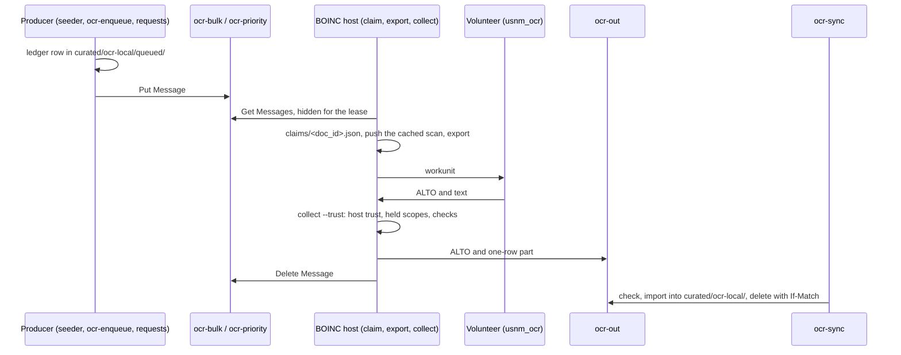
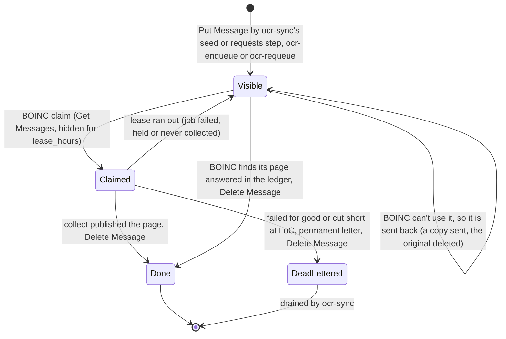
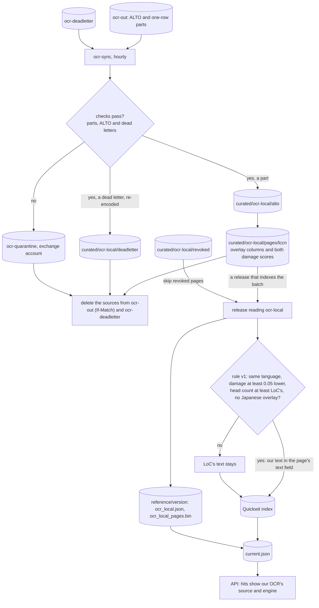

# 12: On-prem OCR Pipeline

**Status (10 November 2026):** OCR runs only through BOINC ([BOINC pages](../boinc/README.md)). The direct queue worker is retired (#966, #1053): its unit, installers, nightly update and `engine-spike.sh` are removed, and nodes 3 and 4 were backed up and destroyed on 24 October 2026, their Arc machines deleted (#966). Steps 2 to 10 and 12 are built, Step 11's pilot ran without its report; the pickup, seeder and release run on-prem; Step 14 is not built. ADR-0015 and ADR-0016 are Proposed. · **Issue:** [#296](https://github.com/tgoodyear/usnewsmap.com/issues/296) · **Runbook:** [On-prem OCR](../operations/onprem-ocr.md) · **Code:** `infra/modules/ocr-exchange.bicep`, `infra/modules/ocr-sync-runner.bicep`, `crates/usnm-ocr-local/`, `crates/usnm-ocr-contract/`, `crates/usnm-ocr-worker/` (scan fetching and engine code), `crates/usnm-boinc/`, `crates/usnm-overlay/`, `crates/usnm-alto/`, `crates/usnm-core/src/damage/`, `ocr/engines/tesseract/`

## 12.1 Purpose and scope

LoC's OCR misreads whole groups of pages, and search can't find a misread word. The [language report](../reports/2026-10-language-analysis/report.md) scored a 10% sample of `pages-v20261003-1` (2,371,337 pages from 2,989 batches) by damage: the share of occurrences of a language's 20 most common words read one edit wrong. A page above 0.25 is badly damaged. The worst groups are German before the 1920s (57,580 sampled pages, about 580,000 in the index), five English batches with median damage 0.46 to 0.52, and the Serbian, Russian and Czech titles ([ADR-0015](adr/0015-onprem-ocr-workers.md)). Azure compute or a cloud OCR service would cost more than the monthly budget, so BOINC hosts, volunteers' and our own, read them again (#296). This document covers queueing a page, reading it, checking the result and putting it into search.

How a page goes through (10 November 2026):

1. A producer (the seeder, `ocr-enqueue`, or the requests step for pages users find) writes a ledger row in `curated/ocr-local/queued/`, then a message on `ocr-bulk` or `ocr-priority` in the exchange account.
2. The BOINC batch controller claims the message for a lease, pushes the page's cached scan through the hand-off and submits a `usnm_ocr` workunit ([queue-fed work](../boinc/server/batch-scheduler.md#queue-fed-work)).
3. `collect --trust` checks the returned result against the host-trust list and writes the ALTO and a one-row part to `ocr-out` (no runs record), then deletes the message ([gold check, host trust](../boinc/server/gold-check.md#host-trust-for-usnm_ocr)).
4. `ocr-sync`, hourly on an on-prem host, checks each part and imports it into `curated/ocr-local/` (Step 8).
5. A full rebuild with `--ocr-local` replaces LoC's text where rule v1 prefers ours (Step 9).

- **Page ids.** Queue messages, `ocr-out` names and `ocr-local` rows carry LoC page keys (`lccn/date/ed-N/seq-N`) and bare LoC doc_ids, which [ADR-0026](adr/0026-source-qualified-page-ids.md) reads as source `loc`. Pages from other sources (`ghn:` pages, §12.2.4) have no route into these queues.
- **Naming (#309).** Script-owned groups are `usnm-ocr-nodes-grp-<env>`; nodes were `usnm-ocr-node<digits>-arcs-<env>`, at most 32 characters ([operator runbook](../../infra/README.md#naming-guard-and-phase-12-rollout)). The exchange account keeps its prod name: renaming it means inventorying its live queues, blobs and OCR and BOINC users and agreeing a window to drain, copy and reconfigure.
- **Engines** are in [ADR-0016](adr/0016-pluggable-ocr-engines.md) and [13: OCR engines](13-ocr-engines.md). Production reads Latin-script pages with Tesseract 5.5 (`usnm_ocr`) and Japanese pages with NDLOCR-Lite (`usnm_ndlocr`, which collects into `ocr-ja`, not this pipeline).
- **The Japanese OCR job** (`ocr/ja-ocr/jaocr.py`, 04 §4.8, writing `curated/ocr-ja/`) is separate; the release reads both overlays (Step 9).
- **Languages:** §12.4.
- **Priorities.** Search latency and running cost first, ingest and rebuild speed second: no required step adds a clause to every search or a field to the index (Step 14, which would, waits for a benchmark).

## 12.2 As built

State on `main` and in prod on 10 November 2026. Settings are from [`infra/env/prod.json`](../../infra/env/prod.json); the main environment has no VNet (`USNM_CAE_VNET` false) and no Container Apps ingest jobs (`USNM_INGEST_JOBS` false).

| Component                                                                                                                                                                                                                                 | State                                                                                                                                                                                                                   | Where                                                                                                                    |
| ----------------------------------------------------------------------------------------------------------------------------------------------------------------------------------------------------------------------------------------- | ----------------------------------------------------------------------------------------------------------------------------------------------------------------------------------------------------------------------- | ------------------------------------------------------------------------------------------------------------------------ |
| Exchange account `stusnmo<suffix>`: StorageV2, LRS, Hot, shared keys off, public network access behind a firewall (default Deny, no trusted-service bypass) allowing `USNM_OCR_NODE_IPS`, the BOINC subnet and, with the VNet, `snet-cae` | In prod as `stusnmoffapzy` (`USNM_OCR_NODES` on). Turning `USNM_OCR_NODES` off deletes it, so it stays on while BOINC runs ([runbook](../operations/onprem-ocr.md#exchange-account-and-nodes-group))                    | `infra/modules/ocr-exchange.bicep`, `infra/main.bicep`                                                                   |
| Queues `ocr-priority`, `ocr-bulk`, `ocr-deadletter`; containers `ocr-out` and `ocr-quarantine` (blobs deleted 30 days after last change), `boinc-handoff`                                                                                 | In prod                                                                                                                                                                                                                 | `infra/modules/ocr-exchange.bicep`                                                                                       |
| BOINC queue identities (the on-prem BOINC host, and the hand-off job where one exists): Message Processor and Message Sender on the work queues, Message Sender on `ocr-deadletter` (#1154), the node writer role on `ocr-out`            | In prod; the hand-off steps run on the BOINC host since 6 November 2026 ([hand-off steps on-prem](../boinc/server/onprem.md#hand-off-steps-on-prem))                                                                    | `infra/modules/ocr-exchange.bicep` (`handoffQueueIds`), `infra/modules/boinc-handoff-runner.bicep`                       |
| The pickup's identity: the on-prem batch host's Arc machine identity                                                                                                                                                                      | In prod (`USNM_OCR_SYNC_ONPREM`, #917)                                                                                                                                                                                  | `infra/modules/ocr-sync-runner.bicep`                                                                                    |
| Node roles through `usnm-ocr-nodes-grp-<env>`: Message Processor on the work queues, Message Sender on `ocr-deadletter`, Queue Data Reader on the three queues, the writer role on `ocr-out` (read and write, no delete)                  | Still granted; no node runs the worker (#966)                                                                                                                                                                           | `infra/modules/ocr-exchange.bicep`, `scripts/ocr-node/group.sh`                                                          |
| `usnm-ocr-worker`: the retired queue loop (`run`), the scan fetcher, scan server and archive, `bulk-ocr`, `loc-text`, GHN commands, `publish-fetched`, engine code, `routes check`, `engines conformance`                                 | The `ocr-worker-*` release still ships it for the scan archive, scan-fetch and dashboard hosts; `usnm-boinc` builds its engine code in                                                                                  | `crates/usnm-ocr-worker/`                                                                                                |
| Queue clients for Azure Storage and for PostgreSQL with pgmq; work message and dead letter v2; bounded ALTO check                                                                                                                         | Both clients built (#335, #342, #967, #972). Producers and the claim step still use Azure; the dashboard reads the pgmq queues, which stay empty ([14, Current evidence](14-corpus-data-flow.md#current-evidence))      | `crates/usnm-store/src/queue.rs`, `crates/usnm-store/src/pgmq.rs`, `crates/usnm-ocr-contract/`, `crates/usnm-alto/`      |
| Damage metric v2 and full damage pass (Steps 4 to 6)                                                                                                                                                                                      | Built (#315, #332, #337); the pass runs on-prem (`USNM_OCR_DAMAGE_ONPREM`)                                                                                                                                              | `crates/usnm-core/src/lang.rs`, `crates/usnm-core/src/damage/`, `crates/usnm-ocr-local/src/ocr_damage.rs`                |
| `ocr-sync`, the seeder and the requests step (Steps 8, 10, 12)                                                                                                                                                                            | Built; seeding on with plan `fetched-eng-20261106` (English, fetched source, budget 36,000, window 2,000, refill below 1,500)                                                                                           | `crates/usnm-ocr-local/`                                                                                                 |
| Release reading `ocr-local` (Step 9)                                                                                                                                                                                                      | On (`USNM_OCR_LOCAL`); on-prem full rebuilds pass `--ocr-local`. On 10 November 2026 `/v1/status` listed 21,290 pages of our OCR: 20,652 `tesseract/5.5.0 frak2021`, 636 `tesseract/5.5.0 eng`, 2 `tesseract/5.5.0 fra` | `crates/usnm-ingest/src/release.rs`, `scripts/onprem/release.sh`                                                         |
| One searched text field (#285)                                                                                                                                                                                                            | On in prod (`USNM_SINGLE_TEXT_FIELD`)                                                                                                                                                                                   | `crates/usnm-ingest/src/release.rs`, `crates/usnm-ingest/src/release/document.rs`, `crates/usnm-core/src/text_layout.rs` |
| Daily copy of `curated/ocr-local/` to on-prem storage                                                                                                                                                                                     | On (`USNM_OCR_LOCAL_COPY`, #1409)                                                                                                                                                                                       | `scripts/onprem/ocr-local-copy/`, `infra/modules/ocr-local-copy.bicep`                                                   |
| Engine survey, round 1                                                                                                                                                                                                                    | Report merged (#370)                                                                                                                                                                                                    | [`docs/reports/2026-10-ocr-engine-survey/`](../reports/2026-10-ocr-engine-survey/report.md)                              |

### 12.2.1 The nodes

Retired (#966). Nodes 1 and 2 ran from 10 October 2026 and were replaced on 12 October by RHEL 10.2 nodes 3 and 4 running `ocr-worker-20261012-75fab3f`. Node 4 was off from 16 October and node 3 from 18 October (#833); both were backed up and destroyed on 24 October 2026 and their Arc machines deleted (#966). Their CPU went to the BOINC pool. Hosts were VMs with UEFI Secure Boot and a vTPM, key-only SSH and AlmaLinux 9 or RHEL 10, provisioned outside this repository.

### 12.2.2 How the worker handles a page

The worker's queue loop is retired (#966). It took `ocr-priority` before `ocr-bulk`, hid each message for a fixed 1800 s (Message Processor has no Update Message, so no renewal), and abandoned a page at 1440 s or 60 s after SIGTERM. The scan fetcher still uses its LoC client (§12.2.4, LoC client rules). These rules still apply to the queues, `ocr-out` and the pickup:

- **Dead letters.** A failed message check (only the kind kept, never content), a permanent LoC answer or a page that fails for good on BOINC dead-letters a page. `v: 2` (#335) has `cause` (`dequeue_count`, `invalid`, `permanent`, `unroutable`), `kind` for `invalid`, and `error` cut to 200 characters. BOINC's `dead-letter` step writes `permanent` letters for failed and cut-short pages ([a page that fails for good](../boinc/server/batch-scheduler.md#a-page-that-fails-for-good)).
- **Output names.** Create-only `alto/<doc_id>.<node>.<stamp>.xml`, the runs record `runs/<lccn>_<date>_ed-<n>.<node>.<stamp>.parquet` (#307, 13 §13.8.3), then `pages/<lccn>_<date>_ed-<n>.<node>.<stamp>.parquet`, one row in the overlay schema. BOINC's `collect` writes the ALTO and part with `<node>` = `boinc-<first 12 hex digits of the job id>` and no runs record (`crates/usnm-boinc/src/lib.rs`). `ocr_source` names the engine (`usnm-tesseract`); `loc_text` holds the queue reason (`bulk` or `user`).
- **No search text in messages.** Unknown fields are refused and every field has a fixed format; only the pickup identity enqueues. `batch` is a LoC base batch name (#317, #335): 1 to 128 ASCII characters from `[A-Za-z0-9_]`, a 2 to 10 lowercase-letter awardee prefix before the first `_`, a nonempty rest, no trailing `_verNN`. Capitals (`curiv_joshuaTree`, `lu_Cypher`, `me_Bissonnette`, `vi_White`, `wvu_Quote`) are part of the identifier, and spelling is case-sensitive everywhere. `language` is an ISO 639-3 code `usnm_core::lang` knows. Oversized damage-table, summary and seed-rank filenames are split into a batch segment and a versioned filename to stay within the object store's 128-byte segment limit. The seeder, `ocr-enqueue`, `ocr-sync` and the BOINC claim share this check; prefetch manifests, fetched lists and v1 dead letters keep their older, looser shape within the same alphabet and bound. Telemetry carries page ids, queues, languages and outcomes, never message bodies, search text or tokens.

### 12.2.3 Text that disagrees with the code

Checked on 10 November 2026:

- ADR-0015 and ADR-0016 are "Proposed", though built and deployed (the maintainer's call).
- A comment in `infra/modules/ocr-exchange.bicep` says a message seen five times goes to `ocr-deadletter`; the retired worker dead-lettered on the 6th receive, and BOINC claims count leases, not receives.
- 04 §4.7 and 08 §8.4.1 say compaction runs monthly. Nothing in this repository schedules a full rebuild: prod rebuilds are started by hand on-prem ([full rebuild](../operations/rebuild-and-index-storage.md#full-rebuild)).

### 12.2.4 Scans fetched ahead of the workers (#368)

The damaged pages' scans are fetched once onto the lab's ZFS pool, so every engine reads the same local scan and LoC serves each image once ([ADR-0015](adr/0015-onprem-ocr-workers.md) decision 9). BOINC volunteers never fetch from LoC: the hand-off pushes the cached scan to the project server ([scan-cache hand-off](../boinc/server/scan-cache-handoff.md)). The [worker README](../../crates/usnm-ocr-worker/README.md#prefetching-scans) has the commands and flag defaults.

- **Manifest.** `usnm-ingest ocr-prefetch-manifest --version <index version> [--partial] [--min-damage 0.25] [--exchange-url <ocr-out URL>]` reads the damage tables (Step 6) and writes `audit/damage/v2/prefetch/<version>/manifest.parquet` and `summary.json` in the curated store: pages above 0.25 in issue order, one copy each (the copy the version keeps, else the batch that sorts first), with doc_id, batch, lccn, date, edition, seq, detected language, decision, damage rate and the issue's loc.gov item URL. The summary counts pages by language, decade, batch, and language by decade. `--partial` reads batches whose tables exist before the version's list does, into `partial-<stamp>/`. `--exchange-url` copies both to `ocr-out/manifests/<version>/`, which `ocr-sync` doesn't read and the lifecycle rule deletes after 30 days. Curated rows have no image URL (curation drops the reel the IIIF id needs), so the fetcher resolves each page through its batch.
- **Getting it to the lab.** `scripts/ocr-node/pull-manifest.sh --scan-server http://<scan server>:8380`, as root on an Arc host whose identity can read `ocr-out`, checks the manifest's sha256 against the summary and PUTs both to the scan server (`/tank/ocr/manifests/<version>/`). Infrastructure tooling provisions the scan and manifest directories. Scans are read over HTTP, not NFS, so a blocked hypervisor mount can't strand a reader.
- **The scan server.** `usnm-ocr-worker serve-scans` (unit `usnm-scanserve.service`, port 8380): `GET /scans/<set>/<batch>/<lccn>/<date>/<ed>/<seq>.<jp2|jpg>` (`image/jp2` or `image/jpeg`) and its `.json` sidecar; `PUT /manifests/<version>/{manifest.parquet,summary.json}`; `GET /index/full.jsonl`, one sidecar per fetched scan in landing order. No scan is deleted since 8 November 2026: a `DELETE` gets 405, and `<scan>.done` markers from earlier buffer deletes still stop a re-fetch (a buffer scan listed in the index before that date may be gone). It serves only configured hosts (names re-resolved every 5 minutes; the container's nftables drops the port from outside its LAN subnet), over plain HTTP, trusted for integrity on the LAN (the maintainer's decision): the scans are LoC's public images and the checks catch a damaged or mismatched scan, not a forgery that rewrites both scan and sidecar. One JSON log line per request (method, path, status, peer).
- **The scan archive (#442, ADR-0018).** `usnm-ocr-worker archive-scans` copies the keep set to a Cold-tier, write-once Azure container, checked against each sidecar, as the off-site copy. The buffer set isn't archived.
- **The fetcher.** `usnm-ocr-worker prefetch` in `usnm-scanfetch` (infrastructure tooling): an unprivileged Debian 12 container with no Azure credentials, `tank/ocr/scans` and `manifests/` bind-mounted read-write, uid 2000 (host 102000), unit `usnm-scanfetch.service`. It runs 16 pages in flight, with `--loc-in-flight` keeping LoC's servers at 4. A lock file allows one fetching process. A run starts from the last run's buffer count when under a day old, leaving a tenth of the cap free; the buffer walk (about ten minutes) runs alongside and replaces that count. It stops after 20 pages from at least 3 titles fail in a row (`--max-failures-in-a-row`, `--stop-min-titles`).
- **LoC client rules** (#335, #523). A 429, 503 or 403 holds every request to that server (loc.gov API, image server or storage service) for `Retry-After`, or 60 s times the attempt number if longer or absent, at most an hour; a longer `Retry-After` is cut to the hour and counted in `ocr.loc_slowdowns` with `capped=true`. A 408 is retried; any other 4xx is permanent. Routes set `LocConfig::html_is_block`, since none expects HTML: a 2xx HTML answer (or `cf-mitigated: challenge`) or an unreadable body fails at once as transient and holds that server for the configured backoff (60 s by default) or a longer `Retry-After` (capped at an hour), without retrying or passing the answer to OCR. A failed item-health probe can't treat a challenge as a working item, and a probe's challenge also stops the original fetch and keeps its requested hold. `ocr.loc_slowdowns` labels holds `reason=html_challenge`, `unreadable_body` or `http_status`, with `status`, `server`, `retry_after` and `capped` attributes. No block is bypassed.
- **The batch route (#368).** Each full-size page is the original JP2 from its batch, not the IIIF JPEG. Batches are BagIt bags on tile.loc.gov's storage service (`https://tile.loc.gov/storage-services/service/ndnp/<inst>/batch_<batch>_ver<NN>/`; `chroniclingamerica.loc.gov/data/batches/<batch>_ver<NN>/` 308-redirects there, followed only onto the storage service). Per batch the fetcher reads `manifest-md5.txt` once and keeps it, with the batch's URL, under `/tank/ocr/manifests/batches/<batch>_ver<NN>/` (`--batch-cache`). Per issue it reads the METS (`<YYYYMMDD><EE>.xml`, about 16 KB, or the signed `_1.xml` if that's all the bag has), checks the bag's md5 and keeps it under `mets/<lccn>/`. Each `np:page` div in the METS structMap has a MODS `start` (the seq) and a `service` file `./<frame>.jp2`, since JP2s are named by reel frame. A JP2 failing the bag's md5 fails as transient. The IIIF base is the JP2's storage path with `/` as `:`, as the item API gives, so it stays the page's id. `--resolution scaled:<n>` uses the same lookup, then the IIIF `pct:<n>` JPEG. Only a page the route can't place (no such batch, issue or METS not in the bag, no JP2 for the seq, or a 404 for a listed JP2) uses the item API and IIIF JPEG; a hold, 403 or failure on the storage service never does, so nothing goes round a block. Status counts `fetched_jp2` and `fetched_item_api`.
  - **Pacing.** Storage requests 1 s apart (`--storage-gap-ms`), API 5 s (`--api-gap-ms`). LoC publishes 150 a minute each for image and storage services with a 1-hour block past it, but not whether they are counted together, so by default they share one pacer at the longer gap and a hold on either holds both; `--storage-own-budget` separates them.
  - **The global budget (#962).** The host's whole LoC budget is 20 requests a minute for storage and image services together (the maintainer's decision of 2 November 2026, after LoC sent challenge pages at about 27 a minute; LoC's published limits at loc.gov/apis/json-and-yaml/working-within-limits are 150 a minute for `/storage-services/`, 150 for Image Services and 20 for the JSON API, each with a one-hour block, and LoC may block lower under load). OCR scans, the quality pass, the bulk OCR archives and any loc.gov API request through it all count. `--loc-global-pacer <file>` (`USNM_LOC_GLOBAL_PACER`) makes every request also wait for a slot in a state file under `flock`, so the fetcher, `bulk-ocr` and `usnm-boinc`'s stages (when the variable is set; `--gap-secs` floor 3 s instead of 5) share one rate. At most 4 requests to LoC's own servers per process are in flight (`--loc-in-flight`, `USNM_PREFETCH_LOC_IN_FLIGHT`, 1 to 16; the bucket isn't counted), since bursts can trip the challenge system. A 429, 403 or challenge page holds the whole budget past the block (`Retry-After`, or an hour) and drops it to 12 a minute for every process for 24 hours from the last push-back (logged at start and lift); `usnm-ocr-worker loc-pacer --file <file> --reset` lifts it sooner. A file slowed before this rule has no end time and stays slow until reset. A 503 holds only its server. The fetcher runs OCR's manifests first and the quality pass's in one-hour slices after, so the quality pass takes what is left. The JSON API gap (5 s) and the title sync's 3.5 s stay under the API's 20 a minute.
  - **Mirrors.** `--mirrors nbu,pst,oru,scu,wayback` (`USNM_PREFETCH_MIRRORS`; none by default) asks copies of LoC's files for a page's JP2 before LoC. LoC's bag manifest and METS still place the page, and only bytes matching the bag's md5 are taken.
    - **State partners.** Four awardees serve their batches' JP2s byte for byte with Chronicling America's software: Nebraska (`nbu`, nebnewspapers.unl.edu, about 583,000 of LoC's pages), Pennsylvania (`pst`, panewsarchive.psu.edu, about 363,000), Oregon (`oru`, oregonnews.uoregon.edu, about 327,000) and South Carolina (`scu`, historicnewspapers.sc.edu, about 306,000, all English): about 6.6% of the corpus. Each is asked only for its own batches, at `/lccn/<lccn>/<date>/ed-<n>/seq-<n>.jp2`. A partner may hold more pages than LoC lists, so where its page JSON names the file (its IIIF id; South Carolina's doesn't), it must be LoC's, or the partner isn't asked.
    - **Wayback Machine.** Archive Team's crawl has a few percent of each batch's storage-service JP2s. One CDX lookup per issue (shared by pages asked at once; a failed lookup isn't kept) lists captures, read as captured (`/web/<timestamp>id_/<url>`), largest first, since some were cut short. Save Page Now is never used: it would make the Internet Archive fetch from LoC.
    - **Pacing.** One request at a time per mirror, at least 5 s after the last ended (`--partner-gap-ms`, `--wayback-gap-ms`), outside the LoC budget. A page waits at most 30 s for its turn, then goes to LoC. A 429 or 503 holds the mirror for `Retry-After` (1 minute to 1 hour); a 403, challenge or HTML for an hour; a held mirror is skipped and never holds LoC. Redirects only within the mirror's host, at most two, each paced. Wayback CDX lookups get 60 s, partners 30 s; a Wayback timeout or connection error holds nothing (a miss, counted as `errors`), and a 503 without `Retry-After` holds 15 s (with one, 15 s to an hour). A partner's timeout or error holds it a minute.
    - **Records and limits.** The sidecar is as for LoC's JP2 (LoC's URL, IIIF base, md5), so downstream reads it unchanged; `sources-<res>.jsonl` records each mirrored page's source (doc_id, mirror, URL, md5, bytes, time), and status counts `fetched_mirror` and per-mirror requests, hits, misses, seq drift, md5 mismatches, skips and holds. A mirror's page neither ends a failure run nor clears an issue's cool-off, and a page the batch route can't place still uses the item API.
    - Not used: Georgia's site (JP2s behind a bot challenge) and Digital Commonwealth (robots rules allow only a lossy JPEG).
  - **No LoC for some manifests.** `--no-loc-prefixes <prefixes>` (`USNM_PREFETCH_NO_LOC_PREFIXES`, comma-separated; none by default): manifests in directories with a listed prefix take JP2s only from the bucket or a mirror. A page neither has, one its batch can't place, and any scaled page are deferred: nothing goes to LoC's storage service, item API or IIIF, it counts in `finished` and `deferred_needs_loc` (status `no_loc`), and it isn't a failure, a cool-off or part of a run of failures; a later run without the prefix takes it. Batch manifests and METS still come from LoC when the bucket can't serve them. OCR's manifests (`queue-ocr-*`) always go to LoC, and since 2 November 2026 the quality pass's (`queue-quality-*`) aren't listed either.
  - **LoC's bucket.** `--loc-bucket https://ndnp-batches.s3.amazonaws.com/` (`USNM_PREFETCH_LOC_BUCKET`; off by default) reads batches LoC's S3 bucket `ndnp-batches` holds from it (us-east-1, anonymous GET and HEAD, not behind Cloudflare). The maintainer allowed it "for everything" on those batches, at a slow pace.
    - **Contents.** Keys drop the awardee and `batch_`: `…/ndnp/<aw>/batch_<b>_ver<NN>/<path>` is `<b>_ver<NN>/<path>`. On 24 October 2026 1,074 of 3,010 batches were public, 9,095,045 of 23,847,619 pages (38.1%); the other 1,936 answered 403. Objects carry `x-amz-meta-md5` (for a single-part upload the ETag is the md5 too).
    - **Use.** For a batch whose manifest isn't on disk, the bucket is asked first, then for METS and full-size JP2s (before any mirror), each checked against the bag's md5. A manifest is taken only if its body matches `x-amz-meta-md5` or, without it, a single-part ETag (32 hex digits, no `-`); otherwise it is refused (`no_md5`). The first answer decides whether a batch is public or private (a 403, or a 404 for the manifest) for the life of the process; after that a 403 or 404 is a miss for that file only. A 403, 404, mismatch, hold or busy bucket sends the request to LoC.
    - **Guessed URLs.** A batch with a `url` file from LoC never uses a guess. Otherwise a bucket manifest's LoC URL is guessed from the batch name (`<aw>/batch_<b>_ver<NN>/`) into `url.guessed`, used only while the bucket is on. When LoC answers 404 under a guess, the fetcher asks Chronicling America's redirect where the batch is (one request on the storage service's pacer, at most hourly per batch), keeps that in `url` and retries before the item API; the IIIF base and the sidecar's URL are then the redirect target's. A METS or JP2 LoC serves under the guess with a matching md5 confirms it; a right guess is then dropped and a wrong one kept as `url.wrong`. Pages LoC was never asked for keep the guess in their sidecar. Only a JP2 under a confirmed URL seeds the storage service's known-good item.
    - **Pacing.** At least 2 s between starts by default (`--loc-bucket-gap-ms`, at least 1 s); `--loc-bucket-concurrency N` (1 to 16, `USNM_PREFETCH_LOC_BUCKET_CONCURRENCY`) runs up to N at once. None of it counts in LoC's budget. `--loc-bucket` takes only an `amazonaws.com` host, so the bucket's client can't be sent to a LoC host. A request waits at most 30 s for its turn, then goes to LoC. A 429 or 503 (SlowDown) holds the bucket for `Retry-After` (1 minute to 1 hour); a challenge, HTML or any redirect (none is followed) for an hour; a 5xx, timeout, network error or unreadable body for a minute. A 403 holds nothing, since it only means the batch is private. A held bucket is skipped, and nothing it answers holds or slows LoC.
    - **Records.** As for a mirror, with `ndnp-batches` in `sources-<res>.jsonl`; status counts `fetched_bucket` and, under `bucket`, requests; manifests, METS and JP2s taken; public and private batches seen; misses; md5 mismatches; manifests refused for want of an md5; skips and holds.
  - **Bulk OCR (#962).** `usnm-ocr-worker bulk-ocr --out <dir> --loc-global-pacer <file>` fetches Chronicling America's per-batch OCR archives (`ocr.txt` and ALTO with word confidence; 3,011 archives, 2.47 TB, with sizes and sha256 in LoC's datasets table) one at a time, at least 60 s apart (LoC: "10 bulk requests within 10 minutes" per IP), checks size and sha256, and stops starting archives after `--max-hours` (default 20; LoC may stop programs running past 24 hours).
  - **Fetching outside content (#1413).** `bulk-ocr` downloads through `usnm_ocr_worker::fetcher`; #1413 moves every outside download onto it. A job names a file, its size and SHA-256, its destination and sources in preference order. A host policy (`crates/usnm-ocr-worker/policies/<name>.toml`, or `--policies <dir>`) sets rate, concurrency, byte cap, retries and push-back; a URL or redirect hop no policy covers is refused, and a redirect can't leave its policy. LoC's policy holds the limits above, shares the state file, and is tested against the scan fetcher's pacer constants. State goes through the `Budget` and `JobStore` traits (`FileBudgets`, `FileJobs`). A policy is refused for an unknown key, two policies on one host, a zero rate, a slow rate above the normal rate, `slow_for_secs` without a slow rate, `default_hold_secs` of zero or above `max_hold_secs`, or a push-back status outside 400 to 599; a slow rate without `slow_for_secs` lasts until `loc-pacer --reset`. `disallow_paths` and `allow_paths` use `robots.txt` patterns (prefix, `*`, final `$`) on every URL and hop; a matching disallow always wins, an allow list admits only allowed paths without a query, and a redirect the policy won't follow is push-back. A job with no SHA-256 treats its size as a ceiling, doesn't resume, reports the SHA-256 received and replaces any existing copy. Planned: a daily byte budget (#1415), state in Postgres, the fetcher as its own CI-built service off the scan-fetch host, then the queue command, alerts and scan prefetch.
  - **A mirror for the archives (#1413).** `bulk-ocr --mirror-url <base> --mirror-manifest <file> --state <dir>` tries the mirror, then LoC, always checking LoC's SHA-256. An archive the mirror lacks or lists with another hash goes in `<state>/held-back.tsv` (`absent-from-mirror`, `sha256-differs`) and comes from LoC, or waits under `--mirror-only`. Transfers resume from `<state>/part`, keep to the policy's byte cap (`--rate-bytes-per-sec` or `<state>/rate-bytes-per-sec` can only lower it; it halves if the API slows), and stop at three verification failures in `<state>/checksum-failures.tsv`, which a restart also refuses. A slowed LoC budget stops only jobs that need LoC.
  - **Georgia Historic Newspapers (#1193).** The maintainer's decision of 1 November 2026: GHN's IIIF page images and our own OCR, starting with public-domain pages to 1930 on titles we lack, once the queue and native OCR (#1418, #1415) can carry them; never GHN's search JSON, its OCR or anything its `robots.txt` disallows. The `ghn` policy covers the site and its image server (untested against GHN): 6 requests a minute, 10 s apart, one transfer at a time, at most 2 MB/s, 2 a minute for a day after a push-back, `robots.txt`'s rules, and only `newspapers.json`, `/lccn/*.json` and full-size `default.jpg`; page HTML and JP2 links redirect to a Turnstile challenge, which is push-back and never followed.
    - `usnm-ocr-worker ghn-catalog --cache <dir> --ours batches.json --out <dir> [--rights <tsv>] [--fetch-metadata --pacer <file>]` is a dry run over GHN's newspapers list and title collections (cached, or fetched under the byte cap, one run at a time on a cache, kept only once they parse). It marks titles `selected`, `ours` (a batch of ours lists the LCCN), `elsewhere` (the Wiregrass Farmer, `sn90052158`, from LoC's API text, #1419), `none-in-range` or `no-metadata`, and writes `titles.tsv`, `issues.tsv` (selected issues to `--through`, at most 1930-12-31) and `summary.json`. With DLG's rights list (refused if it gives an issue two statements) only NoC-US issues are listed; otherwise each is `unchecked`.
    - `usnm-ocr-worker ghn-fetch --issues issues.tsv --out <dir> --pacer <file>` takes each issue's manifest, then its pages' `<service>/full/full/0/default.jpg` (8 MiB and 64 MiB ceilings), through an engine holding only the `ghn` policy; a lock beside the pacer file lets one GHN run transfer at a time. A page lands at `<out>/pages/<lccn>/<year>/<doc_id>.jpg` once it decodes as a whole JPEG (anything else is removed and left to do), with a sidecar `<doc_id>.json`: its `ghn:` page id (ADR-0026), image and manifest URLs, the manifest's SHA-256, the image's size and SHA-256, and its rights basis. It refuses `unchecked` issues without `--unchecked-rights`, issues after 1930 and the Wiregrass Farmer. Neither command enqueues OCR. Not run against GHN yet: DLG's rights list, a page-level duplicate check against Chronicling America and an OCR comparison sample come first.
  - **LoC's page text for pages a bulk archive lacks (#1419).** The Wiregrass (`sn90052158`) has 10,904 pages listed in `gu_allmanbrothers_ver01` against 7,923 curated, and the batch's archive, which matches its published SHA-256, has none of it. `usnm-ocr-worker loc-text enqueue --out <dir> --batch <batch>_ver<NN> [--lccn <lccn>] --bag-manifest <manifest-md5.txt> --counts <curated counts.json> [--datasets <datasets.json>] [--dry-run]` plans the missing title-days into `<dir>/queue.json` (asking LoC nothing, except `--fetch-manifest`, one request in the budget and never on a dry run). `loc-text run --out <dir> --loc-global-pacer <file>` fetches item JSON and `fulltext_service` text through the fetcher under LoC's policy and global budget, refusing a text URL on a host the policy doesn't cover, 60 s apart unless `--gap-secs` (at least 5 s). A push-back slows the budget for every process and ends the run; a run doesn't start while it is slowed. Answers go to `responses/` and `items/`, then the record to `pages/<doc_id>.json` (`ocr_source = "loc-api-fulltext"`, not `ndnp-original`), written last so a rerun skips pages that have one ([worker README](../../crates/usnm-ocr-worker/README.md#locs-text-for-pages-a-bulk-archive-lacks)). Reading them into curation or search, as a source-qualified overlay like `ocr-ja/` (04 §4.8), and any gap under the policy's 60 s are the maintainer's decision.
  - **Item errors on the storage service.** The #414 rule (below) applies to a METS or JP2 only on a second fast, bare 503 for the same file after the first held as usual, since 503s under load look the same there. A batch manifest's 503 always holds. Cool-offs are per route (`storage:<issue>` in `item-errors.json`), so an issue whose item JSON failed still comes through its batch.
  - **The JP2s.** Lossy (9/7 wavelet, 25 quality layers), 8-bit greyscale, about 400 dpi, the IIIF JPEG's pixel size and about 13% smaller; the JPEG re-encodes the JP2, the best LoC publishes (no TIFFs). Tesseract reads JP2 through Leptonica and OpenJPEG (about 20 s more per page; `--dpi 300` either way). The engine contract's decode step (13 §13.4) uses the Rust `image` crate, which doesn't read JP2, so it needs OpenJPEG or a PNG conversion first.
- **Item errors (#414).** Some items answer 503 at once, for hours, while loc.gov works (all of `sn83045081`, 30 July to 11 August 1904, on 12 October 2026). An item JSON 503 is an item error, holding nothing, only when it came within 2 s with no `Retry-After`, another item answered 2xx in the last minute or does when asked now (the last item that answered, from the index after a restart), and fewer than 3 titles had item errors in the last 30 minutes. Anything else holds: a 429, 403, `Retry-After`, slow 503, any image-server 503, a known-good item failing too, or a third title's item errors. The issue's pages are skipped for `--item-cooloff-secs` (a day), each logged as `loc_item_error`, and retried after, in the same run (state `cooling`) or the next; after `--item-max-cooloffs` (3) the issue is permanent. `item-errors.json` keeps cool-offs across restarts.
- **Layout.** `/tank/ocr/scans/<set>/<batch>/<lccn>/<date>/<edition>/<seq>.jp2` (batch route), `<seq>.jpg` (IIIF JPEG: about 6,000 early keep-set scans and item-API pages), `<seq>.pct<n>.jpg` (scaled), each with a sidecar `<file>.json`: doc_id, batch, URL fetched, IIIF base, resolution, fetch and request time, bytes, sha256, User-Agent, `format` (`jpeg` or `jp2`; absent means JPEG) and, for a JP2, the bag's `md5`. Fetches go in `index-<res>.jsonl`, failures in `failures-<res>.jsonl`, and `status-<res>.json` is rewritten every 100 pages and 30 s. A scan counts once its sidecar is written. A run skips scans in either format whose size, sha256 and md5 (where recorded) match their sidecar, so a JPEG already there isn't fetched again as a JP2, and a run can stop and restart against a newer manifest.
- **Cut short at LoC (#1457).** Some of LoC's JP2s end before their codestream does (a box or tile-part past the end of the file, or no EOC marker) yet match the bag's md5. After checksums pass, the fetcher reads the headers (`usnm_ocr_contract::jp2::truncation`). A truncated scan isn't written, indexed or seeded; it is a `source_truncated` failure and a line of `source-truncated.jsonl` (doc_id, batch and version, LoC URL, md5, sha256, bytes, reason, time), the list to report to LoC. Status counts `source_truncated`, and later runs don't ask LoC for that batch version of the page again. A BOINC worker reading one cached before this check fails the page `permanent` without trying the JPEG, and the page keeps LoC's text ([quality on BOINC](../boinc/apps/quality.md#undecodable-source-scans)).
- **Two sets.** The first manifest for `pages-v20261010-2` lists 1,922,826 pages, 1,733,773 English, far more than `tank` holds at about 5 MB a scan.
  - The **keep set**, every page not detected as English plus the worst English batches, kept for good under `scans/keep/`.
  - The **buffer set**, the rest of English, under `scans/buffer/`, capped by `--buffer-cap` (default 1 TB, recounted every minute; an uncountable buffer counts as full). No scan is deleted (since 8 November 2026): the fetcher waits at the cap until the cap is raised or scans move to kept storage. Before that, a buffer scan was deleted once its output was uploaded, leaving `<scan>.done` (ADR-0015 decision 9).
  - `--resolution` and `--buffer-resolution` set each set's resolution; `--sets keep|buffer|both` picks sets.
- **Order and budget.** Keep pages first, by default: German before the 1920s, the worst English batches, Czech, Serbian, Russian, the rest, each issue in its best page's group, in issue order; then buffer pages in issue order. `--max-total-bytes` stops once this run's scans reach a budget.
- **Provenance.** The overlay's `image_url` is always the IIIF base, and the ALTO's `sourceImageInformation` holds the URL of the file read and a `fileIdentifier` with its sha256, plus the bag's md5 for a JP2 (ADR-0015 decision 9).
- **Size.** `prefetch --sample N` and `prefetch-estimate` project a manifest's size and fetch time ([worker README](../../crates/usnm-ocr-worker/README.md#prefetching-scans); numbers on #368).

### 12.2.5 The LAN dashboard

A read-only page of the pipeline's local side, `usnm-ocrdash` (`crates/usnm-ocr-dash/`), on an access-controlled internal endpoint. It shows doc_ids, counts, sizes, times and engine tags, never page text, and has no Azure credentials. DNS, TLS, mounts and containers are infrastructure concerns; the [application runbook](../operations/onprem-ocr.md#the-ocr-dashboard-on-the-lan-296) covers the API and evidence contract.

- **Sources.** Nothing is asked of the fetcher or scan server. The container bind-mounts `tank/ocr/scans` and `tank/ocr/manifests` read-only at the same paths and reads `status-full.json`, `index-full.jsonl` (as it grows), `failures-full.jsonl` and the manifest the status names. After a start it reads the whole fetch index and decodes every queued manifest (about six and a half minutes with 1,983 manifests, #1436) with its lock released, answering from what is read so far. Until then, and while a new plan or replaced index is reread, `warming` says how far it has got (null after), the page shows a "Reading the fetcher's files" panel, `queue_error` says queue totals omit unread manifests, and `GET /readyz` on the LAN listener answers 503 `warming` (200 `ready` after); `/healthz` answers 200 `ok` throughout. Hypervisor stats come from a root timer on each host writing a small JSON every minute: one file is bind-mounted read-only, and the second lab host PUTs its own to `/api/host/pve`, accepted only from that host's address. Schemas are in `usnm_ocr_contract::status`. The workers' status ports (8381, polled every 15 s) went with the worker (#966).
- **Network.** HTTPS on 443 with the configured hostname's certificate from a read-only bind mount, reread on `systemctl reload`; port 80 redirects to it except the stats push (`PUT /api/host/pve`), which stays plain HTTP. Without TLS settings it is plain HTTP on 80. It answers only `--allow` (`lan` by default, the container's subnet, read at start and every five minutes; host names are accepted and re-resolved on the same schedule), and the container's nftables input policy drops everything from outside that subnet.
- **Public view.** `--public-listen` / `USNM_OCRDASH_PUBLIC_LISTEN` (off unless set) serves a redacted page for a Cloudflare Tunnel to publish as ocr.usnewsmap.com without login: plain HTTP (the tunnel terminates TLS), no `--allow` check, so bind it to loopback or an address only cloudflared reaches. Only GET and HEAD of `/`, `/healthz`, `/api/view.json`, `/api/pipeline.json` and `/api/fetch.json`; other routes 404, other methods 405. Redaction happens before rendering (`usnm_ocr_dash::public`): no workbook link; hosts as "scan server" and "lab host N"; guests as "container N" or "VM N"; workers as "OCR node N" without addresses, routes or scan cache; manifests without paths; no fetcher output path or pid, seed plan or Serial Set unit; and paths, lab host names, container numbers and IP addresses replaced in free text. Responses carry `Cache-Control: public, max-age=60` (LAN: `no-store`). A test renders a realistic fixture through it and fails if any of those appear.
- **Step throughput (#704).** Hourly counts per step from the fetch index and from `scripts/ocr-node/throughput-collect.py`, which runs on the hosts holding the controller's and shippers' journals and the BOINC database and PUTs aggregates to `/api/throughput/<source>` (each source only from its own address, not on the public listener). The dashboard never connects to the BOINC server. It keeps two weeks; an unobserved hour stays unknown, a counted zero is zero.
- **Panels.** _Pool and hosts_ (`tank`'s health, capacity, fragmentation, scrub and errors; `tank/ocr` against its quota with used, logical and compression figures for `scans` and `text`; hosts' CPU, memory, load and uptime; the `usnm-` guests). _Scan downloads_ (fetcher state; pages and bytes per set and group; hourly and daily rates, holds and failures; estimated finish per group and for the keep set; pages given up for good, pages skipped while their issue cools off (`loc_item_error`), and the latest failures; holds shorter than the status file's 30 s rewrite can be missed). _What's next_ (next keep-set pages not yet OCRed and next to fetch; a JSON `--seed-plan` shown as is). _What's been OCRed_ (latest pages and counts by language and engine; `ocr-sync` imports via the `batch` throughput collector; damage against LoC is in the curated store, which nothing on the LAN reads). _Queues_ (counts from the PostgreSQL pgmq queues through the `dash_reader` role, `--queue-url`, without reading or taking messages; they read zero while producers and the claim step use the Azure queues ([14, Current evidence](14-corpus-data-flow.md#current-evidence)); the Azure queue depths are in `reference/status/ocr-local.json`).

## 12.3 Diagrams

### 12.3.1 System overview

Three trust boundaries: what BOINC volunteers return is untrusted until host trust and `collect` have checked it; the exchange account is a public endpoint whose firewall allows `USNM_OCR_NODE_IPS` (the lab's public IP) and, where set, the BOINC and Container Apps subnets; in prod the data lake's OCR paths are written by on-prem identities (the batch and BOINC hosts, and the serving API for `ocr-requests`), each within its grant.

```mermaid
flowchart TB
  subgraph VOL["Boundary 1, volunteers: results untrusted"]
    CLIENT["BOINC clients<br/>usnm_ocr (Tesseract)"]
  end

  LOC["Library of Congress<br/>tile.loc.gov, loc.gov"]

  subgraph LAB["On-prem hosts, each with its own Arc identity"]
    FETCH["scan fetcher and scan server<br/>usnm-ocr-worker prefetch, serve-scans"]
    BOINC["BOINC server, controller and<br/>hand-off steps (claim, export, collect --trust)"]
    BATCH["batch host: ocr-sync hourly,<br/>seeder, ocr-enqueue, ocr-damage"]
    REL["release host: full rebuild<br/>with --ocr-local"]
  end

  subgraph AZ["Azure rg-usnm-prod"]
    subgraph EXCH["Boundary 2, exchange account stusnmoffapzy: firewall"]
      WQ[("ocr-priority, ocr-bulk")]
      QD[("ocr-deadletter")]
      OUT[("ocr-out")]
      QUA[("ocr-quarantine")]
      HO[("boinc-handoff")]
    end
    subgraph LAKE["Boundary 3, data lake"]
      CUR[("curated")]
      REF[("reference")]
      REQ[("ocr-requests")]
    end
    MON["Application Insights"]
  end

  SERVE["on-prem serving API"]

  FETCH -->|"paced, one global budget"| LOC
  FETCH -->|"push a cached scan"| HO
  FETCH -->|"fetched-scans list"| OUT
  BOINC -->|"claim, send back, delete"| WQ
  BOINC -->|"permanent letters"| QD
  BOINC <-->|"jobs and results"| HO
  BOINC <-->|"workunits"| CLIENT
  BOINC -->|"ALTO and part"| OUT
  BATCH -->|"seed and requests"| WQ
  BATCH -->|"drain"| QD
  BATCH -->|"read, check, delete"| OUT
  BATCH -->|"rejects"| QUA
  BATCH -->|"ledger, ocr-local"| CUR
  BATCH -->|"status/ocr-local.json"| REF
  BATCH -->|"read and empty day files"| REQ
  BATCH -->|"metrics"| MON
  SERVE -->|"page ids by day"| REQ
  REL -->|"read ocr-local"| CUR
```

What each identity can do:

| Identity                                                                         | Runs                                                        | Can                                                                                                                                                                                                                                                                                                                         | Can't                                                                                                        |
| -------------------------------------------------------------------------------- | ----------------------------------------------------------- | --------------------------------------------------------------------------------------------------------------------------------------------------------------------------------------------------------------------------------------------------------------------------------------------------------------------------- | ------------------------------------------------------------------------------------------------------------ |
| The on-prem BOINC host's Arc identity (and the hand-off job's, where one exists) | `usnm-boinc` claim, export, collect, dead-letter            | Message Processor and Message Sender on `ocr-priority` and `ocr-bulk`; Message Sender on `ocr-deadletter`; the node writer role on `ocr-out` (read, create, overwrite; no delete); write `boinc-handoff`; Cosmos `ops`, the ledger writer on `curated`, read `reference` (`infra/modules/boinc-handoff-runner.bicep`)       | Update Message; delete `ocr-out` blobs                                                                       |
| The batch host's Arc identity                                                    | `ocr-sync`, `ocr-seed`, `ocr-enqueue`, `ocr-requeue`        | Lake role on `curated` (writes only under `ocr-local/`), `reference` (only `status/ocr-local.json`) and `ocr-requests`; read, write and delete on `ocr-out` and `ocr-quarantine`; Message Processor on `ocr-deadletter`; Message Sender and Queue Data Reader on the three queues; Cosmos `ops`; Metrics Publisher; AcrPull | Delete lake blobs                                                                                            |
| The scan fetcher's Arc identity                                                  | `push-boinc-scan.sh`, `publish-fetched`, `pull-manifest.sh` | Write `boinc-handoff`; the node writer role on `ocr-out` for the fetched-scans list (#1056)                                                                                                                                                                                                                                 | Any queue                                                                                                    |
| A node's Arc identity, through `usnm-ocr-nodes-grp-<env>`                        | Nothing since #966                                          | Take, peek and delete on the work queues; add to `ocr-deadletter`; read queue lengths; read, create and overwrite blobs in `ocr-out`; telemetry to the nodes' Application Insights component                                                                                                                                | Add to the work queues; delete blobs; reach the lake, Cosmos or the index                                    |
| `id-usnm-ingest`                                                                 | Container Apps ingest jobs, where `USNM_INGEST_JOBS` is on  | Queue Data Contributor on the exchange account; Blob Data Contributor on `ocr-out`, `ocr-quarantine` and the lake's containers; Cosmos Data Contributor; Monitoring Metrics Publisher; AcrPull                                                                                                                              | Nothing in prod runs as it for OCR                                                                           |
| The operator                                                                     | A workstation, `az` sign-in                                 | Owner on the subscription (provision needs it); owner of `usnm-ocr-nodes-grp-<env>`                                                                                                                                                                                                                                         | No data role on the exchange account, so enqueueing from a workstation is refused; as Owner, could grant one |

### 12.3.2 Page lifecycle

A result from a held scope (German and Serbian while their trust is calibrated, [German note](../notes/2026-11-05-german-trust-hold.md), [Serbian note](../notes/2026-11-07-serbian-trust-hold.md)) is kept unpublished and its message returns after the lease. A page that fails for good gets a `permanent` dead letter, which `ocr-sync` drains.

### 12.3.3 Queue message states

The claim hides a message for `lease_hours` (96 for bulk by default, 36 suggested for `ocr-priority`), with the pop receipt in `boinc-handoff/claims/`; `collect` deletes the message after it writes the page to `ocr-out` ([queue-fed work](../boinc/server/batch-scheduler.md#queue-fed-work)). The claiming identity has Message Sender so it can put an unusable message back, and no Update Message.

### 12.3.4 Result pickup and release

All on `main` (Steps 8 and 9: #342, #344, #346, #347) and in production.

### 12.3.5 Node onboarding

Retired with the worker (#966). `group.sh`, `onboard.sh`, `node-setup.sh` and `offboard.sh` stay in `scripts/ocr-node/` for a new Arc host; the [runbook](../operations/onprem-ocr.md#on-prem-ocr-nodes) has the commands. Onboarding used a throwaway service principal with a 2-hour secret and only Azure Connected Machine Onboarding on `rg-usnm-<env>`, which `onboard.sh` deleted and purged from Entra on exit, also on failure.

## 12.4 Languages

Rust wherever practical (ADR-0004; the maintainer's request of 10 October 2026).

| Component                                                                                                                                                                                                              | Language                                                                                              | Why                                                                                                                                                                                                                                                             |
| ---------------------------------------------------------------------------------------------------------------------------------------------------------------------------------------------------------------------- | ----------------------------------------------------------------------------------------------------- | --------------------------------------------------------------------------------------------------------------------------------------------------------------------------------------------------------------------------------------------------------------- |
| BOINC worker and hand-off steps (`usnm-boinc`, `usnm_ocr`), scan fetcher and scan server (`usnm-ocr-worker`)                                                                                                           | Rust                                                                                                  | ADR-0015 decision 6: shares `PageKey`, the overlay types and the Entra credential code with ingest                                                                                                                                                              |
| Engine adapters                                                                                                                                                                                                        | Rust for CLI and HTTP engines; thin Python inside the container for Python-library engines (13 §13.2) | Imported once behind the contract                                                                                                                                                                                                                               |
| ALTO checks (`usnm-alto`), damage metric v2 (`usnm-core`, feature `damage`), full damage pass (`usnm-ingest ocr-damage`), `ocr-sync`, queue clients (`usnm-store`), seeder, release support, page capture (`usnm-api`) | Rust                                                                                                  | Untrusted bytes parsed in one bounded reader; scoring millions of pages in process (the Python audit drops its per-page table above 3,000,000 rows); one Entra-only queue client; shared `PageKey`, `usnm-overlay`, the Cosmos lock and the search log's writer |
| Word lists                                                                                                                                                                                                             | Data, exported once with wordfreq 3.1.1's Python API                                                  | wordfreq's API is the reference for `quality.py`'s words and order (as `scripts/data/build-english-words.py` does); nothing in the pipeline runs it; a Rust exporter is open question 5                                                                         |
| Parity fixture (`ocr/ja-ocr/damage_parity.py`)                                                                                                                                                                         | Python, one-off                                                                                       | `quality.py`'s v2 code is what the port is checked against                                                                                                                                                                                                      |
| Node and hand-off scripts                                                                                                                                                                                              | Bash, named flags only                                                                                | Operator tooling                                                                                                                                                                                                                                                |
| Infrastructure, alerts, CI                                                                                                                                                                                             | Bicep with KQL; GitHub Actions YAML                                                                   |                                                                                                                                                                                                                                                                 |
| `ocr/ja-ocr/quality.py`, `jaocr.py`, `american_stories_write.py`                                                                                                                                                       | Python                                                                                                | Parity reference and exploration; the recurring audit and the American Stories import (which writes `curated/american-stories/`) move to Rust later (Step 15)                                                                                                   |

## 12.5 Next steps

### The chosen design

One Rust job, `ocr-sync`, picks output up, checks and scores it into `curated/ocr-local/`, drains dead letters, seeds `ocr-bulk` and queues pages users find (Steps 8, 10, 12). The damage metric is in Rust and scores every page's LoC text once per curated batch version (Steps 4 to 6). The release replaces LoC's text in place where the damage rule prefers ours, through #203's hook, so there is no new searched field or hidden-copy clause and no latency change (timing: Step 9, open question 1; Step 14 is the optional delta #296 asked for). Provenance goes in a compact per-version file the API loads, not `ja_latin.json` (Step 9). The API captures pages users find at day level and never touches the exchange account (Step 12). BOINC reads the queues in place of the retired worker (#966).

Each step was one pull request unless it says ops; S, M and L are one place, a few files, or several crates.

| Step | Change                                                          | Size | Language                     | After                     | State on 10 November 2026                                                                                                    |
| ---- | --------------------------------------------------------------- | ---- | ---------------------------- | ------------------------- | ---------------------------------------------------------------------------------------------------------------------------- |
| 0    | Merge #303; node 1 to the TPM key store once Azure allows it    | S    | Bash (existing scripts)      |                           | #303 merged; the TPM move ended with the nodes (#966)                                                                        |
| 1    | Docs catch-up                                                   | S    | Markdown                     |                           | Partly done; what is left is in §12.2.3                                                                                      |
| 2    | Worker build, install script and unit                           | M    | Rust, YAML, Bash             | 0                         | Built (#317, #341); unit and installers removed (#1053); the release still ships                                             |
| 3    | Node monitoring                                                 | M    | Bicep, Bash, KQL             | 0                         | Built (#304, #318, #348); no worker sends to it                                                                              |
| 4    | Language codes and word lists                                   | M    | Rust; one-off Python export  |                           | Built (#315)                                                                                                                 |
| 5    | Damage metric v2 in Rust                                        | L    | Rust; one-off Python fixture | 4                         | Built (#332)                                                                                                                 |
| 6    | Full damage pass and parity gate                                | M    | Rust                         | 5                         | Built (#337); full pass in prod 11 October 2026; runs on-prem (`USNM_OCR_DAMAGE_ONPREM`); no parity gate result recorded     |
| 7    | Shared queue client, contract checks, worker fixes              | M    | Rust                         | 3, 4                      | Built (#335)                                                                                                                 |
| 8    | `ocr-sync`: pickup, checks, dead letters, ledger, scheduled job | L    | Rust, Bicep                  | 6, 7                      | Built (#342, #344); runs on-prem hourly (#917)                                                                               |
| 9    | Release reads `ocr-local`; provenance file                      | L    | Rust, Bicep                  | 8                         | Built (#346, #347); on in prod                                                                                               |
| 10   | Seeder                                                          | M    | Rust, Bicep                  | 6, 8                      | Built (#345); on in prod                                                                                                     |
| 11   | Pilot                                                           | S    | Ops and a draft report       | 2, 3, 8, 9, 10, an engine | German pilot on Tesseract `frak2021` from 11 October 2026 on the nodes, then on BOINC; no pilot report under `docs/reports/` |
| 12   | Pages users find                                                | M    | Rust, Bicep                  | 11                        | Built (#538); the on-prem API writes requests in prod when the conditions in `scripts/onprem/serving/gen-env.sh` hold        |
| 13   | Node 2                                                          | S    | Ops                          | 11                        | Done 11 October 2026; retired                                                                                                |
| 14   | Optional: replacement delta for published batches               | L    | Rust                         | 11 and a benchmark        | Not built; only if full rebuilds prove too slow                                                                              |
| 15   | Follow-up issues                                                |      |                              |                           | Not filed                                                                                                                    |

Outside these steps: the scan prefetch (#368, §12.2.4), with a provenance amendment to ADR-0015, and the engine contract and other engines (ADR-0016, #307) where the survey shows another engine clearly wins.

### Step 0: Merge #303; node 1 to the TPM key store once Azure allows it (ops, S)

Merged in #303. The TPM move waited for the `Microsoft.HybridCompute/HybridComputePreview` feature, Pending since 10 October 2026, and ended with the nodes (#966). `USNM_OCR_NODE_NAMES` is no longer in `infra/env/prod.json`.

### Step 1: Docs catch-up (S)

What is left is in §12.2.3: ADR-0015 and ADR-0016 to Accepted (the maintainer's decision), the "five times" comment in `ocr-exchange.bicep`, and the monthly compaction in 04 §4.7 and 08 §8.4.1.

### Step 2: Worker build, install script and unit (M)

Built in #317 and #341; the node install and unit are removed (#1053). Still live: CI's `ocr-worker-el9` (`cargo build --release --locked -p usnm-ocr-worker` in AlmaLinux 9, failing on any `GLIBC_` symbol newer than 2.34), `ocr-worker-check` (AlmaLinux 10: builds the Tesseract image and reads a line through it with podman) and `ocr-worker-release` (on `main`: attests the binary, image archive, its id and `SHA256SUMS` as `ocr-worker-<yyyymmdd>-<sha7>`; needs `contents: write`, `id-token: write`, `attestations: write`, the workflow default staying `contents: read`). It releases for `main`'s head, or an older commit when none newer changes the worker or dashboard build (`head-of-main.sh --unless-changed ocr_worker,ocr_dash`, #1074). The scan archive, scan-fetch and dashboard hosts install from it, checked with `gh attestation verify` and sha256 ([publication catch-up](../operations/onprem-ocr.md#worker-publication-catch-up)).

The engine image is `ocr/engines/tesseract/`: Debian's Tesseract 5.5.0 (`5.5.0-1+b1`) on a snapshot base pinned in `base.lock`, with the models in `models.lock` (tessdata_best, UB Mannheim's `frak2021` and others; 13 §13.7.2), run by digest. A batch ending in `_verNN` is refused, since the release would skip it silently. The BOINC worker image builds on this engine image ([worker image](../boinc/apps/worker-image.md)).

### Step 3: Node monitoring (M)

Built in #304 for the nodes (`infra/modules/ocr-node-monitoring.bicep`, with `USNM_OCR_NODES` on); since #966 no worker sends to it.

- **Workspace.** `usnm-ocr-log-<env>` with its own daily cap (0.1 GB) and Application Insights `usnm-ocr-appi-<env>`, local auth off (`OCR_NODE_APPINSIGHTS`). The nodes' group has Monitoring Metrics Publisher there only (`principalType: 'Group'`), nothing on `appi-usnm-<env>`: that role grants `Metrics/Write` and `Telemetry/Write` on a whole component and ingestion has no IP firewall, so a node token could fake `usnm-api` rows (read by `api-alerts.bicep` as `AppRoleName == "usnm-api"`) or fill prod's 1 GB cap. The exchange account's `StorageQueueLogs` are off, so they don't fill the cap the BOINC feed alerts share (#1441).
- **Collection.** Rule `usnm-ocr-dcr-<env>` (`OCR_NODE_DCR_ID`): counters every 60 s; syslog `auth`, `authpriv`, `daemon`, `kern`, `cron`, `syslog` and `user` at Warning and above; `local0` at Info; VM insights' `\VmInsights\DetailedMetrics` into `InsightsMetrics` (#348). `onboard.sh` installs AzureMonitorLinuxAgent and the association; `offboard.sh` deletes the association first. Workbook #318.
- **Alerts.** Per-node log volume and the cap (#304), LoC holds (#335). ADR-0015 decision 2 still needs the one-extension amendment.
- **Onboarding role.** Azure Connected Machine Onboarding can add extensions to any Arc machine in the resource group and create or delete its data collection rule associations, so a secret copied during onboarding could remove other machines' monitoring for up to 2 hours (open question 6).

### Step 4: Language codes and word lists (M)

Built in #315.

- **Codes.** `usnm_core::lang` maps the catalog's MARC codes (`ger`, `cze`, `srp`), ISO 639-3 (`deu`, `ces`, `srp`: queue messages and engine routing) and wordfreq's codes, copying `quality.py`'s `WORDFREQ` table exactly (`hrv` and `srp` are both `sh`, `nor` is `nb`, `tgl` is `fil`) and its own lists for Hawaiian and Yiddish, and covers every catalog language (with no word list where `quality.py` has none). A test parses `quality.py`'s tables so the two can't drift.
- **Word lists.** Each wordfreq language's 5,000 most frequent words from wordfreq 3.1.1 (pinned in `ocr/ja-ocr/requirements.txt`), written by `scripts/data/build-damage-words.py --out-dir <dir> [--check]` under `crates/usnm-core/data/damage-words/`. Cherokee, Hawaiian and Yiddish come from `ocr/ja-ocr/wordlists/`; Cherokee also has an unranked list of exact forms attested in both NT editions, which only prevents false near-miss flags and doesn't affect detection or frequency scores. Licences are in `crates/usnm-core/data/README.md`: wordfreq's data is CC BY-SA 4.0 plus the Google Books Ngram terms, as are `english-words.txt` and `english-shared-words.txt`; Cherokee (both CC0), `haw.txt` (CC0) and `yi.txt` (CC BY-SA 4.0) keep theirs. The crate's licence metadata notes the data files.
- **Verify.** `--check` reproduces the committed word lists; every `WORDFREQ` code has a list; round-trip tests for the code map.
- **Feature.** Cargo feature `damage` holds the lists and metric, so the API binary doesn't embed them, as long as the API and ingest images build their crates separately with `-p`.

### Step 5: Damage metric v2 in Rust (L)

Built in #332.

- **Port.** `usnm_core::damage` ports `score_v2`: tokenizing (dehyphenation, word extraction, NFC with combining marks stripped, Yiddish ligatures, full case folding, the rmgarbage flags with the syllabic-consonant exception), the models (top 100 function words, top 20 head words, top 5,000 real words plus the Cherokee NT forms, near-misses one OCR edit from a head word) and detection (title languages plus English, minimum share, lead over the runner-up, 50-word windows for mixed pages, other scripts, Serbian Cyrillic scored in Latin letters). It returns `lang`, `decision`, `mixed_with`, `script`, `function_share`, `damage_rate`, `garbage_share`, `words`, `head` and `near`. `DAMAGED` 0.1, `BADLY_DAMAGED` 0.25, `VERSION` 2. A forced-language score (`quality.py`'s `damage()`, as the survey's `score.py` calls it) serves callers that know the page's language but not the title's (13 §13.4.7); its tables are keyed by ISO 639-3 against `quality.py`'s MARC codes, so the fixture holds both.
- **Python side.** The v2 code (`text_words`, `token_info`, `garbage`, `build_model`, `Damage`, `detect`, `score_v2`, helpers) is in `ocr/ja-ocr/damage_v2.py`, which `quality.py` imports, so parity pins that file. `ocr/ja-ocr/damage_parity.py` adds `jaocr.py damage-parity --pages 400`.
- **Parity fixture.** `jaocr.py damage-parity` samples 400 pages across languages, decisions and scripts from the 10% audit's per-page CSV, and writes `curated/audit/damage-parity/<stamp>.jsonl.zst` (doc_id, text, title languages, `score_v2`'s output, and `detect()`'s `lang.damage.head`, `near`, `function` and `words`; header with `damage_v2.py`'s sha256), logging doc_ids and languages, never text. `usnm-ingest ocr-damage --parity <file>` scores it in Rust and prints counts and up to 50 differing doc_ids. CI uses `crates/usnm-core/tests/data/damage-parity.jsonl.zst`, built locally by `python3 ocr/ja-ocr/damage_parity.py --pages-from <file> --out <path>`: 66 pages of loc.gov text from 33 titles in 25 catalog languages plus 17 synthetic pages for the traps below; `--rescore` rescores it after a change to `damage_v2.py`. Both checks require the same language and decision, equal head, near, function-word and word counts, and rates within 1e-9; the Rust test fails if `damage_v2.py`'s sha256 differs from the header.
- **Known traps.** Python's `casefold` maps ß to "ss"; `str.isalpha` and Python's Unicode `\w` differ from Rust's `char::is_alphabetic` and the regex crate's `\w` on combining marks; `str.split()` splits on `\x1c` to `\x1f`, which `split_whitespace` doesn't.
- **Verify.** `cargo test -p usnm-core --features damage` and clippy in CI.

### Step 6: Full damage pass and parity gate (M)

Built in #337 (`crates/usnm-ocr-local/src/ocr_damage.rs`). [Operations](../operations/japanese-ocr.md#ocr-damage-tables-296) has the commands, including the on-prem run (`USNM_OCR_DAMAGE_ONPREM`).

- **Command.** `usnm-ingest ocr-damage --version <index_version> [--batches <list>] [--sample-pct <n>] [--compare-csv <path>] [--parity <path>] [--max-runtime-secs <s>]`. It scores every page's LoC text against its title's languages plus English. Tables are keyed by curation, not index version: `curated/audit/damage/v<VERSION>/<batch>_ver<NN>.parquet` per base batch and curated version (doc_id, lccn, date, edition, seq, base batch, batch_version, text_status, lang, decision, damage_rate, function_share, garbage_share, words, head, near, `mixed_with`, `script`), with a summary per (batch, lccn) written after the table, which marks the batch version done. `curated/audit/damage/v<VERSION>/versions/<index_version>.json` lists an index version's files; the seeder and `ocr-sync` read it. A batch version already scored at this metric version is skipped.
- **Sampling.** `--sample-pct` uses `quality.py`'s sampler: BLAKE2b with an 8-byte digest of the doc_id, read big-endian, mod 10,000, below round(pct × 100), over every curated row of the version's `batches.json`, duplicate copies included.
- **Gate before any seeding.** On `pages-v20261003-1` with `--sample-pct 10 --compare-csv audit/ocr-quality-v2-pages-v20261003-1-10pct-pages.csv.gz`, joined on doc_id and batch over the CSV's 2,368,911 rows (2,371,337 sampled less the 2,426 Japanese-title pages the audit doesn't score): at least 99.99% agree on language and decision, and `damage_rate`, `function_share` and `garbage_share` equal the CSV's after formatting Rust's value as `{:.4}` with trailing zeros trimmed. The CSV has no head or near counts; Step 5's pages check those. No gate result is recorded.
- **Full pass.** Over `pages-v20261010-2` in prod on 11 October 2026: about 24 million pages in 3,010 batches, about 930 pages a second (the 10% Python run took 5,725 s).

### Step 7: Shared queue client, contract checks and worker fixes (M)

Built in #335; #342 then moved the message and dead letter into `usnm-ocr-contract`. `AzureQueue` and `LocalQueue` are in `usnm-store` (Entra only, no SAS, no redirects), with the approximate message count from Get Queue Metadata, which Storage Queue Data Contributor allows (#345); `PgmqQueue` (#972) implements the same trait for PostgreSQL. Messages take only ISO 639-3 codes `usnm_core::lang` knows and a base-batch-shaped `batch`; `ocr-sync`'s check 5 confirms the batch is published. `unroutable` dead letters (a page moved off a work queue after its defer budget while its engines were down, 13 §13.7.6) are accepted and requeued by the seeder, though no current consumer writes them.

### Step 8: `ocr-sync`: pickup, checks, dead letters, ledger, scheduled job (L)

Built in #342 (shared pieces) and #344 (the job; `crates/usnm-ocr-local/src/`). The work message and dead letter live in `usnm-ocr-contract` (13 §13.2), with #338's rules (a `permanent` or `unroutable` dead letter keeps its message; engine ids follow 13 §13.8.1). `usnm-store` gained `list_info`, `get_if_match` and `delete_if_match`.

- **Commands.** `usnm-ingest ocr-sync --queue-url --out-url [--max-parts <n>] [--report] [--from-quarantine --reason <r>]`; `ocr-enqueue --pages <doc_ids> --reason bulk|user [--plan --batch --dry-run]`, which queues chosen pages with a ledger row each; `ocr-requeue --cause <cause> [--kind <kind>] [--since <date>] [--plan --max-pages --dry-run]`. Only the pickup identity can enqueue, so they run on the batch host ([runbook](../operations/onprem-ocr.md#ocr-pickup-ocr-sync-296)). All three take the Cosmos lock `State::lock("ocr-sync")`, so runs never import twice and nothing queues while the seeder counts; the BOINC claim takes the same lock. `--report` picks nothing up and applies rule v1 to stored scores.
- **Checks**, on each `pages/*.parquet`, oldest and cheapest first, each failure with a reason code:
  1. The name matches the output pattern and the listed size is within limits before download (part and runs record 1 MiB each, ALTO 32 MiB).
  2. `usnm-overlay`'s strict `read_node_part` succeeds: exactly the 16 columns by name, type and order, no nulls except `text`, every field returned (`image_url`, `text_chars`, `text_sha256` included; `read_part` accepts extra columns and nulls and returns none of these three), rows and declared decompressed sizes capped before decoding; `doc_id` matches its `PageKey`; one row, its issue matching the name; `alto/<doc_id>.<node>.<stamp>.xml` exists (paired through `doc_id`).
  3. Its `doc_id` is outstanding in the ledger with the same base batch and reason.
  4. `text_sha256` and `text_chars` match; text at most 512 KiB with no control characters but newline and tab.
  5. `ocr_source` is on the engine list with no `image=local`; `loc_text` is `bulk` or `user`; the batch is in the published version; the title is catalogued and not Japanese; `image_url` is on `tile.loc.gov`.
  6. The ALTO is well-formed XML with no DOCTYPE, within depth and element limits, in an ALTO namespace, with a `Page` that has `WIDTH` and `HEIGHT` (`usnm-alto`'s bounded reader).
  7. The runs record (13 §13.8.3), listed after `pages/` and `alto/`, passes the strict reader with the part's `run_id`, `doc_id` and node, and its selected row's `ocr_engine` equals the part's; else `runs_too_large`, `runs_unreadable`, `runs_mismatch` or `runs_engine`, quarantined (kind `runs`) with the part and ALTO. A part with no runs record (BOINC's `collect` writes none) is still imported.

  `ocred_at` is the blob's server creation time, not the writer's clock.

- **Scores.** Ours against the title's languages plus English with `usnm_core::damage`; LoC's lang, damage_rate and head from Step 6's tables, or from curated text for batches they lack.
- **Ledger.** Create-only `curated/ocr-local/queued/<day>/<run>.parquet` (doc_id, base batch, batch_version, reason, language, plan, attempt, queued_at), written by `ocr-enqueue`, the seeder and the requests step. Outcomes in `curated/ocr-local/outcomes/<day>/<run>.parquet`: `imported`, `dead_lettered` (with cause and kind), `not_sent`. A page is outstanding while its latest row has no later outcome, or its latest outcome is an `unroutable` dead letter.
- **Writes.** At most `--max-parts` (2,000) per run in imports of `--chunk` (200), each complete on its own, so a stopped run loses at most one import. (1) ALTO to `curated/ocr-local/alto/<doc_id>.<node>.<stamp>.xml` and the runs record to `curated/ocr-local/runs/<lccn>_<date>_ed-<n>.<node>.<stamp>.parquet` with `ocred_at`. (2) One merged create-only part per title, `curated/ocr-local/pages/<lccn>/<stamp>.parquet`: the 16 overlay columns plus `batch_version`, `source_part`, `node`, `reason`, `metric_version` and, for both texts, `lang`, `decision`, `damage_rate`, `function_share` and `head`. (3) A run record `curated/ocr-local/import/<stamp>.json`. (4) Delete each source from `ocr-out` with If-Match on the ETag read. Writers can overwrite blobs, so only checked bytes are written and no source is read twice; sources a stopped run left are found in its run record and deleted without reimport.
- **Merged schema v2 (#1162).** New `ocr-local/pages` parts declare Arrow metadata `usnm.ocr_local.schema_version=2` and a non-null `ocr_reason` (`bulk` or `user`), the canonical queue reason; `loc_text` and `reason` stay as equal, deprecated aliases. Parts without the metadata (or version `1`) are read only through matching, valid legacy aliases; v2 requires all three to agree. Unknown versions, missing v2 fields, unversioned new fields, nulls and conflicting or unknown labels fail both score and text reads. Historical parts aren't rewritten; exchange parts keep the strict 16-column schema; `ocr-ja` is unchanged. Use `text` for our OCR and the curated LoC page's `text` for LoC's, never a reason alias.
- **Rejects** go to `ocr-quarantine` (exchange account, 30-day lifecycle) as `rejects/<run>/<source path>` with a content-free `.reason.json` (an oversized source gets the record only). `--from-quarantine` replays a part with its `companions` (ALTO, runs record) as a group: contents read first, companions restored before the part, the part's entries removed first, so a stopped replay never leaves a part without its runs record. If a companion can't be restored (gone, or never kept, as for `runs_too_large`), the group stays (`incomplete`). Pre-`companions` records replay one by one, ALTO and runs records first.
- **Dead letters** are untrusted: any identity with Message Sender on `ocr-deadletter` can put any message up to 64 KiB. Each is parsed with the dead-letter schema (v1 or v2, unknown fields refused, size-capped; `from` is `ocr-priority` or `ocr-bulk`; `message` null or passing `OcrMessage::validate`; known `cause` and `kind`; `error` at most 200 characters, no control characters; `message_id`, `dequeue_count`, `node` and `at` in format). Valid ones are re-encoded to `curated/ocr-local/deadletter/<day>/<stamp>.jsonl`, the rest quarantined with a reason code; then each is deleted.
- **Status and metrics.** `reference/status/ocr-local.json` (imported, rejected by reason, dead letters by cause and kind, queue depths); `ocr_sync.parts` by outcome and reason, `ocr.out.oldest_age_s`, `ocr.out.parts_left` (#1139).
- **Where it runs.** On-prem since #917 (`USNM_OCR_SYNC_ONPREM`): a timer on the batch host runs `usnm-ingest ocr-sync --max-runtime-secs 3000` hourly at minute 17 as that host's Arc identity, with grants in `infra/modules/ocr-sync-runner.bicep` and three log alerts in `infra/modules/ocr-sync-alerts.bicep` (`USNM_OCR_SYNC_ALERTS`). The Container Apps job `usnm-ocrs-caj-<env>` needs `USNM_OCR_NODES` and the ingest jobs on; prod has no ingest jobs.
- **Tests.** A fixture per reject reason; a run stopped between steps; cargo-fuzz targets for `read_node_part`, the ALTO checks and the dead-letter parser (#343).

### Step 9: Release reads `ocr-local`; provenance file (L)

Built in #346 and #347: `crates/usnm-ocr-local/src/`, `crates/usnm-ingest/src/release.rs`, `crates/usnm-ingest/src/release/parts.rs`, `crates/usnm-state/src/ocr_local.rs`, `crates/usnm-api/src/refdata.rs`.

- **Setting.** `--ocr-local` on `release` and `run`; `USNM_OCR_LOCAL` (on in prod) adds it. `scripts/onprem/release.sh` passes it on every on-prem full rebuild.
- **Loading.** List `ocr-local/pages/` once. As the release reaches a batch it loads that batch's titles' parts (`ocr-local/pages/<lccn>/`), as it reads American Stories' text, so memory holds one batch's titles (`ocr_ja::load` holds the whole overlay, which wouldn't fit in 8 GiB). A row applies only to the copy the duplicate plan keeps (`dedup.keeps`), as #203's text does. Revoked rows are left out first, so another reading can still win; then the row with the lowest stored `damage_rate` (ties: newest) is chosen before any text is read. Its text is normalized again for its engine and language (`usnm_core::text::normalize_ocr_for`, with `Hyphenation::for_page` on the row's `ocr_engine` and the language its stored scores found), so later normalization rules (line-end `⸗`, `¬`, `‐` and `—`, #1065, #1130) apply without rewriting parts; a German page read with a non-Fraktur model gets the em-dash rule this way. A row with no detected language (`und`, too few words, or another metric version's scores) is normalized for its engine alone. Normalizing is idempotent.
- **Rule v1.** `ocr_local::rule` (`VERSION` 1, `MARGIN` 0.05, `HEAD_TEST`, recorded in `ocr_local.json`). The release scores LoC's text and the chosen row's re-normalized text again; it doesn't trust stored scores. Ours replaces LoC's when both are decided in the same language (or LoC's is `und` or empty and ours is decided in one of the title's languages, or in English when the title lists none), our damage rate is at least 0.05 lower (exactly 0.05 passes), and our head count is at least LoC's (equal passes). The head test stops a short output that looks clean from winning on its rate. Constants are provisional. `ocr-sync --report` applies the rule to stored scores without the title-language test.
- **Where.** `build_index`'s replacement hook from #203, only for pages of batches this release indexes; published indexes can't change, so our text for already-published batches goes live at the next full rebuild. The Japanese overlay wins when a page has both.
- **Revocations.** Create-only `curated/ocr-local/revoked/<stamp>.json` with `reason`, `reference` and at least one of `node`, `engine` (full tag or short key), `run` (the `ocr-sync` import run, the merged part's stem), `from` and `to` (on `ocred_at`); every field given must match. A file the release can't read stops the release.
- **Records.** `{version}/ocr_local.json`: the rule, the metric, a parts summary (count, bytes, sha256 of the sorted path list), sorted `inputs` (relative path, bytes and SHA-256 of each distinct part decoded in this run, not carried-forward pages), revocations applied, pages carried, dropped and added, and pages considered, replaced and kept by reason (`japanese_ocr`, `revoked`, …), language and engine. The manifest hashes this receipt; its `built_from.ocr_local` holds only the summary. The per-batch input digest is logged and compared at finish; a part changed across batches or replay stops the release. `{version}/ocr_local_pages.bin` (`usnm_state::ocr_local`): sorted 64-bit doc_id hashes, each with an engine index (into a table of each engine's `ocr_source` and `OcrEngineTag` short key, `<family>/<version> <profile>`, 13 §13.8.1) and a u16 index into the version's `batches.json` for the copy holding our text, about 11 bytes a page. A delta carries it forward whether or not the flag is set. When a later batch's copy wins the duplicate plan, the release and the API drop entries whose (doc_id, batch) is in `duplicates.json`, as `refdata` does for `ja_latin`, so LoC's text isn't labelled ours.
- **One model set per short key.** The release fails when one short key has two `models=` digests among rows read on or after 5 November 2026 that replace LoC's text (13 §13.7.2).
- **API.** `refdata` loads `ocr_local_pages.bin`; a hit on our text gets `ocr {source, engine}` and a viewer link without highlights, as #203's pages do. `/v1/status` reports per-engine counts (`published.sources.ocr_local.by_engine`), which the credits page reads (13 §13.13).
- **Timing.** The release logs, and records in `ocr_local.json` as `estimate_published`, how many rows would replace text in published batches (counting only rows whose queued batch the version keeps from its published indexes), from stored scores, so the operator can time a full rebuild. `ocr-sync --report` writes `curated/ocr-local/report/<stamp>.json` for the whole of `ocr-local` without releasing.
- **Verify.** Fixture batches with `ocr-local` parts: full and delta releases, a short output, `und`, a page with both overlays, a duplicate whose kept copy changes; an API provenance test.
- **Why not `ja_latin.json`.** Every incremental release with something to publish reads the curated parts (without text) of every batch holding a title of any page in `ja_latin.json` (`wanted.extend(latin_before.pages.keys().cloned())` in `release.rs`), and every API replica holds it as JSON. A few hundred thousand pages would make both expensive.
- **With #292.** Under one searched text field our text goes in the LoC part of `text_all`, as #203's does. Since #925, layout 3 (05 §5.5.7) keeps LoC's text of a page rule v1 replaced as a third text after ours (`text_loc` stored, a third part of `text_all`), so a phrase LoC's text has whole is still found when ours breaks it. Japanese overlay pages don't get it, only a full rebuild adds it, and the release's records are unchanged. In `pages-v20261022-1` rule v1 replaced about 19.8 thousand of 23.7 million pages ([full rebuild](../operations/rebuild-and-index-storage.md#full-rebuild)).

### Step 10: Seeder (M)

Built in #345 (`crates/usnm-ocr-local/src/seed.rs`), as a `seed` step of `ocr-sync`; `usnm-ingest ocr-seed` runs it alone, and its `--dry-run` prints the units and page ids as JSON and writes nothing. Each setting has an overriding flag (`--seed-plan`, `--bulk-window`, …).

- **Settings.** Off while `USNM_OCR_SEED_PLAN` (the ledger's plan name) is empty (ADR-0015 decision 7). `USNM_OCR_SEED_BATCHES`; `USNM_OCR_SEED_LANGUAGES` (ISO 639-3 detected language, a MARC code read as its ISO code; default ces, deu, eng, pol, rus, srp); `USNM_OCR_SEED_YEARS`; `USNM_OCR_SEED_MIN_DAMAGE` (default 0.25); `USNM_OCR_SEED_MAX_PAGES` (the plan's budget); `USNM_OCR_BULK_WINDOW` (default 0, automatic: about 2 days of pages at the rate the ledger's `imported` outcomes show, at least 500 pages for a start with nothing to measure); `USNM_OCR_BULK_REFILL_BELOW` (default half the window); `USNM_OCR_SEED_PILOT` (one language or a batch list, budget at most 10,000); `USNM_OCR_SEED_SKIP_AMERICAN_STORIES` (off; question 8). Prod's values are in §12.2.
- **Window.** Outstanding means bulk ledger pages with no result, not timed out and not waiting out an `unroutable` dead letter, or `ocr-bulk`'s approximate count if larger.
- **Order.** (batch, lccn) units ranked by summed max(0, damage_rate − 0.1) from Step 6's tables for the published version (`versions/<index_version>.json`), only in the plan's languages (the BOINC claim later checks that an installed model covers each page's language), each unit whole in issue order (lccn, date, edition, seq). Ranks are computed per batch version, filter set and title languages and kept under `curated/ocr-local/seed/rank/`; a run that hits its deadline before every batch is ranked queues nothing new and the next continues. Finished units go under `curated/ocr-local/seed/plans/<plan>/done/` per filter set. A `name_verNN` batch filter must name the published version.
- **Skips.** Titles that list Japanese (`ocr-ja` pages by title); pages in `ja_latin.json`; pages in `ocr-local` or outstanding; duplicate copies, by the release's rule (a batch sorting first has the page with text, or `duplicates.json` hides it); pages under the minimum damage.
- **Messages.** The base batch name (`_verNN` stripped); the detected language in ISO 639-3, or the title's first language for `und`; `score` = LoC's damage rate; reason `bulk`.
- **Ledger and retries.** Written as `ocr-enqueue` does (Step 8). Retries cover the plan's own pages (others use `ocr-enqueue --include-outstanding` or `ocr-requeue`): outstanding 14 days with no result, or dead-lettered with cause `dequeue_count`, is queued again at most 3 times. `unroutable` is requeued outside that limit after 6 hours, doubling to 48 hours per cycle of the same page (13 §13.7.6), cycles counted by dead letter message id. When a send fails, the pages after it get `not_sent`, so they aren't outstanding, and are sent again next run within the retry limit.
- **Fetched scans** (Step 11, #368). `USNM_OCR_SEED_SOURCE=fetched` (prod) takes new pages from the prefetch manifest's keep set (`usnm_ocr_contract::prefetch::keep_order`, the fetcher's order; manifest `USNM_OCR_SEED_MANIFEST`, default the published version's curated copy) instead of ranked units, and only pages on the newest published list `ocr-out/fetched/<version>/<node>.<stamp>.parquet` (`usnm_ocr_contract::fetched`). The scan fetcher's host writes that list from the scan server's `/index/full.jsonl` with `usnm-ocr-worker publish-fetched` (#1056). The list comes from outside the cloud, so it is size-capped, checked row by row and only narrows the manifest; the pickup never reads `fetched/`.
- **Supersession** (#811, off by default). `USNM_OCR_SEED_SUPERSESSION` pins the SHA-256 of a list stored by `usnm-ingest ocr-alternate-supersession` under `curated/ocr-local/alternate-supersession/`. Either source then leaves out a new bulk page the list names for the same batch and version while its exact third-party selection still revalidates (`superseded_alternate`); otherwise the page queues normally, and a unit with such a page isn't marked finished. Retries, `ocr-enqueue`, `ocr-requeue` and queued work are untouched ([note](../notes/2026-11-05-loc-alternate-supersession.md)). `ocr-alternate-accounting` sorts a list's pages, read-only and in seeder order, into avoidable, imported, in flight, settled and unverified; recognition cost stays `unknown` ([accounting note](../notes/2026-11-05-loc-supersession-accounting.md)).
- **Verify.** `--dry-run` counts per unit; the ledger matches the queue count.

### Step 11: Pilot on node 1 (ops and a draft report, S)

The German pilot ran from the evening of 11 October 2026 (the maintainer's OK, #296) on Tesseract with `frak2021` (the survey's best, #370), on nodes 3 and 4 from 12 October, and moved to BOINC with the nodes' retirement. Its seeding settings are the pattern for a fetched-source plan: `USNM_OCR_SEED_SOURCE=fetched`, `USNM_OCR_SEED_PLAN=pilot-german-frak2021`, `USNM_OCR_SEED_LANGUAGES=ger` (read as `deu`), `USNM_OCR_SEED_MAX_PAGES=3000` and a bulk window. On 10 November 2026 the published index served 20,652 pages read with `frak2021` (§12.2). German BOINC results are held until Fraktur trust is calibrated ([note](../notes/2026-11-05-german-trust-hold.md)). Not done from the plan: a hand sample of verdicts, margin and head test per language family, and a draft report under `docs/reports/`.

### Step 12: Pages users find (M)

Built in #538; enabled in prod by `scripts/onprem/serving/gen-env.sh`, which sets `USNM_OCR_REQUESTS_URL` on the on-prem API when `USNM_OCR_NODES` and `USNM_USE_ACR` are on and the pickup runs on-prem with `USNM_BATCH_HOST` set (UNVERIFIED that the live API has it: the settings store is private).

- **API.** In the `/v1/hits` handler (where the request headers are, not the cached compute closure), for each 200, cached or not, that `searchlog::admit` would record (no DNT or GPC, not a crawler, from the site's own pages, warm-up excluded), the API pushes the doc_ids of hits without our OCR and without Congress provenance into a bounded channel of 1,024; a full channel drops and counts. The writer batches per UTC day, shuffles, and every 5 minutes writes page-id-only create-only staging blobs `ocr-requests/staging/{day}/{random}.jsonl`, then samples and shuffles at most 10,000 staged rows into `ocr-requests/days/{day}.jsonl`. No query, filters, search terms, request time or identity is stored. A failed stage write keeps the batch and retries at the next flush or shutdown.
- **Infrastructure.** Lake container `ocr-requests`, with lifecycle rules deleting staging blobs after 7 days and old versions after 1 day (the lake keeps versions). The API gets the no-delete search-log writer role on it and writes create-only (`If-None-Match: *`), though the role would allow an overwrite. The pickup's identity has the lake role on it.
- **`ocr-sync`'s `requests` step.** Per run, at most the one oldest incomplete closed day and 10,000 shuffled page IDs, so an outage or burst can't create unbounded work. It scans the relevant damage tables once in published order, keeping at most one score per ID, and checkpoints scores and the completed-batch cursor in `curated/ocr-local/requests/{day}/lookup.json` (deadline retries resume; a new published version resets it). It drops pages in `ocr-local`, outstanding, Japanese or below Step 6's threshold, and queues the rest at or above 0.1, in shuffled order with a ledger row each, to `ocr-priority` with reason `user` and `queued_at` at 00:00 UTC of the day, up to `USNM_OCR_USER_DAILY_MAX` distinct pages a day (default 1,000); `request_day` holds the rounded day for the cap, while the ledger orders by actual enqueue time. Failed sends or the deadline leave the day incomplete: unattempted IDs get `not_sent`, sent or ambiguous ones stay charged. Request errors are reported only after the imports' status is published and bulk seeding has run. When done, `ocr-sync` writes `ocr-requests/completed/{day}.json`, then replaces the payload with an empty tombstone; the API checks the marker before publishing, and the tombstone stops a running close from recreating the payload. A cleanup interrupted after the marker finishes next run without using its one-day slot. Markers and tombstones never expire.
- **Why the API doesn't enqueue.** A queue write per search would leave a timed record (`queued_at` and a `StorageQueueLogs` row) that could be joined with `AppPageViews`, which ADR-0012 is built to prevent, and the public-facing identity would need a role on an account with public network access.
- **Privacy.** ADR-0012 carries the amendment ("OCR prioritization amendment").
- **Verify.** Tests cover page-id-only encoding, admission, eligibility, duplicate suppression, threshold, daily cap, ledger and source deletion.

### Step 13: Node 2 (ops, S)

Done 10 to 11 October 2026, replaced on 12 October and retired with the worker (§12.2.1).

### Step 14: Optional replacement delta for published batches (L)

Only if full rebuilds prove too slow (open question 1). A delta would re-index a finished (batch, lccn) unit and hide the old copies with one clause per batch on two small raw fields, `NOT (batch:X AND lccn:IN [...])`, never long `doc_id` lists. The new documents need a marker batch value so the clause doesn't hide them, which every consumer of (batch, doc_id) must learn: the duplicate plan, the hiding of #203's copies, `duplicates.json` and the hidden-copy clauses. Each delta uses a delta slot, and more than 8 (`MAX_DELTAS`) force a full base. The gate is a benchmark of the warm-up's queries, cold and warm, p50 and p95, with and without N clauses.

### Step 15: Follow-up issues

Not filed.

- Move the recurring OCR quality audit (its tables and `status/ocr-quality.json`) to Rust once Step 6's parity holds, leaving `quality.py` for exploration.
- Port the American Stories text import (`ocr/ja-ocr/american_stories_write.py`) to Rust, since the release indexes what it writes.

Japanese OCR has moved to BOINC's `usnm_ndlocr` with the NDLOCR-Lite contract adapter ([NDLOCR-Lite on BOINC](../boinc/apps/ndlocr-lite.md)), which was the first planned follow-up.

## 12.6 Open questions

1. **When our text goes live.** Decided 10 October 2026: with full rebuilds; a regular cadence waits for the pilot's measured gain, and Step 14 stays optional.
2. **Replace or keep both.** Decided 10 October 2026: replace LoC's text in the index only where ours scores better, as #203 does; LoC's text stays in `curated` for provenance and rollback, and since #925 also stays searchable as `text_loc`.
3. **Rule v1.** Is a 0.05 margin with the head test right? Calibrate per language family.
4. **Which identity parses exchange output.** Decided 10 October 2026 as `id-usnm-ingest` (ADR-0015 decision 5); since #917 it is the batch host's own identity, scoped by `ocr-sync-runner.bicep` to `ocr-local/` writes.
5. **Word-list export.** The one-off Python export (Step 4), or a Rust exporter reading wordfreq's files? Parity checks either.
6. **Monitoring agent.** Decided 10 October 2026: attached per machine by script, not Azure Policy. Open: a custom onboarding role, or accept the association gap in ADR-0015 (Step 3)? Moot unless nodes return.
7. **User requests.** Pages shown in hits (built), or also an explicit "read this page again" action?
8. **Seeder skips.** Skip pages whose American Stories text already scores as undamaged?
9. **ALTO.** Keep all of it in curated (Cool after 30 days, for word boxes), or only the text?
10. **Worker releases.** GitHub releases kept indefinitely (current practice), or 90-day CI artifacts?
11. **Status page.** Show progress from `reference/status/ocr-local.json` on the public site?
12. **Scan resolution** (#296). Does a scaled-down image read as well as full size, with less memory and less LoC bandwidth? The survey can answer it.

## 12.7 Operations

Runbooks in [`docs/operations/README.md`](../operations/README.md): [On-prem OCR](../operations/onprem-ocr.md) (the pickup, seeding, releases with our OCR, the dashboard, the remaining nodes); [BOINC](../boinc/README.md) (the controller, queue-fed work, host trust); [OCR quality audit](../operations/japanese-ocr.md#ocr-quality-audit) (the 10% sample and per-page CSV); [Full rebuild](../operations/rebuild-and-index-storage.md#full-rebuild) (when replaced text goes live); [Japanese OCR: mixed pages and English text](../operations/japanese-ocr.md#japanese-ocr-mixed-pages-and-english-text) (the #203 path Step 9 builds on); [Search log](../operations/search-serving.md#search-log) (the pattern Step 12 reuses). Daily checks: `reference/status/ocr-local.json`, queue depths and the alerts.

## 12.8 Security notes

- **Entra only, toward Azure.** No keys, SAS tokens or stored secrets; queue URLs with a query or credentials are refused and redirects not followed; Application Insights has local auth off. The pgmq queue database, not yet used by producers, authenticates on-prem clients by certificate ([ADR-0025](adr/0025-onprem-database-client-certificates.md)).
- **Volunteer output is untrusted.** `collect --trust` publishes a result only from a host trusted for its exact (language, profile, psm, dpi) scope; held scopes keep results unpublished ([host trust](../boinc/server/gold-check.md#host-trust-for-usnm_ocr)). Nothing a volunteer returns reaches `ocr-out` without these checks.
- **Exchange output is untrusted.** Several identities can write `ocr-out` and any Message Sender on `ocr-deadletter` can add a letter. `ocr-sync` checks sizes before download, refuses ALTO with a DOCTYPE, accepts only requested pages, re-encodes dead letters, writes only checked bytes and deletes with If-Match (Step 8); the release rescores both texts (Step 9); rejects stay outside the lake. Revocation files keep a source's output out of the next full rebuild; until then its text in published batches stays searchable, and pulling it sooner takes a full rebuild (or Step 14's delta, if built).
- **Node identities** hold their roles through the group (§12.3.1); nodes 3 and 4 left it when their Arc machines were deleted on 24 October 2026 (#966). A node that leaves the group keeps access for up to about 24 hours; removing its IP from `USNM_OCR_NODE_IPS` and provisioning cuts it off at once (with every host behind that IP, the scan archive uploader included).
- **LoC.** Any 4xx other than 403, 408 and 429 is permanent; nothing works around a block (§12.2.4, LoC client rules).
- **Search text and the lab IP.** No search text in messages (§12.2.2). The lab's public IP is only in the environment's settings, never in the repository.

## 12.9 Cost notes

Figures marked "estimate" are unmeasured.

- **Exchange account.** Queues are billed per operation, with no base fee; the Arc control plane for servers is free (ADR-0015). Queue request logs are off (#1441).
- **`ocr-sync`, the seeder and releases** run on on-prem hosts, so they add no Azure compute.
- **Monitoring.** The nodes' workspace and component have no base fee; data is billed per GB. The pickup's three log alerts cost $0.50 a month each.
- **Storage.** Mostly ALTO: estimate 100 to 300 KB a page compressed, 60 to 200 GB for 600,000 pages, a few dollars a month in Cool (open question 9).
- **Search.** No new field or clause; the API holds about 11 bytes per replaced page (estimate: about 7 MB for 600,000 pages).
- **LoC traffic** comes to the lab network, so there is no Azure egress for scans. Volunteers download scans from the project server, not from LoC or Azure.
