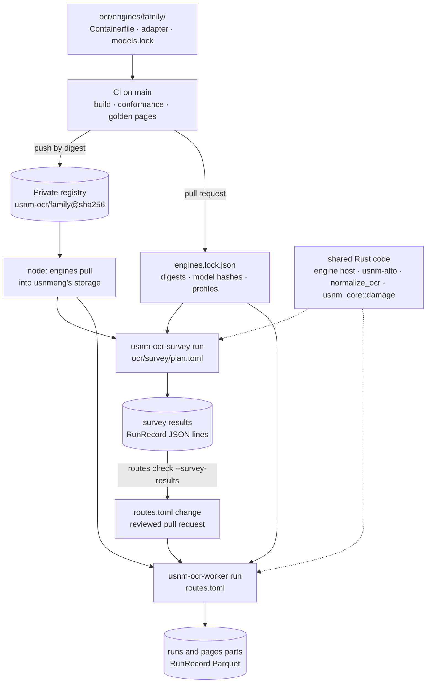

# 13: OCR Engines

**Status (10 November 2026):** designed in October 2026 with [ADR-0016](adr/0016-pluggable-ocr-engines.md) for the on-prem queue worker, which is retired (#966, #1053). OCR now runs only through BOINC ([BOINC pages](../boinc/README.md)): `usnm_ocr` reads Latin-script pages with the pinned Tesseract image directly, without the contract, and `usnm_ndlocr` reads Japanese pages through the NDLOCR-Lite contract adapter. Built: the contract types and schemas (`usnm-ocr-contract`, `ocr/contract/v1/`), the conformance runner, a first engine-host slice, the text-only Tesseract and NDLOCR-Lite adapters (`usnm-ocr-adapter`), `usnm-alto`, the engine catalog with the production licence gate, `profiles.lock` and credits (`usnm-ocr-route`, `ocr/engines/`), the `ocr_engine` tag and the runs record. Not built: route matching beyond a single catch-all route, `engines.lock.json`, the survey commands of §13.9, the cascade, and registry pulls. A section says when it describes the retired worker. **Pipeline:** [12: On-prem OCR pipeline](12-onprem-ocr-pipeline.md).

This document covers how engines plug in: the contract, limits, routing, provenance, the survey, and an engine catalog. [12](12-onprem-ocr-pipeline.md) specifies the rest under its step names: worker build (Step 2), `usnm_core::lang` and `usnm_core::damage` (Steps 4 to 6), message validation (Step 7), `usnm-ingest ocr-sync` (Step 8), the release (Step 9), the seeder (Step 10).

## 13.1 Scope and terms

- **Engine:** an OCR program and its models. **Family:** the program (`tesseract`, `kraken`); it names `ocr_source` (`usnm-<family>`).
- **Engine id:** family plus major.minor (`tesseract-5.5`). A new engine version, adapter or model set is a new image digest under the same id; a new major.minor is a new id.
- **Engine image:** OCI image with engine, models and adapter, pinned by digest. **Adapter:** the entrypoint that speaks the contract. **Instance:** a running container, one page at a time.
- **Profile:** a named model set plus settings (`deu_latf+deu`). **Route:** a rule in `ocr/routing/routes.toml` mapping a page to engine and profile.
- **Worker:** the program that reads a page and writes its outputs: `usnm-boinc work` inside `usnm_ocr` and `usnm_ndlocr`, `usnm-ocr-worker run` on the retired nodes. **Engine host:** the code that runs contract instances (`usnm_ocr_worker::contract`).

## 13.2 Components and their languages

Rust wherever practical (rule of 10 October 2026); Python-library engines keep a thin Python adapter. Rows naming a step of 12 are specified there ([12 §12.4](12-onprem-ocr-pipeline.md#124-languages)).

| Component                                                                                                                                    | Language                      | State on 10 November 2026                                                                                                                                                           |
| -------------------------------------------------------------------------------------------------------------------------------------------- | ----------------------------- | ----------------------------------------------------------------------------------------------------------------------------------------------------------------------------------- |
| `usnm-boinc work`: the BOINC worker for `usnm_ocr`, `usnm_gold` and `usnm_ndlocr` (container), and `usnm_ocr` native (`crates/usnm-ocr-app`) | Rust                          | In production as containers; the native build (#1418) isn't released ([native OCR](../boinc/apps/native-ocr.md))                                                                    |
| `usnm-ocr-worker`: queues, LoC fetch, deadlines, output                                                                                      | Rust                          | Queue loop retired (#966); its engine code (`engine::Tesseract`, `engine::candidates`, `engine::route`) is what `usnm-boinc` runs                                                   |
| Engine host: decode, scaling, tiles, instance pool, `podman --remote`, deadlines, cgroup meter                                               | Rust                          | First slice in `usnm_ocr_worker::contract`: a fixed pool, deadlines with a kill, restart after a crash, hello checks, both layouts. No lock, memory budget, breaker or cgroup meter |
| `usnm-ocr-contract`: messages, `RunRecord`, `ocr_engine` tag, JSON Schema export, conformance runner                                         | Rust                          | Built; schemas in `ocr/contract/v1/`                                                                                                                                                |
| `usnm-ocr-route`: engine catalog, production licence gate, `profiles.lock`, credits                                                          | Rust                          | Built (#371, #1481); route matching isn't                                                                                                                                           |
| `usnm-alto`: bounded ALTO v2 to v4 parser, stored-ALTO writer, boxes to ALTO, markup, tile merge, reading order, column repair, units        | Rust                          | Built; shared with `ocr-sync`                                                                                                                                                       |
| `usnm_core::text::normalize_ocr`                                                                                                             | Rust                          | Built                                                                                                                                                                               |
| `usnm_core::lang`: MARC, ISO 639-3 and wordfreq codes (12 Step 4)                                                                            | Rust                          | Built                                                                                                                                                                               |
| `usnm_core::damage` (feature `damage`): port of `ocr/ja-ocr/quality.py`'s v2 metric, word lists as data (12 Steps 4 to 6)                    | Rust                          | Built                                                                                                                                                                               |
| `usnm-ocr-survey`, as designed: `run`, `throughput`, `score`, `replay`, `repro` (§13.9)                                                      | Rust                          | Not built. The crate of that name scores gold sets (CER and WER, as `scripts/ocr-survey/gold.py`) and builds the gold bundle for `usnm_gold` (#457)                                 |
| `usnm-ocr-adapter` binaries                                                                                                                  | Rust                          | `usnm-ocr-adapter-tesseract-text` (text only) and `usnm-ocr-adapter-ndlocr-lite` built; `kraken`, `openai-vlm` and `oar` not                                                        |
| Python adapter package, one module per engine                                                                                                | Python                        | Not built                                                                                                                                                                           |
| `usnm-ingest ocr-sync` with the runs-record pickup, and the release's `curated/ocr-local/` reader (12 Steps 8 and 9)                         | Rust (`usnm-ingest`)          | Built                                                                                                                                                                               |
| Seeder, a step of `ocr-sync` (12 Step 10)                                                                                                    | Rust                          | Built; filters by the plan's languages (default the Tesseract pilot's), not `routes.toml`; the BOINC claim checks an installed model covers each page's language                    |
| Word-list export (`scripts/data/build-damage-words.py`, 12 Step 4)                                                                           | Python, one-off               | Built                                                                                                                                                                               |
| Damage parity fixture (`ocr/ja-ocr/damage_parity.py`, 12 Step 5)                                                                             | Python, one-off               | Built                                                                                                                                                                               |
| OCR quality audit (`ocr/ja-ocr/quality.py`)                                                                                                  | Python                        | Parity reference until 12 Step 15                                                                                                                                                   |
| Engine Containerfiles (`ocr/engines/tesseract/`, `ocr/engines/ndlocr-lite/`)                                                                 | Containerfile, bash           | Built; models fetched from `models.lock` at build time                                                                                                                              |
| `ocr/engines/engines.toml`, `ocr/routing/routes.toml`, `ocr/engines/profiles.lock`                                                           | TOML, text                    | Built; `routes.toml` holds one catch-all route                                                                                                                                      |
| `ocr/engines/<family>/models.lock`                                                                                                           | Plain text: name, URL, sha256 | Built for Tesseract and NDLOCR-Lite; the survey's own is `scripts/ocr-survey/models.lock`                                                                                           |
| `ocr/engines/engines.lock.json`, `ocr/routing/routes.golden.toml`, `ocr/survey/plan.toml`                                                    | JSON, TOML                    | Not built                                                                                                                                                                           |
| Japanese cloud job (`ocr/ja-ocr/jaocr.py`)                                                                                                   | Python                        | Superseded for new pages by `usnm_ndlocr` ([NDLOCR-Lite on BOINC](../boinc/apps/ndlocr-lite.md))                                                                                    |
| Node scripts (`scripts/ocr-node/*.sh`)                                                                                                       | bash                          | Kept for offboarding and the scan hosts; the worker's unit is removed                                                                                                               |

## 13.3 Component view

**History (worker retired, #966).** One node held the worker and its engine instances; the private Azure registry (engine images by digest), loc.gov and tile.loc.gov, and the exchange account were outside. The worker ran as `usnm` (in `himds`, so it could get Arc tokens) and never ran podman locally: engines ran rootless under a separate `usnmeng` account outside `himds`, driven through its Podman API socket `/run/usnm-ocr/podman.sock` (0660, group `usnmocr`) with `podman --remote`, whose `run --interactive` pipes carried the contract. That let the hardened unit set `NoNewPrivileges=yes` (ADR-0016). Scratch was a size-capped tmpfs at `/run/usnm-ocr/scratch`, so engine output counted against the engine's memory limit; each instance slot had worker-owned `in/` and `out/` with a fixed MCS label pair instead of `:Z`, and a per-page `out/<run_id>/` (0700) with an ACL for the container user. The engine-host code stays in `crates/usnm-ocr-worker`.

On BOINC the client starts the worker image in its own container (`boinc/apps/job.toml`: no network, read-only root, one CPU, 1536 MiB, 64 processes) and the worker runs Tesseract inside it, so the instance pool and Podman socket aren't used ([worker image](../boinc/apps/worker-image.md)).

## 13.4 The contract (usnm-ocr-engine/1)

### 13.4.1 Framing

- The adapter is the `ENTRYPOINT`, started with `--contract 1 --threads <n>`.
- Requests on stdin, replies on stdout: one JSON object per line, UTF-8, LF, at most 1 MiB. One request in flight per instance.
- stderr is free-form. The worker reads it continuously in lines of at most 4 KiB, drops and counts lines over a rate limit, and never stalls on it (podman's attach multiplexes both streams). It keeps the last 50 lines for failure reports and never parses them.
- Within a major version, readers ignore unknown fields; an optional field doesn't bump the version. EOF on stdin: finish, exit 0.
- No bulk data on the pipes. The worker writes `/in/<run_id>.jpg` (`.png` if scaled or tiled, §13.4.3) and creates `/out/<run_id>/`; the adapter writes only regular files, mode 0644, directly in it, and names them in its reply.
- A non-contract stdout line is a crash: kill and restart.
- Python adapters dup fd 1 for the protocol before importing the engine, then point fd 1 and `sys.stdout` at stderr. Rust adapters give children a null or captured stdout and their own process group (§13.6.3).

### 13.4.2 hello (adapter to worker)

First stdout line, when ready. Excerpt (German profiles of the Tesseract image as designed; the built text-only adapter is `usnm-ocr-adapter-tesseract-text`; keys sorted, as in all examples):

```json
{
  "adapter": {"lang": "rust", "name": "usnm-ocr-adapter-tesseract", "version": "0.1.0"},
  "cancel": "adapter",
  "contract": 1,
  "deterministic": true,
  "engine": {"family": "tesseract", "id": "tesseract-5.5", "version": "5.5.0"},
  "granularity": "word",
  "layout": "alto",
  "models": [
    {"name": "tessdata/deu.traineddata", "sha256": "8407331d6aa0229dc927685c01a7938fc5a641d1a9524f74838cdac599f0d06e"},
    {"name": "tessdata/deu_latf.traineddata", "sha256": "429b8c33d37e1a4823a2bb082a644ff13e252f735b7945e08a518d22ddcc459e"},
    {"name": "tessdata/frak2021.traineddata", "sha256": "1da2384254fa8462c776faf3b43307fe19ce51be0931c623b2fdd560f96e299a"}
  ],
  "models_loaded": "per_page",
  "profiles": [
    {"id": "deu", "languages": ["deu"], "models": ["tessdata/deu.traineddata"], "tunable": ["psm"]},
    {"id": "deu_latf+deu", "languages": ["deu"], "models": ["tessdata/deu_latf.traineddata", "tessdata/deu.traineddata"], "tunable": ["psm"]},
    {"id": "frak2021", "languages": ["deu"], "models": ["tessdata/frak2021.traineddata"], "tunable": ["psm"]}
  ],
  "type": "hello"
}
```

- `models`: every file any profile can load, hashed from disk at start (for a CLI engine, the files passed to the CLI). `models_loaded`: `at_start`, or `per_page` for CLI and script engines (Tesseract, Kraken CLIs), whose load time is inside `seconds_wall`.
- `cancel`: `adapter` or `kill` (§13.6.3). `languages`: ISO 639-3 (MARC is mapped before routing, §13.7.5). `layout`: `alto` or `boxes`. `granularity`: finest level with real geometry (`word`, `line`, `block`, `page`). `engine` may add `components` (e.g. Leptonica). No timing; the worker measures start to hello (`model_load_seconds`).
- The worker refuses the instance, counting toward the breaker (§13.6.4), unless the whole hello matches the lock entry for the digest (§13.7.3): `adapter`, `contract`, `engine` (with `components`), `cancel`, `deterministic`, `granularity`, `layout`, `models_loaded`; the (name, sha256) set; and every profile's `languages`, `models` and `tunable` as sets. A different `engine.version` would write an unreviewed version into `ocr_engine`; a different `cancel` changes timeout handling; a profile that kept its id but changed models or languages would draw `unsupported` replies and a wrong `models_digest`. CI writes the lock entry from hello (§13.7.3).

### 13.4.3 page (worker to adapter)

```json
{
  "deadline_ms": 840000,
  "image": {"dpi": 300, "dpi_source": "assumed", "height": 7208, "path": "/in/node1.20261020T140312123456Z.jpg", "sha256": "<sha256 of the file>", "width": 5412},
  "language": "deu",
  "options": {"psm": 3},
  "out": "/out/node1.20261020T140312123456Z/",
  "profile": "deu_latf+deu",
  "run_id": "node1.20261020T140312123456Z",
  "script": "Latf",
  "type": "page"
}
```

- `run_id` is `<node>.<UTC stamp>`, minted at page start before the engine call (`provenance::mint_run_id`, #307); it names the ALTO, runs record and overlay part. No `doc_id`, URL, batch or credential is sent; the worker logs `run_id` to page.
- **Options:** profile `defaults` from `engines.toml` overlaid by the candidate's `options`, sent merged and recorded in the runs record and ALTO. Only keys in the profile's `tunable` may be set. Worker preprocessing (`scale`, `tile`) has its own keys.
- **Image and dpi.** The worker decodes the whole scan (Rust `image` crate) first. Cached scans may be the batch's JP2 since #368 (12 §12.2.4), which `image` can't read; until an OpenJPEG decoder or PNG conversion exists, only Tesseract (JP2 via Leptonica) gets them. `image.dpi` is the scan's dpi times `scale` (300 full, 150 half); adapters take dpi only from here (it isn't an option), and the Tesseract adapter passes it as `--dpi`, so every route reads full scans at 300 dpi, as the BOINC worker does. It passes `--dpi 300` always, since IIIF JPEGs carry no resolution and Tesseract would guess 70.
- **Scale** is worker preprocessing, never in `options`, `tunable` or hello. A profile may set it beside `tile`, and a candidate may override it with its own `scale` (default 1). The worker resizes with Lanczos3 and writes PNG to avoid re-encoding JPEG; the path's extension gives the format, `image.*` describes the scaled file, boxes are scaled back, and the runs record has a `scale` column.
- **Tiles:** a profile may set `tile = { size = 1280, overlap = 256 }` (the survey runs docTR and Surya this way). Each tile is its own request to one instance in turn, `run_id` `<run_id>.t<n>`, own `out`, `deadline_ms` the time left. `usnm-alto` moves boxes to page pixels and keeps a box only if its centre is in the tile's core (tile less half the overlap on inner edges), as the survey's `inside()`. The page is `ok` only if every tile is. Adapters never tile or merge tiles.
- `script`: ISO 15924, optional. `dpi_source`: `assumed` or `loc_alto` (dpi read from LoC's ALTO).

### 13.4.4 result (adapter to worker)

```json
{
  "engine_stats": {"mean_conf": 0.71, "words": 6034},
  "layout": {"kind": "alto", "path": "/out/node1.20261020T140312123456Z/page.xml"},
  "markup": "none",
  "run_id": "node1.20261020T140312123456Z",
  "status": "ok",
  "text": {"path": "/out/node1.20261020T140312123456Z/page.txt"},
  "type": "result",
  "warnings": []
}
```

- `layout.kind` (`alto`, any version and `MeasurementUnit`, or `boxes`, §13.4.5) must equal hello's `layout`; boxes must declare hello's `granularity`, and ALTO must have geometry at it. Mismatch: `engine_protocol`. ALTO results add `alto_dpi` when the engine converted pixels at an assumed dpi (NDNP Open OCR at 300).
- `text` is the engine's own text, kept only for survey comparison; stored text is derived from the layout (§13.4.7). Block-level engines put block text in `boxes.json`; page-level engines write one page-sized block.
- `markup`: `none`, `html` (Surya) or `markdown` (most vision-language models), stripped once in Rust before the ALTO writer and `normalize_ocr`. Ordered list markers always stay; a bullet goes only when at least two adjacent lines start with it, each before an item starting with neither a number nor a currency sign, because lines like `31. Dezember` and `- 5 Cents` are text (#1488). Other formats (DocTags, grounding tokens) are parsed by the adapter into boxes and one of these three values (the Rust `openai-vlm` per-model parsers).
- `status`: `ok`, `unsupported`, `bad_input`, `failed`, `timeout` (§13.4.6). Failures add `"error": {"kind": "...", "message": "..."}` (at most 2 KiB, never page text); `failed` may add `"restart": true` when the adapter knows its engine is in a bad state.
- `"partial": true` output (text read before a deadline) is survey-only; production never stores it.
- `engine_stats`: at most 64 numeric keys of at most 64 characters, stored uninterpreted in `engine_stats_json`, keys sorted. Adapters never report timings, resources, digests or damage.

### 13.4.5 boxes.json (usnm-boxes/1)

For engines without ALTO: docTR, OnnxTR, American Stories, Surya, NDLOCR-Lite, PaddleOCR, oar-ocr, and vision-language spotting or grounding output.

```json
{
  "blocks": [
    {"bbox": [120, 340, 1610, 2200], "conf": 0.9, "dir": "ltr", "kind": "text", "label": "article", "lang": "deu", "lines": [
      {"bbox": [120, 340, 1610, 395], "conf": 0.87, "hyphen": false, "text": "Deutsche Zeitung", "words": [
        {"bbox": [120, 342, 410, 395], "conf": 0.91, "text": "Deutsche"}
      ]}
    ], "order": 0},
    {"bbox": [1700, 300, 3400, 1900], "kind": "illustration", "order": 1}
  ],
  "frame": {"height": 7208, "width": 5412},
  "granularity": "word",
  "reading_order": "engine",
  "units": "px",
  "v": 1
}
```

- `units`: `px`, `rel` (0 to 1, docTR) or `norm1000` (Qwen3-VL, LightOnOCR, Chandra, HunyuanOCR). `frame` is the size the coordinates refer to; an internally resizing engine (dots.ocr) reports `px` with its resized `frame`. Rust maps to the sent image, then the full IIIF frame.
- Boxes are `[x0, y0, x1, y1]` from top left with `x1 > x0`, `y1 > y0`; optional `polygon` and `baseline` as lists of `[x, y]` points. Up to 2 px outside the frame is clamped; more is `convert`.
- `kind`: `text`, `heading`, `caption`, `table` (TextBlocks), `illustration` (Illustration, any text on it dropped), `separator` (GraphicalElement).
- `reading_order`: `engine` (array order or block `order`) or `none` (detection or tile order: docTR, PaddleOCR), for which Rust orders blocks by a column-aware XY cut in the page's direction, so 6 to 8 column pages aren't read across.
- `dir` on block or line: `ltr`, `rtl`, `ttb-rl` (NDLOCR-Lite vertical Japanese); default by script (`rtl` for Hebrew and Yiddish, `ltr` otherwise); words in a line and lines in a block are ordered by it. Lines in a block go in rows top to bottom (right to left for `ttb-rl`), each row along the direction, so a detector's segments of one printed line read in order. Two lines share a row when their cross-line extents overlap by more than half the smaller and their along-line overlap is at most half the shorter; every pair in a row must qualify, so overlap chains can't merge a column into one row.
- Text sits at the finest level present. `hyphen: true` marks a word continued on the next line; the writer emits `HYP` and, where it can join the parts, `SUBS_CONTENT`. `conf` is 0 to 1 or absent.

### 13.4.6 Status and what the worker does

The Production column is the retired queue worker's handling (#966). Under BOINC a failed page is returned as failed; the controller retries or dead-letters it ([a page that fails for good](../boinc/server/batch-scheduler.md#a-page-that-fails-for-good)), and a bundle's other pages still count ([OCR bundles](../boinc/apps/ocr-bundles.md)).

| Source  | Status                                                                                         | Production (worker)                                                                                                          |
| ------- | ---------------------------------------------------------------------------------------------- | ---------------------------------------------------------------------------------------------------------------------------- |
| adapter | `ok`                                                                                           | Convert, write the outputs, delete the message                                                                               |
| adapter | `unsupported`: profile, language or option not in this image                                   | Next candidate, same receive. None left: transient `no_model`, logged as a routing error                                     |
| adapter | `bad_input`: the engine can't read an image the worker decoded                                 | Adapter fault: transient `engine`, next candidate in the same receive                                                        |
| adapter | `failed`                                                                                       | Transient `engine`; restart if asked                                                                                         |
| adapter | `timeout`: the adapter stopped at `deadline_ms` and stopped its processes (`cancel = adapter`) | Transient `engine_timeout`; recycle if `cgroup.procs` has processes not there after `hello`                                  |
| worker  | the scan doesn't decode                                                                        | Permanent, dead-lettered; no engine called                                                                                   |
| worker  | no result by `deadline_ms` + 15 s                                                              | Kill; transient `engine_timeout`; restart lazily                                                                             |
| worker  | instance exited, or a stdout line that isn't contract JSON                                     | `engine_oom` if `podman --remote inspect` shows `OOMKilled`, else `engine_crash`; `podman --remote rm`; restart with backoff |
| worker  | protocol: a limit, a path or the schema broken                                                 | Transient `engine_protocol`; replace the instance                                                                            |
| worker  | `convert`: the ALTO or boxes don't parse                                                       | Transient `convert`                                                                                                          |
| worker  | no usable candidate on this node                                                               | Transient `no_route_here`, plus a node-wide receive backoff (§13.7.6)                                                        |

The survey records every outcome, scoring `ok` and keeping partial text on `timeout`.

On the worker, transient left the message to reappear after its visibility timeout, permanent went to `ocr-deadletter` at once, and a message received more than 5 times was dead-lettered. Repeated failures were to move a page to the next candidate by dequeue count (§13.7.6).

### 13.4.7 What the worker does with a result

1. **Checks files.** Paths must resolve inside `out/<run_id>/`, with no `..` or symlinks (`symlink_metadata`, `O_NOFOLLOW`), and be regular files. Caps: result line 1 MiB, ALTO or boxes 64 MiB, text 8 MiB, job directory 256 MiB (larger than step 7's output limits, because engine ALTO is more verbose than the stored ALTO).
2. **Parses.** `usnm-alto` reads ALTO v2 to v4 in `pixel`, `inch1200` or `mm10` with quick-xml: no `DOCTYPE`, no entity expansion, caps on depth, element count, `CONTENT` length (1 KiB) and strings per page (500,000); Kraken's v4 (`SP` as sibling, polygons) is handled. JSON has a depth limit and checked UTF-8. `boxes.json` is streamed and stops at the first limit: 20,000 blocks, 200,000 lines, 500,000 words (the ALTO string cap), 1 KiB text per word or line, 512 KiB per block (step 7's stored-text limit), 1,000 points per polygon or baseline, 2,000,000 points total. The worker has no memory limit beyond its unit's, so expansion must be refused while reading. Breaches are `engine_protocol`.
3. **Writes the stored ALTO** from parsed values; only escaped `CONTENT` comes from the engine (§13.8.2).
4. **Derives the text** from the stored ALTO in reading order (port of `altotext.py`) for every granularity, so text and boxes always agree, markup already stripped, then `usnm_core::text::normalize_ocr_for`, which also rejoins an em dash at a line end on German pages or Fraktur models (`Hyphenation::for_page`, #1065). The overlay stores and the survey scores this text. Order is the engine's: where Tesseract missed a narrow unruled gutter, text runs across columns (#925). `usnm_alto::split_columns` repairs that (cuts lines straddling a gutter by word centre, reads column by column) but isn't in this step yet; `usnm-ocr-worker column-text` runs it offline on stored ALTO ([note](../notes/2026-11-05-column-reading-order.md)).
5. **Scores damage** with `usnm_core::damage` (12 Step 5) in forced-language mode, as `score.py` calls `quality.py`'s `damage()` (v2 detection needs catalog languages the worker lacks). `usnm_core::lang` maps to the metric's MARC-keyed tables (`ger` to `de`, `hrv` and `srp` to `sh`). `damage_after` is null for `jpn` (`quality.py` doesn't score Japanese titles), `und` and languages without a word list.
6. **Measures** wall, CPU, peak memory and OOM kills from the cgroup (§13.6.4).
7. **Checks output limits, then writes** ALTO, runs record, overlay part, create-only, same `run_id` (§13.8). Limits are `ocr-sync`'s (12 Step 8 checks 1 and 4), one set of constants in `usnm-ocr-contract` that `ocr-sync` uses too, so an uploaded page can't be quarantined for its size: ALTO 32 MiB, part and runs record 1 MiB each, text 512 KiB with no control characters but newline and tab. Over a limit, nothing is uploaded and the page fails transient `convert`, kind `too_large`, so it can move to the next candidate. The BOINC worker applies its own caps (`boinc::MAX_TEXT`, `boinc::MAX_ALTO`) and `usnm_alto::check` before returning a page.

### 13.4.8 Versioning and conformance

- `usnm-ocr-contract`'s Rust types are the source; a schema binary writes `ocr/contract/v1/{hello,page,result,boxes}.schema.json`, and CI fails on drift.
- A breaking change is contract 2; the worker supports N and N-1 during migration, and conformance tests both. CI will run conformance on every image it builds.
- `usnm-ocr-worker engines conformance --engine <id> --fixtures ocr/contract/fixtures`. Until `engines.toml` names engines by id (#371) the form is `--engine contract` with `--engine-image` (through the engine runtime) or `--engine-command` (local adapter), `--fixtures` defaulting to `ocr/contract/fixtures`. It starts one instance at `image.dpi` 300, prints one JSON line per case (`pass`, `fail`, `skipped`) and a summary, and exits non-zero on any failure.

Built in #307 (§13.11 step 4). The runner lives in `usnm-ocr-worker` (`contract::conformance`) so every page goes through production's request, file checks, caps and parsing (§13.4.7 steps 1 and 2). Text is checked as stored (derived from layout); rendered pages are PNGs from `testimg::png`. Cases:

| Case                                    | Requires                                                                                                                                                                                                                                                                                                                                                                                                                 |
| --------------------------------------- | ------------------------------------------------------------------------------------------------------------------------------------------------------------------------------------------------------------------------------------------------------------------------------------------------------------------------------------------------------------------------------------------------------------------------ |
| `text_line`                             | `HELLO LOWER` rendered by `testimg.rs`; the text, and boxes at the page's granularity within 12 px of the ink (inside the image for `block` and `page`)                                                                                                                                                                                                                                                                  |
| `blank_page`                            | No text                                                                                                                                                                                                                                                                                                                                                                                                                  |
| `corrupt_image`                         | `bad_input` for `fixtures/corrupt.png` (valid size in its header); the text-only adapter maps Leptonica's read error to it                                                                                                                                                                                                                                                                                               |
| `unknown_profile`                       | `unsupported`                                                                                                                                                                                                                                                                                                                                                                                                            |
| `deadline`                              | A 3,500×7,262 page with a 1 s deadline: `timeout` from `cancel = adapter`, or no result and the worker's kill after the 15 s grace for `cancel = kill`; then the new instance reads the line. Timed request to reply only; skipped if the engine finishes within 1 s; failed if read after the deadline                                                                                                                  |
| `tesseract_dpi`                         | Family `tesseract`: `--dpi` with argument exactly `300` (`--dpi 300` or `--dpi=300`) in the command line logged to stderr                                                                                                                                                                                                                                                                                                |
| `stdin_eof`                             | No more output, exit 0                                                                                                                                                                                                                                                                                                                                                                                                   |
| `stdout_noise`, `oversized_output`      | Fail if any suite page broke the existing rules (non-contract stdout line, result over 1 MiB, layout, text or directory over its cap, or a layout over its limits): `engine_protocol` and instance replaced (§13.4.6). A real engine can't be made to print noise or a huge page, so these cases only fail passively. The adapter crate's tests trigger each with a stand-in and check the next page uses a new instance |
| `protocol`                              | Fails on any other `engine_protocol` (wrong `run_id`, layout, granularity)                                                                                                                                                                                                                                                                                                                                               |
| `deadline_cgroup`, `contract_n_minus_1` | Skipped: need the runtime's cgroup (§13.6.4), and contract 2                                                                                                                                                                                                                                                                                                                                                             |

CI doesn't run the suite. The NDLOCR-Lite workflow (`.github/workflows/boinc-ndlocr-lite.yml`) runs its own smoke tests on the engine and worker images (`boinc/scripts/smoke-ndlocr.py`, `smoke-ndlocr-worker.py`). The suite found that closing an instance's input only flushed it (Tokio's `shutdown` on a child's stdin doesn't close it), so retired instances sat out the 10 s and were killed; the worker now drops the pipe.

## 13.5 One page through an engine

On BOINC (`usnm-boinc work`, `crates/usnm-boinc/src/worker.rs`): the worker checks that the installed engine's version and route for the page's language (`engine::route`, or `engine::route_lines` for a Cherokee line job) match the job, checks the installed models against the job's profile digest, runs Tesseract on the scan the job names, checks the text and ALTO against the size caps and `usnm_alto::check`, and returns a result manifest with the scan, text and ALTO hashes. `collect` writes the ALTO and one-row part to `ocr-out` from the BOINC host, with no runs record ([queue-fed work](../boinc/server/batch-scheduler.md#queue-fed-work)).

The retired queue worker (#966) checked an engine was usable, received the message, validated it, minted the `run_id` and routed it; fetched the item JSON and IIIF full image and decoded, scaled or tiled it; started an instance if none was idle and checked its hello against the lock; wrote the image to `in/` and sent the page request; then either converted the result (§13.4.7), uploaded ALTO, runs record and part create-only and deleted the message, or, with no result by `deadline_ms` + 15 s, killed the instance and wrote nothing (transient `engine_timeout`). Its `deadline_ms` was the least of the engine's `page_timeout_secs`, the route's `timeout_secs`, and the page budget left minus 60 s for uploads; the budget was 0.8 of the visibility time, 1,440 s of 1,800 s. BOINC's page deadline is the job's `engine.timeout_secs` (default 1800 s, at most 3600).

## 13.6 Engine instances and resource limits

### 13.6.1 Container settings

What an engine image must work under when the engine host runs it (the retired nodes ran it this way; BOINC runs the worker image under `boinc/apps/job.toml` instead): no network (`--network=none`, only the container's loopback, where a vision-language image may run llama-server); a read-only root with a tmpfs `/tmp` (`nosuid,nodev,mode=1777`) and `HOME=/tmp`; `--no-hosts` and `--http-proxy=false`; `--ulimit nofile=1024:1024` and `--ulimit core=0`, with CPU and pid limits; `USER 10001` (`--user 10001:10001`); all capabilities dropped, no-new-privileges, default seccomp, `--init`; no swap; `OMP_THREAD_LIMIT` and `--threads` from the engine's `threads`; only the env `engines.toml` lists, with `HF_HUB_OFFLINE=1`, `TRANSFORMERS_OFFLINE=1` and `XDG_CACHE_HOME=/tmp/cache` baked in; `/in` read-only and `/out` writable; SELinux enforcing. GPU engines get only their CDI device (`--device nvidia.com/gpu=<n>`), and GPU hosts need the `container_use_devices` boolean.

**History.** The worker started instances with `podman --remote --url unix:///run/usnm-ocr/podman.sock run --interactive --init --pull=never` plus the limits below, `--log-driver=none --stop-timeout=10` and no `--rm` (it read `{{.State.OOMKilled}}` with `podman --remote inspect` before `rm`), from a cleared environment with `HOME=/var/lib/usnm-ocr` because the podman client fails without a `HOME` (podman issues 8434, 23818).

### 13.6.2 Limits per engine

Each engine was to declare these in `engines.toml` (§13.7.2); none is in the catalog yet, and the BOINC apps take their limits from their job files:

| Field                            | Meaning                                                                             |
| -------------------------------- | ----------------------------------------------------------------------------------- |
| `memory`                         | `--memory` and `--memory-swap`. Reserved for the instance's whole life              |
| `cpus`, `threads`                | `--cpus`, and the thread count passed to the adapter and as `OMP_THREAD_LIMIT`      |
| `pids`, `shm`, `tmp`             | `--pids-limit`, `--shm-size`, and the size of `/tmp` (a tmpfs, counted in `memory`) |
| `max_instances`, `min_instances` | Instances per node, overridable per node                                            |
| `start_timeout_secs`             | Time to the `hello` line                                                            |
| `page_timeout_secs`              | Longest page                                                                        |
| `idle_stop_secs`                 | Stop an idle instance after this long (0: keep it running)                          |
| `max_jobs_per_instance`          | Recycle the instance after this many pages                                          |
| `gpus`, `gpu_memory`             | Class `gpu` only: GPUs per instance, and the GPU memory it reserves on its device   |

Profiles may add `defaults` and `tile` (§13.4.3). Starting `memory` is the survey's instance peak (`instance_peak_mem_mb`) plus 25%, rounded up; `page_timeout_secs` covers the slowest surveyed page with margin. Tesseract: 1,536 MiB, 1 CPU, 1 thread, 64 pids, 2 instances, 60 s start, 900 s page (guesses until `usnm-ocr-survey throughput`, not built, measures 2, 3 and 4 instances). `routes check` was to refuse a production engine whose `start_timeout_secs + page_timeout_secs` exceeds the page budget minus 60 s.

### 13.6.3 Deadlines and cancellation

Adapters declare `cancel` in hello, and conformance (§13.4.8) still checks it:

- **`adapter`:** at `deadline_ms` the adapter kills the process group it started for the page and cancels in-flight server requests (restarting the server if needed) before answering `timeout`, so no leftover process's CPU or memory is counted against the next page. The text-only Tesseract adapter keeps the deadline active until the child exits and both pipes reach EOF, and kills the group if they are still open.
- **`kill`:** the caller's kill is the path. Python's `SIGALRM` can't interrupt long native torch or ONNX Runtime calls, so such adapters declare `kill`; each kill costs a model load.

### 13.6.4 Node runtime (history)

The design for the worker's engine host (ADR-0016, #296), per node. Only the deadline kill and restart are in the built slice (`usnm_ocr_worker::contract`); the rest wasn't built before the nodes were retired:

- **Scheduling:** an `engine_memory` budget, allowed engines and per-engine `max_instances` from `/etc/usnm-ocr/node.toml` (node 1: 6 GiB of 8 GB); idle instance first, then a new one if it fits, then evicting idle instances of other engines; per-device `gpu_memory` budgets so CUDA OOM never surfaced as `failed`.
- **Cgroup checks:** refuse engines unless memory, cpu and pids controllers were delegated and the effective `memory.max` and `pids.max` (minimum up to the `libpod-<id>.scope`, with ancestors leaving `runtime_memory_headroom` 512 MiB and `runtime_pids_headroom` 256) matched the configured limits.
- **Failure handling:** kill at `deadline_ms` + 15 s; restart backoff 1 s, 5 s, 30 s, 2 min; recycle after `max_jobs_per_instance` pages, above 90% of the memory limit, or with leftover processes in `cgroup.procs` after a `timeout`; a breaker that opened for 15 minutes (doubling to 2 hours) after 3 crashes or refused hellos in 10 minutes, or 5 consecutive distinct pages with engine-level failures.
- **Metering:** CPU from `cpu.stat` `usage_usec`, `peak_mem_mb` from `memory.current` sampled 4 times a second, `instance_peak_mem_mb` from `memory.peak` (no per-page reset on EL9's 5.14 kernel), OOM kills from `memory.events`; telemetry `ocr.engine_seconds`, `ocr.engine_cpu_seconds`, `ocr.engine_peak_mb`, `ocr.engine_restarts`, `ocr.engine_errors`.
- **Images:** `usnm-ocr-worker engines pull --node-config /etc/usnm-ocr/node.toml` was to exchange an Arc Entra token at the registry's `/oauth2/exchange` and pull by digest, with the token in a tmpfs authfile, never on a command line; `engines gc` was to keep the current and previous bundles. The planned registry grant was AcrPull for the node group `usnm-ocr-nodes-<env>` in `infra/modules/registry.bicep`.

## 13.7 Routing

**As built.** Production routes by language in code, not through `routes.toml`: `EngineKind::for_language` sends `jpn` to NDLOCR-Lite (profile `default`) and every other language to Tesseract, and `usnm_ocr_worker::engine::route` takes the first `tesseract-5.5` profile in `engines.toml` file order that covers the language and whose models are installed and pass the licence gate ([gold check, engine routing](../boinc/server/gold-check.md#engine-routing)). A Cherokee line job (#1621) uses `route_lines`, which may also take a `lines_only` profile. `routes.toml` holds one catch-all route (`minimal`, Tesseract `auto`) that `routes check` validates. The rest of this section is the design for full routing; §13.7.2's licence gate, `profiles.lock` and catalog are built.

### 13.7.1 Files

| File                               | Written by     | Contents                                                                           | State                                         |
| ---------------------------------- | -------------- | ---------------------------------------------------------------------------------- | --------------------------------------------- |
| `ocr/engines/engines.toml`         | Hand, reviewed | Engines, their models and licences, profiles, production flag                      | Built ([schema](../../ocr/engines/README.md)) |
| `ocr/routing/routes.toml`          | Hand, reviewed | `version`, ordered routes, title-level script facts                                | One catch-all route                           |
| `ocr/engines/profiles.lock`        | `routes check` | Per engine and profile id: the digest of its model files, append-only (§13.7.2)    | Built (#1481)                                 |
| `ocr/engines/<family>/models.lock` | Hand, reviewed | Model files: name, source URL, sha256                                              | Built for Tesseract and NDLOCR-Lite           |
| `ocr/engines/engines.lock.json`    | CI, in a PR    | Per engine id: image reference and digest, adapter version, model hashes, profiles | Not built                                     |
| `ocr/routing/routes.golden.toml`   | Hand, reviewed | Page attributes and the route each must hit; `cargo test` checks them              | Not built                                     |

The routing bundle was to be `engines.toml`, `routes.toml` and `engines.lock.json`, with a digest over the sorted lines `<file name> <sha256 of its bytes>`.

### 13.7.2 engines.toml

**Built in #371:** the [catalog and credit schema](../../ocr/engines/README.md), the `usnm-ocr-route` loader and shared production licence gate, and `usnm-ocr-worker routes check`. The worker embeds a copy of the catalog. The file holds the Tesseract engine with 30 profiles (German, Serbian, Croatian and Bosnian, Norwegian, Chinese, Yiddish (`yid`, `yidj2`), Hebrew, Greek (`ell`, `grc`), English, Russian, Czech, Polish, Spanish, French, Italian, Danish, Finnish, Swedish, Lithuanian, Slovenian, Hungarian, Slovak, and the lines-only `chr_phoenix`), NDLOCR-Lite (`production = true`), and `production = false` entries for every other engine checked by 11 October 2026. Profile order is preference order: `frak2021` comes before `deu_latf+deu` and `deu`. The per-engine limits of §13.6.2 aren't in it. An excerpt:

```toml
schema = 1
production_licenses = ["Apache-2.0", "MIT", "BSD-3-Clause", "CC0-1.0", "CC-BY-4.0", "CC-BY-NC-4.0", "CC-BY-SA-4.0", "CC-BY-NC-SA-4.0", "AGPL-3.0-only", "LicenseRef-Datalab-OpenRAIL-M", "LicenseRef-MinerU", "LicenseRef-DINOv3", "LicenseRef-dots-MIT"]
credit_required = ["CC-BY-4.0", "CC-BY-NC-4.0", "CC-BY-SA-4.0", "CC-BY-NC-SA-4.0", "LicenseRef-Datalab-OpenRAIL-M", "LicenseRef-MinerU", "LicenseRef-dots-MIT"]

[[engine]]
id = "tesseract-5.5"
family = "tesseract"
production = true
license = "Apache-2.0"
author = "Tesseract OCR project"
source = "https://github.com/tesseract-ocr/tesseract"
credit = "tesseract-5.5 — Tesseract OCR project (Apache-2.0)"
fetched = 2026-10-11

[[engine.model]]
name = "tessdata/frak2021.traineddata"
license = "CC0-1.0"
# version, author, source, credit, terms, fetched as for every model

[[engine.model]]
name = "tessdata/german_print.traineddata"
license = "none"                 # tier 2: note, fetched and credit required

[[engine.profile]]
id = "frak2021"
models = ["tessdata/frak2021.traineddata"]
languages = ["deu"]

[[engine.profile]]
id = "deu_latf+deu"
models = ["tessdata/deu_latf.traineddata", "tessdata/deu.traineddata"]
languages = ["deu"]
```

Licence history: `CC-BY-NC-4.0`, `CC-BY-SA-4.0` and `LicenseRef-Datalab-OpenRAIL-M` were cleared on 10 October 2026 (the site is non-commercial); tier 2, MinerU, DINOv3 and dots on 11 October; CC-BY-NC-SA-4.0 and AGPL-3.0-only on 3 November (#1479). `credit_required` lists licences whose own terms require credit (every production model is credited anyway); DINOv3 asks for acknowledgement only in research publications, so it isn't there. Tier 2 is `license = "none"`, allowed in production (the maintainer, 11 October 2026) with source, author, fetched, note and credit. Tier 3 is `restricted`, never routed in production. `undecided` is never routed until the maintainer decides.

An excluded model's entry (abridged):

```toml
[[engine.model]]
name = "Qwen2.5-VL-3B-Instruct"
license = "LicenseRef-Qwen-Research"
restricted = "Qwen Research License 1(i): \"'Non-Commercial' shall mean for research or evaluation purposes only\"; ..."
```

**One model set per profile id ([#1481](https://github.com/tgoodyear/usnewsmap.com/issues/1481)).** The engine index, API and credits page key engines by the short key, which has no model digest (§13.8.1), so any different model file (retrained or re-downloaded too) needs a new profile id: Yiddish with Jochre's model is `yid_jochre`, not a new file under `yid`.

- `ocr/engines/profiles.lock`: per engine and profile whose models are all in its `models.lock`, the sha256 of sorted `<name> <sha256>` lines (a tag's `models=` is the first 12 hex digits). `routes check` (which CI runs on the committed files in the worker's `routes_check` test) fails on a changed digest, with a message to add a new profile id, or a pinned profile without an entry; `routes check --update-lock` only appends, so dropped ids aren't reused.
- The release fails when one short key has two `models=` digests among rows read on or after 2026-11-05 00:00 UTC that replace LoC's text (`usnm_core::ocr_engine::ONE_MODEL_SET_SINCE_MICROS`): revoke the wrong rows and re-read under a new profile id. Incremental releases check rebuilt batches, full releases every row. Older rows, older tag forms and `models=local` are exempt; no pin had changed in either `models.lock` when the rule took effect.

**The gate.** `production = false` keeps an engine off production routes. Otherwise the engine's code (on `[[engine]]`, with the model fields `license`, `author`, `source`, `credit`, and `fetched`, `note`, `restricted` or `undecided` as needed) and every model of the profile must be tier 1 or 2:

1. **Cleared:** `license` in `production_licenses`.
2. **Attributed:** `license = "none"` with `source` (fetch URL), `author`, `fetched` (date), `note` (where the absence was checked) and `credit`.
3. **Excluded:** `restricted`, quoting and linking the clause; refused whatever `license` says, as is `license = "unknown"`.
4. **Undecided:** `undecided`, naming the decision and linking the terms; refused, `none` included, until a tier replaces it.

`routes check` refuses anything else. Production models need `author`, `source` and `credit` for the credits page, which marks `credit_required` models as licence-required credits, links SPDX ids to spdx.org and `LicenseRef-` ids to their `terms` URL. Tier moves are the maintainer's: 2026-10-10 cleared `CC-BY-NC-4.0`, `CC-BY-SA-4.0` and `LicenseRef-Datalab-OpenRAIL-M` (this project's id for Datalab's differing modified Open RAIL-M terms on Surya 2, Marker and Chandra) because the site is entirely non-commercial; 2026-10-11 added tier 2 (use whichever engine reads better, and credit it; explicit restrictions still exclude); 2026-11-03 ([#1479](https://github.com/tgoodyear/usnewsmap.com/issues/1479)) added `CC-BY-NC-SA-4.0` (Yiddish OCR Corpus models, `credit_required`) and `AGPL-3.0-only` (Jochre 3). No production route to a `credit_required` or tier 2 model may merge without a credits page naming each production engine and model with author or publisher, source, and licence or "no explicit licence".

#### Tiers of the engines and models checked so far

Checked on 11 October 2026 against published terms only; nobody was contacted. `ocr/engines/engines.toml` records the same decisions. These are design readings, not legal advice; where terms were ambiguous the maintainer decided on 2026-10-11.

**Tier 1, cleared**

| Engine or model                                                                                               | Author or publisher                                   | Terms                                                                                                                                                                                                                                                                                                                                                                                                                                                                                                                                                                                                                                                                                                                                                                                                                                           |
| ------------------------------------------------------------------------------------------------------------- | ----------------------------------------------------- | ----------------------------------------------------------------------------------------------------------------------------------------------------------------------------------------------------------------------------------------------------------------------------------------------------------------------------------------------------------------------------------------------------------------------------------------------------------------------------------------------------------------------------------------------------------------------------------------------------------------------------------------------------------------------------------------------------------------------------------------------------------------------------------------------------------------------------------------------- |
| Tesseract 5 and tessdata_best models                                                                          | Tesseract OCR project                                 | Apache-2.0 ([LICENSE](https://github.com/tesseract-ocr/tessdata_best/blob/main/LICENSE))                                                                                                                                                                                                                                                                                                                                                                                                                                                                                                                                                                                                                                                                                                                                                        |
| `frak2021` (Tesseract), the files `frak2021-0.905.traineddata` (best) and `frak2021_0.905.traineddata` (fast) | Stefan Weil, UB Mannheim                              | CC0 on [Zenodo 10125246](https://zenodo.org/records/10125246). Best sha256 `1da23842…e299a`, as surveyed (§13.4.2); other checkpoints on UB Mannheim's server would be tier 2. Training data (Fibeln CC0, [GT4HistOCR](https://zenodo.org/records/1344132) CC BY or BY-SA, AustrianNewspapers CC BY 4.0) doesn't change the model's tier                                                                                                                                                                                                                                                                                                                                                                                                                                                                                                        |
| Kraken `austriannewspapers`                                                                                   | Stefan Weil, Jan Kamlah, Thomas Schmidt               | cc-by-sa-4.0 on [Zenodo 7933402](https://zenodo.org/records/7933402); use that file, not UB Mannheim's older copy                                                                                                                                                                                                                                                                                                                                                                                                                                                                                                                                                                                                                                                                                                                               |
| Kraken `german_print`                                                                                         | Stefan Weil, Jan Kamlah, Thomas Schmidt               | cc-zero on [Zenodo 10519596](https://zenodo.org/records/10519596)                                                                                                                                                                                                                                                                                                                                                                                                                                                                                                                                                                                                                                                                                                                                                                               |
| NDNP Open OCR (code)                                                                                          | Library of Congress                                   | US public domain plus CC0 1.0 ([LICENSE.md](https://github.com/LibraryOfCongress/ndnp-open-ocr/blob/main/LICENSE.md)); its segmentation model is tier 2                                                                                                                                                                                                                                                                                                                                                                                                                                                                                                                                                                                                                                                                                         |
| docTR (code) and the multilingual PARSeq checkpoint                                                           | Mindee; Felix Dittrich                                | Apache-2.0 ([docTR](https://github.com/mindee/doctr/blob/main/LICENSE), [PARSeq](https://huggingface.co/Felix92/doctr-torch-parseq-multilingual-v1))                                                                                                                                                                                                                                                                                                                                                                                                                                                                                                                                                                                                                                                                                            |
| EfficientOCR (code)                                                                                           | Dell Research Harvard                                 | Apache-2.0 ([efficient_ocr](https://github.com/dell-research-harvard/efficient_ocr)); weights tier 2                                                                                                                                                                                                                                                                                                                                                                                                                                                                                                                                                                                                                                                                                                                                            |
| GOT-OCR 2.0                                                                                                   | StepFun, UCAS                                         | apache-2.0 on [Hugging Face](https://huggingface.co/stepfun-ai/GOT-OCR2_0); the [GitHub repository](https://github.com/Ucas-HaoranWei/GOT-OCR2.0)'s badges say data CC BY-NC 4.0, cleared either way                                                                                                                                                                                                                                                                                                                                                                                                                                                                                                                                                                                                                                            |
| Granite-Docling 258M                                                                                          | IBM                                                   | apache-2.0 on [ibm-granite](https://huggingface.co/ibm-granite/granite-docling-258M) and [ggml-org GGUF](https://huggingface.co/ggml-org/granite-docling-258M-GGUF); use the latter (IBM's GGUF repository has no licence)                                                                                                                                                                                                                                                                                                                                                                                                                                                                                                                                                                                                                      |
| Nougat (weights)                                                                                              | Meta                                                  | CC BY-NC 4.0 ([LICENSE-MODEL.md](https://github.com/facebookresearch/nougat/blob/main/LICENSE-MODEL.md)), assumed over the [nougat-small card](https://huggingface.co/facebook/nougat-small)'s `cc-by-4.0`                                                                                                                                                                                                                                                                                                                                                                                                                                                                                                                                                                                                                                      |
| MinerU 4.x, with MinerU2.5-Pro weights                                                                        | OpenDataLab                                           | `LicenseRef-MinerU` ([LICENSE.md](https://github.com/opendatalab/MinerU/blob/master/LICENSE.md)): Apache-2.0 plus §2, online services must "clearly and prominently indicate" that MinerU is used "in the relevant product or service interface or in publicly available documentation", else (§3) the licence terminates. Credits page mandatory. [Pro weights](https://huggingface.co/opendatalab/MinerU2.5-Pro-2605-1.2B) apache-2.0; older MinerU2.5-2509 weights `agpl-3.0`, not cleared                                                                                                                                                                                                                                                                                                                                                   |
| NDLOCR-Lite, with its bundled layout model                                                                    | National Diet Library; Meta (DINOv3)                  | CC BY 4.0, and NDL asks users of the bundled DINOv3-distilled model to follow the [DINOv3 License](https://github.com/facebookresearch/dinov3/blob/main/LICENSE.md) ([README](https://github.com/ndl-lab/ndlocr-lite/blob/master/README.md)), whose ITAR and trade-control bars and §8 change clause don't restrict our use. In production for Japanese pages                                                                                                                                                                                                                                                                                                                                                                                                                                                                                   |
| Surya 2, Marker, Chandra (weights)                                                                            | Datalab                                               | `LicenseRef-Datalab-OpenRAIL-M`, cleared 2026-10-10 (§13.12)                                                                                                                                                                                                                                                                                                                                                                                                                                                                                                                                                                                                                                                                                                                                                                                    |
| ocrs weights; Chronicling Germany's models                                                                    | as in §13.12                                          | CC-BY-SA-4.0; CC-BY-NC-4.0; cleared 2026-10-10                                                                                                                                                                                                                                                                                                                                                                                                                                                                                                                                                                                                                                                                                                                                                                                                  |
| dots.ocr and dots.mocr                                                                                        | rednote-hilab; studio-dots-ai                         | `LicenseRef-dots-MIT`, `credit_required`, `terms` = each [agreement](https://github.com/rednote-hilab/dots.ocr/blob/master/dots.ocr%20LICENSE%20AGREEMENT) ([mocr](https://github.com/studio-dots-ai/dots.mocr/blob/main/dots.mocr%20LICENSE%20AGREEMENT)). 3.3(c) bars "unauthorized digitization of publications/document scanning" and says use involving publications "must first obtain relevant permissions"; 1.6: "the terms of the MIT License shall prevail". Cleared 2026-10-11: MIT prevails, and LoC's own scans of mostly public-domain papers aren't unauthorized digitization. Kept: 6.2 "appropriate disclosures" (credits page and "Our OCR" label, #372); 9, migrate to a revised agreement within the stated period (placeholder 90 days) "otherwise, all rights granted under this Agreement shall automatically terminate" |
| Models trained on the Yiddish OCR Corpus, such as Tesseract `yid` fine-tuned on its training split (#1479)    | Assaf Urieli and the Yiddish Book Center (the corpus) | CC BY-NC-SA 4.0 ([LICENSE.md](https://gitlab.com/jochre/corpora/jochre-yiddish-corpus/-/blob/bd69b412947e03cca18fdd5c72826207946d777f/LICENSE.md)), cleared 2026-11-03, `credit_required`. Models are Adapted Material: `credit` names the corpus and authors, links the licence, says it was trained on it. NonCommercial rests on the site, not passed to commercial reuse; ShareAlike: recipients, BOINC volunteers included, get the model under CC BY-NC-SA 4.0 with no added restrictions. Covers the model, not text from our public-domain scans. `tessdata/yidj2.traineddata`: profile `yidj2`, release asset with notice and provenance (`ocr/models/yidj2/`)                                                                                                                                                                         |
| Jochre 3 (code)                                                                                               | Assaf Urieli, Joliciel Informatique                   | AGPL version 3 with no later-version grant ([LICENSE](https://gitlab.com/jochre/jochre3-ocr/-/blob/023a30fdca73cbf4b8206353c662a7f195a814f1/LICENSE), [build.sbt](https://gitlab.com/jochre/jochre3-ocr/-/blob/023a30fdca73cbf4b8206353c662a7f195a814f1/build.sbt)), so `AGPL-3.0-only`, cleared 2026-11-03. Running it on our own hosts, changed or not, triggers nothing (no network users, section 13); conveying it (e.g. to BOINC volunteers) needs Corresponding Source with our changes and notices. Output isn't an AGPL work; its Yiddish models fall under the row above                                                                                                                                                                                                                                                              |

**Tier 2, openly published with no explicit licence, attributed**

| Engine or model                                                                                                                                   | Author or publisher                                                                | Where it was checked                                                                                                                                                                                                                                                                                                                                                                                                                                                                                                                                                                                         |
| ------------------------------------------------------------------------------------------------------------------------------------------------- | ---------------------------------------------------------------------------------- | ------------------------------------------------------------------------------------------------------------------------------------------------------------------------------------------------------------------------------------------------------------------------------------------------------------------------------------------------------------------------------------------------------------------------------------------------------------------------------------------------------------------------------------------------------------------------------------------------------------ |
| Tesseract `german_print`, `nzz`, `austriannewspapers`                                                                                             | Stefan Weil, UB Mannheim                                                           | [UB Mannheim's server](https://ub-backup.bib.uni-mannheim.de/~stweil/tesstrain/tesseract/): no licence or README, no Zenodo record. `nzz`'s [training data](https://github.com/impresso/NZZ-black-letter-ground-truth) is CC BY-NC 4.0, "can be used for academic purposes"; unclear whether that reaches the model                                                                                                                                                                                                                                                                                          |
| Kraken `reichsanzeiger`, `digitue`, `ubma_segmentation`                                                                                           | UB Mannheim                                                                        | Not on Zenodo, [the server](https://ub-backup.bib.uni-mannheim.de/~stweil/) or its wikis; CC0 ground truth covers data only                                                                                                                                                                                                                                                                                                                                                                                                                                                                                  |
| docTR's default weights (`db_resnet50`, `crnn_vgg16_bn` and the others from doctr-static.mindee.com)                                              | Mindee                                                                             | No weights licence in the [repository](https://github.com/mindee/doctr), [docs](https://mindee.github.io/doctr/) or host                                                                                                                                                                                                                                                                                                                                                                                                                                                                                     |
| American Stories (code and weights), and NDNP Open OCR's segmentation model, which is American Stories' layout model from the same Dropbox folder | Dell Research Harvard (Dell et al. 2023); NDNP Open OCR by the Library of Congress | No licence in the [repository](https://github.com/dell-research-harvard/AmericanStories) or weights zip. The YOLO exports, like the [`effocr_en` localizer](https://huggingface.co/dell-research-harvard/effocr_en/blob/main/localizer.onnx), carry an Ultralytics `license: AGPL-3.0` stamp, which comes from the export tool, not the authors; decided 2026-10-11 not to block, since we run it on our own hosts without distributing it or offering it over a network, and our text isn't an AGPL work. Dataset CC-BY-4.0 ([card](https://huggingface.co/datasets/dell-research-harvard/AmericanStories)) |
| EfficientOCR's `effocr_en` weights                                                                                                                | Dell Research Harvard                                                              | No card or licence on [effocr_en](https://huggingface.co/dell-research-harvard/effocr_en); same stamp, same decision                                                                                                                                                                                                                                                                                                                                                                                                                                                                                         |

**Tier 3, excluded**

| Engine or model        | Author or publisher | Terms                                                                                                                                                                                                                                                |
| ---------------------- | ------------------- | ---------------------------------------------------------------------------------------------------------------------------------------------------------------------------------------------------------------------------------------------------- |
| Qwen2.5-VL-3B-Instruct | Alibaba Qwen        | Qwen Research License 1(i): "for research or evaluation purposes only"; 2(a): "FOR NON-COMMERCIAL PURPOSES ONLY" ([LICENSE](https://huggingface.co/Qwen/Qwen2.5-VL-3B-Instruct/blob/main/LICENSE)). A public site is neither                         |
| CHURRO 3B              | Stanford OVAL       | `license_name: qwen-research` ([card](https://huggingface.co/stanford-oval/churro-3B))                                                                                                                                                               |
| Nanonets-OCR2-3B       | Nanonets            | No own licence; `base_model: Qwen/Qwen2.5-VL-3B-Instruct` ([card](https://huggingface.co/nanonets/Nanonets-OCR2-3B)), so the research-only terms above apply                                                                                         |
| HunyuanOCR             | Tencent             | 5(c): no use or display of the works or "Output or results" "outside the Territory" ([LICENSE](https://huggingface.co/tencent/HunyuanOCR/blob/main/LICENSE)), which excludes the EU, the UK and South Korea, where a public site displays its output |
| EasyOCR's weights      | Jaided AI           | [Terms](https://www.jaided.ai/terms/): "only for your personal, non-commercial use, unless you obtain our permission"; reach to the weights unclear, excluded 2026-10-11. Code stays cleared ([Apache-2.0](https://github.com/JaidedAI/EasyOCR))     |

### 13.7.3 engines.lock.json

Not built: images are pinned by digest in the BOINC app versions and job files instead ([worker image](../boinc/apps/worker-image.md)). As designed, CI writes each entry from the image's hello after conformance: every hello field but `type`, plus `image`, with `models` as a map and `profiles` keyed by id (each profile's `models` in load order, compared as a set). CI fails if a profile's `languages`, `models` or `tunable` differ from `engines.toml`. Since hello must match the whole entry (§13.4.2), a new engine version or `cancel` mode needs a reviewed lock change. The §13.4.2 hello as a lock entry, unchanged fields elided (registry and digest made up):

```json
{
  "tesseract-5.5": {
    "adapter": {"lang": "rust", "name": "usnm-ocr-adapter-tesseract", "version": "0.1.0"},
    "image": "crusnmprodk3x9.azurecr.io/usnm-ocr/tesseract@sha256:3f9a0c1d2e4b507737dc5d6760843358ae18fa807b684b6ce2370cd979c90dc4",
    "models": {
      "tessdata/deu.traineddata": "8407331d6aa0229dc927685c01a7938fc5a641d1a9524f74838cdac599f0d06e",
      "tessdata/deu_latf.traineddata": "429b8c33d37e1a4823a2bb082a644ff13e252f735b7945e08a518d22ddcc459e",
      "tessdata/frak2021.traineddata": "1da2384254fa8462c776faf3b43307fe19ce51be0931c623b2fdd560f96e299a"
    },
    "profiles": {
      "deu": {"languages": ["deu"], "models": ["tessdata/deu.traineddata"], "tunable": ["psm"]},
      "deu_latf+deu": {"languages": ["deu"], "models": ["tessdata/deu_latf.traineddata", "tessdata/deu.traineddata"], "tunable": ["psm"]},
      "frak2021": {"languages": ["deu"], "models": ["tessdata/frak2021.traineddata"], "tunable": ["psm"]}
    }
  }
}
```

### 13.7.4 routes.toml

The committed file has one route, `minimal` (`match = {}`, Tesseract `auto`). The design, with full matching:

```toml
schema = 1
version = 1                      # raise on every change; CI refuses a change without it

[scripts]                        # title-level facts by LCCN, once a typeface is checked (#246)
# "<lccn>" = "Latf"

[[route]]
id = "german-pre1920"
match = { language = ["deu"], date_to = "1919-12-31" }
candidates = [                   # a candidate's options override the profile's defaults
  { engine = "tesseract-5.5", profile = "deu_latf+deu" },
  { engine = "tesseract-5.5", profile = "deu" },
]
fallback_after = 2               # receives per candidate before the next; 2 if absent, at least 1
timeout_secs = 1200

[[route]]
id = "worst-english-batches"     # base batch names, without _verNN
match = { language = ["eng"], batch = ["nn_kant", "txdn_japan", "nn_bentham", "nn_carson", "kyu_frenchie"] }
candidates = [{ engine = "tesseract-5.5", profile = "eng" }]

[[route]]
id = "serbian"
match = { language = ["srp"] }
candidates = [{ engine = "tesseract-5.5", profile = "srp+srp_latn" }]

[[route]]
id = "default"
match = {}
candidates = [{ engine = "tesseract-5.5", profile = "auto" }]
```

### 13.7.5 Matching

- **Inputs:** the message (`language`, `batch`, `reason`, `score`; format unchanged), the `PageKey` (LCCN, date, edition, sequence) and `[scripts]`.
- **Keys:** `language` (ISO 639-3), `script` (ISO 15924, from `[scripts]`), `lccn`, `batch` (base name without `_verNN`, as in curated rows, the release and messages, 12 Step 2; exact or `prefix*`), `date_from`, `date_to`, `reason` (`user` or `bulk`), `score_min`, `score_max` (damage before OCR).
- All keys must hold; a list matches any value; a key the page lacks never matches. First match in file order wins; the last route matches everything. New keys change only `usnm-ocr-route`.
- **Language codes.** 13 catalog MARC codes differ from ISO 639-3 (`ger`, `fre`, `cze`, `slo`, `dut`, `chi`, `gre`, `rum`, `arm`, `wel`, `ice`, `baq`, `alb`; `crates/usnm-core/src/names.rs`), and the catalog may hold LoC's lower-cased name where `language_code` has none (`pennsylvania german`). `usnm_core::lang` (12 Step 4) maps both (`ger` to `deu`, `pennsylvania german` to `pdc`) for the seeder and survey; unmapped titles are logged and not queued. Validation (12 Step 7) accepts only known ISO 639-3 codes, so `ger` is dead-lettered as `language` at once rather than failing `no_model` every receive.

### 13.7.6 Choosing a candidate

A candidate is usable when its engine is allowed on the node, its breaker is closed, its image is pulled, its profile covers the language (`auto`: the first profile that does), and in production it passes the licence gate.

Not built beyond the first usable profile (§13.7). As designed, routes need at least one candidate and `fallback_after` ≥ 1 (default 2); `routes check` and the loader reject violations. The worker starts at candidate `min((dequeue_count - 1) / fallback_after, n - 1)` (integer division, from 0) and takes the first usable one from there, so two failures on the first candidate move the third receive to the second, whatever the cause, with no shared state between nodes (which can't update messages, ADR-0015). `unsupported` and `bad_input` advance within the receive. With nothing usable: transient `no_route_here`. Runs records keep `candidate_rank`.

**Receive guard (history, never built).** Azure Storage queues let a node hide a message only at receive time and can't requeue it, so a worker receiving through an engine outage would use up every visible message's 5 receives within hours. The design guarded receives: no receive while no allowed engine was usable (backoff 1 s doubling to 60 s); a node-wide backoff after `no_route_here` or `no_model` (60 s doubling to 15 minutes); and, with some engines down, peek-then-defer receives (at most 10 a minute, 1,800 s visibility) that left blocked messages hidden so routable ones reached the front, moving a message blocked twice to `ocr-deadletter` with cause `unroutable` for the seeder to requeue. That seeder side is built (`crates/usnm-ocr-local/src/seed.rs`, 12 Step 10): `unroutable` pages are requeued outside the 3-attempt (`MAX_REQUEUES`) limit for `dequeue_count` dead letters, after 6 hours doubling per cycle up to 48, and a requeued message starts at dequeue count 0. Engines a node can never run were to get capability queues (`ocr-bulk-gpu`), which is why `routes check` was to require one route's candidates to share a capability group. On BOINC, plan classes keep pages off hosts that can't run their engine: the scheduler sends work only to hosts whose plan class fits, and the claim takes only pages an installed model covers ([queue-fed work](../boinc/server/batch-scheduler.md#queue-fed-work)).

### 13.7.7 Cascade (optional, per route)

```toml
[route.cascade]                  # belongs to the [[route]] above it
when_damage_above = 0.25         # the first engine's damage after OCR
then = { engine = "kraken-7.1", profile = "pp-ocrv6-medium" }
keep = "min_damage"
min_top_word_hits = 30           # below this, damage is noise: keep the first reading
min_chars_ratio = 0.8            # much less text can look less damaged: keep the first
require_granularity = "line"     # the second reading needs real line geometry
min_word_overlap = 0.6           # share of the first reading's dictionary words that reappear in the same blocks
```

- The second engine reads the same image through the same ALTO writer and normalization. Only the kept reading goes to `ocr-out`; both runs records are written (`selected` true or false), and `ocr_engine` gains `select=cascade:min_damage`.
- The guards exist because the damage metric rates fluent invented text as good: CHURRO found major hallucinations in 36% of 50 zero-shot Qwen2.5-VL-3B predictions, and a 2026 study of Uruguayan microfilm found vision-language models normalizing spelling, adding content and swapping names behind low median error rates.
- Not built. Enabled only after `usnm-ocr-survey replay` shows a worthwhile gain above the threshold from existing runs; never selects between vision-language models by damage alone. `routes check` rejects `score_*` keys and cascades on routes matching `jpn` or `und`, where `damage_after` is null (§13.4.7).

### 13.7.8 Validation, tools and distribution

- **Built.** `usnm-ocr-worker routes check [--engines <file>] [--routes ocr/routing/routes.toml] [--lock ocr/engines/profiles.lock] [--update-lock]` refuses a production candidate (or cascade target) whose code or models fail the licence gate (§13.7.2: `license` neither listed nor `none`, a `none` entry missing `source`, `author`, `fetched`, `note` or `credit`, any `restricted` or `undecided`, or missing `author`, `source`, `credit`), and a profile whose digest differs from `profiles.lock` or a pinned profile with no entry. `auto` checks every profile of the engine. CI runs it.
- **Designed, not built.** Also failing on an unknown engine or profile; empty `candidates` or `fallback_after = 0`; one route's candidates in different capability queues; options outside `tunable`; an unreachable route or no catch-all; a `batch` pattern ending in `_verNN`; `score_*` or a cascade on `jpn` or `und`; timeouts over the budget; a changed file without a new `version`; and `--survey-results`, warning when a production route's locked digests have no survey result. `routes explain --page <key> --language <code> --batch <batch>` to print the route and dropped candidates, and `routes diff --from-version <n> --to-version <n> --manifest <sample.jsonl>` to count pages whose engine or profile changes. `routes.golden.toml` with a default-route page checking its resolved profile, merged options and `image.dpi` 300.
- **Distribution.** The worker embeds the catalog; `--engines` replaces it. Publishing the bundle as an OCI artifact was planned, not built.
- Rows record route and routing version; runs records and ALTO add the bundle digest. Written rows don't change; re-reading under a new route means requeueing.

## 13.8 Provenance

### 13.8.1 ocr_source and ocr_engine

`ocr_source` is `usnm-<family>` (`usnm-tesseract`; later `usnm-kraken` or `usnm-doctr`; the Japanese job's `usnm-ndlocr-lite` already fits). `ocr_engine` is a tag `usnm-core` formats and parses (`OcrEngineTag`):

```text
<family>/<engine version> profile=<profile> image=sha256:<12 hex> models=sha256:<12 hex> route=<route id>@r<N> contract=<n>[ select=cascade:min_damage]
tesseract/5.5.0 profile=deu_latf+deu image=sha256:3f9a0c1d2e4b models=sha256:8c2d71aa09fe route=german-pre1920@r1 contract=1
```

- Family, engine id, profile id and route id match `[a-z0-9][a-z0-9_.+-]{0,63}`; engine versions `[0-9A-Za-z][0-9A-Za-z.+-]{0,63}`; which exclude space, `=`, `/` and `@`, so tags parse back into their fields. The loaders, `routes check` and the hello check enforce it, `OcrEngineTag` won't format anything else, and a test round-trips every lock entry and route.
- `image` is the manifest digest that ran (adapter, engine, models); `models` is the sha256 of the profile's sorted `<name> <sha256>` lines (example digests made up). Short digests resolve through the runs record and `engines.lock.json`'s git history. An unpinned local image writes `image=local`, refused by the worker in production and by `ocr-sync` (12 Step 8).
- The short key, `<family>/<engine version> <profile>` (`tesseract/5.5.0 deu_latf+deu`), is used by the release's engine index (`ocr_local_pages.bin`, 12 Step 9) and the API's `ocr.engine`, so they don't grow per routing version; rows and runs records keep the full tag. One model set per profile id (§13.7.2) means a short key always names one model set.
- Rows written as of 10 November 2026 carry `route=minimal@r1` (`usnm_ocr_worker::engine::ROUTE` and `ROUTE_VERSION`), the one route in `routes.toml`; live short keys are `tesseract/5.5.0 <profile>`.
- The parser also accepts the older `tesseract-<version>/<models>` and `ndlocr-lite <commit>` forms; the API passes the string through.

### 13.8.2 Stored ALTO

- ALTO 3.1 (namespace `http://www.loc.gov/standards/alto/ns-v3#`, schemaLocation `alto-3-1.xsd`), as `ocr/ja-ocr/alto.py` writes; CI validates golden pages with `xmllint --schema`.
- `MeasurementUnit` `pixel` in the frame of the fetched IIIF full image (`<service>/full/full/0/default.jpg`), whose size is the page `WIDTH` and `HEIGHT`; pixels need no dpi, while inch1200 would need LoC's ALTO per page. `usnm-alto` converts to inch1200 when a dpi is known. `sourceImageInformation/fileName` is the URL of the file read: the IIIF URL, or the batch JP2's storage-service URL, which has the same pixel size (12 §12.2.4).
- Geometry only at the reading's granularity; finer elements inherit the parent box and are never used as word positions (the survey's CER reads the granularity first, §13.9).
- TextBlock `LANG` is the page's ISO 639-3 code or the block's `lang`; engine ALTO LANG is ignored (NDNP Open OCR writes `eng` everywhere).
- The description carries provenance (registry, digests and commit made up). `input_sha256` is kept because LoC can re-encode IIIF derivatives.

```xml
<Description>
  <MeasurementUnit>pixel</MeasurementUnit>
  <sourceImageInformation>
    <fileName>https://tile.loc.gov/image-services/iiif/.../full/full/0/default.jpg</fileName>
  </sourceImageInformation>
  <OCRProcessing ID="OCR_0">
    <ocrProcessingStep>
      <processingDateTime>2026-10-20T14:04:31Z</processingDateTime>
      <processingStepSettings>image=crusnmprodk3x9.azurecr.io/usnm-ocr/tesseract@sha256:3f9a0c1d2e4b507737dc5d6760843358ae18fa807b684b6ce2370cd979c90dc4
models=tessdata/deu.traineddata:sha256:8407331d6aa0229dc927685c01a7938fc5a641d1a9524f74838cdac599f0d06e,tessdata/deu_latf.traineddata:sha256:429b8c33d37e1a4823a2bb082a644ff13e252f735b7945e08a518d22ddcc459e
profile=deu_latf+deu
options=psm=3
route=german-pre1920
routing=r1 sha256:062fcec2a5ff4521ad8e1c0b93189b8dd5fa06017dbbd96fc11660ab648a89f0
contract=1
adapter=usnm-ocr-adapter-tesseract 0.1.0 (rust)
granularity=word
run_id=node1.20261020T140312123456Z
input_sha256=0207a56216a746f2d137d019ff44c49c83d4f403efde9b1eddba67ab6ebe326b
dpi=300 (assumed)
damage_before=0.62</processingStepSettings>
      <processingSoftware>
        <softwareCreator>tesseract-ocr</softwareCreator>
        <softwareName>tesseract</softwareName>
        <softwareVersion>5.5.0</softwareVersion>
      </processingSoftware>
    </ocrProcessingStep>
    <postProcessingStep>
      <processingStepSettings>source=ALTO v3, pixel; text=usnm-alto reading order, normalize_ocr</processingStepSettings>
      <processingSoftware>
        <softwareCreator>usnewsmap.com</softwareCreator>
        <softwareName>usnm-ocr-worker</softwareName>
        <softwareVersion>0.1.0+1dcc5c3</softwareVersion>
      </processingSoftware>
    </postProcessingStep>
  </OCRProcessing>
</Description>
```

### 13.8.3 Runs record

`runs/<lccn>_<date>_ed-<n>.<run_id>.parquet`, create-only, Parquet metadata `usnm.runs.schema=1`, written after the ALTO and before the part, so only for receives that write a page. One row per read in the receive: the kept read (`selected` true), a cascade's other read, and earlier candidates answering `unsupported` or `bad_input` (`status`, `error_kind` set). `usnm-ingest ocr-sync` picks it up with the part (12 Step 8; otherwise the 30-day `ocr-out` lifecycle deletes it), checks it with `usnm-ocr-contract`'s strict reader and writes `curated/ocr-local/runs/`, adding `ocred_at` (the part blob's server creation time, as for the overlay row); the node writes only `node_finished_at`. 12 Step 8 check 7 requires the selected row's `ocr_engine` to equal the part's and refuses `image=local`. The survey writes the same `RunRecord` as JSON lines (`"schema": 1`) for every read, failed or not.

| Group         | Columns                                                                                                                                                                  |
| ------------- | ------------------------------------------------------------------------------------------------------------------------------------------------------------------------ |
| Identity      | `run_id`, `doc_id`, `node`, `worker_version`, `contract`, `ocr_engine` (the full tag of §13.8.1, the same string as the overlay row's for the kept read)                 |
| Engine        | `engine_id`, `family`, `engine_version`, `adapter`                                                                                                                       |
| Artifacts     | `image_ref`, `image_digest`, `models_digest`, `models_json`                                                                                                              |
| Configuration | `profile`, `options_json` (defaults merged with the route's options), `scale`, `tiles`                                                                                   |
| Routing       | `route_id`, `routing_version`, `routing_digest`, `candidate_rank`, `selection`, `selected`                                                                               |
| Outcome       | `status`, `error_kind`                                                                                                                                                   |
| Resources     | `seconds_wall`, `seconds_cpu`, `peak_mem_mb`, `instance_peak_mem_mb`, `oom`, `instance_restarts`, `model_load_seconds` (start to `hello`), `models_loaded`, `cold_start` |
| Input         | `image_sha256`, `image_width`, `image_height`, `dpi`, `dpi_source`                                                                                                       |
| Layout        | `granularity`, `reading_order`, `markup`, `blocks`, `lines`, `words`, `mean_conf`, `text_chars`, `text_sha256`, `engine_stats_json` (the adapter's `engine_stats`)       |
| Damage        | `damage_before` (the message's `score`, which main drops), `damage_after` (null for `jpn` and `und`)                                                                     |
| Page          | `language`, `script`, `reason`, `queued_at`, `node_finished_at` (the node's clock when it wrote the ALTO)                                                                |

BOINC's `collect` writes no runs record (12 §12.2.2), so pages read on BOINC have none. Built in #307 (§13.11 step 8) for the retired worker: `provenance::mint_run_id` (strictly increasing per process) mints the `run_id` before the engine call, and the kept read is the only row (`selected`, `selection` `route`, rank 0); `unsupported` candidates and a cascade's other read come with routing (§13.7, #371). Until routes exist (#371), `routing_digest` is null, `options_json` holds the worker's own options (`dpi`, `psm`), and stored ALTO settings carry `image`, `models`, `profile`, `options`, `route`, `routing=r<N>` (no digest yet), `contract`, `adapter`, `run_id`, `input_sha256` and `damage_before`, after the full `ocr_engine` tag. Direct Tesseract reports its Podman image as `image_ref` (`local` for a host binary) with models from `ocr/engines/tesseract/models.lock`; contract engines report hello's adapter, models and `models_loaded`, the result's `markup` and `engine_stats`, and `model_load_seconds` when cold. `cold_start` is true when the instance hasn't read a page yet, new or idle. `seconds_cpu`, memory and `script` are null, `dpi_source` is `assumed`, `damage_after` is forced-language.

- **Reads that write nothing** (the retired worker, `crates/usnm-ocr-worker`). A timeout, crash, OOM, `convert` failure or abandoned page writes no ALTO, runs record or part; instead one `ocr_engine_run` warning (target `ocr_engine_run`, in the page's span, so it reaches Application Insights) carries the Identity, Engine, Routing, Outcome and Resources fields and no page text, with `status` `failed`, `timeout`, `bad_input` or `abandoned` and `error_kind` a §13.4.6 kind, `budget`, `abandoned` / `shutdown`, or `too_large`. `ocr.engine_errors` and `ocr.pages_failed` count them as before. Once the page's runs record is uploaded, a later failure sends no event. Direct Tesseract output breaking §13.4.7 step 1 is `engine_protocol`; a file it didn't write stays `engine`. `seconds_cpu`, memory, contract-engine OOM kills and `instance_restarts` aren't reported.

### 13.8.4 What stays the same

- The overlay's 16 columns, so `ja-ocr`'s Python writer and `usnm_overlay::read_part` don't change.
- `loc_text` on worker rows stays the queue reason (`bulk`, `user`); the `curated/ocr-local/` reader (12 Step 9) must not use `ocr_ja::load` or `ocr_ja::indexable`, which read it as LoC's failure class.
- Output names `alto/<doc_id>.<node>.<stamp>.xml` and `pages/<lccn>_<date>_ed-<n>.<node>.<stamp>.parquet`, with `<node>.<stamp>` now the `run_id`.

### 13.8.5 Reproducibility

- Base images pinned by digest; Debian packages from `snapshot.debian.org` at a fixed timestamp, or the engine built from a sha256-pinned tarball (version pins against the live mirror can't rebuild). The Tesseract engine and BOINC worker images take their snapshot packages from apt bases built once and pinned by digest in `ocr/engines/tesseract/base.lock`, so a build doesn't depend on the mirror being up (#1681).
- Python: `pip --require-hashes` from a transitive lock (`pip-compile --generate-hashes`) seeded from the survey images' `pip freeze`.
- Models pinned by sha256 in `models.lock`, checked at fetch and build, re-hashed at every adapter start, tied to the lock by the hello check. Mutable sources (the Dropbox archive American Stories and NDNP Open OCR use) were to be mirrored as sha256-keyed OCI artifacts (not built).
- Planned: `deterministic` engines get a CI golden test (three fixture pages, stored-text sha256 per image digest), and `usnm-ocr-survey repro --engine <id> --pages 20` reads pages twice and compares hashes; torch on CPU and llama.cpp across thread counts may differ.
- Engine and worker images are pushed by digest to public GHCR packages ([worker image](../boinc/apps/worker-image.md)).
- Planned, not built: when a `routes.toml` version merges, the lock-publishing job sets no-delete and no-write on every digest a production route names, and `engines gc` and registry cleanup skip them. CI can't see production rows (exchange account firewall, private curated data), so the lock follows routes that can write rows. Rebuilds never reproduce a digest.

## 13.9 How the survey and production share engine images



- Not built. Round 1 ran on a Python harness ([report](../reports/2026-10-ocr-engine-survey/report.md)), and engine comparisons since then use the OCR bench ([bench](../ocr/bench.md)). The `usnm-ocr-survey` crate on `main` scores gold sets and builds the gold bundle and bench (`score`, `bundle-build`, `bench-*`, `qwen-bench-*`) for `usnm_gold` and `usnm_qwen`; it has none of the commands below. The node pull and `usnm-ocr-worker run` boxes are history (#966), and images go to GHCR, not a private registry.
- As designed, `usnm-ocr-survey` is a second binary in the worker crate, using the same engine host, podman settings, limits, lock, profiles, tiling, ALTO writer, `normalize_ocr` and `usnm_core::damage`. It adds only a plan, survey-only engines and profiles, and partial output on timeouts. A result is keyed by engine id, image digest, models digest, profile and options, which is what a production route resolves to.
- **Commands** (named flags only):
  - `usnm-ocr-survey run --sample <dir> --work <dir> --plan ocr/survey/plan.toml --engines-lock ocr/engines/engines.lock.json [--engines tesseract-5.5] [--parallel 1] [--pages-per-group 5]` writes canonical ALTO, normalized text and `RunRecord` lines, skipping jobs that have a record. A plan run may be `{ route = "production" }` to route each page as production would.
  - `usnm-ocr-survey throughput --engine tesseract-5.5 --profile deu_latf+deu --instances 3 --pages 8` reports pages per day for a pool size.
  - `usnm-ocr-survey score --work <dir> --manifest <file> --truth <crops dir>` reports damage after OCR (none for Japanese, scored by crop CER only), CER on hand-transcribed crops, ALTO validity of the engine's own output, and partial and timeout counts, as CSV and Markdown. CER follows the run's granularity: for `word` and `line`, the compared text is the contiguous page-text span from the first to the last String whose centre is in the crop, so text the reading order pulled in from other columns counts as errors; for `block` and `page`, the transcription is aligned against the text of blocks overlapping the crop (best local alignment, edit distance over the span), in its own column `cer_block_aligned`.
  - `usnm-ocr-survey replay --work <dir> --cascade-threshold 0.25` computes best-of and cascade gains from existing runs with no new OCR.
  - `usnm-ocr-survey repro` (§13.8.5).
- **Plan file.** `ocr/survey/plan.toml` replaces the `PLAN` table in the survey's `run.py`. Its runs are `{ engine, profile, options, scale }` like route candidates (`scale` beside `options`), so a winner copies into `routes.toml` unchanged. Profile defaults apply, and every run gets the `image.dpi` the worker would send (300 at scale 1).
- Over the Python survey it keys pages by `doc_id`, uses ISO 639-3, scores the text the overlay would store, and measures resources from the cgroup; partial output stays out of the `ok` counts.
- **Round 1** (Python) results are indicative only. Its images were saved with `podman save` by image id on 12 October, before node 1 was deleted: seven archives kept outside the repository (five `ocr-survey/<engine>` images, an untagged Tesseract build, the llama.cpp image) with `podman image inspect` output, a checked `SHA256SUMS` and both nodes' image lists; restore with `podman load` and `podman tag <id> ocr-survey/<engine>`. Survey Containerfiles move to `ocr/engines/<family>/` with adapter entrypoints (new digests), and the Tesseract arm is re-run on the production image before any routing decision; the other engines are re-run as they get adapters.

## 13.10 Adding a new engine

NDLOCR-Lite reached production without steps 8 to 10: a catalog entry with `production = true`, a pinned image with a contract adapter, its own BOINC app (`usnm_ndlocr`) and a route in code (§13.7) ([NDLOCR-Lite on BOINC](../boinc/apps/ndlocr-lite.md), [releasing an app version](../boinc/apps/app-release.md)). The full list, as designed:

1. **Catalog:** a §13.12 row from fact-checked sources (code and model licences, outputs, ALTO, hardware, fit; unconfirmed items in Unconfirmed).
2. **Licences:** each model in `engines.toml` with its tier (§13.7.2), terms quoted and linked; `undecided` for ambiguous terms, survey only until the maintainer decides.
3. **Image:** `ocr/engines/<family>/Containerfile`, base by digest, packages pinned (§13.8.5), models from `models.lock` by sha256, `USER 10001`, offline caches, nothing fetched at run time.
4. **Adapter:** a Rust binary in `usnm-ocr-adapter` (CLI, HTTP, script per page) or a `usnm_ocr_adapter` module importing a Python library once; ALTO if the engine has it, else `boxes.json` with units, reading order and markup; regular files in `/out/<run_id>/` only; never tiles; logs to stderr.
5. **hello:** every model file with sha256, profiles with ISO 639-3 languages and tunables, `cancel`, `models_loaded`.
6. **Conformance** locally and in CI (§13.4.8).
7. **engines.toml entry:** measured limits, timeouts within the budget, `max_instances`, profile `defaults` and `tile`, production flag.
8. **CI** builds, pushes and opens the lock PR.
9. **Survey:** plan runs, scores, and `replay` for a cascade candidate.
10. **Route** only with survey results for the exact digests: `routes check --survey-results` passes, `routes.golden.toml` updated, `version` raised.
11. **Docs:** update the §13.12 row.

## 13.11 Build order

Planned order: Tesseract in containers with the German and worst-English routes, then more engines. "In 12" steps are specified in [12 §12.5](12-onprem-ocr-pipeline.md#125-next-steps). Worker-only steps (1, 6, 10, and the node pulls in 9) ended with the worker (#966).

| #   | Step                                                                                                                                                                                                                                                                                                                 | Size  | State on 10 November 2026                                                                                                                                       |
| --- | -------------------------------------------------------------------------------------------------------------------------------------------------------------------------------------------------------------------------------------------------------------------------------------------------------------------- | ----- | --------------------------------------------------------------------------------------------------------------------------------------------------------------- |
| 1   | **Spike on node 1:** rootless `usnmeng` behind its Podman API socket, `podman --remote run --interactive` from the hardened unit, labelled slots with ACLs, effective cgroup limits, `OOMKilled` before `rm`, tmpfs scratch charged to the container (#296)                                                          | S     | Closed with the worker                                                                                                                                          |
| 2   | **Language codes, in 12:** `usnm_core::lang` (12 Step 4), validation (12 Step 7); routing needs them                                                                                                                                                                                                                 | In 12 | Built                                                                                                                                                           |
| 3   | **`usnm-alto`:** bounded v2 to v4 parser, stored profile, boxes to ALTO (reading order, direction, markup), tile merge, text, units; golden tests; `xmllint` against `alto-3-1.xsd` in CI                                                                                                                            | M     | Built                                                                                                                                                           |
| 4   | **`usnm-ocr-contract`:** types, schema export, `RunRecord`, `OcrEngineTag` and short key, conformance runner                                                                                                                                                                                                         | M     | Built (#307)                                                                                                                                                    |
| 5   | **Tesseract image and Rust adapter:** 5.5.3 from a sha256-pinned tarball on the pinned Debian base (Debian's 5.5.0 lacks 5.5.3's `.traineddata` memory-safety fixes); conformance incl. `--dpi`                                                                                                                      | M     | Image ships Debian's 5.5.0; the text-only adapter and conformance runner are built                                                                              |
| 6   | **Engine host:** pool, hello check, deadlines, `cancel`, breaker, recycling, cgroup meter (§13.6.4); `Engine` becomes `read(PageJob) -> Result<EngineRead, EngineError>` with `BadInput`, `Timeout`, `Crashed`                                                                                                       | L     | First slice (§13.2); the rest closed with the worker                                                                                                            |
| 7   | **`usnm-ocr-route` and data files:** `engines.toml` (`production_licenses`, profile defaults), `routes.toml`, `routes.golden.toml`, `routes` subcommands, bundle from files                                                                                                                                          | M     | Catalog, licence gate, `profiles.lock` and `routes check` built (#371, #1481); matching, golden file and other subcommands not                                  |
| 8   | **Provenance:** early `run_id`, stored `OCRProcessing`, runs record, `ocr_source` from family                                                                                                                                                                                                                        | M     | Built (#307)                                                                                                                                                    |
| 9   | **CI and registry:** build `ocr/engines/*`, conformance and golden pages, push by digest, lock PR, lock production digests; AcrPull for the node group, the registry token exchange, `engines pull` and `engines gc`                                                                                                 | M     | Images built and pushed by digest to GHCR; no lock PR or production lock; node parts closed with the worker                                                     |
| 10  | **Node setup:** `node-setup.sh`, `offboard.sh`, unit hardening                                                                                                                                                                                                                                                       | S     | Unit removed with the worker                                                                                                                                    |
| 11  | **Pickup and release reader, in 12:** `ocr-sync` (12 Step 8) with runs records and `image=local` refusal; `curated/ocr-local/` reader (12 Step 9), separate from `ocr_ja`. Before any release                                                                                                                        | In 12 | Built                                                                                                                                                           |
| 12  | **Damage metric, in 12:** word lists, `usnm_core::damage`, parity gate (12 Steps 4 to 6), forced-language entry (§13.4.7); parallel with step 3                                                                                                                                                                      | In 12 | Built; no parity gate result recorded                                                                                                                           |
| 13  | **`usnm-ocr-survey`:** `run`, `throughput`, `score`, `replay`, `repro`; Tesseract re-run on the production image                                                                                                                                                                                                     | L     | Not built (§13.9)                                                                                                                                               |
| 14  | **First production routes:** German before 1920 and the five worst English batches, Tesseract                                                                                                                                                                                                                        | S     | Replaced by language routing through the catalog (§13.7), on BOINC                                                                                              |
| 15  | **Python adapters:** docTR and NDNP Open OCR from the survey's classes; American Stories importing its `src/` functions (or `efficient_ocr` with its layout and legibility ONNX models) with models loaded once, not six per page; NDLOCR-Lite from `ocr/ja-ocr/jaocr.py`'s `ndlocr()` and `alto.py`'s block parsing | M     | NDLOCR-Lite built as a Rust adapter; the others not. Surya ran as its own BOINC app and was retired on 2 November 2026 (#1428, [Surya](../boinc/apps/surya.md)) |
| 16  | **Kraken** 7.1.1 with the Rust CLI adapter, PP-OCRv6 models and the 2026-09-21 Zenodo blla, pinned; a thin Python adapter if per-call torch and model loads dominate                                                                                                                                                 | M     | Not built                                                                                                                                                       |
| 17  | **Cascade**, only where `replay` shows a gain worth the node time                                                                                                                                                                                                                                                    | S     | Not built                                                                                                                                                       |
| 18  | **GPU engines:** class `gpu`, CDI devices, `gpus` and `gpu_memory` budgets, `container_use_devices`, the Rust `openai-vlm` adapter with per-model prompt, markup and box parsers, a capability queue if needed                                                                                                       | L     | Not built for OCR; GPU work runs on BOINC volunteers as `usnm_qwen` for quality scoring ([quality on BOINC](../boinc/apps/quality.md))                          |

## 13.12 Engine catalog

Fact-checked on 10 October 2026. Licence notes are summaries; §13.7.2's tiers supersede them, and clearing is the maintainer's decision. "Survey": round 1 on node 1 (Python harness, not in the repository; groups german, worst-english, control, serbian, czech, russian, polish; [report](../reports/2026-10-ocr-engine-survey/report.md)). "Gate": the §13.7.2 tier; "Cleared" means allowed on a production route, not deployed. Engines in production are marked so. OldScans: olmOCR-Bench "Old Scans" (LoC historical letters and typewritten pages), source named. "Uruguayan": the 2026 microfilm study, CER mean then median. Seconds and RAM per page on node 1 are unmeasured for every engine not run there.

### 13.12.1 Engines in use or in the survey

| Engine                                                     | Licence                                                                                                                                                                                                                                                                                           | Output and ALTO                                                                                                                                        | Hardware                                                                                                                                                                                                                | Fit for our pages                                                                                                                                                                                                                        | Survey and gate                                                                                                              | Unconfirmed                                                                                                                                              |
| ---------------------------------------------------------- | ------------------------------------------------------------------------------------------------------------------------------------------------------------------------------------------------------------------------------------------------------------------------------------------------- | ------------------------------------------------------------------------------------------------------------------------------------------------------ | ----------------------------------------------------------------------------------------------------------------------------------------------------------------------------------------------------------------------- | ---------------------------------------------------------------------------------------------------------------------------------------------------------------------------------------------------------------------------------------- | ---------------------------------------------------------------------------------------------------------------------------- | -------------------------------------------------------------------------------------------------------------------------------------------------------- |
| Tesseract 5 (5.5.3, 2026-07-24) with tessdata_best         | Apache-2.0; frak2021 CC0; other UB Mannheim models tier 2                                                                                                                                                                                                                                         | txt, hOCR, TSV, PAGE, PDF, ALTO in one run; ALTO v3 namespace, `alto-3-0.xsd`, `pixel`, word Strings with `WC`, `SP`, in `OUTPUTBASE.xml`              | CPU; 4 OpenMP threads default, FAQ: one single-threaded process per core. tessdata_best slowest, most accurate. No pages/s published                                                                                    | `deu_latf` (was `frk`, 2017), `script/Fraktur`, frak2021, german_print 20250915, nzz-36, nzz-64, austriannewspapers; ces, pol, srp, srp_latn, rus, ukr, yid, heb, jpn, jpn_vert. Debian trixie: 5.5.0, lacks 5.5.3's memory-safety fixes | Debian 5.5.0 in all groups, incl. `deu_latf`, frak2021, half scale; no `--dpi 300`. In production (`usnm_ocr`)               | US German 1850s to 1910s; full-page RAM; long s in `deu_latf`; yid, heb, srp, jpn_vert newsprint; ALTO vs our xsd                                        |
| NDNP Open OCR v1.2.1 (Library of Congress)                 | Public domain plus CC0; bundled software own licences (GitHub: NOASSERTION)                                                                                                                                                                                                                       | ALTO, PDF; ALTO v3 namespace, `alto-3-0.xsd`, `inch1200` at hard-coded 300 dpi, NDNP hyphenation; `softwareVersion` 1.2.0; `LANG="eng"` on every block | CPU; FAQ: too slow locally for full production. Default one full-page Tesseract 5.4.1 run; segmentation adds YOLOv8 in ONNX Runtime (session per page, torch for NMS), Tesseract per region, gap-filling full-page pass | NDNP, English-tested, no `lang`. Layout trained on 2,202 19th and 20th century newspaper scans, 13% Chronicling America. LoC used it from 2024 on 472,768 pre-2012 pages                                                                 | Segmentation variant in worst-english, control; pins cbe0ca5, AmericanStories f307e5c. Cleared; segmentation tier 2          | CER (LoC: 12% to 72% fewer unique words only); non-English, Fraktur layout; all scans 300 dpi?; non-English gap filling                                  |
| American Stories pipeline (Dell Research Harvard, f307e5c) | Code, Dropbox weights unlicensed; dataset CC-BY-4.0 (card; paper links CC-BY 2.0)                                                                                                                                                                                                                 | JSON per scan: regions, class, `raw_text`, legibility; finer boxes only in character mode. No ALTO                                                     | CPU, six ONNX models. Azure Fs4v2: EffOCR-Word (Small) 11.60 lines/s, Tesseract (Best) 2.43                                                                                                                             | English only. CER 0.051 on 10 scans; 8.9% (1850s) to 1.8% (1910s). Article, author, headline, caption regions; drops Illegible. Indexed (#218). Last commit 2024-03-07                                                                   | Being added (word-level, worst-english, control). Tier 2                                                                     | Non-English; Dropbox link may change (hash of 2026-10-10 copy); Illegible vs damage metric                                                               |
| docTR 1.1.0 (Mindee)                                       | Apache-2.0; PARSeq multilingual apache-2.0; default weights tier 2                                                                                                                                                                                                                                | Words, confidence, relative 0 to 1 geometry; JSON, hOCR. No ALTO                                                                                       | PyTorch CPU or GPU (no TensorFlow since 1.0). i7-11800H: fast_base 0.8 s per 1024x1024, crnn_vgg16_bn 0.6 s per 64 crops. Docker CUDA 12.2                                                                              | French default vocab; PARSeq: 12 Latin-script languages incl. de, cs, pl. No long s (so no Fraktur), Cyrillic, Hebrew, Japanese. Forms and receipts benchmarks                                                                           | db_resnet50 + parseq-multilingual in worst-english, control, german, czech, polish. Cleared                                  | Full NDNP page; tiling; degraded newsprint                                                                                                               |
| Surya 2 (surya-ocr 0.22.1, Datalab)                        | Code Apache-2.0 (2026-05-14). Weights modified Open RAIL-M: $5M revenue or funding cap except personal or research; no competitors; attribution, licence copy, Share-a-Like on Output; remote restriction                                                                                         | Blocks in reading order: label, HTML, polygon, bbox, confidence; no line or word boxes. No ALTO                                                        | 632M VLM, llama-server (CPU) or vLLM; GGUF F16 1.27 GB plus 205 MB. 5.35 pages/s RTX 5090, 0.108 Apple Silicon                                                                                                          | OldScans 41.8 (Base 99.7). 91-language benchmark: de 89.7, cs 85.8, pl 91.4, sr 94.1, ru 88.8, he 90.9, yi 82.5, ja 86.2. No Fraktur claim                                                                                               | Tiled, 1 page each in worst-english, serbian, russian, german. Cleared 2026-10-10. BOINC app retired 2 November 2026 (#1428) | Personal or research use; revenue test, including for an operator's employer; Share-a-Like on text; competitor status; detector licence; Fraktur, damage |
| NDLOCR-Lite 1.3.x (National Diet Library)                  | CC BY 4.0, plus since 2026-10-08 the DINOv3 License for the bundled layout model (copy on redistribution, research acknowledgement, trade controls, no military use or reverse engineering, changeable). Pinned 636d1cfe has the same model file; `docker/Dockerfile.ja-ocr` names only CC BY 4.0 | NDL XML, text, JSON, PDF. No ALTO; `ocr/ja-ocr/alto.py` writes v3.1, inch1200, one String per line                                                     | No GPU; ONNX Runtime; Windows 11, macOS (M4), Ubuntu 22.04                                                                                                                                                              | Japanese only, vertical and horizontal, books and magazines; `--enable-tcy` for tate-chu-yoko. Our engine for Japanese pages LoC left without text                                                                                       | In production (`ja-ocr`, `usnm_ndlocr`). Cleared                                                                             | DINOv3 duties for private runs and publishing its text; 1900s to 1940s Japanese-American papers; mixed Japanese and English                              |

### 13.12.2 Other classic and line engines (not surveyed)

| Engine                                          | Licence                                                                                                                                                                 | Output and ALTO                                                                                                                        | Hardware                                                                                                                               | Fit for our pages                                                                                                                                                                                                                                                                                                                                                                 | Survey and gate                                                                                                                                                                             | Unconfirmed                                                                       |
| ----------------------------------------------- | ----------------------------------------------------------------------------------------------------------------------------------------------------------------------- | -------------------------------------------------------------------------------------------------------------------------------------- | -------------------------------------------------------------------------------------------------------------------------------------- | --------------------------------------------------------------------------------------------------------------------------------------------------------------------------------------------------------------------------------------------------------------------------------------------------------------------------------------------------------------------------------- | ------------------------------------------------------------------------------------------------------------------------------------------------------------------------------------------- | --------------------------------------------------------------------------------- |
| Kraken 7.1 (7.1.1 on PyPI)                      | Apache-2.0; PP-OCRv6 and blla Apache-2.0; austriannewspapers CC-BY-SA-4.0; fraktur_all_2 CC0; CATMuS-Print CC-BY-4.0; reichsanzeiger, digitue, ubma_segmentation tier 2 | Text, ALTO, PageXML, abbyyXML, hOCR; ALTO v4 (`alto-4-3.xsd`), `pixel`, `BASELINE`, polygons, `WC`, sibling `SP`                       | CPU; CUDA, `mps`. torch >=2.9,<=2.14; Python 3.10 to 3.13. No CPU timing published                                                     | PP-OCRv6 medium CER: German 1.62%, Polish 0.42%, Czech 7.38%, Russian 12.34%, Serbian Cyrillic 0.04% (synthetic), Yiddish 4.49%, Hebrew 5.06%, English 5.90%; German training incl. Chronicling Germany, NZZ, Austrian Newspapers, reichsanzeiger-gt, gt-fraktur. blla: simple Latin, Arabic, Greek layouts; Hebrew by baseline. 2026-09-21 blla on Zenodo 22879549, not in 7.1.1 | Not yet; main German Fraktur candidate; Rust CLI adapter (`kraken -i page.tif page.xml -a segment -bl ocr -m model.safetensors`). Gate: Apache-2.0, CC0, CC-BY-SA and tier 2 models allowed | blla on 6 to 8 columns; PP-OCRv6 on Tesseract or NDNP lines; ocrd_kraken with 7.x |
| Calamari 2.3.1 with calamari_models             | GPL-3.0; models MIT                                                                                                                                                     | Line text; PAGE-XML. No ALTO                                                                                                           | TensorFlow CPU; 5-voter ensembles                                                                                                      | Needs external segmentation. Fraktur models (fraktur_historical, fraktur_19th_century), none for newspapers; no Cyrillic, Hebrew, Japanese                                                                                                                                                                                                                                        | Not planned                                                                                                                                                                                 | TensorFlow `<2.16` pairing; newspaper Fraktur; binarization                       |
| PaddleOCR 3.7 (PP-OCRv6, PP-OCRv5 multilingual) | Apache-2.0 incl. weights, ONNX                                                                                                                                          | Line polygons, boxes, scores; optional word boxes. No ALTO                                                                             | Xeon 8350C s/image (Paddle, OpenVINO, ONNX Runtime): v6 medium 2.05, 1.40, 3.31; small 0.79, 0.59, 0.61; tiny 0.32, 0.20, 0.22         | v6: zh, chinese_cht, en, japan, 46 Latin-script incl. de, cs, pl, sk, sl, hr, rs_latin. No v6 Cyrillic (v5 cyrillic, eslav); no Hebrew, Yiddish, Fraktur; v5 reads long s as f                                                                                                                                                                                                    | Not yet; Rust via oar-ocr or RapidOCR ports                                                                                                                                                 | Word box fields; long s in v6; vertical Japanese                                  |
| RapidOCR 3.10.0 (RapidAI)                       | Apache-2.0; model notice covers only the three default ONNX files (PP-OCRv6 small detector, recognizer, mobile classifier); check others at source                      | Lines, scores; `word_results` (word, score, box); characters optional; JSON, Markdown. No ALTO                                         | ONNX Runtime CPU, OpenVINO; sha256 pins in `default_models.yaml`                                                                       | PP-OCR coverage. Rust ports paddle-ocr-rs 0.6.1 (ONNX Runtime), ocr-rs 2.4.1 (MNN, claims PP-OCRv6)                                                                                                                                                                                                                                                                               | Not yet                                                                                                                                                                                     | Word boxes from the ports                                                         |
| OnnxTR 0.9.0                                    | Apache-2.0; PARSeq ONNX apache-2.0                                                                                                                                      | As docTR; `onnxtr-cli` JSON, Markdown, hOCR, text, HTML. No ALTO                                                                       | CPU, OpenVINO, CUDA, CoreML. i7-14700K FUNSD (0.6.0): 0.57 s/page fast_base, 0.38 8-bit db_resnet50, 0.15 OpenVINO, 0.17 smallest pair | docTR's gaps; 8-bit "can in general lead to poorer accuracy"                                                                                                                                                                                                                                                                                                                      | Not yet                                                                                                                                                                                     | node 1's i5-4250U; 8-bit on old print; OpenVINO rootless                          |
| EasyOCR 1.7.2 (JaidedAI)                        | Code Apache-2.0; weights tier 3                                                                                                                                         | (4-point box, text, confidence) per merged segment. No ALTO                                                                            | PyTorch `gpu=False`; ~1.96 s/page FUNSD, i7-14700K (1.7.1)                                                                             | cs, pl, sk, rs_latin, rs_cyrillic, ru, uk, de, ja; no Hebrew, Yiddish, Fraktur. No release since 2024-09-24                                                                                                                                                                                                                                                                       | Not planned                                                                                                                                                                                 | Historical print                                                                  |
| EfficientOCR 0.1.1 (Dell Research Harvard)      | Apache-2.0 but needs yolov5 <=7.0.10 (GPL on PyPI); effocr_en tier 2                                                                                                    | Line, word, character boxes (y0, x0, y1, x1); COCO JSON. No ALTO                                                                       | ONNX Runtime, every provider                                                                                                           | English and Japanese only; little beyond American Stories. README scripts missing. Last release 2025-04-04                                                                                                                                                                                                                                                                        | Not planned                                                                                                                                                                                 | effocr_en vs American Stories weights                                             |
| oar-ocr 0.10.0 (Rust)                           | Apache-2.0; models upstream                                                                                                                                             | `text_regions`, confidence; `word_boxes` without confidence, maybe per character; page JSON, CLI, PDF only on unreleased main. No ALTO | `ort` =2.0.0-rc.13 (pre-release); `oar-ocr-vl` runs PaddleOCR-VL 1.0, 1.5, 1.6 via Candle (CUDA 8.0+). No throughput published         | PP-OCR's coverage; one maintainer                                                                                                                                                                                                                                                                                                                                                 | Not yet; the Rust route to PP-OCR, own image                                                                                                                                                | Parity with Python; `ort` 2.0 changes                                             |
| ocrs 0.13.1 (Rust)                              | MIT or Apache-2.0; weights cc-by-sa-4.0                                                                                                                                 | Text; JSON lines, words, rotated boxes. No ALTO                                                                                        | CPU via RTen (AVX2, AVX-512, Neon, WASM SIMD)                                                                                          | Latin only; "an early preview"                                                                                                                                                                                                                                                                                                                                                    | Not planned                                                                                                                                                                                 | Newspapers                                                                        |

### 13.12.3 Layout tools, pipelines and frameworks

| Engine                                                                              | Licence                                                                                                                                          | Output and ALTO                                                                        | Hardware                                                                                                                                                                                                                                       | Fit for our pages                                                                                                                                                                                                               | Survey and gate                                         | Unconfirmed                                                    |
| ----------------------------------------------------------------------------------- | ------------------------------------------------------------------------------------------------------------------------------------------------ | -------------------------------------------------------------------------------------- | ---------------------------------------------------------------------------------------------------------------------------------------------------------------------------------------------------------------------------------------------- | ------------------------------------------------------------------------------------------------------------------------------------------------------------------------------------------------------------------------------- | ------------------------------------------------------- | -------------------------------------------------------------- |
| Eynollah 0.9.2 (Berlin State Library)                                               | Apache-2.0; models CC-BY-4.0                                                                                                                     | PAGE-XML; OCR needs layout PAGE-XML                                                    | Layout ONNX Runtime; OCR TensorFlow, tf-keras and/or Torch with transformers (`eynollah[OCR]`); default install pulls onnxruntime-gpu, TensorRT, CUDA. Python 3.8 to 3.11, Linux; "processing can be slow"; models 1.85 GB layout, 1.64 GB OCR | Multi-column historical print, separators, headers; Fraktur-leaning OCR (CER 1.47%, OCR-D-GT-Archiveform); no Cyrillic, Hebrew, Japanese                                                                                        | Not yet; possible German layout step                    | 7 to 8 column US papers                                        |
| Chronicling Germany (University of Bonn)                                            | Code EUPL-1.2; data, models CC-BY-NC-4.0                                                                                                         | PAGE XML. No ALTO                                                                      | GPU-oriented, CPU works; torch 2.1.2, kraken 5.2.9                                                                                                                                                                                             | German-language newspapers, 801 pages (abstract: 693, 1852 to 1924). LSTM 0.022 character Levenshtein in and out of domain; pipeline 0.08 on 20 pages from five unseen German papers, none American. Ships only the Kraken LSTM | Models cleared; EUPL-1.2 code isn't on the cleared list | CPU speed                                                      |
| OCR-D (core, ocrd_tesserocr, ocrd_kraken, ocrd_calamari, ocrd_fileformat, ocrd_all) | core, ocrd_kraken, ocrd_fileformat Apache-2.0; ocrd_all, ocrd_tesserocr MIT; ocrd_calamari GPL-3.0                                               | PAGE-XML; ALTO via `page-to-alto` (v4.2 default)                                       | The wrapped engine's                                                                                                                                                                                                                           | Not an engine; model lists (UB Mannheim Fraktur, Calamari). Per-page METS is overhead                                                                                                                                           | Not planned                                             | ocrd_all releases (none after v2025-07-04); ocrd_kraken with 7 |
| MinerU 4.0 with MinerU2.5-Pro (OpenDataLab)                                         | Apache-2.0 plus commercial licence above 100M MAU or $20M monthly revenue and a MinerU statement in online services; Pro-2605 weights apache-2.0 | Markdown, MiddleJson block boxes; VLM layout then crops; 4.0 line geometry unconfirmed | Small models ONNX Runtime CPU; 1.16B VLM llama.cpp (Vulkan) default, vLLM or LMDeploy; 16 GB RAM advised                                                                                                                                       | 1036x1036 layout thumbnail, native crops. OmniDocBench newspaper edit distance 0.0540 (modern); Uruguayan 9.38%, 4.19%; OldScans 33.7 (2.5.4, olmOCR). Pro card: zh, en                                                         | Cleared; credits must name MinerU                       | Attribution vs our text; narrow columns; scripts               |
| Marker (Datalab) with Surya 2                                                       | Code Apache-2.0; weights as Surya 2                                                                                                              | Markdown, JSON polygons, HTML; no character boxes on VLM pages                         | vLLM in Docker (bf16 8.0+, Turing float16) or llama.cpp                                                                                                                                                                                        | No newspaper evidence. OldScans 33.5 (1.10.1, olmOCR), 32.3 (1.10.0, Chandra card), 43.2 current (vendor)                                                                                                                       | As Surya 2                                              | As Surya 2                                                     |
| Granite-Docling 258M (IBM) via Docling                                              | Apache-2.0; Docling MIT                                                                                                                          | DocTags, 0 to 500 grid boxes; OTSL tables; no word boxes                               | GGUF 0.33 plus 0.19 GB; vLLM (untied revision), llama.cpp, ONNX, MLX                                                                                                                                                                           | English (ja, ar, zh experimental). Resizes to 2,048 px long edge, so crops. SmolDocling paper: repetition loop inventing cells                                                                                                  | Not planned                                             | Degraded type; CPU throughput                                  |

### 13.12.4 Vision-language OCR models

None publishes x86 CPU throughput; most need crops; block-level geometry unless noted.

| Engine                                         | Licence                                                                                                                                                      | Output and ALTO                                                                                                                 | Hardware                                                                                                                           | Fit for our pages                                                                                                                                                                                                                   | Survey and gate                                                                 | Unconfirmed                                                                |
| ---------------------------------------------- | ------------------------------------------------------------------------------------------------------------------------------------------------------------ | ------------------------------------------------------------------------------------------------------------------------------- | ---------------------------------------------------------------------------------------------------------------------------------- | ----------------------------------------------------------------------------------------------------------------------------------------------------------------------------------------------------------------------------------- | ------------------------------------------------------------------------------- | -------------------------------------------------------------------------- |
| olmOCR 2 (Ai2, 7B)                             | Apache-2.0; card: intended for research and educational use                                                                                                  | Markdown, front matter, no coordinates                                                                                          | 8.29B; NVIDIA 12 GB+; FP8 W8A8 Ada or Hopper; community GGUFs                                                                      | English only. OldScans 48.3 BF16, 47.7 FP8. Earlier olmOCR on CHURRO printed: German 66.4, Czech 90.0, Polish 72.4 (normalized Levenshtein similarity). 1288 px input                                                               | Not yet                                                                         | Chronicling America crops; GGUF quality; intended-use wording              |
| Qwen VL: Qwen2.5-VL, Qwen3-VL, Qwen3.5 and 3.6 | Qwen3-VL 2B to 32B, 2.5-VL-7B, 3.5, 3.6 Apache-2.0; 2.5-VL-3B tier 3; 72B Qwen licence                                                                       | Line or word boxes on request: 3-VL 0 to 1000 (divide, clamp), 2.5-VL resized pixels                                            | 3-VL 8B Q4_K_M 5.03 GB; vLLM 7.5+; llama.cpp; mistral.rs CUDA 8.0+                                                                 | CHURRO: major hallucinations in 36% of 50 zero-shot 2.5-VL-3B predictions. Uruguayan 3.6 35B: 9.19%, 2.01%. OldScans 38.6 (2.5), 37.5 (3 8B). 3-VL OCR: 32 languages                                                                | Not yet                                                                         | Languages; dense-column boxes; fp16 pre-Ampere                             |
| dots.ocr and dots.mocr                         | MIT plus agreement (§13.7.2)                                                                                                                                 | JSON blocks, box, category, text, reading order; smart_resize coordinates                                                       | 3.04B; Q8_0 1.89 plus 1.34 GB; vLLM 0.11.0+; llama.cpp (dots.ocr)                                                                  | Runs of dots or underscores can loop. Uruguayan 19.82%, 5.54% (ocr); 10.36%, 4.50% (mocr). OldScans 40.9, 48.2 (1.5)                                                                                                                | Cleared; next round                                                             | Languages; Fraktur, Yiddish; llama.cpp for mocr                            |
| PaddleOCR-VL 1.6 (also 1.0, 1.5)               | Apache-2.0                                                                                                                                                   | PP-DocLayoutV3 boxes (polygons since 1.5) plus 0.96B VLM per element; Markdown, JSON, DOCX; spotting lines, schema undocumented | x64 CPU via PaddlePaddle or Transformers, optional llama.cpp ("primarily for rapid validation"); GGUF 0.94 plus 0.88 GB; vLLM 8.0+ | 109 languages (README 111); "ancient document" claims are Chinese. Uruguayan (1.5) 12.06%, 5.97%. OldScans 37.8 (version not stated)                                                                                                | Rust: Candle (1.0; OCR, table, formula, chart), oar-ocr-vl, PP-DocLayoutV3 ONNX | Candle with 1.5, 1.6; spotting; Yiddish, Fraktur, Serbian Cyrillic; layout |
| DeepSeek-OCR and DeepSeek-OCR 2                | MIT; Apache-2.0                                                                                                                                              | Markdown; grounding label and box (1000 bins) per paragraph                                                                     | 3.34B, 3.39B; flash-attn, bf16; vLLM; llama.cpp (first)                                                                            | Newspapers need Gundam modes (OmniDocBench 0.122; Gundam-M 0.099 unreleased); ~97% precision at 10x compression, ~60% at 20x. Uruguayan (2) 22.45%, 6.20%. OldScans 33.3                                                            | Not yet                                                                         | 19th century; pre-Ampere; llama.cpp for 2                                  |
| GLM-OCR (Z.ai)                                 | MIT; SDK, layout Apache-2.0                                                                                                                                  | Markdown, `bbox_2d` blocks (samples under 1000)                                                                                 | Q8_0 0.95 plus 0.48 GB; vLLM, SGLang, Ollama, llama.cpp; CPU layout; hosted API unused                                             | zh, en, fr, es, ru, de, ja, ko. Uruguayan 10.68%, 4.43%                                                                                                                                                                             | Not yet                                                                         | Box scale; other languages, Fraktur                                        |
| LightOnOCR-3 (0.8B, 1B, 4B) and 2-1B           | Apache-2.0                                                                                                                                                   | Markdown; grounding boxes (0 to 1000) per block; image and chart blocks are descriptions                                        | vLLM; Transformers 5; GGUF for 2-1B only; up to 1,540 px (1B), 2,048 px (0.8B, 4B)                                                 | No historical evaluation; non-European-Latin scripts partial                                                                                                                                                                        | Not yet                                                                         | Languages; llama.cpp; degraded scans                                       |
| HunyuanOCR 1.5 (Tencent)                       | Hunyuan Community License: no EU, UK, South Korea; Output use outside unlicensed; separate licence above 100M MAU                                            | `spotting_json` line boxes (0 to 1000), reading order                                                                           | ~1.1B; CUDA 13; llama.cpp (GGUF is a 1.0 conversion)                                                                               | Uruguayan 12.46%, 4.07% (version not stated)                                                                                                                                                                                        | Excluded                                                                        | Territory clause for EU and UK visitors                                    |
| Chandra OCR 2 (Datalab)                        | Code Apache-2.0; weights modified OpenRAIL-M: $2M revenue and funding caps, competitor clause, no research exception, attribution and Share-a-Like on Output | HTML blocks with `data-bbox` (0 to 1000); Markdown                                                                              | 5.3B; vendor 1.44 pages/s on one H100; ~6.3 MP cap                                                                                 | OldScans 51.1 (vendor; hosted 54.6). Uruguayan 13.19%, 4.38%. Vendor Yiddish 24.9%                                                                                                                                                  | Cleared 2026-10-10                                                              | Exemptions; Fraktur                                                        |
| Kosmos-2.5 (Microsoft)                         | MIT                                                                                                                                                          | `<ocr>` lines with boxes; `<md>` Markdown                                                                                       | 1.37B; F32 ~5.5 GB; Transformers only                                                                                              | English only; ~1 MP tiles; hallucination warning                                                                                                                                                                                    | Not planned                                                                     | Historical crops                                                           |
| GOT-OCR 2.0                                    | Cards apache-2.0; GitHub badges data CC BY-NC 4.0                                                                                                            | Text; coordinates are input                                                                                                     | 580M; Transformers (eager)                                                                                                         | English, Chinese. OldScans 22.1                                                                                                                                                                                                     | Not planned                                                                     | Which licence binds                                                        |
| Florence-2 (Microsoft)                         | MIT                                                                                                                                                          | `<OCR_WITH_REGION>` quads, 1,000 bins                                                                                           | 0.23B, 0.77B; 768x768                                                                                                              | Languages undocumented                                                                                                                                                                                                              | Not planned                                                                     | Languages; granularity                                                     |
| Nougat (Meta)                                  | Code MIT; weights CC-BY-NC                                                                                                                                   | Markdown                                                                                                                        | 349M (base)                                                                                                                        | English scientific papers; non-Latin fails                                                                                                                                                                                          | Not planned                                                                     | None worth testing                                                         |
| CHURRO 3B (Stanford OVAL)                      | Weights tier 3; code Apache-2.0; dataset research only                                                                                                       | Plain text                                                                                                                      | 3.75B Qwen2.5-VL (vLLM, llama.cpp, mistral.rs); community GGUF                                                                     | Historical print and handwriting incl. 12,987 Fraktur documents. Printed: German 82.3, Czech 95.6, Polish 81.6, English 91.0 (normalized Levenshtein similarity). Yiddish 3, Serbian 48, Russian 9 printed documents, training only | Excluded                                                                        | Chronicling America, Serbian Cyrillic, Yiddish                             |
| Nanonets-OCR2-3B                               | None; Qwen Research base                                                                                                                                     | Tagged Markdown                                                                                                                 | 3.75B; vLLM                                                                                                                        | OldScans 40.9                                                                                                                                                                                                                       | Excluded                                                                        | Licence                                                                    |
| Mistral OCR                                    | Proprietary API                                                                                                                                              |                                                                                                                                 | Cloud only                                                                                                                         | Out of scope (would mean contacting Mistral)                                                                                                                                                                                        | Out of scope                                                                    |                                                                            |

### 13.12.5 Model servers

| Runtime        | Licence           | Notes                                                                                                                                                                |
| -------------- | ----------------- | -------------------------------------------------------------------------------------------------------------------------------------------------------------------- |
| vLLM (v0.31.0) | Apache-2.0        | OpenAI-compatible server. NVIDIA compute capability 7.5+ (excludes Maxwell, Pascal, Volta). FP8 W8A8 needs Ada or Hopper                                             |
| llama.cpp      | MIT               | OpenAI-compatible `llama-server`. CUDA builds with toolkit <13 include Maxwell, Pascal and Volta; a Vulkan backend too. Some models need a large context (`-c 8192`) |
| mistral.rs     | MIT               | Rust, OpenAI-compatible. Prebuilt CUDA binaries need Ampere (8.0); runs Qwen2.5-VL, Qwen3-VL and Qwen3.5/3.6                                                         |
| Candle         | MIT or Apache-2.0 | Rust library with PaddleOCR-VL, Qwen3-VL and TrOCR model code                                                                                                        |

Before Turing, vLLM and mistral.rs prebuilds are out, leaving llama.cpp (CUDA below 13, or Vulkan); FlashAttention-2 needs Ampere. `usnm_qwen` runs `llama-server` from a pinned llama.cpp release (`boinc/apps/qwen/llama.lock`) on volunteers' GPUs and CPUs ([quality on BOINC](../boinc/apps/quality.md)). The planned adapter for OCR engines on these servers is the Rust `openai-vlm` binary (not built).

## 13.13 Open questions

- **Licences.** Nothing checked so far is undecided (§13.7.2). Tiers 1 and 2 require a credits page, `/credits` (#372); `engines.toml` and the shared gate are implemented (§13.11 step 7, #371).
- **Distributing engines to volunteers.** BOINC sends engine images and models to volunteers' machines, which the tier notes for AGPL-stamped exports (American Stories, NDNP segmentation, `effocr_en`) and for Jochre 3 treat differently from running on our own hosts. Open: what conveying them to volunteers would require. Neither is on a BOINC app as of 10 November 2026.
- **wordfreq's data** is CC BY-SA 4.0 plus the Google Books Ngram terms. Exported lists keep that licence, with a README naming wordfreq 3.1.1 and its sources, and the crate's licence metadata notes the data files (12 Step 4), as for `crates/usnm-core/data/english-words.txt` and `english-shared-words.txt` on main. The export follows `scripts/data/build-english-words.py`; the port carries `ocr/ja-ocr/wordlists/haw.txt` (CC0) and `yi.txt` (CC BY-SA 4.0) with their licences.
- **Tesseract profiles:** whether `deu_latf+deu` or another profile wins on German pages.
- Closed with the worker (#966): the spike, the registry token exchange with an Arc identity, `podman --remote` without a home, instance counts on node 1, and node 2's GPUs.

### OCR credits page (#372)

`/credits` reads per-engine page counts from `/v1/status` (`published.sources.ocr_local.by_engine`, `published.sources.ocr_ja.by_engine`), frozen in the serving release. `ocr_ja.by_engine` unions Japanese-index pages and main-index Latin-script replacements, deduplicated per page and engine, excluding hidden main-index copies; a reading the Japanese index serves on its own keeps its credit. Older releases fall back to `ja_latin.by_engine` when available. Each "Our OCR" badge links to its engine key's fragment; the footer and "Pages we read ourselves" link to the page.

Vite parses `ocr/engines/engines.toml` at build time for the page and its tests, showing only serving engines and their selected profiles' models; NDLOCR-Lite, which predates the catalog, uses its catalog credit and bundled DINOv3 model. Survey presence isn't evidence of use. An unknown serving key or incomplete credit is an error, and the end-to-end inventory coverage test fails rather than omitting the engine. Licence links, mandatory attribution and tier evidence come from the catalog. Model revisions the serving inventory doesn't record are labelled unrecorded; current worker image pins are checked against the catalog but don't prove which revision produced a reading under a short key, so those stay unrecorded until per-reading digests can verify them.

Each release freezes its catalog entries and the mandatory-attribution list in `credits.json` (checked by the reference manifest, exposed as `published.sources.ocr_credits`); publication fails if a serving key can't be credited. The page prefers that snapshot, so later catalog edits don't change a version's credits; only older releases use the catalog bundled at web build time.
