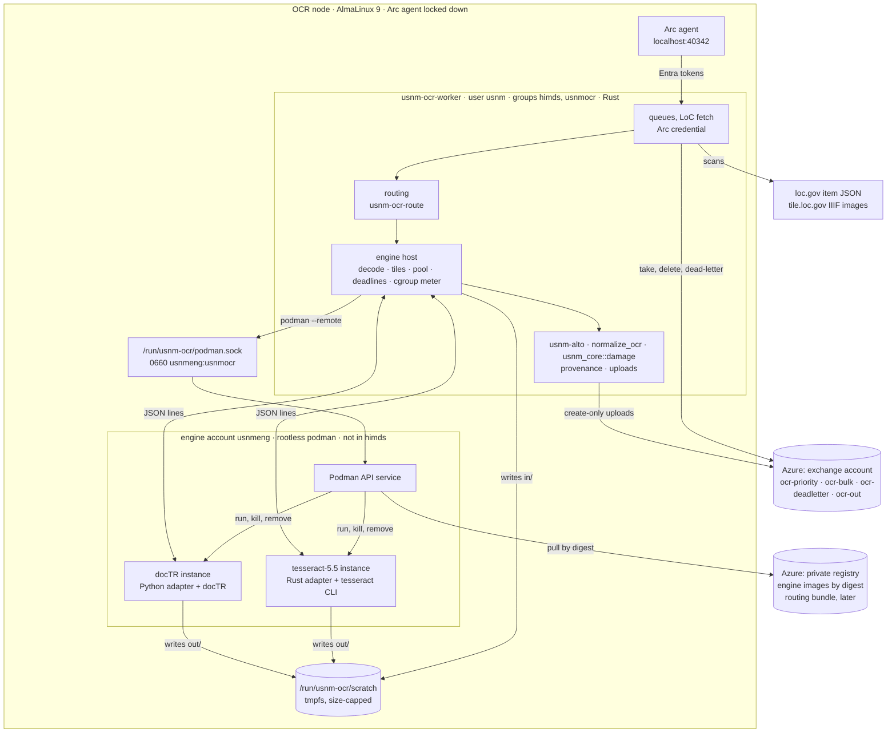
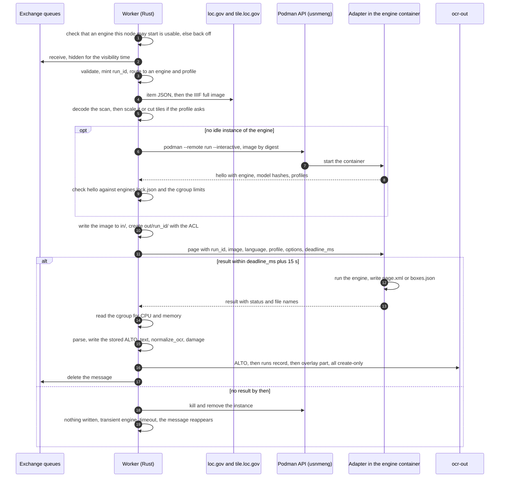
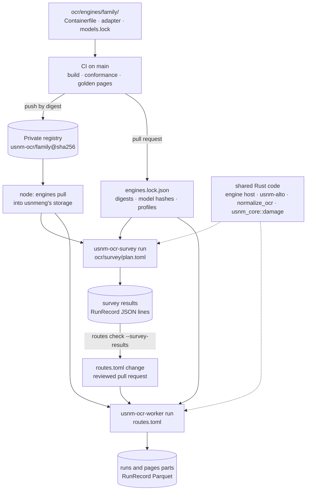

# 13: OCR Engines

**Status:** Proposed with [ADR-0016](adr/0016-pluggable-ocr-engines.md). Nothing here is built yet unless it says main has it · **Date:** October 2026 · **Contract:** `usnm-ocr-engine/1` · **Code today:** `crates/usnm-ocr-worker` (Tesseract only, #298) · **Pipeline:** [12: On-prem OCR pipeline](12-onprem-ocr-pipeline.md)

The on-prem OCR worker ([ADR-0015](adr/0015-onprem-ocr-workers.md), #296) re-reads damaged pages on local machines. This document specifies how it runs more than one OCR engine:

- the contract between the worker and an engine;
- how engines run on a node, and their limits;
- how pages are routed to engines;
- what each page records about the engine that read it;
- how the engine survey uses the same engine images as production;
- a catalog of the engines considered.

[12](12-onprem-ocr-pipeline.md) covers the pipeline around the node: the worker's build, install and unit (Step 2), the language code map and the damage metric in Rust (`usnm_core::lang` and `usnm_core::damage`, Steps 4 to 6), message validation (Step 7), the cloud pickup `usnm-ingest ocr-sync` (Step 8), the release (Step 9) and the seeder (Step 10). This document uses those pieces under 12's names and doesn't restate them.

## 13.1 Scope and terms

- **Engine:** an OCR program and its models, such as Tesseract with tessdata_best, or Kraken with a recognition model.
- **Engine family:** the program, such as `tesseract` or `kraken`. It names `ocr_source` (`usnm-<family>`).
- **Engine id:** a family and a major.minor version, such as `tesseract-5.5`. A change of engine version, adapter or models is a new image digest under the same id; a change of major.minor is a new id.
- **Engine image:** an OCI image with the engine, its models and an adapter, pinned by digest.
- **Adapter:** the image's entrypoint. It speaks the contract and runs the engine.
- **Instance:** a running container of an engine image. It reads one page at a time.
- **Profile:** a named configuration an image offers: a model set plus settings, such as `deu_latf+deu`.
- **Route:** a rule in `ocr/routing/routes.toml` that maps a page to an engine and profile.
- **Worker:** `usnm-ocr-worker`. **Engine host:** the part of the worker that runs instances.

## 13.2 Components and their languages

The rule of 2026-10-10 is that the OCR pipeline is Rust wherever practical. Engines that are Python libraries keep a thin Python adapter. Rows that name a step of 12 are specified there ([12 §12.4](12-onprem-ocr-pipeline.md#124-languages)).

| Component                                                                                                                                            | Language                                 | Why                                                                                                                                                                                                                        |
| ---------------------------------------------------------------------------------------------------------------------------------------------------- | ---------------------------------------- | -------------------------------------------------------------------------------------------------------------------------------------------------------------------------------------------------------------------------- |
| `usnm-ocr-worker`: queues, LoC fetch, deadlines, output (on main)                                                                                    | Rust                                     | ADR-0015 §6. It shares `PageKey`, the overlay types and the credential code with ingest                                                                                                                                    |
| Engine host in the worker: image decode, scaling and tiles, instance pool, `podman --remote` control, deadlines, cgroup meter                        | Rust                                     | The worker owns process control, timeouts and the choice of engine. Tiling once in the worker keeps it out of every adapter                                                                                                |
| `usnm-ocr-contract`: message types, `RunRecord`, the `ocr_engine` tag, JSON Schema export, conformance runner                                        | Rust                                     | One definition of the wire format. The Python adapters validate against the generated schemas                                                                                                                              |
| `usnm-ocr-route`: engine, route and lock types, matching, validation                                                                                 | Rust                                     | The worker, the survey and the seeder route pages the same way                                                                                                                                                             |
| `usnm-alto`: parse ALTO v2, v3 and v4 with limits; write the stored ALTO; convert boxes to ALTO; merge tiles; text in reading order; unit conversion | Rust                                     | The rule names it. One ALTO parser serves the worker and `ocr-sync`'s ALTO checks (12 Step 8). It replaces the survey's `altotext.py`; `ja-ocr/alto.py` stays with the Japanese job until that job moves onto the contract |
| `usnm_core::text::normalize_ocr` (on main)                                                                                                           | Rust                                     | Text is normalized once, in the worker                                                                                                                                                                                     |
| `usnm_core::lang`: MARC, ISO 639-3 and wordfreq codes (12 Step 4)                                                                                    | Rust                                     | Validation, routing, the seeder and the damage tables use one map                                                                                                                                                          |
| `usnm_core::damage` (cargo feature `damage`): port of `ja-ocr/quality.py`'s v2 metric, with its word lists as data files (12 Steps 4 to 6)           | Rust                                     | The rule names it. The worker, the cascade, the survey, `ocr-sync` and the release score text the same way                                                                                                                 |
| `usnm-ocr-survey`: `run`, `throughput`, `score`, `replay`, `repro`                                                                                   | Rust                                     | The rule names the survey runner and scorer, and they must run the production path. They replace the survey's `run.py`, `engine_runner.py`, `score.py` and `tables.py`                                                     |
| `usnm-ocr-adapter` binaries: `tesseract`, `kraken`, later `openai-vlm` and `oar`                                                                     | Rust, static `x86_64-unknown-linux-musl` | CLI and HTTP engines, and any engine that can only be run as a script per page. A static binary works in any base image                                                                                                    |
| `usnm_ocr_adapter` Python package, one module per Python engine                                                                                      | Python                                   | The engine is a Python library imported once into the adapter's process, so its models load once. A Rust adapter would add a second process and IPC                                                                        |
| `usnm-ingest ocr-sync` with the runs-record pickup, and the release's `curated/ocr-local/` reader (12 Steps 8 and 9)                                 | Rust (`usnm-ingest`)                     | They parse untrusted node output, and share `usnm-overlay`, `usnm-alto` and `usnm-ocr-contract`                                                                                                                            |
| Seeder, a step of `ocr-sync` (12 Step 10)                                                                                                            | Rust                                     | It routes with `usnm-ocr-route` and shares the queue client                                                                                                                                                                |
| Word-list export (`scripts/build-damage-words.py`, 12 Step 4)                                                                                        | Python, one-off                          | wordfreq's own API is the reference, as for `scripts/build-english-words.py`. Its output is committed data                                                                                                                 |
| Damage parity fixture (`ja-ocr/damage_parity.py`, 12 Step 5)                                                                                         | Python, one-off                          | `quality.py`'s v2 code is what the port is checked against                                                                                                                                                                 |
| OCR quality audit (`ja-ocr/quality.py`, on main)                                                                                                     | Python                                   | The parity reference until the recurring audit moves to Rust (12 Step 15)                                                                                                                                                  |
| Engine Containerfiles and `fetch-models.sh`                                                                                                          | Containerfile, bash                      | Build-time scripts that make no decisions                                                                                                                                                                                  |
| `ocr/engines/engines.toml`, `ocr/routing/routes.toml`, `ocr/routing/routes.golden.toml`, `ocr/survey/plan.toml`, `/etc/usnm-ocr/node.toml`           | TOML                                     | Hand-written data with comments, read by Rust, so a re-route is a data change                                                                                                                                              |
| `ocr/engines/engines.lock.json`                                                                                                                      | JSON, keys sorted, written by CI         | Pins that a machine writes                                                                                                                                                                                                 |
| `ocr/engines/models.lock`                                                                                                                            | Plain text: name, URL, sha256            | The survey's format, read by `fetch-models.sh` and CI                                                                                                                                                                      |
| CI workflows                                                                                                                                         | GitHub Actions YAML                      | The project's CI                                                                                                                                                                                                           |
| Survey sampler, LoC fetch and crop tool (`sample.py`, `locfetch.py`, `crops.py`, not in the repository)                                              | Python                                   | One-off tools the rule doesn't name. Ported only if they are kept                                                                                                                                                          |
| Japanese cloud job (`ja-ocr/jaocr.py`, on main)                                                                                                      | Python                                   | A running service. Moving it onto the contract is a follow-up (12 Step 15)                                                                                                                                                 |
| Node scripts (`scripts/ocr-node/*.sh`, on main) and the worker's unit file                                                                           | bash, systemd unit                       | Run by root at setup, or read by systemd. They call dnf, useradd, systemctl and azcmagent, and make no routing decisions                                                                                                   |

## 13.3 Component view

One node, with the worker and two engine instances:



- **Two accounts.** The worker runs as `usnm`, which is in `himds` and can get tokens. The engines run under `usnmeng`, a separate system user with its own subordinate ids, which is not in `himds`. Only the worker and `usnmeng` are in the group `usnmocr`.
- **The worker never runs podman locally.** `usnmeng`'s user manager (with lingering on) runs the Podman API service, and its socket is moved to `/run/usnm-ocr/podman.sock` with mode 0660 and group `usnmocr`. The worker runs `podman --remote --url unix:///run/usnm-ocr/podman.sock ...` as child processes. The pipes of `podman --remote run --interactive` are the contract's stdin and stdout. This is why the worker's unit can set `NoNewPrivileges=yes` (ADR-0016, context).
- **The worker's unit**, `scripts/ocr-node/usnm-ocr-worker.service` (12 Step 2 creates it), adds `NoNewPrivileges=yes`, `RestrictNamespaces=yes`, an empty `CapabilityBoundingSet=`, `SystemCallFilter=@system-service`, `ReadWritePaths=/run/usnm-ocr/scratch`, `RuntimeDirectory=usnm-ocr-worker` (mode 0700, for the registry authfile, §13.6.7) and `StateDirectory=usnm-ocr` (the podman client's `HOME`, §13.6.1). It drops `ReadWritePaths=/var/lib/usnm`, and `usnm` no longer needs subordinate ids. 12 Step 2's `KillMode=mixed` stays, so SIGTERM reaches the worker alone and the worker stops the instances itself (§13.6.4).
- **Scratch** is a tmpfs mounted at `/run/usnm-ocr/scratch` with a size cap (node 1: 2 GiB), owned by `usnm`. Memory used by files on a tmpfs is charged to the cgroup of the process that writes them, so an engine's output counts against its own memory limit and can't fill the node's disk.
- **Scratch slots.** Each instance slot, `<engine id>-<n>`, has an `in/` and an `out/` that the worker creates, and a fixed pair of MCS categories. The worker labels both directories with `chcon -t container_file_t -l s0:cA,cB` and starts the container with `--security-opt label=level:s0:cA,cB`, so no volume is mounted with `:Z`. `usnmeng`'s podman couldn't relabel them anyway: the kernel lets only a file's owner, or a process with `CAP_FOWNER` over it, change its label, and the directories belong to `usnm`.
- **Per page**, the worker creates `out/<run_id>/` with mode 0700 and one ACL entry, `setfacl -m u:<id>:rwx`, where `<id>` is the host uid the container user maps to: `usnmeng`'s first subordinate id from `/etc/subuid`, plus 10000. The adapter writes there. The worker reads the adapter's files and deletes them through its ownership of the directory.
- **The spike decides the details** (§13.11, step 1): the socket and group, this labelling and ACL scheme under SELinux enforcing from the hardened unit, `podman --remote` under the unit's environment, and whether the attach streams work with the container log driver turned off.

## 13.4 The contract (usnm-ocr-engine/1)

### 13.4.1 Framing

- The adapter is the image's `ENTRYPOINT`. The worker starts it with named flags only: `--contract 1 --threads <n>`.
- stdin carries requests from the worker and stdout carries replies. Each message is one JSON object on one line: UTF-8, ending in LF, at most 1 MiB.
- stderr is free-form log text. The worker reads it as it arrives, in lines of at most 4 KiB, and drops lines over a rate limit, counting them; it never slows its reads, since podman's attach carries stdout and stderr over one stream and a stalled stderr would stall the protocol. It keeps the last 50 lines to attach to a failure and never parses them.
- One request is in flight per instance at a time. Parallelism comes from more instances.
- Within a contract major version, a reader ignores fields it doesn't know. Adding an optional field doesn't change the version.
- EOF on stdin means: finish and exit 0.
- Bulk data never goes over the pipes. The worker writes the image to `/in/<run_id>.jpg`, or `.png` when it scaled the scan or cut a tile (§13.4.3), and creates `/out/<run_id>/`. The adapter writes only regular files, mode 0644, directly in `/out/<run_id>/`, and names them in its reply.
- A stdout line that isn't valid contract JSON counts as a crash. The instance is killed and restarted.
- Python adapters duplicate fd 1 for the protocol before they import the engine, then point fd 1 and `sys.stdout` at stderr, so a print from a library can't corrupt the stream. Rust adapters give their child processes a null or captured stdout, and start them in a process group of their own (§13.6.5).
- Every example below has its keys sorted.

### 13.4.2 hello (adapter to worker)

The first line on stdout, sent once the adapter is ready for a page. This excerpt shows the Tesseract image's German profiles and their models; the full hello lists every language's:

```json
{
  "adapter": {"lang": "rust", "name": "usnm-ocr-adapter-tesseract", "version": "0.1.0"},
  "cancel": "adapter",
  "contract": 1,
  "deterministic": true,
  "engine": {"family": "tesseract", "id": "tesseract-5.5", "version": "5.5.3"},
  "granularity": "word",
  "layout": "alto",
  "models": [
    {"name": "tessdata/deu.traineddata", "sha256": "8407331d6aa0229dc927685c01a7938fc5a641d1a9524f74838cdac599f0d06e"},
    {"name": "tessdata/deu_latf.traineddata", "sha256": "429b8c33d37e1a4823a2bb082a644ff13e252f735b7945e08a518d22ddcc459e"},
    {"name": "tessdata/frak2021.traineddata", "sha256": "1da2384254fa8462c776faf3b43307fe19ce51be0931c623b2fdd560f96e299a"}
  ],
  "models_loaded": "per_page",
  "profiles": [
    {"id": "deu", "languages": ["deu"], "models": ["tessdata/deu.traineddata"], "tunable": ["psm"]},
    {"id": "deu_latf+deu", "languages": ["deu"], "models": ["tessdata/deu_latf.traineddata", "tessdata/deu.traineddata"], "tunable": ["psm"]},
    {"id": "frak2021", "languages": ["deu"], "models": ["tessdata/frak2021.traineddata"], "tunable": ["psm"]}
  ],
  "type": "hello"
}
```

- `models` lists every model file any profile in this image can load, hashed from disk when the adapter starts. For a CLI engine these are the files the adapter passes to its CLI.
- `models_loaded` is `at_start` when the engine keeps its models in memory between pages, or `per_page` for CLI and script engines (the Tesseract and Kraken CLIs), whose load time falls inside each page's `seconds_wall`.
- `cancel` is `adapter` or `kill` (§13.6.5).
- `languages` are ISO 639-3. The worker maps MARC codes before routing (§13.7.5).
- `layout` is `alto` or `boxes`. `granularity` is the finest level with real geometry: `word`, `line`, `block` or `page`.
- `engine` may also carry `components` (name and version of libraries such as Leptonica).
- hello carries no timing. The worker times the start to hello itself (`model_load_seconds` in the runs record).
- The worker refuses the instance, and counts it toward the engine's breaker (§13.6.5), unless the whole `hello` matches the lock's entry for this image digest (§13.7.3):
  - `adapter` (name, language, version), `contract`, `engine` (`family`, `id`, `version`, and `components` when present), `cancel`, `deterministic`, `granularity`, `layout` and `models_loaded`;
  - the set of (name, sha256) model pairs;
  - the profiles in full: the same ids, and for each id the same `languages`, `models` and `tunable`, compared as sets.

  Each of these changes behaviour or provenance. A different `engine.version` would write an unreviewed version into `ocr_engine`, and a different `cancel` changes how the worker handles a timeout. A profile id alone isn't enough either: an image could keep its ids while a profile drops a language, loads another model or stops accepting an option, so routing would send requests the adapter refuses as `unsupported`, and a swapped model would make the runs record's `models_digest` wrong. CI writes the lock entry from the image's `hello` and fails the build when its profiles differ from `engines.toml`.

### 13.4.3 page (worker to adapter)

```json
{
  "deadline_ms": 840000,
  "image": {"dpi": 300, "dpi_source": "assumed", "height": 7208, "path": "/in/nuc1.20261020T140312123456Z.jpg", "sha256": "<sha256 of the file>", "width": 5412},
  "language": "deu",
  "options": {"psm": 3},
  "out": "/out/nuc1.20261020T140312123456Z/",
  "profile": "deu_latf+deu",
  "run_id": "nuc1.20261020T140312123456Z",
  "script": "Latf",
  "type": "page"
}
```

- `run_id` is `<node>.<UTC stamp>`, minted when the worker starts the page and before the engine call. It names the page's ALTO, runs record and overlay part, so one id ties the protocol, the logs and the outputs together. On main, `output_paths` mints its stamp at upload time; it changes to take the `run_id`, and a name collision adds `-1`, `-2` to the stamp instead of taking a new time.
- The request carries no `doc_id`, URL, batch or credential, only what the engine needs to read the image. The worker logs the mapping from `run_id` to page.
- **Options.** `options` is the profile's `defaults` from `engines.toml`, overlaid by the route candidate's `options`. The worker sends the merged set, and the runs record and the stored ALTO record it. A route may set only keys the profile lists as `tunable`. Options are for the adapter only; the worker's preprocessing (`scale`, `tile`) has its own keys.
- **Image and dpi.** The worker decodes the whole scan (Rust `image` crate) before it sends the page to an instance. Since #368 a cached scan may be the batch's original JP2 (12 §12.2.4), which the `image` crate doesn't read: this step needs a JP2 decoder (OpenJPEG) or a conversion to PNG before the contract handles JP2s. Until then only Tesseract, which reads JP2 through Leptonica, gets them. `image` describes the file the adapter reads: its pixel size, sha256 and dpi. `image.dpi` is the scan's dpi times `scale`: 300 for a full IIIF scan, 150 at half scale. Adapters take the dpi from `image.dpi`; it isn't an option. The Tesseract adapter passes it as `--dpi`, so every route reads full scans at 300 dpi, as main does: main passes `--dpi 300` on every call, because IIIF JPEGs carry no resolution and Tesseract would guess 70.
- **Scale.** `scale` is the worker's preprocessing, like `tile`, and never an adapter option: it isn't in `options`, in any `tunable` list or in `hello`. A profile may set it beside `tile`, and a route candidate may override it with its own `scale` key (default 1). The worker applies it before it writes the image (Lanczos3), and a scaled image is written as PNG so it isn't JPEG-encoded twice. The path's extension gives the format, and `image.width`, `image.height` and `image.dpi` describe the scaled file. Boxes are scaled back afterwards, so every engine gets the same resize. The runs record keeps it in its own `scale` column.
- **Tiles.** A profile may set `tile = { size = 1280, overlap = 256 }`, as the survey runs docTR and Surya on full pages. The worker cuts the tiles with the same code it uses for `scale` and sends each tile to one instance in turn, as its own page request with `run_id` `<run_id>.t<n>`, its own `out` directory and a `deadline_ms` of the time left in the page's deadline. `usnm-alto` moves each tile's boxes to page pixels and keeps a box only when its centre falls in the tile's core (the tile less half the overlap on each inner edge), as the survey's `inside()` does. The page is `ok` only when every tile is. Adapters never tile or merge tiles.
- `script` is ISO 15924 and optional. `dpi_source` is `assumed` (IIIF JPEGs carry no resolution) or `loc_alto`, once a dpi is read from LoC's ALTO.

### 13.4.4 result (adapter to worker)

```json
{
  "engine_stats": {"mean_conf": 0.71, "words": 6034},
  "layout": {"kind": "alto", "path": "/out/nuc1.20261020T140312123456Z/page.xml"},
  "markup": "none",
  "run_id": "nuc1.20261020T140312123456Z",
  "status": "ok",
  "text": {"path": "/out/nuc1.20261020T140312123456Z/page.txt"},
  "type": "result",
  "warnings": []
}
```

- `layout.kind` must equal `hello`'s `layout`, and a `boxes.json` must declare `hello`'s `granularity`; ALTO is checked for geometry at that level. A mismatch is `engine_protocol`, since the lock pins both and the runs record copies them.
- `layout.kind` is `alto` (any version, any `MeasurementUnit`; the adapter gives `alto_dpi` when the engine converted pixels at an assumed dpi, as NDNP Open OCR does at 300) or `boxes` (§13.4.5).
- `text` is the engine's own text, kept by the survey for comparison. The stored text never comes from it: for every granularity it is derived from the layout (§13.4.7). A block-level engine puts each block's text in its `boxes.json` block, and a page-level engine writes one page-sized block.
- `markup` is `none`, `html` (Surya's blocks) or `markdown` (most vision-language models). Rust strips it once, before the ALTO writer and `normalize_ocr`, so no markup reaches the index. Other formats, such as DocTags or grounding tokens, are parsed into boxes and one of these by the adapter (the Rust `openai-vlm` adapter's per-model parsers).
- `status` is one of `ok`, `unsupported`, `bad_input`, `failed` or `timeout` (§13.4.6). A failure adds `"error": {"kind": "...", "message": "..."}`, with the message at most 2 KiB and never containing page text. `failed` may add `"restart": true` when the adapter knows its engine is in a bad state.
- Output marked `"partial": true` (text read before a deadline) is read only by the survey. Production never stores partial output.
- `engine_stats` is free-form numbers, at most 64 keys of at most 64 characters each. The worker keeps it in the runs record's `engine_stats_json` column, keys sorted, and never interprets it. Adapters never report timings, resource use, image digests or damage: the worker measures those itself.

### 13.4.5 boxes.json (usnm-boxes/1)

For engines without ALTO: docTR and OnnxTR, American Stories regions, Surya blocks, NDLOCR-Lite lines, PaddleOCR and oar-ocr, and spotting or grounding output from vision-language models.

```json
{
  "blocks": [
    {"bbox": [120, 340, 1610, 2200], "conf": 0.9, "dir": "ltr", "kind": "text", "label": "article", "lang": "deu", "lines": [
      {"bbox": [120, 340, 1610, 395], "conf": 0.87, "hyphen": false, "text": "Deutsche Zeitung", "words": [
        {"bbox": [120, 342, 410, 395], "conf": 0.91, "text": "Deutsche"}
      ]}
    ], "order": 0},
    {"bbox": [1700, 300, 3400, 1900], "kind": "illustration", "order": 1}
  ],
  "frame": {"height": 7208, "width": 5412},
  "granularity": "word",
  "reading_order": "engine",
  "units": "px",
  "v": 1
}
```

- `units` is `px`, `rel` (0 to 1, as docTR exports) or `norm1000` (0 to 1000, as Qwen3-VL, LightOnOCR, Chandra and HunyuanOCR emit). `frame` is the size of the image the coordinates refer to. Rust maps every box to pixels of the image the worker sent, and then to the full IIIF frame. An engine that resizes internally, such as dots.ocr, reports `px` with `frame` set to its resized size.
- A box is `[x0, y0, x1, y1]` from the top left, with `x1 > x0` and `y1 > y0`. `polygon` and `baseline` are optional lists of `[x, y]` points. Rust clamps boxes up to 2 px outside the frame and rejects the result (`convert`) beyond that.
- `kind` is `text`, `heading`, `caption`, `table`, `illustration` or `separator`. The first four become TextBlocks, `illustration` an Illustration, `separator` a GraphicalElement. Text on an illustration (a vision-language model's description of a picture, for example) is dropped and never indexed.
- `reading_order` is `engine` when the engine gives one: array order, or `order` on blocks where given. It is `none` when the engine emits blocks or lines in detection or tile order (docTR, PaddleOCR). For `none`, Rust orders blocks with a column-aware XY cut on the block boxes, in the page's direction, so the lines of a 6 to 8 column page aren't read across the columns.
- `dir` on a block or line is `ltr`, `rtl` or `ttb-rl` (vertical lines read right to left, as in NDLOCR-Lite's vertical Japanese). Without it, the script's direction applies: `rtl` for Hebrew and Yiddish, `ltr` otherwise. Words in a line and lines in a block are ordered by it.
- Text sits at the finest level present. `hyphen: true` means the line's last word continues on the next line; the writer emits `HYP` and, where it can join the parts, `SUBS_CONTENT`.
- `conf` is 0 to 1, or absent.

### 13.4.6 Status and what the worker does

| Source  | Status                                                                                         | Production                                                                                                                                     | Survey                    |
| ------- | ---------------------------------------------------------------------------------------------- | ---------------------------------------------------------------------------------------------------------------------------------------------- | ------------------------- |
| adapter | `ok`                                                                                           | Convert, write the outputs, delete the message                                                                                                 | Score                     |
| adapter | `unsupported`: profile, language or option not in this image                                   | Try the route's next candidate in the same receive. With none left: transient `no_model`, logged as an error, since it means a routing mistake | Record                    |
| adapter | `bad_input`: the engine can't read an image the worker decoded                                 | The image is fine, so the adapter is wrong: transient `engine`, and the next candidate in the same receive                                     | Record                    |
| adapter | `failed`                                                                                       | Transient `engine`. Restart the instance if the adapter asked                                                                                  | Record                    |
| adapter | `timeout`: the adapter stopped at `deadline_ms` and stopped its processes (`cancel = adapter`) | Transient `engine_timeout`. Recycle the instance if `cgroup.procs` holds processes that weren't there after `hello`                            | Record, with partial text |
| worker  | the scan doesn't decode                                                                        | Permanent, dead-lettered. No engine is called                                                                                                  | Record                    |
| worker  | no result by `deadline_ms` + 15 s                                                              | Kill the instance; transient `engine_timeout`; restart it lazily                                                                               | Record                    |
| worker  | instance exited, or a stdout line that isn't contract JSON                                     | Transient `engine_oom` if `podman --remote inspect` reports `OOMKilled`, else `engine_crash`; then `podman --remote rm`; restart with backoff  | Record                    |
| worker  | protocol: a limit, a path or the schema broken                                                 | Transient `engine_protocol`; replace the instance                                                                                              | Record                    |
| worker  | `convert`: the ALTO or boxes don't parse                                                       | Transient `convert`                                                                                                                            | Record                    |
| worker  | no usable candidate on this node                                                               | Transient `no_route_here`, and a node-wide receive backoff (§13.7.6)                                                                           | Record                    |

"Transient" means what it means on main: the message is left and reappears when its visibility runs out. "Permanent" goes to `ocr-deadletter` at once. A message received more than 5 times is dead-lettered, as on main. A page that keeps failing on its first candidate moves to the next one by dequeue count, with no state shared between nodes (§13.7.6).

### 13.4.7 What the worker does with a result

1. **Checks the files.** Every path must resolve inside the instance's `out/<run_id>/` with no `..` and no symlinks (`symlink_metadata`, `O_NOFOLLOW`), and must be a regular file. Size caps on the engine's files: the result line 1 MiB, ALTO or boxes 64 MiB, text 8 MiB, the whole job directory 256 MiB. Engine ALTO is more verbose than the stored ALTO, so these are larger than the output limits in step 7.
2. **Parses.** `usnm-alto` reads ALTO v2, v3 and v4 in `pixel`, `inch1200` or `mm10` with quick-xml. It refuses any `DOCTYPE`, expands no entities, and caps depth, element count, `CONTENT` length (1 KiB) and strings per page (500,000). It handles Kraken's v4 with `SP` as a sibling element and polygons. JSON is parsed with a depth limit and checked UTF-8. `boxes.json` is read by a streaming deserializer that counts as it goes and stops at the first limit, before it builds the whole structure: 20,000 blocks, 200,000 lines, 500,000 words (the ALTO string cap), 1 KiB of text per word or line, 512 KiB per block (a block- or page-level engine puts a whole block's or page's text there, so the block cap is the stored text's limit of step 7), 1,000 points per polygon or baseline and 2,000,000 points in all. The worker has no memory limit of its own beyond its unit's, so a small file that expands into millions of tiny boxes must be refused while it is read. Breaking a limit is `engine_protocol`.
3. **Writes the stored ALTO** from the parsed values. Nothing from the engine's XML is copied except escaped `CONTENT` strings. The profile is in §13.8.2.
4. **Derives the text** from the stored ALTO in reading order (a port of the survey's `altotext.py`), for every granularity, so text and boxes always agree. The declared `markup` was stripped from the block, line and word text before the ALTO was written. Then `usnm_core::text::normalize_ocr`, as on main. This is the text the overlay stores and the survey scores.
5. **Scores damage after OCR** with `usnm_core::damage` (12 Step 5) in forced-language mode: against the page's language only, as the survey's `score.py` scores with `quality.py`'s `damage()`. v2's language detection needs the title's catalog languages, which the worker doesn't have. `usnm_core::lang` maps the message's ISO 639-3 code to the metric's tables, which `quality.py` keys by MARC code (`ger` to `de`, `hrv` and `srp` to `sh`). `damage_after` is null for `jpn` (`quality.py` doesn't score Japanese titles), for `und` and for any language without a word list.
6. **Measures** wall time, CPU time, peak memory and OOM kills from the instance's cgroup (§13.6.6).
7. **Checks the output limits, then writes** the ALTO, then the runs record, then the overlay part, create-only with the same `run_id` (§13.8). The limits are `ocr-sync`'s (12 Step 8 checks 1 and 4): stored ALTO at most 32 MiB, part and runs record at most 1 MiB each, text at most 512 KiB with no control characters other than newline and tab. They are one set of constants in `usnm-ocr-contract`, which both the worker and `ocr-sync` use, so a page the worker uploads can't be quarantined for its size. A reading over a limit uploads nothing and fails as transient `convert` with kind `too_large`, so the page can move to the route's next candidate by dequeue count.

### 13.4.8 Versioning and conformance

- The Rust types in `usnm-ocr-contract` are the source. A schema binary writes `ocr/contract/v1/{hello,page,result,boxes}.schema.json`, and CI fails if the files differ from the types.
- A breaking change becomes contract 2. The worker supports N and N-1 while images move over, and the conformance suite tests both.
- `usnm-ocr-worker engines conformance --engine <id> --fixtures ocr/contract/fixtures` drives a real container through:
  - a rendered text line (`testimg.rs` on main renders one), with box positions checked within a tolerance;
  - a blank page;
  - a corrupt image, which must return `bad_input` (production never sends one, but the adapter's mapping is checked);
  - an unknown profile, which must return `unsupported`;
  - a 1 s deadline on a large page. An image with `cancel = adapter` must return `timeout`, leave no process it started in the container's `cgroup.procs`, and serve the next request. For `cancel = kill` the suite expects no result, checks the worker's kill, and checks that the restarted instance serves the next page;
  - for Tesseract, a page with `image.dpi` 300, which must run the CLI with `--dpi 300` (the adapter logs its command line to stderr);
  - noise printed to stdout by the engine, which must not reach the protocol;
  - an oversized output, and stdin EOF.
- CI runs conformance for every image it builds.

Built in #307 (part of §13.11 step 4), with these limits:

- **The engine.** Until `engines.toml` names engines by id (#371), the runner takes the engine as `run` does: `usnm-ocr-worker engines conformance --engine contract` with `--engine-image` (through the engine runtime) or `--engine-command` (a local adapter, for development), and `--fixtures` (default `ocr/contract/fixtures`). It starts one instance at `image.dpi` 300 and prints one JSON line per case (`pass`, `fail` or `skipped`), then a summary, and exits non-zero if any case fails.
- **Through the worker's exchange.** The runner is in `usnm-ocr-worker` (`contract::conformance`), not `usnm-ocr-contract`, because it drives the worker's own instance code. Every page goes through the same request, file checks, size caps and layout parsing as a production page (§13.4.7 steps 1 and 2), so the runner checks the adapter against exactly what the worker accepts.
- **The cases.** Text is checked as the worker stores it: derived from the parsed layout (§13.4.7 step 4), not the optional text file. The rendered pages are sent as PNGs (§13.4.1), encoded by `testimg::png`. `text_line` renders `HELLO LOWER` with `testimg.rs` and requires the text, and boxes at the page's granularity within 12 px of the ink (inside the image, for `block` and `page`). `blank_page` requires no text. `corrupt_image` sends `fixtures/corrupt.png` with the size in its header and requires `bad_input`; the text-only adapter now maps Leptonica's read error to it. `unknown_profile` requires `unsupported`. `deadline` gives a 3,500×7,262 page a 1 s deadline and requires `timeout` from a `cancel = adapter` engine, or for `cancel = kill` no result and the worker's kill after the 15 s grace; then the (new) instance must read the line. The case times the adapter from the request to its reply, without the instance's start, the scan's copy or the worker's reading of the output. A page read within the 1 s deadline leaves nothing to cancel, so `deadline` is skipped on an engine that fast; a page read after it fails. `tesseract_dpi`, for the `tesseract` family, requires `--dpi` with the argument exactly `300` (`--dpi 300` or `--dpi=300`) in the command line the adapter logs to stderr. `stdin_eof` closes the instance's input and requires no more output and exit 0.
- **Stdout noise and oversized output** are the contract's existing rules, not new behaviour: a line on stdout that isn't a contract message, a result line over 1 MiB, a layout, text or page directory over its cap or a layout over its limits is `engine_protocol`, and the worker kills and replaces the instance (§13.4.6, §13.4.7 step 1). The runner can't make a real engine print noise or a huge page, so `stdout_noise` and `oversized_output` fail if any page of the suite broke one of these rules, and pass otherwise. Any other `engine_protocol` failure (a wrong `run_id`, layout or granularity) fails `protocol`. The adapter crate's tests break each rule with a stand-in and check that the case fails and the next page is read on a new instance.
- **Skipped.** `deadline_cgroup` (nothing the adapter started left in the container's `cgroup.procs`) needs the engine runtime's cgroup (§13.6.6), and `contract_n_minus_1` waits for contract 2. CI doesn't run the suite yet: there's no adapter image to build (§13.11 steps 5 and 9).
- **Closing an instance's input.** The suite found that the worker's "close its input" only flushed the pipe (Tokio's `shutdown` on a child's stdin doesn't close it), so a retired instance always waited out the 10 s and was killed. The worker now drops the pipe, and an adapter sees EOF.

## 13.5 One page through an engine



- `deadline_ms` is the smallest of the engine's `page_timeout_secs`, the route's `timeout_secs`, and the time left in the page's budget minus 60 s for the uploads (minus `start_timeout_secs` too when the instance is cold). The budget is 0.8 of the visibility time, as on main: 1,440 s at the default 1,800 s.
- The uploads are cut off at the budget, as on main.

## 13.6 Engine instances and resource limits

### 13.6.1 Container settings

The engine host starts an instance like this (one command, shown wrapped):

```sh
podman --remote --url unix:///run/usnm-ocr/podman.sock run --interactive --init --pull=never \
  --name usnm-eng-<engine id>-<n> --label usnm.node=<node> --label usnm.engine=<engine id> \
  --network=none --http-proxy=false --no-hosts \
  --read-only --tmpfs /tmp:rw,nosuid,nodev,size=<tmp>,mode=1777 \
  --user 10001:10001 --cap-drop=all --security-opt=no-new-privileges \
  --security-opt label=level:s0:<cA>,<cB> \
  --memory=<memory> --memory-swap=<memory> --cpus=<cpus> --pids-limit=<pids> --shm-size=<shm> \
  --ulimit nofile=1024:1024 --ulimit core=0 \
  --log-driver=none --stop-timeout=10 \
  --env HOME=/tmp --env OMP_THREAD_LIMIT=<threads> [only the env listed for the engine] \
  --volume /run/usnm-ocr/scratch/<engine id>-<n>/in:/in:ro \
  --volume /run/usnm-ocr/scratch/<engine id>-<n>/out:/out:rw \
  <registry>.azurecr.io/usnm-ocr/<family>@sha256:<digest> --contract 1 --threads <threads>
```

- **No network.** `--network=none` leaves only the container's own loopback, so an engine can't reach loc.gov, storage, the registry or the Arc agent at the host's `localhost:40342`. A vision-language image can still run llama-server on that loopback.
- **No credentials or host environment.** The worker spawns `podman --remote` with a cleared environment plus `PATH`, `LANG`, `HOME=/var/lib/usnm-ocr` (the unit's `StateDirectory`), `XDG_CONFIG_HOME=/var/lib/usnm-ocr/config` and `CONTAINERS_CONF=/etc/usnm-ocr/containers-remote.conf`. The podman client has failed with no `HOME`, or with a `HOME` that doesn't exist (podman issues 8434 and 23818), and `usnm`'s home, `/var/lib/usnm`, is read-only under the unit. The container gets `HOME`, `OMP_THREAD_LIMIT` and the env `engines.toml` lists for the engine. Engine caches (`HF_HUB_OFFLINE=1`, `TRANSFORMERS_OFFLINE=1`, `XDG_CACHE_HOME=/tmp/cache`) are baked into the image.
- **No identity on the host.** `--user 10001:10001` maps to a subordinate id of `usnmeng`, not to `usnmeng` itself. Images set `USER 10001` too.
- **No privileges.** A read-only root, all capabilities dropped, no-new-privileges, the default seccomp profile, `--init`.
- **Limits.** Memory equals memory plus swap, so there is no swap; CPU, pid, open-file and core-file limits.
- **No `--rm`.** After an instance exits, the worker reads its exit code and `{{.State.OOMKilled}}` with `podman --remote inspect`, then removes it with `podman --remote rm`. With `--rm`, the container and its cgroup can be gone before the worker reads them.
- **SELinux** stays enforcing. The container runs at its slot's fixed MCS level, and the slot's directories carry the same label (§13.3), so no volume needs `:Z`. Node 2's GPU engines get only the CDI device they need (`--device nvidia.com/gpu=<n>`). On GPU nodes `node-setup.sh` turns on the `container_use_devices` boolean, which `container_t` needs to open NVIDIA device nodes. Labels are never disabled.

### 13.6.2 Limits per engine

Each engine entry in `engines.toml` (§13.7.2) declares:

| Field                            | Meaning                                                                             |
| -------------------------------- | ----------------------------------------------------------------------------------- |
| `memory`                         | `--memory` and `--memory-swap`. Reserved for the instance's whole life              |
| `cpus`, `threads`                | `--cpus`, and the thread count passed to the adapter and as `OMP_THREAD_LIMIT`      |
| `pids`, `shm`, `tmp`             | `--pids-limit`, `--shm-size`, and the size of `/tmp` (a tmpfs, counted in `memory`) |
| `max_instances`, `min_instances` | Instances per node, overridable per node                                            |
| `start_timeout_secs`             | Time to the `hello` line                                                            |
| `page_timeout_secs`              | Longest page                                                                        |
| `idle_stop_secs`                 | Stop an idle instance after this long (0: keep it running)                          |
| `max_jobs_per_instance`          | Recycle the instance after this many pages                                          |
| `gpus`, `gpu_memory`             | Class `gpu` only: GPUs per instance, and the GPU memory it reserves on its device   |

Each profile may add `defaults` (options sent unless a route overrides them) and `tile` (§13.4.3).

Starting values come from the survey: `memory` is the engine's instance peak (`instance_peak_mem_mb`, §13.6.6) on the survey's pages plus 25%, rounded up, and `page_timeout_secs` covers its slowest surveyed page with margin. For Tesseract the starting entry is 1,536 MiB, 1 CPU, 1 thread, 64 pids, 2 instances on node 1, 60 s to start and 900 s per page. These are guesses until `usnm-ocr-survey throughput` measures 2, 3 and 4 instances on node 1's two cores.

The worker refuses a production engine at startup, and `routes check` refuses it in CI, when `start_timeout_secs + page_timeout_secs` exceeds the page budget minus 60 s. On main the worker only warns when `--page-timeout-secs` is at or over the budget.

### 13.6.3 Memory budget and scheduling

- Each node declares an `engine_memory` budget in its node file, `/etc/usnm-ocr/node.toml` (named flag `--node-config`). Node 1: 6 GiB of its 8 GB. The node file also lists the engines the node may start, and per-engine overrides of `max_instances`.
- A page routed to engine E gets, in order: an idle instance of E; a new instance, if E is under `max_instances` and its `memory` fits the budget; a new instance after stopping the least recently used idle instances of other engines; or else it waits. After 25% of the page budget it tries the route's next candidate. With none, it leaves the message.
- `--concurrency` still caps pages in flight. It defaults to 1 on main; with engine instances it should be at least the node's instance count plus 1, so the next page's fetch overlaps the current OCR.
- **GPU nodes.** `node.toml` also gives each GPU device a `gpu_memory` budget. An instance of a `gpu` engine is pinned to one device (`--device nvidia.com/gpu=<n>`) where its `gpu_memory` fits, so two vision-language instances never share a GPU they don't fit on together. Without this, a CUDA out-of-memory error comes back as `failed`, not as an OOM kill, and the breaker flaps.
- On node 1, large Python engines compete for the same budget. Mixed queues can make the node start and stop engines back and forth, which per-node engine lists and `idle_stop_secs` limit.

### 13.6.4 Startup and shutdown

- **Startup:** the worker removes stale containers (`podman --remote rm -f --filter label=usnm.node=<node>`), empties scratch, and loads the routing bundle (§13.7.8). For each engine the node may start, it checks the image digest is present. With `podman --remote info` it checks that the memory, cpu and pids cgroup controllers are delegated; without them it refuses to start engines.
- **First instance of each engine:** the worker checks `memory.max` and `pids.max` in two parts. cgroup v2 limits are hierarchical, but each file shows only the value set on that cgroup, so one file can't show the limit that applies.
  - **The limit is set.** The smallest value over the container's `CgroupPath` and its ancestors up to its `libpod-<id>.scope` must equal the configured limit. `CgroupPath` can point at an inner `container` cgroup whose own limit is `max`, so the scope is included.
  - **Nothing above it is tighter.** Every ancestor above the scope, below the cgroup root (`usnmeng`'s `user@<uid>.service`, `user-<uid>.slice` and `user.slice`; the root has no limit files), must be `max` or leave room for what the node may run there at once plus the runtime around it. Those ancestors also hold `usnmeng`'s user manager, the Podman API service, conmon and the other runtime helpers. So `memory.max` and `memory.high` must be at least the node's `engine_memory` plus `runtime_memory_headroom`, and `pids.max` at least the sum of `pids` times `max_instances` over the engines the node may start plus `runtime_pids_headroom`. Both headrooms are in `node.toml` (defaults 512 MiB and 256), and `node-setup.sh` sets any limit it puts on `usnmeng`'s slice from the same file. Otherwise a systemd slice above the scope could leave an engine less memory or fewer pids than the scheduler assumes.

  If either part fails, the worker refuses the engine and raises an error naming the cgroup and its value. Limits that don't apply fail closed instead of letting an engine use the whole node.

- **Every instance:** after `hello`, the worker records the container's `cgroup.procs`, for the check after a timeout (§13.6.5).
- **SIGTERM:** the worker stops taking messages and gives in-flight pages `--shutdown-grace-secs`, as on main. Then it closes every instance's stdin, waits up to 10 s, and removes what is left.

### 13.6.5 Deadlines, crashes and recycling

- **Adapter deadline.** Each image declares `cancel` in `hello`.
  - With `adapter`, the adapter stops at `deadline_ms`. Before it answers `timeout`, it kills every process it started for the page (it runs engine children in their own process group and kills the group) and cancels in-flight server requests, restarting the server if it has to (Surya's llama-server). Otherwise an orphan keeps working into the next page and its CPU and memory are counted against that page.
  - With `kill`, the adapter makes no promise, and the worker's kill is the path. Python adapters use `SIGALRM`, which Python delivers only between bytecodes, so a long native call in torch or ONNX Runtime isn't interrupted. Python adapters whose engine spends most of a page in such a call declare `kill`. Each kill costs a model load.
  - After any `timeout` result, the worker compares `cgroup.procs` with the set it recorded after `hello`, and recycles the instance if extra processes remain.
- **Worker deadline.** At `deadline_ms` + 15 s the worker runs `podman --remote kill --signal KILL` and removes the instance.
- **Crash.** EOF on stdout, a line that isn't contract JSON, or a container exit. The page fails as transient. The instance restarts lazily with backoff: 1 s, 5 s, 30 s, 2 min.
- **Breaker.** An engine's breaker opens on either of these, and disables the engine on the node for 15 minutes:
  - 3 crashes or refused `hello`s in 10 minutes;
  - 5 pages in a row, each a different `doc_id`, that end in an engine-level failure: `failed`, `timeout` from the adapter, the worker's `engine_timeout`, `engine_oom`, `engine_protocol` or `convert`, with no `ok` between them. Counting distinct pages keeps one bad page from opening it: a page that fails on every receive counts once. `unsupported`, `bad_input`, LoC errors and `too_large` don't count.

  Routes then use their next candidate. While no engine the node may start is usable, the worker takes no messages (§13.7.6). After the 15 minutes the breaker is half open: one page goes to the engine, and its failure opens the breaker again for twice as long, up to 2 hours. So an engine release that hangs or fails on every page costs 5 pages one receive each, then one page's receive per open period, instead of draining the queue.

- **Recycling.** An instance restarts between pages after `max_jobs_per_instance` pages, or when `memory.current` after a page is above 90% of its limit (a leak).
- A page that always times out, while other pages succeed, costs a kill and a restart on each of its 5 receives before it is dead-lettered.

### 13.6.6 Metering

The worker gets each instance's cgroup path from `podman --remote inspect --format '{{.State.CgroupPath}}'` and reads, for every page:

- **CPU:** the `usage_usec` delta in `cpu.stat`. It is exact, because an instance reads one page at a time.
- **Peak memory of the page:** `memory.current` sampled 4 times a second during the page (`peak_mem_mb`).
- **Peak memory of the instance:** `memory.peak` (`instance_peak_mem_mb`). It is the cgroup's high-water mark since the instance started, model load included. Resetting it per page needs Linux 6.12 and write access to `usnmeng`'s cgroup files, and EL9's 5.14 kernel and the worker have neither. The survey sizes `memory` limits from it.
- **OOM kills:** the `oom_kill` delta in `memory.events` while the instance lives; after an exit, `{{.State.OOMKilled}}` (§13.6.1).
- **Wall time:** from writing the request to reading the result.

For a page during which the instance exits, CPU and peak memory are null.

Cgroup files are world-readable, and `ProtectControlGroups=yes` leaves them readable. These figures go into the runs record and into telemetry: `ocr.engine_seconds`, `ocr.engine_cpu_seconds` and `ocr.engine_peak_mb` (histograms by engine, profile and language), and `ocr.engine_restarts` and `ocr.engine_errors` (counters by engine and cause).

### 13.6.7 Images on the node

- `usnm-ocr-worker engines pull --node-config /etc/usnm-ocr/node.toml` gets an Entra token from the Arc agent, exchanges it at the registry's `/oauth2/exchange` endpoint for a registry refresh token, and pulls each image the bundle names by digest through the Podman API. The credential goes in an authfile in the worker's `RuntimeDirectory` (tmpfs, 0700), passed with `--authfile` and deleted after the pull, never on a command line. `podman --remote pull` sends it to the Podman API service in the `X-Registry-Auth` header, so `usnmeng`'s service holds the registry refresh token (about 3 hours, AcrPull on the whole registry) during the pull; ADR-0016's consequences record this.
- `engines gc` removes images that are in neither the current nor the previous bundle. Engines whose image isn't pulled yet are skipped by routing.
- Containers always run with `--pull=never`, by digest.
- The one new grant is AcrPull on the registry for `usnm-ocr-nodes-<env>` (`principalType: 'Group'`), in `infra/modules/registry.bicep`. The grant is registry-wide; see ADR-0016's consequences for why not per repository.

## 13.7 Routing

### 13.7.1 Files

| File                             | Written by     | Contents                                                                           |
| -------------------------------- | -------------- | ---------------------------------------------------------------------------------- |
| `ocr/engines/engines.toml`       | Hand, reviewed | Engines, their models and licences, profiles, limits, production flag              |
| `ocr/routing/routes.toml`        | Hand, reviewed | `version`, ordered routes, title-level script facts                                |
| `ocr/engines/engines.lock.json`  | CI, in a PR    | Per engine id: image reference and digest, adapter version, model hashes, profiles |
| `ocr/engines/models.lock`        | Hand, reviewed | Model files: name, source URL, sha256 (moved from the survey, same format)         |
| `ocr/routing/routes.golden.toml` | Hand, reviewed | Page attributes and the route each must hit; `cargo test` checks them              |

The routing bundle is `engines.toml`, `routes.toml` and `engines.lock.json`. Its digest is the sha256 of the lines `<file name> <sha256 of its bytes>`, sorted.

### 13.7.2 engines.toml

**Built in #371:** the [catalog and credit schema](../../ocr/engines/README.md),
`usnm-ocr-route` loader and shared production licence gate, both worker engine paths,
and `usnm-ocr-worker routes check`. The minimal route stays Tesseract-only;
full matching, node capability routing and the rest of the bundle remain later steps.

An excerpt, with the German profiles only:

```toml
schema = 1
# Tier 1, cleared: licences that allow our use. The maintainer edits this list.
# The NC, SA and Datalab entries were cleared on 2026-10-10 because the site
# is non-commercial. MinerU's, DINOv3's and dots' terms were added on 2026-10-11.
production_licenses = [
  "Apache-2.0", "MIT", "BSD-3-Clause", "CC0-1.0", "CC-BY-4.0",
  "CC-BY-NC-4.0", "CC-BY-SA-4.0", "LicenseRef-Datalab-OpenRAIL-M",
  "LicenseRef-MinerU", "LicenseRef-DINOv3", "LicenseRef-dots-MIT",
]
# Licences whose own terms require credit. Every production model is
# credited on the credits page anyway; these say the licence requires it.
# DINOv3's licence asks for acknowledgement only in research publications,
# so it isn't here; NDLOCR-Lite is credited under its CC BY 4.0.
credit_required = [
  "CC-BY-4.0", "CC-BY-NC-4.0", "CC-BY-SA-4.0", "LicenseRef-Datalab-OpenRAIL-M",
  "LicenseRef-MinerU", "LicenseRef-dots-MIT",
]
# Tier 2, attributed: license = "none" (openly published, no explicit
# licence) is allowed in production by the maintainer's decision of
# 2026-10-11, when the entry has source, author, fetched, note and credit.
# Tier 3, excluded: an entry with `restricted` is never routed in production.
# Undecided: an entry with `undecided` is never routed in production either,
# until the maintainer decides and the field is removed.

[[engine]]
id = "tesseract-5.5"
family = "tesseract"             # ocr_source = "usnm-tesseract"
build = "ocr/engines/tesseract"
adapter = "rust"
class = "cpu"                    # cpu, or gpu (node 2)
production = true
license = "Apache-2.0"           # the engine's code, gated like a model
author = "Tesseract OCR project"
source = "https://github.com/tesseract-ocr/tesseract"
credit = "Tesseract OCR engine, Tesseract OCR project, Apache-2.0"
deterministic = true
memory = "1536m"
cpus = 1.0
threads = 1
pids = 64
shm = "64m"
tmp = "512m"
max_instances = 2
min_instances = 1
idle_stop_secs = 0
start_timeout_secs = 60
page_timeout_secs = 900
max_jobs_per_instance = 2000
env = {}

[[engine.model]]
name = "tessdata/deu_latf.traineddata"
license = "Apache-2.0"
author = "Tesseract OCR project"
source = "https://github.com/tesseract-ocr/tessdata_best"
credit = "Tesseract deu_latf model, Tesseract OCR project, Apache-2.0"

[[engine.model]]
name = "tessdata/deu.traineddata"
license = "Apache-2.0"
author = "Tesseract OCR project"
source = "https://github.com/tesseract-ocr/tessdata_best"
credit = "Tesseract deu model, Tesseract OCR project, Apache-2.0"

[[engine.model]]
name = "tessdata/frak2021.traineddata"
license = "CC0-1.0"              # Zenodo record 10125246, the file frak2021-0.905.traineddata
author = "Stefan Weil, UB Mannheim"
source = "https://zenodo.org/records/10125246"
fetched = 2026-10-11
credit = "frak2021 Tesseract model by Stefan Weil, UB Mannheim (CC0 1.0)"

[[engine.model]]
name = "tessdata/german_print.traineddata"
license = "none"                 # tier 2
author = "Stefan Weil, UB Mannheim"
source = "https://ub-backup.bib.uni-mannheim.de/~stweil/tesstrain/tesseract/german_print/"
fetched = 2026-10-11
note = "No explicit licence: the directory and its parents have no licence or README, and the model isn't on Zenodo"
credit = "german_print Tesseract model by Stefan Weil, UB Mannheim (published without a licence)"

# File order is preference order when a route says profile = "auto".
# On main, candidates() in engine.rs tries deu_latf+deu, frk+deu, deu.
# frk+deu is dropped (tessdata_best renamed frk to deu_latf), and frak2021
# is added second.
[[engine.profile]]
id = "deu_latf+deu"
models = ["tessdata/deu_latf.traineddata", "tessdata/deu.traineddata"]
languages = ["deu"]
defaults = { psm = 3 }           # sent unless a route overrides them
tunable = ["psm"]

[[engine.profile]]
id = "frak2021"
models = ["tessdata/frak2021.traineddata"]
languages = ["deu"]
defaults = { psm = 3 }
tunable = ["psm"]

[[engine.profile]]
id = "deu"
models = ["tessdata/deu.traineddata"]
languages = ["deu"]
defaults = { psm = 3 }
tunable = ["psm"]
```

An excluded model's entry looks like this:

```toml
[[engine.model]]
name = "qwen2.5-vl-3b-instruct.gguf"
license = "LicenseRef-Qwen-Research"
restricted = """Qwen Research License 1(i): "'Non-Commercial' shall mean for research or evaluation purposes only." \
https://huggingface.co/Qwen/Qwen2.5-VL-3B-Instruct/blob/main/LICENSE"""
```

**The gate.** `production = false` keeps an engine out of production routes. A production route may use a profile only if the engine's code and every model the profile uses are in tier 1 or tier 2. The engine's code is recorded on `[[engine]]` with the same fields as a model (`license`, `author`, `source`, `credit`, and `fetched`, `note`, `restricted` or `undecided` where they apply), and the same rules hold for it:

1. **Cleared.** Its `license` is in `production_licenses`.
2. **Openly published, no explicit licence, attributed.** Its `license` is `none`, and it has `source` (the URL the file was fetched from), `author` (the author or publisher as the source names them), `fetched` (a date), `note` (that it has no explicit licence, and where that was checked) and `credit`.
3. **Excluded.** It has `restricted`, which quotes the clause that restricts our use and links it. It is refused whatever its `license` says. `license = "unknown"` means nobody has checked the terms yet, and is refused too.
4. **Undecided.** It has `undecided`, which says what the maintainer has to decide and links the terms. It is refused whatever its `license` says, including `none`, until the maintainer decides and the field is replaced by a tier.

Every model that a production route uses needs `author`, `source` and `credit`, because the credits page is built from them. Models whose licence is in `credit_required` are marked on that page as credited because the licence requires it. The worker and `routes check` both refuse anything else. Moving a model between tiers is the maintainer's decision. The page links each licence: an SPDX identifier links to its page on spdx.org, and an entry under a `LicenseRef-` licence carries `terms`, the URL of the licence text it was checked against.

- **The maintainer's decision of 2026-10-10.** usnewsmap.com is entirely non-commercial, so the maintainer added `CC-BY-NC-4.0`, `CC-BY-SA-4.0` and `LicenseRef-Datalab-OpenRAIL-M` to the starting list. `LicenseRef-Datalab-OpenRAIL-M` is this project's identifier, in SPDX's `LicenseRef-` form, for Datalab's modified Open RAIL-M on the weights of Surya 2, Marker and Chandra (§13.12). The terms differ between those models; this identifier covers them all.
- **The maintainer's decision of 2026-10-11.** Use whichever engine or model reads our pages better, and credit it on the site. That adds tier 2, and the re-check below. Terms that explicitly restrict our use still exclude a model.
- **The condition.** The site must have a credits page that names each engine and model used in production, with its author or publisher, source, and licence or "no explicit licence". No production route to a model in `credit_required` or in tier 2 merges before that page exists.

#### Tiers of the engines and models checked so far

Checked on 2026-10-11 against the published terms only. Nobody was contacted. These are readings of the terms for this design, not legal advice. Where the terms were open to more than one reading, the maintainer decided on 2026-10-11; those rows say so.

**Tier 1, cleared**

| Engine or model                                                                                               | Author or publisher                     | Terms, quoted                                                                                                                                                                                                                                                                                                                                                                                                                                                                                                                                                                                                                                                                                                                                                                                                                                                                                                                                                                                                                                                                                                                                                                                                                                                                                                                                                                                                                                                                                                              |
| ------------------------------------------------------------------------------------------------------------- | --------------------------------------- | -------------------------------------------------------------------------------------------------------------------------------------------------------------------------------------------------------------------------------------------------------------------------------------------------------------------------------------------------------------------------------------------------------------------------------------------------------------------------------------------------------------------------------------------------------------------------------------------------------------------------------------------------------------------------------------------------------------------------------------------------------------------------------------------------------------------------------------------------------------------------------------------------------------------------------------------------------------------------------------------------------------------------------------------------------------------------------------------------------------------------------------------------------------------------------------------------------------------------------------------------------------------------------------------------------------------------------------------------------------------------------------------------------------------------------------------------------------------------------------------------------------------------- |
| Tesseract 5 and tessdata_best models                                                                          | Tesseract OCR project                   | Apache-2.0 ([tessdata_best LICENSE](https://github.com/tesseract-ocr/tessdata_best/blob/main/LICENSE))                                                                                                                                                                                                                                                                                                                                                                                                                                                                                                                                                                                                                                                                                                                                                                                                                                                                                                                                                                                                                                                                                                                                                                                                                                                                                                                                                                                                                     |
| `frak2021` (Tesseract), the files `frak2021-0.905.traineddata` (best) and `frak2021_0.905.traineddata` (fast) | Stefan Weil, UB Mannheim                | Zenodo record "Tesseract OCR models for historic prints based on Latin script", licence field "Creative Commons Zero v1.0 Universal" ([10.5281/zenodo.10125246](https://zenodo.org/records/10125246)). The best file's sha256, `1da23842…e299a`, is the one the survey ran (§13.4.2's `hello` example) and the one on UB Mannheim's server. The other `frak2021` checkpoints on that server aren't in the record, and would be tier 2                                                                                                                                                                                                                                                                                                                                                                                                                                                                                                                                                                                                                                                                                                                                                                                                                                                                                                                                                                                                                                                                                      |
| Kraken `austriannewspapers`                                                                                   | Stefan Weil, Jan Kamlah, Thomas Schmidt | Zenodo licence field "cc-by-sa-4.0" ([7933402](https://zenodo.org/records/7933402)). Use the Zenodo file: the older copy on UB Mannheim's server isn't confirmed to be the same model                                                                                                                                                                                                                                                                                                                                                                                                                                                                                                                                                                                                                                                                                                                                                                                                                                                                                                                                                                                                                                                                                                                                                                                                                                                                                                                                      |
| Kraken `german_print`                                                                                         | Stefan Weil, Jan Kamlah, Thomas Schmidt | Zenodo licence field "cc-zero" ([10519596](https://zenodo.org/records/10519596))                                                                                                                                                                                                                                                                                                                                                                                                                                                                                                                                                                                                                                                                                                                                                                                                                                                                                                                                                                                                                                                                                                                                                                                                                                                                                                                                                                                                                                           |
| NDNP Open OCR (code)                                                                                          | Library of Congress                     | "As a work of the United States Government, this project is in the public domain within the United States. Additionally, we waive copyright and related rights in the work worldwide through the CC0 1.0 Universal public domain dedication." ([LICENSE.md](https://github.com/LibraryOfCongress/ndnp-open-ocr/blob/main/LICENSE.md)). Its segmentation model is American Stories', below                                                                                                                                                                                                                                                                                                                                                                                                                                                                                                                                                                                                                                                                                                                                                                                                                                                                                                                                                                                                                                                                                                                                  |
| docTR (code) and the multilingual PARSeq checkpoint                                                           | Mindee; Felix Dittrich                  | Apache-2.0 ([docTR LICENSE](https://github.com/mindee/doctr/blob/main/LICENSE)); `license: apache-2.0` on [Felix92/doctr-torch-parseq-multilingual-v1](https://huggingface.co/Felix92/doctr-torch-parseq-multilingual-v1)                                                                                                                                                                                                                                                                                                                                                                                                                                                                                                                                                                                                                                                                                                                                                                                                                                                                                                                                                                                                                                                                                                                                                                                                                                                                                                  |
| EfficientOCR (code)                                                                                           | Dell Research Harvard                   | Apache-2.0 ([efficient_ocr](https://github.com/dell-research-harvard/efficient_ocr)). Its `effocr_en` weights are below                                                                                                                                                                                                                                                                                                                                                                                                                                                                                                                                                                                                                                                                                                                                                                                                                                                                                                                                                                                                                                                                                                                                                                                                                                                                                                                                                                                                    |
| GOT-OCR 2.0                                                                                                   | StepFun, UCAS                           | `license: apache-2.0` on [stepfun-ai/GOT-OCR2_0](https://huggingface.co/stepfun-ai/GOT-OCR2_0). The [GitHub repository](https://github.com/Ucas-HaoranWei/GOT-OCR2.0) has no licence file, only badges: "Code License: Apache_2.0" and "Data License: CC By NC 4.0". CC BY-NC is cleared for us either way                                                                                                                                                                                                                                                                                                                                                                                                                                                                                                                                                                                                                                                                                                                                                                                                                                                                                                                                                                                                                                                                                                                                                                                                                 |
| Granite-Docling 258M                                                                                          | IBM                                     | `license: apache-2.0` on [ibm-granite/granite-docling-258M](https://huggingface.co/ibm-granite/granite-docling-258M) and on [ggml-org/granite-docling-258M-GGUF](https://huggingface.co/ggml-org/granite-docling-258M-GGUF). Use the ggml-org GGUF: IBM's own GGUF repository has no card or licence                                                                                                                                                                                                                                                                                                                                                                                                                                                                                                                                                                                                                                                                                                                                                                                                                                                                                                                                                                                                                                                                                                                                                                                                                       |
| Nougat (weights)                                                                                              | Meta                                    | "Creative Commons Attribution-NonCommercial 4.0 International Public License" ([LICENSE-MODEL.md](https://github.com/facebookresearch/nougat/blob/main/LICENSE-MODEL.md)). The [nougat-small card](https://huggingface.co/facebook/nougat-small) says `cc-by-4.0`, which conflicts with upstream; upstream's NC licence is the one assumed                                                                                                                                                                                                                                                                                                                                                                                                                                                                                                                                                                                                                                                                                                                                                                                                                                                                                                                                                                                                                                                                                                                                                                                 |
| MinerU 4.x, with MinerU2.5-Pro weights                                                                        | OpenDataLab                             | `LicenseRef-MinerU`: Apache-2.0 plus conditions. §2: "If you provide online services to third parties based on MinerU, you must clearly and prominently indicate, in the relevant product or service interface or in publicly available documentation, that MinerU is used." §3: if it isn't, "this License and all rights granted under this License will terminate automatically" ([LICENSE.md](https://github.com/opendatalab/MinerU/blob/master/LICENSE.md)). The credits page is mandatory for MinerU. MinerU2.5-Pro weights: `license: apache-2.0` ([MinerU2.5-Pro-2605-1.2B](https://huggingface.co/opendatalab/MinerU2.5-Pro-2605-1.2B)); the older MinerU2.5-2509 weights are `agpl-3.0` and aren't cleared                                                                                                                                                                                                                                                                                                                                                                                                                                                                                                                                                                                                                                                                                                                                                                                                       |
| NDLOCR-Lite, with its bundled layout model                                                                    | National Diet Library; Meta (DINOv3)    | "本プログラムは、国立国会図書館がCC BY 4.0ライセンスで公開するものです。" (NDL publishes this program under CC BY 4.0.) The layout model's backbone is a ViT-Tiny distilled from DINOv3, and "同梱の当館による学習済モデルを使用する場合には、次のDINOv3ライセンスについても遵守をお願いいたします。" (when using NDL's bundled trained model, please also follow the DINOv3 License) ([README](https://github.com/ndl-lab/ndlocr-lite/blob/master/README.md)). The [DINOv3 License](https://github.com/facebookresearch/dinov3/blob/main/LICENSE.md) (`LicenseRef-DINOv3`) bars "activities subject to the International Traffic in Arms Regulations (ITAR) or end uses prohibited by Trade Controls", and §8 says "Meta may modify this Agreement from time to time … All such changes will be effective immediately." Neither restricts our use. Already in production for the Japanese pages                                                                                                                                                                                                                                                                                                                                                                                                                                                                                                                                                                                                                           |
| Surya 2, Marker, Chandra (weights)                                                                            | Datalab                                 | `LicenseRef-Datalab-OpenRAIL-M`, cleared on 2026-10-10 (§13.12)                                                                                                                                                                                                                                                                                                                                                                                                                                                                                                                                                                                                                                                                                                                                                                                                                                                                                                                                                                                                                                                                                                                                                                                                                                                                                                                                                                                                                                                            |
| ocrs weights; Chronicling Germany's models                                                                    | as in §13.12                            | CC-BY-SA-4.0; CC-BY-NC-4.0. Cleared on 2026-10-10 (§13.12)                                                                                                                                                                                                                                                                                                                                                                                                                                                                                                                                                                                                                                                                                                                                                                                                                                                                                                                                                                                                                                                                                                                                                                                                                                                                                                                                                                                                                                                                 |
| dots.ocr and dots.mocr                                                                                        | rednote-hilab; studio-dots-ai           | `LicenseRef-dots-MIT`, in `credit_required` because of 6.2, with each entry's `terms` set to its agreement's URL: MIT plus a supplemental agreement, the same text for both ([dots.ocr](https://github.com/rednote-hilab/dots.ocr/blob/master/dots.ocr%20LICENSE%20AGREEMENT), [dots.mocr](https://github.com/studio-dots-ai/dots.mocr/blob/main/dots.mocr%20LICENSE%20AGREEMENT)). 3.3(c): "Licensees shall not use the tool for unauthorized digitization of publications/document scanning or bulk scraping of content. Any use involving publications or other copyright-protected materials must first obtain relevant permissions." 1.6: "In the event of any conflict or inconsistency between this Agreement and the MIT License, the terms of the MIT License shall prevail." The maintainer cleared both on 2026-10-11: MIT prevails on any conflict (1.6), and reading scans the Library of Congress itself made of mostly public-domain newspapers isn't "unauthorized digitization of publications". Two terms carry over. 6.2: the licensee "shall provide appropriate disclosures when publishing or relying upon such content", which the credits page and the "Our OCR" label meet (#372). 9: "Licensor reserves the right to issue a revised version of this Agreement. Licensee shall migrate to the new version within [e.g., ninety (90)] days of its release; otherwise, all rights granted under this Agreement shall automatically terminate." Not surveyed in round 1; both are in the next round |

**Tier 2, openly published with no explicit licence, attributed**

| Engine or model                                                                                                                                   | Author or publisher                                                                | Where it was checked                                                                                                                                                                                                                                                                                                                                                                                                                                                                                                                                                                                                                                                                                                                                                                                                                                                                                                                                            |
| ------------------------------------------------------------------------------------------------------------------------------------------------- | ---------------------------------------------------------------------------------- | --------------------------------------------------------------------------------------------------------------------------------------------------------------------------------------------------------------------------------------------------------------------------------------------------------------------------------------------------------------------------------------------------------------------------------------------------------------------------------------------------------------------------------------------------------------------------------------------------------------------------------------------------------------------------------------------------------------------------------------------------------------------------------------------------------------------------------------------------------------------------------------------------------------------------------------------------------------- |
| Tesseract `german_print`, `nzz`, `austriannewspapers`                                                                                             | Stefan Weil, UB Mannheim                                                           | [UB Mannheim's server](https://ub-backup.bib.uni-mannheim.de/~stweil/tesstrain/tesseract/): no licence or README in the directories or their parents, and no Zenodo record. `nzz`'s training data, [impresso's NZZ ground truth](https://github.com/impresso/NZZ-black-letter-ground-truth), is CC BY-NC 4.0 and its README says "This ground truth can be used for academic purposes"; nothing says whether that reaches the model                                                                                                                                                                                                                                                                                                                                                                                                                                                                                                                             |
| Kraken `reichsanzeiger`, `digitue`, `ubma_segmentation`                                                                                           | UB Mannheim                                                                        | Not on Zenodo; nothing on [UB Mannheim's server](https://ub-backup.bib.uni-mannheim.de/~stweil/) or in its wikis. Their ground-truth repositories are CC0, which covers the data only                                                                                                                                                                                                                                                                                                                                                                                                                                                                                                                                                                                                                                                                                                                                                                           |
| docTR's default weights (`db_resnet50`, `crnn_vgg16_bn` and the others from doctr-static.mindee.com)                                              | Mindee                                                                             | No licence for the weights in the [repository](https://github.com/mindee/doctr), the [documentation](https://mindee.github.io/doctr/) or the download host. The Apache-2.0 LICENSE covers the code                                                                                                                                                                                                                                                                                                                                                                                                                                                                                                                                                                                                                                                                                                                                                              |
| American Stories (code and weights), and NDNP Open OCR's segmentation model, which is American Stories' layout model from the same Dropbox folder | Dell Research Harvard (Dell et al. 2023); NDNP Open OCR by the Library of Congress | No licence: the [repository](https://github.com/dell-research-harvard/AmericanStories) has no LICENSE (GitHub's API reports none), and the weights zip has none. The layout model is an Ultralytics YOLO export, and the [`effocr_en` localizer](https://huggingface.co/dell-research-harvard/effocr_en/blob/main/localizer.onnx) carries `license: AGPL-3.0 https://ultralytics.com/license` in its ONNX metadata. That stamp comes from the export tool, not from the authors. The maintainer decided on 2026-10-11 that it doesn't block use: we run the model on our own nodes to make text, we don't distribute the model, and we don't offer a modified version for users to interact with over a network, so AGPL-3.0's obligations wouldn't apply even if it covers the weights. The text we publish isn't an AGPL-3.0 work. The dataset is CC-BY-4.0 on its [Hugging Face card](https://huggingface.co/datasets/dell-research-harvard/AmericanStories) |
| EfficientOCR's `effocr_en` weights                                                                                                                | Dell Research Harvard                                                              | No card and no licence on [effocr_en](https://huggingface.co/dell-research-harvard/effocr_en), and the same AGPL-3.0 export stamp in `localizer.onnx`, decided the same way                                                                                                                                                                                                                                                                                                                                                                                                                                                                                                                                                                                                                                                                                                                                                                                     |

**Tier 3, excluded**

| Engine or model        | Author or publisher | Terms, quoted                                                                                                                                                                                                                                                                                                                                                                                                                       |
| ---------------------- | ------------------- | ----------------------------------------------------------------------------------------------------------------------------------------------------------------------------------------------------------------------------------------------------------------------------------------------------------------------------------------------------------------------------------------------------------------------------------- |
| Qwen2.5-VL-3B-Instruct | Alibaba Qwen        | Qwen Research License 1(i): "'Non-Commercial' shall mean for research or evaluation purposes only"; 2(a): "FOR NON-COMMERCIAL PURPOSES ONLY" ([LICENSE](https://huggingface.co/Qwen/Qwen2.5-VL-3B-Instruct/blob/main/LICENSE)). A public site isn't research or evaluation                                                                                                                                                          |
| CHURRO 3B              | Stanford OVAL       | `license_name: qwen-research` on [stanford-oval/churro-3B](https://huggingface.co/stanford-oval/churro-3B): the same terms                                                                                                                                                                                                                                                                                                          |
| Nanonets-OCR2-3B       | Nanonets            | No licence of its own; [its card](https://huggingface.co/nanonets/Nanonets-OCR2-3B) names `base_model: Qwen/Qwen2.5-VL-3B-Instruct`, so the research-only terms above apply to it                                                                                                                                                                                                                                                   |
| HunyuanOCR             | Tencent             | 5(c): "You must not use, reproduce, modify, distribute, or display the Tencent Hunyuan Works, Output or results of the Tencent Hunyuan Works outside the Territory." ([LICENSE](https://huggingface.co/tencent/HunyuanOCR/blob/main/LICENSE)). The Territory leaves out the EU, the UK and South Korea, and a public site displays its output there                                                                                 |
| EasyOCR's weights      | Jaided AI           | Jaided AI's [terms](https://www.jaided.ai/terms/): "For the free version, you may use our Services only for your personal, non-commercial use, unless you obtain our permission." Whether "Services" covers the downloadable weights is unclear; the maintainer excluded them on 2026-10-11. EasyOCR's code stays cleared (Apache-2.0, [EasyOCR](https://github.com/JaidedAI/EasyOCR)), but no production route may use its weights |

**Training data behind `frak2021`.** It was trained on Fibeln (CC0-1.0), [GT4HistOCR](https://zenodo.org/records/1344132) (Zenodo says cc-by-4.0, its README CC BY-SA 4.0) and AustrianNewspapers (CC BY 4.0). On GT4HistOCR, the [tesstrain wiki](https://github.com/tesseract-ocr/tesstrain/wiki/GT4HistOCR) says: "It is unclear what this implies for any OCR model which was trained using that data set or for text which was recognized using such models." The model's own licence is CC0, so this doesn't change its tier.

### 13.7.3 engines.lock.json

The same excerpt as the `hello` in §13.4.2 (registry name and image digest made up):

```json
{
  "tesseract-5.5": {
    "adapter": {"lang": "rust", "name": "usnm-ocr-adapter-tesseract", "version": "0.1.0"},
    "cancel": "adapter",
    "contract": 1,
    "deterministic": true,
    "engine": {"family": "tesseract", "id": "tesseract-5.5", "version": "5.5.3"},
    "granularity": "word",
    "image": "crusnmprodk3x9.azurecr.io/usnm-ocr/tesseract@sha256:3f9a0c1d2e4b507737dc5d6760843358ae18fa807b684b6ce2370cd979c90dc4",
    "layout": "alto",
    "models": {
      "tessdata/deu.traineddata": "8407331d6aa0229dc927685c01a7938fc5a641d1a9524f74838cdac599f0d06e",
      "tessdata/deu_latf.traineddata": "429b8c33d37e1a4823a2bb082a644ff13e252f735b7945e08a518d22ddcc459e",
      "tessdata/frak2021.traineddata": "1da2384254fa8462c776faf3b43307fe19ce51be0931c623b2fdd560f96e299a"
    },
    "models_loaded": "per_page",
    "profiles": {
      "deu": {"languages": ["deu"], "models": ["tessdata/deu.traineddata"], "tunable": ["psm"]},
      "deu_latf+deu": {"languages": ["deu"], "models": ["tessdata/deu_latf.traineddata", "tessdata/deu.traineddata"], "tunable": ["psm"]},
      "frak2021": {"languages": ["deu"], "models": ["tessdata/frak2021.traineddata"], "tunable": ["psm"]}
    }
  }
}
```

- CI writes the entry from the image's `hello` after conformance: every field of `hello` except `type`, with `models` as a map and `profiles` keyed by id. It fails if any profile's `languages`, `models` or `tunable` differ from its entry in `engines.toml`. The worker compares each `hello` with the whole entry (§13.4.2), so a new engine version or `cancel` mode needs a lock change in a reviewed PR.
- `models` within a profile keeps the profile's load order; the comparisons treat it as a set.

### 13.7.4 routes.toml

```toml
schema = 1
version = 1                      # raise on every change; CI refuses a change without it

[scripts]                        # title-level facts by LCCN, once a typeface is checked (#246)
# "<lccn>" = "Latf"

[[route]]
id = "german-pre1920"
match = { language = ["deu"], date_to = "1919-12-31" }
candidates = [                   # a candidate's options override the profile's defaults
  { engine = "tesseract-5.5", profile = "deu_latf+deu" },
  { engine = "tesseract-5.5", profile = "deu" },
]
fallback_after = 2               # receives per candidate before the next; 2 if absent, at least 1
timeout_secs = 1200

[[route]]
id = "worst-english-batches"     # base batch names, without _verNN
match = { language = ["eng"], batch = ["nn_kant", "txdn_japan", "nn_bentham", "nn_carson", "kyu_frenchie"] }
candidates = [{ engine = "tesseract-5.5", profile = "eng" }]

[[route]]
id = "serbian"
match = { language = ["srp"] }
candidates = [{ engine = "tesseract-5.5", profile = "srp+srp_latn" }]

[[route]]
id = "default"
match = {}
candidates = [{ engine = "tesseract-5.5", profile = "auto" }]
```

### 13.7.5 Matching

- **Inputs** come from the message (`language`, `batch`, `reason`, `score`), the `PageKey` (LCCN, date, edition, sequence) and `[scripts]`. The message format doesn't change.
- **Keys:** `language` (ISO 639-3), `script` (ISO 15924, from `[scripts]`), `lccn`, `batch` (the base name without `_verNN`, as curated rows, the release and messages use it (12 Step 2); exact, or a `prefix*` pattern), `date_from`, `date_to`, `reason` (`user` or `bulk`), `score_min`, `score_max` (the message's damage before OCR).
- All keys in a `match` must hold; a list matches any of its values. A key that the page lacks (no `script`, no `score`) never matches. The first route in file order that matches wins, and the last route must match everything.
- **Language codes.** The catalog stores MARC codes, and 13 of them differ from ISO 639-3: `ger`, `fre`, `cze`, `slo`, `dut`, `chi`, `gre`, `rum`, `arm`, `wel`, `ice`, `baq` and `alb` (`crates/usnm-core/src/names.rs`). It can also hold LoC's lower-cased name for a language `language_code` has no code for, such as `pennsylvania german`. `usnm_core::lang` (12 Step 4) maps both to ISO 639-3 (`ger` to `deu`, `pennsylvania german` to `pdc`) for the seeder and the survey; a title with an unmapped value is logged and not queued. Message validation (12 Step 7) accepts only ISO 639-3 codes the map knows, so a message carrying `ger` is dead-lettered as `language` at once, instead of failing `no_model` on every receive.
- New match keys (a page type, say) are a change to `usnm-ocr-route` only.

### 13.7.6 Choosing a candidate

A candidate is usable on this node when its engine is in the node's list, its breaker is closed, its image is pulled, its profile covers the language (`auto` takes the first profile that does), and in production it passes the licence gate.

Each route has at least one candidate, and `fallback_after` is a whole number of at least 1, defaulting to 2 when the route leaves it out (as all but the first example do). `routes check` and the worker's loader reject an empty `candidates` list and `fallback_after = 0`. With `n` candidates, the worker starts at candidate `min((dequeue_count - 1) / fallback_after, n - 1)`, in integer division counting from 0, and takes the first usable one from there. A page that failed twice on its first candidate moves to the second on its third receive, whatever the cause. This needs no state shared between nodes, which can't update messages (ADR-0015). Within one receive, `unsupported` and `bad_input` move straight to the next candidate. If nothing is usable, the page fails as transient `no_route_here`, since another node may have the engine. Each runs record keeps `candidate_rank`, so pages read by a fallback are visible.

**Receives while engines are down.** Three facts about Azure Storage Queues and ADR-0015's roles shape this:

- Get Messages hides each message it returns for the visibility timeout given in that call, and raises each one's dequeue count by 1. The worker dead-letters a message on its 6th receive.
- A node can't change a message's visibility after the receive (no Update Message) and can't put a message back on a work queue (no Put Message). It can peek, which returns up to 32 messages with their dequeue counts and changes neither, and it can add messages to `ocr-deadletter`.
- In a mixed queue the worker can't reach a message without receiving the ones ahead of it.

So a worker that kept receiving through an engine outage would spend every visible message's receives in a few hours, and node 1 is the only node, so "another node may have the engine" doesn't help. The worker guards its receives, as 12 Step 7 does for LoC holds:

1. **No engine usable.** Before each receive the worker checks that at least one engine the node may start is usable: image present, breaker closed, cgroup self-check passed, and an idle instance or memory to start one. If none is, it doesn't receive, and backs off as it does on empty queues (1 s doubling to 60 s) until a breaker closes or an image arrives.
2. **Routing failures.** A page that fails as `no_route_here` or `no_model` sets a node-wide receive backoff of 60 s, doubling to 15 minutes, which the next success clears.
3. **Some engines down: bounded receive-and-defer.** The worker peeks first and routes each peeked message as it would on receive (with its dequeue count plus 1). A message is _blocked_ when no candidate from its starting rank is usable on this node.
   - If the first peeked message isn't blocked, the worker receives as usual.
   - Otherwise it makes a defer receive: Get Messages for the leading blocked messages plus one (at most 32), with the usual 1,800 s visibility. It reads any routable message the call returns, since the order can change between the peek and the receive. It leaves the blocked ones without deleting them, so they stay hidden for 1,800 s and the messages behind them reach the front.
   - **Defer budget.** A message is deferred at most twice. A blocked message whose peeked dequeue count is already 2 is moved instead: the worker receives it (its 3rd receive), adds it to `ocr-deadletter` with cause `unroutable` and the ids of the engines that were down, and deletes it from the work queue. 12 Step 10's seeder queues `unroutable` dead letters again outside the limit of 3 attempts that `dequeue_count` ones get, so a long outage can't use up a page's attempts. It waits before each requeue, 6 hours doubling to 48 hours per `unroutable` cycle of the same page, so a page doesn't churn through the work queue while the engine stays down. The page stays outstanding in the ledger meanwhile, and the status file reports pages that are `unroutable` for more than 7 days. A message queued again starts with dequeue count 0.
   - **Rate.** At most 10 defer receives a minute, and only while a page slot is free.
   - **Extra routable messages.** The order can change between the peek and the receive, so one defer receive can return several routable messages. The worker holds them in a local lease queue of at most `--concurrency` messages, starting each when a slot frees. A held page's budget runs from the receive, so a page is started only if its budget still covers the engine's `deadline_ms`, the fetch and the uploads; otherwise, and when the lease queue is full, the message is left like a deferred one. It costs a receive and counts toward its defer budget and candidate rank. Pages in flight never exceed `--concurrency`.
   - A deferred receive counts toward the candidate rank too (`fallback_after`). That is the intended effect when the first candidate's engine is the one down.

**Why the hide isn't short.** The visibility timeout is set per Get Messages call and can't be changed afterwards. A short hide on the blocked messages would bring them back to the front within minutes, and every return would cost another receive. With 1,800 s, an outage costs each blocked message one receive per 30 minutes, at most 3 receives, then a dead letter and a requeue. A routable message received in the same call keeps its full page budget.

**Cost.** For `B` blocked messages ahead of routable work, reaching that work takes about `B / 32` defer receives (at most 10 a minute, so 1,000 blocked messages take about 3 minutes) and uses one of each blocked message's receives. After about an hour of outage, blocked messages that come round a third time are moved to `ocr-deadletter`: 3 receives, a dead-letter put and a delete each, and a later put by the seeder. Storage transactions are billed per 10,000, so the queue cost is small; the real cost is the page's receives and up to an hour's delay, plus the seeder's delay, before a deferred page is read. Main's 5-receive limit is unchanged.

**Tests.** With every breaker open, 100 queued messages still have dequeue count 0 after 10 minutes. With engine A's breaker open and 100 messages for A queued ahead of 10 for engine B, the 10 B pages finish, no A message on the work queue passes dequeue count 2, and the A messages past their budget are in `ocr-deadletter` with cause `unroutable`. A stand-in queue that returns a defer receive's batch reordered, with 5 routable messages, keeps pages in flight at `--concurrency` and leaves no message hidden past its budget without counting it. With an engine that hangs on every page and is the node's only engine, its breaker opens after 5 pages and those 5 messages have dequeue count 1; while it stays down, at most one more receive is spent per open period.

**Queues per capability.** Defers keep a mixed queue moving through a short outage of one engine. They don't suit an engine that a node can never run. When node 2 runs engines node 1 can't, routes for those engines get a capability queue (`ocr-bulk-gpu`, with its Bicep queue and a grant to the node group), and the seeder picks the queue with the same `usnm-ocr-route` crate. A node receives only from queues whose engines it may start, so an outage there costs nothing on the other queues. The limit is that a route's candidates must all be in one capability group, since a node can't move a message between queues; `routes check` enforces it. If outages of one CPU engine start sending many pages to `ocr-deadletter` as `unroutable`, that engine moves to a queue of its own the same way.

### 13.7.7 Cascade (optional, per route)

```toml
[route.cascade]                  # belongs to the [[route]] above it
when_damage_above = 0.25         # the first engine's damage after OCR
then = { engine = "kraken-7.1", profile = "pp-ocrv6-medium" }
keep = "min_damage"
min_top_word_hits = 30           # below this, damage is noise: keep the first reading
min_chars_ratio = 0.8            # much less text can look less damaged: keep the first
require_granularity = "line"     # the second reading needs real line geometry
min_word_overlap = 0.6           # share of the first reading's dictionary words that reappear in the same blocks
```

- The second engine reads the same image. Both readings go through the same ALTO writer and normalization. Only the kept one is written to `ocr-out`; both runs records are written, with `selected` true or false, and `ocr_engine` gains `select=cascade:min_damage`.
- The guards exist because the damage metric scores fluent invented text as good. CHURRO found major hallucinations in 36% of 50 zero-shot Qwen2.5-VL-3B predictions, and a 2026 study of Uruguayan microfilm documents found vision-language models normalizing spelling, adding content and swapping names behind low median error rates.
- A cascade is turned on only after `usnm-ocr-survey replay` shows, from existing survey runs, that the gain on pages above the threshold is worth the extra node time. A cascade never selects between vision-language models by damage alone.
- `damage_after` is null for `jpn` and `und` (§13.4.7), so `routes check` rejects `score_*` keys and cascades on routes that match those languages.

### 13.7.8 Validation, tools and distribution

- `usnm-ocr-worker routes check --routing ocr/routing/routes.toml --engines ocr/engines/engines.toml --engines-lock ocr/engines/engines.lock.json [--survey-results <dir>]` fails on: an unknown engine or profile; an empty `candidates` list or `fallback_after = 0`; candidates of one route in different capability queues; options not in a profile's `tunable`; an unreachable route; no catch-all; a production route to a `production = false` engine, to an engine whose code is outside tiers 1 and 2, or to a profile that uses a model outside them (§13.7.2), meaning a `license` not in `production_licenses` and not `none`, a `none` entry without `source`, `author`, `fetched`, `note` or `credit`, any entry with `restricted` or `undecided`, or any production engine or model without `author`, `source` and `credit`; a `batch` pattern ending in `_verNN`; `score_*` keys or a cascade on a route that matches `jpn` or `und`; timeouts over the page budget; a changed file without a new `version`. `routes.golden.toml` includes a page on the default route and checks its resolved request: profile, merged options and `image.dpi` 300. With `--survey-results` it warns when a production route's locked image and model digests have no survey result. CI runs it.
- `routes explain --page sn83045462/1890-05-03/ed-1/seq-7 --language deu --batch nbu_gage` prints the route, the candidates and why any were dropped.
- `routes diff --from-version 1 --to-version 2 --manifest <sample.jsonl>` counts pages whose engine or profile changes.
- **Distribution, first release:** the bundle files are installed on the node with the worker and passed by named flags (`--routing-file`, `--engines-file`, `--engines-lock`).
- **Distribution, later:** CI publishes the bundle as one OCI artifact, `usnm-ocr/routing:r<N>`, and moves a `current` tag. The worker resolves `current` every 10 minutes with the same registry token, verifies and validates the bundle, and swaps it in. Pages in flight finish on the bundle they started with. A bundle that fails validation is ignored, the last good one stays, and a metric fires.
- Every row records the route and routing version, and the runs record and ALTO add the bundle digest. Rows already written don't change: re-reading pages under a new route means queueing them again.

## 13.8 Provenance

### 13.8.1 ocr_source and ocr_engine

- `ocr_source` is `usnm-<family>` from `engines.toml`: `usnm-tesseract` as on main, `usnm-kraken`, `usnm-doctr`. The Japanese job's `usnm-ndlocr-lite` already follows this.
- `ocr_engine` is a tag that `usnm-core` formats and parses (`OcrEngineTag`):

```text
<family>/<engine version> profile=<profile> image=sha256:<12 hex> models=sha256:<12 hex> route=<route id>@r<N> contract=<n>[ select=cascade:min_damage]
```

- **Identifiers.** Family, engine id, profile id and route id match `[a-z0-9][a-z0-9_.+-]{0,63}`, and an engine version matches `[0-9A-Za-z][0-9A-Za-z.+-]{0,63}`. None can hold a space, `=`, `/` or `@`, so the tag and the short key split back into their fields. `engines.toml`'s and `routes.toml`'s loaders, `routes check` and the `hello` check enforce this, and `OcrEngineTag` refuses to format a value outside it. A test round-trips every lock entry and route.

Example (digests made up):

```text
tesseract/5.5.3 profile=deu_latf+deu image=sha256:3f9a0c1d2e4b models=sha256:8c2d71aa09fe route=german-pre1920@r1 contract=1
```

- `image` is the manifest digest of the image that ran. It covers the adapter, the engine and the models baked in.
- `models` is the sha256 of the profile's model files, as sorted lines `<name> <sha256>`.
- The short digests resolve to full ones through the runs record and the git history of `engines.lock.json`.
- A run on an image the lock doesn't pin (a local build for an experiment) writes `image=local`. The worker refuses such images in production, and `ocr-sync` (12 Step 8) refuses rows that carry it.
- `OcrEngineTag` also gives a short key, `<family>/<engine version> <profile>` (`tesseract/5.5.3 deu_latf+deu`). The release's engine index (`ocr_local_pages.bin`, 12 Step 9) and the API's `ocr.engine` use the short key, so their table of engines doesn't grow with every routing version. The full tag stays in the rows and the runs record.
- The parser also accepts the forms on main, `tesseract-<version>/<models>` and `ndlocr-lite <commit>`, so existing rows still parse. The API keeps passing the string through.

### 13.8.2 Stored ALTO

- ALTO 3.1: namespace `http://www.loc.gov/standards/alto/ns-v3#`, schemaLocation `alto-3-1.xsd`, the version `ja-ocr/alto.py` writes.
- `MeasurementUnit` `pixel`, in the frame of the IIIF full image the worker fetched (`<service>/full/full/0/default.jpg`). Page `WIDTH` and `HEIGHT` are that image's size. Pixels need no dpi, which IIIF JPEGs don't carry; inch1200 would need LoC's ALTO for each page, one more request. `usnm-alto` converts to inch1200 when a dpi is known.
- `sourceImageInformation/fileName` is the IIIF full-image URL, as on main.
- Geometry only at the reading's granularity. Finer elements inherit their parent's box, and the settings record the granularity. Inherited boxes are never used as word positions: the survey's CER (§13.9) reads the granularity first.
- `LANG` on each TextBlock is the page's ISO 639-3 code, or the block's `lang` from `boxes.json`. LANG attributes in engine ALTO are ignored: NDNP Open OCR writes `eng` on every block, whatever the page's language.
- CI checks the writer's output against `alto-3-1.xsd` with `xmllint --schema` on golden pages.

The description carries the provenance. The registry name, digests and commit below are made up; the example is well-formed XML:

```xml
<Description>
  <MeasurementUnit>pixel</MeasurementUnit>
  <sourceImageInformation>
    <fileName>https://tile.loc.gov/image-services/iiif/.../full/full/0/default.jpg</fileName>
  </sourceImageInformation>
  <OCRProcessing ID="OCR_0">
    <ocrProcessingStep>
      <processingDateTime>2026-10-20T14:04:31Z</processingDateTime>
      <processingStepSettings>image=crusnmprodk3x9.azurecr.io/usnm-ocr/tesseract@sha256:3f9a0c1d2e4b507737dc5d6760843358ae18fa807b684b6ce2370cd979c90dc4
models=tessdata/deu.traineddata:sha256:8407331d6aa0229dc927685c01a7938fc5a641d1a9524f74838cdac599f0d06e,tessdata/deu_latf.traineddata:sha256:429b8c33d37e1a4823a2bb082a644ff13e252f735b7945e08a518d22ddcc459e
profile=deu_latf+deu
options=psm=3
route=german-pre1920
routing=r1 sha256:062fcec2a5ff4521ad8e1c0b93189b8dd5fa06017dbbd96fc11660ab648a89f0
contract=1
adapter=usnm-ocr-adapter-tesseract 0.1.0 (rust)
granularity=word
run_id=nuc1.20261020T140312123456Z
input_sha256=0207a56216a746f2d137d019ff44c49c83d4f403efde9b1eddba67ab6ebe326b
dpi=300 (assumed)
damage_before=0.62</processingStepSettings>
      <processingSoftware>
        <softwareCreator>tesseract-ocr</softwareCreator>
        <softwareName>tesseract</softwareName>
        <softwareVersion>5.5.3</softwareVersion>
      </processingSoftware>
    </ocrProcessingStep>
    <postProcessingStep>
      <processingStepSettings>source=ALTO v3, pixel; text=usnm-alto reading order, normalize_ocr</processingStepSettings>
      <processingSoftware>
        <softwareCreator>usnewsmap.com</softwareCreator>
        <softwareName>usnm-ocr-worker</softwareName>
        <softwareVersion>0.1.0+1dcc5c3</softwareVersion>
      </processingSoftware>
    </postProcessingStep>
  </OCRProcessing>
</Description>
```

`input_sha256` is recorded because LoC can re-encode its IIIF derivatives.

### 13.8.3 Runs record

A new create-only object, `runs/<lccn>_<date>_ed-<n>.<run_id>.parquet`, with Parquet key-value metadata `usnm.runs.schema=1`. It is written after the ALTO and before the overlay part, so it exists only for a receive that writes a page. It has one row per engine read in that receive: the read that was kept (`selected` true), a cascade's other read, and any candidate that answered `unsupported` or `bad_input` before the kept one (`status` and `error_kind` set). `usnm-ingest ocr-sync` (12 Step 8) picks it up with the page's part, checks it with `usnm-ocr-contract`'s strict reader and writes it to `curated/ocr-local/runs/`. 12 Step 8 lists this object in its pickup; without that, it would sit in `ocr-out` until the 30-day lifecycle rule deleted it. The survey writes the same `RunRecord` as JSON lines with `"schema": 1`.

| Group         | Columns                                                                                                                                                                  |
| ------------- | ------------------------------------------------------------------------------------------------------------------------------------------------------------------------ |
| Identity      | `run_id`, `doc_id`, `node`, `worker_version`, `contract`, `ocr_engine` (the full tag of §13.8.1, the same string as the overlay row's for the kept read)                 |
| Engine        | `engine_id`, `family`, `engine_version`, `adapter`                                                                                                                       |
| Artifacts     | `image_ref`, `image_digest`, `models_digest`, `models_json`                                                                                                              |
| Configuration | `profile`, `options_json` (defaults merged with the route's options), `scale`, `tiles`                                                                                   |
| Routing       | `route_id`, `routing_version`, `routing_digest`, `candidate_rank`, `selection`, `selected`                                                                               |
| Outcome       | `status`, `error_kind`                                                                                                                                                   |
| Resources     | `seconds_wall`, `seconds_cpu`, `peak_mem_mb`, `instance_peak_mem_mb`, `oom`, `instance_restarts`, `model_load_seconds` (start to `hello`), `models_loaded`, `cold_start` |
| Input         | `image_sha256`, `image_width`, `image_height`, `dpi`, `dpi_source`                                                                                                       |
| Layout        | `granularity`, `reading_order`, `markup`, `blocks`, `lines`, `words`, `mean_conf`, `text_chars`, `text_sha256`, `engine_stats_json` (the adapter's `engine_stats`)       |
| Damage        | `damage_before` (the message's `score`, which main drops), `damage_after` (null for `jpn` and `und`)                                                                     |
| Page          | `language`, `script`, `reason`, `queued_at`, `node_finished_at` (the node's clock when it wrote the ALTO)                                                                |

- **Reads that write nothing.** A receive that ends in a timeout, crash, OOM kill, `convert` failure or abandoned page writes no ALTO, runs record or part (§13.5), so its reads aren't in `runs/`. The worker sends each such read to telemetry as an `ocr_engine_run` event with the Identity, Engine, Routing, Outcome and Resources fields above and no page text. `ocr.engine_errors` and `ocr.pages_failed` count them as before. The survey writes a `RunRecord` for every read, failed or not.
- **Times.** The node writes only its own clock, as `node_finished_at`. `ocred_at` is the server's creation time of the page's part blob, as 12 Step 8 sets it for the overlay row; `ocr-sync` adds it as a column when it writes the runs record to `curated/ocr-local/runs/`, so both records carry the same `ocred_at`.
- **ocr-sync's check.** 12 Step 8 check 7 takes `ocr_engine` from the selected row, requires it to equal the part's `ocr_engine`, and refuses it when it carries `image=local`.

Built in #307 (step 8 of §13.11, the issue's item 6), with these limits:

- **One row.** The worker mints the `run_id` (`provenance::mint_run_id`, strictly increasing per process) before the engine call, passes it to an engine behind the contract as the request's `run_id`, names the page's three outputs with it, and writes the kept read as the record's only row (`selected`, `selection` `route`, rank 0). Candidates that answered `unsupported` and a cascade's other read come with routing (§13.7, #371).
- **What's known.** `routing_digest` is null and `options_json` holds the worker's own options (`dpi`, `psm` for direct Tesseract), until routes and `engines.toml` exist (#371). Direct Tesseract reports its Podman image reference as `image_ref` and `local` for a host binary; its `models_digest` and `models_json` come from `ocr/engines/tesseract/models.lock` for the profile's models. An engine behind the contract reports `hello`'s adapter, models and `models_loaded`, the result's `markup` and `engine_stats`, and `model_load_seconds` from spawn to `hello` on its cold start. `seconds_cpu`, the memory columns and `script` are null, `dpi_source` is `assumed`, and `damage_after` is the forced-language score of the stored text (null for a language with no word list).
- **Stored ALTO.** The settings carry `image`, `models`, `profile`, `options`, `route`, `routing=r<N>` (no digest yet), `contract`, `adapter`, `run_id`, `input_sha256` and `damage_before`, after the full `ocr_engine` tag.
- **Reads that write nothing.** A page whose engine call started and that writes no runs record sends one `ocr_engine_run` warning (target `ocr_engine_run`, in the page's span, so it reaches Application Insights) with the Identity, Engine, Routing, Outcome and Resources fields and no page text: `status` `failed`, `timeout`, `bad_input` or `abandoned`, and `error_kind` from §13.4.6 (`engine`, `engine_timeout`, `engine_oom` for direct Tesseract, `engine_crash`, `engine_protocol`, `convert`), `budget` for a page abandoned at its visibility budget, `abandoned` / `shutdown` for a page still reading when the shutdown grace ran out (reported as its task is dropped, still in the page's span, and only once), or the worker's kind for a failure after the read (`too_large`, a write). Once the page's runs record is uploaded the read has its record, so a later failure (the part's upload, or a stop while the scan is evicted) sends no event. The engine fields are the read's when it answered, else the planned engine's from `Engine::describe` (the route and `hello` before the call), with the instance's own fields once the read has its slot and instance. A page with no engine for its language, or a scratch failure before the engine sees the page (the scan's copy, its page directory, or direct Tesseract's scratch slot), sends none. `cold_start` is true when the instance the page gets hasn't read one yet, whether it's new or idle. Direct Tesseract's output files that break the rules of §13.4.7 step 1 (not a regular file, over the size cap, text not UTF-8) are `engine_protocol`; a file it didn't write stays `engine`. Not reported yet: `seconds_cpu` and memory (cgroup metering, §13.6.6), OOM kills of an engine behind the contract (needs the container's state from Podman), and `instance_restarts` (always 0).

### 13.8.4 What stays the same

- The overlay keeps its 16 columns, so `ja-ocr`'s Python writer and `usnm_overlay::read_part` don't change.
- `loc_text` on worker rows stays the queue reason (`bulk` or `user`), as on main. The reader for `curated/ocr-local/` is its own code (12 Step 9): it must not use `ocr_ja::load` or `ocr_ja::indexable`, which read `loc_text` as LoC's failure class.
- Output names keep their form: `alto/<doc_id>.<node>.<stamp>.xml` and `pages/<lccn>_<date>_ed-<n>.<node>.<stamp>.parquet`, where `<node>.<stamp>` is now the `run_id`.

### 13.8.5 Reproducibility

- Containerfiles pin base images by digest, as the survey's already do.
- Debian packages come from `snapshot.debian.org` at a fixed timestamp, or the engine is built from a sha256-pinned source tarball. Pinning a package version against the live mirror isn't enough to rebuild.
- Python dependencies install with `pip --require-hashes` from a lock that includes transitive dependencies (`pip-compile --generate-hashes`), started from the current survey images' `pip freeze`.
- Model files are pinned by sha256 in `models.lock`, checked when fetched and again at build. The adapter hashes them again at every start, and the `hello` check ties them to the lock.
- Mutable sources, such as the Dropbox archive American Stories and NDNP Open OCR download, are mirrored into the registry as OCI artifacts keyed by sha256, so a rebuild doesn't depend on the link staying the same.
- Engines marked `deterministic` get a golden test in CI: three fixture pages, with the stored text's sha256 recorded per image digest. `usnm-ocr-survey repro --engine <id> --pages 20` runs pages twice on a node and compares text hashes. Torch on CPU and llama.cpp across thread counts may not repeat exactly.
- When a `routes.toml` version merges, the CI job that publishes the lock sets no-delete and no-write on every digest a production route names, and `engines gc` and any registry cleanup leave those digests alone. CI can't see production rows (the exchange account's firewall keeps it out, and curated data is private), so the lock follows the routes that can write rows. A rebuild never gives the same digest, so the pushed image is the only exact copy.

## 13.9 How the survey and production share engine images



- `usnm-ocr-survey` is a second binary in the worker crate. It uses the same engine host, `podman` settings, limits, lock, profiles, tiling, ALTO writer, `normalize_ocr` and `usnm_core::damage`. It adds only a plan, survey-only engines and profiles, and partial output on timeouts.
- A survey result is keyed by engine id, image digest, models digest, profile and options: what a production route resolves to.
- **Commands** (named flags only):
  - `usnm-ocr-survey run --sample <dir> --work <dir> --plan ocr/survey/plan.toml --engines-lock ocr/engines/engines.lock.json [--engines tesseract-5.5] [--parallel 1] [--pages-per-group 5]` writes canonical ALTO, normalized text and `RunRecord` lines, and skips jobs that already have a record. A plan run may be `{ route = "production" }`, which routes each page as production would.
  - `usnm-ocr-survey throughput --engine tesseract-5.5 --profile deu_latf+deu --instances 3 --pages 8` reports pages per day for a pool size.
  - `usnm-ocr-survey score --work <dir> --manifest <file> --truth <crops dir>` reports damage after OCR (none for Japanese, which is scored by crop CER only), CER on the hand-transcribed crops, ALTO validity of the engine's own output, and partial and timeout counts, as CSV and Markdown for the draft report. The CER method follows the run's recorded granularity:
    - For `word` and `line` runs, the compared text is the contiguous span of the page text from the first to the last String whose centre falls inside the crop, so text from other columns that the reading order put in between counts as errors.
    - For `block` and `page` runs, whose Strings carry their block's box, the crop's transcription is aligned against the text of the blocks that overlap the crop (best local alignment, edit distance over the aligned span), reported in its own column, `cer_block_aligned`.
  - `usnm-ocr-survey replay --work <dir> --cascade-threshold 0.25` computes best-of and cascade gains from existing runs with no new OCR.
  - `usnm-ocr-survey repro`, as in §13.8.5.
- **Plan file.** `ocr/survey/plan.toml` replaces the `PLAN` table in the survey's `run.py`. Its runs are the same `{ engine, profile, options, scale }` as a route's candidates (`scale` beside `options`, not in them), so a winner is copied into `routes.toml` unchanged. Profiles' defaults apply as in production, and every run gets the `image.dpi` the worker would send (300 at scale 1).
- **What it fixes.** Pages are keyed by `doc_id`; languages are ISO 639-3; the scored text is the normalized text the overlay would store; resources come from the cgroup outside the container. Partial output stays marked partial and out of the `ok` counts, as the Python survey has it.
- The survey shares node 1 with the worker, so it runs with the worker stopped, or with instances of its own, so that timings don't compete.
- **Moving off round 1:**
  1. The Python round finishes unchanged. Its results are kept as indicative only.
  2. The round-1 images lived only in node 1's local storage under mutable `ocr-survey/<engine>` tags. They were saved with `podman save` by image id on 12 October, before node 1 was deleted: seven archives in `/tank/ocr-survey/2026-10-11/images/` on pve-big (the five `ocr-survey/<engine>` images, an earlier untagged Tesseract build and the llama.cpp image), each with its `podman image inspect` output, a `SHA256SUMS` checked on pve-big, and the image lists of both nodes. `podman load` and `podman tag <id> ocr-survey/<engine>` bring one back.
  3. The survey Containerfiles move to `ocr/engines/<family>/`, and their entrypoint changes from `engine_runner.py` to an adapter. Their digests change.
  4. The Tesseract arm is re-run on the production image and profiles before any routing decision. The other engines are re-run as they get adapters.

## 13.10 Adding a new engine

1. **Catalog.** Add a row to §13.12 from fact-checked sources: licence of code and of every model, outputs, ALTO, hardware, fit. Anything not confirmed goes in the Unconfirmed column.
2. **Licences.** List each model in `engines.toml` with its licence and its tier (§13.7.2), quoting and linking the terms. A model with no explicit licence gets `license = "none"` with `source`, `author`, `fetched`, `note` and `credit`. A model whose terms restrict our use gets `restricted`, quoting the clause. Terms open to more than one reading go to the maintainer: the entry gets `undecided`, and the model stays survey only until then.
3. **Image.** `ocr/engines/<family>/Containerfile`: base image by digest, packages pinned (§13.8.5), models from `models.lock` checked by sha256, `USER 10001`, offline caches baked in, nothing fetched at run time.
4. **Adapter.** A Rust binary in `usnm-ocr-adapter` for a CLI or HTTP engine, or for an engine that can only be run as a script per page. A module in `usnm_ocr_adapter` for a Python library, which it imports once. It writes ALTO if the engine has it, otherwise `boxes.json` with declared units, reading order and markup, and only regular files in `/out/<run_id>/`. It never tiles. Logs go to stderr.
5. **hello.** List every model file any profile can load, with its sha256, profiles with ISO 639-3 languages and their tunable options, `cancel` and `models_loaded`.
6. **Conformance** passes locally and in CI (§13.4.8).
7. **engines.toml entry** with limits from a first measurement, timeouts within the page budget, `max_instances` per node, profile `defaults` and `tile`, and the production flag.
8. **CI** builds and pushes the image and opens the lock PR.
9. **Survey.** Add runs to the plan, run them, score them, and run `replay` if the engine is a cascade candidate.
10. **Route.** Only after survey results exist for the exact digests. `routes check --survey-results` passes, `routes.golden.toml` is updated, `version` goes up.
11. **Docs.** Update the engine's row in §13.12.

## 13.11 Build order

The first pass aims at Tesseract in containers with the German and worst-English routes, then more engines.

Steps marked "in 12" are specified in [12 §12.5](12-onprem-ocr-pipeline.md#125-next-steps) and listed here only for their order.

| #   | Step                                                                                                                                                                                                                                                                                                                                                                                                                                                                                                                                                                                                                                                                                                                                                                              | Size  |
| --- | --------------------------------------------------------------------------------------------------------------------------------------------------------------------------------------------------------------------------------------------------------------------------------------------------------------------------------------------------------------------------------------------------------------------------------------------------------------------------------------------------------------------------------------------------------------------------------------------------------------------------------------------------------------------------------------------------------------------------------------------------------------------------------- | ----- |
| 1   | **Spike on node 1.** With SELinux enforcing: create `usnmeng` with lingering and subordinate ids; move its Podman API socket to `/run/usnm-ocr/podman.sock` with group `usnmocr`; from a unit hardened like the worker's plus `NoNewPrivileges=yes`, with the environment of §13.6.1, run `podman --remote run --interactive` with the §13.6.1 flags; check the JSON lines pass both ways with the log driver off; label a slot with a fixed MCS pair, write to `out/<run_id>/` through its ACL as the container user, then read and delete the files as `usnm` (§13.3); read back the effective `memory.max` and `pids.max`; OOM-kill an instance and read `OOMKilled` before `podman rm`; confirm tmpfs scratch writes count against the container's memory. Results go on #296 | S     |
| 2   | **Language codes, in 12.** `usnm_core::lang` (12 Step 4) and message validation (12 Step 7). Routing (step 7) needs them                                                                                                                                                                                                                                                                                                                                                                                                                                                                                                                                                                                                                                                          | In 12 |
| 3   | **`usnm-alto`.** Parse v2, v3 and v4 with limits; write the stored profile; boxes to ALTO with reading order (the engine's, or an XY cut), direction and markup stripping; tile merging; text; unit conversion. Golden tests on Tesseract 5.5, NDNP Open OCR, Kraken 7.1 and `ja-ocr/alto.py` output; `xmllint` against `alto-3-1.xsd` in CI. 12 Step 8's ALTO checks use its bounded reader, and whichever of the two lands first creates the crate                                                                                                                                                                                                                                                                                                                              | M     |
| 4   | **`usnm-ocr-contract`.** Types, schema export, `RunRecord`, `OcrEngineTag` with its short key, the conformance runner                                                                                                                                                                                                                                                                                                                                                                                                                                                                                                                                                                                                                                                             | M     |
| 5   | **Tesseract image and Rust adapter.** Tesseract 5.5.3 from a sha256-pinned source tarball on the pinned Debian base (Debian has 5.5.0, without 5.5.3's `.traineddata` memory-safety fixes). Conformance, including `--dpi` from `image.dpi`                                                                                                                                                                                                                                                                                                                                                                                                                                                                                                                                       | M     |
| 6   | **Engine host in the worker.** Image decode, scaling and tiles; pool, `podman --remote`, hello check, memory budget, deadlines, kills, `cancel` handling, breaker, recycling, cgroup meter and self-check, stale-container cleanup; the receive guard (§13.7.6). The `Engine` trait becomes `read(PageJob) -> Result<EngineRead, EngineError>` with `BadInput`, `Timeout` and `Crashed` added. A parity test on fixture pages compares the Tesseract image, run through the engine host, with today's host subprocess path (`engine::Tesseract`); then `--tesseract-bin` and the host subprocess path go                                                                                                                                                                          | L     |
| 7   | **`usnm-ocr-route` and the data files.** `engines.toml` with `production_licenses` and profile defaults, `routes.toml`, `routes.golden.toml`, the `routes` subcommands, bundle loading from files                                                                                                                                                                                                                                                                                                                                                                                                                                                                                                                                                                                 | M     |
| 8   | **Provenance.** `run_id` minted before the engine call, the stored ALTO's `OCRProcessing`, the runs record, `ocr_source` from the family                                                                                                                                                                                                                                                                                                                                                                                                                                                                                                                                                                                                                                          | M     |
| 9   | **CI and registry.** Build `ocr/engines/*`, conformance and golden pages, push by digest, open the lock PR, lock the digests that production routes name; AcrPull for the node group in `registry.bicep`; the registry token exchange, `engines pull` and `engines gc` in the worker                                                                                                                                                                                                                                                                                                                                                                                                                                                                                              | M     |
| 10  | **Node setup.** The `node-setup.sh` and `offboard.sh` changes, and the hardening in `scripts/ocr-node/usnm-ocr-worker.service`, the unit file 12 Step 2 creates (§13.3)                                                                                                                                                                                                                                                                                                                                                                                                                                                                                                                                                                                                           | S     |
| 11  | **Pickup and release reader, in 12.** `ocr-sync` (12 Step 8), with the runs records in its pickup and the refusal of `image=local` rows, and the release's `curated/ocr-local/` reader (12 Step 9), separate from `ocr_ja`. Needed before any release                                                                                                                                                                                                                                                                                                                                                                                                                                                                                                                             | In 12 |
| 12  | **Damage metric, in 12.** Word lists, `usnm_core::damage` and the parity gate (12 Steps 4 to 6), with the forced-language entry point the worker and the survey use (§13.4.7). Can start in parallel with step 3                                                                                                                                                                                                                                                                                                                                                                                                                                                                                                                                                                  | In 12 |
| 13  | **`usnm-ocr-survey`.** `run`, `throughput`, `score`, `replay`, `repro`; re-run the Tesseract arm on the production image                                                                                                                                                                                                                                                                                                                                                                                                                                                                                                                                                                                                                                                          | L     |
| 14  | **First production routes:** German before 1920 and the five worst English batches, on Tesseract                                                                                                                                                                                                                                                                                                                                                                                                                                                                                                                                                                                                                                                                                  | S     |
| 15  | **Python adapter package**, and adapters for docTR, NDNP Open OCR, Surya, American Stories and NDLOCR-Lite. docTR, NDNP Open OCR and Surya start from the survey's engine classes. The American Stories adapter imports the pipeline's functions from its `src/` (or uses the `efficient_ocr` package with American Stories' layout and legibility ONNX models) and loads the models once; the survey's class runs the pipeline script per page, which loads six ONNX models every time. The NDLOCR-Lite adapter imports NDLOCR-Lite's `src/` modules, starting from `ja-ocr/jaocr.py`'s `ndlocr()` and `alto.py`'s block parsing; the survey has no NDLOCR-Lite class                                                                                                            | M     |
| 16  | **Kraken** 7.1.1 image with the Rust CLI adapter, the PP-OCRv6 models and the 2026-09-21 blla from Zenodo, pinned. If loading torch and the model on every CLI call takes much of each page's time, a thin Python adapter on Kraken's API replaces it; the contract doesn't change                                                                                                                                                                                                                                                                                                                                                                                                                                                                                                | M     |
| 17  | **Cascade**, only on routes where `replay` shows a gain worth the node time                                                                                                                                                                                                                                                                                                                                                                                                                                                                                                                                                                                                                                                                                                       | S     |
| 18  | **Node 2 GPU engines**, once its GPUs are known: class `gpu`, CDI devices, `gpus` and `gpu_memory` with per-device budgets, `container_use_devices` in `node-setup.sh`, the Rust `openai-vlm` adapter with per-model prompt, markup and box parsers, a capability queue if needed                                                                                                                                                                                                                                                                                                                                                                                                                                                                                                 | L     |

## 13.12 Engine catalog

From research fact-checked on 2026-10-10, with the fact-check's corrections applied. Licence terms are summaries, not legal readings. "Survey" is round 1 on node 1 (Python harness, not in the repository) with its groups: german, worst-english, control, serbian, czech, russian and polish. "Gate" is this design's starting licence gate; clearing an engine is the maintainer's decision. The tiers as of 2026-10-11, with the terms quoted, are in §13.7.2, which supersedes this catalog where they differ. OldScans figures are olmOCR-Bench's "Old Scans" category (Library of Congress historical letters and typewritten pages), from the source named.

### 13.12.1 Engines in use or in the survey

| Engine                                                     | Licence                                                                                                                                                                                                                                                                                                                                                                   | Output and ALTO                                                                                                                                                                                           | Hardware                                                                                                                                                                                                                                                                                                                                 | Fit for our pages                                                                                                                                                                                                                                                                                                                                            | Survey and gate                                                                                                                                                                                                                                                                   | Unconfirmed                                                                                                                                                                                                                                                                                  |
| ---------------------------------------------------------- | ------------------------------------------------------------------------------------------------------------------------------------------------------------------------------------------------------------------------------------------------------------------------------------------------------------------------------------------------------------------------- | --------------------------------------------------------------------------------------------------------------------------------------------------------------------------------------------------------- | ---------------------------------------------------------------------------------------------------------------------------------------------------------------------------------------------------------------------------------------------------------------------------------------------------------------------------------------- | ------------------------------------------------------------------------------------------------------------------------------------------------------------------------------------------------------------------------------------------------------------------------------------------------------------------------------------------------------------ | --------------------------------------------------------------------------------------------------------------------------------------------------------------------------------------------------------------------------------------------------------------------------------- | -------------------------------------------------------------------------------------------------------------------------------------------------------------------------------------------------------------------------------------------------------------------------------------------- |
| Tesseract 5 (5.5.3, 2026-07-24) with tessdata_best         | Engine and tessdata_best Apache-2.0. UB Mannheim's frak2021: CC0 1.0 on Zenodo. Its german_print, nzz and austriannewspapers: no licence anywhere (tier 2, §13.7.2)                                                                                                                                                                                                       | txt, hOCR, TSV, PAGE, PDF and ALTO in one run. ALTO v3 namespace, schemaLocation `alto-3-0.xsd`, `pixel`, word Strings with `WC`, `SP`; written to `OUTPUTBASE.xml`                                       | CPU only. Up to 4 OpenMP threads by default; the FAQ advises one single-threaded process per core for many images. tessdata_best is the slowest, most accurate set. No pages/s published                                                                                                                                                 | `deu_latf` (formerly `frk`, 2017) and `script/Fraktur`; UB Mannheim's frak2021 (mostly German and Latin ground truth), german_print 20250915, nzz-36 and nzz-64, austriannewspapers. Also ces, pol, srp, srp_latn, rus, ukr, yid, heb, jpn, jpn_vert. No accuracy claim for degraded newsprint. Debian trixie has 5.5.0, without 5.5.3's memory-safety fixes | Survey: Debian 5.5.0 in all seven groups, including `deu_latf`, frak2021 and half scale; no `--dpi 300`. Gate: production. frak2021 cleared (CC0); the other UB Mannheim models attributed, once the credits page exists (§13.7.2)                                                | UB Mannheim licences; accuracy on US German papers, 1850s to 1910s; RAM per process on full pages; long s or s in `deu_latf` output; yid, heb, srp, jpn_vert on newsprint; whether its ALTO validates against our pinned xsd                                                                 |
| NDNP Open OCR v1.2.1 (Library of Congress)                 | US public domain plus CC0 1.0. Bundled third-party software under its own licences; GitHub reports NOASSERTION. The segmentation model is American Stories'                                                                                                                                                                                                               | ALTO and PDF per page. ALTO v3 namespace, `alto-3-0.xsd`, `inch1200` at a hard-coded 300 dpi, NDNP hyphenation; `softwareVersion` hard-coded 1.2.0 on v1.2.1; `LANG="eng"` on every TextBlock, hard-coded | CPU only; the FAQ calls local runs too slow for full production. Segmentation is off by default: one full-page Tesseract 5.4.1 run per page. With it on: a YOLOv8 layout model in ONNX Runtime (a new session per page, torch and torchvision for NMS) plus one Tesseract pass per region and a full-page pass whose text fills the gaps | Built for NDNP; tested on English only; calls Tesseract with no `lang`; layout model trained on 2,202 scans of public-domain and off-copyright 19th and 20th century newspapers, 13% of them from Chronicling America (Dell's paper). LoC has used it since 2024 on pages digitized before 2012: 472,768 pages                                               | Survey: segmentation variant in worst-english and control, pinned to cbe0ca5 and AmericanStories f307e5c. Gate: the default profile can go to production; the segmentation profile's model has no licence and is attributed, so it can too once the credits page exists (§13.7.2) | Seconds per page and RAM on node 1; CER (LoC publishes only a 12% to 72% drop in unique words); layout on non-English and Fraktur pages; whether every NDNP scan is 300 dpi; gap filling with non-English models                                                                             |
| American Stories pipeline (Dell Research Harvard, f307e5c) | Code: no licence file. Dataset: CC-BY-4.0 per its Hugging Face card (the paper says CC-BY and links 2.0). Weights: a Dropbox folder with no licence                                                                                                                                                                                                                       | JSON per scan: region boxes with class, `raw_text`, legibility. Line, word and character boxes only in character-level mode. No ALTO                                                                      | CPU; six ONNX models on ONNX Runtime. Paper, Azure Fs4v2: EffOCR-Word (Small) 11.60 lines/s against Tesseract (Best) 2.43 lines/s                                                                                                                                                                                                        | English only ("We do not process foreign language newspapers"). End-to-end CER 0.051 on 10 scans; 8.9% in the 1850s to 1.8% in the 1910s. Reads only article, author, headline and caption regions and drops Illegible chunks. Its text is already indexed (#218). Last commit 2024-03-07                                                                    | Survey: being added (word-level, worst-english and control). Gate: attributed (no licence; AGPL-3.0 export stamp, §13.7.2), once the credits page exists                                                                                                                          | Weights licence; layout and legibility models on non-English pages; the Dropbox link can change (our hash is of the 2026-10-10 copy); time and RAM on node 1; whether Illegible matches our damage metric                                                                                    |
| docTR 1.1.0 (Mindee)                                       | Apache-2.0. The multilingual PARSeq checkpoint is apache-2.0; default weights from doctr-static.mindee.com carry no separate statement                                                                                                                                                                                                                                    | Document tree with word text, confidence and relative 0 to 1 geometry; JSON and hOCR export. No ALTO                                                                                                      | CPU or GPU through PyTorch (TensorFlow removed in 1.0). Project CPU timings on an i7-11800H: fast_base 0.8 s per 1024x1024 detection, crnn_vgg16_bn 0.6 s per 64 crops. Docker images are CUDA 12.2-based                                                                                                                                | Default recognizers use a French vocabulary. Multilingual PARSeq covers 12 Latin-script languages, including de, cs and pl. No long s, so no Fraktur; no pretrained Cyrillic, Hebrew or Japanese. Benchmarks are on forms and receipts                                                                                                                       | Survey: db_resnet50 + parseq-multilingual in worst-english, control, german, czech, polish. Gate: production; the default weights attributed (no licence, §13.7.2), once the credits page exists                                                                                  | Default weights' licence; RAM and time on a full NDNP page on node 1; tiling of large scans; accuracy on degraded newsprint                                                                                                                                                                  |
| Surya 2 (surya-ocr 0.22.1, Datalab)                        | Code Apache-2.0 since 2026-05-14. Weights: modified AI Pubs Open RAIL-M. No use above $5M revenue or funding except personal or research use; none by a competing service; attribution and a licence copy with any Output; Share-a-Like on Output; the licensor can restrict use remotely                                                                                 | Blocks in reading order with label, HTML, polygon, bbox and confidence. No line or word boxes in v2. No ALTO                                                                                              | One 632M-parameter VLM served by llama-server on CPU or vLLM on NVIDIA; GGUF is F16, 1.27 GB plus a 205 MB projector. Published: 5.35 pages/s on an RTX 5090, 0.108 pages/s on Apple Silicon; no x86 CPU figure                                                                                                                          | OldScans 41.8 against 99.7 in the "Base" category (project's table). Internal 91-language benchmark: de 89.7, cs 85.8, pl 91.4, sr 94.1, ru 88.8, he 90.9, yi 82.5, ja 86.2. No Fraktur claim                                                                                                                                                                | Survey: tiled pages in worst-english, serbian, russian, german (1 page per group). Gate: production allowed under the 2026-10-10 licence decision, once the credits page exists (§13.7.2)                                                                                         | Whether our use is personal or research use; whether the revenue test reaches the maintainer's employer; whether Share-a-Like binds published text; whether usnewsmap competes with Datalab; the detector's and error model's licence; x86 time and RAM on node 1; Fraktur and damaged pages |
| NDLOCR-Lite 1.3.x (National Diet Library)                  | CC BY 4.0. Since 2026-10-08 NDL also asks users of its bundled layout model to follow the DINOv3 License: a copy with any redistribution, acknowledgement in research publications, trade controls, no military use, no reverse engineering, terms Meta may change. Our pinned commit (636d1cfe) has the same layout model file. `Dockerfile.ja-ocr` names only CC BY 4.0 | Per page: NDL XML, text, JSON; optional PDF. No ALTO: `ja-ocr/alto.py` writes ALTO v3.1 in inch1200, one String per line                                                                                  | No GPU needed; ONNX Runtime. Tested on Windows 11, macOS (Apple M4) and Ubuntu 22.04                                                                                                                                                                                                                                                     | Japanese only, vertical and horizontal; aimed at books and magazines, with an `--enable-tcy` option that improves tate-chu-yoko (horizontal runs in vertical lines). Our engine for Japanese pages LoC left without text                                                                                                                                     | Not in the survey; production as the Japanese cloud job (`ja-ocr`). Gate: cleared, CC BY 4.0 with the DINOv3 License (§13.7.2)                                                                                                                                                    | Which DINOv3 obligations apply to running it privately and publishing its text; accuracy on 1900s to 1940s Japanese-American papers; time and RAM on node 1; mixed Japanese and English pages                                                                                                |

### 13.12.2 Other classic and line engines (not surveyed)

| Engine                                          | Licence                                                                                                                                                                                                                                         | Output and ALTO                                                                                                                                                                         | Hardware                                                                                                                                                                                                     | Fit for our pages                                                                                                                                                                                                                                                                                                                                                                                                                                                 | Survey and gate                                                                                                                                                                                                                                                                                                                         | Unconfirmed                                                                                                                                                          |
| ----------------------------------------------- | ----------------------------------------------------------------------------------------------------------------------------------------------------------------------------------------------------------------------------------------------- | --------------------------------------------------------------------------------------------------------------------------------------------------------------------------------------- | ------------------------------------------------------------------------------------------------------------------------------------------------------------------------------------------------------------ | ----------------------------------------------------------------------------------------------------------------------------------------------------------------------------------------------------------------------------------------------------------------------------------------------------------------------------------------------------------------------------------------------------------------------------------------------------------------- | --------------------------------------------------------------------------------------------------------------------------------------------------------------------------------------------------------------------------------------------------------------------------------------------------------------------------------------- | -------------------------------------------------------------------------------------------------------------------------------------------------------------------- |
| Kraken 7.1 (7.1.1 on PyPI)                      | Engine Apache-2.0. Models: PP-OCRv6 tiny, small and medium Apache-2.0; blla Apache-2.0; austriannewspapers CC-BY-SA-4.0; fraktur_all_2 CC0; CATMuS-Print CC-BY-4.0; UB Mannheim's reichsanzeiger, digitue and ubma_segmentation show no licence | Text, ALTO, PageXML, abbyyXML, hOCR. ALTO v4 (`alto-4-3.xsd`) in `pixel`, with `BASELINE`, polygons, String `WC` and `SP` as a sibling element                                          | CPU by default; CUDA and Apple `mps` optional. torch >=2.9,<=2.14; Python 3.10 to 3.13. No CPU timing published                                                                                              | PP-OCRv6 medium CER: German 1.62%, Polish 0.42%, Czech 7.38%, Russian 12.34%, Serbian Cyrillic 0.04% (synthetic data only), Yiddish 4.49%, Hebrew 5.06%, English 5.90%. German training includes Chronicling Germany, NZZ, Austrian Newspapers, reichsanzeiger-gt and gt-fraktur. blla was trained on Latin, Arabic and Greek documents with simple layouts and finds Hebrew lines by baseline. The 2026-09-21 blla isn't in 7.1.1; it comes from Zenodo 22879549 | Not yet; the main candidate for German Fraktur. Rust CLI adapter (`kraken -i page.tif page.xml -a segment -bl ocr -m model.safetensors`). Gate: Apache-2.0 and CC0 models production; CC-BY-SA models once the credits page exists (§13.7.2); UB Mannheim's models without a licence attributed, once the credits page exists (§13.7.2) | blla on 6 to 8 column US pages; time and RAM per model size on node 1; UB Mannheim licences; PP-OCRv6 on box lines from Tesseract or NDNP ALTO; ocrd_kraken with 7.x |
| Calamari 2.3.1 with calamari_models             | Engine GPL-3.0; model repository MIT                                                                                                                                                                                                            | Line text; reads and writes PAGE-XML itself. No ALTO                                                                                                                                    | TensorFlow on CPU; each model is a 5-voter ensemble, so a line is read 5 times                                                                                                                               | A line recognizer with no layout; needs a line segmentation from another engine. Fraktur models (fraktur_historical, fraktur_19th_century) but none for newspapers; no Cyrillic, Hebrew or Japanese                                                                                                                                                                                                                                                               | Not planned                                                                                                                                                                                                                                                                                                                             | Speed on node 1; a working Python and TensorFlow pair under `<2.16`; accuracy on US German newspaper Fraktur; effect of our binarization                             |
| PaddleOCR 3.7 (PP-OCRv6, PP-OCRv5 multilingual) | Code Apache-2.0; PP-OCRv6 and v5 weights and the official ONNX exports apache-2.0 on Hugging Face                                                                                                                                               | Line polygons and boxes with per-line scores; optional word boxes. No ALTO                                                                                                              | Project timings on a Xeon 8350C, s/image (Paddle, OpenVINO, ONNX Runtime): v6 medium 2.05, 1.40, 3.31; small 0.79, 0.59, 0.61; tiny 0.32, 0.20, 0.22                                                         | v6 small and medium: zh, chinese_cht, en, japan and 46 Latin-script languages including de, cs, pl, sk, sl, hr, rs_latin. No Cyrillic in v6 (v5 cyrillic and eslav models); no Hebrew, Yiddish or Fraktur; the v5 French example reads long s as f                                                                                                                                                                                                                | Not yet. A Rust route exists through oar-ocr or RapidOCR's ports                                                                                                                                                                                                                                                                        | Word box fields and confidence; long s in the v6 dictionary; vertical Japanese; time and RAM on node 1                                                               |
| RapidOCR 3.10.0 (RapidAI)                       | Code Apache-2.0. Its model notice covers only the three default ONNX files (PP-OCRv6 small detector and recognizer, mobile classifier); others must be checked at their source                                                                  | Line boxes, text, per-line scores; `word_results` as (word, score, box); optional character boxes; JSON and Markdown. No ALTO                                                           | ONNX Runtime on CPU by default; OpenVINO optional. Models pinned by sha256 in `default_models.yaml`                                                                                                          | Same coverage as PP-OCR. Third-party Rust ports: paddle-ocr-rs 0.6.1 (ONNX Runtime) and ocr-rs 2.4.1 (MNN; says it supports PP-OCRv6)                                                                                                                                                                                                                                                                                                                             | Not yet                                                                                                                                                                                                                                                                                                                                 | CPU throughput on node 1; whether the Rust ports give word boxes                                                                                                     |
| OnnxTR 0.9.0                                    | Apache-2.0; multilingual PARSeq ONNX apache-2.0                                                                                                                                                                                                 | As docTR; `onnxtr-cli` exports by file extension (JSON, Markdown, hOCR, text, HTML). No ALTO                                                                                            | CPU, OpenVINO, CUDA, CoreML. On an i7-14700K, FUNSD (README figures for OnnxTR 0.6.0): about 0.57 s/page with fast_base, 0.38 with 8-bit db_resnet50, 0.15 with OpenVINO; the smallest model pair about 0.17 | docTR's gaps; 8-bit "can in general lead to poorer accuracy"                                                                                                                                                                                                                                                                                                                                                                                                      | Not yet                                                                                                                                                                                                                                                                                                                                 | CPU figures on node 1's i5-4250U; 8-bit loss on historical print; OpenVINO in rootless podman                                                                        |
| EasyOCR 1.7.2 (JaidedAI)                        | Code Apache-2.0; no licence found for the weights                                                                                                                                                                                               | (4-point box, text, confidence) per segment; segments are merged, not single words. No ALTO                                                                                             | PyTorch, CPU with `gpu=False`; about 1.96 s/page on FUNSD on an i7-14700K (EasyOCR 1.7.1, OnnxTR's table)                                                                                                    | cs, pl, sk, rs_latin, rs_cyrillic, ru, uk, de, ja; no Hebrew, Yiddish or Fraktur. No release since 2024-09-24                                                                                                                                                                                                                                                                                                                                                     | Not planned                                                                                                                                                                                                                                                                                                                             | Weights licence; accuracy on historical print                                                                                                                        |
| EfficientOCR 0.1.1 (Dell Research Harvard)      | Apache-2.0, but requires yolov5 <=7.0.10, which PyPI lists as GPL; the effocr_en weights declare no licence                                                                                                                                     | Python API with line, word and character boxes as (y0, x0, y1, x1), and COCO JSON export. No ALTO                                                                                       | CPU through ONNX Runtime (it always uses every available provider)                                                                                                                                           | English and Japanese only; adds little beyond American Stories' English. The README's scripts are missing from the tree. Last release 2025-04-04                                                                                                                                                                                                                                                                                                                  | Not planned                                                                                                                                                                                                                                                                                                                             | Weights licence; whether effocr_en matches the American Stories weights                                                                                              |
| oar-ocr 0.10.0 (Rust)                           | Apache-2.0; models keep their upstream licences                                                                                                                                                                                                 | `text_regions` with text and confidence; optional `word_boxes` without per-word confidence, possibly per character. Page JSON, CLI and PDF input exist only on unreleased main. No ALTO | ONNX Runtime through `ort` =2.0.0-rc.13, a pre-release; SIMD; `oar-ocr-vl` runs PaddleOCR-VL 1.0, 1.5 and 1.6 through Candle (its CUDA kernels need compute capability 8.0+). No throughput published        | PP-OCR's coverage and gaps. One maintainer in practice                                                                                                                                                                                                                                                                                                                                                                                                            | Not yet; the Rust route to PP-OCR, in its own image                                                                                                                                                                                                                                                                                     | Parity with Python PaddleOCR; changes in the `ort` 2.0 API; PaddleOCR-VL under Candle on node 1                                                                      |
| ocrs 0.13.1 (Rust)                              | Code MIT or Apache-2.0; weights cc-by-sa-4.0 per the Hugging Face card                                                                                                                                                                          | Text; JSON lines and words with rotated rectangles. No ALTO                                                                                                                             | CPU only through RTen (AVX2, AVX-512, Neon, WebAssembly SIMD)                                                                                                                                                | Latin alphabet only; "an early preview"                                                                                                                                                                                                                                                                                                                                                                                                                           | Not planned                                                                                                                                                                                                                                                                                                                             | Effect of CC-BY-SA on output; accuracy and speed on newspapers                                                                                                       |

### 13.12.3 Layout tools, pipelines and frameworks

| Engine                                                                              | Licence                                                                                                                                                                                                                              | Output and ALTO                                                                                                            | Hardware                                                                                                                                                                                                                                                                                                 | Fit for our pages                                                                                                                                                                                                                                                                                                                             | Survey and gate                                                                | Unconfirmed                                                                                                                       |
| ----------------------------------------------------------------------------------- | ------------------------------------------------------------------------------------------------------------------------------------------------------------------------------------------------------------------------------------ | -------------------------------------------------------------------------------------------------------------------------- | -------------------------------------------------------------------------------------------------------------------------------------------------------------------------------------------------------------------------------------------------------------------------------------------------------- | --------------------------------------------------------------------------------------------------------------------------------------------------------------------------------------------------------------------------------------------------------------------------------------------------------------------------------------------- | ------------------------------------------------------------------------------ | --------------------------------------------------------------------------------------------------------------------------------- |
| Eynollah 0.9.2 (Berlin State Library)                                               | Code Apache-2.0; models CC-BY-4.0                                                                                                                                                                                                    | PAGE-XML only. Its OCR step needs PAGE-XML from a layout pass as input                                                     | Layout on ONNX Runtime; OCR needs TensorFlow and tf-keras and/or Torch with transformers (`eynollah[OCR]`). The default install pulls onnxruntime-gpu, TensorRT and CUDA libraries even on CPU. Python 3.8 to 3.11 on Linux; "processing can be slow"; model archives 1.85 GB (layout) and 1.64 GB (OCR) | Multi-column historical prints with separator and header detection; OCR models lean to Fraktur (default CER 1.47% on OCR-D-GT-Archiveform). No Cyrillic, Hebrew or Japanese OCR                                                                                                                                                               | Not yet; a possible layout step for German pages                               | RAM and time on node 1; layout on 7 to 8 column US papers                                                                         |
| Chronicling Germany (University of Bonn)                                            | Code EUPL-1.2; dataset and models CC-BY-NC-4.0                                                                                                                                                                                       | PAGE XML. No ALTO                                                                                                          | Built around GPUs, also runs on CPU; torch 2.1.2, kraken 5.2.9                                                                                                                                                                                                                                           | German-language newspapers: 801 annotated pages in the current paper's body (its abstract says 693, from 1852 to 1924). Its LSTM scores 0.022 character Levenshtein distance in and out of domain; the full pipeline 0.08 on 20 pages from five German papers outside training, none American. The shipped pipeline runs only the Kraken LSTM | Gate: production allowed (CC-BY-NC-4.0) once the credits page exists (§13.7.2) | Whether our use fits CC-BY-NC; CPU speed on node 1                                                                                |
| OCR-D (core, ocrd_tesserocr, ocrd_kraken, ocrd_calamari, ocrd_fileformat, ocrd_all) | core Apache-2.0, ocrd_all MIT, ocrd_kraken Apache-2.0, ocrd_calamari GPL-3.0, ocrd_tesserocr MIT, ocrd_fileformat Apache-2.0                                                                                                         | PAGE-XML per step; ALTO through ocrd-fileformat (`page-to-alto`, Python; ALTO v4.2 by default)                             | Set by the wrapped engine                                                                                                                                                                                                                                                                                | Not an engine. Useful for its curated model lists (UB Mannheim Fraktur models for Tesseract and Kraken, Calamari models). A METS workspace per page is overhead the worker doesn't need                                                                                                                                                       | Not planned                                                                    | Per-page METS overhead; whether ocrd_all is still released (no tag after v2025-07-04); ocrd_kraken with Kraken 7                  |
| MinerU 4.0 with MinerU2.5-Pro (OpenDataLab)                                         | MinerU Open Source License: Apache-2.0 plus a commercial licence above 100M monthly active users or $20M monthly revenue, and a prominent statement in any online service that it uses MinerU. MinerU2.5-Pro-2605 weights apache-2.0 | Markdown and MiddleJson with block boxes; the VLM finds layout boxes, then reads crops. Line geometry in 4.0 not confirmed | Small models on ONNX Runtime CPU; the 1.16B VLM on llama.cpp (Vulkan) by default, vLLM or LMDeploy on NVIDIA. At least 16 GB system memory advised for higher throughput                                                                                                                                 | Layout on a 1036x1036 thumbnail, text on native-resolution crops. OmniDocBench newspaper edit distance 0.0540 (modern papers); Uruguayan microfilm CER mean 9.38%, median 4.19%; OldScans 33.7 (2.5.4, olmOCR's table). The Pro card lists zh and en                                                                                          | Gate: cleared; the credits page must say MinerU is used (§13.7.2)              | Whether the attribution clause applies to our published text; layout on narrow multi-column pages; script coverage; line geometry |
| Marker (Datalab) with Surya 2                                                       | Code Apache-2.0; weights the same modified Open RAIL-M as Surya 2                                                                                                                                                                    | Markdown, JSON with block polygons, HTML; pages read by the VLM have no character boxes                                    | Spawns vLLM in Docker on NVIDIA (the default bf16 needs compute capability 8.0+; Turing needs float16) or llama.cpp elsewhere                                                                                                                                                                            | No newspaper evidence. OldScans 33.5 (1.10.1, olmOCR's table), 32.3 (1.10.0, Chandra's card), 43.2 for the current version (vendor)                                                                                                                                                                                                           | Gate: as Surya 2; adds layout and assembly to Surya 2                          | As Surya 2                                                                                                                        |
| Granite-Docling 258M (IBM) via Docling                                              | Model Apache-2.0; Docling MIT; the GGUF repository declares no licence                                                                                                                                                               | DocTags: elements with boxes on a 0 to 500 grid; tables as OTSL. No word boxes                                             | GGUF 0.33 GB plus a 0.19 GB projector; vLLM (with the untied revision), llama.cpp, ONNX, MLX                                                                                                                                                                                                             | English (Japanese, Arabic, Chinese experimental). Pages are resized to 2,048 px on the long edge, so newspapers need crops. SmolDocling's paper shows a repetition loop inventing text cells                                                                                                                                                  | Not planned                                                                    | Accuracy on degraded type; CPU throughput                                                                                         |

### 13.12.4 Vision-language OCR models (node 2 candidates)

None of these publishes an x86 CPU throughput. Most need crops of a newspaper page. Their geometry is block-level unless the table says otherwise.

| Engine                                         | Licence                                                                                                                                                                                          | Output and ALTO                                                                                                                                             | Hardware                                                                                                                                                                                                   | Fit for our pages                                                                                                                                                                                                                                       | Survey and gate                                                                                                                                 | Unconfirmed                                                                                                            |
| ---------------------------------------------- | ------------------------------------------------------------------------------------------------------------------------------------------------------------------------------------------------ | ----------------------------------------------------------------------------------------------------------------------------------------------------------- | ---------------------------------------------------------------------------------------------------------------------------------------------------------------------------------------------------------- | ------------------------------------------------------------------------------------------------------------------------------------------------------------------------------------------------------------------------------------------------------- | ----------------------------------------------------------------------------------------------------------------------------------------------- | ---------------------------------------------------------------------------------------------------------------------- |
| olmOCR 2 (Ai2, 7B)                             | Code and weights Apache-2.0; the card says it is intended for research and educational use under Ai2's guidelines                                                                                | Markdown with front matter; no text coordinates                                                                                                             | 8.29B parameters; tested on NVIDIA GPUs with 12 GB or more; FP8 W8A8 needs Ada or Hopper; community GGUFs exist                                                                                            | English only. OldScans 48.3 (BF16), 47.7 (FP8). On CHURRO's printed pages an earlier olmOCR scored German 66.4, Czech 90.0, Polish 72.4 (normalized Levenshtein similarity). 1288 px input, so crops                                                    | Not yet                                                                                                                                         | Accuracy on Chronicling America crops; GGUF quality; what the intended-use wording means for a public site             |
| Qwen VL: Qwen2.5-VL, Qwen3-VL, Qwen3.5 and 3.6 | Qwen3-VL 2B to 32B Apache-2.0; Qwen2.5-VL-7B Apache-2.0; Qwen2.5-VL-3B Qwen Research License (research or evaluation only); 72B Qwen licence; the Qwen3.5 and 3.6 checkpoints checked Apache-2.0 | Line or word boxes on request: Qwen3-VL in 0 to 1000 (divide by 1000 and clamp), Qwen2.5-VL in pixels of the resized input                                  | Qwen3-VL 8B GGUF Q4_K_M 5.03 GB; vLLM needs compute capability 7.5+; llama.cpp; mistral.rs prebuilt CUDA needs 8.0+                                                                                        | CHURRO found major hallucinations in 36% of 50 zero-shot Qwen2.5-VL-3B predictions. Uruguayan study: Qwen 3.6 35B median CER 2.01%, mean 9.19%. OldScans 38.6 (2.5 VL), 37.5 (3 VL 8B). Qwen3-VL OCR: 32 languages per its README                       | Not yet                                                                                                                                         | Which languages; box accuracy on dense 19th-century columns; fp16 on pre-Ampere GPUs                                   |
| dots.ocr and dots.mocr                         | MIT, plus a supplemental agreement that bars unauthorized digitization of publications (clause 3.3(c)) and says MIT prevails on conflict                                                         | One JSON list of blocks with box, category and text, in reading order; boxes in the resized input's coordinates (smart_resize)                              | 3.04B; GGUF Q8_0 1.89 GB plus 1.34 GB projector; vLLM since 0.11.0; llama.cpp for dots.ocr                                                                                                                 | The card warns that runs of dots or underscores can make output repeat endlessly. Uruguayan study: CER mean and median 19.82% and 5.54% (dots.ocr), 10.36% and 4.50% (dots.mocr). OldScans 40.9 and 48.2 (1.5)                                          | Gate: cleared on 2026-10-11 (§13.7.2). Not in round 1; both are in the next survey round                                                        | Per-language support; Fraktur and Yiddish; llama.cpp for dots.mocr                                                     |
| PaddleOCR-VL 1.6 (also 1.0, 1.5)               | Apache-2.0                                                                                                                                                                                       | Layout boxes (PP-DocLayoutV3; polygons since 1.5) and a 0.96B VLM per element; Markdown, JSON, DOCX. A spotting task gives lines, with no documented schema | x64 CPU through PaddlePaddle, Transformers, or either with llama.cpp; the docs call local direct inference "primarily for rapid validation". GGUF 0.94 GB plus 0.88 GB; vLLM needs compute capability 8.0+ | 109 languages per the docs (111 in the README); its "ancient document" claims are about Chinese. Uruguayan study (1.5): CER mean 12.06%, median 5.97%. OldScans 37.8 (version not stated)                                                               | Not yet. Rust routes: Candle (1.0 by default; OCR, table, formula and chart tasks only), oar-ocr-vl, and an official PP-DocLayoutV3 ONNX export | Whether Candle loads 1.5 and 1.6; spotting format; Yiddish, Fraktur, Serbian Cyrillic; layout on historical newspapers |
| DeepSeek-OCR and DeepSeek-OCR 2                | MIT and Apache-2.0                                                                                                                                                                               | Markdown; with grounding, a label and box (1000 bins) before each paragraph                                                                                 | 3.34B and 3.39B; Hugging Face examples need flash-attn and bf16; vLLM; llama.cpp for the first model                                                                                                       | Newspapers need the Gundam modes (OmniDocBench edit distance 0.122; Gundam-M's 0.099 is not a released mode); about 97% precision under 10x compression, about 60% at 20x. Uruguayan study (OCR 2): CER mean 22.45%, median 6.20%. OldScans 33.3        | Not yet                                                                                                                                         | 19th-century accuracy; pre-Ampere GPUs; llama.cpp for OCR 2                                                            |
| GLM-OCR (Z.ai)                                 | Model MIT; SDK Apache-2.0; its layout model Apache-2.0                                                                                                                                           | Markdown and blocks with `bbox_2d` (the sample's values stay under 1000)                                                                                    | GGUF Q8_0 0.95 GB plus 0.48 GB; vLLM, SGLang, Ollama, llama.cpp; layout can run on CPU. The SDK also offers a hosted API, which we wouldn't use                                                            | Languages zh, en, fr, es, ru, de, ja, ko. Uruguayan study: CER mean 10.68%, median 4.43%                                                                                                                                                                | Not yet                                                                                                                                         | Box coordinate scale; unlisted languages and Fraktur                                                                   |
| LightOnOCR-3 (0.8B, 1B, 4B) and 2-1B           | Apache-2.0                                                                                                                                                                                       | Markdown; in grounding mode, a label and box (0 to 1000) per block. Image and chart blocks hold a description, not page text                                | vLLM; Transformers 5; GGUF from ggml-org for 2-1B only. Inputs up to 1,540 px (1B) or 2,048 px (0.8B, 4B)                                                                                                  | No historical evaluation; the paper says scripts other than European Latin are not fully supported                                                                                                                                                      | Not yet                                                                                                                                         | Language coverage; llama.cpp for the 0.8B and 4B; degraded scans                                                       |
| HunyuanOCR 1.5 (Tencent)                       | Tencent Hunyuan Community License: not licensed in the EU, the UK or South Korea, and use of Output outside that territory is unlicensed; a separate licence above 100M monthly active users     | `spotting_json`: line boxes (0 to 1000) with text in reading order                                                                                          | About 1.1B; its unified environment needs CUDA 13; a llama.cpp path (the ggml-org GGUF is a 1.0 conversion)                                                                                                | Uruguayan study: CER mean 12.46%, median 4.07% (version not stated)                                                                                                                                                                                     | Gate: excluded (§13.7.2)                                                                                                                        | Legal reading of the territory clause for a US site with EU and UK visitors                                            |
| Chandra OCR 2 (Datalab)                        | Code Apache-2.0; weights modified OpenRAIL-M: $2M revenue and funding limits, a competitor clause with no research exception, attribution and Share-a-Like on Output                             | HTML blocks with `data-bbox` (0 to 1000) and labels; Markdown                                                                                               | 5.3B; vendor: 1.44 pages/s on one H100; its pipeline caps images at about 6.3 MP                                                                                                                           | OldScans 51.1 (vendor; Datalab's hosted API 54.6). Uruguayan study: CER mean 13.19%, median 4.38%. Vendor benchmark: Yiddish 24.9%                                                                                                                      | Gate: production allowed under the 2026-10-10 licence decision, once the credits page exists (§13.7.2)                                          | Whether our use fits the exemptions; Fraktur                                                                           |
| Kosmos-2.5 (Microsoft)                         | MIT                                                                                                                                                                                              | `<ocr>` mode gives text lines with a box each; `<md>` gives Markdown                                                                                        | 1.37B; F32 weights (about 5.5 GB); Transformers only, not in vLLM or llama.cpp                                                                                                                             | English only; about 1 MP per tile; the card warns of hallucination                                                                                                                                                                                      | Not planned                                                                                                                                     | Accuracy on historical crops                                                                                           |
| GOT-OCR 2.0                                    | Hugging Face cards apache-2.0; the GitHub repository has no licence file, and its badges say code Apache 2.0, data CC BY-NC 4.0                                                                  | Text only; coordinates are an input, not an output                                                                                                          | 580M; Transformers (eager attention)                                                                                                                                                                       | English and Chinese. OldScans 22.1                                                                                                                                                                                                                      | Not planned                                                                                                                                     | Which licence binds                                                                                                    |
| Florence-2 (Microsoft)                         | MIT                                                                                                                                                                                              | `<OCR_WITH_REGION>` quad boxes in 1,000 bins (line or word not stated)                                                                                      | 0.23B and 0.77B; 768x768 input                                                                                                                                                                             | Languages not documented                                                                                                                                                                                                                                | Not planned                                                                                                                                     | Language coverage; box granularity                                                                                     |
| Nougat (Meta)                                  | Code MIT; weights CC-BY-NC (the nougat-small card says cc-by-4.0, but upstream says NC)                                                                                                          | Markdown, no coordinates                                                                                                                                    | 349M (base)                                                                                                                                                                                                | English scientific papers; non-Latin scripts fail                                                                                                                                                                                                       | Not planned                                                                                                                                     | None worth testing                                                                                                     |
| CHURRO 3B (Stanford OVAL)                      | Weights: Qwen Research License (research or evaluation only); code Apache-2.0; dataset research only                                                                                             | Plain text per page, no coordinates                                                                                                                         | 3.75B, Qwen2.5-VL architecture (vLLM, llama.cpp, mistral.rs); community GGUF with projector                                                                                                                | Trained on historical print and handwriting, including 12,987 Fraktur documents. Printed: German 82.3, Czech 95.6, Polish 81.6, English 91.0 (normalized Levenshtein similarity). Yiddish 3 printed documents, Serbian 48, Russian 9, all training only | Gate: excluded (§13.7.2)                                                                                                                        | Whether our use counts as research; Chronicling America, Serbian Cyrillic and Yiddish                                  |
| Nanonets-OCR2-3B                               | No licence declared; its base model is under the Qwen Research License                                                                                                                           | Markdown with tags, no coordinates                                                                                                                          | 3.75B; vLLM                                                                                                                                                                                                | OldScans 40.9                                                                                                                                                                                                                                           | Gate: excluded (§13.7.2)                                                                                                                        | Licence terms                                                                                                          |
| Mistral OCR                                    | Proprietary API, no open weights                                                                                                                                                                 |                                                                                                                                                             | Cloud only                                                                                                                                                                                                 | Out of scope: self-hosting would mean contacting Mistral                                                                                                                                                                                                | Out of scope                                                                                                                                    |                                                                                                                        |

### 13.12.5 Model servers for node 2

| Runtime        | Licence           | Notes                                                                                                                                                                |
| -------------- | ----------------- | -------------------------------------------------------------------------------------------------------------------------------------------------------------------- |
| vLLM (v0.31.0) | Apache-2.0        | OpenAI-compatible server. NVIDIA compute capability 7.5+ (excludes Maxwell, Pascal, Volta). FP8 W8A8 needs Ada or Hopper                                             |
| llama.cpp      | MIT               | OpenAI-compatible `llama-server`. CUDA builds with toolkit <13 include Maxwell, Pascal and Volta; a Vulkan backend too. Some models need a large context (`-c 8192`) |
| mistral.rs     | MIT               | Rust, OpenAI-compatible. Prebuilt CUDA binaries need Ampere (8.0); runs Qwen2.5-VL, Qwen3-VL and Qwen3.5/3.6                                                         |
| Candle         | MIT or Apache-2.0 | Rust library with PaddleOCR-VL, Qwen3-VL and TrOCR model code                                                                                                        |

Node 2's GPUs aren't known yet. Before Turing, vLLM and the mistral.rs prebuilds are out, which leaves llama.cpp (CUDA below 13, or Vulkan). FlashAttention-2 needs Ampere or newer. The adapter for any of these is the Rust `openai-vlm` binary.

## 13.13 Open questions

- **The spike** (§13.11, step 1). If rootless podman behind a shared API socket doesn't work on AlmaLinux 9.8 with SELinux enforcing, ADR-0016 is amended.
- **Licences.** The three readings left open were settled on 2026-10-11, so nothing checked so far is undecided (§13.7.2). The credits page that tiers 1 and 2 require is `/credits` (#372); `engines.toml` and the shared gate are implemented (§13.11 step 7, #371).
- **wordfreq's data** is CC BY-SA 4.0, plus the Google Books Ngram terms. The exported lists keep that licence, with a README naming wordfreq 3.1.1 and its sources, and the crate's licence metadata notes the data files (12 Step 4). The same holds for `crates/usnm-core/data/english-words.txt` and `english-shared-words.txt`, which main already commits as wordfreq exports. The new export follows `scripts/build-english-words.py`, and the port carries over `ja-ocr/wordlists/haw.txt` (CC0) and `yi.txt` (CC BY-SA 4.0) with their recorded licences.
- **Tesseract on node 1:** how many instances the two cores carry, and whether `deu_latf+deu` or another profile wins on the German pages.
- **The registry token exchange** with an Arc identity.
- **`podman --remote` without a home** under the hardened unit (§13.6.1), not yet tried on node 1.
- **Node 2's GPUs**, which decide the model server and the vision-language candidates.

### OCR credits page (#372)

`/credits` reads the serving version's per-engine page counts from
`/v1/status` (`published.sources.ocr_local.by_engine` and
`published.sources.ocr_ja.by_engine`). The latter is the union of Japanese
search-index pages and main-index Latin-script replacements, deduplicated
per page and engine. It is frozen in the release, not taken from the latest
OCR job; older releases fall back to `ja_latin.by_engine` when available. Each “Our OCR”
badge links to the exact engine key's fragment; the footer and “Pages we
read ourselves” also link to the page.

Vite parses `ocr/engines/engines.toml` at build time for both the page and
its tests. Only serving engines and their selected profile models appear;
the pre-catalog Japanese NDLOCR-Lite pipeline uses its catalog credit and
bundled DINOv3 model. Survey inventory alone is not evidence of use.
Unknown serving keys or incomplete credits produce an explicit error, and
the end-to-end inventory coverage test fails rather than silently omitting
them. Licence links, mandatory attribution, and attributed-tier evidence
come directly from the catalog. Model revisions absent from the existing
serving inventory are labelled as unrecorded rather than invented.

New releases freeze the used catalog entries and mandatory-attribution list
in `credits.json`, checked by the reference manifest and exposed as
`published.sources.ocr_credits`. Publication fails if a serving engine key
cannot be credited. The page prefers that frozen snapshot; only releases
predating this file use the catalog bundled at web build time. This keeps
credits for a serving version independent of later catalog edits.
