### JP2s the engine cannot read (crash scan, every fetched page)

| Group | JP2s | Exit 136 within seconds | Read (ran to the 20 s limit or finished) | Crash share |
|---|---|---|---|---|
| English | 73 | 13 | 60 | 18% |
| German | 28 | 15 | 13 | 54% |
| Other | 31 | 9 | 22 | 29% |
| 1840-1879 | 35 | 11 | 24 | 31% |
| 1880-1909 | 49 | 17 | 32 | 35% |
| 1910-1929 | 48 | 9 | 39 | 19% |
| Batches starting mdu_ | 14 | 12 | 2 | 86% |
| All other batches | 118 | 25 | 93 | 21% |
| All | 132 | 37 | 95 | 28% |

### Failures and empty outputs

| Format | Runs | Failed (non-zero exit) | Empty text | Timed out |
|---|---|---|---|---|
| JP2 | 80 | 27 | 0 | 3 |
| IIIF JPEG | 80 | 3 | 0 | 3 |

- page 4 (deu, 1860s): {"jp2": {"rc": 1, "chars": null, "status": null, "wall": 4.13, "stderr": ""}}
- page 5 (eng, 1880s): {"jpg": {"rc": 1, "chars": null, "status": null, "wall": 1202.08, "stderr": ""}}
- page 7 (eng, 1910s): {"jp2": {"rc": 1, "chars": null, "status": null, "wall": 1201.44, "stderr": ""}}
- page 9 (eng, 1910s): {"jp2": {"rc": 1, "chars": null, "status": null, "wall": 3.63, "stderr": ""}}
- page 10 (eng, 1860s): {"jp2": {"rc": 1, "chars": null, "status": null, "wall": 5.57, "stderr": ""}}
- page 15 (pol, 1900s): {"jp2": {"rc": 1, "chars": null, "status": null, "wall": 4.73, "stderr": ""}}
- page 17 (deu, 1850s): {"jp2": {"rc": 1, "chars": null, "status": null, "wall": 3.01, "stderr": ""}}
- page 19 (pol, 1900s): {"jp2": {"rc": 1, "chars": null, "status": null, "wall": 4.16, "stderr": ""}}
- page 20 (eng, 1880s): {"jp2": {"rc": 1, "chars": null, "status": null, "wall": 1201.53, "stderr": ""}, "jpg": {"rc": 1, "chars": null, "status": null, "wall": 1201.43, "stderr": ""}}
- page 22 (deu, 1910s): {"jp2": {"rc": 1, "chars": null, "status": null, "wall": 2.96, "stderr": ""}}
- page 23 (eng, 1910s): {"jp2": {"rc": 1, "chars": null, "status": null, "wall": 3.34, "stderr": ""}}
- page 26 (deu, 1860s): {"jp2": {"rc": 1, "chars": null, "status": null, "wall": 2.39, "stderr": ""}}
- page 30 (eng, 1840s): {"jp2": {"rc": 1, "chars": null, "status": null, "wall": 3.87, "stderr": ""}}
- page 31 (deu, 1850s): {"jp2": {"rc": 1, "chars": null, "status": null, "wall": 3.73, "stderr": ""}}
- page 33 (eng, 1880s): {"jp2": {"rc": 1, "chars": null, "status": null, "wall": 3.26, "stderr": ""}}
- page 35 (deu, 1870s): {"jp2": {"rc": 1, "chars": null, "status": null, "wall": 2.71, "stderr": ""}}
- page 42 (eng, 1920s): {"jp2": {"rc": 1, "chars": null, "status": null, "wall": 1201.49, "stderr": ""}, "jpg": {"rc": 1, "chars": null, "status": null, "wall": 1201.5, "stderr": ""}}
- page 44 (deu, 1890s): {"jp2": {"rc": 1, "chars": null, "status": null, "wall": 3.22, "stderr": ""}}
- page 45 (eng, 1920s): {"jp2": {"rc": 1, "chars": null, "status": null, "wall": 3.62, "stderr": ""}}
- page 50 (deu, 1900s): {"jp2": {"rc": 1, "chars": null, "status": null, "wall": 3.09, "stderr": ""}}
- page 53 (srp, 1900s): {"jp2": {"rc": 1, "chars": null, "status": null, "wall": 2.37, "stderr": ""}}
- page 56 (eng, 1900s): {"jp2": {"rc": 1, "chars": null, "status": null, "wall": 3.48, "stderr": ""}}
- page 58 (eng, 1870s): {"jp2": {"rc": 1, "chars": null, "status": null, "wall": 3.62, "stderr": ""}}
- page 64 (deu, 1880s): {"jp2": {"rc": 1, "chars": null, "status": null, "wall": 2.6, "stderr": ""}}
- page 65 (eng, 1860s): {"jp2": {"rc": 1, "chars": null, "status": null, "wall": 2.43, "stderr": ""}}
- page 68 (deu, 1900s): {"jp2": {"rc": 1, "chars": null, "status": null, "wall": 2.44, "stderr": ""}}
- page 73 (deu, 1910s): {"jp2": {"rc": 1, "chars": null, "status": null, "wall": 2.5, "stderr": ""}}
- page 75 (pol, 1920s): {"jp2": {"rc": 1, "chars": null, "status": null, "wall": 2.44, "stderr": ""}}

### Agreement with LoC's OCR, by language profile

| Group | Pages | JP2 WER (bag) | JPEG WER (bag) | JP2 CER (bag) | JPEG CER (bag) | JP2 recall | JPEG recall | JP2 better / equal / worse (WER) |
|---|---|---|---|---|---|---|---|---|
| English | 31 | 0.657 | 0.665 | 0.747 | 0.741 | 0.392 | 0.398 | 16 / 1 / 14 |
| German | 6 | 0.827 | 0.841 | 0.951 | 0.970 | 0.412 | 0.415 | 2 / 2 / 2 |
| Other | 15 | 0.419 | 0.458 | 0.400 | 0.410 | 0.586 | 0.567 | 10 / 1 / 4 |
| All | 52 | 0.608 | 0.626 | 0.670 | 0.672 | 0.451 | 0.449 | 28 / 4 / 20 |

### By era

| Group | Pages | JP2 WER (bag) | JPEG WER (bag) | JP2 CER (bag) | JPEG CER (bag) | JP2 recall | JPEG recall | JP2 better / equal / worse (WER) |
|---|---|---|---|---|---|---|---|---|
| 1840-1879 | 10 | 0.633 | 0.635 | 0.811 | 0.812 | 0.378 | 0.377 | 7 / 0 / 3 |
| 1880-1909 | 21 | 0.665 | 0.680 | 0.734 | 0.736 | 0.446 | 0.442 | 11 / 1 / 9 |
| 1910-1929 | 21 | 0.538 | 0.567 | 0.539 | 0.542 | 0.490 | 0.489 | 10 / 3 / 8 |
| All | 52 | 0.608 | 0.626 | 0.670 | 0.672 | 0.451 | 0.449 | 28 / 4 / 20 |

### By condition

| Group | Pages | JP2 WER (bag) | JPEG WER (bag) | JP2 CER (bag) | JPEG CER (bag) | JP2 recall | JPEG recall | JP2 better / equal / worse (WER) |
|---|---|---|---|---|---|---|---|---|
| ordinary | 45 | 0.558 | 0.572 | 0.562 | 0.565 | 0.471 | 0.467 | 23 / 3 / 19 |
| poor (damage >= 0.5) | 7 | 0.924 | 0.972 | 1.363 | 1.364 | 0.319 | 0.328 | 5 / 1 / 1 |
| All | 52 | 0.608 | 0.626 | 0.670 | 0.672 | 0.451 | 0.449 | 28 / 4 / 20 |

### The two Tesseract outputs against each other

| Group | Pages | Identical text | Word-sequence agreement (mean) | Line agreement (mean) | Bag-of-words Dice (mean) |
|---|---|---|---|---|---|
| English | 31 | 0 | 0.500 | 0.224 | 0.762 |
| German | 6 | 0 | 0.519 | 0.332 | 0.770 |
| Other | 15 | 0 | 0.473 | 0.267 | 0.777 |
| All | 52 | 0 | 0.494 | 0.249 | 0.767 |

### Time and memory

| Group | Pages | JP2 engine secs (mean) | JPEG engine secs (mean) | JP2 / JPEG | JP2 file MB | JPEG file MB | JP2 peak RSS MiB (median / max) | JPEG peak RSS MiB (median / max) |
|---|---|---|---|---|---|---|---|---|
| English | 31 | 329 | 329 | 1.00 | 5.9 | 6.0 | 275 / 540 | 260 / 457 |
| German | 6 | 49 | 44 | 1.10 | 5.5 | 6.6 | 223 / 369 | 223 / 341 |
| Other | 15 | 95 | 91 | 1.05 | 4.6 | 4.5 | 228 / 369 | 223 / 344 |
| All | 52 | 229 | 228 | 1.01 | 5.5 | 5.6 | 248 / 540 | 238 / 457 |

```mermaid
xychart-beta
    title "Mean bag-of-words WER against LoC OCR (lower is closer)"
    x-axis [English, German, Other]
    y-axis "WER (bag)" 0 --> 1
    bar [0.657, 0.827, 0.419]
    bar [0.665, 0.841, 0.458]
```

First bar series is JP2, second is IIIF JPEG.
