This report is about OCR quality, speed and failures. It does not re-measure fetching. Fetch speed and completeness favour the JP2 route, as the earlier work for #368 and #420 found and as [12: on-prem OCR pipeline](../../design/12-onprem-ocr-pipeline.md) §12.2.4 records: the bag route moves the original file with an md5 check and no per-image IIIF render. The question here is whether Tesseract reads the JP2 as well as it reads the JPEG that LoC's IIIF server makes from it, and what happens to the pages it cannot read.

# Summary

- **The production engine cannot read about one JP2 in four.** Of 132 JP2s fetched for this test, 37 (28%) make Tesseract exit with status 136 within about 3 seconds. The files show no sign of damage in transit: the md5 matches the bag's manifest on the 7 crashing files whose batches were cached, and all 37 have a box structure that fits the file size and end with the end-of-codestream marker. Those checks rule out truncation, not corruption inside the codestream of the other 30. For each of the 24 crashing pages that were also OCRed in full, the JPEG reads normally. In the 80 pages that were OCRed in full, 24 JP2s crashed this way and no JPEG did.
- **Where both formats read, the text is about the same.** On the 52 pages where both finished, the JP2 text is slightly closer to LoC's OCR (mean bag-of-words WER 0.608 against 0.626), the word recall is the same, and on the four pages where the two differ by more than 0.1 WER the JP2 is the better one on all four. The engine takes the same time on both (median ratio 1.00).
- **Recommendation: JP2 as the default, with a JPEG fallback.** When the engine exits 136 on a JP2, fetch the IIIF JPEG for that page and run it again. Without the fallback the worker retries each crashing page and then dead-letters it, so a quarter or more of this sample would never get text. Finding the cause of the crash and updating the engine image would remove the fallback; this report did not get that far.
- **The sample is small and not random.** 80 pages were OCRed, not the 300 first planned, because the run was held to nice 19 beside the production worker. German is over-represented and the crash rate depends heavily on the batch, so 28% is a number for this sample, not for the corpus.

# How the numbers are made

**Sample.** The pages were drawn for the OCR engine survey and the language audit: English, German, Czech, Polish, Serbian and Russian pages from 1840 to 1929, weighted towards non-English pages and pages LoC marks as damaged. `build_sample.py` and `build_extra.py` chose them from the prefetch manifest, `merge_sample.py` added the pages the worker's `prefetch` placed, and `order_sample.py` thinned German to 29 pages and interleaved the languages so that any prefix of the run is mixed. That gave 135 pages (74 English, 29 German, 14 Polish, 8 Czech, 7 Serbian, 3 Russian), 20 of them with LoC damage rate 0.5 or more. Fetching stopped after 132 (see Caveats). 80 were OCRed in sample order: 44 English, 17 German, 10 Polish, 6 Serbian, 2 Czech and 1 Russian.

**Files.** For each page `fetch.py` got the IIIF JPEG (`/full/full/0/default.jpg`), the original JP2 from the batch bag, and LoC's ALTO next to the JP2. Pages in the scan server's keep set came from there. Everything else came from LoC one request at a time, 5 seconds apart, with a stop on any 403, 429 or 5xx. For 34 of the extra pages the JP2 came from the worker's own `prefetch`, which checks the md5.

**Engine.** `run_ocr.py` ran the worker's `ocr-file` subcommand, so the path is the production one: the pinned Tesseract 5.5.0 image in a podman container with 1536 MiB, one CPU and one thread, `--psm 3 --dpi 300`, the language profile the worker picks (`frak2021` for German), and a 1200 second page timeout. It ran as the `usnm` user on node 3 at nice 19 and idle IO priority, one page at a time for most of the run. For about 0.6 of the 11.2 hours, mostly near the start, two runners (`--parts 2`) ran at once; engine times from those pages include that contention. The order of the two formats alternated from page to page. Peak memory is the highest `VmHWM` of the Tesseract process, read every 5 seconds. The run went from 6:28 pm ET on 12 October to 5:30 am ET on 13 October, 11.2 hours of OCR, plus 0.6 hours for the crash scan below.

**Reference.** LoC's ALTO for the same page. It is machine output, so every score here is agreement with LoC's OCR, not accuracy against the printed page.

**Scoring.** `score.py` normalises all three texts the same way (NFKC, lower case, long s to s, line-end hyphens joined, anything that is not a letter or digit read as a space) and counts words as a multiset, because the two Tesseract runs and LoC read columns in different orders. The metrics are word recall, word precision, a bag-of-words WER (`(max(reference words, OCR words) - matched) / reference words`, a floor on the true WER that also charges extra junk words), and a bag-of-words CER. The CER pairs leftover words by first letter and length, greedily, so it is a heuristic, not a bound: a one-letter change at the start of a word costs more than its true edit distance. Agreement between the two Tesseract outputs is also scored as an aligned word sequence and as aligned whole lines (Python `difflib`, no junk heuristic), and as the Dice overlap of the word multisets.

**Crash scan.** `crash_scan.py` ran the same `ocr-file` on the JP2 of every fetched page with a 20 second page timeout. An unreadable JP2 exits in a few seconds with status 136. A readable one runs on until the timeout. Unlike `run_ocr.py`, the scan did not lower the priority of the Tesseract process inside the container, only of the `ocr-file` client, so for its 0.6 hours the engine ran at normal priority beside the worker. The scan agreed with the full run on all 80 pages that had both (24 crashes, 52 reads that ran past the limit, 3 full-run timeouts, 1 that finished).

# JP2s the engine cannot read

| Group | JP2s | Exit 136 within seconds | Read (ran to the 20 s limit or finished) | Crash share |
|---|---|---|---|---|
| English | 73 | 13 | 60 | 18% |
| German | 28 | 15 | 13 | 54% |
| Other | 31 | 9 | 22 | 29% |
| 1840-1879 | 35 | 11 | 24 | 31% |
| 1880-1909 | 49 | 17 | 32 | 35% |
| 1910-1929 | 48 | 9 | 39 | 19% |
| Batches starting mdu_ | 14 | 12 | 2 | 86% |
| All other batches | 118 | 25 | 93 | 21% |
| All | 132 | 37 | 95 | 28% |

Notes on the crashes:

- The failure is quick and total: no text, exit 1 from `ocr-file` with "tesseract exited with exit status: 136" in the log, 2.4 to 5.6 seconds after the start. Status 136 is 128 plus signal 8 under the usual shell convention, a floating-point exception. That points at the image read inside the engine image (Leptonica 1.84.1 or libopenjp2 2.5.3 reading the JP2). It is an inference from the status; no core or trace was taken.
- It is probably not the fetch. The 7 crashing files whose batch manifests were cached match their md5; all 37 have complete box structure and an end-of-codestream marker (`data/integrity.jsonl`). For the other 30 that rules out truncation but not damage inside the codestream.
- It is not visible in the headers. `jp2info.py` shows the same structure on crashing and reading files: 1024 by 1024 tiles, 25 layers, 6 decomposition levels, 9/7 wavelet, no precincts, one grey component at 8 bits. The crashing files range from 26.9 to 73.3 megapixels, inside the range of the readable ones (8.1 to 101.7). Raising the memory limit, changing `--dpi` or `--psm`, or using another language profile did not change the outcome on the pages tried earlier (those tests are not in `data/`).
- It depends on the batch. 12 of 14 JP2s from batches whose names start `mdu_` crash, against 25 of 118 from all other batches. German is also higher (54%), but the German pages come mostly from a few titles and from those batches, so language and batch cannot be told apart here.
- The engine reads the other 72% of JP2s. For the 52 of them that were scored, the text is about as good as the JPEG's (see Quality against LoC's OCR).

**What production does with them.** `worker.rs` treats an engine failure as a transient error: the page comes back after 1800 seconds and is dead-lettered on the sixth receive, before the engine runs. There is no JPEG fallback. This comes from reading the code, not from running the queue. So a crashing JP2 costs five failed attempts of about 3 seconds each and several hours of queue time, and then needs a person.

# Failures, empty outputs and timeouts

| Format | Runs | Exit 136 | Timed out at 1200 s | Other failure | Empty text |
|---|---|---|---|---|---|
| JP2 | 80 | 24 | 3 | 0 | 0 |
| IIIF JPEG | 80 | 0 | 3 | 0 | 0 |

Four pages timed out. Pages 20 and 42 (English, 1880s and 1920s) timed out in both formats, page 5 in the JPEG only and page 7 in the JP2 only. Pages that dense take 500 to 1000 seconds in either format when they finish, and this run was at nice 19 beside seven production Tesseract processes, so some of these timeouts may come from the run's priority. They do not separate the formats.

# Quality against LoC's OCR

The 52 scored pages are those where both formats finished. That leaves out the pages where the JP2 crashed, and most of them are German, so German has 6 scored pages here. Treat the German row as an anecdote. Lower WER and CER are better; higher recall is better.

| Group | Pages | JP2 WER (bag) | JPEG WER (bag) | JP2 CER (bag) | JPEG CER (bag) | JP2 recall | JPEG recall | JP2 better / equal / worse (WER) |
|---|---|---|---|---|---|---|---|---|
| English | 31 | 0.657 | 0.665 | 0.747 | 0.741 | 0.392 | 0.398 | 16 / 1 / 14 |
| German | 6 | 0.827 | 0.841 | 0.951 | 0.970 | 0.412 | 0.415 | 2 / 2 / 2 |
| Other | 15 | 0.419 | 0.458 | 0.400 | 0.410 | 0.586 | 0.567 | 10 / 1 / 4 |
| All | 52 | 0.608 | 0.626 | 0.670 | 0.672 | 0.451 | 0.449 | 28 / 4 / 20 |

| Group | Pages | JP2 WER (bag) | JPEG WER (bag) | JP2 CER (bag) | JPEG CER (bag) | JP2 recall | JPEG recall | JP2 better / equal / worse (WER) |
|---|---|---|---|---|---|---|---|---|
| 1840-1879 | 10 | 0.633 | 0.635 | 0.811 | 0.812 | 0.378 | 0.377 | 7 / 0 / 3 |
| 1880-1909 | 21 | 0.665 | 0.680 | 0.734 | 0.736 | 0.446 | 0.442 | 11 / 1 / 9 |
| 1910-1929 | 21 | 0.538 | 0.567 | 0.539 | 0.542 | 0.490 | 0.489 | 10 / 3 / 8 |
| All | 52 | 0.608 | 0.626 | 0.670 | 0.672 | 0.451 | 0.449 | 28 / 4 / 20 |

| Group | Pages | JP2 WER (bag) | JPEG WER (bag) | JP2 CER (bag) | JPEG CER (bag) | JP2 recall | JPEG recall | JP2 better / equal / worse (WER) |
|---|---|---|---|---|---|---|---|---|
| ordinary | 45 | 0.558 | 0.572 | 0.562 | 0.565 | 0.471 | 0.467 | 23 / 3 / 19 |
| poor (damage >= 0.5) | 7 | 0.924 | 0.972 | 1.363 | 1.364 | 0.319 | 0.328 | 5 / 1 / 1 |
| All | 52 | 0.608 | 0.626 | 0.670 | 0.672 | 0.451 | 0.449 | 28 / 4 / 20 |

Paired over the 52 pages (JP2 minus JPEG, bootstrap 95% interval): WER -0.018 (-0.034 to -0.005), word recall +0.002 (-0.006 to +0.011), word precision +0.006 (-0.001 to +0.016), CER -0.002 (-0.012 to +0.006). Only the WER difference excludes zero, and most of it comes from four pages. The JP2 text has 0.6% more characters on average (ratio 1.006, median 0.998). Absolute WER is high for both (0.4 to 0.8 on most groups) because LoC's reading order, layout and character set differ from Tesseract's. The German figure also reflects `frak2021` against LoC's OCR of Fraktur.

```mermaid
xychart-beta
    title "Mean bag-of-words WER against LoC OCR (lower is closer)"
    x-axis [English, German, Other]
    y-axis "WER (bag)" 0 --> 1
    bar [0.657, 0.827, 0.419]
    bar [0.665, 0.841, 0.458]
```

The first bar series is JP2 and the second is the IIIF JPEG.

## The two Tesseract outputs against each other

| Group | Pages | Identical text | Word-sequence agreement (mean) | Line agreement (mean) | Bag-of-words Dice (mean) |
|---|---|---|---|---|---|
| English | 31 | 0 | 0.500 | 0.224 | 0.762 |
| German | 6 | 0 | 0.519 | 0.332 | 0.770 |
| Other | 15 | 0 | 0.473 | 0.267 | 0.777 |
| All | 52 | 0 | 0.494 | 0.249 | 0.767 |

No page gives identical text in the two formats. The bag-of-words overlap is about 0.77, but aligned as a sequence it falls to about 0.49, and as whole lines to 0.25. The gap looks like layout rather than letters. The two inputs differ by a few pixel values (the JPEG is a lossy render of the JP2), so Tesseract's page segmentation takes different blocks in a different order, and on some pages one format reads far more text than the other (below).

## Ten pages read by hand

The two texts of ten pages were read side by side, picked to cover the languages and a spread of agreement (`data/handcheck.txt`, from `handcheck.py`). The scan images were not looked at: no scan data was moved off the nodes, so this is a read of the OCR text against LoC's, not against the print. For each page the table counts the words where the two outputs differ and how many of those LoC's OCR also has.

| Page | Language, year | Words JP2 / JPEG | Differing words found in LoC, JP2 / JPEG | WER JP2 / JPEG | Better text |
|---|---|---|---|---|---|
| 11 | Polish, 1921 | 2310 / 2801 | 1407 of 1796 / 1472 of 2287 | 0.27 / 0.54 | JP2: the JPEG adds about 500 junk words |
| 46 | Polish, 1887 | 3344 / 1914 | 1619 of 3175 / 772 of 1745 | 0.60 / 0.77 | JP2: reads twice the text, and clean Polish where the JPEG is fragments |
| 1 | English, 1911 | 1251 / 1354 | 484 of 891 / 544 of 994 | 0.76 / 0.84 | No clear winner |
| 60 | English, 1919, damaged | 217 / 251 | 46 of 133 / 58 of 167 | 0.81 / 0.94 | No clear winner, mostly noise in both |
| 21 | English, 1907 | 9822 / 10224 | 6346 of 7455 / 5847 of 7857 | 0.43 / 0.50 | JP2, slightly |
| 78 | English, 1894 | 3422 / 3593 | 1797 of 2918 / 1848 of 3089 | 0.62 / 0.60 | No clear winner |
| 72 | English, 1887, damaged | 1010 / 1018 | 475 of 848 / 520 of 856 | 0.75 / 0.73 | No clear winner |
| 66 | Polish, 1911 | 3728 / 4015 | 2085 of 2609 / 2191 of 2896 | 0.23 / 0.29 | No clear winner: the JP2 splits some words ("kon cert"), the JPEG misreads others |
| 13 | German, 1894, damaged | 1263 / 1317 | 483 of 1135 / 509 of 1189 | 1.92 / 2.02 | No clear winner, noise in both |
| 48 | Czech, 1910 | 4228 / 3666 | 1749 of 3315 / 1409 of 2753 | 0.59 / 0.63 | JP2: reads more of the page |

The JP2 is better on four of the ten, none favours the JPEG, and six have no clear winner. On these ten pages, large differences between the formats mostly come from which regions of the page were read.

# Speed and memory

| Group | Pages | JP2 engine secs (mean) | JPEG engine secs (mean) | JP2 / JPEG | JP2 file MB | JPEG file MB | JP2 peak RSS MiB (median / max) | JPEG peak RSS MiB (median / max) |
|---|---|---|---|---|---|---|---|---|
| English | 31 | 329 | 329 | 1.00 | 5.9 | 6.0 | 275 / 540 | 260 / 457 |
| German | 6 | 49 | 44 | 1.10 | 5.5 | 6.6 | 223 / 369 | 223 / 341 |
| Other | 15 | 95 | 91 | 1.05 | 4.6 | 4.5 | 228 / 369 | 223 / 344 |
| All | 52 | 229 | 228 | 1.01 | 5.5 | 5.6 | 248 / 540 | 238 / 457 |

- The engine takes the same time on both formats: the median of the per-page ratio is 1.00, the mean is 1.04 (bootstrap interval 0.98 to 1.12). Time depends on the page, not the format. English newspaper pages take about 330 seconds on average here, and some take 800 to 1000; Polish and Serbian pages take about 95, and the 6 scored German pages about 45 with `frak2021`. Those 6 are light pages: the production worker's German pages take 400 to 700 seconds.
- Decode time is not separable. `ocr-file` reports one figure for the engine call, and Tesseract does not report its image read. The 24 crashes fail 2.4 to 5.6 seconds after the start, container start included, so the JP2 read takes seconds out of hundreds. Any extra cost of the JP2 read is lost in the page-to-page variation.
- Memory is about the same. Median peak 248 MiB for the JP2 and 238 MiB for the JPEG; the highest was 540 MiB (JP2) and 457 MiB (JPEG), against the 1536 MiB limit. Sampling every 5 seconds gives a lower bound on the true peak.
- The JP2s averaged 5.5 MB and the JPEGs 5.6 MB on these pages.

**Effect on the production worker.** None was measurable. Node 3's worker logged about 37 journal entries an hour with the run going and 38 an hour during a half-hour pause. These count every outcome, not only pages that got text. Its rate had already dropped from about 54 before the first test, with or without the run, for reasons not found here.

# Recommendation

**Default to the JP2, and fall back to the IIIF JPEG for a page whose JP2 the engine cannot read.**

- Fetch speed and completeness favour the JP2, and where the engine can read it the text is as good as the JPEG's and, on this sample, slightly closer to LoC's. This sample shows no OCR-quality reason to prefer the JPEG.
- The fallback is not optional. At 28% of this sample, and 86% of the JP2s from `mdu_` batches, pages would otherwise cycle through retries and end in the dead-letter queue. The simplest rule is to treat engine exit status 136 on a `.jp2` as "fetch the page's IIIF JPEG and rerun", once, and record that the page used the JPEG. The one-time cost is a JPEG fetch for the pages that need it; the crash itself is cheap, about 3 seconds.
- A mixed policy that chooses by batch (JPEG for `mdu_`, JP2 elsewhere) would save the failed attempts but rests on 14 JP2s. The per-page fallback needs no such guess.
- Worth doing next, separately: find why the engine image crashes on these files (a different Leptonica or openjp2 build, or decoding with another tool first) and test it. If a newer image reads them, the fallback can go.

# Caveats

- The run is 80 OCRed pages, not about 300. At nice 19 beside the production worker the run averaged about 8 pages an hour, so it was stopped at 5:30 am ET. The sample order is interleaved, so the 80 are a mixed prefix, but 52 scored pages is a small base for the per-group rows.
- The sample is not random. It favours German and damaged pages, uses pages already in the scan server's keep set for German, and excludes 1930 onward. The crash share (28%) and the batch pattern are properties of this sample.
- The scored pages are the ones whose JP2 read, which is a selection. If the unreadable JP2s hold harder pages, the quality comparison flatters neither format but says nothing about them.
- LoC's OCR is a consistency yardstick, not ground truth. It is old machine output with its own errors, and the bag-of-words metrics ignore reading order.
- The hand check is of text, not images.
- Three pages were not fetched. LoC returned a 520 for a JP2, and the fetch stopped there as planned. Earlier, a 503 from the IIIF image server paused the fetch for about an hour before one retry, and a 503 from www.loc.gov's item API stopped the worker's `prefetch` after 34 of 91 extra pages.
- Decode time was not measured on its own, and the engine's behaviour on failure comes from reading `worker.rs`, not from running the queue.
- Times are US Eastern. The run is on node 3 only; node 4 was not used. Scratch files on node 3, node 4 and the scan host were removed afterwards.

# Files

Scripts, in the order they ran: `build_sample.py`, `build_extra.py`, `merge_sample.py`, `order_sample.py`, `fetch.py`, `run_ocr.py`, `crash_scan.py`, `integrity.py`, `jp2info.py`, `score.py`, `aggregate.py`, `handcheck.py`, `worker_rate.py`. All take named `--flags`. `data/` holds the sample (`sample.jsonl`), the per-run results (`results.jsonl`), the per-page scores (`scores.jsonl`), the crash scan (`crash.jsonl`), the file checks (`integrity.jsonl`, `info.jsonl`), the tables (`tables.md`) and the hand check (`handcheck.txt`). The OCR text itself stayed on the node.
