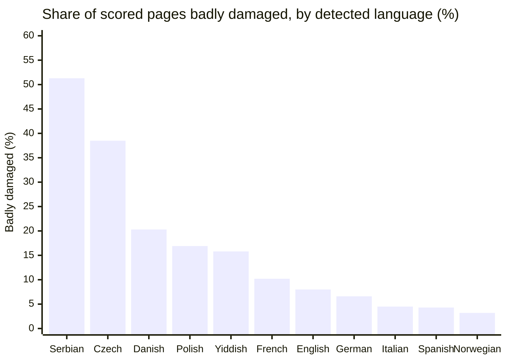
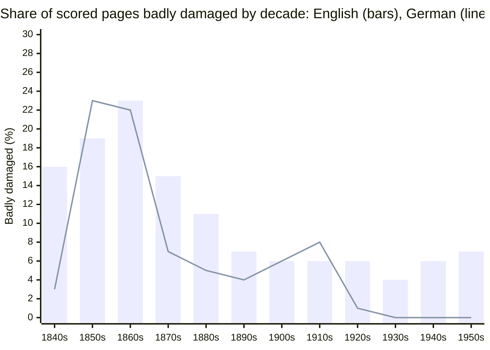
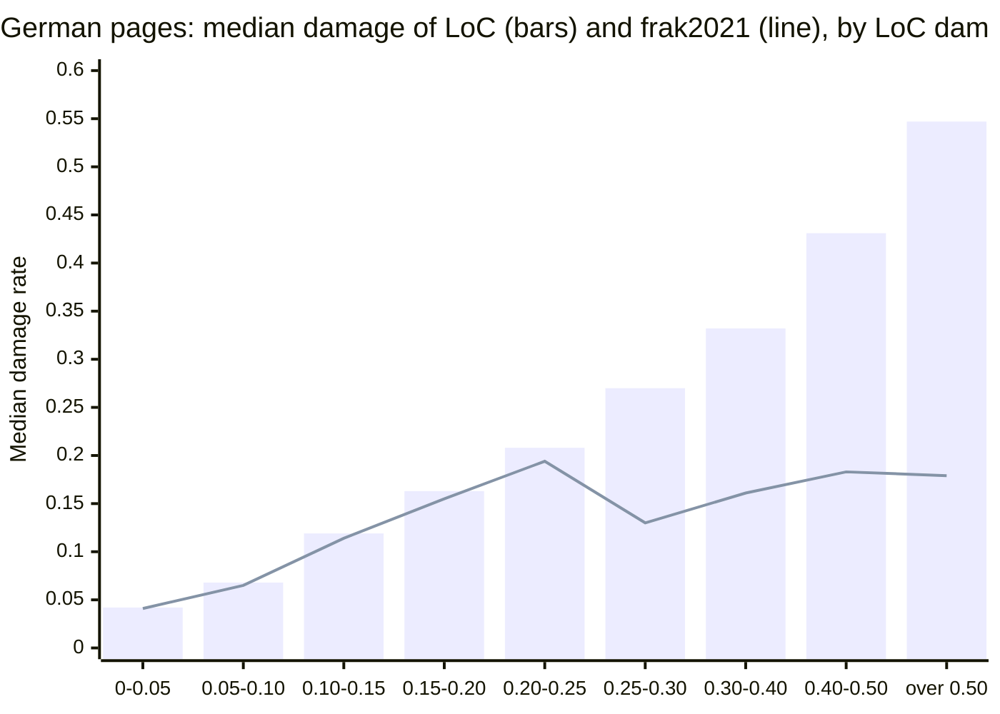

The data is `usnm_quality`'s stored summary `quality.page_summary` as it stood on 31 October 2026, read-only. The queries are in [`queries/`](queries/), their results in [`data/`](data/), and [`summarize.py`](summarize.py) makes every table below from those results.

# Summary

The summary holds 23,755,747 pages from 4,691 titles, and 23,541,352 of them (99.1%) have a damage score for LoC's OCR. By that score 63.3% are fine, 28.6% moderate and 8.1% (1,916,180 pages) badly damaged. No signal in this report measures accuracy; they are damage and agreement signals.

| Band          | Damage rate           | Pages      | Share of scored |
| ------------- | --------------------- | ---------- | --------------- |
| Fine          | 0.10 or lower         | 14,903,211 | 63.3%           |
| Moderate      | Over 0.10, up to 0.25 | 6,721,961  | 28.6%           |
| Badly damaged | Over 0.25             | 1,916,180  | 8.1%            |

**Worth re-OCRing: 1,823,814 pages (7.7% of the corpus).** A candidate is a page with a damage rate over 0.25, computed from at least 50 word occurrences, that our OCR hasn't read. English holds 1,665,657 of them (91.3%) and all other languages 158,157. On 251,966 candidates American Stories' text of the same page scores fine and has at least half the text, so a usable second text may already exist. That leaves 1,571,848. Paired runs back the rule for German and English only. With `frak2021`, bin medians for German pages over 0.25 fell from 0.27-0.55 to 0.13-0.18.

**Re-OCR gain in the moderate band is unproven.** The band holds another 6,637,057 pages our OCR hasn't read. Our paired runs have 354 English pages and 1,167 German pages from 0.10 to 0.25. Nearly all the German pages are from one title, and 243 are from 0.15 to 0.25. Median gains there are under 0.02 for German and 0.06 or less for English, and the mean damage change per bin is between -0.015 and +0.010 (negative means lower damage).

**Damage clusters by title, decade and batch.** Eleven titles hold a quarter of the candidates and 53 hold half. The highest share of badly damaged pages is in the 1860s (22.4%), and the largest number in the 1910s (383,535). Ninety-six of the 2,873 batches with 1,000 or more scored pages are over half badly damaged.

**Serbian, Russian, Czech, Danish, Polish and Yiddish have the highest bad shares** among languages with 10,000 or more scored pages. The metric probably overstates inflected languages, so compare each language with itself over time, not with English.

**German Fraktur pilot.** [`data/german-fraktur-pilot-candidates.csv`](data/german-fraktur-pilot-candidates.csv) lists 5,000 pages from 95 titles, 1830s to 1910s: 3,750 badly damaged and 1,250 from the upper moderate band (0.15 to 0.25), where our paired runs have 243 German pages. No page's typeface has been checked.

# What each signal means

No signal below is ground truth. The corpus has no transcription to measure accuracy against, apart from the small hand-corrected sets in [the gold set](../../ocr-gold-set.md).

| Signal              | Column                                            | What it measures                                                                                                                                                                                                                 | Coverage             | What it can't say                                                                                                                                                                      |
| ------------------- | ------------------------------------------------- | -------------------------------------------------------------------------------------------------------------------------------------------------------------------------------------------------------------------------------- | -------------------- | -------------------------------------------------------------------------------------------------------------------------------------------------------------------------------------- |
| Damage rate         | `damage_rate`                                     | Of the occurrences of the language's 20 most common words, the share that come out one edit wrong and aren't a real word ([definition](../2026-10-language-analysis/report.md#how-the-numbers-are-made)). Reads LoC's text alone | 99.1%                | Overstates heavily inflected languages. Depends on the page's detected language. Blind to the rest of the page's words                                                                 |
| Garbage share       | `garbage_share`                                   | Share of tokens that don't look like words                                                                                                                                                                                       | Every page with text | Numbers, tables and ads count too                                                                                                                                                      |
| Function share      | `function_share`                                  | Share of tokens that are the language's common words                                                                                                                                                                             | 99.1%                | Low on ads and tables as well as on damaged text                                                                                                                                       |
| Agreement Dice      | `loc_as_dice`                                     | Word-bag overlap of LoC's text and American Stories' for the page                                                                                                                                                                | 64.1%                | Agreement isn't accuracy. Falls when one reader has less of the page                                                                                                                   |
| Local disagreement  | `loc_as_local_cer_sym`, with `loc_as_matched_loc` | Edits over characters both readers placed. Read only where at least half of LoC's text was placed                                                                                                                                | 43.8%                | Counts both readers' errors. Garbled text doesn't place, so it shows as low matched share, not as high disagreement ([details](../../ocr-text-agreement.md#what-it-can-and-cant-tell)) |
| LoC word confidence | `loc_wc_mean`                                     | Mean confidence LoC's OCR engine gave its words                                                                                                                                                                                  | 36.9%                | Not comparable between engines (below)                                                                                                                                                 |
| Hat estimate        | `loc_est_cer`                                     | LoC's error rate solved from three or more readers' disagreement                                                                                                                                                                 | 4,316 pages (0.02%)  | Pages chosen worst first, so never a corpus estimate. Readers can share errors                                                                                                         |

**Word confidence isn't used for ranking here.** Mean confidence runs from 0.549 (Image Converter) to 0.908 (iArchives OCR Framework) by the software LoC's ALTO names ([`word-confidence.csv`](data/word-confidence.csv)), so a difference between titles may be a difference between engines. `rank.sql` averages it with the damage score. This report doesn't.

**Bands.** Fine, moderate and badly damaged are the repository's thresholds, `DAMAGED` 0.1 and `BADLY_DAMAGED` 0.25 in `crates/usnm-core`. A rate rests on `head + near` occurrences. Below 50 we call it weak evidence: at a rate of 0.25 and 50 occurrences the sampling error alone is about 0.06. That covers 248,879 scored pages (1.1%), and 73,546 of the badly damaged ones.

**How far the signals agree.** Query [`07`](queries/07-signal-crosstab.sql) sets the damage band against the agreement class. For English pages they point the same way: 56.8% of fine pages have LoC's and American Stories' texts placed with local disagreement up to 0.2 (split 41.0% and 15.8%), and only 2.9% of bad pages do. On English bad pages with a pair, 93.6% have under half their text placed.

| Language | Damage band | Pages      | No pair | Under half placed | Placed, disagreement up to 0.1 | Placed, 0.1 to 0.2 | Placed, over 0.2 |
| -------- | ----------- | ---------- | ------- | ----------------- | ------------------------------ | ------------------ | ---------------- |
| English  | fine        | 14,137,057 | 34.0%   | 9.0%              | 41.0%                          | 15.8%              | 0.3%             |
| English  | moderate    | 5,889,745  | 28.6%   | 35.2%             | 4.0%                           | 29.8%              | 2.4%             |
| English  | bad         | 1,732,329  | 30.9%   | 64.7%             | 0.0%                           | 2.9%               | 1.5%             |
| German   | fine        | 294,509    | 72.8%   | 27.2%             | 0.0%                           | 0.0%               | 0.0%             |
| German   | moderate    | 278,244    | 67.7%   | 32.3%             | 0.0%                           | 0.0%               | 0.0%             |
| German   | bad         | 40,317     | 70.6%   | 29.4%             | 0.0%                           | 0.0%               | 0.0%             |
| Others   | fine        | 471,645    | 80.4%   | 5.1%              | 0.9%                           | 13.2%              | 0.3%             |
| Others   | moderate    | 553,972    | 77.0%   | 11.0%             | 0.0%                           | 10.6%              | 1.3%             |
| Others   | bad         | 143,534    | 84.5%   | 13.3%             | 0.0%                           | 1.6%               | 0.6%             |

On German pages the agreement signal says nothing: 217 pages of 613,070 have half their text placed, median Dice is 0.160, and the share placed doesn't change across bands. American Stories' OCR is English-only, which may be why. Median matched share is over 0.5 for English, Spanish, Polish, French, Italian and Lithuanian, so agreement can be read for those where a pair exists. It is 0.023 for Norwegian, 0.105 for Danish and 0.206 for Finnish. Yiddish and Serbian have no pairs.

On the 4,311 pages with both a hat estimate and a damage score, the Spearman rank correlation between them is 0.509. Median hat estimate is 0.194 on fine pages, 0.217 on moderate and 0.355 on bad ([`hat-check.csv`](data/hat-check.csv)). The pages were staged worst first, so this shows direction only.

**Coverage and exclusions.**

| Item                                                                                                        | Pages      | Share of 23,755,747 |
| ----------------------------------------------------------------------------------------------------------- | ---------- | ------------------- |
| Pages of index `pages-v20261026-1` (23,766,177) missing from the summary, all in 24 titles listing Japanese | 10,430     | n/a                 |
| No LoC text (`no_text`)                                                                                     | 25,314     | 0.11%               |
| Language undetermined (`und`), no damage score                                                              | 189,070    | 0.80%               |
| Undetermined with under 20 words                                                                            | 38,521     | 0.16%               |
| Undetermined with 100 or more words                                                                         | 84,182     | 0.35%               |
| Language mixed, scored against both                                                                         | 37,723     | 0.16%               |
| Damage score present                                                                                        | 23,541,352 | 99.10%              |
| American Stories pair                                                                                       | 15,224,177 | 64.09%              |
| Pair with half of LoC's text placed                                                                         | 10,412,125 | 43.83%              |
| LoC word confidence                                                                                         | 8,754,040  | 36.85%              |
| Scan features from a quality unit                                                                           | 236,102    | 0.99%               |
| Output of our OCR                                                                                           | 24,128     | 0.10%               |

Unscored pages can't be ranked, and some may be among the worst: the audit leaves a page undetermined when too few of its function words survive. The 84,182 undetermined pages with 100 or more words are the group to check. They are counted apart from the candidates.

| First catalog language | Pages      | Unscored | Share | Under 20 words | Und, 100+ words |
| ---------------------- | ---------- | -------- | ----- | -------------- | --------------- |
| English                | 21,888,391 | 169,843  | 0.8%  | 54,092         | 65,577          |
| Spanish                | 493,196    | 10,186   | 2.1%  | 2,307          | 3,199           |
| Swedish                | 19,615     | 7,899    | 40.3% | 1,133          | 4,131           |
| Hungarian              | 13,442     | 6,012    | 44.7% | 1,876          | 619             |
| Czech                  | 58,448     | 3,809    | 6.5%  | 728            | 2,835           |
| German                 | 628,429    | 3,787    | 0.6%  | 497            | 2,773           |
| Italian                | 111,205    | 2,419    | 2.2%  | 1,416          | 300             |
| Danish                 | 87,917     | 1,865    | 2.1%  | 110            | 537             |
| Croatian               | 3,744      | 1,542    | 41.2% | 415            | 156             |
| Polish                 | 115,334    | 1,494    | 1.3%  | 97             | 1,332           |
| French                 | 152,613    | 1,403    | 0.9%  | 186            | 818             |
| Slovenian              | 16,236     | 746      | 4.6%  | 14             | 500             |
| Japanese               | 15,054     | 691      | 4.6%  | 234            | 171             |
| Romanian               | 3,679      | 652      | 17.7% | 229            | 60              |

The full-corpus medians match the [10% audit](../2026-10-language-analysis/report.md#summary) closely: English 0.071 in both, French 0.075 in both, German 0.103 against 0.105, Polish 0.177 against 0.178, Serbian 0.254 against 0.257. Among the eleven languages tabled below, bad shares differ by 0.7 points or less, apart from Serbian (51.3% against 52.7%) and Yiddish (15.8% against 13.8%).

# Damage by language

Pages are grouped by the language detected on the page, not the title's catalog language. Detected or mixed pages only. "All others" is every other language with a word list. Of those, Russian is 39.5% bad on 11,923 pages, Finnish 14.4% on 25,615, Slovak 11.2% on 5,182, Slovenian 9.6% on 15,219 and Lithuanian 7.6% on 20,471. The 96 pages detected as Hebrew all score bad, which may reflect the word list.

| Language   | Scored     | Median | Fine               | Moderate          | Bad              | Weak evidence |
| ---------- | ---------- | ------ | ------------------ | ----------------- | ---------------- | ------------- |
| German     | 613,070    | 0.103  | 294,509 (48.0%)    | 278,244 (45.4%)   | 40,317 (6.6%)    | 0.1%          |
| Spanish    | 393,235    | 0.084  | 250,040 (63.6%)    | 126,386 (32.1%)   | 16,809 (4.3%)    | 1.4%          |
| Polish     | 164,134    | 0.177  | 19,927 (12.1%)     | 116,461 (71.0%)   | 27,746 (16.9%)   | 5.8%          |
| French     | 131,770    | 0.075  | 83,405 (63.3%)     | 34,967 (26.5%)    | 13,398 (10.2%)   | 1.8%          |
| Yiddish    | 120,664    | 0.162  | 11,224 (9.3%)      | 90,346 (74.9%)    | 19,094 (15.8%)   | 6.7%          |
| Italian    | 86,497     | 0.112  | 36,077 (41.7%)     | 46,521 (53.8%)    | 3,899 (4.5%)     | 0.5%          |
| Czech      | 53,521     | 0.211  | 2,110 (3.9%)       | 30,831 (57.6%)    | 20,580 (38.5%)   | 0.3%          |
| Norwegian  | 49,238     | 0.084  | 33,858 (68.8%)     | 13,810 (28.0%)    | 1,570 (3.2%)     | 0.0%          |
| Serbian    | 43,258     | 0.254  | 344 (0.8%)         | 20,729 (47.9%)    | 22,185 (51.3%)   | 0.3%          |
| Danish     | 27,828     | 0.149  | 9,762 (35.1%)      | 12,427 (44.7%)    | 5,639 (20.3%)    | 14.9%         |
| English    | 21,759,131 | 0.071  | 14,137,057 (65.0%) | 5,889,745 (27.1%) | 1,732,329 (8.0%) | 1.0%          |
| All others | 99,006     |        | 24,898 (25.1%)     | 61,494 (62.1%)    | 12,614 (12.7%)   | 4.7%          |
| All        | 23,541,352 |        | 14,903,211 (63.3%) | 6,721,961 (28.6%) | 1,916,180 (8.1%) | 1.1%          |

Quantiles for every language are in [`language-quantiles.csv`](data/language-quantiles.csv), and medians per language and decade in [`language-decade-median.csv`](data/language-decade-median.csv).

Agreement by language:

| Language   | Pairs      | Share | Median Dice | Placed     | Share | Median local CER |
| ---------- | ---------- | ----- | ----------- | ---------- | ----- | ---------------- |
| German     | 181,816    | 29.7% | 0.160       | 217        | 0.0%  | 0.105            |
| Spanish    | 142,169    | 36.2% | 0.491       | 80,614     | 20.5% | 0.141            |
| Polish     | 23,885     | 14.6% | 0.431       | 18,578     | 11.3% | 0.151            |
| French     | 12,867     | 9.8%  | 0.470       | 8,863      | 6.7%  | 0.150            |
| Yiddish    | 0          | 0.0%  | n/a         | 0          | 0.0%  | n/a              |
| Italian    | 2,919      | 3.4%  | 0.587       | 2,190      | 2.5%  | 0.111            |
| Czech      | 14,762     | 27.6% | 0.295       | 6,473      | 12.1% | 0.196            |
| Norwegian  | 6,705      | 13.6% | 0.177       | 0          | 0.0%  | n/a              |
| Serbian    | 0          | 0.0%  | n/a         | 0          | 0.0%  | n/a              |
| Danish     | 12,156     | 43.7% | 0.205       | 590        | 2.1%  | 0.154            |
| English    | 14,738,488 | 67.7% | 0.707       | 10,268,754 | 47.2% | 0.091            |
| All others | 26,437     | 26.7% | n/a         | 20,558     | 20.8% | n/a              |

"Placed" is a pair with at least half of LoC's text placed. The medians for local disagreement are over those pages only.

# Damage by decade

Share of scored pages badly damaged, for cells with at least 500 scored pages:

| Language   | 1830s | 1840s | 1850s | 1860s | 1870s | 1880s | 1890s | 1900s | 1910s | 1920s | 1930s | 1940s | 1950s | 1960s |
| ---------- | ----- | ----- | ----- | ----- | ----- | ----- | ----- | ----- | ----- | ----- | ----- | ----- | ----- | ----- |
| German     | 5%    | 3%    | 23%   | 22%   | 7%    | 5%    | 4%    | 6%    | 8%    | 1%    | 0%    | 0%    | 0%    | 0%    |
| Spanish    | 4%    | 1%    | 6%    | 8%    | 3%    | 3%    | 8%    | 8%    | 6%    | 3%    | 1%    | 1%    | 1%    | 3%    |
| Polish     |       |       |       |       |       | 27%   | 15%   | 14%   | 17%   | 23%   | 4%    | 2%    |       |       |
| French     |       | 15%   | 13%   | 8%    | 15%   | 23%   | 16%   | 27%   | 24%   | 0%    | 0%    | 1%    | 6%    |       |
| Yiddish    |       |       |       |       |       |       |       |       | 25%   | 22%   | 10%   | 15%   | 3%    |       |
| Italian    |       |       |       |       |       |       | 3%    | 4%    | 8%    | 2%    | 4%    | 0%    | 0%    |       |
| Czech      |       |       |       |       | 70%   |       | 59%   | 56%   | 42%   | 21%   | 13%   | 20%   | 20%   |       |
| Norwegian  |       |       |       |       | 1%    | 0%    | 0%    | 9%    | 3%    | 1%    |       |       |       |       |
| Serbian    |       |       |       |       |       |       |       | 78%   | 61%   | 60%   | 71%   | 43%   | 12%   | 32%   |
| Danish     |       |       |       | 1%    | 4%    | 34%   | 40%   | 12%   | 21%   | 21%   |       |       |       |       |
| English    | 10%   | 16%   | 19%   | 23%   | 15%   | 11%   | 7%    | 6%    | 6%    | 6%    | 4%    | 6%    | 7%    | 10%   |
| All others |       |       |       |       |       |       | 19%   | 3%    | 12%   | 22%   | 20%   | 2%    | 5%    | 7%    |

All languages together:

| Decade | Scored    | Bad     | Bad share | Candidates |
| ------ | --------- | ------- | --------- | ---------- |
| 1730s  | 680       | 11      | 1.6%      | 11         |
| 1740s  | 190       | 7       | 3.7%      | 7          |
| 1750s  | 884       | 114     | 12.9%     | 112        |
| 1760s  | 3,001     | 25      | 0.8%      | 22         |
| 1770s  | 11,266    | 313     | 2.8%      | 311        |
| 1780s  | 11,380    | 180     | 1.6%      | 120        |
| 1790s  | 15,916    | 561     | 3.5%      | 289        |
| 1800s  | 35,140    | 1,004   | 2.9%      | 981        |
| 1810s  | 45,826    | 1,315   | 2.9%      | 1,308      |
| 1820s  | 68,211    | 3,178   | 4.7%      | 3,175      |
| 1830s  | 112,621   | 11,477  | 10.2%     | 11,473     |
| 1840s  | 249,850   | 38,954  | 15.6%     | 38,865     |
| 1850s  | 496,241   | 92,216  | 18.6%     | 91,876     |
| 1860s  | 728,092   | 162,862 | 22.4%     | 162,188    |
| 1870s  | 1,003,852 | 141,926 | 14.1%     | 140,096    |
| 1880s  | 1,508,029 | 165,710 | 11.0%     | 162,873    |
| 1890s  | 2,879,613 | 216,804 | 7.5%      | 213,673    |
| 1900s  | 4,511,398 | 301,471 | 6.7%      | 293,217    |
| 1910s  | 5,541,918 | 383,535 | 6.9%      | 357,104    |
| 1920s  | 2,808,564 | 178,136 | 6.3%      | 166,819    |
| 1930s  | 1,254,671 | 60,382  | 4.8%      | 52,718     |
| 1940s  | 1,148,713 | 68,857  | 6.0%      | 59,601     |
| 1950s  | 788,684   | 56,172  | 7.1%      | 43,381     |
| 1960s  | 316,612   | 30,970  | 9.8%      | 23,594     |

The candidates column is defined under [Pages worth re-OCRing](#pages-worth-re-ocring).

# Pages worth re-OCRing

**The rule.** A candidate has a damage rate over 0.25, `head + near` of at least 50, and no output of our OCR. The rule comes from the paired runs below, which show a clear gain above 0.25 on German and English pages and little to none beneath it, on the pages measured.

| Language   | Re-OCR candidates | Share | Of which with AS | Bad, already OCR'd | Bad, weak evidence | Moderate, unproven |
| ---------- | ----------------- | ----- | ---------------- | ------------------ | ------------------ | ------------------ |
| German     | 21,627            | 1.2%  | 7,132            | 18,608             | 278                | 276,837            |
| Spanish    | 15,065            | 0.8%  | 9,113            | 0                  | 1,744              | 124,658            |
| Polish     | 26,744            | 1.5%  | 3,632            | 0                  | 1,002              | 110,639            |
| French     | 12,794            | 0.7%  | 740              | 0                  | 604                | 34,219             |
| Yiddish    | 16,345            | 0.9%  | 0                | 0                  | 2,749              | 86,617             |
| Italian    | 3,842             | 0.2%  | 44               | 0                  | 57                 | 46,356             |
| Czech      | 20,506            | 1.1%  | 4,159            | 0                  | 74                 | 30,739             |
| Norwegian  | 1,568             | 0.1%  | 393              | 0                  | 2                  | 13,805             |
| Serbian    | 22,089            | 1.2%  | 0                | 0                  | 96                 | 20,688             |
| Danish     | 5,409             | 0.3%  | 1,760            | 0                  | 230                | 10,440             |
| English    | 1,665,657         | 91.3% | 1,183,921        | 411                | 66,264             | 5,822,337          |
| All others | 12,168            | 0.7%  | 1,952            | 0                  | 446                | 59,722             |
| All        | 1,823,814         | 100%  | 1,212,846        | 19,019             | 73,546             | 6,637,057          |

"Of which with AS" counts candidates that have any American Stories pair. "Moderate, unproven" is the moderate band with the same evidence and OCR conditions. Worst-page lists for 20 languages are in [`worst-pages.csv`](data/worst-pages.csv).

**What re-OCR did on pages already read.** Query [`10`](queries/10-reocr-outcomes.sql) pairs each page's LoC damage with our output's damage on the same page and metric. These are the only paired numbers in the database in any quantity: 24,128 outputs, nearly all German `frak2021` or English `eng`.

| Language, profile  | LoC damage from | Pages  | Median, LoC | Median, ours | Share lower | Mean change |
| ------------------ | --------------- | ------ | ----------- | ------------ | ----------- | ----------- |
| German, `frak2021` | 0.00            | 1,132  | 0.042       | 0.041        | 53.1%       | +0.004      |
|                    | 0.05            | 2,449  | 0.068       | 0.065        | 63.8%       | +0.002      |
|                    | 0.10            | 924    | 0.119       | 0.114        | 64.6%       | +0.005      |
|                    | 0.15            | 219    | 0.163       | 0.155        | 70.8%       | -0.007      |
|                    | 0.20            | 24     | 0.208       | 0.194        | 66.7%       | -0.015      |
|                    | 0.25            | 10,358 | 0.270       | 0.130        | 90.6%       | -0.117      |
|                    | 0.30            | 6,439  | 0.332       | 0.161        | 89.7%       | -0.148      |
|                    | 0.40            | 1,303  | 0.431       | 0.183        | 92.2%       | -0.219      |
|                    | 0.50            | 368    | 0.547       | 0.179        | 95.1%       | -0.338      |
| English, `eng`     | 0.10            | 176    | 0.121       | 0.094        | 64.2%       | +0.010      |
|                    | 0.15            | 106    | 0.168       | 0.138        | 65.1%       | +0.001      |
|                    | 0.20            | 72     | 0.221       | 0.166        | 59.7%       | -0.005      |
|                    | 0.25            | 153    | 0.274       | 0.205        | 78.4%       | -0.044      |
|                    | 0.30            | 172    | 0.336       | 0.240        | 79.7%       | -0.071      |
|                    | 0.40            | 56     | 0.445       | 0.352        | 69.6%       | -0.078      |
|                    | 0.50            | 30     | 0.538       | 0.415        | 73.3%       | -0.124      |

**The jump at 0.25.** The German gain goes from 0.015 to 0.117 between neighbouring bins with 24 and 10,358 pages. The bins hold different pages. Most German runs took only pages over 0.25, so 18,468 pages sit there, while 4,730 of the 4,748 pages at or under 0.25 are from one title, the _Luxemburger Gazette_ (`sn84027101`), whose median damage is 0.055. Its typeface may also differ from the other titles'. So the gain for German pages from 0.15 to 0.25, some 120,000 pages, is not measured. Picking pages for their high LoC score also inflates the measured gain a little, as some of a high score is noise. Per-decade figures are in [`reocr-german-decades.csv`](data/reocr-german-decades.csv): 0.263 to 0.313 down to 0.104 to 0.192, 1850s to 1910s.

**Other languages have almost no paired evidence.** Our OCR has read 4 French and 1 Polish page. The [engine survey](../2026-10-ocr-engine-survey/report.md) ran 5 to 15 pages a group: Tesseract lowered median damage for Serbian (0.217 to 0.126) and Czech (0.500 to 0.288), and raised it for Polish (0.123 to 0.155), Russian (0.217 to 0.290) and clean English controls (0.038 to 0.060). So the counts for those languages say where LoC's text scores badly, not that any engine we have would improve it.

**Does a second text already exist?** Query [`15`](queries/15-as-text-on-candidates.sql) scores American Stories' text of each candidate with the same metric. "Under half" means American Stories holds less than half LoC's characters for the page, so it can't stand in for the page whatever its score.

| Language   | Candidates | No AS text | AS under half of LoC | AS not scored | AS fine | AS moderate | AS bad  |
| ---------- | ---------- | ---------- | -------------------- | ------------- | ------- | ----------- | ------- |
| German     | 21,627     | 14,495     | 1,570                | 3,581         | 7       | 83          | 1,891   |
| Spanish    | 15,065     | 5,952      | 5,018                | 60            | 2       | 1,636       | 2,397   |
| Polish     | 26,744     | 23,112     | 1,125                | 1,160         | 0       | 32          | 1,315   |
| French     | 12,794     | 12,054     | 43                   | 7             | 25      | 66          | 599     |
| Yiddish    | 16,345     | 16,345     | 0                    | 0             | 0       | 0           | 0       |
| Italian    | 3,842      | 3,798      | 30                   | 0             | 3       | 8           | 3       |
| Czech      | 20,506     | 16,347     | 348                  | 3,177         | 3       | 36          | 595     |
| Norwegian  | 1,568      | 1,175      | 37                   | 85            | 0       | 40          | 231     |
| Serbian    | 22,089     | 22,089     | 0                    | 0             | 0       | 0           | 0       |
| Danish     | 5,409      | 3,649      | 61                   | 54            | 141     | 177         | 1,327   |
| English    | 1,665,657  | 481,736    | 483,592              | 3,680         | 251,765 | 331,769     | 113,115 |
| All others | 12,168     | 10,216     | 238                  | 952           | 20      | 161         | 581     |
| All        | 1,823,814  | 610,968    | 492,062              | 12,756        | 251,966 | 334,008     | 122,054 |

On 251,966 candidates, almost all English, American Stories scores fine and has at least half the text. Search already reads American Stories' text where the index has it, so those pages may gain less from another reading. On the other 1,571,848, no American Stories text that covers at least half the page scores fine.

# Where the candidates are

Candidates sit in 3,581 titles. The largest 10 hold 452,784 (24.8%), 11 reach a quarter, 53 reach half and 303 reach 80%.

Candidates per language and decade:

| Language   | 1830s  | 1840s  | 1850s  | 1860s   | 1870s   | 1880s   | 1890s   | 1900s   | 1910s   | 1920s   | 1930s  | 1940s  | 1950s  | 1960s  |
| ---------- | ------ | ------ | ------ | ------- | ------- | ------- | ------- | ------- | ------- | ------- | ------ | ------ | ------ | ------ |
| German     | 65     | 177    | 1,540  | 5,816   | 1,995   | 499     | 2,244   | 4,346   | 4,731   | 138     | 7      | 45     | 24     |        |
| Spanish    | 83     | 30     | 331    | 465     | 380     | 467     | 2,912   | 4,180   | 2,773   | 2,218   | 428    | 359    | 27     | 412    |
| Polish     |        |        |        |         |         | 440     | 3,188   | 5,272   | 10,775  | 6,944   | 105    | 20     |        |        |
| French     | 77     | 177    | 540    | 276     | 542     | 1,380   | 1,505   | 3,879   | 3,376   | 17      | 91     | 139    | 795    |        |
| Yiddish    |        |        |        |         |         |         | 78      |         | 4,048   | 3,735   | 1,957  | 6,273  | 254    |        |
| Italian    |        |        |        |         |         |         | 136     | 849     | 2,560   | 110     | 183    | 4      |        |        |
| Czech      |        |        |        |         | 1,449   | 155     | 3,925   | 4,110   | 6,814   | 2,704   | 555    | 673    | 121    |        |
| Norwegian  |        |        |        |         | 6       | 14      | 20      | 1,051   | 410     | 67      |        |        |        |        |
| Serbian    |        |        |        |         |         |         |         | 399     | 2,301   | 6,371   | 8,059  | 3,640  | 835    | 484    |
| Danish     |        |        |        | 2       |         | 885     | 1,247   | 900     | 2,028   | 347     |        |        |        |        |
| English    | 11,248 | 38,481 | 89,465 | 155,626 | 135,724 | 159,032 | 198,315 | 268,176 | 314,066 | 139,408 | 38,166 | 48,150 | 40,911 | 22,553 |
| All others |        |        |        | 3       |         | 1       | 103     | 55      | 3,222   | 4,760   | 3,167  | 298    | 414    | 145    |

## Titles

| Title                                | LCCN       | Language | Pages     | Median | Bad share | Candidates |
| ------------------------------------ | ---------- | -------- | --------- | ------ | --------- | ---------- |
| _The Sun_ (NY)                       | sn83030272 | English  | 196,557   | 0.244  | 48.5%     | 93,903     |
| _Evening Star_ (DC)                  | sn83045462 | English  | 1,227,640 | 0.065  | 8.8%      | 87,010     |
| _New-York Tribune_ (NY)              | sn83030214 | English  | 312,636   | 0.103  | 22.5%     | 68,103     |
| _The Evening World_ (NY)             | sn83030193 | English  | 152,993   | 0.194  | 29.0%     | 44,263     |
| _The New York Herald_ (NY)           | sn83030313 | English  | 120,323   | 0.188  | 30.0%     | 35,965     |
| _Deseret Evening News_ (UT)          | sn83045555 | English  | 72,840    | 0.248  | 49.5%     | 35,786     |
| _The Seattle Star_ (WA)              | sn87093407 | English  | 84,151    | 0.186  | 32.3%     | 27,126     |
| _Amerikanski Srbobran_ (PA)          | sn85055101 | Serbian  | 48,710    | 0.238  | 45.6%     | 22,096     |
| _The Evening Herald_ (NM)            | sn92070582 | English  | 23,714    | 0.388  | 84.7%     | 19,829     |
| _The Guthrie Daily Leader_ (OK)      | sn86063952 | English  | 61,459    | 0.187  | 32.6%     | 18,703     |
| _The Washington Times_ (DC)          | sn84026749 | English  | 277,096   | 0.069  | 6.9%      | 17,345     |
| _Dziennik Chicagoski_ (IL)           | sn83045747 | Polish   | 67,288    | 0.201  | 24.5%     | 16,411     |
| _Tulsa Daily World_ (OK)             | sn85042344 | English  | 38,379    | 0.225  | 43.1%     | 16,334     |
| _The Morning Tulsa Daily World_ (OK) | sn85042345 | English  | 29,607    | 0.263  | 55.3%     | 15,896     |
| _Albuquerque Morning Journal_ (NM)   | sn84031081 | English  | 54,796    | 0.143  | 28.9%     | 15,338     |

| Title                                                   | LCCN       | Language | Pages   | Median | Bad share | Candidates |
| ------------------------------------------------------- | ---------- | -------- | ------- | ------ | --------- | ---------- |
| _Amerikanski Srbobran_ (PA)                             | sn85055101 | Serbian  | 48,710  | 0.238  | 45.6%     | 22,096     |
| _Dziennik Chicagoski_ (IL)                              | sn83045747 | Polish   | 67,288  | 0.201  | 24.5%     | 16,411     |
| _Pokrok Západu_ (NE)                                    | sn83045348 | Czech    | 20,431  | 0.366  | 78.6%     | 14,433     |
| _Le Messager_ (ME)                                      | sn83045313 | French   | 101,331 | 0.079  | 11.5%     | 11,077     |
| _Der Tog = the Day_ (NY)                                | sn83045861 | Yiddish  | 16,401  | 0.204  | 31.9%     | 4,780      |
| _Yidishes Ṭageblaṭṭ = the Jewish Daily News_ (NY)       | sn86063496 | Yiddish  | 32,109  | 0.158  | 18.4%     | 4,444      |
| _Richmonder Anzeiger_ (VA)                              | sn86071815 | German   | 4,690   | 0.434  | 93.9%     | 4,268      |
| _Rassvet = the Dawn_ (IL)                               | sn82015743 | Russian  | 10,233  | 0.236  | 38.8%     | 3,960      |
| _L'italia_ (CA)                                         | sn85066408 | Italian  | 54,910  | 0.140  | 6.6%      | 3,506      |
| _Danskeren_ (WI)                                        | sn86086559 | Danish   | 10,517  | 0.218  | 32.0%     | 3,357      |
| _Der Morgen Zshurnal = the Jewish Morning Journal_ (NY) | sn83045837 | Yiddish  | 14,135  | 0.176  | 29.7%     | 3,119      |
| _Süd California Deutsche Zeitung_ (CA)                  | sn86064439 | German   | 8,964   | 0.218  | 33.6%     | 2,999      |
| _Boletín Mercantil De Puerto Rico_ (PR)                 | sn91099739 | Spanish  | 49,955  | 0.102  | 5.9%      | 2,950      |
| _Nebraska Staats-Zeitung_ (NE)                          | sn87067031 | German   | 2,916   | 0.617  | 99.3%     | 2,835      |
| _Osage County Volksblatt_ (MO)                          | sn89066801 | German   | 3,392   | 0.304  | 69.8%     | 2,293      |

Highest share badly damaged, among the 2,409 titles with at least 1,000 scored pages:

| Title                                         | LCCN       | Language | Pages  | Median | Bad share | Candidates |
| --------------------------------------------- | ---------- | -------- | ------ | ------ | --------- | ---------- |
| _Nebraska Staats-Zeitung_ (NE)                | sn87067031 | German   | 2,916  | 0.617  | 99.3%     | 2,835      |
| _The Daily Wabash Express_ (IN)               | sn84038189 | English  | 2,221  | 0.550  | 99.0%     | 1,936      |
| _Corpus Christi Caller and Daily Herald_ (TX) | sn86088527 | English  | 7,577  | 0.545  | 98.6%     | 7,146      |
| _Daily National Republican_ (DC)              | sn86053572 | English  | 1,908  | 0.402  | 96.9%     | 1,786      |
| _The Corpus Christi Caller_ (TX)              | sn86071134 | English  | 8,521  | 0.460  | 95.9%     | 7,693      |
| _Council Bluffs Bugle_ (IA)                   | sn82014129 | English  | 1,554  | 0.517  | 95.3%     | 1,256      |
| _True American_ (LA)                          | sn83016527 | English  | 1,591  | 0.484  | 94.7%     | 1,500      |
| _Richmonder Anzeiger_ (VA)                    | sn86071815 | German   | 4,690  | 0.434  | 93.9%     | 4,268      |
| _The Davenport Daily Gazette_ (IA)            | sn87058152 | English  | 2,061  | 0.452  | 93.2%     | 1,792      |
| _The Post_ (PA)                               | sn84026106 | English  | 2,093  | 0.390  | 93.1%     | 1,947      |
| _The Middlebury Register_ (VT)                | sn83025667 | English  | 5,431  | 0.381  | 92.3%     | 5,000      |
| _Gainesville Daily Sun_ (FL)                  | sn95026977 | English  | 15,005 | 0.372  | 91.2%     | 13,475     |
| _The Texas Republican_ (TX)                   | sn83025730 | English  | 3,519  | 0.478  | 87.8%     | 3,075      |
| _The Oxford Falcon_ (MS)                      | sn85038605 | English  | 1,134  | 0.379  | 86.4%     | 878        |
| _The Waco Daily Examiner_ (TX)                | sn84022109 | English  | 9,718  | 0.434  | 86.1%     | 8,105      |

Each language's largest titles:

| Language  | Candidates | Titles with any | Largest three                                                                                                                           |
| --------- | ---------- | --------------- | --------------------------------------------------------------------------------------------------------------------------------------- |
| German    | 21,627     | 71              | _Richmonder Anzeiger_ 4,265; _Süd California Deutsche Zeitung_ 2,997; _Nebraska Staats-Zeitung_ 2,834                                   |
| Spanish   | 15,065     | 43              | _Boletín Mercantil De Puerto Rico_ 2,828; _La Democracia_ 2,183; _La Prensa_ 1,868                                                      |
| Polish    | 26,744     | 21              | _Dziennik Chicagoski_ 16,406; _Jedność-Polonia = Unity-Polonia_ 1,601; _Głos Polek_ 1,530                                               |
| French    | 12,794     | 29              | _Le Messager_ 10,764; _Le Meschacébé_ 1,137; _The Opelousas Courier_ 257                                                                |
| Yiddish   | 16,345     | 6               | _Der Tog = the Day_ 4,610; _Yidishes Ṭageblaṭṭ = the Jewish Daily News_ 4,344; _Der Morgen Zshurnal = the Jewish Morning Journal_ 3,110 |
| Italian   | 3,842      | 17              | _L'italia_ 3,503; _La Verita' = the Truth_ 249; _La Libera Parola_ 31                                                                   |
| Czech     | 20,506     | 10              | _Pokrok Západu_ 14,429; _Svět = World_ 2,194; _Telegraf_ 2,033                                                                          |
| Norwegian | 1,568      | 7               | _Sisseton Posten_ 1,116; _Decorah-Posten_ 276; _Decorah-Posten Og Ved Arnen_ 155                                                        |
| Serbian   | 22,089     | 1               | _Amerikanski Srbobran_ 22,089                                                                                                           |
| Danish    | 5,409      | 4               | _Danskeren_ 3,354; _Stjernen_ 1,982; _St. Croix Avis_ 65                                                                                |

Every title is in [`title-summary.csv`](data/title-summary.csv), and every title and decade in [`title-decades.csv`](data/title-decades.csv).

## Title and decade

| Title                        | Decade | Pages   | Mean damage | Bad share | Candidates |
| ---------------------------- | ------ | ------- | ----------- | --------- | ---------- |
| _The Sun_ (NY)               | 1900s  | 56,832  | 0.299       | 63.1%     | 35,023     |
| _New-York Tribune_ (NY)      | 1910s  | 80,338  | 0.225       | 40.9%     | 30,926     |
| _Evening Star_ (DC)          | 1950s  | 282,191 | 0.12        | 13.9%     | 29,164     |
| _Deseret Evening News_ (UT)  | 1890s  | 26,954  | 0.346       | 79.7%     | 21,337     |
| _Evening Star_ (DC)          | 1960s  | 123,580 | 0.139       | 18.6%     | 17,085     |
| _The Evening World_ (NY)     | 1900s  | 36,927  | 0.254       | 44.0%     | 16,198     |
| _Tulsa Daily World_ (OK)     | 1910s  | 36,895  | 0.247       | 44.2%     | 16,091     |
| _The Seattle Star_ (WA)      | 1900s  | 20,390  | 0.322       | 77.0%     | 15,688     |
| _The Sun_ (NY)               | 1910s  | 50,541  | 0.223       | 29.9%     | 14,702     |
| _The Evening World_ (NY)     | 1890s  | 36,539  | 0.24        | 39.6%     | 14,429     |
| _The Sun_ (NY)               | 1890s  | 45,745  | 0.218       | 29.5%     | 13,502     |
| _Gainesville Daily Sun_ (FL) | 1900s  | 15,005  | 0.379       | 91.2%     | 13,475     |
| _The Evening Herald_ (NM)    | 1910s  | 15,618  | 0.388       | 86.6%     | 13,390     |
| _New-York Tribune_ (NY)      | 1890s  | 57,927  | 0.176       | 23.0%     | 13,159     |
| _Deseret Evening News_ (UT)  | 1900s  | 40,924  | 0.226       | 32.0%     | 13,003     |

## Batches

A batch is one delivery of scanned pages and OCR from one digitising partner. Top batches, by share of pages badly damaged, among those with 1,000 or more scored pages:

| Batch           | Pages  | Bad share | Mean damage | Titles | Decades     |
| --------------- | ------ | --------- | ----------- | ------ | ----------- |
| `nn_kant`       | 5,280  | 99.3%     | 0.511       | 1      | 1910s-1910s |
| `nn_bentham`    | 5,192  | 98.4%     | 0.495       | 1      | 1900s-1900s |
| `nn_carson`     | 11,466 | 98.0%     | 0.469       | 2      | 1860s-1870s |
| `nn_aristotle`  | 4,956  | 97.5%     | 0.410       | 1      | 1900s-1900s |
| `txdn_japan`    | 11,996 | 96.9%     | 0.494       | 2      | 1910s-1910s |
| `nn_carnap`     | 5,164  | 96.7%     | 0.409       | 1      | 1900s-1900s |
| `mimtptc_ionia` | 10,806 | 94.6%     | 0.425       | 2      | 1880s-1890s |
| `uuml_hornacek` | 10,046 | 92.8%     | 0.384       | 1      | 1890s-1890s |
| `wyu_hydra`     | 9,133  | 92.7%     | 0.401       | 1      | 1900s-1920s |
| `iahi_kingler`  | 5,318  | 88.9%     | 0.436       | 3      | 1850s-1880s |
| `txdn_honda`    | 12,405 | 88.4%     | 0.395       | 2      | 1910s-1920s |
| `tu_archie`     | 4,062  | 88.3%     | 0.425       | 1      | 1850s-1860s |

The ten batches with the most bad pages hold 111,873 of 1,916,180 (5.8%), and the top 100 hold 573,174 (29.9%). All batches are in [`batches.csv`](data/batches.csv). A batch-level pattern suggests the cause may be that batch's scans or its OCR run, which this data can't separate.

# Page language against title language

Chronicling America catalogs languages per title, and the damage audit detects each page's language among the title's catalog languages plus English. This report's language tables use the page's language, so a mislabelled title has limited effect on them. No page is detected in a language other than English that its title doesn't list, by construction. A title whose catalog leaves out its real language therefore can't be detected correctly: its pages come out English or undetermined.

| First catalog language | Pages      | In that language | English | Other listed | Undetermined |
| ---------------------- | ---------- | ---------------- | ------- | ------------ | ------------ |
| English                | 21,888,391 | 97.8%            |         | 1.4%         | 0.8%         |
| German                 | 628,429    | 90.9%            | 8.5%    | 0.0%         | 0.6%         |
| Spanish                | 493,196    | 66.4%            | 31.6%   | 0.0%         | 2.1%         |
| French                 | 152,613    | 80.4%            | 18.7%   | 0.0%         | 0.9%         |
| Polish                 | 115,334    | 98.5%            | 0.2%    | 0.0%         | 1.3%         |
| Italian                | 111,205    | 59.7%            | 2.3%    | 35.9%        | 2.2%         |
| Danish                 | 87,917     | 31.7%            | 66.2%   | 0.0%         | 2.1%         |
| Czech                  | 58,448     | 90.3%            | 3.2%    | 0.0%         | 6.5%         |
| Norwegian              | 39,560     | 99.6%            | 0.3%    | 0.0%         | 0.1%         |
| Finnish                | 26,353     | 97.2%            | 0.8%    | 0.0%         | 2.0%         |
| Yiddish                | 26,135     | 97.8%            | 1.0%    | 0.0%         | 1.2%         |
| Swedish                | 19,615     | 46.0%            | 13.7%   | 0.0%         | 40.3%        |
| Lithuanian             | 12,092     | 99.5%            | 0.0%    | 0.0%         | 0.5%         |

Percentages are of the pages in titles listing that language first. All counts are in [`language-mismatch.csv`](data/language-mismatch.csv).

For 45 titles with 1,000 or more pages (418,339 pages), the first catalog language holds under half the pages. The largest:

| Title                                                                           | LCCN       | Catalog languages | Pages  | In first language | Largest            |
| ------------------------------------------------------------------------------- | ---------- | ----------------- | ------ | ----------------- | ------------------ |
| _Brownsville Herald_ (TX)                                                       | sn86063730 | spa, eng          | 94,327 | 0.0%              | English 99.3%      |
| _St. Croix Avis_ (VI)                                                           | sn84037526 | dan, eng          | 66,454 | 9.9%              | English 87.5%      |
| _La Gaceta_ (FL)                                                                | sn86002403 | ita, spa, eng     | 41,657 | 0.0%              | Spanish 95.4%      |
| _Santa Fe New Mexican_ (NM)                                                     | sn84020630 | spa, eng          | 32,544 | 0.0%              | English 99.9%      |
| _Jamestown Weekly Alert_ (ND)                                                   | sn85042405 | ger, eng          | 17,577 | 0.0%              | English 99.9%      |
| _The Berne Witness_ (IN)                                                        | sn84045439 | ger, eng          | 15,868 | 14.7%             | English 85.1%      |
| _Brewery Gulch Gazette_ (AZ)                                                    | sn89070012 | spa, eng          | 14,156 | 0.1%              | English 97.7%      |
| _Dakota Farmers' Leader_ (SD)                                                   | sn00065127 | ger, eng          | 11,258 | 0.3%              | English 97.2%      |
| _De Queen Bee_ (AR)                                                             | sn89051293 | cho, eng          | 9,110  | 0.0%              | English 99.7%      |
| _The Weekly Thibodaux Sentinel and Journal of the 8th Senatorial District_ (LA) | sn88064492 | fre, eng          | 8,028  | 38.9%             | English 60.9%      |
| _The Maui News_ (HI)                                                            | sn82014689 | haw, eng          | 8,028  | 0.2%              | English 99.3%      |
| _Amerikai Magyar Hirlap = American Magyar Journal_ (OH)                         | sn88078388 | hun, eng          | 7,810  | 5.2%              | Undetermined 73.2% |

These are cases where the first catalog language isn't the main language on the page. We haven't checked why for each title. Going the other way, 312,338 pages in titles that list English first are in another listed language; _Amerikanski Srbobran_, cataloged `eng, srp`, is one such title, which is why the catalog table above has no Serbian row and the title's bad share in the title tables (45.6%) is lower than Serbian pages' own (51.3%).

English-only catalog entries can't reveal a missing language except as undetermined pages. The highest shares, which may be damage, a missing language or both:

| Title                                                 | LCCN       | Pages  | Undetermined or no text |
| ----------------------------------------------------- | ---------- | ------ | ----------------------- |
| _Askov American_ (MN)                                 | sn89064914 | 14,115 | 23.6%                   |
| _The Daily Comet_ (LA)                                | sn83016548 | 2,953  | 19.1%                   |
| _The White Mountain Echo and Tourist's Register_ (NH) | sn91063244 | 3,161  | 17.1%                   |
| _Council Bluffs Bugle_ (IA)                           | sn82014129 | 1,554  | 14.9%                   |
| _The Evening Tribune_ (RI)                            | sn91070627 | 4,843  | 14.7%                   |
| _The Adak Sun_ (AK)                                   | sn96060044 | 2,444  | 13.7%                   |
| _The Kentucky Gazette_ (KY)                           | sn84027460 | 8,699  | 12.0%                   |
| _The Daily Wabash Express_ (IN)                       | sn84038189 | 2,221  | 11.9%                   |

Damaged pages don't seem to be slipping into English much. In titles listing German first, pages detected English are 2.2% bad against 6.9% for German pages, and undetermined pages are 0.6%. The same holds for Czech and Danish. It's close for Spanish (6.0% against 4.8%, on 155,720 English pages) and reverses for Italian and Norwegian, where the English pages are few (2,515 and 121).

| First language | Own pages | Own bad | English pages | English bad |
| -------------- | --------- | ------- | ------------- | ----------- |
| German         | 571,242   | 6.9%    | 53,400        | 2.2%        |
| Spanish        | 327,290   | 4.8%    | 155,720       | 6.0%        |
| Polish         | 113,631   | 21.8%   | 209           | 11.0%       |
| French         | 122,707   | 10.5%   | 28,487        | 8.7%        |
| Yiddish        | 25,558    | 11.9%   | 273           | 9.5%        |
| Italian        | 66,370    | 5.8%    | 2,515         | 35.7%       |
| Czech          | 52,783    | 38.7%   | 1,856         | 2.0%        |
| Norwegian      | 39,402    | 3.9%    | 121           | 54.5%       |
| Serbian        | 0         | n/a     | 0             | n/a         |
| Danish         | 27,828    | 20.3%   | 58,224        | 3.1%        |

# German Fraktur pilot list

[`data/german-fraktur-pilot-candidates.csv`](data/german-fraktur-pilot-candidates.csv) holds 5,000 pages, ordered by `rank`. It is meant as the manifest for [#325](https://github.com/tgoodyear/usnewsmap.com/issues/325) and could be cut to its size: the first 1,000 ranks hold 750 bad and 250 moderate pages from all 95 titles and every decade. #325's scope is the 1850s to the 1910s, so filter `decade` to match it exactly. This report inspected no scans and starts no run.

**Selection** ([`13-german-pilot.sql`](queries/13-german-pilot.sql)). Pages are German by detection and printed before 1920, because German damage drops in the 1920s. The funnel:

| Step                          | Pages over 0.25 | Pages from 0.15 to 0.25 |
| ----------------------------- | --------------- | ----------------------- |
| Detected or mixed German      | 40,317          | 122,043                 |
| Detected only, no mixed pages | 39,612          | 121,205                 |
| Printed before 1920           | 39,403          | 118,630                 |
| No output of our OCR yet      | 20,872          | 118,387                 |
| `head + near` at least 50     | 20,804          | 118,255                 |
| At least 500 words            | 20,717          | 117,947                 |

The last step is the check for pages that are probably blank or not text: a German page's median is 3,591 words. The list's median is 2,818 words, and every page was detected as German with at least 10% function words, which a blank or picture-only page wouldn't reach. Tables and advertisement pages can still pass. Of the 5,000, 3,519 have scan features. They weren't used as a filter, as most German pages don't have them.

**Two tiers.** The list has 3,750 bad pages and 1,250 upper-moderate pages. The first tier holds the worst pages. Earlier runs read 18,531 of the 39,403 bad German pages from before 1920, so the gain there is already measured. The second tier measures a band with 243 paired pages, nearly all from one title. The `tier` column separates them, so either can be dropped.

**Spread.** Each tier is taken round-robin over (title, decade), like `rank.sql`'s image pass. Inside a stratum pages come worst first, one per issue before any issue gives a second.

| Tier           | Eligible | Strata | Titles | Chosen | Titles chosen | Strata chosen | Median damage chosen | Max per title | Max per stratum |
| -------------- | -------- | ------ | ------ | ------ | ------------- | ------------- | -------------------- | ------------- | --------------- |
| Bad            | 20,717   | 105    | 61     | 3,750  | 61            | 105           | 0.360                | 389           | 98              |
| Upper moderate | 117,947  | 178    | 89     | 1,250  | 89            | 178           | 0.245                | 56            | 8               |

| Decade | Eligible bad | Chosen bad | Eligible moderate | Chosen moderate | Titles chosen |
| ------ | ------------ | ---------- | ----------------- | --------------- | ------------- |
| 1830s  | 64           | 64         | 308               | 44              | 6             |
| 1840s  | 177          | 152        | 1,855             | 46              | 6             |
| 1850s  | 1,538        | 174        | 1,886             | 64              | 10            |
| 1860s  | 5,706        | 757        | 6,626             | 136             | 20            |
| 1870s  | 1,986        | 248        | 12,863            | 175             | 28            |
| 1880s  | 482          | 294        | 14,532            | 132             | 22            |
| 1890s  | 2,230        | 400        | 19,831            | 177             | 27            |
| 1900s  | 4,099        | 688        | 22,781            | 233             | 33            |
| 1910s  | 4,435        | 973        | 37,265            | 243             | 37            |

Most chosen pages by title:

| Title                                             | Chosen | Of which bad | Decades |
| ------------------------------------------------- | ------ | ------------ | ------- |
| _Süd California Deutsche Zeitung_ (CA)            | 421    | 389          | 4       |
| _Hermanner Volksblatt_ (MO)                       | 321    | 281          | 5       |
| _Osage County Volksblatt_ (MO)                    | 220    | 199          | 3       |
| _Richmonder Anzeiger_ (VA)                        | 212    | 196          | 2       |
| _Nebraska Staats-Zeitung_ (NE)                    | 206    | 206          | 3       |
| _The Berne Witness_ (IN)                          | 192    | 176          | 3       |
| _Scranton Wochenblatt_ (PA)                       | 190    | 146          | 6       |
| _Der Lecha Patriot Und Northampton Demokrat_ (PA) | 158    | 142          | 2       |
| _Baltimore Wecker_ (MD)                           | 145    | 129          | 2       |
| _Die Eureka Post_ (SD)                            | 144    | 129          | 2       |

The list spans 4,572 issues. The ten largest titles hold 2,209 pages (44.2%), and no title more than 8.4%. Thin decades take all or nearly all they have: every eligible bad page of the 1830s and 152 of 177 from the 1840s are in. The median chosen page scores 0.360 in the bad tier and 0.245 in the moderate tier. That second figure sits near the band's top because each stratum gives its worst pages first.

**Columns.** `rank` is the suggested order, keeping the 3:1 mix at any cut. `tier_rank` and `stratum_rank` show how the page was picked. `doc_id` is the page's identifier, and `lccn`, `date`, `edition`, `seq`, `batch` and `batch_version` locate its scan. The rest are the signals above, with `loc_wc_mean` filled on 953 pages and `loc_as_dice` on 1,751.

**What the list isn't.** It isn't a list of Fraktur pages. The database holds no typeface signal: the `fraktur_score` that the scoring code computes isn't in `quality.page_summary`. The [language report's hypothesis](../2026-10-language-analysis/report.md#fraktur) would make Fraktur likely on German pages from before 1920 that score badly, but only #325's human labels can establish it. The _Luxemburger Gazette_, whose pages barely changed with `frak2021`, supplies 29 pages to the list, which may be worth checking first.

# Caveats

- **Nothing here is accuracy.** A rate of 0.30 doesn't mean 30% of characters or words are wrong. It's a share of common-word occurrences.
- **Languages aren't comparable.** The metric probably overstates heavily inflected languages, and word lists differ in quality ([the language report](../2026-10-language-analysis/report.md#how-the-numbers-are-made)). Compare a language with itself. Counts for Polish, Czech, Serbian, Russian, Finnish, Lithuanian and Yiddish carry this most. No hand check has quantified it.
- **Japanese isn't assessed.** The 10,430 pages missing from the summary are in 24 of the 27 titles that list Japanese, where LoC has no Japanese text ([language report](../2026-10-language-analysis/report.md#the-gap-at-loc)). The 22,399 pages of those titles that are present are 21,537 English, the rest undetermined, empty or Hawaiian.
- **Page language can be wrong.** Detection works from common words, so a badly read page may fail it, and a title's catalog limits its candidates.
- **The pages our OCR has read aren't a sample.** They were picked by damage, title and earlier experiments. Gains can't be carried to other titles without a check, and German `frak2021` scoring lower doesn't by itself show its text is right ([#835](https://github.com/tgoodyear/usnewsmap.com/issues/835) records a German calibration that failed on ground truth).
- **Ads, tables and lists.** Numeric and short-line shares aren't stored in `quality.page_summary`, so these can't be told apart from prose here.
- **Snapshot.** Counts move as campaigns load. Title names and catalog languages come from `/v1/titles` of `pages-v20261026-1`.

# Open questions

1. How much would moderate-band pages gain? The second tier of the pilot list measures this for German. No other language has a plan.
2. How many of the 84,182 undetermined pages with 100 or more words are damaged text, and how many are in a language their title doesn't list?
3. Would other engines change the rule for English, where `eng` lowers damage less than `frak2021` does for German?
4. Do the 96 batches over half bad share a scan problem or an OCR problem? The answer decides whether a re-read of the same images helps.

# Reproducing this

`run-queries.sh --dsn-file <file> --out-dir data` runs the queries one at a time with any role that can read schema `quality`. `data/titles.csv` is `GET /v1/titles?v=pages-v20261026-1` reduced to five columns. `python3 summarize.py --data-dir data --tables tables.md` writes the derived CSVs and the tables. The queries take about 10 minutes in all, and `02-cube.sql` is the source of the language, title, decade and candidate counts.

`data/` is checked in for review. Following [the reports' data rule](../README.md#data), it moves to the `report-data` release when that set is next published.
