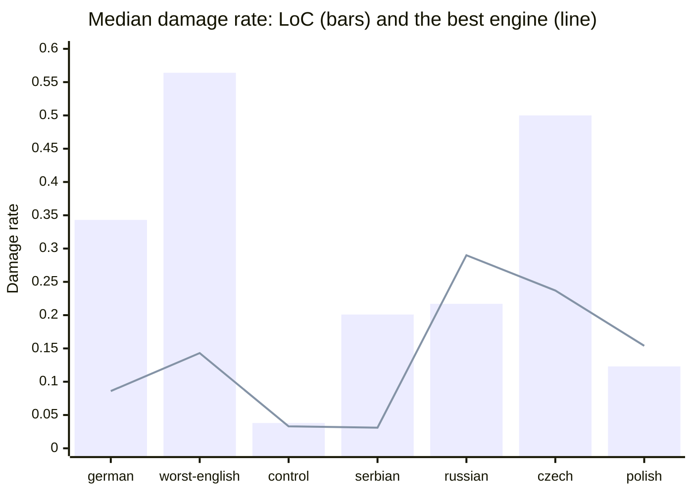

## Sample

| Group | Pages | Years | LoC damage (median) | LoC known share (median) | LoC words (median) |
|---|---|---|---|---|---|
| german | 15 | 1859-1911 | 0.343 | 0.380 | 2807 |
| worst-english | 15 | 1861-1918 | 0.532 | 0.340 | 7080 |
| control | 10 | 1921-1934 | 0.038 | 0.774 | 2695 |
| serbian | 15 | 1906-1962 | 0.217 | 0.433 | 2663 |
| russian | 5 | 1918-1931 | 0.217 | 0.445 | 1806 |
| czech | 15 | 1876-1920 | 0.500 | 0.311 | 2424 |
| polish | 5 | 1890-1936 | 0.123 | 0.485 | 2217 |

## german

| Engine | Pages read | Damage (median) | LoC damage, same pages | Change (median) | Pages better | Known share change (median) | Words vs LoC (median) | Known words vs LoC (median); pages above 1 | Seconds/page alone | Seconds/page, 4 at once | Peak RSS MB (max) |
|---|---|---|---|---|---|---|---|---|---|---|---|
| docTR | 14 of 15 (1 timed out) | 0.589 | 0.357 | 0.162 | 0 of 14 | -0.163 | 1.22 | 0.72; 2 | 257 |  | 4808 |
| Surya | 1 of 2 (1 timed out) | 0.030 | 0.607 | -0.577 | 1 of 1 | 0.374 | 1.49 | 3.44; 1 | 2383 |  | 7082 |
| Tesseract `deu` | 15 of 15 (2 with no text) | 0.239 | 0.343 | -0.164 | 9 of 13 | 0.113 | 1.06 | 1.57; 10 | 100 | 333 | 310 |
| Tesseract `deu_latf` | 15 of 15 (2 with no text) | 0.163 | 0.343 | -0.208 | 10 of 13 | 0.191 | 1.06 | 1.82; 10 | 98 | 282 | 314 |
| Tesseract `deu_latf`, 50% scale | 15 of 15 | 0.162 | 0.343 | -0.220 | 11 of 15 | 0.203 | 1.03 | 1.78; 12 | 73 | 263 | 310 |
| Tesseract `frak2021` | 15 of 15 (2 with no text) | 0.086 | 0.343 | -0.285 | 13 of 13 | 0.230 | 1.09 | 1.94; 12 | 52 | 228 | 303 |

## worst-english

| Engine | Pages read | Damage (median) | LoC damage, same pages | Change (median) | Pages better | Known share change (median) | Words vs LoC (median) | Known words vs LoC (median); pages above 1 | Seconds/page alone | Seconds/page, 4 at once | Peak RSS MB (max) |
|---|---|---|---|---|---|---|---|---|---|---|---|
| American Stories | 15 of 15 | 0.256 | 0.532 | -0.238 | 13 of 15 | 0.257 | 0.56 | 0.84; 6 | 128 |  | 4856 |
| docTR | 8 of 15 (7 timed out) | 0.143 | 0.564 | -0.360 | 8 of 8 | 0.222 | 1.39 | 1.72; 7 | 257 |  | 4914 |
| NDNP Open OCR | 15 of 15 | 0.194 | 0.532 | -0.330 | 15 of 15 | 0.287 | 1.06 | 1.53; 13 | 291 |  | 1307 |
| Surya | 0 of 2 (2 timed out) |  |  |  | 0 of 0 |  |  | ; 0 |  |  | 10675 |
| Tesseract `eng` | 13 of 15 (2 timed out) | 0.280 | 0.532 | -0.245 | 12 of 13 | 0.225 | 0.64 | 1.17; 7 | 701 | 495 | 344 |
| Tesseract `eng`, 50% scale | 15 of 15 | 0.288 | 0.532 | -0.224 | 13 of 15 | 0.247 | 0.41 | 0.69; 3 | 203 | 339 | 289 |

## control

| Engine | Pages read | Damage (median) | LoC damage, same pages | Change (median) | Pages better | Known share change (median) | Words vs LoC (median) | Known words vs LoC (median); pages above 1 | Seconds/page alone | Seconds/page, 4 at once | Peak RSS MB (max) |
|---|---|---|---|---|---|---|---|---|---|---|---|
| American Stories | 10 of 10 | 0.033 | 0.038 | -0.002 | 5 of 10 | 0.007 | 0.86 | 0.88; 0 | 128 |  | 5087 |
| docTR | 10 of 10 | 0.042 | 0.038 | 0.007 | 2 of 10 | -0.037 | 1.13 | 1.06; 9 | 257 |  | 3300 |
| NDNP Open OCR | 10 of 10 | 0.071 | 0.038 | 0.025 | 1 of 10 | -0.008 | 1.02 | 1.01; 7 | 182 |  | 1426 |
| Tesseract `eng` | 10 of 10 | 0.060 | 0.038 | 0.024 | 1 of 10 | -0.020 | 1.01 | 0.99; 3 | 701 | 167 | 429 |
| Tesseract `eng`, 50% scale | 10 of 10 | 0.060 | 0.038 | 0.018 | 2 of 10 | -0.006 | 0.97 | 0.97; 2 | 203 | 119 | 373 |

## serbian

| Engine | Pages read | Damage (median) | LoC damage, same pages | Change (median) | Pages better | Known share change (median) | Words vs LoC (median) | Known words vs LoC (median); pages above 1 | Seconds/page alone | Seconds/page, 4 at once | Peak RSS MB (max) |
|---|---|---|---|---|---|---|---|---|---|---|---|
| Surya | 2 of 2 | 0.031 | 0.201 | -0.170 | 2 of 2 | 0.126 | 1.24 | 1.61; 2 | 2202 |  | 11565 |
| Tesseract `srp` | 15 of 15 | 0.126 | 0.217 | -0.060 | 11 of 15 | 0.077 | 1.04 | 1.27; 15 | 82 | 291 | 376 |
| Tesseract `srp`, 50% scale | 15 of 15 | 0.265 | 0.217 | 0.025 | 7 of 15 | 0.049 | 1.00 | 1.06; 9 | 58 | 226 | 296 |
| Tesseract `srp_latn` | 15 of 15 | 0.575 | 0.217 | 0.353 | 0 of 15 | -0.272 | 0.90 | 0.37; 2 | 74 | 218 | 280 |

## russian

| Engine | Pages read | Damage (median) | LoC damage, same pages | Change (median) | Pages better | Known share change (median) | Words vs LoC (median) | Known words vs LoC (median); pages above 1 | Seconds/page alone | Seconds/page, 4 at once | Peak RSS MB (max) |
|---|---|---|---|---|---|---|---|---|---|---|---|
| Surya | 1 of 2 (1 timed out) | 0.120 | 0.217 | -0.097 | 1 of 1 | -0.005 | 1.55 | 1.54; 1 | 3393 |  | 11836 |
| Tesseract `rus` | 5 of 5 | 0.290 | 0.217 | 0.123 | 1 of 5 | -0.030 | 1.01 | 0.95; 0 | 78 | 144 | 278 |

## czech

| Engine | Pages read | Damage (median) | LoC damage, same pages | Change (median) | Pages better | Known share change (median) | Words vs LoC (median) | Known words vs LoC (median); pages above 1 | Seconds/page alone | Seconds/page, 4 at once | Peak RSS MB (max) |
|---|---|---|---|---|---|---|---|---|---|---|---|
| docTR | 15 of 15 | 0.237 | 0.500 | -0.290 | 14 of 15 | 0.054 | 1.25 | 1.44; 15 | 257 |  | 5218 |
| Tesseract `ces` | 15 of 15 | 0.288 | 0.500 | -0.234 | 14 of 15 | 0.106 | 1.08 | 1.44; 15 | 147 | 256 | 425 |
| Tesseract `ces`, 50% scale | 15 of 15 | 0.247 | 0.500 | -0.218 | 15 of 15 | 0.138 | 1.06 | 1.46; 14 | 95 | 160 | 294 |

## polish

| Engine | Pages read | Damage (median) | LoC damage, same pages | Change (median) | Pages better | Known share change (median) | Words vs LoC (median) | Known words vs LoC (median); pages above 1 | Seconds/page alone | Seconds/page, 4 at once | Peak RSS MB (max) |
|---|---|---|---|---|---|---|---|---|---|---|---|
| docTR | 5 of 5 | 0.154 | 0.123 | 0.031 | 1 of 5 | -0.021 | 1.19 | 1.15; 5 | 257 |  | 3345 |
| Tesseract `pol` | 5 of 5 | 0.155 | 0.123 | 0.030 | 0 of 5 | 0.010 | 1.03 | 1.00; 4 | 50 | 103 | 402 |

## Single-run seconds per page

| Engine | Pages | Median s | Min s | Max s | Busy cores (median) | Pages/day, one at a time |
|---|---|---|---|---|---|---|
| American Stories | 2 | 128 | 103 | 153 | 6.04 | 670 |
| docTR | 5 | 257 | 179 | 590 | 7.66 | 330 |
| Tesseract `ces`, 50% scale | 1 | 95 | 95 | 95 | 0.99 | 910 |
| Tesseract `ces` | 1 | 147 | 147 | 147 | 0.95 | 580 |
| Tesseract `deu` | 1 | 100 | 100 | 100 | 0.99 | 860 |
| Tesseract `deu_latf`, 50% scale | 1 | 73 | 73 | 73 | 0.99 | 1180 |
| Tesseract `deu_latf` | 1 | 98 | 98 | 98 | 0.99 | 880 |
| Tesseract `eng`, 50% scale | 2 | 203 | 198 | 208 | 0.99 | 420 |
| Tesseract `eng` | 2 | 701 | 209 | 1192 | 0.99 | 120 |
| Tesseract `frak2021` | 1 | 52 | 52 | 52 | 0.99 | 1660 |
| Tesseract `pol` | 1 | 50 | 50 | 50 | 0.99 | 1720 |
| Tesseract `rus` | 1 | 78 | 78 | 78 | 0.99 | 1110 |
| Tesseract `srp`, 50% scale | 1 | 58 | 58 | 58 | 0.98 | 1490 |
| Tesseract `srp` | 1 | 82 | 82 | 82 | 0.99 | 1050 |
| Tesseract `srp_latn` | 1 | 74 | 74 | 74 | 0.94 | 1160 |

## Throughput

| Containers at once | Pages | Wall seconds | Pages/day |
|---|---|---|---|
| 1 | 8 | 962 | 719 |
| 2 | 8 | 604 | 1144 |
| 4 | 8 | 541 | 1277 |

## German typeface

| Page | Title | deu damage | deu_latf damage | deu known | deu_latf known | Reads better |
|---|---|---|---|---|---|---|
| sn86071815_1859-09-17_ed1_seq6 | Richmonder Anzeiger | 0.160 | 0.076 | 0.525 | 0.642 | deu_latf |
| sn86054053_1860-04-14_ed1_seq1 | Hermanner Volksblatt | 0.346 | 0.274 | 0.470 | 0.554 | deu_latf |
| sn86071815_1860-08-03_ed1_seq3 | Richmonder Anzeiger | 0.181 | 0.149 | 0.490 | 0.577 | unclear |
| sn86071815_1861-03-09_ed1_seq1 | Richmonder Anzeiger | 0.207 | 0.163 | 0.462 | 0.540 | unclear |
| sn86071815_1862-03-15_ed1_seq3 | Richmonder Anzeiger | 0.323 | 0.312 | 0.452 | 0.470 | unclear |
| sn86053575_1866-08-05_ed1_seq2 | Tennessee Staatszeitung | 0.290 | 0.255 | 0.460 | 0.523 | unclear |
| sn86053575_1866-08-23_ed1_seq1 | Tennessee Staatszeitung | 0.239 | 0.176 | 0.493 | 0.586 | deu_latf |
| sn86054053_1866-12-29_ed1_seq3 | Hermanner Volksblatt | 0.480 | 0.474 | 0.359 | 0.333 | unclear |
| sn86053575_1868-11-19_ed1_seq1 | Tennessee Staatszeitung |  |  |  |  | unclear |
| sn86054053_1869-09-24_ed1_seq2 | Hermanner Volksblatt |  |  |  |  | unclear |
| sn86054053_1871-04-22_ed1_seq1 | Hermanner Volksblatt | 0.354 | 0.332 | 0.437 | 0.474 | unclear |
| sn87067031_1892-07-15_ed1_seq6 | Nebraska Staats-Zeitung | 0.179 | 0.095 | 0.525 | 0.620 | deu_latf |
| sn87067031_1909-02-12_ed1_seq8 | Nebraska Staats-Zeitung | 0.172 | 0.070 | 0.519 | 0.644 | deu_latf |
| sn87067031_1909-05-14_ed1_seq3 | Nebraska Staats-Zeitung | 0.192 | 0.080 | 0.567 | 0.744 | deu_latf |
| sn87067031_1911-07-28_ed1_seq3 | Nebraska Staats-Zeitung | 0.253 | 0.077 | 0.590 | 0.763 | deu_latf |

## Chart: median damage by group, LoC against the best engine

%% german: best = Tesseract `frak2021`
%% worst-english: best = docTR
%% control: best = American Stories
%% serbian: best = Surya
%% russian: best = Tesseract `rus`
%% czech: best = docTR
%% polish: best = docTR

