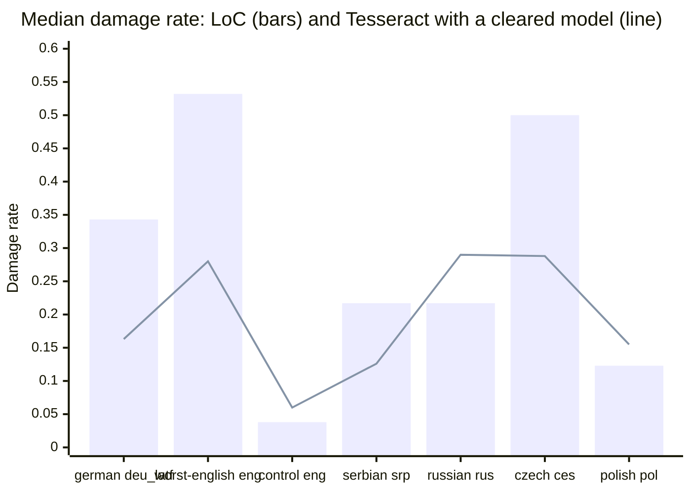
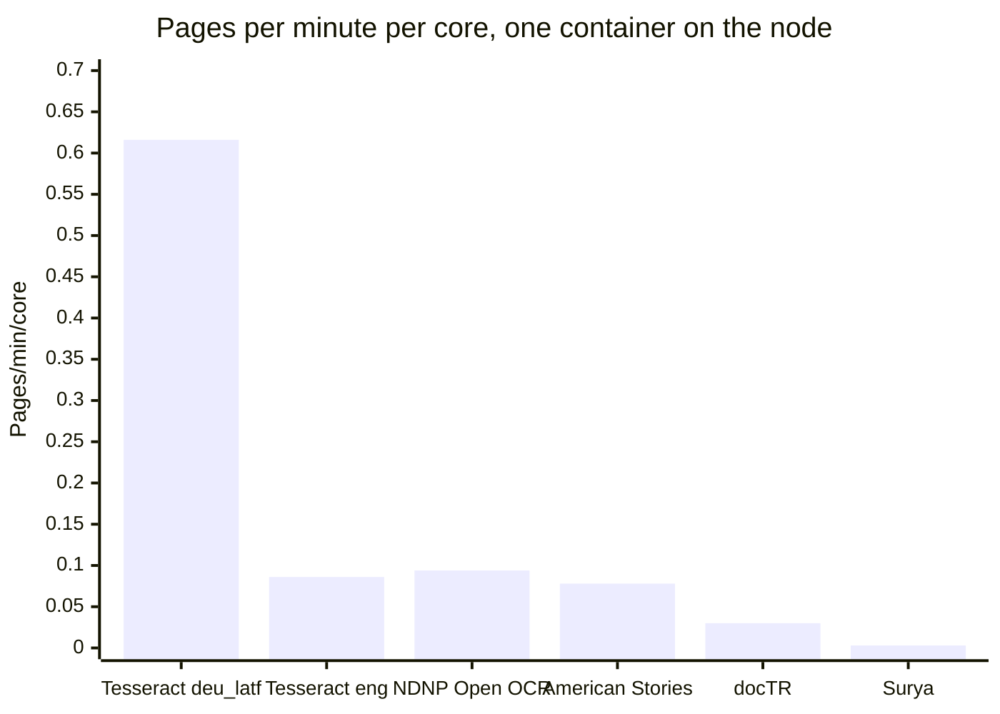

Round 1 of the engine survey in #296 ran five OCR engines on the same 80 sampled pages and scored each engine's text against LoC's own OCR of those pages. The plan is in [13: OCR engines](../../design/13-ocr-engines.md) (§13.9, and the catalog in §13.12) and [ADR-0016](../../design/adr/0016-pluggable-ocr-engines.md). The code is in `scripts/ocr-survey/`, and every number below comes from the files in `data/`.

As §13.9 says, round 1 is indicative only. It ran on the Python harness, not on production images: Debian's Tesseract 5.5.0 without `--dpi 300`, the engines' raw text rather than the `normalize_ocr` text the overlay stores, and memory measured inside each container.

# Summary

- **No ground truth, so no CER or WER.** No crops were hand-transcribed. Accuracy is the language audit's damage metric (`ja-ocr/quality.py`): each text's damage rate and its known words, compared with LoC's text of the same page. Lower damage is better. More known words than LoC means more words a search could match.
- **Tesseract with Apache-2.0 models improves German, Czech and Serbian on most pages.** The median damage rate drops from 0.343 to 0.163 for German (`deu_latf`), from 0.500 to 0.288 for Czech (`ces`) and from 0.217 to 0.126 for Serbian (`srp`). With `ces` and `srp`, every page has more known words than LoC's text.
- **NDNP Open OCR is the only engine that read all 15 of the worst English pages and beat LoC on every one.** Its median damage was 0.194 against LoC's 0.532, and it found 1.53 times LoC's known words. The variant surveyed uses a layout model with no licence, so it is survey only.
- **On the Polish, Russian and control pages, no engine's median damage was clearly below LoC's,** except Surya on the one Russian page it finished.
- **UB Mannheim's `frak2021` model scored best on German** (median damage 0.086, lower than LoC on all 13 pages it read), but it has no licence file, so it is survey only.
- **Surya scored best on the Serbian pages (median damage 0.031 on 2 pages) and was the slowest engine.** It took a median 2,411 s per page with about 8 cores busy, and used up to 11.8 GB of memory. It finished 4 of its 8 pages.
- **Tesseract is the cheapest engine.** It used one core per page and at most 429 MB. In the timing runs, docTR, American Stories and Surya each kept 6 to 8 cores busy per page and used 4.2 to 11.8 GB.

The bars are LoC's median damage over the pages each Tesseract run read, and the line is Tesseract's median over the same pages, at full scale (`summary.json`: `loc_median_damage_same_pages` and `median_damage`). Where the line is below the bar, Tesseract did better.

| Group | Pages | Lowest damage | Best with a cleared licence | Keep LoC's text? |
|---|---|---|---|---|
| german | 15 | Tesseract `frak2021` (survey only) | Tesseract `deu_latf` | No |
| worst-english | 15 | NDNP Open OCR over all 15 pages (survey only); docTR lower on the 8 pages it finished | Tesseract `eng` | No |
| control | 10 | American Stories, about equal to LoC | None better than LoC | Yes |
| serbian | 15 | Surya (2 pages) | Tesseract `srp` | No |
| russian | 5 | Surya (1 page) | None better than LoC | Yes |
| czech | 15 | docTR (survey only), with Tesseract `ces` at 50% scale close behind | Tesseract `ces` | No |
| polish | 5 | None better than LoC | None | Yes |

"Cleared" means every model in the run has a licence in `production_licenses` (13 §13.7.2). Surya's licence is cleared on condition of a credits page, which doesn't exist yet.

# How the numbers are made

**Sample.** `sample.py` drew 90 pages from loc.gov with seed 296. `score.py --select-control` kept 10 of the 20 control candidates (two per title, the first in draw order that LoC read well), so 80 pages are scored. The groups are the language audit's worst cases, plus the control.

| Group | Pages | Years | Sources | LoC damage (median) | LoC known share (median) | LoC words (median) |
|---|---|---|---|---|---|---|
| german | 15 | 1859-1911 | Nebraska Staats-Zeitung, Richmonder Anzeiger, Hermanner Volksblatt, Tennessee Staatszeitung | 0.343 | 0.380 | 2807 |
| worst-english | 15 | 1861-1918 | Batches nn_kant, txdn_japan, nn_bentham, nn_carson, kyu_frenchie | 0.532 | 0.340 | 7080 |
| control | 10 | 1921-1934 | Five English dailies | 0.038 | 0.774 | 2695 |
| serbian | 15 | 1906-1962 | Amerikanski Srbobran | 0.217 | 0.433 | 2663 |
| russian | 5 | 1918-1931 | Russian-language titles | 0.217 | 0.445 | 1806 |
| czech | 15 | 1876-1920 | Pokrok Západu | 0.500 | 0.311 | 2424 |
| polish | 5 | 1890-1936 | Polish-language titles | 0.123 | 0.485 | 2217 |

**Engines.** Each engine ran in its own podman container built from `scripts/ocr-survey/containers/`. The versions are the ones the engines reported in their results.

| Engine | Version | Models or variant | Groups | Node |
|---|---|---|---|---|
| Tesseract | 5.5.0 (Debian) | tessdata_best `deu`, `deu_latf`, `eng`, `srp`, `srp_latn`, `ces`, `rus`, `pol`; UB Mannheim `frak2021`; some also at 50% scale | All seven | 1 |
| NDNP Open OCR | cbe0ca5, with Tesseract 5.4.1 | Segmentation on (American Stories' layout model) | worst-english, control | 1 |
| American Stories | f307e5c | Word-level | worst-english, control | 2 |
| docTR | 1.1.0, torch 2.12.1 CPU | `db_resnet50` + `parseq-multilingual` | worst-english, control, german, czech, polish | 2 |
| Surya | surya-ocr 0.22.1 on llama.cpp server | Tiled pages | worst-english, serbian, russian, german; 2 pages each | 2 |

Node 1 is VM 120 on the NUC (Intel i5-4250U, 2 cores, 4 threads). Node 2 is VM 200 on pve-big (Intel i7-7700K, 8 vCPUs, 40 GiB). Both run AlmaLinux 9.8.

**Scoring.** Node 1's results were copied to node 2, and `score.py` ran there on 11 October at 2:07 PM ET, in a `python:3.12-slim` container with wordfreq 3.1.1 and lxml 6.1.3 (`data/run-score.sh`, `data/pip-freeze.txt`), using `ja-ocr/quality.py` as of 5ced3c6. For each page, it scores LoC's text and each engine's text in the group's language:

- `damage_rate`: near-misses of the language's 20 most frequent words, over near-misses plus those words.
- `known_share` and `known_words`: the share and the number of the text's words that are in the language's top 5,000.
- Against LoC's text of the same page: the change in damage and in known share, and the ratios of words and of known words.

Only pages with status `ok` count in the medians. Partial text from a timed-out page stays on disk and is left out.

# Results by group

These tables are `tables.py`'s output, with some columns left out. "Pages better" counts pages where the engine's damage is lower than LoC's. "Known words vs LoC" gives the median ratio, then the number of pages above 1. Peak RSS is the largest seen in any run of that engine on that group, including runs with 4 containers at once.

## German

| Engine | Pages read | Damage (median) | LoC, same pages | Change (median) | Pages better | Known words vs LoC; pages above 1 | Peak RSS MB |
|---|---|---|---|---|---|---|---|
| Tesseract `frak2021` | 15 of 15 (2 with no text) | 0.086 | 0.343 | -0.285 | 13 of 13 | 1.94; 12 | 303 |
| Tesseract `deu_latf` | 15 of 15 (2 with no text) | 0.163 | 0.343 | -0.208 | 10 of 13 | 1.82; 10 | 314 |
| Tesseract `deu_latf`, 50% scale | 15 of 15 | 0.162 | 0.343 | -0.220 | 11 of 15 | 1.78; 12 | 310 |
| Tesseract `deu` | 15 of 15 (2 with no text) | 0.239 | 0.343 | -0.164 | 9 of 13 | 1.57; 10 | 310 |
| docTR | 14 of 15 (1 timed out) | 0.589 | 0.357 | 0.162 | 0 of 14 | 0.72; 2 | 4808 |
| Surya | 1 of 2 (1 timed out) | 0.030 | 0.607 | -0.577 | 1 of 1 | 3.44; 1 | 7082 |

- The same two pages (Tennessee Staatszeitung, 1868-11-19, and Hermanner Volksblatt, 1869-09-24) gave no text at full scale with all three models, returning `ok` in 30 to 54 s. At 50% scale `deu_latf` read both, which is why that row has 15 pages with text. Why full scale failed on them wasn't checked.
- On the typeface question from #246: `deu_latf` read clearly better than `deu` on 7 of 15 pages, `deu` on none, and 8 were unclear, 2 of them with no text from either. "Clearly" means both damage and known share better by at least 0.05.
- docTR made German worse. Its recognizer has no long s, so no Fraktur (13 §13.12.1).

## Worst English batches

| Engine | Pages read | Damage (median) | LoC, same pages | Change (median) | Pages better | Known words vs LoC; pages above 1 | Peak RSS MB |
|---|---|---|---|---|---|---|---|
| NDNP Open OCR | 15 of 15 | 0.194 | 0.532 | -0.330 | 15 of 15 | 1.53; 13 | 1307 |
| docTR | 8 of 15 (7 timed out) | 0.143 | 0.564 | -0.360 | 8 of 8 | 1.72; 7 | 4914 |
| American Stories | 15 of 15 | 0.256 | 0.532 | -0.238 | 13 of 15 | 0.84; 6 | 4856 |
| Tesseract `eng` | 13 of 15 (2 timed out) | 0.280 | 0.532 | -0.245 | 12 of 13 | 1.17; 7 | 344 |
| Tesseract `eng`, 50% scale | 15 of 15 | 0.288 | 0.532 | -0.224 | 13 of 15 | 0.69; 3 | 289 |
| Surya | 0 of 2 (2 timed out) | | | | | | 10675 |

- American Stories has less damage than LoC but fewer words (0.56 of LoC's, median) and fewer known words (0.84). It reads only article, headline, author and caption regions and drops chunks its classifier calls illegible (13 §13.12.1), so part of its lower damage comes from text it leaves out.
- docTR's 7 timeouts all came from its first, overloaded run on node 2 (see Caveats). The 8 pages it finished aren't a random subset of the 15.
- Tesseract at 50% scale read every page but found fewer known words than LoC (0.69).

## Control pages

| Engine | Pages read | Damage (median) | LoC, same pages | Change (median) | Pages better | Known words vs LoC; pages above 1 | Peak RSS MB |
|---|---|---|---|---|---|---|---|
| American Stories | 10 of 10 | 0.033 | 0.038 | -0.002 | 5 of 10 | 0.88; 0 | 5087 |
| docTR | 10 of 10 | 0.042 | 0.038 | 0.007 | 2 of 10 | 1.06; 9 | 3300 |
| Tesseract `eng`, 50% scale | 10 of 10 | 0.060 | 0.038 | 0.018 | 2 of 10 | 0.97; 2 | 373 |
| Tesseract `eng` | 10 of 10 | 0.060 | 0.038 | 0.024 | 1 of 10 | 0.99; 3 | 429 |
| NDNP Open OCR | 10 of 10 | 0.071 | 0.038 | 0.025 | 1 of 10 | 1.01; 7 | 1426 |

The control pages were picked because LoC read them well, and no engine does clearly better. docTR finds slightly more known words (1.06) at slightly higher damage.

## Serbian

| Engine | Pages read | Damage (median) | LoC, same pages | Change (median) | Pages better | Known words vs LoC; pages above 1 | Peak RSS MB |
|---|---|---|---|---|---|---|---|
| Surya | 2 of 2 | 0.031 | 0.201 | -0.170 | 2 of 2 | 1.61; 2 | 11565 |
| Tesseract `srp` | 15 of 15 | 0.126 | 0.217 | -0.060 | 11 of 15 | 1.27; 15 | 376 |
| Tesseract `srp`, 50% scale | 15 of 15 | 0.265 | 0.217 | 0.025 | 7 of 15 | 1.06; 9 | 296 |
| Tesseract `srp_latn` | 15 of 15 | 0.575 | 0.217 | 0.353 | 0 of 15 | 0.37; 2 | 280 |

The Latin-script model makes these pages worse, and at 50% scale `srp` has more damage than LoC.

## Russian

| Engine | Pages read | Damage (median) | LoC, same pages | Change (median) | Pages better | Known words vs LoC; pages above 1 | Peak RSS MB |
|---|---|---|---|---|---|---|---|
| Surya | 1 of 2 (1 timed out) | 0.120 | 0.217 | -0.097 | 1 of 1 | 1.54; 1 | 11836 |
| Tesseract `rus` | 5 of 5 | 0.290 | 0.217 | 0.123 | 1 of 5 | 0.95; 0 | 278 |

## Czech

| Engine | Pages read | Damage (median) | LoC, same pages | Change (median) | Pages better | Known words vs LoC; pages above 1 | Peak RSS MB |
|---|---|---|---|---|---|---|---|
| docTR | 15 of 15 | 0.237 | 0.500 | -0.290 | 14 of 15 | 1.44; 15 | 5218 |
| Tesseract `ces`, 50% scale | 15 of 15 | 0.247 | 0.500 | -0.218 | 15 of 15 | 1.46; 14 | 294 |
| Tesseract `ces` | 15 of 15 | 0.288 | 0.500 | -0.234 | 14 of 15 | 1.44; 15 | 425 |

The three runs find about the same share of known words. Tesseract at 50% scale took 95 s for its timed page, against 147 s at full scale.

## Polish

| Engine | Pages read | Damage (median) | LoC, same pages | Change (median) | Pages better | Known words vs LoC; pages above 1 | Peak RSS MB |
|---|---|---|---|---|---|---|---|
| docTR | 5 of 5 | 0.154 | 0.123 | 0.031 | 1 of 5 | 1.15; 5 | 3345 |
| Tesseract `pol` | 5 of 5 | 0.155 | 0.123 | 0.030 | 0 of 5 | 1.00; 4 | 402 |

# Speed and memory

Speed comes from runs with one container on the node: the timing passes for Tesseract (node 1) and for docTR and American Stories (node 2, one page per group), and the main runs of NDNP Open OCR (node 1) and Surya (node 2), which ran one container at a time. Pages per minute per core is 60 divided by the median CPU-seconds per page, so an engine is charged for every core it keeps busy (`derive.py`).

| Engine | Node | Pages timed | Seconds/page (median) | CPU-seconds/page (median) | Busy cores (median) | Pages/min/core | Peak RSS MB |
|---|---|---|---|---|---|---|---|
| Tesseract `pol` | 1 | 1 | 50 | 50 | 0.99 | 1.211 | 189 |
| Tesseract `frak2021` | 1 | 1 | 52 | 52 | 0.99 | 1.162 | 235 |
| Tesseract `srp`, 50% scale | 1 | 1 | 58 | 57 | 0.98 | 1.059 | 137 |
| Tesseract `srp_latn` | 1 | 1 | 74 | 70 | 0.94 | 0.862 | 172 |
| Tesseract `deu_latf`, 50% scale | 1 | 1 | 73 | 72 | 0.99 | 0.831 | 198 |
| Tesseract `rus` | 1 | 1 | 78 | 77 | 0.99 | 0.781 | 213 |
| Tesseract `srp` | 1 | 1 | 82 | 81 | 0.99 | 0.738 | 198 |
| Tesseract `ces`, 50% scale | 1 | 1 | 95 | 94 | 0.99 | 0.637 | 204 |
| Tesseract `deu_latf` | 1 | 1 | 98 | 97 | 0.99 | 0.616 | 276 |
| Tesseract `deu` | 1 | 1 | 100 | 99 | 0.99 | 0.607 | 271 |
| Tesseract `ces` | 1 | 1 | 147 | 140 | 0.95 | 0.429 | 250 |
| Tesseract `eng`, 50% scale | 1 | 2 | 203 | 201 | 0.99 | 0.298 | 282 |
| Tesseract `eng` | 1 | 2 | 701 | 696 | 0.99 | 0.086 | 361 |
| NDNP Open OCR | 1 | 25 | 265 | 640 | 2.39 | 0.094 | 1426 |
| American Stories | 2 | 2 | 128 | 773 | 6.04 | 0.078 | 4865 |
| docTR | 2 | 5 | 257 | 1970 | 7.66 | 0.030 | 4190 |
| Surya | 2 | 4 | 2411 | 18753 | 7.78 | 0.003 | 11820 |

- Node 1's i5-4250U and node 2's i7-7700K are different CPUs, so figures from the two nodes don't compare core for core. No engine ran on both nodes, so the size of the difference wasn't measured.
- Tesseract `eng`'s two timed pages differ widely: 1,192 s for a worst-English page whose LoC text has 17,401 words, and 209 s for a control page. The 701 s "median" is their average.
- **Throughput on node 1** (Tesseract `deu_latf` on the first 8 German pages, one thread per container): 719 pages a day with 1 container, 1,144 with 2 and 1,277 with 4 (`summary.json`, `throughput`). Node 1 has 2 cores, and going from 2 containers to 4 added 12%.

# Failures and skips

| Engine | Jobs | ok | Timed out | ok with no text | Partial text kept | Peak RSS MB (any run) |
|---|---|---|---|---|---|---|
| Tesseract | 195 | 193 | 2 | 6 | 0 | 429 |
| NDNP Open OCR | 25 | 25 | 0 | 0 | 0 | 1426 |
| docTR | 60 | 52 | 8 | 0 | 0 | 5218 |
| American Stories | 25 | 25 | 0 | 0 | 0 | 5087 |
| Surya | 8 | 4 | 4 | 0 | 4 | 11836 |

- **Tesseract:** Two worst-English pages hit the 1,800 s limit with `eng` at full scale, with 4 containers running at once. The 6 jobs with no text are the two German pages above, with each of three models.
- **docTR:** All 8 timeouts (7 worst-English, 1 German) hit the 1,800 s limit during the first, overloaded run. The restarted run had none.
- **Surya:** The limit was 3,600 s per page, but the 4 pages that timed out were stopped at 3,756 to 4,364 s. Their partial text (1,977 to 5,486 words) is on disk and not scored. Why the stop came late wasn't checked.
- **Time limits.** The limits above are the ones recorded with each result and in the job files: 1,800 s for every engine except Surya, at 3,600 s. The `PLAN` in the committed `run.py` has 3,600 s for Tesseract and 1,800 s for Surya, so the job files were written with other values than the committed script's. The cause wasn't traced.
- **Not run:** NDNP Open OCR and American Stories ran on English only, as planned; American Stories reads only English. Surya ran 2 pages per group, as planned. docTR didn't run on Serbian or Russian (it has no pretrained Cyrillic model). NDNP Open OCR's default profile, without segmentation, wasn't surveyed.

**ALTO.** All 193 ALTO files from Tesseract's `ok` jobs and all 25 from NDNP Open OCR are ALTO v3 and validate against LoC's `alto-3-0.xsd`. The 2 Tesseract jobs that timed out left ALTO files that aren't well-formed XML. docTR, American Stories and Surya write no ALTO. Of LoC's 80 files, 66 are ALTO v2 and valid, and 14 use the pre-standard CCS namespace, which has no public schema to check against.

# Licences

From the engine catalog (13 §13.12.1), `production_licenses` in `engines.toml` (13 §13.7.2) and ADR-0016's Consequences. These are the design's gate, not legal readings, and clearing an engine is the maintainer's decision.

| Engine, as surveyed | Status | Why |
|---|---|---|
| Tesseract with tessdata_best (`deu`, `deu_latf`, `eng`, `srp`, `srp_latn`, `ces`, `rus`, `pol`) | Cleared | Engine and models are Apache-2.0 |
| Tesseract with `frak2021` | Survey only | UB Mannheim's models have no licence file |
| NDNP Open OCR, segmentation on | Survey only | The segmentation model is American Stories', which has no licence. The default profile, without segmentation, can go to production |
| American Stories | Survey only | No licence on the code or the weights |
| docTR (`db_resnet50` + `parseq-multilingual`) | Survey only | The code and `parseq-multilingual` are Apache-2.0, but the default `db_resnet50` weights have no stated terms |
| Surya 2 | Cleared on condition | Datalab's modified OpenRAIL-M has been in `production_licenses` since 2026-10-10, on condition that the site has a credits page first. Datalab's terms also attach attribution and share-alike conditions to the output |

# Which engine for which group

- **German:** Tesseract `deu_latf`, which is cleared. `frak2021` did better but needs a licence decision. At 50% scale `deu_latf` also read the two pages that gave no text at full scale, with about the same median damage.
- **Worst English:** NDNP Open OCR had the best result over all 15 pages, but only with its unlicensed segmentation model. Tesseract `eng` is the cleared choice, with lower damage than LoC on 12 of 13 pages and 1.17 times LoC's known words. Whether NDNP Open OCR's default profile does as well wasn't measured.
- **Serbian:** Tesseract `srp` at full scale, which is cleared. Surya scored better on 2 pages, but used about 230 times Tesseract's CPU time per page (18,753 against 81 CPU-seconds, on different nodes).
- **Czech:** Tesseract `ces`, which is cleared. At 50% scale it was better than LoC on 15 of 15 pages, and faster. docTR is about as good and is survey only.
- **Russian, Polish and the control pages:** Keep LoC's text. No engine's median damage was clearly below LoC's on these groups, except Surya on the one Russian page it finished.

This agrees with the Tesseract-only pilot path approved on 10 October (#296).

# Caveats

- **No CER.** The damage metric counts near-misses of frequent words. It doesn't measure accuracy against a transcription, and an engine that drops text can score well on it, as American Stories shows. The plan's CER on hand-transcribed crops (13 §13.9) needs crops that haven't been made.
- **Small samples.** 5 to 15 pages per group, 2 per group for Surya, and 1 or 2 pages per Tesseract variant in the timing pass. One page can move a median by a few hundredths.
- **The NUC's power cutouts.** The NUC lost power while NDNP Open OCR was running on node 1. 10 of 25 pages were done, and the run resumed at 9:07 AM ET on 11 October. `run.py` skips pages that have a result, so the page that was running when the power went was read again from the start. The results have 25 rows, one per page, all `ok`, with no duplicates, and all 25 ALTO files validate. Tesseract had finished on node 1 before the cutouts.
- **docTR's restart.** docTR started on node 2 with 3 containers of 8 threads each, which pushed the load to about 17 on 8 vCPUs. It was restarted at 2:22 AM ET with 4 containers of 2 threads each. 34 of its 60 results, including all 8 timeouts, are from the first run. The timed-out pages weren't rerun. Its timing pass ran alone on the node with 8 threads.
- **Memory was measured inside each container,** summed over its processes, with up to 4 containers running at once for some engines. Production would measure from the cgroup (13 §13.6.6).
- **AlmaLinux, not RHEL.** Both nodes run AlmaLinux 9.8. The longer-term target is RHEL 10. The engines run in containers with their own userland, so the host OS probably matters little to these numbers, but nothing ran on RHEL to confirm that.
- **Two different CPUs.** See Speed and memory.

# Data and reproduction

- `data/scores.jsonl`: a row per page and text, LoC's and each engine run's.
- `data/summary.json`: per group and engine run, plus timing, throughput and the German typeface comparison.
- `data/timing.jsonl`: the timing passes. `data/alto.jsonl`: the ALTO checks.
- `data/tables.md`: the output of `tables.py --data data`. The group tables above come from it.
- `derive.py --data data`: the speed, failure and ALTO tables, the typeface counts and the speed chart.
- `data/run-score.sh` and `data/pip-freeze.txt`: how the scoring ran.

The full survey directories from both nodes (sample pages, LoC's ALTO and text, engine outputs, logs and these scores) are on pve-big at `/tank/ocr-survey/2026-10-11/`, with a `SHA256SUMS` manifest computed on each node and checked against the copy.
