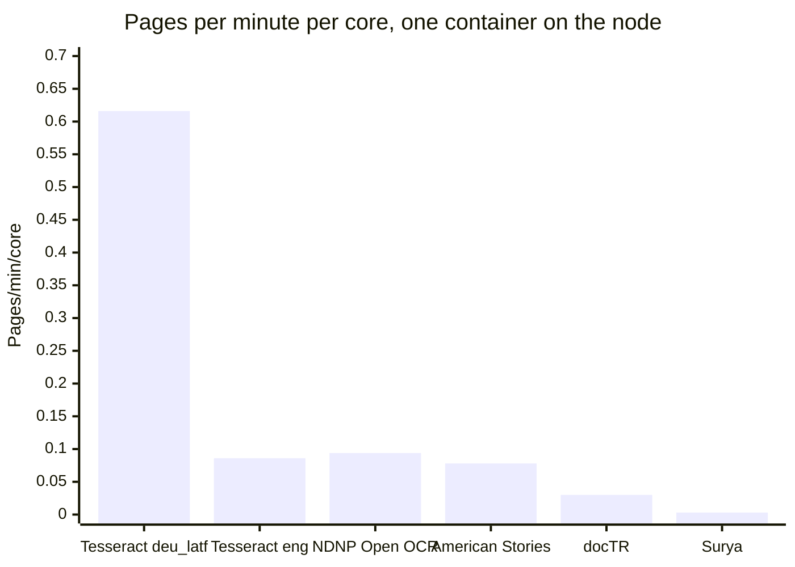

Round 1 of the engine survey in #296 ran five OCR engines on the same 80 sampled pages and scored each engine's text against LoC's own OCR of those pages. The plan is in [13: OCR engines](../../design/13-ocr-engines.md) (§13.9, and the catalog in §13.12) and [ADR-0016](../../design/adr/0016-pluggable-ocr-engines.md). The code is in `scripts/ocr-survey/`, and every survey number below comes from the files in `data/`. The pilot figures in What happened next come from #296.

As §13.9 says, round 1 is indicative only. It ran on the Python harness, not on production images: Debian's Tesseract 5.5.0 without `--dpi 300`, the engines' raw text rather than the `normalize_ocr` text the overlay stores, and memory measured inside each container.

# Summary

- **No ground truth, so no CER or WER.** No crops were hand-transcribed. Accuracy is the language audit's damage metric (`ja-ocr/quality.py`): each text's damage rate and its known words, compared with LoC's text of the same page. Lower damage is better. More known words than LoC means more words a search could match.
- **Tesseract with cleared models improves German, Czech and Serbian on most pages.** The median damage rate drops from 0.371 to 0.086 for German with `frak2021` (0.163 with `deu_latf`, on the same 13 pages), from 0.500 to 0.288 for Czech (`ces`) and from 0.217 to 0.126 for Serbian (`srp`). With `ces` and `srp`, every page has more known words than LoC's text.
- **NDNP Open OCR is the only engine that read all 15 of the worst English pages and beat LoC on every one.** Its median damage was 0.194 against LoC's 0.532, and it found 1.53 times LoC's known words. The variant surveyed uses American Stories' layout model, which has no explicit licence. Since 11 October that model is in the attributed tier, so it can go to production once the site has a credits page (#372).
- **On the Polish, Russian and control pages, no engine's median damage was clearly below LoC's,** except Surya on the one Russian page it finished.
- **UB Mannheim's `frak2021` model scored best on German** (median damage 0.086, lower than LoC on all 13 pages it read). It is cleared: UB Mannheim deposited the same file on Zenodo under CC0 1.0 ([10.5281/zenodo.10125246](https://zenodo.org/records/10125246)). The German pilot runs it (see What happened next).
- **Surya scored best on the Serbian pages (median damage 0.031 on 2 pages) and was the slowest engine.** It took a median 2,411 s per page with about 8 cores busy, and used up to 11.8 GB of memory. It finished 4 of its 8 pages.
- **Tesseract is the cheapest engine.** It used one core per page and at most 429 MB. In the timing runs, docTR, American Stories and Surya each kept 6 to 8 cores busy per page and used 4.2 to 11.8 GB.

The bars are LoC's median damage over the pages each Tesseract run read, and the line is Tesseract's median over the same pages, at full scale (`summary.json`: `loc_median_damage_same_pages` and `median_damage`). Where the line is below the bar, Tesseract did better.

| Group | Pages | Lowest damage | Best that can go to production now | Keep LoC's text? |
|---|---|---|---|---|
| german | 15 | Tesseract `frak2021` (cleared) | Tesseract `frak2021` | No |
| worst-english | 15 | NDNP Open OCR over all 15 pages (attributed); docTR lower on the 8 pages it finished (attributed) | Tesseract `eng` | No |
| control | 10 | American Stories, about equal to LoC (attributed) | None better than LoC | Yes |
| serbian | 15 | Surya on 2 pages (cleared, credit required) | Tesseract `srp` | No |
| russian | 5 | Surya on 1 page (cleared, credit required) | None better than LoC | Yes |
| czech | 15 | docTR (attributed), with Tesseract `ces` at 50% scale close behind | Tesseract `ces` | No |
| polish | 5 | None better than LoC | None | Yes |

The tiers are those of 13 §13.7.2 and ADR-0016, as of the licence decisions of 11 October (#373, #377). "Cleared" means every model in the run has a licence in `production_licenses`. "Attributed" means at least one model was published openly with no explicit licence and is allowed with a credit. No production route to an attributed model, or to one whose licence requires credit (Surya's), merges before the site has a credits page (#372). "Now" means cleared with no credit required, which among the runs surveyed is Tesseract with tessdata_best or `frak2021`.

# How the numbers are made

**Sample.** `sample.py` drew 90 pages from loc.gov with seed 296. `score.py --select-control` kept 10 of the 20 control candidates (two per title, the first in draw order that LoC read well), so 80 pages are scored. The groups are the language audit's worst cases, plus the control.

| Group | Pages | Years | Sources | LoC damage (median) | LoC known share (median) | LoC words (median) |
|---|---|---|---|---|---|---|
| german | 15 | 1859-1911 | Nebraska Staats-Zeitung, Richmonder Anzeiger, Hermanner Volksblatt, Tennessee Staatszeitung | 0.343 | 0.380 | 2807 |
| worst-english | 15 | 1861-1918 | Batches nn_kant, txdn_japan, nn_bentham, nn_carson, kyu_frenchie | 0.532 | 0.340 | 7080 |
| control | 10 | 1921-1934 | Five English dailies | 0.038 | 0.774 | 2695 |
| serbian | 15 | 1906-1962 | Amerikanski Srbobran | 0.217 | 0.433 | 2663 |
| russian | 5 | 1918-1931 | Russian-language titles | 0.217 | 0.445 | 1806 |
| czech | 15 | 1876-1920 | Pokrok Západu | 0.500 | 0.311 | 2424 |
| polish | 5 | 1890-1936 | Polish-language titles | 0.123 | 0.485 | 2217 |

**Engines.** Each engine ran in its own podman container built from `scripts/ocr-survey/containers/`. The versions are the ones the engines reported in their results.

| Engine | Version | Models or variant | Groups | Node |
|---|---|---|---|---|
| Tesseract | 5.5.0 (Debian) | tessdata_best `deu`, `deu_latf`, `eng`, `srp`, `srp_latn`, `ces`, `rus`, `pol`; UB Mannheim `frak2021`; some also at 50% scale | All seven | 1 |
| NDNP Open OCR | cbe0ca5, with Tesseract 5.4.1 | Segmentation on (American Stories' layout model) | worst-english, control | 1 |
| American Stories | f307e5c | Word-level | worst-english, control | 2 |
| docTR | 1.1.0, torch 2.12.1 CPU | `db_resnet50` + `parseq-multilingual` | worst-english, control, german, czech, polish | 2 |
| Surya | surya-ocr 0.22.1 on llama.cpp server | Tiled pages | worst-english, serbian, russian, german; 2 pages each | 2 |

Node 1 is VM 120 on the NUC (Intel i5-4250U, 2 cores, 4 threads). Node 2 is VM 200 on pve-big (Intel i7-7700K, 8 vCPUs, 40 GiB). Both run AlmaLinux 9.8.

**Scoring.** Node 1's results were copied to node 2, and `score.py` ran there on 11 October at 2:07 PM ET, in a `python:3.12-slim` container with wordfreq 3.1.1 and lxml 6.1.3 (`data/run-score.sh`), using `ja-ocr/quality.py` as of 5ced3c6. It ran again on 12 October at 7:07 AM ET with `score.py`'s fix to the "LoC, same pages" baseline and `dedup.py` (`data/run-score-r2.sh`, `data/pip-freeze.txt`). `scores.jsonl`, `alto.jsonl` and `timing.jsonl` came out byte for byte the same, and only three German baselines in `summary.json` changed. For each page, it scores LoC's text and each engine's text in the group's language:

- `damage_rate`: near-misses of the language's 20 most frequent words, over near-misses plus those words.
- `known_share` and `known_words`: the share and the number of the text's words that are in the language's top 5,000.
- Against LoC's text of the same page: the change in damage and in known share, and the ratios of words and of known words.

Only pages with status `ok` count in the medians. Partial text from a timed-out page stays on disk and is left out.

# Results by group

These tables are `tables.py`'s output, with some columns left out. "LoC, same pages" is LoC's median over the pages where the engine's text has a damage rate, so pages it read with no text are left out of both. "Pages better" counts pages where the engine's damage is lower than LoC's. "Known words vs LoC" gives the median ratio, then the number of pages above 1. Peak RSS is the largest seen in any run of that engine on that group, including runs with 4 containers at once.

**docTR and Surya kept some words twice.** Both read large pages in 1,280 px tiles overlapping by 256 px, and a word was kept from the tile whose core held its centre. The cores were cut 128 px in from each inner edge. Where a page's last tile started less than a full step after the one before it, the cores of the two overlapped, and a word in that strip could be kept from both. The Copilot review of #370 found this. In docTR's text, 8% to 19% of the words (median by group) were in such a strip and overlapped an earlier word's box by at least half. The "duplicates removed" rows score docTR's text without them (`dedup.py`, `data/doctr-dedup.jsonl`). Duplicates barely move the damage rate, which is a ratio, but they inflated docTR's words and known words. Surya's output has no boxes, so its duplicates can't be removed. Its text repeats 0 to 5 lines of more than 40 characters per page. `engine_runner.py` now splits each overlap at its midpoint. Tesseract, NDNP Open OCR and American Stories read whole pages and aren't affected.

## German

| Engine | Pages read | Damage (median) | LoC, same pages | Change (median) | Pages better | Known words vs LoC; pages above 1 | Peak RSS MB |
|---|---|---|---|---|---|---|---|
| Tesseract `frak2021` | 15 of 15 (2 with no text) | 0.086 | 0.371 | -0.285 | 13 of 13 | 1.94; 12 | 303 |
| Tesseract `deu_latf` | 15 of 15 (2 with no text) | 0.163 | 0.371 | -0.208 | 10 of 13 | 1.82; 10 | 314 |
| Tesseract `deu_latf`, 50% scale | 15 of 15 | 0.162 | 0.343 | -0.220 | 11 of 15 | 1.78; 12 | 310 |
| Tesseract `deu` | 15 of 15 (2 with no text) | 0.239 | 0.371 | -0.164 | 9 of 13 | 1.57; 10 | 310 |
| docTR | 14 of 15 (1 timed out) | 0.589 | 0.357 | 0.162 | 0 of 14 | 0.72; 2 | 4808 |
| docTR, duplicates removed | 14 | 0.579 | 0.357 | 0.172 | 0 of 14 | 0.56; 2 | |
| Surya | 1 of 2 (1 timed out) | 0.030 | 0.607 | -0.577 | 1 of 1 | 3.44; 1 | 7082 |

- The same two pages (Tennessee Staatszeitung, 1868-11-19, and Hermanner Volksblatt, 1869-09-24) gave no text at full scale with all three models, returning `ok` in 30 to 54 s. At 50% scale `deu_latf` read both, which is why that row has 15 pages with text. Why full scale failed on them wasn't checked.
- On the typeface question from #246: `deu_latf` read clearly better than `deu` on 7 of 15 pages, `deu` on none, and 8 were unclear, 2 of them with no text from either. "Clearly" means both damage and known share better by at least 0.05.
- docTR made German worse. Its recognizer has no long s, so no Fraktur (13 §13.12.1).

## Worst English batches

| Engine | Pages read | Damage (median) | LoC, same pages | Change (median) | Pages better | Known words vs LoC; pages above 1 | Peak RSS MB |
|---|---|---|---|---|---|---|---|
| NDNP Open OCR | 15 of 15 | 0.194 | 0.532 | -0.330 | 15 of 15 | 1.53; 13 | 1307 |
| docTR | 8 of 15 (7 timed out) | 0.143 | 0.564 | -0.360 | 8 of 8 | 1.72; 7 | 4914 |
| docTR, duplicates removed | 8 | 0.145 | 0.564 | -0.362 | 8 of 8 | 1.58; 7 | |
| American Stories | 15 of 15 | 0.256 | 0.532 | -0.238 | 13 of 15 | 0.84; 6 | 4856 |
| Tesseract `eng` | 13 of 15 (2 timed out) | 0.280 | 0.532 | -0.245 | 12 of 13 | 1.17; 7 | 344 |
| Tesseract `eng`, 50% scale | 15 of 15 | 0.288 | 0.532 | -0.224 | 13 of 15 | 0.69; 3 | 289 |
| Surya | 0 of 2 (2 timed out) | | | | | | 10675 |

- American Stories has less damage than LoC but fewer words (0.56 of LoC's, median) and fewer known words (0.84). It reads only article, headline, author and caption regions and drops chunks its classifier calls illegible (13 §13.12.1), so part of its lower damage comes from text it leaves out.
- docTR's 7 timeouts all came from its first, overloaded run on node 2 (see Caveats). The 8 pages it finished aren't a random subset of the 15.
- Tesseract at 50% scale read every page but found fewer known words than LoC (0.69).

## Control pages

| Engine | Pages read | Damage (median) | LoC, same pages | Change (median) | Pages better | Known words vs LoC; pages above 1 | Peak RSS MB |
|---|---|---|---|---|---|---|---|
| American Stories | 10 of 10 | 0.033 | 0.038 | -0.002 | 5 of 10 | 0.88; 0 | 5087 |
| docTR | 10 of 10 | 0.042 | 0.038 | 0.007 | 2 of 10 | 1.06; 9 | 3300 |
| docTR, duplicates removed | 10 | 0.041 | 0.038 | 0.006 | 2 of 10 | 0.98; 1 | |
| Tesseract `eng`, 50% scale | 10 of 10 | 0.060 | 0.038 | 0.018 | 2 of 10 | 0.97; 2 | 373 |
| Tesseract `eng` | 10 of 10 | 0.060 | 0.038 | 0.024 | 1 of 10 | 0.99; 3 | 429 |
| NDNP Open OCR | 10 of 10 | 0.071 | 0.038 | 0.025 | 1 of 10 | 1.01; 7 | 1426 |

The control pages were picked because LoC read them well, and no engine does clearly better. docTR's 1.06 times LoC's known words comes from words it kept twice; with those removed it is 0.98.

## Serbian

| Engine | Pages read | Damage (median) | LoC, same pages | Change (median) | Pages better | Known words vs LoC; pages above 1 | Peak RSS MB |
|---|---|---|---|---|---|---|---|
| Surya | 2 of 2 | 0.031 | 0.201 | -0.170 | 2 of 2 | 1.61; 2 | 11565 |
| Tesseract `srp` | 15 of 15 | 0.126 | 0.217 | -0.060 | 11 of 15 | 1.27; 15 | 376 |
| Tesseract `srp`, 50% scale | 15 of 15 | 0.265 | 0.217 | 0.025 | 7 of 15 | 1.06; 9 | 296 |
| Tesseract `srp_latn` | 15 of 15 | 0.575 | 0.217 | 0.353 | 0 of 15 | 0.37; 2 | 280 |

The Latin-script model makes these pages worse, and at 50% scale `srp` has more damage than LoC.

## Russian

| Engine | Pages read | Damage (median) | LoC, same pages | Change (median) | Pages better | Known words vs LoC; pages above 1 | Peak RSS MB |
|---|---|---|---|---|---|---|---|
| Surya | 1 of 2 (1 timed out) | 0.120 | 0.217 | -0.097 | 1 of 1 | 1.54; 1 | 11836 |
| Tesseract `rus` | 5 of 5 | 0.290 | 0.217 | 0.123 | 1 of 5 | 0.95; 0 | 278 |

## Czech

| Engine | Pages read | Damage (median) | LoC, same pages | Change (median) | Pages better | Known words vs LoC; pages above 1 | Peak RSS MB |
|---|---|---|---|---|---|---|---|
| docTR | 15 of 15 | 0.237 | 0.500 | -0.290 | 14 of 15 | 1.44; 15 | 5218 |
| docTR, duplicates removed | 15 | 0.236 | 0.500 | -0.302 | 15 of 15 | 1.28; 15 | |
| Tesseract `ces`, 50% scale | 15 of 15 | 0.247 | 0.500 | -0.218 | 15 of 15 | 1.46; 14 | 294 |
| Tesseract `ces` | 15 of 15 | 0.288 | 0.500 | -0.234 | 14 of 15 | 1.44; 15 | 425 |

Both Tesseract runs find about 1.45 times LoC's known words, and docTR 1.28 once its duplicates are removed. Tesseract at 50% scale took 95 s for its timed page, against 147 s at full scale.

## Polish

| Engine | Pages read | Damage (median) | LoC, same pages | Change (median) | Pages better | Known words vs LoC; pages above 1 | Peak RSS MB |
|---|---|---|---|---|---|---|---|
| docTR | 5 of 5 | 0.154 | 0.123 | 0.031 | 1 of 5 | 1.15; 5 | 3345 |
| docTR, duplicates removed | 5 | 0.163 | 0.123 | 0.026 | 1 of 5 | 0.98; 1 | |
| Tesseract `pol` | 5 of 5 | 0.155 | 0.123 | 0.030 | 0 of 5 | 1.00; 4 | 402 |

# Speed and memory

Speed comes from runs with one container on the node: the timing passes for Tesseract (node 1) and for docTR and American Stories (node 2, one page per group), and the main runs of NDNP Open OCR (node 1) and Surya (node 2), which ran one container at a time. Pages per minute per core is 60 divided by the median CPU-seconds per page, so an engine is charged for every core it keeps busy (`derive.py`).

| Engine | Node | Pages timed | Seconds/page (median) | CPU-seconds/page (median) | Busy cores (median) | Pages/min/core | Peak RSS MB |
|---|---|---|---|---|---|---|---|
| Tesseract `pol` | 1 | 1 | 50 | 50 | 0.99 | 1.211 | 189 |
| Tesseract `frak2021` | 1 | 1 | 52 | 52 | 0.99 | 1.162 | 235 |
| Tesseract `srp`, 50% scale | 1 | 1 | 58 | 57 | 0.98 | 1.059 | 137 |
| Tesseract `srp_latn` | 1 | 1 | 74 | 70 | 0.94 | 0.862 | 172 |
| Tesseract `deu_latf`, 50% scale | 1 | 1 | 73 | 72 | 0.99 | 0.831 | 198 |
| Tesseract `rus` | 1 | 1 | 78 | 77 | 0.99 | 0.781 | 213 |
| Tesseract `srp` | 1 | 1 | 82 | 81 | 0.99 | 0.738 | 198 |
| Tesseract `ces`, 50% scale | 1 | 1 | 95 | 94 | 0.99 | 0.637 | 204 |
| Tesseract `deu_latf` | 1 | 1 | 98 | 97 | 0.99 | 0.616 | 276 |
| Tesseract `deu` | 1 | 1 | 100 | 99 | 0.99 | 0.607 | 271 |
| Tesseract `ces` | 1 | 1 | 147 | 140 | 0.95 | 0.429 | 250 |
| Tesseract `eng`, 50% scale | 1 | 2 | 203 | 201 | 0.99 | 0.298 | 282 |
| Tesseract `eng` | 1 | 2 | 701 | 696 | 0.99 | 0.086 | 361 |
| NDNP Open OCR | 1 | 25 | 265 | 640 | 2.39 | 0.094 | 1426 |
| American Stories | 2 | 2 | 128 | 773 | 6.04 | 0.078 | 4865 |
| docTR | 2 | 5 | 257 | 1970 | 7.66 | 0.030 | 4190 |
| Surya | 2 | 4 | 2411 | 18753 | 7.78 | 0.003 | 11820 |

- Node 1's i5-4250U and node 2's i7-7700K are different CPUs, so figures from the two nodes don't compare core for core. No engine ran on both nodes, so the size of the difference wasn't measured.
- Tesseract `eng`'s two timed pages differ widely: 1,192 s for a worst-English page whose LoC text has 17,401 words, and 209 s for a control page. The 701 s "median" is their average.
- **Throughput on node 1** (Tesseract `deu_latf` on the first 8 German pages, one thread per container): 719 pages a day with 1 container, 1,144 with 2 and 1,277 with 4 (`summary.json`, `throughput`). Node 1 has 2 cores, and going from 2 containers to 4 added 12%.

# Failures and skips

| Engine | Jobs | ok | Timed out | ok with no text | Partial text kept | Peak RSS MB (any run) |
|---|---|---|---|---|---|---|
| Tesseract | 195 | 193 | 2 | 6 | 0 | 429 |
| NDNP Open OCR | 25 | 25 | 0 | 0 | 0 | 1426 |
| docTR | 60 | 52 | 8 | 0 | 0 | 5218 |
| American Stories | 25 | 25 | 0 | 0 | 0 | 5087 |
| Surya | 8 | 4 | 4 | 0 | 4 | 11836 |

- **Tesseract:** Two worst-English pages hit the 1,800 s limit with `eng` at full scale, with 4 containers running at once. The 6 jobs with no text are the two German pages above, with each of three models.
- **docTR:** All 8 timeouts (7 worst-English, 1 German) hit the 1,800 s limit during the first, overloaded run. The restarted run had none.
- **Surya:** The limit was 3,600 s per page, but the 4 pages that timed out were stopped at 3,756 to 4,364 s. Their partial text (1,977 to 5,486 words) is on disk and not scored. The limit is a Python `SIGALRM` in `engine_runner.py`. Python runs the handler only when the current call into native code returns, and the recorded time also includes restarting Surya's llama.cpp server after the stop. How the extra 156 to 764 s splits between the handler's delay and the restart wasn't measured.
- **Time limits:** The limits above are the ones in the job files and recorded with each result: 1,800 s for every engine except Surya, at 3,600 s. Tesseract's main run finished by 8:34 PM ET on 10 October, with 1,800 s recorded in every result, and `run.py` was first committed at 8:45 PM with 3,600 s for Tesseract. The copy of `run.py` on node 2 that wrote Surya's jobs has 3,600 s for Surya, and the committed one has 1,800 s. `run.py`'s `PLAN` now has the limits that ran.
- **Not run:** NDNP Open OCR and American Stories ran on English only, as planned; American Stories reads only English. Surya ran 2 pages per group, as planned. docTR didn't run on Serbian or Russian (it has no pretrained Cyrillic model). NDNP Open OCR's default profile, without segmentation, wasn't surveyed.

**ALTO.** All 193 ALTO files from Tesseract's `ok` jobs and all 25 from NDNP Open OCR are ALTO v3 and validate against LoC's `alto-3-0.xsd`. The 2 Tesseract jobs that timed out left ALTO files that aren't well-formed XML. docTR, American Stories and Surya write no ALTO. Of LoC's 80 files, 66 are ALTO v2 and valid, and 14 use the pre-standard CCS namespace, which has no public schema to check against.

# Licences

The tiers below are those of 13 §13.7.2 and ADR-0016's Consequences, as they stand after the licence decisions of 11 October (#373, #377). These are the design's gate, not legal readings, and moving an engine or model between tiers is the maintainer's decision.

| Engine, as surveyed | Tier | Why |
|---|---|---|
| Tesseract with tessdata_best (`deu`, `deu_latf`, `eng`, `srp`, `srp_latn`, `ces`, `rus`, `pol`) | Cleared | Engine and models are Apache-2.0 |
| Tesseract with `frak2021` | Cleared | UB Mannheim deposited it on Zenodo under CC0 1.0 ([10.5281/zenodo.10125246](https://zenodo.org/records/10125246)). Its sha256 matches the file the survey ran |
| NDNP Open OCR, segmentation on | Attributed | The code is US public domain and CC0, so it is cleared, and the default profile without segmentation can go to production as it is. The segmentation model is American Stories' layout model, which has no explicit licence; the maintainer put it in the attributed tier on 11 October |
| American Stories | Attributed | Neither the code nor the weights have a licence; attributed by the same decision |
| docTR (`db_resnet50` + `parseq-multilingual`) | Attributed | The code and `parseq-multilingual` are Apache-2.0. The default `db_resnet50` weights have no stated licence and are attributed |
| Surya 2 | Cleared, credit required | Datalab's modified Open RAIL-M has been in `production_licenses` since 10 October. Datalab's terms also put attribution and share-alike conditions on the output |

- **The Ultralytics stamp.** American Stories' layout model, which NDNP Open OCR's segmentation also uses, is an Ultralytics YOLO export, and the same export in `effocr_en` carries `license: AGPL-3.0` in its ONNX metadata. The stamp comes from the export tool, not from the authors. We run the model on our own nodes, don't distribute it and don't offer a modified version over a network, so AGPL-3.0's obligations wouldn't apply even if it covered the weights, and the text we publish isn't an AGPL-3.0 work (ADR-0016).
- **The credits page.** No production route to an attributed model, or to one whose licence requires credit, merges before the site has a credits page naming each engine and model with its author, source and licence (#372). Of the runs surveyed, only Tesseract with tessdata_best or `frak2021` can be routed before then.
- **Not in round 1.** dots.ocr and dots.mocr are cleared (MIT with a supplemental agreement, credit required), by the maintainer's decision of 11 October. EasyOCR's weights are excluded: Jaided AI's terms limit its free "Services" to "personal, non-commercial use". EasyOCR's code stays cleared, but no production route may use its weights.

# Which engine for which group

- **German:** Tesseract `frak2021`, which is cleared and had the lowest damage on every page it read. `deu_latf` is the fallback; at 50% scale it also read the two pages that gave no text at full scale with every model, with about the same median damage.
- **Worst English:** NDNP Open OCR with segmentation had the best result over all 15 pages, and its layout model is now attributed, so it can go to production once the credits page exists. Until then Tesseract `eng` is the choice, with lower damage than LoC on 12 of 13 pages and 1.17 times LoC's known words. NDNP Open OCR kept a median 2.4 cores busy and used up to 1.4 GB, against one core and at most 0.4 GB for Tesseract. Whether NDNP Open OCR's default profile, which is cleared, does as well wasn't measured.
- **Serbian:** Tesseract `srp` at full scale, which is cleared. Surya scored better on 2 pages and is allowed once the credits page exists, but it used about 230 times Tesseract's CPU time per page (18,753 against 81 CPU-seconds, on different nodes).
- **Czech:** Tesseract `ces`, which is cleared. At 50% scale it was better than LoC on 15 of 15 pages, and faster. docTR, which is attributed, had a little less damage but fewer known words once its duplicates are removed (1.28 against 1.44).
- **Russian, Polish and the control pages:** Keep LoC's text. No engine's median damage was clearly below LoC's on these groups, except Surya on the one Russian page it finished.

This agrees with the Tesseract-only pilot path approved on 10 October (#296), and the clearance of `frak2021` made it the pilot's German model.

# What happened next

- **The German pilot (#296), 11 and 12 October.** The workers on both nodes read German pages with Tesseract `frak2021`, and `ocr-sync` imported 2,999 of them by 6:17 AM ET on 12 October, with one dead letter. The `ocr-sync --report` at 1:19 AM ET on 12 October covered the first 959. Over those pages, the median damage was 0.120 for ours against 0.287 for LoC's, ours was lower on 939 of the 953 pages that have both scores, and rule v1 would replace 842 of 959 (88%).
- **Throughput.** From 11:36 PM on 11 October to 12:25 AM ET on 12 October, node 1 read about 2.3 pages a minute (3 at once) and node 2 about 8.9 (7 at once).
- **Publication** waits for the full rebuild in #283.

The pilot's numbers are from the pilot comment on #296 and `ocr-sync --report` (`curated/ocr-local/report/`). They are the production pipeline's, not this survey's.

# Full-size or 50% scans

The scan prefetch (#368) had to choose a resolution, and this survey is the only evidence. Its 50% images were the full IIIF JPEG shrunk on the node with Lanczos, not LoC's own `pct:50` JPEG, so it shows how a half-size image reads and not how LoC's half-size file reads.

| Group | Model | Full | 50% | LoC, same pages, full / 50% | Known words vs LoC, full / 50% |
|---|---|---|---|---|---|
| German | `deu_latf` | 0.163 (13 pages with text) | 0.162 (15 with text) | 0.371 / 0.343 | 1.82 / 1.78 |
| Worst English | `eng` | 0.280 (2 timed out) | 0.288 | 0.532 / 0.532 | 1.17 / 0.69 |
| Control | `eng` | 0.060 | 0.060 | 0.038 / 0.038 | 0.99 / 0.97 |
| Serbian | `srp` | 0.126 | 0.265 | 0.217 / 0.217 | 1.27 / 1.06 |
| Czech | `ces` | 0.288 | 0.247 | 0.500 / 0.500 | 1.44 / 1.46 |

Half size read German about as well and Czech a little better, lost text on the worst English pages (0.69 of LoC's known words against 1.17) and made Serbian worse than LoC's own text. It was faster for every model timed. `frak2021`, Russian and Polish weren't run at 50%.

The prefetch fetches full-size scans for both its sets, as posted on #368: a full scan can be shrunk on the node later, but a 50% download can't be turned back into a full one. Whether 50% is good enough for some groups stays open until a sample of LoC's `pct:50` files has been read.

# Next round

- **dots.ocr and dots.mocr,** now cleared, on node 2.
- **NDNP Open OCR's default profile,** without segmentation, on the worst English and control pages. It is cleared as it is, while the segmentation profile is attributed and waits for the credits page.
- **docTR's reruns:** the 7 worst English pages and 1 German page that timed out during its first, overloaded run.

# Caveats

- **No CER.** The damage metric counts near-misses of frequent words. It doesn't measure accuracy against a transcription, and an engine that drops text can score well on it, as American Stories shows. The plan's CER on hand-transcribed crops (13 §13.9) needs crops that haven't been made.
- **Small samples.** 5 to 15 pages per group, 2 per group for Surya, and 1 or 2 pages per Tesseract variant in the timing pass. One page can move a median by a few hundredths.
- **Licences changed after the first draft.** The tiers here follow the decisions of 11 October (#373, #377), which came after this report was first drafted.
- **The NUC's power cutouts.** The NUC lost power while NDNP Open OCR was running on node 1. The cause turned out to be a schedule set on the Kasa smart plug the NUC is plugged into, and the schedule has since been removed. 10 of 25 pages were done, and the run resumed at 9:07 AM ET on 11 October. `run.py` skips pages that have a result, so the page that was running when the power went was read again from the start. The results have 25 rows, one per page, all `ok`, with no duplicates, and all 25 ALTO files validate. Tesseract had finished on node 1 before the cutouts.
- **docTR's restart.** docTR started on node 2 with 3 containers of 8 threads each, which pushed the load to about 17 on 8 vCPUs. It was restarted at 2:22 AM ET with 4 containers of 2 threads each. 34 of its 60 results, including all 8 timeouts, are from the first run. The timed-out pages weren't rerun (see Next round). Its timing pass ran alone on the node with 8 threads.
- **Memory was measured inside each container,** summed over its processes, with up to 4 containers running at once for some engines. Production would measure from the cgroup (13 §13.6.6).
- **AlmaLinux, not RHEL.** Both nodes run AlmaLinux 9.8. The longer-term target is RHEL 10. The engines run in containers with their own userland, so the host OS probably matters little to these numbers, but nothing ran on RHEL to confirm that.
- **Two different CPUs.** See Speed and memory.

# Data and reproduction

- `data/scores.jsonl`: a row per page and text, LoC's and each engine run's.
- `data/summary.json`: per group and engine run, plus timing, throughput and the German typeface comparison.
- `data/timing.jsonl`: the timing passes. `data/alto.jsonl`: the ALTO checks.
- `data/tables.md`: the output of `tables.py --data data`. The group tables above come from it.
- `derive.py --data data`: the speed, failure and ALTO tables, the typeface counts and the speed chart.
- `data/run-score.sh`, `data/run-score-r2.sh` and `data/pip-freeze.txt`: how the scoring ran.
- `dedup.py`: docTR's scores without the words its tiling kept twice, in `data/doctr-dedup.jsonl` and `data/doctr-dedup.md`.

The full survey directories from both nodes (sample pages, LoC's ALTO and text, engine outputs, logs and these scores) are on pve-big at `/tank/ocr-survey/2026-10-11/`, with a `SHA256SUMS` manifest computed on each node and checked against the copy.
