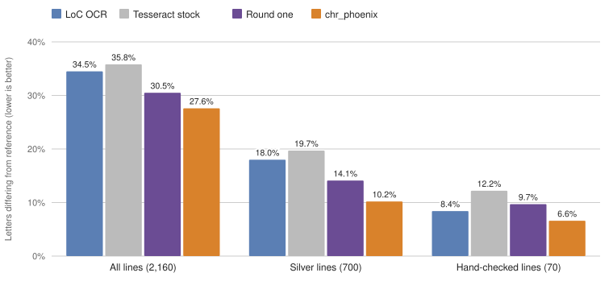
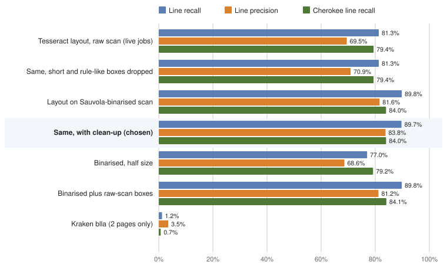
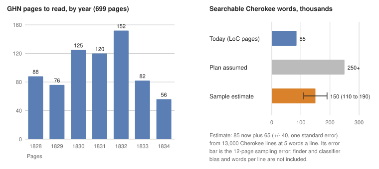

# Cherokee: what is searchable, how good the OCR is, and a plan

6 November 2026, updated 9 November with the _Phoenix_ model (step 3) and 12 November with the first production re-read, the plan for the 699 pages and per-word script detection (step 4). Follows [#1581](https://github.com/tgoodyear/usnewsmap.com/issues/1581) (the word lists and the engine tests) and [#1590](https://github.com/tgoodyear/usnewsmap.com/issues/1590) (the Georgia Historic Newspapers images).

## Summary

**Question.** How much of the _Cherokee Phoenix_'s Cherokee text can people search on usnewsmap.com, how accurate is it, and what would it take to make it better? The paper is the first Cherokee-language newspaper, and search only finds a word if the OCR (machine reading of the page image) spelled it right.

**Hypothesis.** The plan in section 5 set a measure for each step before it ran. The gate that mattered was pre-stated: fine-tune an OCR model on the paper's own letters (step 3) and go on to step 4 only if it beats LoC's (the Library of Congress, whose OCR is what we index) on held-out real lines. The finding that most errors come from a few look-alike letters came from the data, so it is post-hoc.

**Answer.** We search 324 pages (82 issues, 1828 to 1833), which hold about 85,000 Cherokee words on 191 pages. That is 32% of the 1,023 pages LoC and Georgia Historic Newspapers (GHN) list; images of the other 699 are on our storage without OCR. On 70 lines checked by eye against the page, LoC's Cherokee OCR gets at least 8 to 9% of letters wrong (CER, character error rate: share of letters wrong) and stock Tesseract 16 to 17%, mostly on look-alike letters in the paper's 1828 type. Our fine-tuned model, `chr_phoenix`, reads the held-out silver lines (lines aligned to the 1860 New Testament) at 10.2% CER against LoC's 18.0%, 7.8 points better (95% interval 6.3 to 9.1). On the 70 hand-checked lines it is also ahead, 6.6% against 8.4%, but 70 lines are too few to settle that (interval -4.9 to +1.9 points). The gate passed, and the model has re-read the 190 pages with Cherokee lines that have a scan. For the 699 missing pages we expect about 65,000 more words, not the 165,000 more the plan assumed.

**What it means.**

- Go on with step 4: the 699 pages need a line finder for pages without layout data, which tests at 90% line recall (subsection "The 699 pages"). A pilot of 5 pages comes first.
- The new text is not searchable yet: the 190 re-read pages wait for a rebuild of the index, and the model is not deployed.
- Open: the only checked set is 70 lines, so how well the model reads unseen news pages is unmeasured, and dark early pages may defeat the line finder.



**Figure 1.** Disagreement with the reference (share of syllabary letters that differ, lower is better) at PSM 13. On all lines and silver lines the reference is the 1860 New Testament, whose wording and own errors sometimes differ from the print, so those bars are not pure OCR error; only the 70 hand-checked lines measure OCR error against the page. PSM 13 is Tesseract's single-line mode. No interval is drawn; the intervals for the differences are in the text. Source: the table in step 3.

**What the published data holds.** The `report-2026-11-cherokee` data set has the 2,160 line crops with their New Testament reference lines (`testset-v2/aligned.jsonl`), 20 New Testament reference pages, every reading and the hand-check answers. It does not hold the full New Testament text or ChrEn. The New Testament word lists are not in the data set but are committed in the repository (`ocr/ja-ocr/wordlists/chr.txt` and `chr-attested.txt`, from #1584), so the word-list rows and the New Testament half of the dictionary comparison can be rescored from the retained readings and reference pages, as in [Reproducing](#reproducing). Only the ChrEn arm of the dictionary comparison needs ChrEn fetched from its repository, and only rebuilding the New Testament text itself needs the pinned PDFs, whose sha256 are in `testset-v2/manifest.json`.

### Findings in detail

- **Volume.** usnewsmap.com searches 324 pages of the _Cherokee Phoenix_ (82 issues, 1828-03-06 to 1833-10-19). They hold about 85,000 words of Cherokee syllabary, on 191 pages. That is 32% of the 1,023 pages LoC and GHN list for the paper. Images of the other 699 pages are already on our storage, without OCR. No other Cherokee-language newspaper is in the index. The largest one outside it is the _Cherokee Advocate_ (1844–1906), 895 issues on the Gateway to Oklahoma History.
- **Accuracy.** The first measured figure comes from 70 lines checked against the page images: LoC's Cherokee OCR misreads at least 8–9% of syllabary letters, and stock Tesseract 16–17% (step 2). The proxies we can compute say LoC's Cherokee OCR is weak, and weak in particular letters. ᎾᏍᎩ ("that"), the second most common word in the New Testament, is read correctly 127 times and misread as ᏩᏍᎩ, ᏣᏍᎩ or ᏳᏍᎩ 1,007 times. ᎠᎴ ("and", the most common) is read correctly 2,547 times in 2,555. The paper's name, ᏣᎳᎩ ᏧᎴᎯᏌᏅᎯ, reads exactly on 47 of 82 front pages. It appears in a standing notice in the first column, not in the masthead. LoC's word confidences are no help: 99.8% of Cherokee words have a confidence of at least 0.5, and the median is 1.0.
- **Models.** Tesseract's Cherokee model reads clean typeset text well: 1.67% character error on the New Testament PDFs. On Phoenix scans it makes the same letter confusions LoC's OCR makes. Our Qwen3-VL-2B route produced no syllabary at all, and in a 2026 benchmark none of 14 vision-language models read Cherokee. Fine-tuned on the paper's own glyphs, Tesseract beats LoC: `chr_phoenix` reads the test set's silver lines at 10.2% character error against LoC's 18.0%, and the hand-checked lines at 6.6% against 8.4%, though 70 lines are too few to settle that (step 3). It isn't deployed yet.
- **The type.** The _Phoenix_ was set in one font, cast in Boston in 1827. Nine of its letters were recut in 1834, mostly because they looked too much like other letters. Three of them (Ꮩ, Ꮅ and Ꮦ) are among the pairs our engines confuse (section 4). The recut came after the paper's last issue, so every _Phoenix_ page has the 1828 shapes.
- **Plan.** Build ground truth without new transcription work where we can, train a Phoenix-specific model, OCR the 699 missing pages, and make search tolerant of the known confusions in the meantime. Steps 1 to 3 are done: search now finds ᎾᏍᎩ on 108 pages (35 before), and the model passed its test. The BOINC re-OCR (step 4) has run for the 191 pages that have Cherokee lines: 190 were read and accepted on 11 and 12 November, one waits for a scan. Next are the 699 missing pages and per-word script detection (#1666, not yet merged) for English words inside Cherokee lines. Step 4 holds the inventory of the 699, a line finder for pages without ALTO and the campaign design. The finder and classifier are measured on LoC pages; the campaign itself has not been run.

## 1. Volume: what we have against what exists

### Our index

Counts from LoC's OCR batches for the two titles (`dlc_misctopsn83020866_ver03`, `dlc_misctopsn83020874_ver02`), read with [`scripts/chr_alto_stats.py`](scripts/chr_alto_stats.py) and [`scripts/chr_masthead.py`](scripts/chr_masthead.py):

| Measure                                           | Value                 |
| ------------------------------------------------- | --------------------- |
| Pages / issues                                    | 324 / 82              |
| Pages with any Cherokee words                     | 191                   |
| Pages with 100 or more Cherokee words             | 111                   |
| ALTO text blocks tagged `language="chr"`          | 615 (of 6,497)        |
| Lines in Cherokee blocks                          | 16,682 (9% of lines)  |
| Syllabary words in Cherokee blocks                | 83,449                |
| Syllabary tokens in the page text (`ocr.txt`)     | 84,833 (36,216 forms) |
| Syllabary characters                              | 342,559               |
| Cherokee words per page: median / 90th percentile | 53 / 874              |

The 9% share of lines fits Landini's content analysis of the paper, which found 83.4% of its editorial content in English ([Landini 1990](https://trace.tennessee.edu/utk_graddiss/11440)). Search works on the syllabary: on 6 November `/v1/aggregate` found ᏣᎳᎩ on 122 pages, ᎠᎴ on 117, ᏣᎳᎩ ᏧᎴᎯᏌᏅᎯ on 65 and ᏥᏌ on 38.

The quality database holds all 324 pages and their damage scores, but no second reading of any of them: no BOINC engine has read a Cherokee page.

### Cherokee print outside the index

| Source                                           | Years     | Size                                       | Online                                          | Cherokee text                                               |
| ------------------------------------------------ | --------- | ------------------------------------------ | ----------------------------------------------- | ----------------------------------------------------------- |
| _Cherokee Phoenix_, GHN-only pages               | 1828–1834 | 699 pages / 177 issues                     | Images fetched (#1590)                          | No Cherokee OCR: all of GHN's ᏣᎳᎩ hits fall on LoC's issues |
| _Cherokee Advocate_, Gateway to Oklahoma History | 1844–1906 | 895 items, all tagged Cherokee and English | Yes, from Oklahoma Historical Society microfilm | No syllabary OCR found; not in Chronicling America          |
| _Cherokee Messenger_                             | 1844–1846 | About 194 pages                            | Subscription or by request                      | Not found                                                   |
| Modern _Cherokee Phoenix_ and _Advocate_         | 1977–2014 | About 400 issues                           | Licensed access only                            | Not stated                                                  |
| Laws of the Cherokee Nation, 1852                | 1852      | 121 pages                                  | Wikisource                                      | 11 pages transcribed, not proofread (CC BY-SA)              |
| Constitution and laws, 1875                      | 1875      | 233 pages                                  | LoC                                             | Not found                                                   |
| Cherokee books on the Internet Archive           | 1824–2020 | 48 items (hymns, gospels, laws)            | Yes                                             | The Archive's automatic OCR, quality unknown                |

Sources: [Gateway collection](https://gateway.okhistory.org/explore/collections/CHRAD/); [Chronicling America's Cherokee facet](https://www.loc.gov/collections/chronicling-america/?fa=language:cherokee) (only the two _Phoenix_ titles); [Newspapers.com, _Messenger_](https://www.newspapers.com/paper/the-cherokee-messenger/23517/); [the modern papers' scanning](https://www.cherokeephoenix.org/news/cherokee-newspapers-digital-archives-in-progress/article_0a90c636-3071-592e-aec7-7317d348e5fb.html); [Wikisource, 1852 laws](https://wikisource.org/wiki/Index:Cherokee_Laws.pdf); [LoC, 1875 laws](https://www.loc.gov/item/28014177/); [Internet Archive search](https://archive.org/advancedsearch.php?q=language%3A%28chr+OR+cherokee%29).

Machine-readable Cherokee text, for vocabulary and as possible ground truth:

| Corpus                                                                              | Size                                                         | Terms                                          | Kind                                                    |
| ----------------------------------------------------------------------------------- | ------------------------------------------------------------ | ---------------------------------------------- | ------------------------------------------------------- |
| Cherokee New Testament, 1860 (full text not in the published data; its word lists are in `ocr/ja-ocr/wordlists`) | About 115,700 words per edition                              | CC0                                            | Typeset                                                 |
| [ChrEn](https://github.com/ZhangShiyue/ChrEn/tree/master/data) (Zhang et al., 2020; not in the published data) | 206,000 Cherokee tokens, 38,000 forms; 14,151 sentence pairs | Research use; copyright stays with the sources | Typeset books, 56% New Testament, OCR corrected by hand |
| [DAILP](https://dailp.northeastern.edu)                                             | 87 documents                                                 | CC BY-NC 4.0                                   | Letters, notices, stories; mostly manuscript            |
| Cherokee Wikipedia                                                                  | 999 articles, about 40,000 words                             | CC BY-SA                                       | Modern, born digital                                    |

**Where that leaves us.** Of the Cherokee-language newspaper pages known to be online, we search 324. The rest of the _Phoenix_ (699 pages) is the closest gap: we hold the images and the only cost is OCR. The _Advocate_ is the largest: 895 issues, 1844 to 1906. ChrEn is the one hand-corrected corpus larger than the New Testament.

## 2. Accuracy of what is searchable

There is no checked transcription of a whole _Phoenix_ page; the error rates measured on test lines are in steps 2 and 3. The figures below are proxies over all 324 pages, each computed the same way for any reading of the pages so that two engines can be compared.

| Proxy (LoC OCR, 324 pages)                                       | Value                        |
| ---------------------------------------------------------------- | ---------------------------- |
| Words in the New Testament's top 5,000                           | 31.8%                        |
| Words in the New Testament outside the top 5,000                 | 5.1%                         |
| Words one letter from exactly one known word                     | 10.8%                        |
| ᎾᏍᎩ ("that", NT rank 2) read correctly, of ᎾᏍᎩ + ᏩᏍᎩ + ᏣᏍᎩ + ᏳᏍᎩ | 127 of 1,134 (11.2%)         |
| ᎠᎴ ("and", NT rank 1) read correctly, of ᎠᎴ + ᎠᏞ + ᎤᎴ            | 2,547 of 2,555               |
| Front pages where ᏣᎳᎩ ᏧᎴᎯᏌᏅᎯ (a standing notice) reads exactly   | 47 of 82                     |
| Cherokee words with LoC confidence under 0.5                     | 0.2% (median confidence 1.0) |

None of ᏩᏍᎩ, ᏣᏍᎩ and ᏳᏍᎩ appears in either New Testament edition, so they are misreadings, not spellings. Most of the damage is in a few letters. Where LoC and Tesseract read the same 1,320 lines differently, the commonest disagreements are pairs of letters that look alike in the paper's type: Ꮧ/Ꮨ (di/ti, 159), Ꮅ/Ꮲ (li/tlv, 70), Ꮎ/Ꭷ (na/ka, 45), Ꮎ/Ꮾ (na/hnv, 46), Ꮣ/Ꮦ (da/te, 44). The press's type was not today's glyph set either: it printed Ꮩ (do) upside down, like Λ, until 31 May 1834 ([languagegeek](http://www.languagegeek.com/rotinonhsonni/tsalagi/do.html)). Tesseract's Cherokee model was trained only on modern fonts ([its font list](https://github.com/tesseract-ocr/langdata_lstm/blob/main/chr/okfonts.txt)).

Search often misses a word with one of these letters. A query for ᎾᏍᎩ finds 35 pages; ᏩᏍᎩ alone finds 80.

## 3. Models run against Cherokee

| Reading                                                           | Test                                   | Result                                                                                      | Speed             |
| ----------------------------------------------------------------- | -------------------------------------- | ------------------------------------------------------------------------------------------- | ----------------- |
| LoC OCR (the index's text)                                        | 324 _Phoenix_ pages, proxies           | Above: 31.8% known, ᎾᏍᎩ 11.2% right                                                         | n/a               |
| Tesseract 5.5 `chr`, `tessdata_best`                              | 20 New Testament pages, reference text | 1.67% character error on syllabary, 3.48% overall                                           | 3.5 s/page        |
| Tesseract 5.5 `chr`, `tessdata_fast`                              | Same                                   | 1.71% and 3.50%                                                                             | 1.9 s/page        |
| Tesseract `chr`, whole _Phoenix_ pages                            | 103 pages, proxies                     | Unusable: reads the English columns as syllabary (3.8 times LoC's token count, 11.2% known) | 44 s/page         |
| Tesseract `chr+eng`, whole pages                                  | 8 mixed pages, proxies                 | 35.2% known against LoC's 31.2%; English kept                                               | 45 s/page         |
| Tesseract `chr`, LoC's Cherokee lines only (`cherokee_hybrid.py`) | Same 8 pages, 1,320 lines              | 32.5% known; ᎾᏍᎩ 7 right, 38 misread (LoC: 11 and 50); 123 empty lines kept LoC's text      | About 70 ms/line  |
| Tesseract `chr`, line crops: upscaled 2x, or PSM 6                | 40 lines, agreement with LoC           | Less agreement than native-size PSM 7 (28.7% and 30.2% edit distance against 25.2%)         | n/a               |
| Qwen3-VL-2B Q8 (BOINC `usnm_qwen` prompt)                         | 1 New Testament page                   | No syllabary output; 100% error on Cherokee characters                                      | 624 s/page on CPU |
| Tesseract `chr_phoenix` (step 3), line crops at PSM 13            | Test set v2, 2,160 lines               | 27.6% error on all lines, 10.2% silver, 6.6% hand-checked (LoC: 34.5%, 18.0%, 8.4%)         | n/a               |
| Tesseract `chr_phoenix+eng`, line crops at PSM 13                 | Same                                   | Worse than `chr_phoenix` alone (12.9% silver); writes 863 Latin words on syllabary lines    | n/a               |

From the literature, on other material:

- Zhang et al. ([2022](https://arxiv.org/pdf/2204.11909)), 20 book pages: Tesseract 23.0% character error on full pages and 6.3% on clean crops; Google Cloud Vision 19.9% and 7.4%. Google lists Cherokee as experimental and not regularly evaluated. Google Document AI and Azure don't list it.
- GlotOCR Bench ([2026](https://arxiv.org/html/2604.12978)), 100 synthetic Cherokee sentences: none of 14 vision-language models, among them GPT-4.1, Gemini 3.1 Flash-Lite and Qwen3-VL-8B, read any sentence under 5% character error.
- No Transkribus or Kraken model for the syllabary was found, and no published handwriting work.

The New Testament results show Tesseract can read Cherokee type, and the _Phoenix_ results show it doesn't know this type. Two unrelated engines make the same confusions, which points at the glyphs. A model trained on _Phoenix_-like lines was the change most likely to help, and in step 3 it did. The vision-language route is closed for now.

## 4. The press's type

Patrick Giasson's MA thesis, _The Typographic Inception of the Cherokee Syllabary_ (University of Reading, 2004), traces the first Cherokee font from Sequoyah's drawings to the foundry. It is the only source we have found that shows the 1828 letter shapes next to the 1834 ones. Everything below is from it unless marked as ours.

**The 1827 font.** The Baker & Greele foundry in Boston cut and cast the font in 1827 from Samuel Worcester's drawings. The press used it from the first _Phoenix_ in February 1828. Sixteen letters (Ꭱ Ꭰ Ꮃ Ꮐ Ꮲ Ꮇ Ᏼ Ꭺ Ꮓ Ꭼ Ꭲ Ꭻ Ꮶ Ꮪ Ꮋ Ꮮ, in the Latin shapes R D W G P M B A Z E T J K S H L) are the small capitals of the foundry's small pica roman, a Scotch Roman. The other 69 were cut new. The Cherokee was cast at small-capital height on the same small pica body as the English, so the two can share a line. With the 1834 changes and a larger companion font added in the late 1850s for capitals and titles, the same typeface set almost all printed Cherokee until the 1970s. That includes the _Cherokee Advocate_.

**The 1834 recut.** In 1834 Worcester had letters recut (the thesis says ten and describes nine) because they were "sufficiently distinct when the print is clear but we find that we cannot always rely upon it" (his letter, ABCFM 18.3.1 v.7, 234). The new type reached the press in 1835. The _Phoenix_ had stopped in May 1834, so none of its pages has the new shapes. Against our measurements:

| Letter | 1828 shape and its trouble                              | 1834 change                      | What we measured (sections 2 and 5)                              |
| ------ | ------------------------------------------------------- | -------------------------------- | ---------------------------------------------------------------- |
| Ꮩ do   | Λ, an upside-down V, taken for Ꭺ go                     | Small capital V                  | Ꮩ read as Ꭺ 430 times; Λ was Ꮩ in 22 of 26 hand-checked disputes |
| Ꮅ li   | A P with a flag, taken for Ꮲ tlv                        | Rounded off                      | Ꮅ read as Ꮲ 1,007 times, the commonest misreading                |
| Ꮦ te   | Its short left stroke broke off the metal, leaving Ꮣ da | Stroke enlarged, tail closed     | Ꮣ/Ꮦ 44 disagreements                                             |
| Ꮯ tli  | G-shaped, taken for Ꮆ lo                                | Small capital C                  | Not separated yet; see the G-shaped letters below                |
| Ᏺ yo   | A plain h, the same as Ꮒ ni except the top serif        | Hooked ascender                  | Not measured                                                     |
| Ꮢ sv   | Close to Ꭱ e                                            | Counter opened, leg straightened | Not measured                                                     |
| Ꮥ de   | Close to Ꭶ ga, which it often stands next to            | New shape                        | Not measured                                                     |
| Ꮾ wv   | Reason not given                                        | Made like a 6                    | Ꮎ/Ꮾ 46 disagreements                                             |
| Ꮌ mo   | Reason not given                                        | Recut twice                      | Not measured                                                     |

The thesis lists further letters told apart only by a serif or a ball terminal: Ꭱ/Ꮢ, Ꭹ/Ꮍ, Ꮒ/Ᏺ, and six G-shaped letters, Ꮐ Ꮯ Ꮆ Ᏻ Ꮳ Ꮹ. Ꮃ and Ꮤ differ only slightly in structure.

**Consequences for the OCR.** The rest of this section is our reading, not the thesis's.

- **The G-shaped letter in ᎾᏍᎩ may be Ꮐ.** The hand check found a G-shaped letter where today's θ-like Ꮎ belongs. LoC reads that word as ᏩᏍᎩ, ᏣᏍᎩ or ᏳᏍᎩ, with Ꮹ, Ꮳ and Ᏻ: all three are in the G-shaped group. The 1828 and 1835 type specimens show Ꮐ (_nah_) as a plain Latin G. Worcester's 1834 order for new type asks for 9 ounces of Ꮐ against 12 of Ꮎ. So the _Phoenix_ may spell the word ᏀᏍᎩ. Against it, the thesis says the larger font of the late 1850s left Ꮐ out, "probably because it was almost never used". That may describe only the later printing. This is untested. The test: count Ꮐ in LoC's text and in Tesseract's `chr` character set, and compare _Phoenix_ crops with the specimens' Ꮐ. If it holds, Ꮐ goes into the `~ocr` table and the training text, and the checked references need the period spelling.
- **More letter pairs to try in `~ocr`.** Ᏺ/Ꮒ, Ꮢ/Ꭱ, Ꮥ/Ꭶ, Ꭹ/Ꮍ and Ꮃ/Ꮤ. Each is added only if LoC's misreadings show it, by the step 1 rule.
- **A font built from the press's type.** The 16 Latin letters can come from an open Scotch Roman with small capitals. The other 69 can be cut from glyphs on the _Phoenix_ scans themselves, since one font printed every page. Synthetic lines should set Cherokee at small-capital height next to English at full size.
- **Broken type counts as damage.** Where the stroke of Ꮦ broke off, the page shows Ꮣ. References keep the intended Ꮦ, and only the word list can recover it, so letter-shape training alone has a floor on this pair.
- **The _Advocate_ uses the same font.** Its model can start from the _Phoenix_ model, adding the 1834 shapes of the nine letters and folding the larger capitals to one case.
- **Telling Cherokee lines from English.** Cherokee is cast at small-capital height, and Worcester shrank strokes that rose above it (Ꭷ, Ꭾ). A line with almost no ascenders or descenders is likely syllabary, a cheap first test for step 4's line classifier.
- **A check on letter frequencies.** The 1834 order gives ounces of type per letter, a rough guide to how often each was set. A letter the OCR outputs far more often than its share of type suggests misreadings into it (Ꮲ: 2 ounces against Ꮅ's 14). A letter it rarely outputs suggests misreadings away from it.

The thesis is © Patrick Giasson, all rights reserved. We cite its facts and don't copy its plates into the repository or the training data.

## 5. Plan

Each step has a measure that can be recomputed from its output, and steps 1 and 2 need no new transcription.

### Step 1. Confusion-tolerant Cherokee search (quick, no OCR) ([#1619](https://github.com/tgoodyear/usnewsmap.com/issues/1619))

Search `word~ocr` with a Cherokee table of letter pairs, so ᎾᏍᎩ~ocr also finds ᏩᏍᎩ, ᏣᏍᎩ and ᏳᏍᎩ. Romanized queries (_tsalagi_ → ᏣᎳᎩ, the follow-up noted in #1581) can share the same expansion code later.

**Done in [#1624](https://github.com/tgoodyear/usnewsmap.com/pull/1624).** The table holds the 13 pairs with at least 50 occurrences among LoC's one-letter misreadings of the New Testament's 5,000 most frequent words, out of 7,870 such misreadings in 84,833 tokens ([`scripts/chr_letter_pairs.py`](scripts/chr_letter_pairs.py)). The commonest are Ꮅ read as Ꮲ (1,007), Ꮧ as Ꮨ (473) and Ꮩ as Ꭺ (430, the inverted-V do). Ꮎ goes to five letters: Ᏻ, Ꮹ, Ꭷ, Ꮾ and Ꮳ (101 to 145 each). For the 200 most frequent New Testament words, the 324 pages give 5,496 page hits exactly and 1,102 more with `~ocr` ([`scripts/chr_ocr_variant_recall.py`](scripts/chr_ocr_variant_recall.py)). Of the added hits, 979 match only non-words. 122 match another New Testament form and 1 matches both, so those 123 may be false hits. ᎾᏍᎩ goes from 35 pages to 109. ᎦᏙᎯ ("earth") goes from 0 to 52, because its Ꮩ is always read as Ꭺ. `~ocr` is opt-in, so a ranking penalty for variants isn't needed yet; making it the default for syllabary queries is a separate decision.

**Date-aware search and text, 8 November ([#1661](https://github.com/tgoodyear/usnewsmap.com/pull/1661)).** Every _Phoenix_ page was printed with the 1828 type, so two misreadings can be undone without `~ocr`: Ꭺ read for the Λ-shaped Ꮩ, and a word-initial Ꮹ, Ꮳ, Ᏻ or Ꮐ read for Ꮎ. A word is changed only when it isn't a New Testament form and exactly one undone reading is. It applies to pages printed before 1835, in the index text (LoC's original is kept beside it) and in plain queries. Live, a plain query for ᎾᏍᎩ now finds 108 pages (35 before) and ᎦᏙᎯ 52 (0 before); ᎠᎴ is unchanged at 117. The hand check supports the Ꮩ rule (19 answers for it, none for LoC). It doesn't yet support the Ꮎ rule: none of 38 answers chose the undone reading, so that rule rests on the New Testament alignment alone.

### Step 2. Ground truth without new transcription ([#1620](https://github.com/tgoodyear/usnewsmap.com/issues/1620))

1. **Synthetic _Phoenix_ lines.** Render New Testament and ChrEn sentences in a font with the period glyphs (Plantagenet Cherokee has the Λ do; Digohweli has it as a historic alternate). Add microfilm noise, blur and ink spread, tuned so the letter confusions on synthetic lines match the ones measured above. These give exact references for training and a first error rate.
2. **Text the paper reprinted.** The _Phoenix_ printed scripture (ᏥᏌ, Jesus, is on 38 pages) and laws later collected in the 1852 _Laws_. Align its OCR lines against the 1860 New Testament and the Wikisource laws; lines that match a known passage closely give near-ground truth on real scans. Wording may differ from the later editions, so only close alignments count, and every letter that differs is reported as a disagreement, not an error.
3. **Self-checking items.** A notice that starts ᏣᎳᎩ ᏧᎴᎯᏌᏅᎯ ᎯᎠ ᏂᎦᎥ ᏧᎬᏩᎶᏗ stands in the first column of page 1; ᏧᎴᎯᏌᏅᎯ reads exactly on 61 front-page lines across the 82 issues. Checked once by eye, its text is a reference for every copy.

**Measure:** the number of real _Phoenix_ lines with a reference, and the error of LoC and Tesseract on them. That would be the first real accuracy figure for the index's Cherokee text.

**Test set version 1, 7 November ([#1625](https://github.com/tgoodyear/usnewsmap.com/pull/1625)).** Item 2 is built: whole Cherokee text blocks aligned to the 1860 New Testament give 2,160 lines on 29 pages. 716 have no sign of a wording difference (`silver`), and 1,444 are kept with the reason they look different. The set is frozen with checksums, and its pages are excluded from training. Character error on syllabary letters, against the New Testament reference:

| Tier                  | Lines | LoC OCR | Tesseract stock | Stock + NT word list |
| --------------------- | ----: | ------: | --------------: | -------------------: |
| silver                |   716 |   17.4% |           24.8% |                24.0% |
| dropped-wording       |   744 |   29.9% |           36.5% |                36.0% |
| dropped-gap-run       |   539 |   49.3% |           53.7% |                53.4% |
| dropped-too-different |   161 |   64.3% |           68.1% |                67.7% |

Stock Tesseract reads these lines worse than LoC does. The silver tier favours LoC, because its lines were chosen by aligning LoC's text. The references follow the 1860 wording, which the _Phoenix_ sometimes doesn't (one crop prints ᎯᎠᏃ where the reference has ᎯᎠᎨ). A 200-line sample, half silver and half dropped, is set aside for a glyph-by-glyph check, which will measure that error and give the first fully checked figures.

**Hand check, 7 November.** In the 200-line sample, LoC and the reference disagree on 575 words. Each was checked against the page image: does the reference match the print, does LoC, or neither? The answers were reference 183, LoC 185, neither 179 and can't tell 28. On silver lines the reference matched the print more often (109 against LoC's 47, with 57 neither). On the dropped tiers LoC matched more often, and neither ran 35–40%. The answers come from one checker who doesn't read Cherokee and may include a few misclicks. 70 lines came out fully resolved, with every disputed word answered by one of the two readings. Character error on those lines, against the checked text ([`scripts/chr_checked_score.py`](scripts/chr_checked_score.py)):

| Text                 | 70 lines | 47 silver lines |
| -------------------- | -------: | --------------: |
| 1860 New Testament   |    10.5% |            3.3% |
| LoC OCR              |     8.4% |            9.2% |
| Tesseract stock      |    17.2% |           16.5% |
| Stock + NT word list |    16.6% |           15.5% |

These are the first measured error rates for the index's Cherokee text. About half of the error measured against the unchecked reference was the reference's own. The ranking doesn't change. The lines with a "neither" answer are left out, so the 70 lean clean. The checked text is built from LoC's and the reference's words, which flatters LoC, so its figure is a floor.

The answers back up the letter findings above. Λ was Ꮩ in 22 of 26 Ꮩ/Ꭺ disputes, Ꮅ beat Ꮲ in 22 of 25, and Ꮧ beat Ꮨ in 23 of 24. All 16 disputes between Ꮎ and Ꮹ or Ꮳ came out neither or can't tell: the paper prints a G-shaped letter in ᎾᏍᎩ, not today's θ-like Ꮎ. Which letter it is hasn't been settled yet. Specks in the margin also get read as letters. Digits aren't scored at all: LoC read a verse number "24." as "9Ꮞ.".

**The paper's own glyphs, 8–9 November ([#1673](https://github.com/tgoodyear/usnewsmap.com/pull/1673)).** Item 1 changed course. The synthetic lines are set from the paper's own letters instead of a modern font. `crates/usnm-glyphs` cuts the words LoC read as New Testament forms (or as one after undoing the 1828 misreadings) out of 190 page scans and splits them into letters. It keeps the 87,657 of 92,139 glyphs whose nearest neighbours on other pages carry the same label. Word-initial Ꮎ is a class of its own. Ꮊ, Ꮌ, Ꮍ, Ꮐ and Ꮛ have no samples, and Ꮯ, Ꮚ, Ꮬ and Ꮾ almost none. From the bank came:

- **Synthetic lines.** New Testament text set glyph by glyph and degraded like the microfilm, 20,000 lines per training round.
- **A traced font.** "Phoenix 1828", averaged and traced from the best samples, covers 72 letters plus the word-initial Ꮎ. It is CC0, a research tool rather than a revival.
- **New examples on check.usnewsmap.com.** 76 letters now show crops from this bank. The tasks and the 833 answers so far are unchanged.

No glyph from a test-set page was used for training. The bank the model was trained from did let test-page glyphs vote when deciding which training glyphs to keep; the crate no longer does (`clean --exclude-manifest`).

### Step 3. A _Phoenix_ model ([#1621](https://github.com/tgoodyear/usnewsmap.com/issues/1621))

Fine-tune Tesseract's `chr` model with `tesstrain` on the synthetic lines plus the aligned real lines, holding out the test set's pages and the standing notice for testing. Try Kraken as a second engine if Tesseract stalls. **Measure:** character error on the held-out lines, the ᎾᏍᎩ share, masthead exact reads, and the word-list proxies, against LoC and stock `chr`. Go on to step 4 only if it beats LoC on the held-out real lines.

**Dictionary-only test, 6 November.** Before any retraining, the word list inside the stock model was replaced, with the network unchanged ([`scripts/chr_dict_compare.py`](scripts/chr_dict_compare.py)). Adding the 24,479 New Testament forms to the model's 6,368 words changed about 2.3% of the tokens on the same 1,320 _Phoenix_ lines. Of the changes, 127 turned a non-word into a New Testament word and 3 went the other way. ᎾᏍᎩ was still read right only 7 times, as with the stock list, which already held the word. Adding ChrEn's 54,922 forms as well made the readings worse: 30 known words reversed, 165 other changes, and ᎾᏍᎩ down to 5. So the word list helps a little but cannot fix the letter shapes. The fine-tune keeps the New Testament list, and ChrEn goes into the rendered training text instead. Results and hashes are on [#1621](https://github.com/tgoodyear/usnewsmap.com/issues/1621).

**The fine-tune, 9 November ([#1673](https://github.com/tgoodyear/usnewsmap.com/pull/1673)).** `chr_phoenix` is stock `chr` with the New Testament word list, trained further with `lstmtraining` on CPU in two rounds of 20,000 iterations. Each round used about 14,400 real lines and 20,000 synthetic ones. The real lines are runs of words LoC read as New Testament forms, cut from 161 pages. ChrEn wasn't used in the end; the synthetic text is the New Testament alone. Round two added verse numbers, punctuation and margin specks to the training lines, after round one read "28" as ᎯᎯ and invented letters at line ends. Scores on test set v2 (2,160 line crops from the same 29 pages, re-tiered: 700 silver), at PSM 13:

| Reading         | All lines | Silver | Hand-checked (70) |
| --------------- | --------: | -----: | ----------------: |
| LoC OCR         |     34.5% |  18.0% |              8.4% |
| Tesseract stock |     35.8% |  19.7% |             12.2% |
| Round one       |     30.5% |  14.1% |              9.7% |
| `chr_phoenix`   |     27.6% |  10.2% |              6.6% |

- **It passes this step's test.** On silver lines it is 7.8 points better than LoC (95% page bootstrap −9.1 to −6.3), on 26 of 29 pages. On the hand-checked lines it is better on 38 and worse on 15, but 70 lines don't settle it (−4.9 to +1.9).
- **It fixes the 1828 letters.** On silver lines, Ꮩ read as Ꭺ falls from 192 to 17, Ꮅ as Ꮲ from 191 to 2, Ꮧ as Ꮨ from 119 to 8, and Ꮎ misread from 155 to 7.
- **Some verses may be memorised.** The synthetic text and every test reference are New Testament text. On the 69 silver lines with no word pair in the synthetic text, it still beats LoC, by less: 15.6% against 20.7%. News pages are unscored.
- **Line mode.** At PSM 7, both it and stock `chr` return nothing on 166 of the 2,160 crops, mostly tall ones; PSM 13 reads them. The stock figures in step 2's tables come from the earlier baseline run; at PSM 13, stock reads the silver lines at 19.7%.

The model is Apache-2.0, like the start model. It is documented in `ocr/models/chr-phoenix/` and isn't deployed.

### Step 4. OCR the 699 missing pages and re-read the 324 ([#1622](https://github.com/tgoodyear/usnewsmap.com/issues/1622))

The GHN-only pages have no layout. Find text lines with a layout model, classify each line's script (syllabary against Latin) on the crop, and read Cherokee lines with the step-3 model and English lines with the engine we use for English. On LoC's pages, keep LoC's English and replace Cherokee lines only where the new reading is better by the step-3 measures (the `cherokee_hybrid.py` path). The production run goes through BOINC, like all OCR; at about 1,000 pages it is one small campaign. **Measure:** Cherokee words searchable (from about 85,000 to an estimated 250,000 or more, if the GHN pages carry the same share), and the proxies on the new text.

**Re-read of the pages with Cherokee lines, 11 and 12 November ([#1621](https://github.com/tgoodyear/usnewsmap.com/issues/1621)).** This is the first part of step 4 to run in production: the 191 of the 324 pages that have Cherokee lines. The other 133 have none and were skipped. The `chr_phoenix` model (step 3) read the Cherokee lines on LoC's pages, and LoC's text stayed for everything else (`export --line-read chr`, [the runbook](../../boinc/apps/ocr-bundles.md)). A page is accepted when every line the job did not read is LoC's text byte for byte, and at least half of the lines it did read took the model's reading (`line-merge-v1`). An accepted page keeps LoC's text beside ours (`text_loc`). The 699 pages without OCR are not part of this run.

| Export | Pages | Lines read | Model's reading | LoC's kept (fallback) | Accepted | Lines changed that weren't read |
| ------ | ----: | ---------: | --------------: | --------------------: | -------: | ------------------------------: |
| Test batch | 5 | 648 | 586 | 62 | 5 | 0 |
| 2 | 61 | 5,229 | 4,972 | 257 | 61 | 0 |
| 3 | 62 | 5,415 | 5,170 | 245 | 62 | 0 |
| 4 | 62 | 5,374 | 5,059 | 315 | 62 | 0 |
| **Total** | **190** | **16,666** | **15,787** | **879** | **190** | **0** |

- **Fallbacks.** A line goes back to LoC's reading when the model read nothing (9 lines), fewer than half as many syllabary letters as LoC (280), or fewer New Testament words than LoC (590), as in `reading_fails` in `usnm-core`.
- **Totals.** 94.7% of the 16,666 lines took the model's reading. All 190 pages were accepted. The run's stop rule halts on any line changed that the job hadn't read, which would be a bug, and none changed. `line-report` also gives a damage figure per page for ours and for LoC's text. Averaged over pages it was lower for ours in exports 2, 3 and 4: 0.0261 against 0.0341, 0.0437 against 0.0528, and 0.0631 against 0.0722. Over all 190 pages it was lower for ours on 50, higher on 3 and equal on 137. It is a damage score; step 3 reports character error.
- **Page not read.** `sn83020874/1829-03-04/ed-1/seq-2` has Cherokee lines but no scan on our storage. It waits until one can be fetched.
- **Test-set pages.** 29 of the 190 pages are test-set pages (13 in export 2, 10 in export 3, 6 in export 4). The production run read them as approved, so their numbers are production output. The model's training lines were cut from the other 161. None of this measures how well the model reads unseen pages; step 3's test does that.
- **Search.** `collect` publishes each accepted page to the OCR output (`ocr-out`); the 190 parts have not been listed to confirm it. The pages reach search at the next full rebuild. Whether they wait for the planned one or get one of their own is open.

**Check tasks for the re-read, 12 November ([#1620](https://github.com/tgoodyear/usnewsmap.com/issues/1620)).** The 70 fully checked lines are too few to measure the model against LoC (95% page bootstrap −4.9 to +1.9 points). The first check took about 12 answers per resolved line (833 answers, 70 lines). check.usnewsmap.com now has two new Cherokee pages built from the production readings. Both leave the first Cherokee set and its 833 answers as they were.

- **[Disputed lines](https://check.usnewsmap.com/chr-lines)**, 680 tasks, one per line: lines where `chr_phoenix` and LoC differ in exactly one word, on the 29 test-set pages only (312 news lines, 368 lines that reprint the New Testament). A line is resolved once that word settles on one of the two readings, which needs at least three answers with two thirds agreeing. The target is 300 fully resolved held-out lines. With the first hand check's rate of "neither" answers (179 of 575 words), the 680 lines should give more than 400. [`scripts/chr_disputes_score.py`](scripts/chr_disputes_score.py) reads the site's export and [`check-lines-manifest.jsonl`](check-lines-manifest.jsonl) and reports lines resolved against 300, answers per resolved line, and each reading's letter error against the checked text, with their difference and page-bootstrap intervals. The checked text is LoC's line with the disputed word settled, so errors both readings share are not seen.
- **[Rare letters](https://check.usnewsmap.com/chr-rare)**, 367 tasks, on pages outside the test set: 247 words for the letters the glyph bank has none or almost none of (Ꮊ 15, Ꮌ 32, Ꮚ 40, Ꮛ 40, Ꮬ 40, Ꮯ 39, Ꮾ 41; no candidate word for Ꮍ), and 120 words for the Ꮐ-for-Ꮎ question (words the New Testament spells with a first-letter Ꮎ, such as ᎾᏍᎩ, with Ꮎ against Ꮐ). The page's notes describe the type specimens' shapes in words and don't reproduce the plates. `usnm-glyphs add-checked` turns the settled words into labelled glyphs for the next training round, never from a test-set page.

The selection, the build commands and the glyph step are in [`edge/check/README.md`](../../../edge/check/README.md#the-phoenix-re-read-sets-1620-1621). Whether image similarity could carry a letter decision on these sets without a person looking is tested in [letter-similarity.md](letter-similarity.md).

**Machine admission.** Each machine ran gold units on the model's worker image (`840487b2…`) and was admitted when its English gold reports passed, under a line-job trust scope of its own (#1753): `chr/chr_phoenix`, with the same `max_cer` (0.0873) as English. Only that entry of `gold/trust.json` changed, checked against a backup each time, and English trust stayed byte for byte as it was.

- One of our machines passed with 20 of 20 gold units, each at 0.0716 character error. It ran the test batch and exports 2 and 3 alone.
- A second machine's first set of 20 units had one unit that skipped a crop (29 of 30), after its client had been paused and resumed. It was not admitted from that set. A fresh set of 20 passed with 30 crops each and the same 0.0716, and the machine took 20 of the 62 jobs of export 4. The first set was kept as evidence.
- A third machine had finished none of its 20 units by the end of the run, because its two CPUs were held by OCR tasks that average 2.5 hours. It is not in the scope. One more `gold-trust` adds it when its units finish.

**Scheduler batch check.** The first gold units could not be sent. The scheduler's batch patch expected batch 1 of every Docker plan class it didn't list, so it refused every unit in batch 1621 for the new `docker_lines` class, silently: the units never got a result row, and the scheduler's log said `App version for assigned WU not found` ([#1772](https://github.com/tgoodyear/usnewsmap.com/pull/1772)). With the batch bounds in `plan_class_spec.xml` now authoritative for any class that names them, the units went out and the run above followed. The runbook now lists the scheduler check, how long gold waits behind a machine's running OCR, and partial trust ([#1793](https://github.com/tgoodyear/usnewsmap.com/pull/1793)).

**Script detection.** Tesseract's own fallback can't split the scripts. With `chr+eng` it re-reads low-confidence words in English and wrote 863 Latin words on test lines that have essentially none, because 16 of the type's letters are Latin small capitals. Per-word script detection is [#1666](https://github.com/tgoodyear/usnewsmap.com/issues/1666). An English name usually follows its syllabary form in parentheses, and Cherokee is cast at small-capital height with almost no ascenders or descenders, so the classifier looks at the word's ink and its neighbours as well as at what the engines read.

**Per-word script detection, 12 November ([#1666](https://github.com/tgoodyear/usnewsmap.com/issues/1666)).** A line job can now read each word in its own script: `export --line-read chr --line-words` makes a job with profile `chr_phoenix+eng`, whose pages `line-merge-v2` decides. Jobs without the flag are the ones of the production run above, under `line-merge-v1`, and their results are unchanged. The worker does the following for each line crop (`crates/usnm-boinc/src/lines/script.rs`):

1. `chr_phoenix` reads the crop at PSM 13, as before, and Tesseract's TSV gives each word its box and confidence.
2. A word is a candidate for a second reading when it is not a New Testament form of two or more letters and the model is under 80% sure of it. About 20% of the test set's words were candidates when this was measured, with a second rule that also took any word 1.3 times as tall as the line's other words with almost no ink in its top third. That rule was dropped in review (#2094): no verdict in step 3 accepts a word the model is 80% or more sure of, so those words were read in English for nothing. The routed words, and so the figures below, are unchanged.
3. The English model reads each candidate's box with ten pixels around it, stopping at the neighbouring words' boxes (#2094 review; the measurements below used the full ten pixels). The word is Latin when the evidence agrees, by one of four rules: four or more lowercase letters (three when the shape agrees, two inside brackets) at English confidence 70 or more, with the syllabary model under 70% sure; a hyphenated run of lowercase syllables such as `a-ska-ya`, which the paper prints beside Cherokee words on its vocabulary lesson; a reading of four or more letters at confidence 55 or more with the shape of English ink; or a neighbour of a Latin word with three lowercase letters and some confidence, so a run of English words is caught. A reading of only the 16 capitals the syllabary shares with Latin is never evidence, and neither is one with noise glyphs, or with a word the English word list and its letter pairs don't allow.
4. The line is the syllabary reading with the Latin words replaced by the English model's. Nothing else changes, so a line with no Latin word is byte for byte what v1 gives.

`line-merge-v2` is v1's page test. It differs in one place: when it holds a line's reading against LoC's text, the letters of the Latin words count with the syllabary letters, because LoC wrote a few syllabary letters for each Latin word. Without that, a line whose Latin words take most of its letters fails the half-as-many-letters test and keeps LoC's text. A reading with no syllabary letter at all gets no credit and falls back.

Measured on test set v2 (2,160 line crops, 11,340 words) with the round-two model, Tesseract 5.5.0, PSM 13 (`chr_word_route_score.py`; `usnm-boinc line-crops` reads the crops):

| Reading                          | Latin words written | Silver CER | All lines | Checked | Lines that keep LoC's text |
| -------------------------------- | ------------------: | ---------: | --------: | ------: | -------------------------: |
| `chr_phoenix` (v1, as in production) |                   0 |     10.22% |    27.61% |   6.56% |                125 (5.8%) |
| `chr_phoenix+eng` (Tesseract's own) |                 863 |     12.86% |    29.67% |   8.92% |                          – |
| Per-word route (v2)              |                   0 |     10.22% |    27.61% |   6.56% |                125 (5.8%) |

- **No cost on Cherokee.** All 2,160 lines read as v1 reads them: the 2,264 words read again in English (20% of words) were all kept as syllabary. The fallback lines are the same 125 (2 empty, 25 few letters, 98 fewer known words), against 879 of 16,666 (5.3%) in the production run.
- **What it finds.** The test set has no Latin, so recall comes from 754 Cherokee-marked lines, cut from the scans with the worker's padding, on four pages that have hand-labelled Latin words (`ocr/script-detect/labels/hand.jsonl`, two of the pages in the test set): 43 of 63 labelled Latin words are routed (55 of the 63 are on the vocabulary lesson). None of the 13 labelled syllabary or numeral words that were read again is. Of the 766 unlabelled words read again, 3 are routed: "pair", "Cherokee." and a fragment of a transliteration, all Latin. Of the 20 Latin words missed, 9 were not candidates and 11 were read again and not routed: mostly transliterations the English model read at low confidence with a stray digit or hyphen, and short words ("al", "C.").
- **A look at other pages.** On 379 lines of four other pages, 554 words were read again and none were routed.
- **Tuning.** The thresholds were chosen by looking at those two sets. An early version wrote 9 Latin words on the test set, and a later one routed four syllabary words on the labelled pages ("yon", "ona", "oar", "nib"). The rules above came from removing those cases, so the zeros are figures the rules were fitted to. A set of mixed lines that nothing was fitted to is the next test.
- **Cost.** In a debug build on one thread the test set takes 129 s against 57 s for the line model alone.
- **Against the router of [#1675](https://github.com/tgoodyear/usnewsmap.com/issues/1675).** That router, a trained CNN and gradient-boosted trees, caught 26 of 60 Latin words on pages it had not seen and gained one CER point over round two by also sending numerals and specks to English. It isn't in the worker, which carries no Python or trained model. These rules leave numerals to the syllabary model. Neither figure is on pages held out from its tuning, so the two aren't comparable.

**Production.** The word route needs a new `usnm_ocr` worker image (`docker_lines`), because the worker now reads word boxes and runs the English model on them, and a native build would need the `eng` model in its plan. No app version has been published for it. A re-run of the 190 pages is not warranted for Cherokee accuracy: the test set's CER is the same, and the earlier survey found Latin on well under 0.1% of words (71 hand-confirmed words, 55 of them on one lesson). It would make those words searchable, at most about 70 known ones. It is worth doing together with the next worker release, for instance when the 699 pages with no LoC text are read.

**The 699 pages: inventory, line finding and campaign design (12 November: finder and classifier measured on LoC pages; campaign design, not run).**

> **Question.** Can we OCR the 699 GHN pages, which have no layout data, and how many Cherokee words would that add?
>
> **Hypothesis.** The plan assumed the GHN pages carry the same share of Cherokee as LoC's (9% of lines), which gives 250,000 words or more in all. No accuracy threshold was set for the line finder before it was tested: we compared candidate finders on 30 LoC pages and kept the best.
>
> **Answer.** The chosen finder (Tesseract's layout on a binarised scan, then a clean-up) finds 89.7% of text lines and 84.0% of Cherokee lines on LoC pages, with 83.8% of its boxes on a real line. A second model separates Cherokee lines from English at 99.0% recall and 98.9% precision. On 12 GHN pages the classifier calls only 3.9% of lines Cherokee, so the 699 pages hold about 13,000 Cherokee lines (standard error 8,000), about 65,000 words. The assumption of 250,000 did not hold. These figures come from LoC scans and 12 GHN pages. Dark early pages are the main risk: the first issue's page 1 fails.
>
> **What it means.** Run a pilot of 5 pages before the campaign, not the whole 699. The campaign is a few hours of Cherokee line jobs, so the cost is small. Open: better line finding for dark pages, and ingest of the finished pages into search.



**Figure 2.** Line recall, line precision and Cherokee line recall by finder. Source: the finder table below.



**Figure 3.** Left: the 699 pages by year (inventory table below). Right: Cherokee words in thousands. The estimate adds the sample's 65,000 new words to today's 85,000; its bar covers only the uncertainty in the line count. Source: "GHN scans" below.

This prepares the rest of step 4. The 699 pages have no ALTO, so a line job needs boxes from another source, and the line classifier and the English route are new.

_Inventory._ `ghn-pages.jsonl` lists the 699 pages, one JSON line each, in the shape of `phoenix-pages.jsonl`: the page, `doc_id` (`ghn:<lccn>_<date>_ed-<n>_seq-<n>`, the form ADR-0026 gives a Georgia Historic Newspapers (GHN) page), batch and version, the image's path under the fetcher's output directory, its size and sha256, and its IIIF URL on GHN as provenance. `lines` is `null` until a finder has run, and `test_set` is false. Each image was hashed again and its dimensions read from the JPEG header (`chr_ghn_pages.py`); every value agrees with the fetcher's inventory and the verification receipts of #1590. Nothing was fetched. The file is committed as the campaign's page list, as `phoenix-pages.jsonl` is for the 324 (`usnm-boinc line-stage-ghn` reads it), and `scripts/chr_ghn_pages.py` regenerates it from the fetcher's inventory.

| | |
| --- | --- |
| Pages / issues | 699 / 177 |
| `gua_cph` v3 (`sn83020866`, 1828-02-21 to 1829-01-28) | 104 pages |
| `gua_cia` v3 (`sn83020874`, 1829-02-11 to 1834-05-17) | 595 pages |
| By year, 1828 to 1834 | 88, 76, 125, 120, 152, 82, 56 |
| Pages per issue | 4 on 169 issues, 2 on 6, 5 on 1, 6 on 1 |
| Images | 4,695,100,592 bytes, 699 distinct sha256, one grey JPEG component each |
| Width, height (min / median / max, pixels) | 3,757 / 4,309 / 7,112; 6,344 / 6,768 / 10,184 |
| Overlap with LoC's 324 | none: no page, no issue |

The listing for two pages came from an issue's HTML page (no IIIF manifest), the rest from manifests.

_Finding lines without ALTO._ Truth is LoC's ALTO lines, scaled to the scan as `export --line-read` scales them (`chr_layout_eval.py truth`). The 190 pages with a local scan and a Cherokee line hold 107,837 lines, 16,680 of them Cherokee by `select_lines`' rule. The sample is 30 of them, picked by the sha256 of `layout-sample-1622:<page>` (skipping the first six, which were set aside for tuning that was not needed): 17,043 lines, 2,910 of them Cherokee, 10 pages from `sn83020866` and 20 from `sn83020874`. Every finder ran in a container with no network, as an unprivileged user, on a loaded shared machine, so times are not speeds.

LoC's boxes run taller than the print and overlap their neighbours' by a few pixels, so a finder that hugs the ink scores an IoU of 0.5 to 0.7 against them on a perfect line, so the score looks at what a crop would hold. A box matches a truth line when its centre is in the middle half of the line's height and inside its width, it covers 80% of the line's width, and it is at most 1.6 times as wide and as tall (`chr_layout_eval.py score` defines it; strict IoU is in the JSON). Recall is matched truth lines over truth lines, precision matched boxes over boxes. A box on real print that LoC's OCR missed counts against precision, so precision is a lower bound.

| Finder, on the 30 pages | Line recall | Line precision | Cherokee line recall | Boxes holding two lines |
| --- | ---: | ---: | ---: | ---: |
| Tesseract PSM 3 on the scan, as the live page jobs lay out | 81.3% | 69.5% | 79.4% | 444 |
| Same, boxes under 14 pixels high and rule-like wide boxes dropped | 81.3% | 70.9% | 79.4% | 444 |
| PSM 3 on the Sauvola-binarised scan | 89.8% | 81.6% | 84.0% | 593 |
| **Same, with the same clean-up** | **89.7%** | **83.8%** | **84.0%** | 530 |
| Same at half size | 77.0% | 68.6% | 79.2% | 1,165 |
| Sauvola boxes plus raw-scan boxes in the gaps | 89.8% | 81.2% | 84.1% | 659 |
| Kraken `blla` (7.1.1), its default, 2 pages | 1.2% | 3.5% | 0.7% | 320 |

On the 6 pages the raw layout handled worst, recall and precision were 51.5% and 35.6% raw, 77.9% and 69.2% with the paper brightness flattened, and 90.4% and 77.8% binarised. By page, the chosen finder's median recall is 94.9% and median precision 86.7%; the weakest page is at 51.3% recall, and 5 of the 30 pages are under 80%.

- **Why Tesseract's layout.** It is what the live page jobs already run (PSM 3), it needs nothing new on the worker, and it keeps reading order (block, paragraph, line numbers), which the assembled page needs. On these scans it fails where the ink is faint: it boxes fragments or one smear across a column, and binarising first (Sauvola, window 51, k 0.3, after dividing out the paper's brightness) removes most of that. Tesseract only finds the boxes; crops are cut from the original greyscale scan, as the job does today.
- **Kraken.** Its wheel carries the `blla` model. At its default (it scales a page to 1,800 pixels high, so a 43-pixel line becomes 12) it found 371 boxes for 1,171 truth lines on 2 pages, most of them spanning columns. A tiled run at full scale did not finish a page in 20 minutes and was stopped, so Kraken's segmenter has not been measured at the right scale. It would also add a PyTorch stack to the machine that stages the jobs.
- **What was dropped.** A first run-length finder of our own (smear the ink sideways, take each blob as a line) fragmented justified lines, whose word gaps are as wide as the gutters; it was not pursued. The union with the raw layout adds nothing. `chr_phoenix+eng` does not change the boxes (layout comes before recognition), only what is read.
- **Cherokee lines are the weak part.** 16% of Cherokee lines get no matching box, against 10% of all lines. On a GHN page checked by eye, whole runs of syllabary lines at the top of a column carried no boxes while the same column lower down did. At about 84% Cherokee line recall, the campaign reads about 84% of the Cherokee lines unless the finder improves.
- **Reading from the finder's boxes costs nothing measurable.** For 600 Cherokee lines that exactly one finder box matches, `chr_phoenix` at PSM 13 (padding and settings of a line job, `chr_layout_read.py`) reads the finder's box and LoC's box alike: the two readings differ in 4% of syllabary letters, and each is about 16% from LoC's own text (15.9% for the finder's box, 16.2% for LoC's). A crop with 10 more pixels of vertical padding is worse (8.8% apart, 18.5% from LoC), so the job's padding stays as it is.
- **A check that needs no truth.** The share of boxes over 1.8 times the median height (merged lines) correlates at -0.77 with a page's recall on the 30 pages; the share of ink inside the boxes, which was the obvious candidate, correlates at -0.05. A page with a high share goes to a second layout attempt or to a look by hand.

_Page script._ Each line of a page with English and Cherokee must go to the right model. A gradient-boosted classifier on 19 shape features of the crop (`chr_line_script.py`: the ink's own bounding box, component heights and widths, ink in the top, middle and bottom quarter, word gaps) was trained on the 90,769 LoC lines of the 160 pages outside the sample, and scored on the finder's own boxes on the 30 pages (15,297 boxes that match a truth line, 2,447 of them Cherokee). Alone it finds 97.1% of Cherokee lines at 96.2% precision. A second stage that adds the first stage's score for the two lines above and below in the same column gives 99.0% and 98.9%: 51 errors in 15,297 lines, 25 Cherokee lines called English and 26 English lines called Cherokee. The features that depend on a scan's size and grey levels (line height, width, contrast) are left out. With them the score on LoC is the same (99.6%), but on a GHN page with many syllabary lines it called 9 of 315 lines Cherokee, where the version without them called 76. An English line called Cherokee is read by `chr_phoenix` and gives syllabary noise; a Cherokee line called English gives Latin noise. The per-word router of #1666 works on lines already known to be Cherokee, so the two cover different mistakes.

_GHN scans._ On 12 GHN pages spread over the 699 (every 58th), the finder gave a median of 514 boxes per page after the clean-up, and the classifier called 234 of 5,966 lines Cherokee (3.9%; 0 to 124 a page). That would be about 13,000 Cherokee lines on the 699 pages (a standard error of 8,000), about 65,000 words at LoC's 5 words a line (83,449 words on 16,682 lines), against the 250,000 or more the step's measure assumed: LoC's pages have 9% Cherokee lines, and these twelve have 4%. On 60 pages of each source, the median grey level is 215 on GHN and 169 on LoC, and the paper-to-ink spread is 168 against 57 (`chr_scan_stats.py`), so GHN scans are generally brighter and higher in contrast than LoC's, except some early pages: the first issue's page 1 is dark. Five of the 12 GHN pages have a merged-lines share over 0.08, and the first issue's page 1 visibly fails (the boxes are smears as wide as the columns). The figures above come from LoC scans and will be lower on part of the GHN set. Two other Sauvola settings (window 25 and 101, k 0.2) on that page gave 69 and 121 boxes instead of 324 and a merged-lines share that stayed high. A dark early-issue page therefore needs another preprocessing step or another finder, which is the main open risk.

_Campaign design._ A line job reads the boxes it is given, wherever they came from. The design keeps that and adds a staging step. The maintainer approved the campaign on 23 November 2026, with the line finder and reader that [#2128](https://github.com/tgoodyear/usnewsmap.com/issues/2128) adopted. The code for each step below is in the repository; none of it has run on the 699 pages yet.

1. **Layout at staging, with finder S1.** #2128 tested two changes to the finder above on 154 LoC pages nothing had been tuned on, against a rule fixed before scoring. Its [Experiment 1 result](https://github.com/tgoodyear/usnewsmap.com/issues/2128#issuecomment-7119527011) adopted S1: the banded column finder of #2107, frozen at commit `337fc0aa`, cuts the page into column regions, and the finder above (S0) runs inside each region. S1 found 89.6% of Cherokee lines (95% page bootstrap 87.9 to 91.4) against S0's 81.5% on those pages, with precision 83.9% against 83.0%. It was better on 53 pages, the same on 63 and worse on 38. The staging step (`scripts/ocr-survey/chr_ghn_layout/ghn_boxes.py`) runs S1 as #2128 scored it, on the machine that holds the images. The S1 and S0 code is copied unchanged from #2128's branch (`89fb1017`), the column finder is the `337fc0aa` file, and the step refuses a column finder whose sha256 differs. Then it calls each box Cherokee or Latin with the classifier above (`classify_lines.py` from `8b82fe7e`, shape features only), checks the page's merged-lines share, and writes one `boxes.jsonl` per page. The file has a page row with the `ghn:` id, the scan's sha256 and size, the finder's and the classifier's version strings and the merged-lines share. Then it has one row a box in S1's order: line id `r<region>b<block>p<par>l<line>` (the column region, then Tesseract's own numbering), box in scan pixels, and the classifier's call. A page whose share is over 0.08 is marked held, for a second layout attempt or a look by hand. Running layout at staging keeps the boxes under our control and checkable.
2. **One job a page, Cherokee lines only.** One `chr` line job per page, with the boxes the classifier calls Cherokee, PSM 13, 300 DPI, up to 2,000 lines. The reader stays `chr_phoenix` (sha256 `88eb1016…`): #2128's [Experiment 2](https://github.com/tgoodyear/usnewsmap.com/issues/2128#issuecomment-7119644096) found neither retrained model better (silver CER 8.00% for `chr_phoenix`, 11.13% and 11.78% for the two new ones). With per-word script detection merged (#1666, [#2094](https://github.com/tgoodyear/usnewsmap.com/pull/2094)), the jobs use the word route (`export --line-words`, profile `chr_phoenix+eng`): `chr_phoenix` reads each line and the English model reads the words that look Latin. Line jobs don't read the English text of these pages. It comes from the normal English page OCR, the pipeline that reads LoC pages. The first design had a second `eng` line job per page; the 12 November decision dropped it, so no `eng` line language is needed.
3. **Export without ALTO.** `usnm-boinc line-stage-ghn` writes the staging tree from `ghn-pages.jsonl`, the fetcher's images and the boxes. `export --line-read chr --line-boxes <dir>` reads `ghn/<local id>/boxes.jsonl` in place of `--loc-alto`, takes the scan from the GHN page list, keeps the boxes beside the job (`line-read/boxes.jsonl`) and no `loc.xml`. `line-read/record.json` records the boxes' sha256 and the scan size instead of LoC's ALTO. It skips a held page and a page with no Cherokee line, and it reserves no native ledger row, since the pages are not in the search pipeline.
4. **Import without LoC.** The job's page is the Cherokee readings in the boxes' order. A new admission rule, `line-assemble-v1` (`usnm_ocr_local::rule::line_assemble`), replaces the line-merge rules for a page with no LoC text: every box has a reading from the job, and at least half of the lines took a non-empty reading (the share `line-merge-v1` uses, `MIN_MODEL_SHARE`; to be confirmed on the pilot). There is no `text_loc`. `import` writes the assembled page and the verdict into the job's journal and holds the result under the page's `ghn:` id, whatever the verdict, because ingest into search is separate work. Combining the Cherokee lines with the page OCR's English into one page is a later step too.

Two things in the code stopped this from running on the worker that is live, and both need one new worker release:

- **The job's URL check.** `Job::validate` required the scan's URLs to start with `https://tile.loc.gov/`, and the worker runs `Job::validate` on every job (`worker.rs`). It now takes GHN's IIIF host (`boinc::GHN_SCAN_ROOT`) for a GHN page and only for one, and refuses a GHN page in anything but a line job.
- **The page's identity on the wire.** A job's message holds a LoC page key, and ADR-0026 says a GHN page never has one. So the wire spelling puts `ghn` in front of the LCCN (`ghnsn83020866/1828-02-21/ed-1/seq-1`, `usnm_core::page_id::GHN_WIRE_PREFIX`). Released workers' key check accepts it, and it can't equal a LoC key (a real LCCN has at most three letters before its digits). It converts back to the `ghn:` id (`PageId::from_wire_key`). `export` refuses a GHN page that LoC holds when it is given LoC's ALTO, and `import` writes the `ghn:` id, so the search side never sees a bare id for these pages.

Together these need a new line-job worker release. Each machine that takes the jobs then passes gold units on it, and one `gold-trust` step writes the line scope, `chr/chr_phoenix+eng`. The design needs no new trust rule. The runbook steps are in [ocr-bundles.md](../../boinc/apps/ocr-bundles.md), "Cherokee line jobs on GHN pages (#1622)".

**Prior art.** The finder is Tesseract's own layout analysis (Tesseract 5.5.0, Apache-2.0) on a Sauvola-binarised scan, with Kraken's `blla` segmenter measured beside it (above). The column finder's method follows [jscancella/NYTribuneOCRExperiments](https://github.com/jscancella/NYTribuneOCRExperiments) (projection-profile column finding, GPL-3.0), reimplemented in #2107 with no code copied. #2107 also draws on [jscancella/chronam_with_yolo](https://github.com/jscancella/chronam_with_yolo) (YOLOv5 columns on Chronicling America pages, GPL-3.0), whose model is not used here. Both repositories were read in November 2026.

_Size._ The 699 pages hold about 350,000 lines (about 500 a page), about 13,000 of them Cherokee. Exports 2 to 4 of #1621 read 16,018 lines in 77, 65 and 90 minutes, between 1 and 1.4 lines a second (from the run notes on #1621), on machines that were also running their own OCR tasks. At that rate the Cherokee jobs take a few hours. The normal page OCR reads the other 337,000 lines, a page at a time. Getting these 699 pages into that pipeline (a `ghn:` id, scans served from our own storage, a batch and a title the pipeline knows) is separate work. That makes at most 699 line jobs, one a page, and fewer where a page has no Cherokee line.

_Before anything runs._ The script detection of #1666 is merged (#2094), and the maintainer approved the campaign on 23 November with #2128's finder and reader. After the code above, in order: a worker release; gold and trust; a pilot of 5 pages, stopped at any collect failure or if fewer than 4 of the 5 are admitted by `line-assemble-v1`, plus a look at the pilot's boxes by eye; then the Cherokee line jobs. The finder ships as #2128 scored it (S1: on 154 LoC pages it found 93.7% of lines and 89.6% of Cherokee lines). A page that looks merged goes to a second attempt or a look by hand, and better finding for dark early pages is a follow-up. The ingest of the finished pages into search (a `ghn:` page has no LoC row to compare with, and `ocr-sync` and the release take bare ids today) is a separate piece of the plan.

The commands are under Reproducing. The tables behind these numbers, with the sample's page list, are in [`layout-1622/README.md`](layout-1622/README.md).

### Step 5. The _Cherokee Advocate_ ([#1623](https://github.com/tgoodyear/usnewsmap.com/issues/1623))

895 issues, 1844–1906, the largest Cherokee newspaper online and absent from Chronicling America. Its host's robots.txt bars ClaudeBot by name and asks other crawlers for one request every 3 seconds. Start from its OAI-PMH metadata to count pages and issues; whether to fetch images at all is a decision for the maintainer (below). The _Advocate_ was printed decades after the _Phoenix_, so step 3's model may need a second round of fine-tuning on it.

### Step 5 result: the _Advocate_'s holdings in the Gateway's metadata

Harvested on 12 November 2026 from the Gateway's OAI-PMH endpoint, set `collection:CHRAD` ("Cherokee Advocate"), in two requests (`ListSets`, then one `ListRecords` that returned the whole set with no resumption token). Before the first request I read the site's robots.txt, which allows `/oai/` for crawlers without their own entry (it bars ClaudeBot by name and sets a crawl delay of 3 seconds for the rest), and its terms of use, which make the content available for research and say nothing against automated metadata access. The script sends a generic research-script User-Agent, waits 3 seconds between requests, and stops on any HTTP error. No images and no OCR text were fetched.

| Count                               | Value                 |
| ----------------------------------- | --------------------- |
| Issues (records)                    | 895                   |
| Pages (sum of each record's extent) | 3,578                 |
| Years with at least one issue       | 42, from 1845 to 1906 |

Every record carries an extent ("four pages", "six pages") and a date, so the page count is the sum of stated extents, not a count of page images. 863 issues are four pages, 16 are two, and 16 run from one to eight. By year, the holdings fall into three blocks:

- 1845 to 1849: 6 issues, 26 pages. The early run is thin.
- 1850 to 1869: none. The Gateway's metadata lists no issue for these 20 years.
- 1870 to 1906: the other 889 issues. 1876 to 1883 has 354 of them, and 1900 to 1906 has 286.

The metadata puts the first issue in 1845, not 1844 as the plan above says, and 3,578 stated pages is the size of the page-image set if a later step fetches images. The totals (first line) and per-year counts (one line each) are in [`advocate-holdings.jsonl`](advocate-holdings.jsonl), converted from the script's JSON output. Re-run with `python3 docs/reports/2026-11-cherokee/scripts/chr_advocate_oai.py --set-name "Cherokee Advocate" --out advocate-holdings.json`; its offline tests are `python3 -m unittest docs/reports/2026-11-cherokee/scripts/test_chr_advocate_oai.py`.

### Decisions

Made on 6 November 2026:

- **Ground truth.** Synthetic and aligned references only (step 2). A set transcribed by a Cherokee reader would still be the only fully trustworthy test; no one is being asked for one. Results from steps 2 and 3 are reported with that limit.
- **The _Advocate_.** Metadata only for now, through the Gateway's OAI-PMH interface. Whether to fetch images is decided after the step-3 model works.
- **Order.** Step 1 (confusion-tolerant search) first.

## Conclusion

We know what is searchable (about 85,000 Cherokee words on 191 of 324 pages), that LoC's Cherokee OCR is weak in specific letters, and that a model fine-tuned on the paper's own glyphs beats it on held-out silver lines by 7.8 points of character error. We are fairly sure of that gain, since it holds on 26 of 29 pages. We are less sure of the gain on real news text, because the only hand-checked set is 70 lines and the references are New Testament text. The 699 missing pages are a smaller prize than planned (about 65,000 words, not 165,000) and the line finder is the weak part.

- Next: pilot 5 GHN pages through the staged layout (finder S1, #2128) and line job, with the stop rule in step 4.
- Next: decide whether to deploy `chr_phoenix` and when to rebuild the index with the 190 re-read pages.
- Open: a set of lines transcribed by a Cherokee reader would be the only fully trustworthy test; none is planned.

## Reproducing

The scripts in [`scripts/`](scripts/) take only named arguments and write JSON to standard output. Run them from the repository root.

```sh
S=docs/reports/2026-11-cherokee/scripts
D=docs/reports/2026-11-cherokee/data
scripts/ops/data-assets.sh --fetch --set report-2026-11-cherokee
python3 $S/chr_alto_stats.py --tar dlc_misctopsn83020866_ver03.tar.bz2 --tar dlc_misctopsn83020874_ver02.tar.bz2
python3 $S/chr_masthead.py --tar dlc_misctopsn83020866_ver03.tar.bz2 --tar dlc_misctopsn83020874_ver02.tar.bz2
python3 $S/chr_confusions.py --eval-dir $D/eval
python3 $S/chr_letter_pairs.py --tar dlc_misctopsn83020866_ver03.tar.bz2 --tar dlc_misctopsn83020874_ver02.tar.bz2 --wordlists ocr/ja-ocr/wordlists
python3 $S/chr_dict_compare.py --out-dir $D/dict-compare/out --refs $D/eval/nt-reference/nt-engine-sample/refs --wordlists ocr/ja-ocr/wordlists --baseline A_stock
python3 $S/chr_checked_score.py --answers $D/hand-check/glyph-check-answers.jsonl --engine loc=$D/hand-check/loc.jsonl --engine stock=$D/testset-v2/baselines/tesseract-chr-stock.jsonl --out checked-v1.json
python3 scripts/ocr-survey/cherokee_testset.py score --lines $D/testset-v2/crops/lines.jsonl --pred loc --pred chr_phoenix=$D/readings/phoenix-round2-psm13.jsonl --tier silver
python3 $S/chr_disputes_score.py --export check-chr-lines.jsonl --manifest docs/reports/2026-11-cherokee/check-lines-manifest.jsonl --target 300
# Per-word script detection (#1666): read the crops with and without the word route (TESSDATA_PREFIX holds chr_phoenix and eng), then score
usnm-boinc line-crops --lines $D/testset-v2/crops/lines.jsonl --crops $D/testset-v2/crops --out v1.jsonl
usnm-boinc line-crops --lines $D/testset-v2/crops/lines.jsonl --crops $D/testset-v2/crops --out v2.jsonl --words --words-log v2-words.jsonl
python3 $S/chr_checked_score.py --answers $D/hand-check/glyph-check-answers.jsonl --engine v2=v2.jsonl --out checked.json
python3 $S/chr_word_route_score.py --lines $D/testset-v2/crops/lines.jsonl --checked checked.json --pred r2=$D/readings/phoenix-round2-psm13.jsonl --pred r2eng=$D/readings/phoenix-round2-eng-psm13.jsonl --pred v1=v1.jsonl --pred v2=v2.jsonl
python3 $S/chr_ocr_variant_recall.py --tar dlc_misctopsn83020866_ver03.tar.bz2 --tar dlc_misctopsn83020874_ver02.tar.bz2 --wordlists ocr/ja-ocr/wordlists
```

**Inputs.** LoC's batches come from `https://chroniclingamerica.loc.gov/data/ocr/<batch>.tar.bz2`:

| Batch                                 | sha256                                                             |
| ------------------------------------- | ------------------------------------------------------------------ |
| `dlc_misctopsn83020866_ver03.tar.bz2` | `32fdb37c101f552c8a58bd3461fdf969d2c1a6dd57682fa2213cee09ac82e9cc` |
| `dlc_misctopsn83020874_ver02.tar.bz2` | `b4dbf6c3f53ec5f43ae8bdd9434e1b5ac7363d830c0dd350547c957d02d976a0` |

The word lists are in the repository. The other inputs are in the release [`data-report-2026-11-cherokee-20261109-82de31f`](https://github.com/tgoodyear/usnewsmap.com/releases/tag/data-report-2026-11-cherokee-20261109-82de31f), with the source-rights notice. `scripts/ops/data-assets.sh --fetch --set report-2026-11-cherokee`, run from the repository root, checks the tarball against `ops/data-assets.json` and extracts it to `data/`, whose README describes each file:

| Asset                                 | SHA-256                                                            |
| ------------------------------------- | ------------------------------------------------------------------ |
| `report-2026-11-cherokee.tar.gz`      | `a5cbccdc1bcad45298e64a8fa832150ba4aaebff790e5116ee35065d88b429f6` |
| `report-2026-11-cherokee.members.txt` | `8ad10ab845529fb56f2a89335faa13fa1694a97879483ace4c44961ecc09b9ad` |

- `chr_confusions.py` reads the #1581 evaluation outputs in `data/eval/` (`nt-reference/nt-engine-sample/` and `region-aware/out/hybrid/`).
- `chr_dict_compare.py` reads the dictionary comparison's readings in `data/dict-compare/out/` and the New Testament references in `data/eval/nt-reference/nt-engine-sample/refs/`.
- `chr_checked_score.py` reads the hand-check answers and LoC text in `data/hand-check/` and stock Tesseract's readings in `data/testset-v2/baselines/`.
- `cherokee_testset.py score` scores the readings in `data/readings/` (`chr_phoenix` rounds one and two, `chr_phoenix+eng`, stock `chr` at PSM 13) against the test set v2 crops in `data/testset-v2/crops/`. Its `SHA256SUMS` checks the crops.

**The page list for the line jobs (#1621).** [`phoenix-pages.jsonl`](phoenix-pages.jsonl) lists the 324 pages, one JSON line each: the page, its batch and version, its ALTO's sha256, the lines `export --line-read chr` reads, whether test set v2 holds it, and the local copy of its scan (LoC's full-size IIIF JPEG: URL, bytes, sha256), or `null`. It was made without fetching anything, from the two archives above unpacked and the scans already on our storage:

```sh
usnm-boinc line-pages --loc-alto <the two archives' ocr.xml, unpacked> \
  --title sn83020866=dlc_misctopsn83020866_ver03:print --title sn83020874=dlc_misctopsn83020874_ver02:print \
  --scans <scan copies> --test-lines $D/testset-v2/crops/lines.jsonl > phoenix-pages.jsonl
```

191 pages have lines to read, and 190 of those have a local scan. The one without is `sn83020874/1829-03-04/ed-1/seq-2`. Its 29 test-set pages are marked.

**The 699 GHN-only pages and the line finder (#1622).** These are the commands for the step-4 preparation. Run them from the repository root with Tesseract 5.5.0 and Python with numpy, scipy, Pillow and scikit-learn (the image of `ocr/script-detect/Containerfile` has them). The first command regenerates `ghn-pages.jsonl`. The finder's results are in [`layout-1622/README.md`](layout-1622/README.md).

```sh
python3 $S/chr_ghn_pages.py --inventory <the fetcher's inventory.jsonl> --images <its output directory> --loc-pages docs/reports/2026-11-cherokee/phoenix-pages.jsonl --out ghn-pages.jsonl
python3 $S/chr_layout_eval.py truth --pages docs/reports/2026-11-cherokee/phoenix-pages.jsonl --alto-dir <the two archives' ocr.xml, unpacked> --scans <scan copies> > truth.jsonl
python3 $S/chr_layout_find.py tess --psm 3 --prep sauvola --scans <scan copies> --truth truth.jsonl --select <a file of the 30 pages listed in layout-1622/README.md> --out found.jsonl
python3 $S/chr_layout_post.py clean --found found.jsonl --truth truth.jsonl > found-clean.jsonl
python3 $S/chr_layout_eval.py score --truth truth.jsonl --found found-clean.jsonl --label tess3-psm3-sauvola-clean
python3 $S/chr_layout_read.py --truth truth.jsonl --found found-clean.jsonl --scans <scan copies> --tessdata <dir with chr_phoenix.traineddata> --max-lines 600
python3 $S/chr_line_script.py features --truth truth.jsonl --scans <scan copies> --select <pages outside the sample> --out feats-train.jsonl
python3 $S/chr_line_script.py features --truth truth.jsonl --scans <scan copies> --found found.jsonl --out feats-test.jsonl
python3 $S/chr_line_script.py fit --train feats-train.jsonl --test feats-test.jsonl --context --drop h --drop w --drop contrast
python3 $S/chr_layout_qa.py --found found-clean.jsonl --scans <scan copies>
python3 $S/chr_scan_stats.py --set loc=<scan copies> --set ghn=ghn-pages.jsonl --ghn-images <the fetcher's output directory>
```

**The campaign's boxes (#1622, finder S1 of #2128).** The staging step's commands, with the same software. `--train` is the training features of `chr_line_script.py features` on the 160 pages outside the #1622 sample (`feats-train.jsonl` above). `find` refuses a column finder other than the frozen `337fc0aa` file and a Tesseract other than 5.5.0, and checks every image against `ghn-pages.jsonl`. `write` classifies lines with the #2128 amendment 3.3 ensemble ([ocr/models/chr-line-clf-v2](../../../ocr/models/chr-line-clf-v2/README.md) lists its inputs and checks) and holds faded pages as well as pages with merged lines. The runbook ([ocr-bundles.md](../../boinc/apps/ocr-bundles.md), "Cherokee line jobs on GHN pages (#1622)") goes on from `pilot.txt`.

```sh
L=scripts/ocr-survey/chr_ghn_layout
python3 $L/ghn_boxes.py find --ghn-pages docs/reports/2026-11-cherokee/ghn-pages.jsonl --images <the fetcher's output directory> --tessdata <dir with eng.traineddata> --out found-s1.jsonl --jobs 6
gh release download model-chr-line-clf-v2-20261124 --repo tgoodyear/usnewsmap.com --dir chr-line-clf-v2
python3 $L/ghn_boxes.py write --ghn-pages docs/reports/2026-11-cherokee/ghn-pages.jsonl --images <the fetcher's output directory> --found found-s1.jsonl --train feats-train.jsonl --chr-tessdata <dir with chr_phoenix.traineddata> --eng-tessdata <dir with tessdata_best eng.traineddata> --cnn chr-line-clf-v2/chr_line_clf_v2_cnn.pt --chr-text <the #2128 R3 corpus.txt> --eng-text chr-line-clf-v2/eng-lm-lines.txt --out-dir line-boxes
python3 $L/ghn_boxes.py pilot --ghn-pages docs/reports/2026-11-cherokee/ghn-pages.jsonl --summary line-boxes/summary.jsonl --out pilot.txt
```

The search counts are from `https://api.usnewsmap.com/v1/aggregate?q=…` on the dates given.
