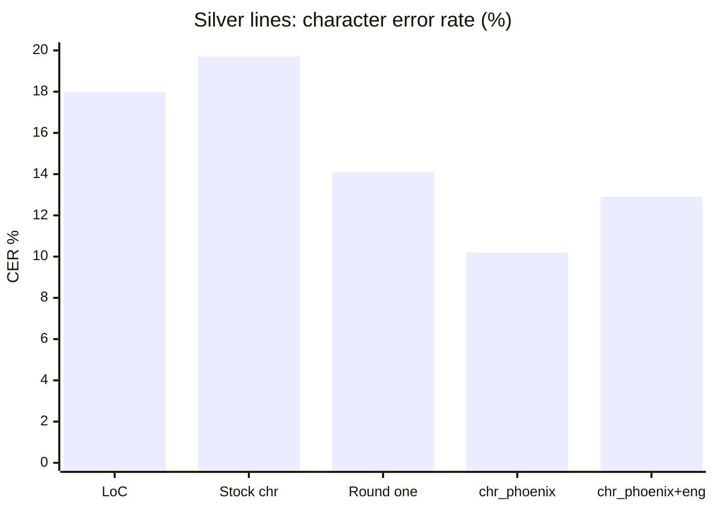
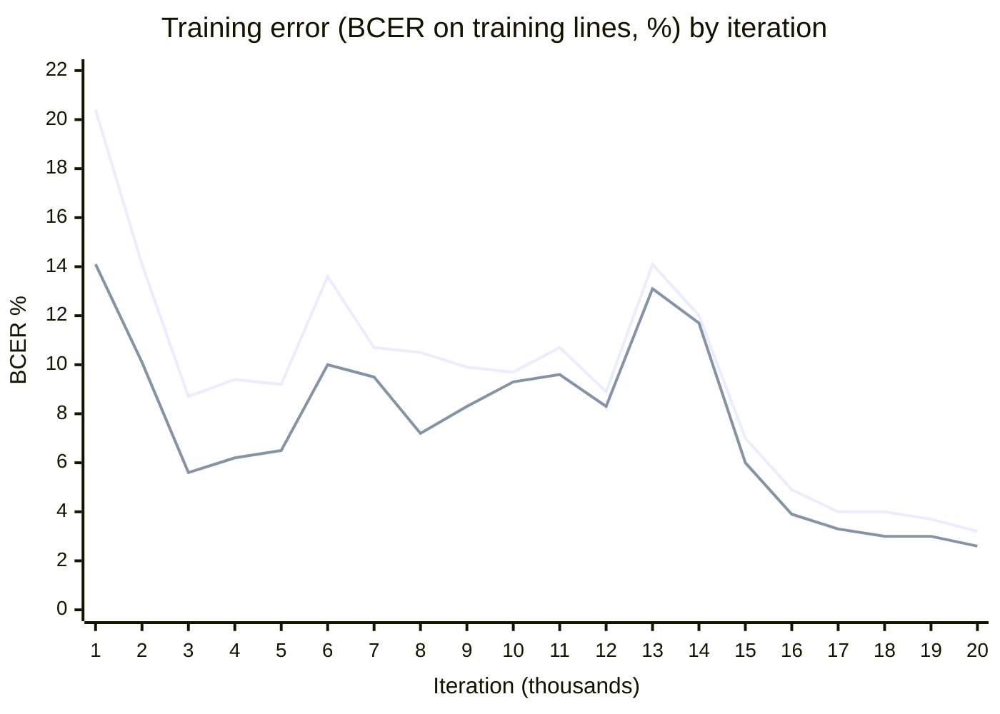

# chr-phoenix: Tesseract `chr` trained on the Cherokee Phoenix

`chr_phoenix.traineddata` is Tesseract's `chr` model fine-tuned for the Cherokee Phoenix (1828 to 1834), issue #1621. The paper was printed with the first Cherokee type, which differs from modern fonts:

- Ꮩ is printed as Λ;
- a word-initial Ꮎ is printed as a block G;
- 16 letters are Latin small capitals.

LoC's OCR misreads these letters by the hundred. On the frozen Cherokee test set the model misreads them far less often than LoC and has a lower error rate overall. **It isn't deployed yet**: the next step is a BOINC re-OCR of the pre-1835 Cherokee pages.

| File              | What it is                                                                         |
| ----------------- | ---------------------------------------------------------------------------------- |
| `NOTICE.md`       | The licence, sources, changes made and disclaimer. Ships with the model            |
| `provenance.json` | The model's sha256, the start model, the data, both training rounds and the scores |
| `SHA256SUMS`      | The sha256 of each release asset but itself                                        |
| `recipe/`         | The scripts and container that made the training data and ran the training         |

## Release

The model is the [`model-tesseract-chr-phoenix-20261109`](https://github.com/tgoodyear/usnewsmap.com/releases/tag/model-tesseract-chr-phoenix-20261109) release's assets, not a file in the repository:

| Asset                     | What it is                                                                                            |
| ------------------------- | ----------------------------------------------------------------------------------------------------- |
| `chr_phoenix.traineddata` | The model, sha256 `88eb101611962ec6b6b421985203aa6722849da6b7350197e11ce2c0ff71f7f8`, 2,516,527 bytes |
| `NOTICE.md`               | As committed here                                                                                     |
| `LICENSE-Apache-2.0.txt`  | tessdata_best's `LICENSE`, which covers the start model and this one                                  |
| `provenance.json`         | As committed here                                                                                     |
| `recipe-chr-phoenix.tar`  | `recipe/` as committed here, packed with fixed metadata                                               |
| `SHA256SUMS`              | As committed here                                                                                     |

To fetch and read with it:

```sh
gh release download model-tesseract-chr-phoenix-20261109 --repo tgoodyear/usnewsmap.com --dir chr-phoenix
(cd chr-phoenix && shasum -a 256 -c SHA256SUMS)
tesseract line.png - --psm 13 -l chr_phoenix --tessdata-dir chr-phoenix
```

Read line crops with **PSM 13** (raw line). At PSM 7, both this model and stock `chr` return nothing for 166 of the 2,160 test crops, mostly the taller ones.

## Licence

**Apache-2.0**, like the start model. The training data is public domain (LoC's scans of the paper) or CC0 (the 1860 New Testament's text). `NOTICE.md` has the sources.

## Scores

The test set is the frozen Cherokee test set v2 (#1620): 2,160 line crops from 29 Phoenix pages that no training step used. References are the New Testament verses the paper printed, aligned to LoC's lines. Silver lines are the 700 whose alignment the builder kept; the other 1,460 it flagged for a gap, reworded text or too large a difference, so their references are less certain. The 70 hand-checked lines are those whose every disputed word was settled on check.usnewsmap.com. Scores are character error rates over syllabary letters. The Tesseract runs are at PSM 13.

| Reader                        | All 2,160 lines | Silver 700 lines | Hand-checked 70 lines |
| ----------------------------- | --------------- | ---------------- | --------------------- |
| LoC's OCR                     | 34.5%           | 18.0%            | 8.4%                  |
| Stock `chr`                   | 35.8%           | 19.7%            | 12.2%                 |
| Round one                     | 30.5%           | 14.1%            | 9.7%                  |
| **`chr_phoenix`** (round two) | **27.6%**       | **10.2%**        | **6.6%**              |
| `chr_phoenix+eng`             | 29.7%           | 12.9%            | 8.9%                  |



- **Better than LoC on whole pages.** `chr_phoenix` minus LoC is −7.8 points on silver lines (95% page bootstrap −9.1 to −6.3) and −6.9 on all lines (−8.0 to −5.8). It was better on 26 of 29 pages.
- **Hand-checked lines.** It was better on 38 lines and worse on 15, at −1.8 points (line bootstrap −4.9 to +1.9). The interval includes zero, so 70 lines are too few to settle it.
- **The first type's letters.** Silver-line counts of each misreading:

  | Misreading                | LoC | `chr_phoenix` |
  | ------------------------- | --- | ------------- |
  | Ꮩ read as Ꭺ               | 192 | 17            |
  | Ꮅ read as Ꮲ               | 191 | 2             |
  | Ꮧ read as Ꮨ               | 119 | 8             |
  | Ꮎ read as Ꮾ, Ꮹ, Ꮳ, Ᏻ or Ꭷ | 155 | 7             |

  Its main remaining errors are dropped and added letters at the ends of lines.

- **Some verses may be memorised.** The synthetic lines are New Testament text, and so are the test references, so the model may know some verses' wording. On the 69 silver lines with no word pair in the synthetic text, it still beats LoC, by less: 15.6% against 20.7%.
- **`+eng` hurts.** With `eng` as a second language, Tesseract re-read low-confidence words in English and wrote 863 Latin words on test lines that have essentially none. Many of the paper's letters are Latin small capitals, so it reads Cherokee words as English. Mixed-script lines need per-word script detection (#1666) instead.
- **Not preregistered.** Round two's changes (numerals, punctuation and margin noise in training) were chosen after reading round one's errors on this test set.
- **News pages are unscored.** Every test line is scripture. The model learned the New Testament's vocabulary, so news text may gain less.

## Training

Everything ran on pve-big's CPUs in the `recipe/Containerfile` image (Debian trixie, Tesseract 5.5.0).

1. **Glyph bank.** `crates/usnm-glyphs` cut LoC's ALTO word boxes from 190 page scans and split each word LoC read as a known New Testament form into its letters. Of its 92,139 glyphs, it kept the 87,657 that agreed with their nearest neighbours on other pages. Word-initial Ꮎ is its own class. Pages of the frozen test set are excluded from everything below.

   The bank this model was trained from had two faults that have since been fixed in the crate. Glyph ids were unique only by page, word position and letter index, so 2,323 rows (2.5%) shared an id with another and 1,141 crops were overwritten by another crop of the same letter. Its cleaning also let test-page glyphs vote on which training-page glyphs to keep; `clean --exclude-manifest` now stops that. No test-page glyph was used for training, and no label was wrong, but a rebuilt bank may give slightly different lines.

2. **Real lines** (`chr_real_lines.py`). From 161 pages, it takes runs of consecutive words LoC read as New Testament forms, or that match exactly one form once one of the first type's misreadings is undone (Ꭺ read for Ꮩ; a word-initial Ꮹ/Ꮳ/Ᏻ/Ꮐ read for Ꮎ). Round two also keeps numeral and punctuation tokens inside runs. That gives 14,391 lines.
3. **Synthetic lines** (`chr_synth_lines.py`). 20,000 lines of New Testament text are set glyph by glyph from the bank and degraded like the microfilm. Round two adds verse numbers and punctuation set in DejaVu Serif, and a sliver of a glyph in some margins.
4. **Fine-tune** (`chr_finetune.sh`). The model trains with `lstmtraining --continue_from`, same character set, holding out the real lines of about one page in twenty, chosen by a hash of the page (497 lines), for lstmtraining's own evaluation:
   - Round one: 20,000 iterations from stock `chr` with the New Testament word list added, reaching a training error rate of 3.23%.
   - Round two (`round2.sh`): 20,000 more from round one, reaching 2.57%.



The upper line is round one, the lower round two. This is lstmtraining's running error on the lines it trains on, not the test set; it is noisy until about 15,000 iterations and then falls steadily in both rounds. The held-out lines (`eval.list`) were scored only a few times per run, at 8.9% to 10.2% character error.

The start model can't write the digit 4, `?` or straight quotes. Lines needing them are left out.

## What's next

1. **BOINC re-OCR** of the pre-1835 Phoenix pages, read as line crops at PSM 13. The text goes beside LoC's (layout 3) so that search keeps both.
2. **A score on news text**, from hand-checked lines on check.usnewsmap.com.
3. **A third round** whose synthetic text leaves out the test set's verses, to measure the gain without any memorised wording.
